# SAT Benchmarks

A curated, **four-format** (**Binary AIGER 1.9 `.aig.xz`**, **DIMACS `.cnf.xz`**, **[CryptoMiniSat](https://github.com/msoos/cryptominisat) `.xcnf.xz`**, and **DIMACS-ANF `.anf.xz`**) repository of **90 standalone top-level collections** (**86 SAT collections** totaling **1,040 instances** and **4,152 compressed SAT benchmark files** across all four formats, **2 MATA NFA collections** totaling **174 `.mata.xz` files**, and **2 URI-manifest collections** indexing the complete 25-year SAT Competition & SAT-Race archive plus all 97 UBC SATLIB archives, with bespoke reproducible **`diagram.svg`** vector illustrations across all **90 / 90** collections) spanning Boolean satisfiability, circuit inversion, algebraic cryptanalysis, quantum LDPC code distance, bilinear tensor decomposition & exact/modular matrix inversion, rectangle-free grid coloring, OEIS combinatorial frontiers (sorting/selection networks, Golomb rulers, van der Waerden numbers, peaceable queens, Zarankiewicz numbers, grid point patterns), Picat-SAT combinatorial encodings (VMTL, Golomb rulers, Costas arrays, MAPF, Numberlink, rectangle packing), graph theory, combinatorial chessboard puzzles, symmetry breaking, exact circuit synthesis, hardware/SHA-256 verification, finite-automata complementation, SATLIB/DIMACS classics, and SAT Competition corpora. All benchmark input files across the repository are stored xz-compressed (`.xz`) and strictly respect GitHub's `< 95 MB` per-file limit.

## Uniform Collection Layout

Every collection lives at the repository root in its own self-contained directory (`<collection>/`) with **zero** benchmark files at collection root:

- **`README.md`** — Uniform 6-section page layout across all **90 / 90** collections: hero `diagram.svg` figure immediately below the title, followed by `## Provenance & Credit` (with `- **Recommended by:**` last when present), `## Problem Description`, `## Corpus & Data Sizes`, `## Benchmark Results` (Frobenius 1C, [CaDiCaL](https://github.com/arminbiere/cadical) 3.1.0, [CryptoMiniSat](https://github.com/msoos/cryptominisat) 5.18.0, [dense-solver](https://github.com/libdense/dense-solver) 0.0.4, [Kissat](https://github.com/arminbiere/kissat) 4.0.4, plus [`cake_lpr`](https://github.com/tanyongkiam/cake_lpr) / [`lrat-check`](https://github.com/marijnheule/drat-trim) certification), `## Phase-Transition & Structural Analysis` (or `## Automata Structural Analysis`), and `## References`.
- **`diagram.svg`** + **`src/gen_diagram.py`** — Reproducible bespoke vector illustration across all **90 / 90** collections, generated directly from real benchmark instances or problem geometry.
- **`expected.tsv`** — Top-level 2-column ground-truth verdict manifest (`<instance_without_.xz>\t<SAT|UNSAT|UNKNOWN>`, no header, sorted alphabetically by instance name) across **89 / 90** collections (**21,439 rows**: `8,587 SAT / 6,193 UNSAT / 6,659 UNKNOWN`), covering 1-to-1 every file in `*-orig/` (flat relative POSIX paths such as `sortnet_n11_d7.cnf`, `bar.aig`, `w5.solved.xcnf`, `ARI056_1.mata`, plus `<hash>.cnf` entries for URI-only instance corpora and complementation verdicts for MATA NFAs), programmatically validated by [`src/verify_expected.py`](src/verify_expected.py).
- **`<orig-fmt>-orig/`** — Native original compressed files directly inside: `aig-orig/` (9 collections, 52 instances), `cnf-orig/` (76 collections, 986 instances), `xcnf-orig/` (1 collection, 2 instances), or `mata-orig/` (2 NFA collections, 174 automata).
- **`<conv-fmt>-converted/`** — Exact lossless conversions for all remaining SAT formats directly inside (with any `> 95 MB` GitHub-limit omissions explicitly documented in `<collection>/format_exclusions.tsv` and validated by [`src/verify_expected.py`](src/verify_expected.py)):
  - `aig-converted/` (or `aig-orig/`): **1,036 / 1,040** **Binary AIGER 1.9** (`L = 0`, `O = 1` combinational miter where `PO_0 = 1` iff SAT; `213.50 MB` total, verified with [Berkeley **ABC**](https://github.com/berkeley-abc/abc) `read_aiger`, `0` errors; 4 largest `guillochon-oeis-a067782-sortnet` files `> 95 MB` omitted per [`format_exclusions.tsv`](guillochon-oeis-a067782-sortnet/format_exclusions.tsv)).
  - `cnf-converted/` (or `cnf-orig/`): **1,040 / 1,040** **DIMACS `.cnf.xz`** (`367.19 MB` total).
  - `xcnf-converted/` (or `xcnf-orig/`): **1,040 / 1,040** **[CryptoMiniSat](https://github.com/msoos/cryptominisat) `.xcnf.xz`** (`346.87 MB` total, with complete $2^{k-1}$-clause XOR parity blocks collapsed losslessly to native `x l1 ... lk 0` lines).
  - `anf-converted/`: **1,036 / 1,040** **DIMACS-ANF `.anf.xz`** (`346.84 MB` total, linear-size degree-$\le 2$ from `aig-orig/` and degree-$\le 3$ from `xcnf-orig/` / `xcnf-converted/`, generated via [`src/to_anf.py`](src/to_anf.py); same 4 `> 95 MB` `guillochon-oeis-a067782-sortnet` files omitted per [`format_exclusions.tsv`](guillochon-oeis-a067782-sortnet/format_exclusions.tsv)).
- **`src/`** — Standalone generator, exporter, fetcher, diagram, or converter source code (alongside repository-wide [`src/to_anf.py`](src/to_anf.py), [`src/analyze_benchmarks.py`](src/analyze_benchmarks.py), and [`src/verify_expected.py`](src/verify_expected.py)).

## Benchmark Collections (90 Collections)

<table cellpadding="12" cellspacing="0">
  <tr>
    <td width="25%" align="center" valign="top">
      <a href="aloul-dac02-bench/README.md">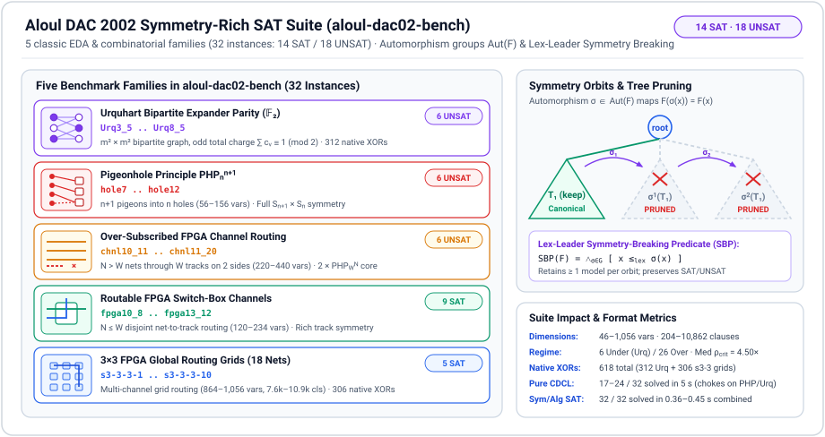</a>  
      <a href="aloul-dac02-bench/README.md"><b>Aloul DAC 2002 Symmetry Benchmarks</b></a> 
      <code>aloul-dac02-bench</code>
    </td>
    <td width="25%" align="center" valign="top">
      <a href="aloul-difp-a/README.md">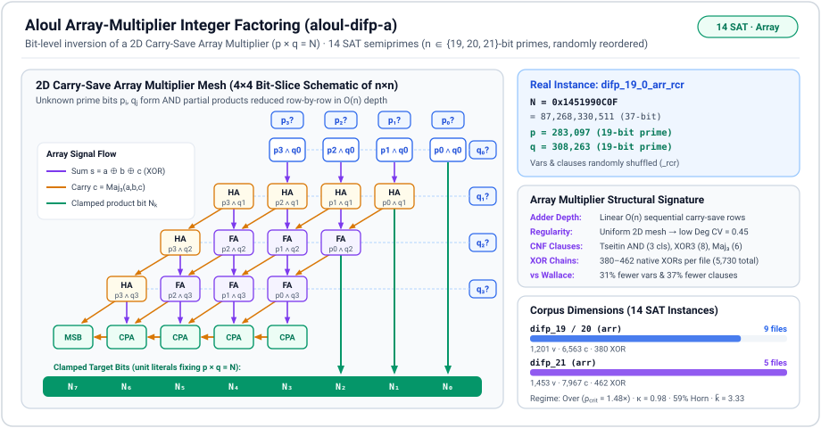</a>  
      <a href="aloul-difp-a/README.md"><b>Aloul Array-Multiplier Integer Factoring Benchmarks</b></a> 
      <code>aloul-difp-a</code>
    </td>
    <td width="25%" align="center" valign="top">
      <a href="aloul-difp-w/README.md">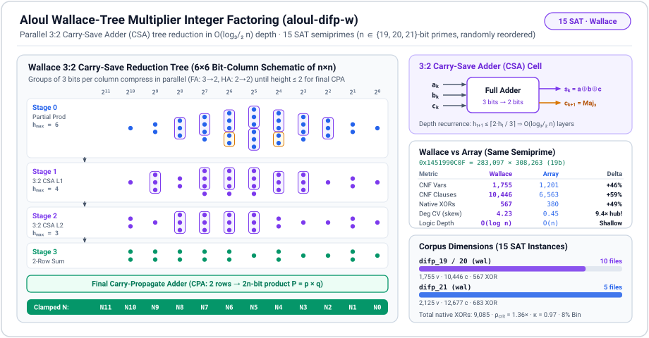</a>  
      <a href="aloul-difp-w/README.md"><b>Aloul Wallace-Multiplier Integer Factoring Benchmarks</b></a> 
      <code>aloul-difp-w</code>
    </td>
    <td width="25%" align="center" valign="top">
      <a href="aloul-fpga-sb-sat/README.md">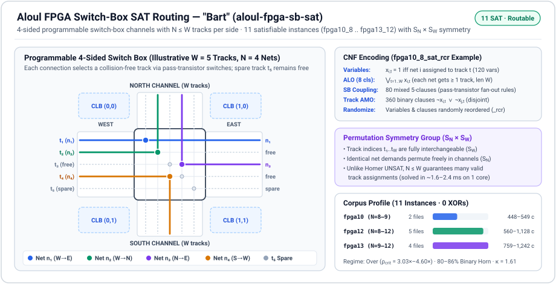</a>  
      <a href="aloul-fpga-sb-sat/README.md"><b>Aloul FPGA Switch-Box SAT Benchmarks — "Bart"</b></a> 
      <code>aloul-fpga-sb-sat</code>
    </td>
  </tr>
  <tr>
    <td width="25%" align="center" valign="top">
      <a href="aloul-fpga-sb-uns/README.md">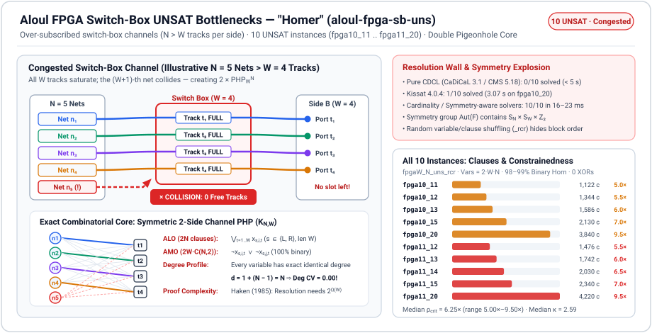</a>  
      <a href="aloul-fpga-sb-uns/README.md"><b>Aloul FPGA Switch-Box UNSAT Benchmarks — "Homer"</b></a> 
      <code>aloul-fpga-sb-uns</code>
    </td>
    <td width="25%" align="center" valign="top">
      <a href="brewbaker-golomb-rulers/README.md">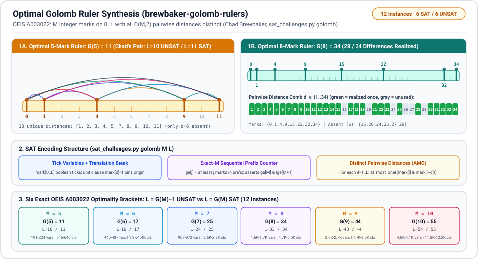</a>  
      <a href="brewbaker-golomb-rulers/README.md"><b>Optimal Golomb Ruler Synthesis</b></a> 
      <code>brewbaker-golomb-rulers</code>
    </td>
    <td width="25%" align="center" valign="top">
      <a href="brewbaker-select-networks/README.md">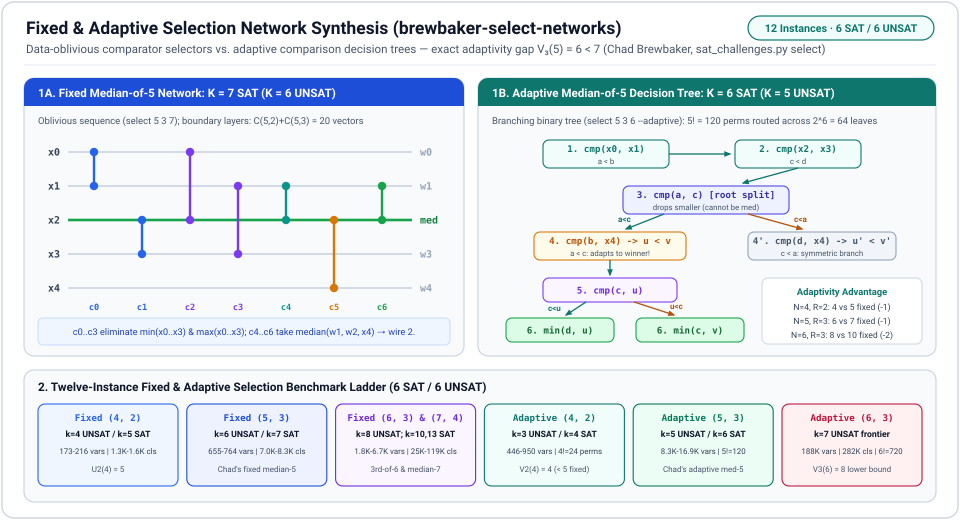</a>  
      <a href="brewbaker-select-networks/README.md"><b>Fixed &amp; Adaptive Selection Network Synthesis</b></a> 
      <code>brewbaker-select-networks</code>
    </td>
    <td width="25%" align="center" valign="top">
      <a href="brewbaker-sha256-cec/README.md">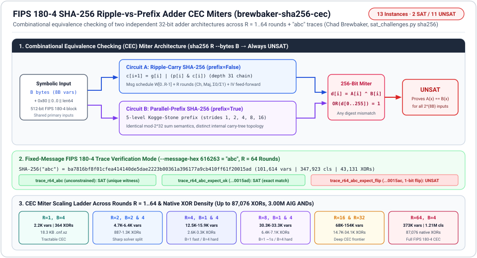</a>  
      <a href="brewbaker-sha256-cec/README.md"><b>FIPS 180-4 SHA-256 Ripple-vs-Prefix Adder CEC Miters</b></a> 
      <code>brewbaker-sha256-cec</code>
    </td>
  </tr>
  <tr>
    <td width="25%" align="center" valign="top">
      <a href="brewbaker-sort-networks/README.md">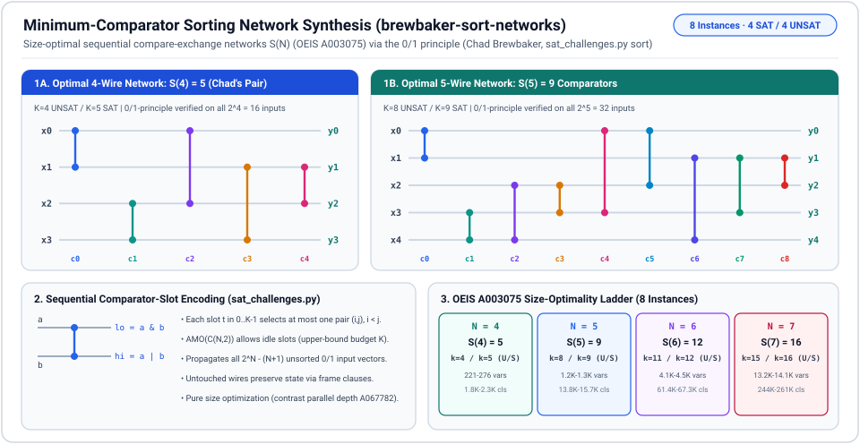</a>  
      <a href="brewbaker-sort-networks/README.md"><b>Minimum-Comparator Sorting Network Synthesis</b></a> 
      <code>brewbaker-sort-networks</code>
    </td>
    <td width="25%" align="center" valign="top">
      <a href="brewbaker-tensor-cross/README.md">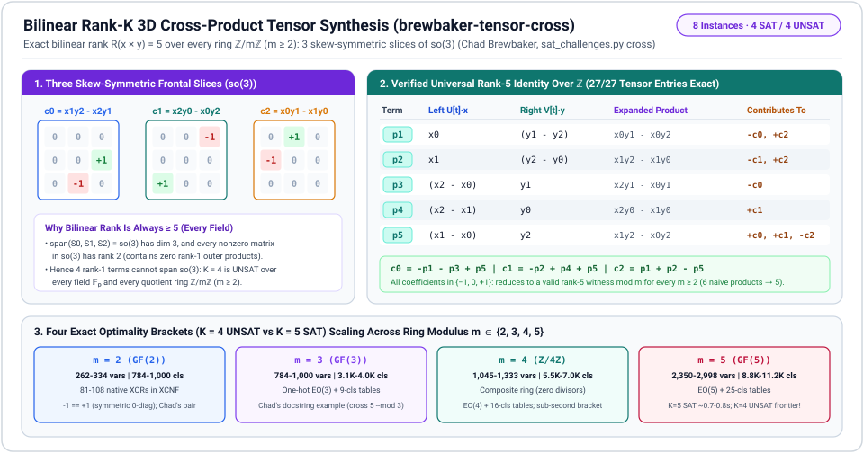</a>  
      <a href="brewbaker-tensor-cross/README.md"><b>Bilinear Rank-<i>K</i> 3D Cross-Product Tensor Synthesis</b></a> 
      <code>brewbaker-tensor-cross</code>
    </td>
    <td width="25%" align="center" valign="top">
      <a href="brewbaker-tensor-dot/README.md">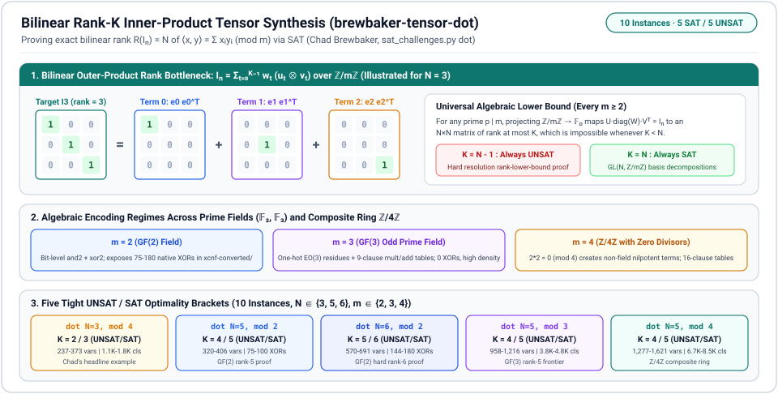</a>  
      <a href="brewbaker-tensor-dot/README.md"><b>Bilinear Rank-<i>K</i> Inner-Product Tensor Synthesis</b></a> 
      <code>brewbaker-tensor-dot</code>
    </td>
    <td width="25%" align="center" valign="top">
      <a href="brewbaker-tensor-matmul/README.md">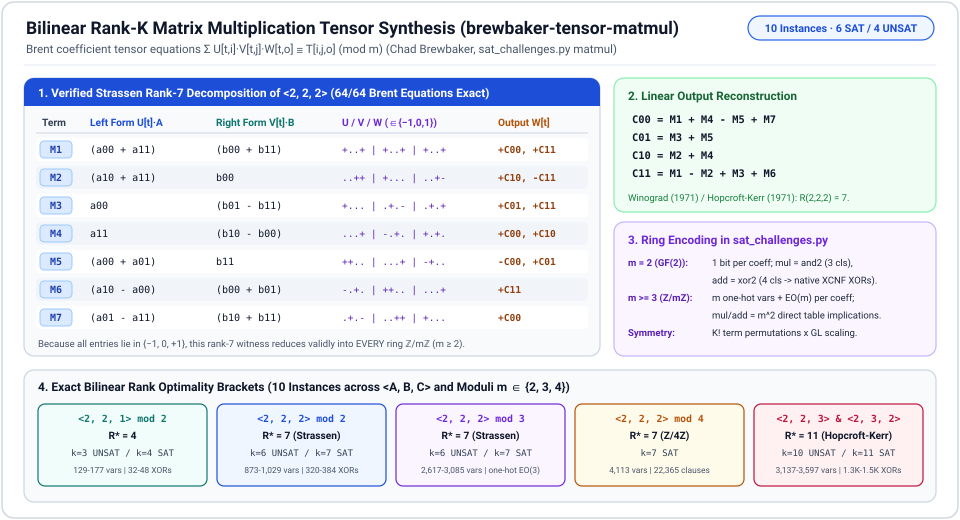</a>  
      <a href="brewbaker-tensor-matmul/README.md"><b>Bilinear Rank-<i>K</i> Matrix Multiplication Tensor Synthesis</b></a> 
      <code>brewbaker-tensor-matmul</code>
    </td>
  </tr>
  <tr>
    <td width="25%" align="center" valign="top">
      <a href="cec-arithmetic-miters/README.md">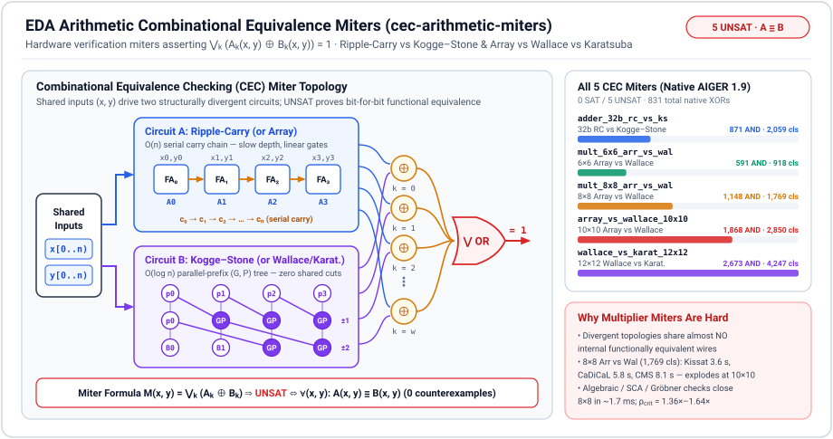</a>  
      <a href="cec-arithmetic-miters/README.md"><b>EDA Arithmetic Combinational Equivalence Checking (CEC) Miters</b></a> 
      <code>cec-arithmetic-miters</code>
    </td>
    <td width="25%" align="center" valign="top">
      <a href="coupled-linear-nonlinear/README.md">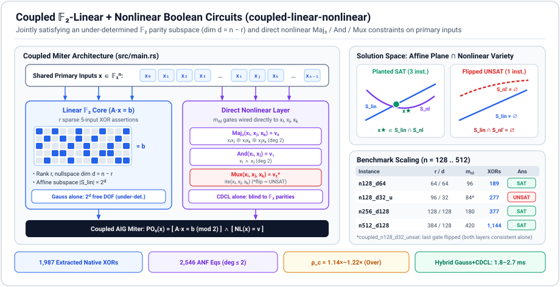</a>  
      <a href="coupled-linear-nonlinear/README.md"><b>Coupled Linear + Nonlinear Circuits</b></a> 
      <code>coupled-linear-nonlinear</code>
    </td>
    <td width="25%" align="center" valign="top">
      <a href="davies-rectangle-free-27/README.md">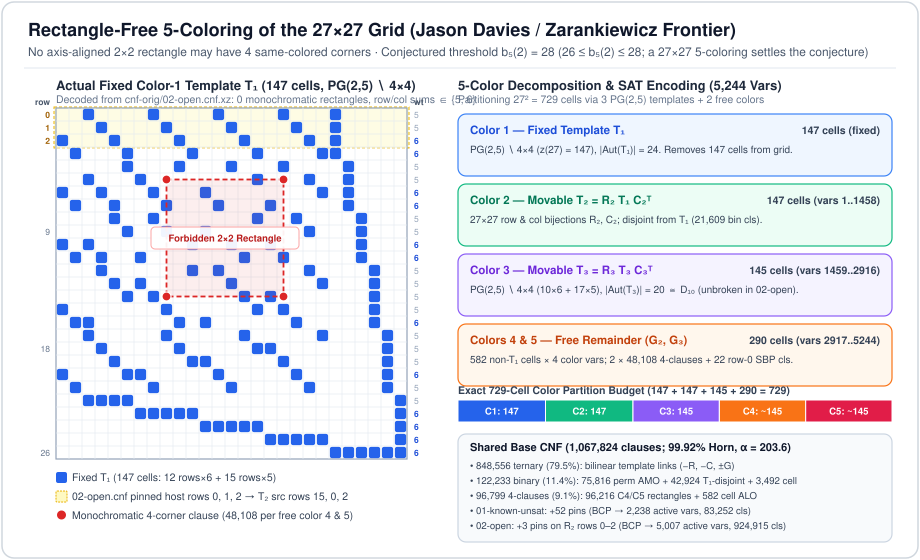</a>  
      <a href="davies-rectangle-free-27/README.md"><b>Rectangle-Free 5-Coloring of the 27×27 Grid</b></a> 
      <code>davies-rectangle-free-27</code>
    </td>
    <td width="25%" align="center" valign="top">
      <a href="dense-solver-public/README.md">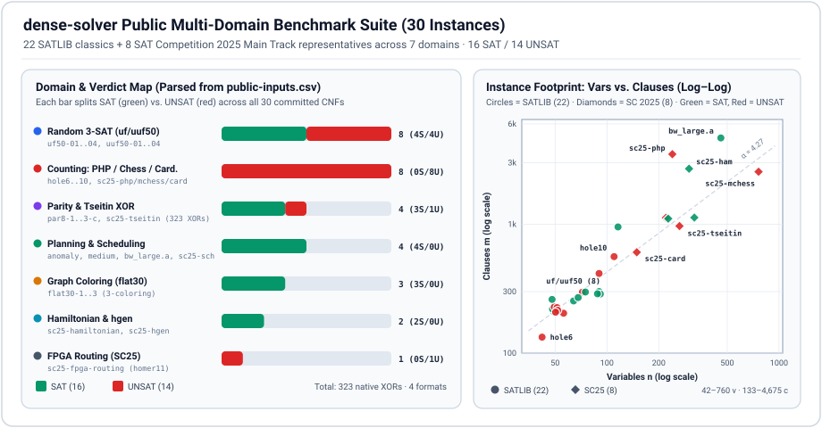</a>  
      <a href="dense-solver-public/README.md"><b>dense-solver Public SAT Benchmarks</b></a> 
      <code>dense-solver-public</code>
    </td>
  </tr>
  <tr>
    <td width="25%" align="center" valign="top">
      <a href="dense-solver-synthetic-chessboard/README.md">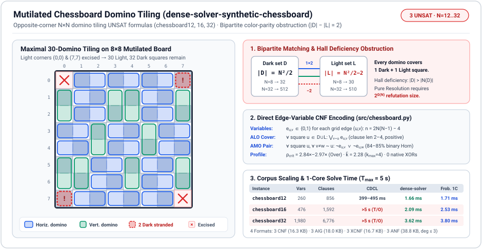</a>  
      <a href="dense-solver-synthetic-chessboard/README.md"><b>dense-solver Synthetic Mutilated Chessboard Tiling Benchmarks</b></a> 
      <code>dense-solver-synthetic-chessboard</code>
    </td>
    <td width="25%" align="center" valign="top">
      <a href="dense-solver-synthetic-php/README.md">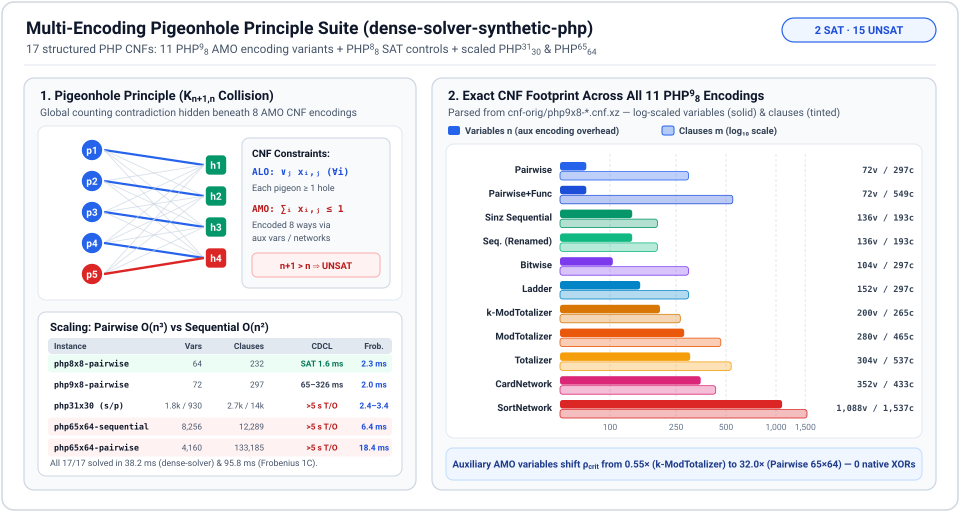</a>  
      <a href="dense-solver-synthetic-php/README.md"><b>dense-solver Synthetic Multi-Encoding Pigeonhole Principle Benchmarks</b></a> 
      <code>dense-solver-synthetic-php</code>
    </td>
    <td width="25%" align="center" valign="top">
      <a href="f2-frobenius-circulants/README.md">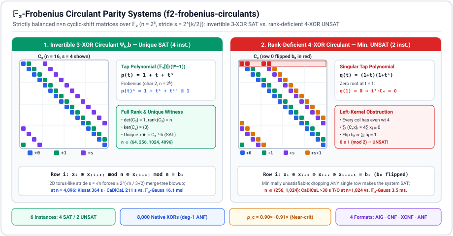</a>  
      <a href="f2-frobenius-circulants/README.md"><b>𝔽2-Frobenius Circulants</b></a> 
      <code>f2-frobenius-circulants</code>
    </td>
    <td width="25%" align="center" valign="top">
      <a href="fede-intern-challenge/README.md">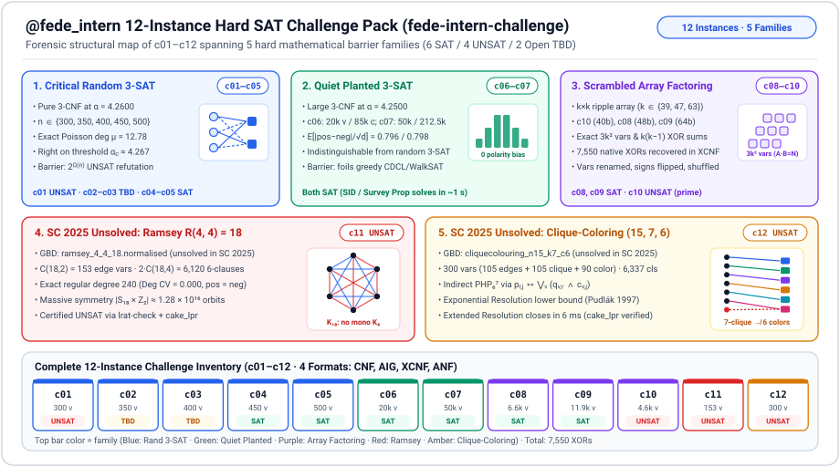</a>  
      <a href="fede-intern-challenge/README.md"><b>@fede_intern 12-Instance Hard SAT Challenge Pack</b></a> 
      <code>fede-intern-challenge</code>
    </td>
  </tr>
  <tr>
    <td width="25%" align="center" valign="top">
      <a href="guillochon-oeis-a067782-sortnet/README.md">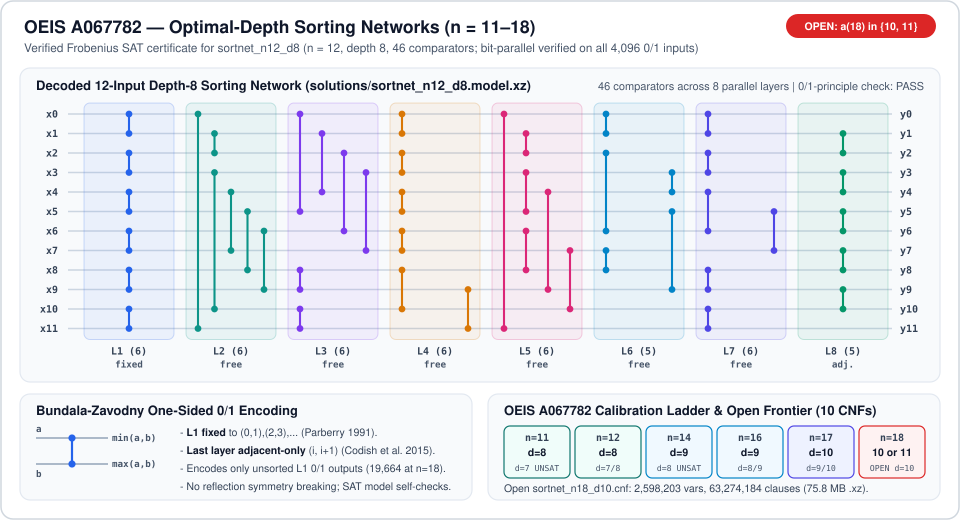</a>  
      <a href="guillochon-oeis-a067782-sortnet/README.md"><b>OEIS A067782 — Optimal-Depth Sorting Networks</b></a> 
      <code>guillochon-oeis-a067782-sortnet</code>
    </td>
    <td width="25%" align="center" valign="top">
      <a href="guillochon-oeis-a171081-vdw/README.md">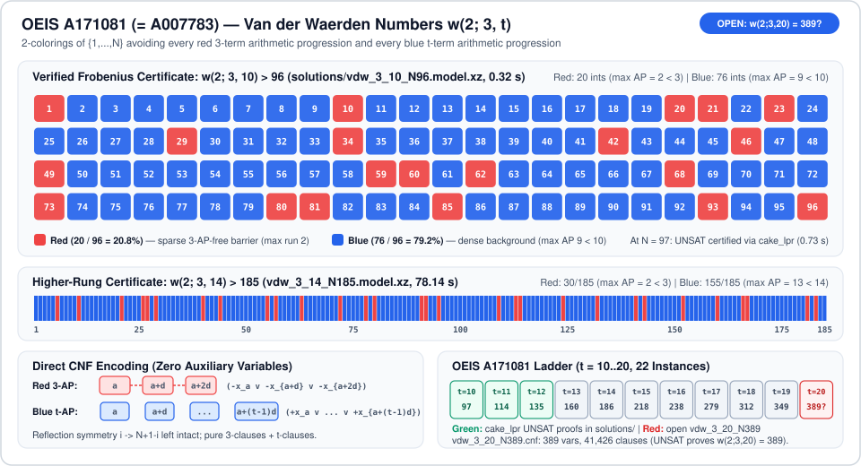</a>  
      <a href="guillochon-oeis-a171081-vdw/README.md"><b>OEIS A171081 / A007783 — Van der Waerden Numbers <i>w</i>(2; 3, <i>t</i>)</b></a> 
      <code>guillochon-oeis-a171081-vdw</code>
    </td>
    <td width="25%" align="center" valign="top">
      <a href="guillochon-oeis-a250000-queens/README.md">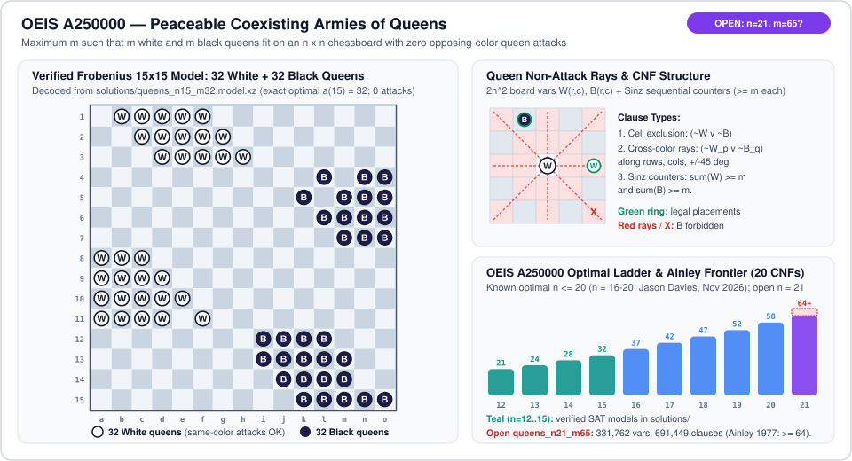</a>  
      <a href="guillochon-oeis-a250000-queens/README.md"><b>OEIS A250000 — Peaceable Coexisting Armies of Queens</b></a> 
      <code>guillochon-oeis-a250000-queens</code>
    </td>
    <td width="25%" align="center" valign="top">
      <a href="guillochon-oeis-a350304-zarankiewicz/README.md">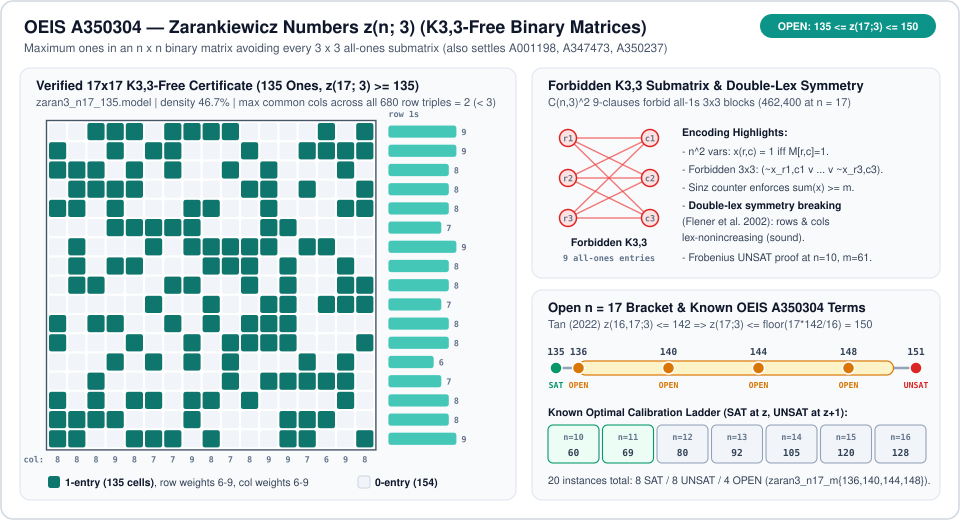</a>  
      <a href="guillochon-oeis-a350304-zarankiewicz/README.md"><b>OEIS A350304 — Zarankiewicz Numbers <i>z</i>(<i>n</i>; 3) (<i>K</i>3,3-Free Binary Matrices)</b></a> 
      <code>guillochon-oeis-a350304-zarankiewicz</code>
    </td>
  </tr>
  <tr>
    <td width="25%" align="center" valign="top">
      <a href="guillochon-oeis-grid-sq-any/README.md">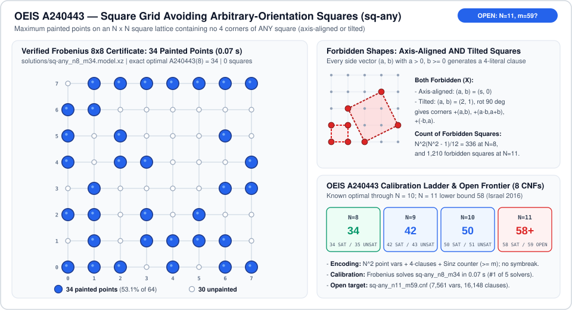</a>  
      <a href="guillochon-oeis-grid-sq-any/README.md"><b>OEIS A240443 — Square-Grid No-Arbitrary-Square</b></a> 
      <code>guillochon-oeis-grid-sq-any</code>
    </td>
    <td width="25%" align="center" valign="top">
      <a href="guillochon-oeis-grid-sq-axis/README.md">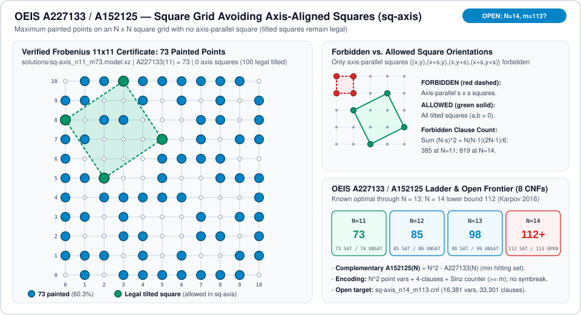</a>  
      <a href="guillochon-oeis-grid-sq-axis/README.md"><b>OEIS A227133 / A152125 — Square-Grid No-Axis-Aligned-Square</b></a> 
      <code>guillochon-oeis-grid-sq-axis</code>
    </td>
    <td width="25%" align="center" valign="top">
      <a href="guillochon-oeis-grid-tri-any/README.md">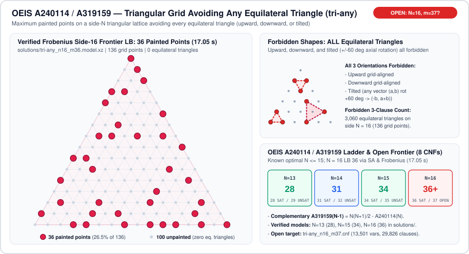</a>  
      <a href="guillochon-oeis-grid-tri-any/README.md"><b>OEIS A240114 / A319159 — Triangular-Grid No-Arbitrary-Equilateral-Triangle</b></a> 
      <code>guillochon-oeis-grid-tri-any</code>
    </td>
    <td width="25%" align="center" valign="top">
      <a href="guillochon-oeis-grid-tri-axis/README.md">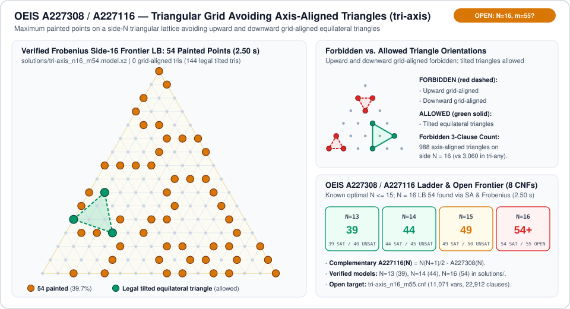</a>  
      <a href="guillochon-oeis-grid-tri-axis/README.md"><b>OEIS A227308 / A227116 — Triangular-Grid No-Axis-Aligned-Equilateral-Triangle</b></a> 
      <code>guillochon-oeis-grid-tri-axis</code>
    </td>
  </tr>
  <tr>
    <td width="25%" align="center" valign="top">
      <a href="guillochon-oeis-grid-tri-up/README.md">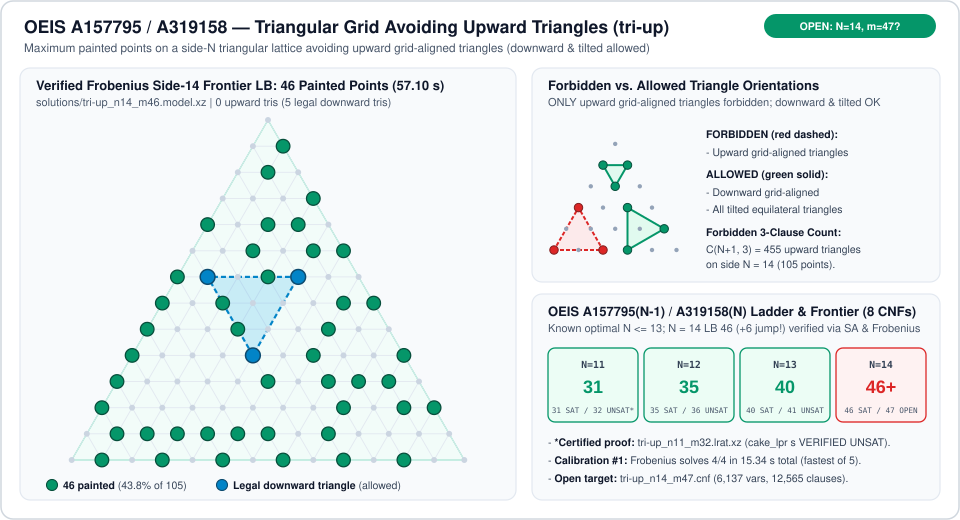</a>  
      <a href="guillochon-oeis-grid-tri-up/README.md"><b>OEIS A157795 / A319158 — Triangular-Grid No-Upward-Equilateral-Triangle</b></a> 
      <code>guillochon-oeis-grid-tri-up</code>
    </td>
    <td width="25%" align="center" valign="top">
      <a href="hamd-hamiltonian-cycle/README.md">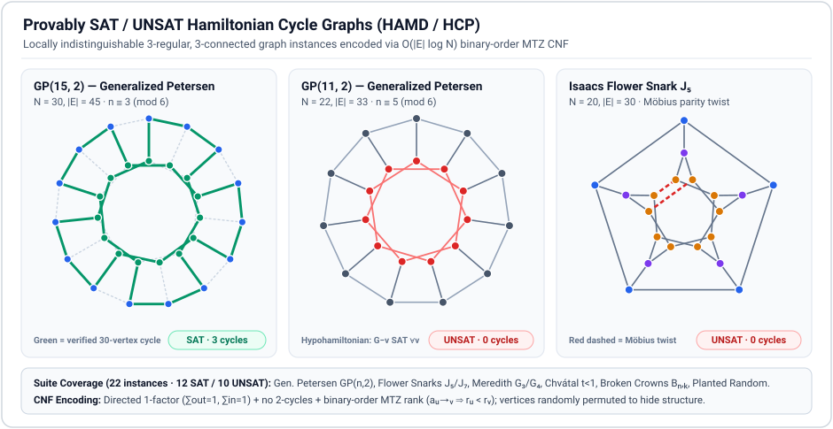</a>  
      <a href="hamd-hamiltonian-cycle/README.md"><b>Provably SAT/UNSAT Hamiltonian Cycle (HAMD / HCP) Benchmarks</b></a> 
      <code>hamd-hamiltonian-cycle</code>
    </td>
    <td width="25%" align="center" valign="top">
      <a href="hard-spn/README.md">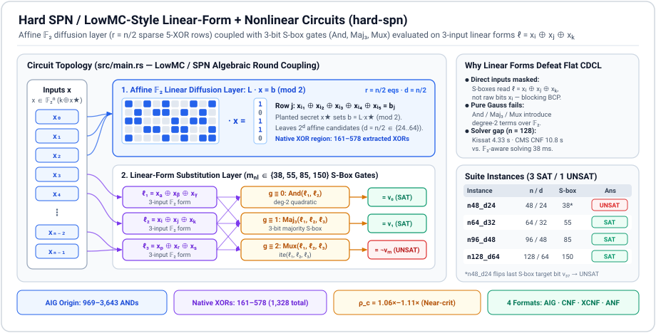</a>  
      <a href="hard-spn/README.md"><b>Hard SPN / LowMC-Style Linear-Form + Nonlinear Circuits</b></a> 
      <code>hard-spn</code>
    </td>
    <td width="25%" align="center" valign="top">
      <a href="heule-matrix-6pooled3and-c1/README.md">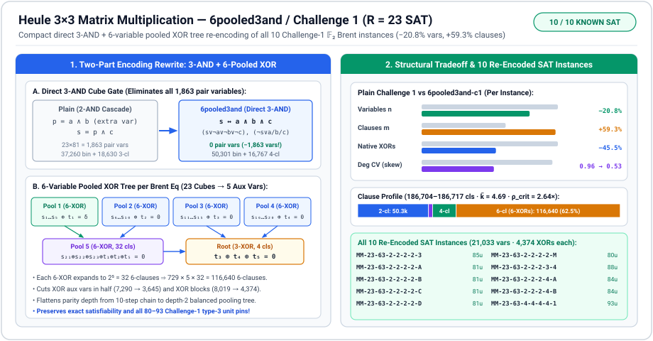</a>  
      <a href="heule-matrix-6pooled3and-c1/README.md"><b>Heule 3×3 Matrix Multiplication — 6pooled3and/challenge1</b></a> 
      <code>heule-matrix-6pooled3and-c1</code>
    </td>
  </tr>
  <tr>
    <td width="25%" align="center" valign="top">
      <a href="heule-matrix-6pooled3and-c3/README.md">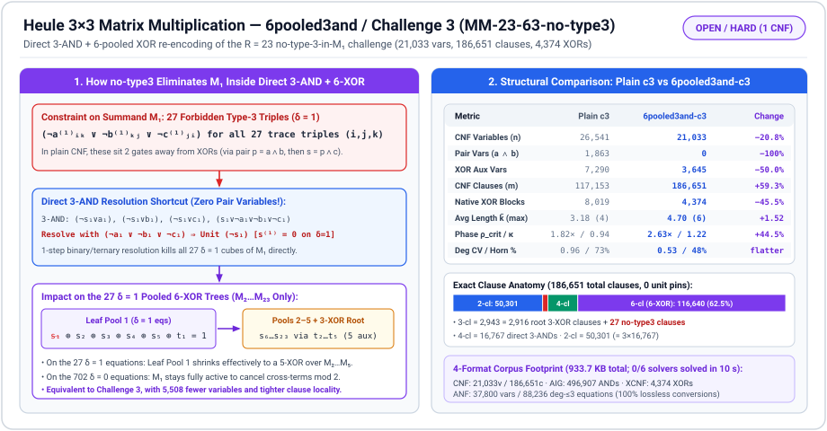</a>  
      <a href="heule-matrix-6pooled3and-c3/README.md"><b>Heule 3×3 Matrix Multiplication — 6pooled3and/challenge3</b></a> 
      <code>heule-matrix-6pooled3and-c3</code>
    </td>
    <td width="25%" align="center" valign="top">
      <a href="heule-matrix-6pooled3and-c4/README.md">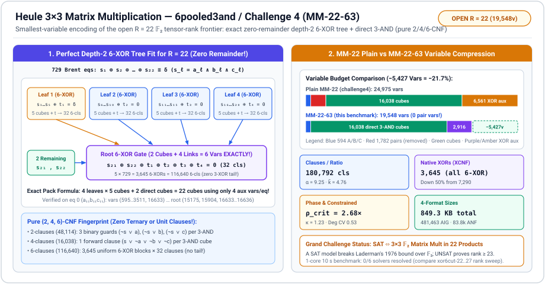</a>  
      <a href="heule-matrix-6pooled3and-c4/README.md"><b>Heule 3×3 Matrix Multiplication — 6pooled3and/challenge4</b></a> 
      <code>heule-matrix-6pooled3and-c4</code>
    </td>
    <td width="25%" align="center" valign="top">
      <a href="heule-matrix-challenge1/README.md">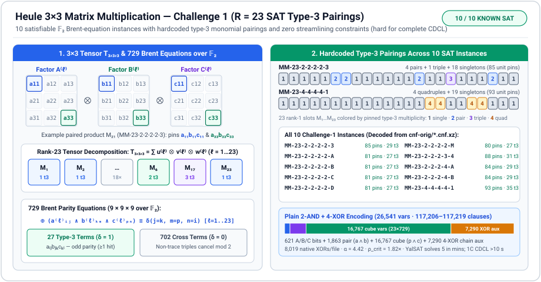</a>  
      <a href="heule-matrix-challenge1/README.md"><b>Heule 3×3 Matrix Multiplication — Challenge 1</b></a> 
      <code>heule-matrix-challenge1</code>
    </td>
    <td width="25%" align="center" valign="top">
      <a href="heule-matrix-challenge2/README.md">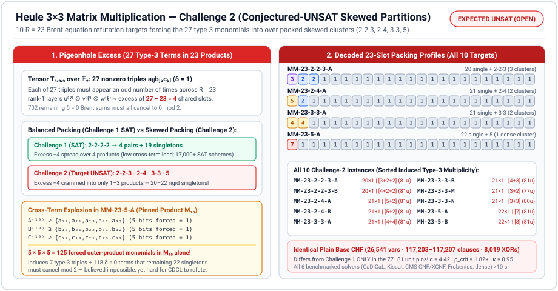</a>  
      <a href="heule-matrix-challenge2/README.md"><b>Heule 3×3 Matrix Multiplication — Challenge 2</b></a> 
      <code>heule-matrix-challenge2</code>
    </td>
  </tr>
  <tr>
    <td width="25%" align="center" valign="top">
      <a href="heule-matrix-challenge3/README.md">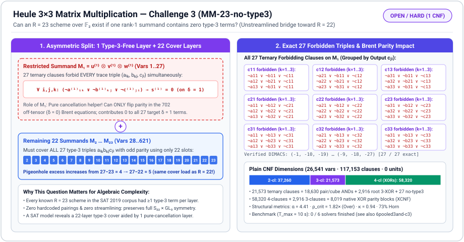</a>  
      <a href="heule-matrix-challenge3/README.md"><b>Heule 3×3 Matrix Multiplication — Challenge 3</b></a> 
      <code>heule-matrix-challenge3</code>
    </td>
    <td width="25%" align="center" valign="top">
      <a href="heule-matrix-challenge4/README.md">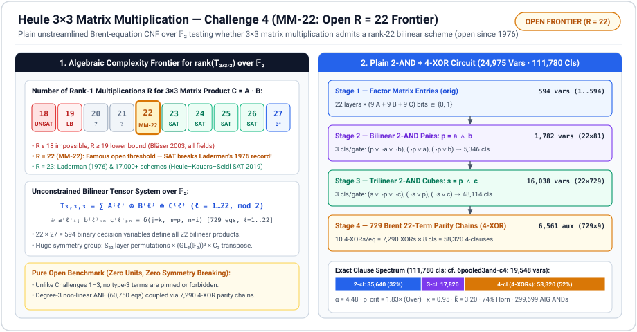</a>  
      <a href="heule-matrix-challenge4/README.md"><b>Heule 3×3 Matrix Multiplication — Challenge 4</b></a> 
      <code>heule-matrix-challenge4</code>
    </td>
    <td width="25%" align="center" valign="top">
      <a href="heule-matrix-fraction/README.md">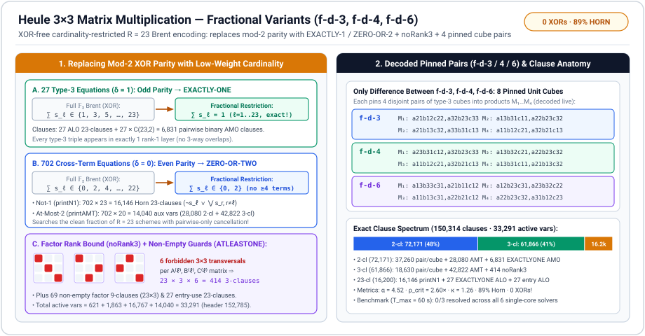</a>  
      <a href="heule-matrix-fraction/README.md"><b>Heule 3×3 Matrix Multiplication — Fractional Variants</b></a> 
      <code>heule-matrix-fraction</code>
    </td>
    <td width="25%" align="center" valign="top">
      <a href="heule-matrix-xor6cut/README.md">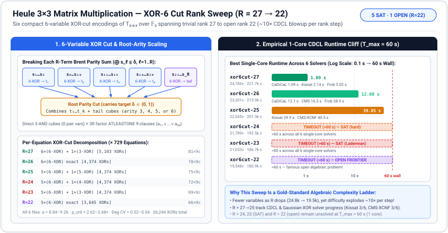</a>  
      <a href="heule-matrix-xor6cut/README.md"><b>Heule 3×3 Matrix Multiplication — XOR-6 Cut Encodings</b></a> 
      <code>heule-matrix-xor6cut</code>
    </td>
  </tr>
  <tr>
    <td width="25%" align="center" valign="top">
      <a href="integer-factoring/README.md">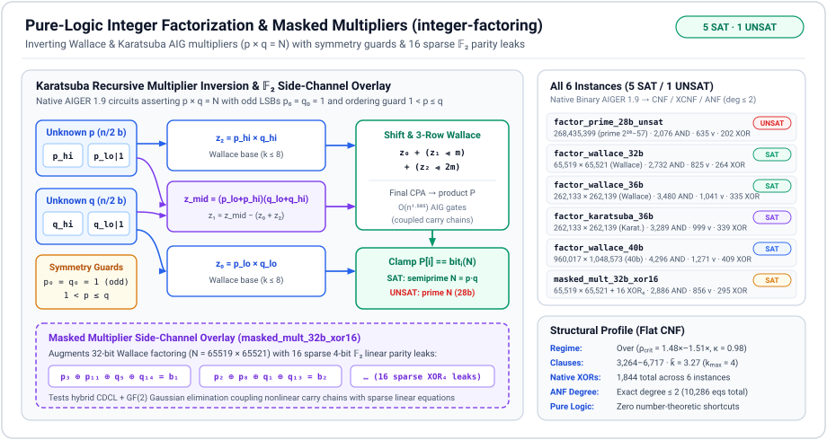</a>  
      <a href="integer-factoring/README.md"><b>Pure-Logic Integer Factorization &amp; Masked Multiplier Circuits</b></a> 
      <code>integer-factoring</code>
    </td>
    <td width="25%" align="center" valign="top">
      <a href="knights-tour-obstacles/README.md">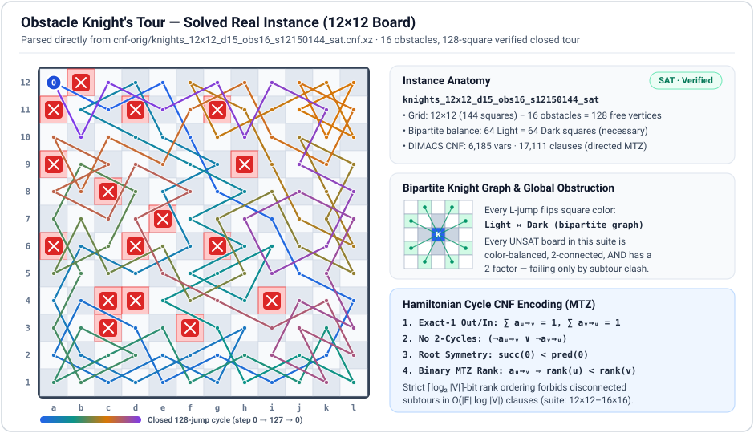</a>  
      <a href="knights-tour-obstacles/README.md"><b>Obstacle Knight's Tour — Hamiltonian Cycle on Punched Chessboards</b></a> 
      <code>knights-tour-obstacles</code>
    </td>
    <td width="25%" align="center" valign="top">
      <a href="mata-presburger-nfa-tptp/README.md">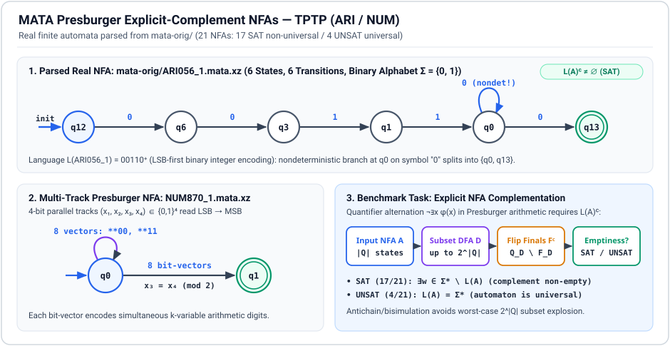</a>  
      <a href="mata-presburger-nfa-tptp/README.md"><b>MATA Presburger Explicit-Complement NFA Benchmarks — TPTP</b></a> 
      <code>mata-presburger-nfa-tptp</code>
    </td>
    <td width="25%" align="center" valign="top">
      <a href="mata-presburger-nfa-ultimate-automizer/README.md">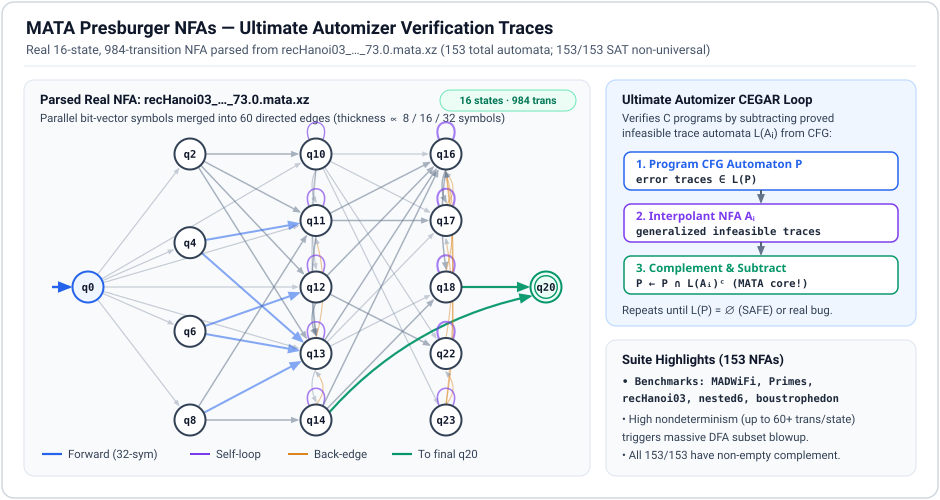</a>  
      <a href="mata-presburger-nfa-ultimate-automizer/README.md"><b>MATA Presburger Explicit-Complement NFA Benchmarks — Ultimate Automizer</b></a> 
      <code>mata-presburger-nfa-ultimate-automizer</code>
    </td>
  </tr>
  <tr>
    <td width="25%" align="center" valign="top">
      <a href="mod-circuit-sat/README.md">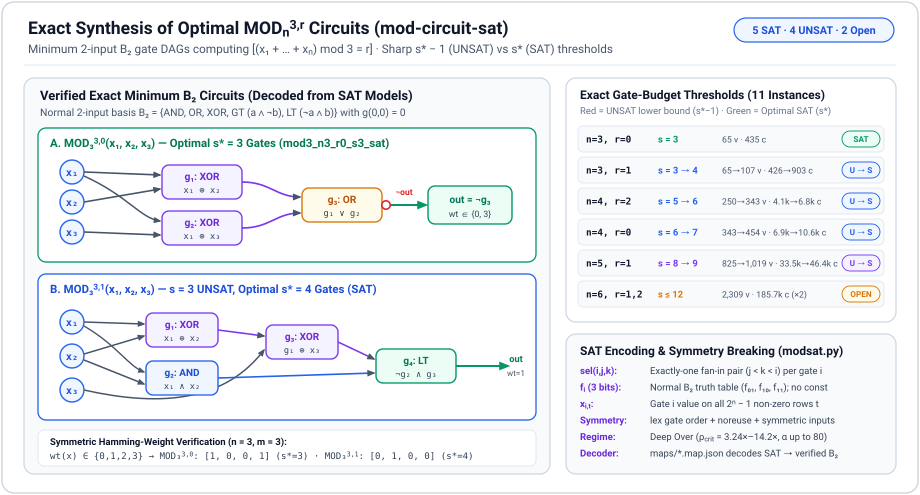</a>  
      <a href="mod-circuit-sat/README.md"><b>Exact Synthesis of Optimal MOD<i>n</i>3,<i>r</i> Boolean Circuits</b></a> 
      <code>mod-circuit-sat</code>
    </td>
    <td width="25%" align="center" valign="top">
      <a href="picat-costas-arrays/README.md">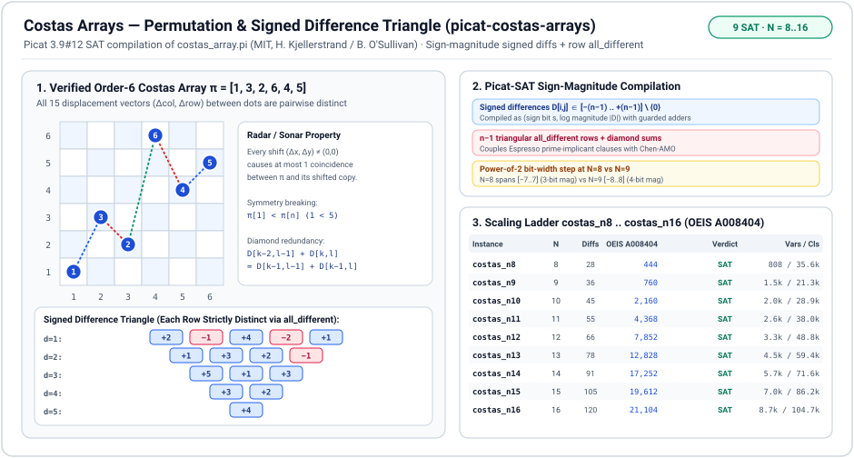</a>  
      <a href="picat-costas-arrays/README.md"><b>Costas Arrays</b></a> 
      <code>picat-costas-arrays</code>
    </td>
    <td width="25%" align="center" valign="top">
      <a href="picat-golomb-rulers/README.md">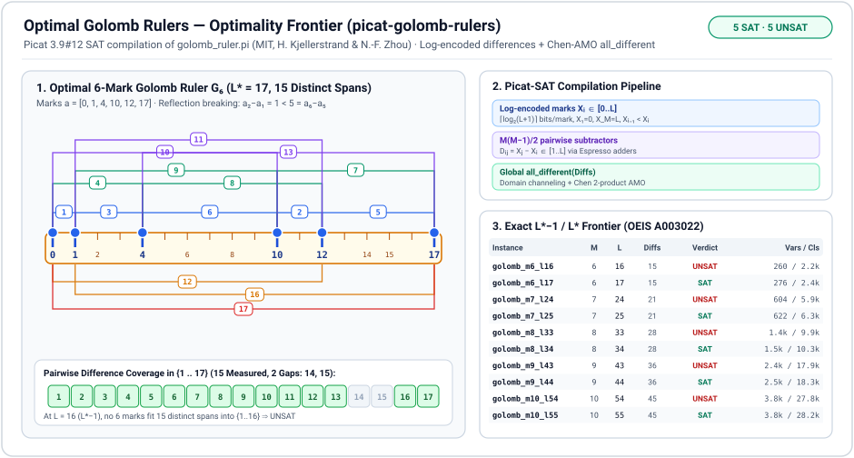</a>  
      <a href="picat-golomb-rulers/README.md"><b>Optimal Golomb Rulers</b></a> 
      <code>picat-golomb-rulers</code>
    </td>
    <td width="25%" align="center" valign="top">
      <a href="picat-mapf/README.md">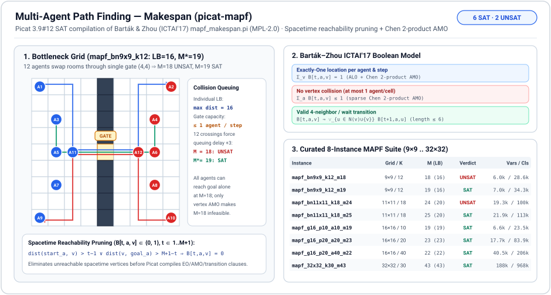</a>  
      <a href="picat-mapf/README.md"><b>Multi-Agent Path Finding — Makespan</b></a> 
      <code>picat-mapf</code>
    </td>
  </tr>
  <tr>
    <td width="25%" align="center" valign="top">
      <a href="picat-numberlink/README.md">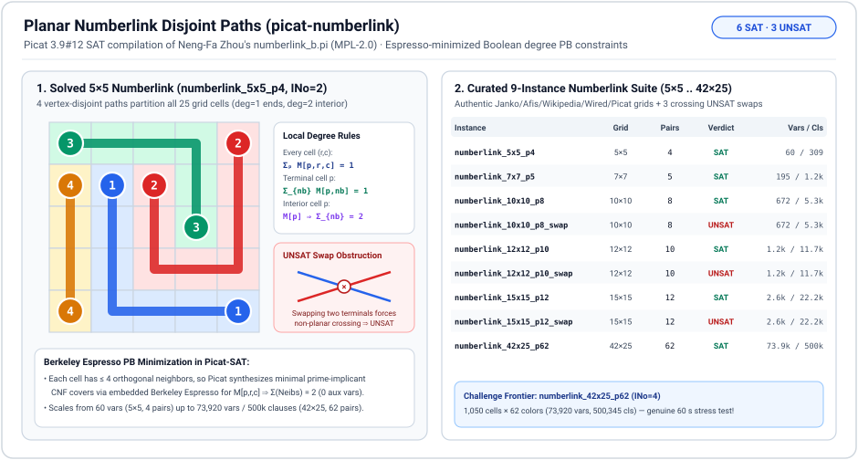</a>  
      <a href="picat-numberlink/README.md"><b>Planar Numberlink Disjoint Paths</b></a> 
      <code>picat-numberlink</code>
    </td>
    <td width="25%" align="center" valign="top">
      <a href="picat-rectangle-packing/README.md">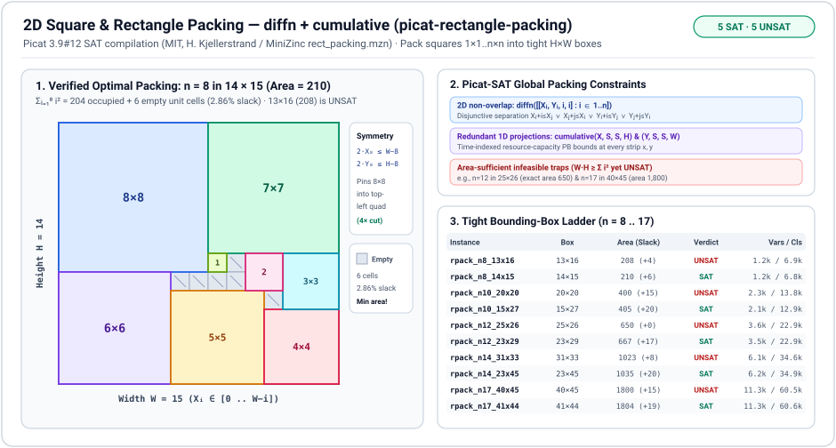</a>  
      <a href="picat-rectangle-packing/README.md"><b>2D Square &amp; Rectangle Packing — diffn + cumulative</b></a> 
      <code>picat-rectangle-packing</code>
    </td>
    <td width="25%" align="center" valign="top">
        
      <a href="picat-vmtl/README.md"><b>Vertex Magic Total Labeling on <i>Kn</i></b></a> 
      <code>picat-vmtl</code>
    </td>
    <td width="25%" align="center" valign="top">
        
      <a href="pretolani-pret/README.md"><b>Pretolani Parity-Charged 2-Coloring Instances</b></a> 
      <code>pretolani-pret</code>
    </td>
  </tr>
  <tr>
    <td width="25%" align="center" valign="top">
        
      <a href="qdistsat-qldpc/README.md"><b>Quantum Error-Correcting LDPC Code Distance SAT Benchmarks (QDistSAT / Bivariate-Bicycle Codes)</b></a> 
      <code>qdistsat-qldpc</code>
    </td>
    <td width="25%" align="center" valign="top">
        
      <a href="queen-armies/README.md"><b>Peaceable Queen Armies</b></a> 
      <code>queen-armies</code>
    </td>
    <td width="25%" align="center" valign="top">
        
      <a href="random-3sat-phase-transition/README.md"><b>Critical &amp; Off-Threshold Phase-Transition Random 3-SAT</b></a> 
      <code>random-3sat-phase-transition</code>
    </td>
    <td width="25%" align="center" valign="top">
        
      <a href="rb-bench-model-rb/README.md"><b>Model RB Forced-Satisfiable SAT Benchmarks (RB-bench / BHOSLIB)</b></a> 
      <code>rb-bench-model-rb</code>
    </td>
  </tr>
  <tr>
    <td width="25%" align="center" valign="top">
        
      <a href="sat-competition-2002-2026-uris/README.md"><b>International SAT Competition &amp; SAT-Race Archive URIs (2002–2026)</b></a> 
      <code>sat-competition-2002-2026-uris</code>
    </td>
    <td width="25%" align="center" valign="top">
        
      <a href="sat-shortcut-challenge-tier1/README.md"><b>SAT Shortcut Challenge — Tier 1 Structured Suite</b></a> 
      <code>sat-shortcut-challenge-tier1</code>
    </td>
    <td width="25%" align="center" valign="top">
        
      <a href="sat-shortcut-challenge-tier3/README.md"><b>SAT Shortcut Challenge — Tier 3 Random 3-SAT Suite</b></a> 
      <code>sat-shortcut-challenge-tier3</code>
    </td>
    <td width="25%" align="center" valign="top">
        
      <a href="satlib-ais/README.md"><b>SATLIB — All-Interval Series (full)</b></a> 
      <code>satlib-ais</code>
    </td>
  </tr>
  <tr>
    <td width="25%" align="center" valign="top">
        
      <a href="satlib-archive-uris/README.md"><b>UBC SATLIB Complete 97-Archive URI Manifest</b></a> 
      <code>satlib-archive-uris</code>
    </td>
    <td width="25%" align="center" valign="top">
        
      <a href="satlib-beijing/README.md"><b>SATLIB — 1996 Beijing SAT Competition (full)</b></a> 
      <code>satlib-beijing</code>
    </td>
    <td width="25%" align="center" valign="top">
        
      <a href="satlib-bmc/README.md"><b>SATLIB — Bounded Model Checking — Shtrichman (full)</b></a> 
      <code>satlib-bmc</code>
    </td>
    <td width="25%" align="center" valign="top">
        
      <a href="satlib-bms-rti/README.md"><b>SATLIB — Backbone-Minimal Random 3-SAT (sample / 1,000*)</b></a> 
      <code>satlib-bms-rti</code>
    </td>
  </tr>
  <tr>
    <td width="25%" align="center" valign="top">
        
      <a href="satlib-cbs/README.md"><b>SATLIB — Controlled Backbone Random 3-SAT (sample / 40,000*)</b></a> 
      <code>satlib-cbs</code>
    </td>
    <td width="25%" align="center" valign="top">
        
      <a href="satlib-dimacs-aim/README.md"><b>SATLIB — Artificial Random 3-SAT — Iwama et al. (full)</b></a> 
      <code>satlib-dimacs-aim</code>
    </td>
    <td width="25%" align="center" valign="top">
        
      <a href="satlib-dimacs-bf/README.md"><b>SATLIB — Circuit Bridge-Fault Analysis (full)</b></a> 
      <code>satlib-dimacs-bf</code>
    </td>
    <td width="25%" align="center" valign="top">
        
      <a href="satlib-dimacs-dubois/README.md"><b>SATLIB — Dubois Hard Parity UNSAT (full)</b></a> 
      <code>satlib-dimacs-dubois</code>
    </td>
  </tr>
  <tr>
    <td width="25%" align="center" valign="top">
        
      <a href="satlib-dimacs-gcp-large/README.md"><b>SATLIB — Large Graph Colouring g125/g250 (full)</b></a> 
      <code>satlib-dimacs-gcp-large</code>
    </td>
    <td width="25%" align="center" valign="top">
        
      <a href="satlib-dimacs-hanoi/README.md"><b>SATLIB — Towers of Hanoi hanoi4, hanoi5 (full)</b></a> 
      <code>satlib-dimacs-hanoi</code>
    </td>
    <td width="25%" align="center" valign="top">
        
      <a href="satlib-dimacs-ii/README.md"><b>SATLIB — Inductive Inference (full)</b></a> 
      <code>satlib-dimacs-ii</code>
    </td>
    <td width="25%" align="center" valign="top">
        
      <a href="satlib-dimacs-jnh/README.md"><b>SATLIB — Variable-Length Random SAT — Hooker (full)</b></a> 
      <code>satlib-dimacs-jnh</code>
    </td>
  </tr>
  <tr>
    <td width="25%" align="center" valign="top">
        
      <a href="satlib-dimacs-lran/README.md"><b>SATLIB — Large Random 3-SAT f600/f1000/f2000 (full)</b></a> 
      <code>satlib-dimacs-lran</code>
    </td>
    <td width="25%" align="center" valign="top">
        
      <a href="satlib-dimacs-parity/README.md"><b>SATLIB — Parity Learning par8/par16/par32 (full)</b></a> 
      <code>satlib-dimacs-parity</code>
    </td>
    <td width="25%" align="center" valign="top">
        
      <a href="satlib-dimacs-phole/README.md"><b>SATLIB — Pigeonhole Principle hole6..10 (full)</b></a> 
      <code>satlib-dimacs-phole</code>
    </td>
    <td width="25%" align="center" valign="top">
        
      <a href="satlib-dimacs-ssa/README.md"><b>SATLIB — Single-Stuck-At Circuit Faults (full)</b></a> 
      <code>satlib-dimacs-ssa</code>
    </td>
  </tr>
  <tr>
    <td width="25%" align="center" valign="top">
        
      <a href="satlib-flat-gcp/README.md"><b>SATLIB — Flat 3-Colourable Graphs flat30..200 (sample / 1,700*)</b></a> 
      <code>satlib-flat-gcp</code>
    </td>
    <td width="25%" align="center" valign="top">
        
      <a href="satlib-planning-blocksworld/README.md"><b>SATLIB — SATPLAN Blocks World (full)</b></a> 
      <code>satlib-planning-blocksworld</code>
    </td>
    <td width="25%" align="center" valign="top">
        
      <a href="satlib-planning-logistics/README.md"><b>SATLIB — SATPLAN Logistics a..d (full)</b></a> 
      <code>satlib-planning-logistics</code>
    </td>
    <td width="25%" align="center" valign="top">
        
      <a href="satlib-qg/README.md"><b>SATLIB — Quasigroup / Latin Squares — Zhang (full)</b></a> 
      <code>satlib-qg</code>
    </td>
  </tr>
  <tr>
    <td width="25%" align="center" valign="top">
        
      <a href="satlib-rnd3sat/README.md"><b>SATLIB — Uniform Random 3-SAT uf/uuf50..250 (sample / 6,600*)</b></a> 
      <code>satlib-rnd3sat</code>
    </td>
    <td width="25%" align="center" valign="top">
        
      <a href="satlib-sw-gcp/README.md"><b>SATLIB — Morphed Small-World 5-Colouring lp0..p0 (sample / 901*)</b></a> 
      <code>satlib-sw-gcp</code>
    </td>
    <td width="25%" align="center" valign="top">
        
      <a href="sha256-preimage/README.md"><b>FIPS 180-4 SHA-256 Preimage Circuits</b></a> 
      <code>sha256-preimage</code>
    </td>
    <td width="25%" align="center" valign="top">
        
      <a href="sigal-aes256-xcnf/README.md"><b>Full 14-Round AES-256 Known-Plaintext Key-Recovery XCNFs</b></a> 
      <code>sigal-aes256-xcnf</code>
    </td>
  </tr>
  <tr>
    <td width="25%" align="center" valign="top">
        
      <a href="tseitin-expanders/README.md"><b>MOD2-Tseitin Expanders &amp; Prisms</b></a> 
      <code>tseitin-expanders</code>
    </td>
    <td width="25%" align="center" valign="top">
        
      <a href="vlsat-2/README.md"><b>VLSAT-2 Benchmark Suite (INRIA / CADP)</b></a> 
      <code>vlsat-2</code>
    </td>
    <td width="25%" align="center" valign="top">
        
      <a href="vzhn-sat-inv-matrix-int/README.md"><b>Exact Integer Matrix Inversion over ℤ</b></a> 
      <code>vzhn-sat-inv-matrix-int</code>
    </td>
    <td width="25%" align="center" valign="top">
        
      <a href="vzhn-sat-inv-matrix-mod/README.md"><b>Modular Ring Matrix Inversion over ℤ/<i>m</i>ℤ</b></a> 
      <code>vzhn-sat-inv-matrix-mod</code>
    </td>
  </tr>
  <tr>
    <td width="25%" align="center" valign="top">
        
      <a href="zed-adversarial-hub/README.md"><b>Adversarial Bit-Vector Hub Arithmetic Disjunction Circuits</b></a> 
      <code>zed-adversarial-hub</code>
    </td>
    <td width="25%" align="center" valign="top">
        
      <a href="zed-adversarial-php/README.md"><b>Adversarial Scaled AIGER Pigeonhole Principle Circuits</b></a> 
      <code>zed-adversarial-php</code>
    </td>
    <td width="25%"></td>
    <td width="25%"></td>
  </tr>
</table>

**Archive & Aggregate Notes:** [`sat-competition-2002-2026-uris/`](sat-competition-2002-2026-uris/README.md) stores 62 immutable GBD URI lists (`uris/<track>_<year>.uri`, 25 consecutive years 2002–2026 across 14 track categories, 32,194 track-year slots $\to$ **20,225 unique CNFs**: `7,818 SAT / 5,792 UNSAT / 6,615 UNKNOWN`), [`vlsat-2/vlsat2_100.uri`](vlsat-2/vlsat2_100.uri) stores all 100 INRIA URLs, and [`satlib-archive-uris/satlib_all_97_archives.uri`](satlib-archive-uris/satlib_all_97_archives.uri) stores all 97 official UBC SATLIB `.tar.gz` archive URLs rather than duplicating multi-gigabyte raw archives in Git. Across the repository, **1,040 SAT benchmark instances** across **86 SAT collections** are committed across all four formats (**1,036** verified Binary AIGER 1.9 `.aig.xz`, **1,040** DIMACS `.cnf.xz`, **1,040** [CryptoMiniSat](https://github.com/msoos/cryptominisat) `.xcnf.xz`, and **1,036** DIMACS-ANF `.anf.xz` = **4,152** xz-compressed SAT benchmark files, `1,274.40 MB` total; 4 largest `guillochon-oeis-a067782-sortnet` `.aig.xz`/`.anf.xz` files omitted per [`format_exclusions.tsv`](guillochon-oeis-a067782-sortnet/format_exclusions.tsv) for GitHub's `< 95 MB` limit), alongside **174 `.mata.xz` NFA benchmarks** (`2.61 MB`), **29 verified OEIS solution certificates** across `guillochon-oeis-*/solutions/` (`174.57 MB`), **90 / 90** bespoke `diagram.svg` vector illustrations, and full generator/converter scripts.

## Highlighted Solver Summary

### 1. Unified 50-Benchmark Flat-CNF Gauntlet (1-Core, Identical Flat `.cnf` Input)

- **Timeout:** Uniform competition-standard $T_{\max} = 5{,}000\;\text{s}$ per instance (PAR-2 penalty $10{,}000\;\text{s} = 10{,}000{,}000\;\text{ms}$) across all **50 / 50** instances (Part I: 30 circuit/algebraic instances; Part II: 20 adversarial Zed, SC 2023/2024, and Random 3-SAT instances) and all six solver configurations.
- **Same machine?** **Yes** — all six solver configurations were run on the exact same machine (**AMD Ryzen 9 5950X**, 16-core/32-thread, Linux, 1 dedicated core per run, exact median of 3 runs for solves under $120\;\text{s}$; 0 verdict disagreements, 100% SAT models clause-verified).

| Solver (1C) | Solved | Fastest Wins | Part I PAR-2 (30, $T_{\max}=5{,}000\;\text{s}$) | Part II PAR-2 (20, $T_{\max}=5{,}000\;\text{s}$) | Unified 50 PAR-2 |
|---|---:|---:|---:|---:|---:|
| **Frobenius 1C** | **50 / 50** | **45 / 50** *(50/50 vs. 4 main)* | **430.02 ms** *(fastest)* | **4,309.00 ms** *(fastest)* | **4,739.02 ms** *(fastest)* |
| [CaDiCaL](https://github.com/arminbiere/cadical) 3.1.0 | 42 / 50 | 0 / 50 | 25,715,225.61 ms *(59,800x slower)* | 63,590,706.89 ms *(14,758x slower)* | 89,305,932.50 ms *(18,845x slower)* |
| [CryptoMiniSat](https://github.com/msoos/cryptominisat) 5.18.0 (CNF) | 41 / 50 | 0 / 50 | 30,027,443.01 ms *(69,828x slower)* | 66,244,167.48 ms *(15,373x slower)* | 96,271,610.49 ms *(20,315x slower)* |
| [CryptoMiniSat](https://github.com/msoos/cryptominisat) 5.18.0 (XCNF) | 42 / 50 | 0 / 50 | 20,471,425.77 ms *(47,606x slower)* | 66,319,713.99 ms *(15,391x slower)* | 86,791,139.76 ms *(18,314x slower)* |
| [dense-solver](https://github.com/libdense/dense-solver) 0.0.4 | 44 / 50 | 5 / 50 | 11,402,189.74 ms *(26,515x slower)* | 51,005,536.14 ms *(11,837x slower)* | 62,407,725.88 ms *(13,169x slower)* |
| [Kissat](https://github.com/arminbiere/kissat) 4.0.4 | 40 / 50 | 0 / 50 | 35,047,925.98 ms *(81,503x slower)* | 70,251,994.22 ms *(16,304x slower)* | 105,299,920.20 ms *(22,220x slower)* |

### 2. 22-Instance Provable HAMD Suite (1-Core, Identical Flat `.cnf` Input)

- **Timeout:** $T_{\max} = 15\;\text{s}$ per instance (PAR-2 penalty $30\;\text{s}$).
- **Same machine?** **Yes** — all four solvers were run sequentially on the exact same machine (**AMD Ryzen 9 5950X**, 1 core per run, exact median of 3 runs).

| Solver (1C) | Solved | Fastest Wins | Total PAR-2 ($T_{\max}=15\;\text{s}$) | Proof / Model Verification |
|---|---:|---:|---:|---|
| **Frobenius 1C** | **22 / 22** | **21 / 22** | **226.57 ms** *(fastest)* | 12/12 SAT cycles + 10/10 UNSAT [`cake_lpr`](https://github.com/tanyongkiam/cake_lpr) + [`lrat-check`](https://github.com/marijnheule/drat-trim) OK |
| [CaDiCaL](https://github.com/arminbiere/cadical) 3.1.0 | 17 / 22 | 0 / 22 | 163,592.80 ms *(722x slower)* | 100% verdict agreement on solved instances |
| [CryptoMiniSat](https://github.com/msoos/cryptominisat) 5.18.0 (CNF) | 18 / 22 | 0 / 22 | 148,852.60 ms *(657x slower)* | 100% verdict agreement on solved instances |
| [dense-solver](https://github.com/libdense/dense-solver) 0.0.4 | 17 / 22 | 1 / 22 | 159,432.38 ms *(704x slower)* | 100% verdict agreement on solved instances |
| [Kissat](https://github.com/arminbiere/kissat) 4.0.4 | 18 / 22 | 0 / 22 | 140,869.50 ms *(622x slower)* | 100% verdict agreement on solved instances |

### 3. Combinatorial Chessboard Suites (1-Core, Identical Flat `.cnf` Input)

- **Timeout:** $T_{\max} = 15\;\text{s}$ per instance (PAR-2 penalty $30\;\text{s}$).
- **Same machine?** **Yes** — all five solvers were run sequentially on the exact same **AMD Ryzen 9 5950X** Linux workstation (1 core per run, 0 verdict disagreements).

| Collection (Instances, $T_{\max}$) | Frobenius 1C | [CaDiCaL](https://github.com/arminbiere/cadical) 3.1.0 | [CryptoMiniSat](https://github.com/msoos/cryptominisat) 5.18.0 | [dense-solver](https://github.com/libdense/dense-solver) 0.0.4 | [Kissat](https://github.com/arminbiere/kissat) 4.0.4 |
|---|---:|---:|---:|---:|---:|
| [**Obstacle Knight's Tour**](knights-tour-obstacles/README.md) (10, 15 s) | **10/10 — 178.8 ms** *(fastest)* | 10/10 — 11,302 ms *(63.2x)* | 10/10 — 9,121 ms *(51.0x)* | 2/10 — 250,274 ms *(1,400x)* | 10/10 — 8,678 ms *(48.5x)* |
| [**Peaceable Queen Armies**](queen-armies/README.md) (8, 15 s) | **8/8 — 56,672 ms** *(fastest)* | 1/8 — 214,106 ms *(3.78x)* | 1/8 — 211,830 ms *(3.74x)* | 2/8 — 204,847 ms *(3.61x)* | 4/8 — 160,604 ms *(2.83x)* |

### 4. Imported External Benchmark Collections (1-Core, Identical Flat `.cnf` Input; Plus Native `.mata.xz`)

- **Timeout:** Per-instance $T_{\max}$ is listed in each row (PAR-2 penalty $= 2\,T_{\max}$).
- **Same machine?** **Yes** — all solvers were run on the exact same **AMD Ryzen 9 5950X** Linux workstation (1 thread per run, 0 verdict disagreements, 100% SAT model verification; full-suite sweeps pinned to dedicated physical cores with zero SMT sharing). **100% of every committed collection was benchmarked** (with the 9 Guillochon OEIS collections evaluated on their 30-instance 5-solver calibration ladder plus up to `3,600 s` frontier runs, and `davies-rectangle-free-27` evaluated on `01-known-unsat` at `600 s` plus extended `02-open` profiling).

| External Collection (Instances, $T_{\max}$) | Frobenius 1C | [CaDiCaL](https://github.com/arminbiere/cadical) 3.1.0 | [CryptoMiniSat](https://github.com/msoos/cryptominisat) 5.18.0 | [dense-solver](https://github.com/libdense/dense-solver) 0.0.4 | [Kissat](https://github.com/arminbiere/kissat) 4.0.4 |
|---|---:|---:|---:|---:|---:|
| [**Aloul DAC02**](aloul-dac02-bench/README.md) (32, 5 s) | **32/32 — 360.3 ms** *(fastest)* | 17/32 — 154,076 ms *(428x)* | 23/32 — 96,866 ms *(269x)* | 32/32 — 450.7 ms *(1.25x)* | 24/32 — 87,033 ms *(242x)* |
| [**Aloul DIFP-A**](aloul-difp-a/README.md) (14, 5 s) | **14/14 — 72.9 ms** *(fastest)* | 8/14 — 82,148 ms *(1,128x)* | 7/14 — 85,065 ms *(1,168x)* | 5/14 — 106,012 ms *(1,455x)* | 8/14 — 80,636 ms *(1,107x)* |
| [**Aloul DIFP-W**](aloul-difp-w/README.md) (15, 5 s) | **15/15 — 190.4 ms** *(fastest)* | 6/15 — 101,152 ms *(531x)* | 7/15 — 88,571 ms *(465x)* | 4/15 — 115,672 ms *(607x)* | 7/15 — 97,101 ms *(510x)* |
| [**Aloul FPGA Switch-Box**](aloul-fpga-sb-sat/README.md) ([SAT](aloul-fpga-sb-sat/README.md) + [UNSAT](aloul-fpga-sb-uns/README.md), 21, 5 s) | **21/21 — 34.4 ms** *(fastest)* | 11/21 — 100,093 ms *(2,906x)* | 11/21 — 100,380 ms *(2,914x)* | 21/21 — 37.4 ms *(1.09x)* | 12/21 — 93,237 ms *(2,707x)* |
| **Brewbaker 7-Suite Pack** ([Golomb](brewbaker-golomb-rulers/README.md), [Select](brewbaker-select-networks/README.md), [SHA256](brewbaker-sha256-cec/README.md), [Sort](brewbaker-sort-networks/README.md), [Cross](brewbaker-tensor-cross/README.md), [Dot](brewbaker-tensor-dot/README.md), [Matmul](brewbaker-tensor-matmul/README.md); 73, 60 s) | **65/73 — 1,133.29 s** *(fastest)* | 62/73 — 1,657.42 s *(1.46x)* | 59/73 — 1,848.53 s *(1.63x)* | 54/73 — 2,532.43 s *(2.23x)* | 62/73 — 1,474.17 s *(1.30x)* |
| [**Davies Rectangle-Free $27\times 27$**](davies-rectangle-free-27/README.md) (`01-known-unsat`, 1 / 2, 600 s) | **1/1 — 100.59 s** *(`--proof`: **91.54 s**, fastest)* | 1/1 — 339.43 s *(3.71x)* | 1/1 — 414.78 s *(4.53x)* | 0/1 — 1,200.0 s *(T/O)* | 1/1 — 570.57 s *(6.23x)* |
| [**dense-solver Public**](dense-solver-public/README.md) (30, 5 s) | **29/30 — 10,251 ms** *(fastest)* | 24/30 — 64,035 ms *(6.25x)* | 20/30 — 100,928 ms *(9.85x)* | 28/30 — 20,460 ms *(2.00x)* | 25/30 — 53,137 ms *(5.18x)* |
| [**dense-solver Synthetic — Chessboard**](dense-solver-synthetic-chessboard/README.md) (3, 5 s) | **3/3 — 6.4 ms** *(fastest)* | 1/3 — 20,421 ms *(3,191x)* | 1/3 — 20,495 ms *(3,202x)* | 3/3 — 7.4 ms *(1.15x)* | 1/3 — 20,399 ms *(3,187x)* |
| [**dense-solver Synthetic — PHP**](dense-solver-synthetic-php/README.md) (17, 5 s) | **17/17 — 31.6 ms** *(fastest)* | 13/17 — 40,653 ms *(1,286x)* | 13/17 — 41,142 ms *(1,301x)* | 17/17 — 38.2 ms *(1.21x)* | 13/17 — 40,202 ms *(1,271x)* |
| [**`@fede_intern` 12-CNF Challenge**](fede-intern-challenge/README.md) (12, 60 s / 300 s) | **9/12 — 362.3 s** *(300 s: **10/12 — 1,264 s**)* | 3/12 — 1,120.2 s *(300 s: 4/12 — 5,002 s)* | 0/12 — 1,440.0 s | 0/12 — 1,440.0 s | 3/12 — 1,117.7 s *(300 s: 4/12 — 4,926 s)* |
| **Guillochon OEIS SAT** ([A067782](guillochon-oeis-a067782-sortnet/README.md), [A171081](guillochon-oeis-a171081-vdw/README.md), [A250000](guillochon-oeis-a250000-queens/README.md), [A350304](guillochon-oeis-a350304-zarankiewicz/README.md), [5 Grid](guillochon-oeis-grid-sq-any/README.md); 30 cal. / 112, 60 s) | 20/30 — 1,381.0 s *(5/5 UNSAT: **74.6 s**)* | **20/30 — 1,293.2 s** *(fastest PAR-2)* | 15/30 — 2,046.9 s *(1.58x)* | 13/30 — 2,134.7 s *(1.65x)* | 19/30 — 1,598.3 s *(1.24x)* |
| [**Heule Matrix `xor6cut`**](heule-matrix-xor6cut/README.md) (6, 60 s; other 8 suites 37, 10 s: all 0/37) | 2/6 — 523,063 ms *(1.25x)* | 2/6 — 493,170 ms *(1.18x)* | 2/6 — 510,399 ms *(XCNF: 3/6 — 455,099 ms)* | 0/6 — 720,000 ms *(1.72x)* | **3/6 — 418,266 ms** *(fastest)* |
| [**MATA Presburger NFAs**](mata-presburger-nfa-tptp/README.md) ([TPTP](mata-presburger-nfa-tptp/README.md) + [UAutomizer](mata-presburger-nfa-ultimate-automizer/README.md), 174, 5 s, `.mata.xz`) | **174/174 — 1,596 ms** *(complement; emp 1,692 ms, exp 2,147 ms)* | — *(CNF only)* | — *(CNF/XCNF only)* | — *(CNF only)* | — *(CNF only)* |
| [**`mod-circuit-sat`**](mod-circuit-sat/README.md) $n=3\text{--}5$ (9, 30 s) | **9/9 — 17,346 ms** *(fastest)* | 9/9 — 29,702 ms *(1.71x)* | 8/9 — 67,344 ms *(3.88x)* | 8/9 — 67,769 ms *(3.91x)* | 9/9 — 25,994 ms *(1.50x)* |
| [**Model RB Full Suite**](rb-bench-model-rb/README.md) (40, 5 s) | **22/40 — 198,193 ms** *(fastest)* | 12/40 — 293,728 ms *(1.48x)* | 10/40 — 308,697 ms *(1.56x)* | 10/40 — 307,528 ms *(1.55x)* | 11/40 — 306,309 ms *(1.55x)* |
| **Picat-SAT 6-Suite Pack** ([Costas](picat-costas-arrays/README.md), [Golomb](picat-golomb-rulers/README.md), [MAPF](picat-mapf/README.md), [Numberlink](picat-numberlink/README.md), [RectPack](picat-rectangle-packing/README.md), [VMTL](picat-vmtl/README.md); 56, 60 s) | **53/56 — 481.31 s** *(fastest)* | 52/56 — 554.22 s *(1.15x)* | 52/56 — 605.87 s *(1.26x)* | 52/56 — 594.24 s *(1.23x)* | 53/56 — 497.87 s *(1.03x)* |
| [**Pretolani PRET**](pretolani-pret/README.md) (8, 5 s) | 8/8 — 9.86 ms *(1.53x)* | 8/8 — 41.53 ms *(6.46x)* | 8/8 — 161.74 ms *(25.2x)* | **8/8 — 6.43 ms** *(fastest)* | 8/8 — 58.45 ms *(9.09x)* |
| [**QDistSAT Full Suite**](qdistsat-qldpc/README.md) `BB_30..756` (10, 10 s) | 5/10 — 100,082 ms *(1.00x; solved-5: 81.7 ms)* | **5/10 — 100,078 ms** *(fastest)* | 5/10 — 100,515 ms *(XCNF: 100,297 ms)* | 5/10 — 100,119 ms *(1.00x)* | 5/10 — 100,090 ms *(1.00x)* |
| [**SAT Competition 2023/2024 Gauntlet**](sat-competition-2002-2026-uris/README.md)\* (12, 5,000 s) | **12/12 — 3,745 ms** *(fastest)* | 8/12 — 43,480,568 ms *(11,611x)* | 9/12 — 36,241,382 ms *(9,678x)* | 9/12 — 30,505,588 ms *(8,146x)* | 8/12 — 40,251,149 ms *(10,749x)* |
| [**SAT Shortcut Challenge Tier-1**](sat-shortcut-challenge-tier1/README.md) (47, 300 s) | **47/47 — 1.00 s** *(fastest)* | 45/47 — 1,730.8 s *(1,729x)* | 46/47 — 1,004.2 s *(1,003x)* | 45/47 — 1,225.7 s *(1,224x)* | 45/47 — 1,323.2 s *(1,322x)* |
| [**SAT Shortcut Challenge Tier-3**](sat-shortcut-challenge-tier3/README.md) (25, 300 s) | **17/25 — 4,860.5 s** *(fastest)* | 17/25 — 4,923.0 s *(1.013x)* | 12/25 — 8,583.6 s *(1.77x)* | 5/25 — 12,370.4 s *(2.55x)* | 17/25 — 5,055.9 s *(1.04x)* |
| [**SATLIB All 22 Collections**](satlib-archive-uris/README.md) (331, 5 s) | **331/331 — 19,253 ms** *(fastest)* | 316/331 — 174,495 ms *(9.06x)* | 323/331 — 164,024 ms *(8.52x)* | 313/331 — 207,808 ms *(10.8x)* | 314/331 — 189,408 ms *(9.84x)* |
| [**VLSAT-2 First 10**](vlsat-2/README.md) (10, 5 s) | **9/10 — 10,035 ms** *(fastest)* | 0/10 — 100,000 ms *(9.96x)* | 0/10 — 100,000 ms *(9.96x)* | 7/10 — 30,031 ms *(2.99x)* | 4/10 — 64,843 ms *(6.46x)* |
| [**`vzhn` Matrix Inversion — Integer ($\mathbb{Z}$)**](vzhn-sat-inv-matrix-int/README.md) (11, 60 s) | 11/11 — 25.26 s *(1.26x)* | 11/11 — 31.83 s *(1.59x)* | 11/11 — 106.65 s *(5.32x)* | 11/11 — 92.10 s *(4.59x)* | **11/11 — 20.06 s** *(fastest)* |
| [**`vzhn` Matrix Inversion — Modular ($\mathbb{Z}/m\mathbb{Z}$)**](vzhn-sat-inv-matrix-mod/README.md) (15, 60 s) | **15/15 — 1.13 s** *(fastest)* | 11/15 — 499.33 s *(442x)* | 14/15 — 142.65 s *(126x)* | 11/15 — 509.79 s *(451x)* | 10/15 — 611.47 s *(541x)* |

*\*The curated 14-instance SC 2023/2024 Gauntlet slice (12 instances in Part II of the Unified 50-Benchmark Flat-CNF Gauntlet in Section 1 above) is indexed in [`sat-competition-2002-2026-uris/`](sat-competition-2002-2026-uris/README.md) alongside all 25 years of SAT Competition & SAT-Race URI manifests (62 `.uri` manifests, 20,225 unique CNFs; SC 2024–2026 Main Track results summarized in Section 5 below). [`sigal-aes256-xcnf/`](sigal-aes256-xcnf/README.md) contains full 14-round AES-256 XCNF cryptanalytic challenges (throughput benchmarked in its collection README).*

### 5. SAT Competition 2024–2026 Main Track (`sat-competition-2002-2026-uris/`, 1,166 Unique CNFs, 1-Core)

- **Archive & Scope:** Part of the complete 25-year [`sat-competition-2002-2026-uris/`](sat-competition-2002-2026-uris/README.md) corpus (`2002–2026`, 62 `.uri` manifests across 14 track categories, 32,194 slots $\to$ **20,225 unique CNFs**). At $T_{\max} = 300\;\text{s}$ with UNSAT proof logging, Frobenius 1C solved and formally certified **441 / 1,166** deduplicated SC 2024–2026 Main Track instances (**234 SAT** model-verified + **207 UNSAT** [`cake_lpr`](https://github.com/tanyongkiam/cake_lpr)-certified, `0` errors).
- **Timeout:** Evaluated below at $T_{\max} = 15\;\text{s}$ and $T_{\max} = 60\;\text{s}$ cutoffs (official competition full runs used $T_{\max} = 5{,}000\;\text{s}$).
- **Same machine?** **No (different machines)** — Frobenius 1C ran on our local **AMD Ryzen 9 5950X** workstation (1 core per instance, unrestricted available RAM), whereas competitor scores are taken directly from official published competition logs/slides (**StarExec** cluster for SC 2024; **LMU / competition sequential clusters** for SC 2025–2026). CPU differences affect absolute runtimes, so ratios below reflect cross-machine published PAR-2 comparisons.

| Track (400 CNFs each) | Solver (1C) | $T_{\max}=15\;\text{s}$ Solved & PAR-2 | $T_{\max}=60\;\text{s}$ Solved & PAR-2 |
|---|---|---:|---:|
| **SC 2024** | **Frobenius 1C** | **72 / 400 — 25.04 s** *(fastest)* | **111 / 400 — 91.02 s** *(fastest)* |
| | [CaDiCaL](https://github.com/arminbiere/cadical) (Main #7) | 26 / 400 — 28.24 s *(1.13x slower)* | 54 / 400 — 106.69 s *(1.17x slower)* |
| | [kissat-sc2024](https://github.com/arminbiere/kissat) (Main #1 Gold) | 43 / 400 — 27.15 s *(1.08x slower)* | 81 / 400 — 99.47 s *(1.09x slower)* |
| **SC 2025** | **Frobenius 1C** | **95 / 400 — 23.51 s** | **141 / 400 — 81.92 s** |
| | *(Official SC 2025 published aggregate 5,000 s slide totals only; no per-instance CSV)* | — | — |
| **SC 2026** | **Frobenius 1C** | **122 / 400 — 21.37 s** *(fastest)* | **139 / 400 — 80.24 s** *(fastest)* |
| | [Lymphosat](https://c.mov/lymphosat/) (AI-Track #1 Gold) | 81 / 400 — 24.58 s *(1.15x slower)* | 109 / 400 — 90.07 s *(1.12x slower)* |
| | [satsuma-iter-kissat](https://github.com/markusa4/satsuma) (Main #1 Gold) | 70 / 400 — 25.13 s *(1.18x slower)* | 112 / 400 — 90.46 s *(1.13x slower)* |

### 6. Four-Format Cross-Product Parity (`.aig.xz` × `.cnf.xz` × `.xcnf.xz` × `.anf.xz`, 1-Core)

- **Protocol:** **AMD Ryzen 9 5950X**, 1 core (`taskset -c 0`), 3-run median wall-clock time (including in-process `.xz` decompression, parsing, solving, and full model verification) at $T_{\max} = 30\;\text{s}$, across **18 representative benchmarks × 4 formats = 72 cells** (**70 / 72 solved**, **0 verdict disagreements**).

| Origin | Benchmark | Verdict | Frobenius (`.aig.xz`) | Frobenius (`.cnf.xz`) | Frobenius (`.xcnf.xz`) | Frobenius (`.anf.xz`) |
|---|---|---:|---:|---:|---:|---:|
| `aig-orig` | `f2_frobenius_n4096` | SAT | 15.55 ms | 15.24 ms | **8.07 ms** | 13.30 ms |
| `aig-orig` | `spn_sat_n96_d48` | SAT | 163.90 ms | 6.47 ms | **5.96 ms** | 102.18 ms |
| `aig-orig` | `factor_wallace_40b` | SAT | **4.20 ms** | 5.73 ms | 4.86 ms | 806.62 ms |
| `aig-orig` | `sha256_64r_k16_unsat` | UNSAT | **66.49 ms** | 112.04 ms | 81.58 ms | *>30 s* |
| `aig-orig` | `spn_sat_n128_d64` | SAT | 8,689.03 ms | 38.75 ms | **36.42 ms** | 1,243.61 ms |
| `aig-orig` | `coupled_n128_d32_unsat` | UNSAT | 2.45 ms | 2.66 ms | **2.21 ms** | 2.68 ms |
| `aig-orig` | `coupled_n512_d128` | SAT | **3.08 ms** | 3.62 ms | 4.36 ms | 3.47 ms |
| `cnf-orig` | `rand3sat_n200_unsat` | UNSAT | **175.49 ms** | 176.45 ms | 175.59 ms | 180.47 ms |
| `cnf-orig` | `hamd_meredith_k3_n50_unsat` | UNSAT | 4.90 ms | 3.78 ms | **3.58 ms** | 5.34 ms |
| `cnf-orig` | `php65x64-sequential` | UNSAT | 6.44 ms | **4.45 ms** | 4.50 ms | 9.40 ms |
| `cnf-orig` | `mod3_n4_r0_s6_unsat` | UNSAT | 148.26 ms | **147.69 ms** | 150.23 ms | 148.74 ms |
| `cnf-orig` | `pret150_25` | UNSAT | 1.96 ms | 2.08 ms | 1.77 ms | **1.70 ms** |
| `cnf-orig` | `BB_72_12_6_w5_unsat` | UNSAT | 100.01 ms | 94.15 ms | **46.02 ms** | 89.07 ms |
| `cnf-orig` | `BB_72_12_6_w6_sat` | SAT | 2.89 ms | **2.33 ms** | 3.03 ms | 21.02 ms |
| `cnf-orig` | `c04` *(Fede rand 3-SAT)* | SAT | 53.89 ms | 55.21 ms | 54.64 ms | **53.39 ms** |
| `cnf-orig` | `c08` *(Fede 48b factoring)* | SAT | 28.22 ms | 20.34 ms | **13.90 ms** | *>30 s* |
| `cnf-orig` | `c11` *(SC25 `ramsey_4_4_18`)* | UNSAT | 60.18 ms | 53.33 ms | **52.83 ms** | 64.33 ms |
| `cnf-orig` | `c12` *(SC25 `cliquecol`)* | UNSAT | 8.27 ms | 4.69 ms | **4.50 ms** | 7.45 ms |

<!-- BEGIN_STRUCTURAL_ANALYSIS -->
## Cross-Collection Phase-Transition & Structural Profile

*Auto-generated across all **86 SAT collections (1,040 instances)** by [`src/analyze_benchmarks.py`](src/analyze_benchmarks.py) (with the curated 14-instance SC 2023–2024 slice also detailed in [`sat-competition-2002-2026-uris/README.md`](sat-competition-2002-2026-uris/README.md)). Each row summarizes where the collection sits relative to the clause-length-weighted critical threshold $\rho_{\mathrm{crit}} = \frac{1}{n}\sum_k m_k / \alpha_c(k)$ (`Under` $<0.90\times$, `Near-crit` $0.90\text{--}1.10\times$, `Over` $>1.10\times$), Gent–Walsh constrainedness $\kappa$, clause geometry ($\bar{k}$, `%Bin`, `%Horn`), variable-degree skew (`Deg CV`), extracted XOR parity blocks, and total ANF equations.*

| Collection | Inst | Med $\alpha$ | Med $\alpha_c^{\mathrm{eff}}$ | Med $\rho_{\mathrm{crit}}$ [Min–Max] | Regime Split (U/N/O) | Med $\kappa$ | Med $\bar{k}$ | Bin% | Horn% | Deg CV | XORs | ANF Eqs |
|---|---:|---:|---:|---:|:---:|---:|---:|---:|---:|---:|---:|---:|
| [`aloul-dac02-bench/`](aloul-dac02-bench/README.md) | 32 | 5.60 | 1.07 | **4.50x** [0.31x–9.75x] | 6 / 0 / 26 | 1.87 | 2.19 | 93% | 94% | 0.15 | 618 | 98,363 |
| [`aloul-difp-a/`](aloul-difp-a/README.md) | 14 | 5.46 | 3.70 | **1.48x** [1.48x–1.48x] | 0 / 0 / 14 | 0.98 | 3.33 | 12% | 59% | 0.45 | 5,730 | 59,288 |
| [`aloul-difp-w/`](aloul-difp-w/README.md) | 15 | 5.95 | 4.37 | **1.36x** [1.36x–1.36x] | 0 / 0 / 15 | 0.97 | 3.42 | 8% | 56% | 4.23 | 9,085 | 97,350 |
| [`aloul-fpga-sb-sat/`](aloul-fpga-sb-sat/README.md) | 11 | 4.56 | 1.18 | **3.85x** [3.03x–4.60x] | 0 / 0 / 11 | 1.61 | 2.70 | 84% | 84% | 0.15 | 0 | 14,184 |
| [`aloul-fpga-sb-uns/`](aloul-fpga-sb-uns/README.md) | 10 | 6.35 | 1.01 | **6.25x** [5.00x–9.50x] | 0 / 0 / 10 | 2.59 | 2.13 | 99% | 99% | 0.00 | 0 | 24,008 |
| [`brewbaker-golomb-rulers/`](brewbaker-golomb-rulers/README.md) | 12 | 2.92 | 1.21 | **2.41x** [2.29x–2.47x] | 0 / 0 / 12 | 1.07 | 2.23 | 78% | 90% | 1.59 | 0 | 58,746 |
| [`brewbaker-select-networks/`](brewbaker-select-networks/README.md) | 12 | 7.45 | 3.69 | **2.02x** [0.54x–3.55x] | 5 / 0 / 7 | 1.32 | 3.63 | 12% | 71% | 1.35 | 0 | 1,946,861 |
| [`brewbaker-sha256-cec/`](brewbaker-sha256-cec/README.md) | 13 | 3.21 | 1.64 | **1.96x** [1.68x–1.98x] | 0 / 0 / 13 | 0.97 | 2.51 | 49% | 71% | 0.66 | 287,298 | 2,444,424 |
| [`brewbaker-sort-networks/`](brewbaker-sort-networks/README.md) | 8 | 13.37 | 4.70 | **2.84x** [2.16x–3.66x] | 0 / 0 / 8 | 2.13 | 3.65 | 5% | 74% | 1.60 | 0 | 1,181,300 |
| [`brewbaker-tensor-cross/`](brewbaker-tensor-cross/README.md) | 8 | 3.85 | 2.15 | **1.76x** [1.59x–2.36x] | 0 / 0 / 8 | 1.00 | 2.73 | 31% | 94% | 0.46 | 189 | 42,479 |
| [`brewbaker-tensor-dot/`](brewbaker-tensor-dot/README.md) | 10 | 3.94 | 2.13 | **1.71x** [1.67x–2.35x] | 0 / 0 / 10 | 1.00 | 2.73 | 31% | 92% | 0.77 | 499 | 31,876 |
| [`brewbaker-tensor-matmul/`](brewbaker-tensor-matmul/README.md) | 10 | 3.29 | 2.01 | **1.64x** [1.56x–2.40x] | 0 / 0 / 10 | 0.91 | 2.65 | 32% | 68% | 0.66 | 4,960 | 72,526 |
| [`cec-arithmetic-miters/`](cec-arithmetic-miters/README.md) | 5 | 5.20 | 3.69 | **1.36x** [1.36x–1.64x] | 0 / 0 / 5 | 0.91 | 3.30 | 12% | 56% | 0.35 | 831 | 3,819 |
| [`coupled-linear-nonlinear/`](coupled-linear-nonlinear/README.md) | 4 | 4.08 | 3.48 | **1.18x** [1.14x–1.22x] | 0 / 0 / 4 | 0.99 | 3.11 | 3% | 49% | 0.86 | 1,987 | 2,546 |
| [`davies-rectangle-free-27/`](davies-rectangle-free-27/README.md) | 2 | 203.64 | 3.23 | **63.1x** [63.1x–63.1x] | 0 / 0 / 2 | 42.57 | 2.98 | 11% | 100% | 0.24 | 0 | 2,340,047 |
| [`dense-solver-public/`](dense-solver-public/README.md) | 30 | 4.36 | 1.25 | **2.96x** [0.48x–14.5x] | 2 / 9 / 19 | 1.25 | 2.32 | 74% | 72% | 0.23 | 323 | 24,963 |
| [`dense-solver-synthetic-chessboard/`](dense-solver-synthetic-chessboard/README.md) | 3 | 3.34 | 1.16 | **2.89x** [2.84x–2.97x] | 0 / 0 / 3 | 1.23 | 2.28 | 84% | 84% | 0.10 | 0 | 10,420 |
| [`dense-solver-synthetic-php/`](dense-solver-synthetic-php/README.md) | 17 | 1.66 | 1.05 | **1.46x** [0.55x–32.0x] | 2 / 3 / 12 | 0.61 | 2.29 | 95% | 97% | 0.20 | 0 | 177,838 |
| [`f2-frobenius-circulants/`](f2-frobenius-circulants/README.md) | 6 | 4.50 | 4.98 | **0.90x** [0.90x–0.91x] | 0 / 6 / 0 | 0.87 | 3.67 | 0% | 56% | 0.45 | 8,000 | 6,720 |
| [`fede-intern-challenge/`](fede-intern-challenge/README.md) | 12 | 4.26 | 4.27 | **1.00x** [0.92x–8.19x] | 0 / 8 / 4 | 0.82 | 3.00 | 0% | 50% | 0.28 | 7,550 | 413,044 |
| [`guillochon-oeis-a067782-sortnet/`](guillochon-oeis-a067782-sortnet/README.md) | 10 | 21.27 | 3.75 | **5.67x** [4.29x–6.08x] | 0 / 0 / 10 | 3.94 | 3.18 | 9% | 96% | 8.75 | 0 | 39,380,276 |
| [`guillochon-oeis-a171081-vdw/`](guillochon-oeis-a171081-vdw/README.md) | 22 | 61.15 | 4.84 | **12.6x** [5.51x–22.7x] | 0 / 0 / 22 | 10.38 | 4.43 | 0% | 88% | 0.26 | 0 | 897,761 |
| [`guillochon-oeis-a250000-queens/`](guillochon-oeis-a250000-queens/README.md) | 20 | 2.10 | 1.56 | **1.35x** [1.32x–1.39x] | 0 / 0 / 20 | 0.66 | 2.47 | 53% | 53% | 3.54 | 0 | 6,284,278 |
| [`guillochon-oeis-a350304-zarankiewicz/`](guillochon-oeis-a350304-zarankiewicz/README.md) | 20 | 9.96 | 7.98 | **1.25x** [1.23x–1.26x] | 0 / 0 / 20 | 0.63 | 7.69 | 10% | 90% | 9.41 | 0 | 31,936,933 |
| [`guillochon-oeis-grid-sq-any/`](guillochon-oeis-grid-sq-any/README.md) | 8 | 2.13 | 1.69 | **1.26x** [1.26x–1.27x] | 0 / 0 / 8 | 0.63 | 2.59 | 47% | 55% | 1.90 | 0 | 81,364 |
| [`guillochon-oeis-grid-sq-axis/`](guillochon-oeis-grid-sq-axis/README.md) | 8 | 2.04 | 1.63 | **1.25x** [1.24x–1.25x] | 0 / 0 / 8 | 0.62 | 2.53 | 50% | 52% | 1.81 | 0 | 178,940 |
| [`guillochon-oeis-grid-tri-any/`](guillochon-oeis-grid-tri-any/README.md) | 8 | 2.21 | 1.71 | **1.29x** [1.29x–1.30x] | 0 / 0 / 8 | 0.66 | 2.54 | 45% | 56% | 2.62 | 0 | 165,008 |
| [`guillochon-oeis-grid-tri-axis/`](guillochon-oeis-grid-tri-axis/README.md) | 8 | 2.08 | 1.64 | **1.26x** [1.26x–1.27x] | 0 / 0 / 8 | 0.63 | 2.51 | 48% | 53% | 1.92 | 0 | 127,610 |
| [`guillochon-oeis-grid-tri-up/`](guillochon-oeis-grid-tri-up/README.md) | 8 | 2.05 | 1.62 | **1.26x** [1.26x–1.27x] | 0 / 0 / 8 | 0.63 | 2.50 | 49% | 53% | 1.54 | 0 | 67,526 |
| [`hamd-hamiltonian-cycle/`](hamd-hamiltonian-cycle/README.md) | 22 | 2.64 | 2.60 | **0.99x** [0.75x–1.31x] | 6 / 7 / 9 | 0.54 | 3.19 | 28% | 73% | 0.71 | 0 | 298,001 |
| [`hard-spn/`](hard-spn/README.md) | 4 | 5.67 | 5.31 | **1.07x** [1.06x–1.11x] | 0 / 3 / 1 | 0.92 | 3.60 | 2% | 51% | 1.27 | 1,328 | 1,825 |
| [`heule-matrix-6pooled3and-c1/`](heule-matrix-6pooled3and-c1/README.md) | 10 | 8.88 | 3.37 | **2.64x** [2.64x–2.64x] | 0 / 0 / 10 | 1.22 | 4.69 | 27% | 48% | 0.53 | 43,740 | 882,928 |
| [`heule-matrix-6pooled3and-c3/`](heule-matrix-6pooled3and-c3/README.md) | 1 | 8.87 | 3.37 | **2.63x** [2.63x] | 0 / 0 / 1 | 1.22 | 4.70 | 27% | 48% | 0.53 | 4,374 | 88,236 |
| [`heule-matrix-6pooled3and-c4/`](heule-matrix-6pooled3and-c4/README.md) | 1 | 9.25 | 3.45 | **2.68x** [2.68x] | 0 / 0 / 1 | 1.23 | 4.76 | 27% | 48% | 0.53 | 3,645 | 83,835 |
| [`heule-matrix-challenge1/`](heule-matrix-challenge1/README.md) | 10 | 4.42 | 2.43 | **1.82x** [1.82x–1.82x] | 0 / 0 / 10 | 0.95 | 3.18 | 32% | 73% | 0.96 | 80,190 | 639,928 |
| [`heule-matrix-challenge2/`](heule-matrix-challenge2/README.md) | 10 | 4.42 | 2.43 | **1.82x** [1.82x–1.82x] | 0 / 0 / 10 | 0.95 | 3.18 | 32% | 73% | 0.96 | 80,190 | 639,895 |
| [`heule-matrix-challenge3/`](heule-matrix-challenge3/README.md) | 1 | 4.41 | 2.43 | **1.82x** [1.82x] | 0 / 0 / 1 | 0.94 | 3.18 | 32% | 73% | 0.96 | 8,019 | 63,936 |
| [`heule-matrix-challenge4/`](heule-matrix-challenge4/README.md) | 1 | 4.48 | 2.45 | **1.83x** [1.83x] | 0 / 0 / 1 | 0.95 | 3.20 | 32% | 74% | 0.95 | 7,290 | 60,750 |
| [`heule-matrix-fraction/`](heule-matrix-fraction/README.md) | 3 | 4.52 | 1.73 | **2.60x** [2.60x–2.60x] | 0 / 0 / 3 | 1.26 | 4.68 | 48% | 89% | 0.76 | 0 | 1,424,184 |
| [`heule-matrix-xor6cut/`](heule-matrix-xor6cut/README.md) | 6 | 8.94 | 3.39 | **2.65x** [2.62x–2.68x] | 0 / 0 / 6 | 1.22 | 4.71 | 27% | 48% | 0.53 | 26,244 | 565,146 |
| [`integer-factoring/`](integer-factoring/README.md) | 6 | 5.24 | 3.49 | **1.50x** [1.48x–1.51x] | 0 / 0 / 6 | 0.98 | 3.27 | 13% | 59% | 0.41 | 1,844 | 10,286 |
| [`knights-tour-obstacles/`](knights-tour-obstacles/README.md) | 10 | 2.77 | 2.87 | **0.97x** [0.96x–1.04x] | 0 / 10 / 0 | 0.54 | 3.29 | 24% | 74% | 1.05 | 0 | 356,221 |
| [`mod-circuit-sat/`](mod-circuit-sat/README.md) | 11 | 20.07 | 2.70 | **7.52x** [3.24x–14.2x] | 0 / 0 / 11 | 4.03 | 3.41 | 27% | 73% | 1.10 | 0 | 987,859 |
| [`picat-costas-arrays/`](picat-costas-arrays/README.md) | 9 | 14.56 | 2.57 | **5.24x** [4.92x–5.95x] | 0 / 0 / 9 | 2.30 | 4.87 | 37% | 44% | 2.22 | 0 | 1,699,572 |
| [`picat-golomb-rulers/`](picat-golomb-rulers/README.md) | 10 | 7.45 | 1.21 | **6.30x** [5.70x–8.33x] | 0 / 0 / 10 | 2.65 | 2.62 | 82% | 86% | 1.54 | 0 | 189,424 |
| [`picat-mapf/`](picat-mapf/README.md) | 8 | 5.00 | 1.17 | **4.30x** [2.86x–4.48x] | 0 / 0 / 8 | 1.81 | 2.58 | 84% | 84% | 0.22 | 0 | 2,234,843 |
| [`picat-numberlink/`](picat-numberlink/README.md) | 9 | 7.90 | 1.74 | **4.13x** [2.75x–5.43x] | 0 / 0 / 9 | 2.02 | 2.85 | 50% | 67% | 0.32 | 0 | 946,105 |
| [`picat-rectangle-packing/`](picat-rectangle-packing/README.md) | 10 | 5.92 | 3.57 | **1.81x** [1.51x–1.89x] | 0 / 0 / 10 | 1.25 | 3.06 | 9% | 51% | 1.92 | 171 | 350,943 |
| [`picat-vmtl/`](picat-vmtl/README.md) | 10 | 7.21 | 1.29 | **5.48x** [4.83x–7.18x] | 0 / 0 / 10 | 2.35 | 2.82 | 75% | 82% | 0.83 | 0 | 277,527 |
| [`pretolani-pret/`](pretolani-pret/README.md) | 8 | 2.67 | 4.27 | **0.62x** [0.62x–0.62x] | 8 / 0 / 0 | 0.51 | 3.00 | 0% | 51% | 0.00 | 560 | 560 |
| [`qdistsat-qldpc/`](qdistsat-qldpc/README.md) | 10 | 2.40 | 1.92 | **1.24x** [1.22x–1.25x] | 0 / 0 / 10 | 0.66 | 2.63 | 37% | 75% | 1.02 | 1,474 | 147,815 |
| [`queen-armies/`](queen-armies/README.md) | 8 | 2.04 | 1.48 | **1.39x** [1.29x–1.48x] | 0 / 0 / 8 | 0.66 | 2.42 | 58% | 58% | 0.68 | 0 | 104,931 |
| [`random-3sat-phase-transition/`](random-3sat-phase-transition/README.md) | 8 | 4.26 | 4.27 | **1.00x** [0.89x–1.17x] | 1 / 6 / 1 | 0.82 | 3.00 | 0% | 51% | 0.28 | 0 | 6,904 |
| [`rb-bench-model-rb/`](rb-bench-model-rb/README.md) | 40 | 69.47 | 1.00 | **69.4x** [42.3x–86.2x] | 0 / 0 / 40 | 28.81 | 2.01 | 100% | 100% | 0.19 | 0 | 2,959,100 |
| [`sat-shortcut-challenge-tier1/`](sat-shortcut-challenge-tier1/README.md) | 47 | 3.33 | 1.89 | **1.75x** [0.62x–72.0x] | 9 / 8 / 30 | 0.92 | 2.61 | 38% | 68% | 0.10 | 6,793 | 310,239 |
| [`sat-shortcut-challenge-tier3/`](sat-shortcut-challenge-tier3/README.md) | 25 | 4.26 | 4.27 | **1.00x** [1.00x–1.00x] | 0 / 25 / 0 | 0.82 | 3.00 | 0% | 50% | 0.27 | 0 | 42,600 |
| [`satlib-ais/`](satlib-ais/README.md) | 4 | 15.43 | 1.26 | **12.3x** [7.47x–17.1x] | 0 / 0 / 4 | 5.47 | 2.31 | 73% | 99% | 0.16 | 0 | 11,334 |
| [`satlib-beijing/`](satlib-beijing/README.md) | 16 | 5.98 | 2.37 | **3.49x** [2.50x–24.8x] | 0 / 0 / 16 | 1.48 | 2.76 | 24% | 100% | 1.16 | 0 | 870,840 |
| [`satlib-bmc/`](satlib-bmc/README.md) | 13 | 4.96 | 1.20 | **3.94x** [3.47x–6.33x] | 0 / 0 / 13 | 1.74 | 2.63 | 81% | 82% | 1.64 | 17,125 | 2,930,376 |
| [`satlib-bms-rti/`](satlib-bms-rti/README.md) | 4 | 3.60 | 4.27 | **0.84x** [0.64x–1.01x] | 2 / 2 / 0 | 0.69 | 3.00 | 0% | 48% | 0.33 | 0 | 1,416 |
| [`satlib-cbs/`](satlib-cbs/README.md) | 6 | 4.29 | 4.27 | **1.01x** [0.94x–1.05x] | 0 / 6 / 0 | 0.83 | 3.00 | 0% | 49% | 0.28 | 0 | 2,542 |
| [`satlib-dimacs-aim/`](satlib-dimacs-aim/README.md) | 72 | 2.00 | 4.22 | **0.47x** [0.37x–1.45x] | 60 / 0 / 12 | 0.39 | 3.00 | 0% | 50% | 0.04 | 0 | 23,162 |
| [`satlib-dimacs-bf/`](satlib-dimacs-bf/README.md) | 4 | 3.11 | 1.54 | **2.01x** [1.94x–2.11x] | 0 / 0 / 4 | 0.96 | 2.52 | 55% | 72% | 0.50 | 28 | 22,223 |
| [`satlib-dimacs-dubois/`](satlib-dimacs-dubois/README.md) | 13 | 2.67 | 4.27 | **0.62x** [0.32x–0.62x] | 13 / 0 / 0 | 0.51 | 3.00 | 0% | 74% | 0.00 | 749 | 749 |
| [`satlib-dimacs-gcp-large/`](satlib-dimacs-gcp-large/README.md) | 4 | 46.79 | 1.00 | **46.7x** [31.1x–62.7x] | 0 / 0 / 4 | 19.39 | 2.02 | 100% | 100% | 0.07 | 0 | 838,147 |
| [`satlib-dimacs-hanoi/`](satlib-dimacs-hanoi/README.md) | 2 | 7.18 | 1.57 | **4.56x** [4.38x–4.74x] | 0 / 0 / 2 | 2.32 | 2.48 | 50% | 75% | 0.57 | 0 | 19,909 |
| [`satlib-dimacs-ii/`](satlib-dimacs-ii/README.md) | 41 | 10.28 | 1.08 | **9.37x** [2.57x–24.1x] | 0 / 0 / 41 | 3.90 | 3.01 | 93% | 97% | 0.64 | 0 | 736,164 |
| [`satlib-dimacs-jnh/`](satlib-dimacs-jnh/README.md) | 50 | 8.50 | 6.05 | **1.37x** [1.10x–1.59x] | 0 / 1 / 49 | 0.87 | 4.89 | 9% | 26% | 0.14 | 0 | 125,683 |
| [`satlib-dimacs-lran/`](satlib-dimacs-lran/README.md) | 3 | 4.25 | 4.27 | **1.00x** [1.00x–1.00x] | 0 / 3 / 0 | 0.82 | 3.00 | 0% | 51% | 0.28 | 0 | 15,300 |
| [`satlib-dimacs-parity/`](satlib-dimacs-parity/README.md) | 30 | 3.66 | 2.62 | **1.40x** [1.15x–1.59x] | 0 / 0 / 30 | 0.87 | 2.78 | 19% | 47% | 0.95 | 18,548 | 52,790 |
| [`satlib-dimacs-phole/`](satlib-dimacs-phole/README.md) | 5 | 4.12 | 1.03 | **4.00x** [3.00x–5.00x] | 0 / 0 / 5 | 1.66 | 2.18 | 97% | 97% | 0.00 | 0 | 1,845 |
| [`satlib-dimacs-ssa/`](satlib-dimacs-ssa/README.md) | 8 | 2.35 | 1.22 | **1.90x** [1.84x–2.04x] | 0 / 0 / 8 | 0.84 | 2.28 | 77% | 78% | 1.30 | 92 | 56,675 |
| [`satlib-flat-gcp/`](satlib-flat-gcp/README.md) | 8 | 3.73 | 1.07 | **3.47x** [3.08x–3.49x] | 0 / 0 / 8 | 1.47 | 2.09 | 91% | 91% | 0.22 | 0 | 10,073 |
| [`satlib-planning-blocksworld/`](satlib-planning-blocksworld/README.md) | 7 | 12.67 | 1.21 | **9.82x** [4.50x–17.3x] | 0 / 0 / 7 | 4.43 | 2.24 | 78% | 87% | 0.36 | 0 | 210,742 |
| [`satlib-planning-logistics/`](satlib-planning-logistics/README.md) | 4 | 8.39 | 1.56 | **5.21x** [4.21x–6.02x] | 0 / 0 / 4 | 2.51 | 2.61 | 55% | 90% | 0.33 | 0 | 55,604 |
| [`satlib-qg/`](satlib-qg/README.md) | 22 | 39.81 | 1.84 | **20.4x** [12.5x–40.6x] | 0 / 0 / 22 | 10.96 | 2.66 | 40% | 99% | 0.02 | 0 | 1,742,827 |
| [`satlib-rnd3sat/`](satlib-rnd3sat/README.md) | 10 | 4.30 | 4.27 | **1.01x** [1.00x–1.02x] | 0 / 10 / 0 | 0.83 | 3.00 | 0% | 50% | 0.27 | 0 | 6,436 |
| [`satlib-sw-gcp/`](satlib-sw-gcp/README.md) | 5 | 6.20 | 1.03 | **6.01x** [6.01x–6.01x] | 0 / 0 / 5 | 2.50 | 2.10 | 97% | 97% | 0.07 | 0 | 16,500 |
| [`sha256-preimage/`](sha256-preimage/README.md) | 5 | 6.50 | 5.58 | **1.16x** [1.16x–1.23x] | 0 / 0 / 5 | 0.94 | 3.52 | 2% | 50% | 0.65 | 77,329 | 309,573 |
| [`sigal-aes256-xcnf/`](sigal-aes256-xcnf/README.md) | 2 | 6.78 | 3.85 | **1.76x** [1.76x–1.76x] | 0 / 0 / 2 | 1.08 | 3.53 | 15% | 54% | 1.14 | 85,624 | 331,648 |
| [`tseitin-expanders/`](tseitin-expanders/README.md) | 4 | 3.60 | 4.98 | **0.72x** [0.72x–0.72x] | 4 / 0 / 0 | 0.70 | 3.67 | 0% | 56% | 0.26 | 880 | 880 |
| [`vlsat-2/`](vlsat-2/README.md) | 10 | 15.52 | 1.00 | **15.5x** [13.7x–22.2x] | 0 / 0 / 10 | 6.42 | 2.04 | 100% | 100% | 0.33 | 0 | 140,639 |
| [`vzhn-sat-inv-matrix-int/`](vzhn-sat-inv-matrix-int/README.md) | 11 | 6.75 | 5.98 | **1.13x** [1.11x–1.25x] | 0 / 0 / 11 | 0.96 | 3.54 | 0% | 48% | 1.43 | 349,168 | 2,450,232 |
| [`vzhn-sat-inv-matrix-mod/`](vzhn-sat-inv-matrix-mod/README.md) | 15 | 5.65 | 1.90 | **1.56x** [1.16x–23.2x] | 0 / 0 / 15 | 1.00 | 2.62 | 38% | 83% | 0.71 | 43,911 | 1,304,169 |
| [`zed-adversarial-hub/`](zed-adversarial-hub/README.md) | 6 | 3.27 | 2.30 | **1.42x** [1.42x–1.42x] | 0 / 0 / 6 | 0.84 | 2.76 | 26% | 50% | 1.71 | 10,146 | 40,276 |
| [`zed-adversarial-php/`](zed-adversarial-php/README.md) | 12 | 3.53 | 1.24 | **2.84x** [2.56x–3.08x] | 0 / 0 / 12 | 1.74 | 2.02 | 51% | 98% | 1.31 | 0 | 111,646 |
<!-- END_STRUCTURAL_ANALYSIS -->

## Format Conventions

- **Binary AIGER 1.9 (`aig-orig/*.aig.xz`, `aig-converted/*.aig.xz`):** Standard Armin Biere combinational AIGER format (`aig M I 0 1 A`) with `L = 0` latches and `O = 1` primary output `PO_0` that evaluates to `1` iff all circuit assertions / CNF clauses are satisfied, stored xz-compressed. Readable directly after `xz -dc` by Berkeley [`abc`](https://github.com/berkeley-abc/abc), `aigtoaig`, `aigtocnf`, [Yosys](https://github.com/YosysHQ/yosys), and HWMCC toolchains (and natively in-process by Frobenius).
- **DIMACS CNF / XCNF (`cnf-orig/*.cnf.xz`, `cnf-converted/*.cnf.xz`, `xcnf-orig/*.xcnf.xz`, `xcnf-converted/*.xcnf.xz`):** Standard SAT Competition `p cnf <vars> <clauses>` format stored xz-compressed; `.xcnf.xz` files include native [CryptoMiniSat](https://github.com/msoos/cryptominisat) `x l1 ... lk 0` XOR parity clauses.
- **DIMACS-ANF (`anf-converted/*.anf.xz`):** Standard Bosphorus/PolyBoRi Algebraic Normal Form (`p anf <nv> <neq>`, `x <mon1> <mon2> ... 0` over $\mathbb{F}_2$ with `T` = constant `1` and `.` monomial products), generated losslessly in linear size by [`src/to_anf.py`](src/to_anf.py) (degree $\le 2$ from `aig-orig/`, degree $\le 3$ from `xcnf-orig/` / `xcnf-converted/`).
- **MATA Automata (`mata-orig/*.mata.xz`):** Standard VeriFIT `.mata` NFA format stored xz-compressed.
- **Ground-Truth Verdict Manifests (`<collection>/expected.tsv`):** Strictly formatted 2-column tab-separated file with **no header**, sorted alphabetically by column 1 (`<instance_without_.xz>\t<SAT|UNSAT|UNKNOWN>`), where column 1 is the exact relative POSIX path inside the primary `*-orig/` directory stripped of `.xz` (e.g., `foo.cnf`, `sortnet_n11_d7.cnf`, `bar.aig`, `w5.solved.xcnf`, `ARI056_1.mata`, or `<hash>.cnf` for URI-manifest corpora). Programmatically validated across all 90 collections (89 with `expected.tsv`, 21,439 total rows), README tables, and live solver runs by [`src/verify_expected.py`](src/verify_expected.py) (`python3 src/verify_expected.py --check-hygiene` or `python3 src/verify_expected.py --check-run <results.json|logs_dir>`).
- **Format Exclusion Manifests (`<collection>/format_exclusions.tsv`):** Optional 3-column tab-separated manifest (`<converted_dir>\t<rel_stem>\t<reason>`) explicitly documenting converted artifacts omitted to respect GitHub's `< 95 MB` per-file size limit (e.g., [`guillochon-oeis-a067782-sortnet/format_exclusions.tsv`](guillochon-oeis-a067782-sortnet/format_exclusions.tsv)); validated strictly by [`src/verify_expected.py`](src/verify_expected.py) so any accidental omission still fails.

## License

- Repository-authored original collections and generator/conversion scripts are licensed under the **MIT License** — see [`LICENSE`](LICENSE).
- Sourced collections retain their original upstream licenses, notices, and provenance links inside their respective directories:
  - [`sat-competition-2002-2026-uris/LICENSE`](sat-competition-2002-2026-uris/LICENSE) — Creative Commons Attribution 4.0 International (**CC-BY-4.0**) for SAT Competition / SAT-Race / GBD archives + MIT for scripts.
  - [`sat-shortcut-challenge-tier1/LICENSE`](sat-shortcut-challenge-tier1/LICENSE) & [`sat-shortcut-challenge-tier3/LICENSE`](sat-shortcut-challenge-tier3/LICENSE) — **Apache License 2.0** (`keithadler/sat-shortcut-challenge`).
  - [`dense-solver-public/LICENSE`](dense-solver-public/LICENSE), [`dense-solver-synthetic-chessboard/LICENSE`](dense-solver-synthetic-chessboard/LICENSE), [`dense-solver-synthetic-php/LICENSE`](dense-solver-synthetic-php/LICENSE), & [`SOURCES.md`](dense-solver-public/SOURCES.md) — **MIT License** (`libdense/dense-solver`) + preserved SATLIB / SC 2025 attributions.
  - `guillochon-oeis-*/LICENSE` (e.g., [`guillochon-oeis-a067782-sortnet/LICENSE`](guillochon-oeis-a067782-sortnet/LICENSE) across all 9 OEIS collections) — **MIT License** for generator/verifier code (`guillochon/oeis-sat-instances`) + **CC0** public domain for DIMACS CNF instances.
  - [`mata-presburger-nfa-tptp/LICENSE`](mata-presburger-nfa-tptp/LICENSE) & [`mata-presburger-nfa-ultimate-automizer/LICENSE`](mata-presburger-nfa-ultimate-automizer/LICENSE) — **MIT License** (`VeriFIT/mata`).
  - [`qdistsat-qldpc/LICENSE`](qdistsat-qldpc/LICENSE) & [`NOTICE`](qdistsat-qldpc/NOTICE) — **GNU General Public License v3.0 or later (`GPL-3.0-or-later`)** (`guluchen/QDistSAT` / `DistQLDPC`, with retained `codeDistancePYPI` MIT notices).
  - `picat-{costas-arrays,golomb-rulers,rectangle-packing}/LICENSE` (**MIT License**) & `picat-{mapf,numberlink,vmtl}/LICENSE` (**Mozilla Public License 2.0**, `picat-lang.org`).
  - Public academic archives and community-contributed collections without dedicated upstream `LICENSE` files (`aloul-*`, `brewbaker-*`, `davies-rectangle-free-27`, `fede-intern-challenge`, `heule-matrix-*`, `mod-circuit-sat`, `pretolani-pret`, `rb-bench-model-rb`, `satlib-*`, `sigal-aes256-xcnf`, `vlsat-2`, `vzhn-sat-inv-matrix-*`) carry explicit author attributions, papers, and upstream links in each collection's `README.md`.
