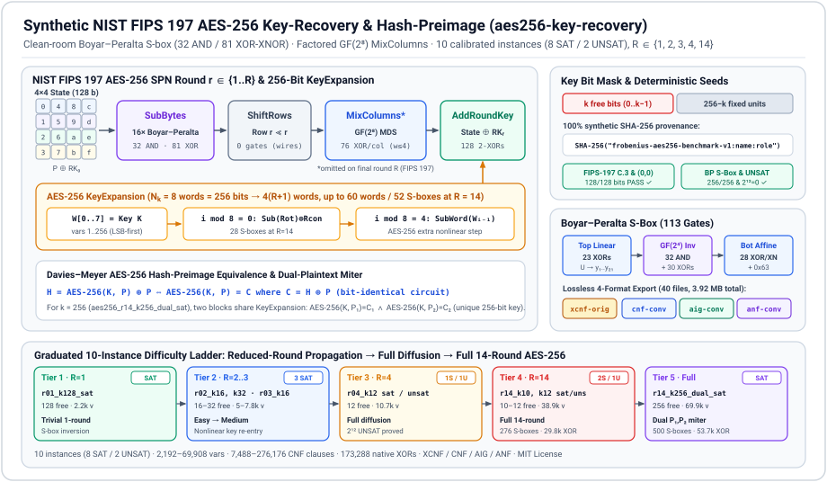

# Synthetic NIST FIPS 197 AES-256 Key-Recovery & Hash-Preimage Circuits (`aes256-key-recovery`)

*Figure: Clean-room NIST FIPS 197 AES-256 SPN round datapath, Boyar–Peralta (SEA 2010) 32-AND / 81-XOR-XNOR S-box decomposition, algebraic equivalence to fixed-IV Davies–Meyer AES-256 hash preimage, transparent deterministic SHA-256 key/plaintext provenance, and the 10-instance graduated $(R, k)$ difficulty ladder. Regenerated via [`src/gen_diagram.py`](src/gen_diagram.py).*

## Provenance & Credit

- **Author:** Luke Hutchison ([`lukehutch`](https://github.com/lukehutch))
- **License:** MIT License ([`../LICENSE`](../LICENSE))
- **Upstream Standards & Circuit Reference:** [NIST FIPS PUB 197](https://csrc.nist.gov/publications/detail/fips/197/final) (Advanced Encryption Standard, AES-256) and Boyar & Peralta (SEA 2010, Table 1) combinational AES S-box minimization.

## Problem Description

A 100% original, transparent, reproducible suite of synthetic **NIST FIPS 197 AES-256** key-recovery and **Davies–Meyer AES-256 hash-preimage** circuits spanning five calibrated difficulty tiers from trivial 1-round S-box inversion through full-diffusion reduced-round instances and full 14-round AES-256 partial-key recovery to a full 256-bit dual-plaintext cryptographic challenge.

- **Exact NIST FIPS 197 AES-256 & Davies–Meyer Equivalence:** For $R \in \{1, \dots, 14\}$ rounds, rounds $1 \dots R-1$ apply `SubBytes`, `ShiftRows`, `MixColumns` over $\mathrm{GF}(2^8) = \mathbb{F}_2[x]/(x^8+x^4+x^3+x+1)$, and `AddRoundKey`, while final round $R$ omits `MixColumns` per standard FIPS 197 convention so $R = 14$ matches FIPS 197 byte-for-byte. Under fixed-IV **Davies–Meyer** compression $H = \mathrm{AES\text{-}256}(K, P) \oplus P$, finding a preimage key/message block $K$ for target digest $H$ and fixed chaining value $P$ is bit-for-bit identical to known-plaintext key recovery $\mathrm{AES\text{-}256}(K, P) = C$ with $C = H \oplus P$. Both the byte-level reference and the gate-level Boolean circuit are self-verified against `AES-256(0, 0) = dc95c078a2408989ad48a21492842087` and **FIPS 197 Appendix C.3** (`K = 000102...1f`, `P = 001122...ff` $\to$ `C = 8ea2b7ca516745bfeafc49904b496089`) on 128/128 bits, and against each other across all $R \in \{1, \dots, 14\}$.
- **Clean-Room Boyar–Peralta S-Box & Factored $\mathbb{F}_2$-Linear Layers:** Each AES S-box uses the published **Boyar–Peralta (SEA 2010, Table 1)** combinational decomposition (**32 AND gates + 81 XOR/XNOR gates = 113 gates**, verified 256/256 against the FIPS 197 S-box). `MixColumns` is factored via $d_j = a_j \oplus a_{(j+1)\bmod 4}$ and $b_j = \mathrm{xtime}(d_j) \oplus a_{(j+1)\bmod 4} \oplus d_{(j+2)\bmod 4}$ so every XOR parity gate across the entire circuit has arity 2 or 3 (maximum native XCNF/CNF width 4, requiring zero auxiliary CNF variables during XOR expansion).
- **Transparent Deterministic Synthetic Provenance:** Every instance derives its 32-byte synthetic key $K$ and 16-byte plaintext(s) $P_1$ (and $P_2$ for the dual-block miter) deterministically from $\mathrm{SHA\text{-}256}(\texttt{"frobenius-aes256-benchmark-v1:}\langle\text{name}\rangle\texttt{:}\langle\text{role}\rangle\texttt{"})$ (`role` $\in \{\text{"key"}, \text{"plaintext1"}, \text{"plaintext2"}\}$). Variables `1..256` represent the 256 key bits in LSB-first byte order (`var = 1 + 8*byte + bit`); bits `0..k-1` are left free while bits `k..255` are fixed to their synthetic values via unit clauses.
- **Mathematically Verified Ground Truth (`8 SAT / 2 UNSAT`):** Every SAT instance's synthetic witness is verified directly against 100% of clauses/equations/gates in all four re-parsed compressed formats (and uniquely verified over $2^k$ for $k \le 12$). Both UNSAT instances (`aes256_r04_k12_unsat`, `aes256_r14_k12_unsat`) flip bit 0 of ciphertext byte 0 (`C[0] ^= 0x01`) and are **exhaustively proven UNSAT** across all $2^{12} = 4{,}096$ keys in Python.

## Corpus & Data Sizes

### Directory Layout & Regeneration

- `xcnf-orig/` — Native **[CryptoMiniSat](https://github.com/msoos/cryptominisat) `.xcnf.xz`** circuits (`853.7 KB`, native `x l1 ... lk 0` parity clauses + 3-clause Tseitin AND gates).
- `cnf-converted/` — Exact Tseitin **DIMACS `.cnf.xz`** conversions (`2.12 MB`, zero auxiliary variables; max clause width 4).
- `aig-converted/` — Combinational **Binary AIGER 1.9 `.aig.xz`** miters (`103.0 KB`, `L = 0, O = 1`, `I = k` free key bits with fixed key bits constant-folded, `PO_0 = 1` iff SAT; independently parsed and witness-simulated across all 10 files plus Frobenius native `.aig.xz` parser checks).
- `anf-converted/` — Lossless linear-size **DIMACS-ANF `.anf.xz`** conversions (`884.7 KB`, degree $\le 3$, generated and verified via [`../src/to_anf.py`](../src/to_anf.py)).
- **[`expected.tsv`](expected.tsv)** — Ground-truth verdict manifest for all 10 instances (**8 SAT / 2 UNSAT**).
- `src/` — Standalone zero-dependency clean-room generator [`src/gen_aes256.py`](src/gen_aes256.py) (`python3 src/gen_aes256.py`) and vector diagram script [`src/gen_diagram.py`](src/gen_diagram.py).

### Problem Parameters & Data Sizes

| Instance | Rounds $R$ | Free Bits $k$ | Pairs | Ans | Vars | CNF Clauses | Native XORs | AIG ANDs | `.xcnf.xz` | `.cnf.xz` | `.aig.xz` | `.anf.xz` |
|---|---:|---:|---:|:---:|---:|---:|---:|---:|---:|---:|---:|---:|
| `aes256_r01_k128_sat` | 1 | 128 | 1 | SAT | 2,192 | 7,488 | 1,424 | 4,495 | 9.7 KB | 20.4 KB | 2.0 KB | 10.4 KB |
| `aes256_r02_k16_sat` | 2 | 16 | 1 | SAT | 5,012 | 18,752 | 3,604 | 2,949 | 20.7 KB | 47.5 KB | 1.9 KB | 22.2 KB |
| `aes256_r02_k32_sat` | 2 | 32 | 1 | SAT | 5,012 | 18,736 | 3,604 | 6,064 | 20.5 KB | 47.7 KB | 3.5 KB | 22.2 KB |
| `aes256_r03_k16_sat` | 3 | 16 | 1 | SAT | 7,832 | 29,904 | 5,784 | 8,751 | 31.0 KB | 74.7 KB | 4.5 KB | 33.0 KB |
| `aes256_r04_k12_sat` | 4 | 12 | 1 | SAT *(unique)* | 10,652 | 41,060 | 7,964 | 15,148 | 41.6 KB | 100.1 KB | 7.3 KB | 45.3 KB |
| `aes256_r04_k12_unsat` | 4 | 12 | 1 | UNSAT *(proved)* | 10,652 | 41,060 | 7,964 | 15,140 | 41.8 KB | 102.7 KB | 7.5 KB | 45.1 KB |
| `aes256_r14_k10_sat` | 14 | 10 | 1 | SAT *(unique)* | 38,852 | 152,582 | 29,764 | 87,439 | 144.6 KB | 370.4 KB | 19.5 KB | 148.8 KB |
| `aes256_r14_k12_sat` | 14 | 12 | 1 | SAT *(unique)* | 38,852 | 152,580 | 29,764 | 87,635 | 140.1 KB | 372.4 KB | 19.7 KB | 147.8 KB |
| `aes256_r14_k12_unsat` | 14 | 12 | 1 | UNSAT *(proved)* | 38,852 | 152,580 | 29,764 | 87,651 | 153.2 KB | 365.8 KB | 19.3 KB | 147.6 KB |
| `aes256_r14_k256_dual_sat` | 14 | 256 | 2 | SAT | 69,908 | 276,176 | 53,652 | 186,077 | 250.6 KB | 669.4 KB | 17.8 KB | 262.2 KB |

### Deterministic Synthetic Vectors

Every key $K$ and plaintext $P$ below is generated solely by $\mathrm{SHA\text{-}256}(\texttt{"frobenius-aes256-benchmark-v1:}\langle\text{instance}\rangle\texttt{:}\langle\text{role}\rangle\texttt{"})$ (truncating to 16 bytes for plaintexts) with zero external or secret data:

| Instance | Plaintext $P_1$ (hex) | Target Ciphertext $C_1$ (hex) | Davies–Meyer Target $H_1 = C_1 \oplus P_1$ (hex) |
|---|---|---|---|
| `aes256_r01_k128_sat` | `40b0c8b82745f45b12e01c7ca5c3548c` | `fef2a145e85f53cbb7ee31afd60071ff` | `be4269fdcf1aa790a50e2dd373c32573` |
| `aes256_r02_k16_sat` | `4745caffec7cfb8ae9215233e513664f` | `79cdd60025c3b29a8a9cd1e31aa07afc` | `3e881cffc9bf491063bd83d0ffb31cb3` |
| `aes256_r02_k32_sat` | `464de296da7ac07dff3cd2a7f9d6467c` | `af7258e417fc6c5d72934bb9fc69ce14` | `e93fba72cd86ac208daf991e05bf8868` |
| `aes256_r03_k16_sat` | `b8fc7df30471ef78230f4133c8045d59` | `c640c77956a883979b5b5f7b09e11030` | `7ebcba8a52d96cefb8541e48c1e54d69` |
| `aes256_r04_k12_sat` | `7e41b425620ec62a117bd6150e628d80` | `07a2ed35ebb77855779f930c578a306b` | `79e3591089b9be7f66e4451959e8bdeb` |
| `aes256_r04_k12_unsat` | `6b7d640988303de8a5ca07dfb1024a29` | `95e44b7ce06e713ca88df09bd3144a2f` *(bit 0 flipped)* | `fe992f75685e4cd40d47f74462160006` |
| `aes256_r14_k10_sat` | `6e5afa773f9603e9334ac56dfe8c1358` | `6900bc31f7135ac41f79569a23036e38` | `075a4646c885592d2c3393f7dd8f7d60` |
| `aes256_r14_k12_sat` | `2c59620c18955595bf622215bcb14dff` | `49927945fe924fe337988fb5ae48fb9b` | `65cb1b49e6071a7688faada012f9b664` |
| `aes256_r14_k12_unsat` | `bea241460daa55ab160d75fc6e76d057` | `6c6c4d224f032d43dbb701cc72a24faf` *(bit 0 flipped)* | `d2ce0c6442a978e8cdba74301cd49ff8` |
| `aes256_r14_k256_dual_sat` | `7e4baee5d39a09cdeef674f31747ea8a` *(P2: `647c75927a5f1485ba2e380338e8ac78`)* | `790284c2d41a1c40e5dbdaecda1af724` *(C2: `02517ef512c4aee57a3752eb826eaebd`)* | `07492a270780158d0b2dae1fcd5d1dae` |

## Benchmark Results

An uncontended 1-core comparative benchmark across all five solvers — **Frobenius 1C** (native `.xcnf.xz`, `.cnf.xz`, and `.aig.xz`), **[CaDiCaL](https://github.com/arminbiere/cadical) 3.1.0**, **[CryptoMiniSat](https://github.com/msoos/cryptominisat) 5.18.0** (CNF and native XCNF), **[dense-solver](https://github.com/libdense/dense-solver) 0.0.4**, and **[Kissat](https://github.com/arminbiere/kissat) 4.0.4** — on the dedicated AMD Ryzen 9 5950X workstation is **scheduled to run upon completion of the current optimization wave** so all measurements are collected with zero CPU contention.

- **Pre-benchmark verification:** All 10 instances have been programmatically verified across all four formats (`xcnf-orig/`, `cnf-converted/`, `aig-converted/`, `anf-converted/`), including 128/128-bit NIST FIPS 197 test-vector agreement, 256/256 Boyar–Peralta S-box equivalence, 100% SAT witness satisfaction across all 4 formats, and exhaustive $2^{12}$ UNSAT refutations in Python for `aes256_r04_k12_unsat` and `aes256_r14_k12_unsat`.

<!-- BEGIN_STRUCTURAL_ANALYSIS -->
## Phase-Transition & Structural Analysis

*Auto-generated by [`../src/analyze_benchmarks.py`](../src/analyze_benchmarks.py). Position relative to the critical phase transition is measured by $\rho_{\mathrm{crit}} = \frac{1}{n}\sum_k m_k / \alpha_c(k)$ (exact $\alpha/\alpha_c(k)$ for pure $k$-SAT; effective critical threshold $\alpha_c^{\mathrm{eff}} = \alpha/\rho_{\mathrm{crit}}$; `Under` $<0.90\times$, `Near-crit` $0.90\text{--}1.10\times$, `Over` $>1.10\times$), alongside Gent–Walsh annealed constrainedness $\kappa = -\frac{1}{n}\sum_i \log_2(1-2^{-k_i})$ (AAAI 1996), clause-length profile ($\bar{k}$, `%Bin`, `%Horn`), variable-degree CV ($\sigma_d/\bar{d}$, uniformity vs. hub skew), and extracted native XOR parity clauses.*

| Instance | Active $n$ | Clauses $m$ | $\alpha=m/n$ | $\alpha_c^{\mathrm{eff}}$ | $\rho_{\mathrm{crit}}$ (Regime) | $\kappa$ | $\bar{k}$ ($k_{\max}$) | Bin% | Horn% | Pos% | Deg CV | XORs |
|---|---:|---:|---:|---:|---:|---:|---:|---:|---:|---:|---:|---:|
| `aes256_r01_k128_sat` | 2,192 | 7,488 | 3.42 | 2.74 | **1.25x** (Over) | 0.86 | 2.79 (3) | 14% | 48% | 49% | 0.41 | 1,424 |
| `aes256_r02_k16_sat` | 5,012 | 18,752 | 3.74 | 2.97 | **1.26x** (Over) | 0.86 | 2.89 (4) | 12% | 45% | 49% | 0.42 | 3,604 |
| `aes256_r02_k32_sat` | 5,012 | 18,736 | 3.74 | 2.98 | **1.25x** (Over) | 0.86 | 2.89 (4) | 12% | 44% | 49% | 0.42 | 3,604 |
| `aes256_r03_k16_sat` | 7,832 | 29,904 | 3.82 | 3.06 | **1.25x** (Over) | 0.85 | 2.92 (4) | 12% | 43% | 49% | 0.41 | 5,784 |
| `aes256_r04_k12_sat` | 10,652 | 41,060 | 3.85 | 3.11 | **1.24x** (Over) | 0.84 | 2.94 (4) | 12% | 43% | 49% | 0.41 | 7,964 |
| `aes256_r04_k12_unsat` | 10,652 | 41,060 | 3.85 | 3.11 | **1.24x** (Over) | 0.84 | 2.94 (4) | 12% | 43% | 49% | 0.41 | 7,964 |
| `aes256_r14_k10_sat` | 38,852 | 152,582 | 3.93 | 3.19 | **1.23x** (Over) | 0.83 | 2.97 (4) | 12% | 42% | 49% | 0.42 | 29,764 |
| `aes256_r14_k12_sat` | 38,852 | 152,580 | 3.93 | 3.19 | **1.23x** (Over) | 0.83 | 2.97 (4) | 12% | 42% | 49% | 0.42 | 29,764 |
| `aes256_r14_k12_unsat` | 38,852 | 152,580 | 3.93 | 3.19 | **1.23x** (Over) | 0.83 | 2.97 (4) | 12% | 42% | 49% | 0.42 | 29,764 |
| `aes256_r14_k256_dual_sat` | 69,908 | 276,176 | 3.95 | 3.22 | **1.23x** (Over) | 0.83 | 2.98 (4) | 12% | 42% | 49% | 0.43 | 53,652 |

**Collection Phase-Transition Summary (10 instances, 4 formats: 10 CNF / 10 AIG / 10 XCNF / 10 ANF):** median $\rho_{\mathrm{crit}} = 1.24\times$ (range `1.23x–1.26x`), median $\kappa = 0.84$, regime split **0 Under / 0 Near-critical / 10 Over**, total extracted native XOR parity clauses = **173,288**, total ANF equations = **332,654**.
<!-- END_STRUCTURAL_ANALYSIS -->

## References

- NIST, *Advanced Encryption Standard (AES)*, FIPS PUB 197, November 2001 (updated May 2023).
- J. Boyar and R. Peralta, *A New Combinational Logic Minimization Technique with Applications to Cryptology*, SEA 2010, LNCS 6049, pp. 178–189.
- N. Courtois and G. V. Bard, *Algebraic Cryptanalysis of the Data Encryption Standard*, Cryptography and Coding (IMA 2007), LNCS 4887, pp. 152–169.
- M. Soos, K. Nohl, and C. Castelluccia, *Extending SAT Solvers to Cryptographic Problems*, SAT 2009, LNCS 5584, pp. 244–257.
- A. Menezes, P. van Oorschot, and S. Vanstone, *Handbook of Applied Cryptography*, Section 9.4.1 (Davies–Meyer hash construction), CRC Press, 1996.
