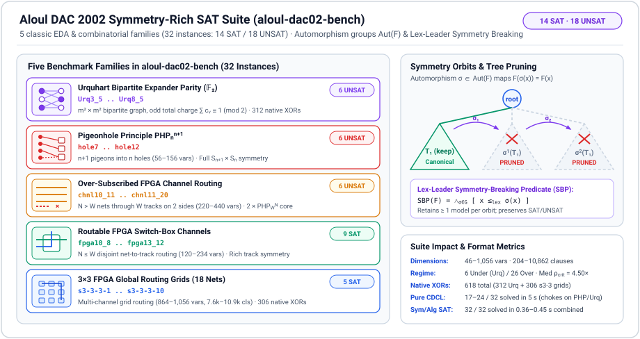

# Aloul DAC 2002 Symmetry Benchmarks (`aloul-dac02-bench`)

*Figure: Five symmetry-rich Aloul DAC 2002 benchmark families (`Urq`, `hole`, `chnl`, `fpga`, `s3-3`; 14 SAT / 18 UNSAT) paired with an automorphism orbit tree illustrating lex-leader symmetry-breaking predicate ($\mathrm{SBP}$) pruning. Regenerated via [`src/gen_diagram.py`](src/gen_diagram.py).*

## Provenance & Credit

- **Authors:** Fadi A. Aloul, Arathi Ramani, Igor L. Markov, and Karem A. Sakallah (University of Michigan / American University of Sharjah)
- **Upstream Homepage:** [Fadi Aloul — SAT Benchmarks](https://www.aloul.net/benchmarks.html)
- **License:** Classic public academic benchmarks contributed to the SAT 2002 Competition and published on `aloul.net`; no separate upstream `LICENSE` file is bundled in the archives.
- **Sibling Aloul Collections:** [`aloul-difp-a/`](../aloul-difp-a/README.md), [`aloul-difp-w/`](../aloul-difp-w/README.md), [`aloul-fpga-sb-sat/`](../aloul-fpga-sb-sat/README.md), [`aloul-fpga-sb-uns/`](../aloul-fpga-sb-uns/README.md)
- **Recommended by:** [`@merlin_numa`](https://twitter.com/merlin_numa) (Twitter/X)

## Problem Description

Mixed symmetry-rich EDA/combinatorial suite from Aloul et al.'s DAC 2002 paper spanning FPGA switch-boxes, global routing (SAT), pigeonhole (`hole`, `chnl`), and randomized Urquhart parity instances (`Urq3_5`–`Urq8_5`).

## Corpus & Data Sizes

- **`cnf-orig/`** — 32 original native **DIMACS `.cnf.xz`** files (120.6 KB).
- **`aig-converted/`** — 32 exact **Binary AIGER 1.9 `.aig.xz`** conversions (156.1 KB, verified via [Berkeley ABC](https://github.com/berkeley-abc/abc) `read_aiger`).
- **`xcnf-converted/`** — 32 lossless **[CryptoMiniSat](https://github.com/msoos/cryptominisat) `.xcnf.xz`** conversions (106.4 KB, `618` extracted native XOR parity clauses).
- **`anf-converted/`** — 32 lossless linear-size **DIMACS-ANF `.anf.xz`** conversions (291.6 KB, generated via [`../src/to_anf.py`](../src/to_anf.py)).
- **[`expected.tsv`](expected.tsv)** — Ground-truth verdict manifest for all 32 instances (**14 SAT / 18 UNSAT**).
- **`src/`** — Standalone converters (`cnf2aig.py`, `cnf2xcnf.py`).

| Format | Directory | Files | Key Dimensions (Range) | Compressed Size |
|---|---|---:|---|---:|
| **DIMACS CNF (origin)** | `cnf-orig/` | 32 | Vars: 46–1,056; Clauses: 204–10,862 | 120.6 KB |
| **Binary AIGER 1.9** | `aig-converted/` | 32 | Inputs: 46–1,056; ANDs: 447–22,693 | 156.1 KB |
| **[CryptoMiniSat](https://github.com/msoos/cryptominisat) XCNF** | `xcnf-converted/` | 32 | Native XOR clauses total: 618 | 106.4 KB |
| **DIMACS-ANF** | `anf-converted/` | 32 | Vars: 88–6,983; Eqs: 236–10,998 (deg ≤ 3) | 291.6 KB |
| **Total (4 Formats, Status: 14 SAT / 18 UNSAT)** | | **128** | | **674.7 KB** |

## Benchmark Results

- **Hardware & Protocol:** Same machine (**AMD Ryzen 9 5950X**, 16C/32T Linux, **1 thread per run** pinned across 8 dedicated physical cores, $T_{\max} = 5\;\text{s}$, PAR-2 penalty $10,000\;\text{ms}$). All solvers ran with default single-thread flags (`-t 1` for CryptoMiniSat 5.18.0; `--max-cores 1` for Frobenius) on identical uncompressed flat `.cnf` inputs; **100% of all 32 instances** were run (no subsampling), every Frobenius SAT model was independently verified against 100% of input clauses, and **0 verdict disagreements** occurred across all solvers.

| Instance | Verdict | Frobenius 1C | [CaDiCaL](https://github.com/arminbiere/cadical) 3.1.0 | [CryptoMiniSat](https://github.com/msoos/cryptominisat) 5.18.0 | [dense-solver](https://github.com/libdense/dense-solver) 0.0.4 | [Kissat](https://github.com/arminbiere/kissat) 4.0.4 |
|---|:---:|---:|---:|---:|---:|---:|
| `Urq3_5` | UNSAT | 3.12 ms | >5 s | 21.89 ms | **1.36 ms** | >5 s |
| `Urq4_5` | UNSAT | 3.14 ms | >5 s | 26.52 ms | **1.42 ms** | >5 s |
| `Urq5_5` | UNSAT | 2.58 ms | >5 s | 37.84 ms | **1.42 ms** | >5 s |
| `Urq6_5` | UNSAT | 2.36 ms | >5 s | 47.46 ms | **1.77 ms** | >5 s |
| `Urq7_5` | UNSAT | 2.69 ms | >5 s | 54.96 ms | **1.86 ms** | >5 s |
| `Urq8_5` | UNSAT | 2.63 ms | >5 s | 80.99 ms | **2.08 ms** | >5 s |
| `chnl10_11` | UNSAT | 2.12 ms | >5 s | >5 s | **1.34 ms** | 199.97 ms |
| `chnl10_12` | UNSAT | 2.15 ms | >5 s | >5 s | **1.49 ms** | 528.05 ms |
| `chnl10_13` | UNSAT | 2.87 ms | >5 s | >5 s | **1.39 ms** | 1,122.17 ms |
| `chnl11_12` | UNSAT | 1.87 ms | >5 s | >5 s | **1.26 ms** | 1,035.18 ms |
| `chnl11_13` | UNSAT | 1.79 ms | >5 s | >5 s | **1.49 ms** | 1,528.22 ms |
| `chnl11_20` | UNSAT | 2.31 ms | >5 s | >5 s | **1.46 ms** | 231.50 ms |
| `fpga10_8_sat` | SAT | 2.04 ms | 4.31 ms | 15.53 ms | **1.67 ms** | 9.95 ms |
| `fpga10_9_sat` | SAT | 2.02 ms | 6.02 ms | 19.22 ms | 1.81 ms | **1.30 ms** |
| `fpga12_11_sat` | SAT | 1.64 ms | 4.73 ms | 39.46 ms | 2.00 ms | **1.33 ms** |
| `fpga12_12_sat` | SAT | 1.76 ms | 18.74 ms | 47.61 ms | 1.99 ms | **1.35 ms** |
| `fpga12_8_sat` | SAT | **1.64 ms** | 4.22 ms | 20.58 ms | 2.16 ms | 12.76 ms |
| `fpga12_9_sat` | SAT | **1.76 ms** | 4.66 ms | 25.76 ms | 2.29 ms | 20.55 ms |
| `fpga13_10_sat` | SAT | **1.70 ms** | 4.42 ms | 36.38 ms | 2.07 ms | 20.46 ms |
| `fpga13_12_sat` | SAT | **1.82 ms** | 5.11 ms | 54.22 ms | 2.27 ms | 39.50 ms |
| `fpga13_9_sat` | SAT | **2.03 ms** | 4.12 ms | 30.15 ms | 2.30 ms | 18.04 ms |
| `hole10` | UNSAT | 1.66 ms | >5 s | >5 s | **1.54 ms** | 1,611.23 ms |
| `hole11` | UNSAT | 1.73 ms | >5 s | >5 s | **1.50 ms** | >5 s |
| `hole12` | UNSAT | **1.72 ms** | >5 s | >5 s | 1.86 ms | >5 s |
| `hole7` | UNSAT | 1.76 ms | 27.57 ms | 52.36 ms | **1.32 ms** | 15.09 ms |
| `hole8` | UNSAT | 1.65 ms | 273.31 ms | 333.41 ms | **1.38 ms** | 67.06 ms |
| `hole9` | UNSAT | 1.94 ms | 3,254.17 ms | 4,878.71 ms | **1.59 ms** | 243.28 ms |
| `s3-3-3-1` | SAT | **45.34 ms** | 56.17 ms | 171.48 ms | 70.88 ms | 77.45 ms |
| `s3-3-3-10` | SAT | 81.50 ms | 137.34 ms | 254.11 ms | **53.69 ms** | 56.79 ms |
| `s3-3-3-3` | SAT | **49.69 ms** | 65.23 ms | 203.24 ms | 67.14 ms | 78.92 ms |
| `s3-3-3-4` | SAT | **68.08 ms** | 143.37 ms | 179.22 ms | 69.22 ms | 83.55 ms |
| `s3-3-3-8` | SAT | 59.17 ms | 62.45 ms | 234.93 ms | 143.68 ms | **29.30 ms** |
| **Solved (32 files)** | — | **32 / 32** *(highest)* | 17 / 32 *(-15 worse)* | 23 / 32 *(-9 worse)* | **32 / 32** *(highest)* | 24 / 32 *(-8 worse)* |
| **Total PAR-2** | — | **360.3 ms** *(fastest)* | 154,075.9 ms *(427.66x slower)* | 96,866.0 ms *(268.86x slower)* | 450.7 ms *(1.25x slower)* | 87,033.0 ms *(241.57x slower)* |

<!-- BEGIN_STRUCTURAL_ANALYSIS -->
## Phase-Transition & Structural Analysis

*Auto-generated by [`../src/analyze_benchmarks.py`](../src/analyze_benchmarks.py). Position relative to the critical phase transition is measured by $\rho_{\mathrm{crit}} = \frac{1}{n}\sum_k m_k / \alpha_c(k)$ (exact $\alpha/\alpha_c(k)$ for pure $k$-SAT; effective critical threshold $\alpha_c^{\mathrm{eff}} = \alpha/\rho_{\mathrm{crit}}$; `Under` $<0.90\times$, `Near-crit` $0.90\text{--}1.10\times$, `Over` $>1.10\times$), alongside Gent–Walsh annealed constrainedness $\kappa = -\frac{1}{n}\sum_i \log_2(1-2^{-k_i})$ (AAAI 1996), clause-length profile ($\bar{k}$, `%Bin`, `%Horn`), variable-degree CV ($\sigma_d/\bar{d}$, uniformity vs. hub skew), and extracted native XOR parity clauses.*

| Group / Family | Files | Med $n$ | Med $m$ | $\alpha=m/n$ (Med) | $\alpha_c^{\mathrm{eff}}$ (Med) | $\rho_{\mathrm{crit}}$ Med [Min–Max] (Regime) | Med $\kappa$ | Med $\bar{k}$ | Bin% | Horn% | Deg CV | Total XORs |
|---|---:|---:|---:|---:|---:|---:|---:|---:|---:|---:|---:|---:|
| `aloul-dac02-bench` | 27 | 176 | 949 | 5.31 | 1.16 | **4.00x** [0.31x–9.50x] (Over) | 1.66 | 2.68 | 86% | 86% | 0.13 | 312 |
| `s3-3` | 5 | 912 | 8,356 | 9.16 | 1.06 | **8.61x** [8.23x–9.75x] (Over) | 3.62 | 2.11 | 93% | 94% | 0.25 | 306 |

**Collection Phase-Transition Summary (32 instances, 4 formats: 32 CNF / 32 AIG / 32 XCNF / 32 ANF):** median $\rho_{\mathrm{crit}} = 4.50\times$ (range `0.31x–9.75x`), median $\kappa = 1.87$, regime split **6 Under / 0 Near-critical / 26 Over**, total extracted native XOR parity clauses = **618**, total ANF equations = **98,363**.
<!-- END_STRUCTURAL_ANALYSIS -->

## References

- F. A. Aloul, A. Ramani, I. L. Markov, and K. A. Sakallah, *"Solving Difficult SAT Instances in the Presence of Symmetry"*, Proc. 39th Design Automation Conference (DAC 2002), pp. 731–736.
- F. A. Aloul, A. Ramani, I. L. Markov, and K. A. Sakallah, *"Solving Difficult Instances of Boolean Satisfiability in the Presence of Symmetry"*, IEEE Trans. Computer-Aided Design (TCAD), 22(9), pp. 1117–1137, Sept. 2003.
