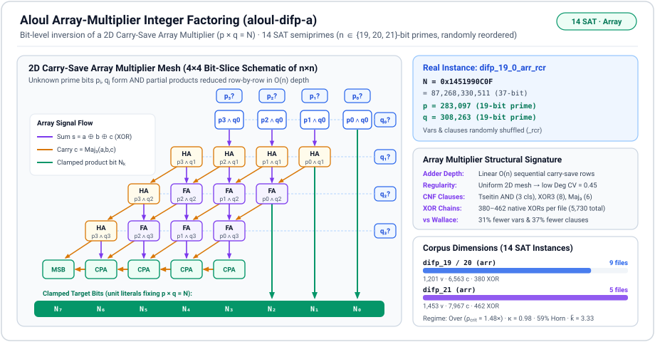

# Aloul Array-Multiplier Integer Factoring Benchmarks (`aloul-difp-a`)

*Figure: Bit-slice 2D carry-save array multiplier mesh ($O(n)$ depth, diagonal XOR sums and vertical $\mathrm{Maj}_3$ carries into clamped target $N$) spotlighting real semiprime `difp_19_0_arr_rcr` ($283{,}097 \times 308{,}263$). Regenerated via [`src/gen_diagram.py`](src/gen_diagram.py).*

## Provenance & Credit

- **Authors:** Fadi A. Aloul, Arathi Ramani, Igor L. Markov, and Karem A. Sakallah (University of Michigan / American University of Sharjah)
- **Upstream Homepage:** [Fadi Aloul — SAT Benchmarks](https://www.aloul.net/benchmarks.html)
- **License:** Classic public academic benchmarks contributed to the SAT 2002 Competition and published on `aloul.net`; no separate upstream `LICENSE` file is bundled in the archives.
- **Sibling Aloul Collections:** [`aloul-dac02-bench/`](../aloul-dac02-bench/README.md), [`aloul-difp-w/`](../aloul-difp-w/README.md), [`aloul-fpga-sb-sat/`](../aloul-fpga-sb-sat/README.md), [`aloul-fpga-sb-uns/`](../aloul-fpga-sb-uns/README.md)
- **Recommended by:** [`@merlin_numa`](https://twitter.com/merlin_numa) (Twitter/X)

## Problem Description

Difficult Integer Factorization Problems (`difp_a`, 14 SAT instances) encoded via **Array multipliers** multiplying two $n$-bit primes ($n \in \{19, 20, 21\}$), with variables and clauses randomly reordered.

## Corpus & Data Sizes

- **`cnf-orig/`** — 14 original native **DIMACS `.cnf.xz`** files (500.1 KB).
- **`aig-converted/`** — 14 exact **Binary AIGER 1.9 `.aig.xz`** conversions (571.5 KB, verified via [Berkeley ABC](https://github.com/berkeley-abc/abc) `read_aiger`).
- **`xcnf-converted/`** — 14 lossless **[CryptoMiniSat](https://github.com/msoos/cryptominisat) `.xcnf.xz`** conversions (307.9 KB, `5,730` extracted native XOR parity clauses).
- **`anf-converted/`** — 14 lossless linear-size **DIMACS-ANF `.anf.xz`** conversions (468.1 KB, generated via [`../src/to_anf.py`](../src/to_anf.py)).
- **[`expected.tsv`](expected.tsv)** — Ground-truth verdict manifest for all 14 instances (**14 SAT / 0 UNSAT**).
- **`src/`** — Standalone converters (`cnf2aig.py`, `cnf2xcnf.py`).

| Format | Directory | Files | Key Dimensions (Range) | Compressed Size |
|---|---|---:|---|---:|
| **DIMACS CNF (origin)** | `cnf-orig/` | 14 | Vars: 1,201–1,453; Clauses: 6,563–7,967 | 500.1 KB |
| **Binary AIGER 1.9** | `aig-converted/` | 14 | Inputs: 1,201–1,453; ANDs: 18,140–22,058 | 571.5 KB |
| **[CryptoMiniSat](https://github.com/msoos/cryptominisat) XCNF** | `xcnf-converted/` | 14 | Native XOR clauses total: 5,730 | 307.9 KB |
| **DIMACS-ANF** | `anf-converted/` | 14 | Vars: 1,235–1,491; Eqs: 3,937–4,771 (deg ≤ 3) | 468.1 KB |
| **Total (4 Formats, Status: 14 SAT / 0 UNSAT)** | | **56** | | **1.80 MB** |

## Benchmark Results

- **Hardware & Protocol:** Same machine (**AMD Ryzen 9 5950X**, 16C/32T Linux, **1 thread per run** pinned to a dedicated physical core, $T_{\max} = 5\;\text{s}$, PAR-2 penalty $10,000\;\text{ms}$). All solvers ran with default single-thread flags (`-t 1` for CryptoMiniSat 5.18.0; `--max-cores 1` for Frobenius, reporting the exact median of 3 runs) on identical uncompressed flat `.cnf` inputs; **100% of all 14 instances** were run (no subsampling), all 14/14 Frobenius SAT models were independently verified against 100% of input clauses, and **0 verdict disagreements** occurred across all solvers.

| Instance | Verdict | Frobenius 1C | [CaDiCaL](https://github.com/arminbiere/cadical) 3.1.0 | [CryptoMiniSat](https://github.com/msoos/cryptominisat) 5.18.0 | [dense-solver](https://github.com/libdense/dense-solver) 0.0.4 | [Kissat](https://github.com/arminbiere/kissat) 4.0.4 |
|---|:---:|---:|---:|---:|---:|---:|
| `difp_19_0_arr_rcr` | SAT | **4.30 ms** | 1,364.53 ms | >5 s | >5 s | >5 s |
| `difp_19_1_arr_rcr` | SAT | **4.23 ms** | 3,567.78 ms | >5 s | 2,444.97 ms | 3,556.88 ms |
| `difp_19_3_arr_rcr` | SAT | **4.17 ms** | 4,097.83 ms | 1,047.68 ms | >5 s | 4,631.54 ms |
| `difp_19_99_arr_rcr` | SAT | **4.18 ms** | >5 s | >5 s | 1,001.61 ms | 4,968.67 ms |
| `difp_20_0_arr_rcr` | SAT | **4.64 ms** | 3,877.38 ms | >5 s | >5 s | 2,293.15 ms |
| `difp_20_1_arr_rcr` | SAT | **4.67 ms** | 1,047.60 ms | 2,370.92 ms | >5 s | >5 s |
| `difp_20_2_arr_rcr` | SAT | **4.67 ms** | 3,823.22 ms | 2,313.61 ms | 5,062.50 ms | 3,607.96 ms |
| `difp_20_3_arr_rcr` | SAT | **4.46 ms** | 2,466.49 ms | 2,466.35 ms | 5,264.38 ms | >5 s |
| `difp_20_99_arr_rcr` | SAT | **5.05 ms** | 1,903.50 ms | 848.98 ms | 2,238.55 ms | 497.63 ms |
| `difp_21_0_arr_rcr` | SAT | **5.98 ms** | >5 s | >5 s | >5 s | 945.96 ms |
| `difp_21_1_arr_rcr` | SAT | **6.36 ms** | >5 s | >5 s | >5 s | >5 s |
| `difp_21_2_arr_rcr` | SAT | **6.89 ms** | >5 s | >5 s | >5 s | >5 s |
| `difp_21_3_arr_rcr` | SAT | **6.79 ms** | >5 s | 1,638.21 ms | >5 s | 134.61 ms |
| `difp_21_99_arr_rcr` | SAT | **6.45 ms** | >5 s | 4,378.83 ms | >5 s | >5 s |
| **Total (14 files, PAR-2)** | **14/14** | **14/14 — 72.9 ms** *(fastest)* | 8/14 — 82,148.3 ms *(1,127.62x)* | 7/14 — 85,064.6 ms *(1,167.65x)* | 5/14 — 106,012.0 ms *(1,455.19x)* | 8/14 — 80,636.4 ms *(1,106.87x)* |

*Summary:* Frobenius 1C solves all **14/14** instances (including `difp_21_1_arr_rcr` and `difp_21_2_arr_rcr`, where all four baseline solvers time out at $5\;\text{s}$) in **`72.9 ms` total** (`4.17–6.89 ms` per instance) — **1,106.87x faster** PAR-2 than Kissat 4.0.4, **1,127.62x faster** than CaDiCaL 3.1.0, **1,167.65x faster** than CryptoMiniSat 5.18.0, and **1,455.19x faster** than dense-solver 0.0.4.

<!-- BEGIN_STRUCTURAL_ANALYSIS -->
## Phase-Transition & Structural Analysis

*Auto-generated by [`../src/analyze_benchmarks.py`](../src/analyze_benchmarks.py). Position relative to the critical phase transition is measured by $\rho_{\mathrm{crit}} = \frac{1}{n}\sum_k m_k / \alpha_c(k)$ (exact $\alpha/\alpha_c(k)$ for pure $k$-SAT; effective critical threshold $\alpha_c^{\mathrm{eff}} = \alpha/\rho_{\mathrm{crit}}$; `Under` $<0.90\times$, `Near-crit` $0.90\text{--}1.10\times$, `Over` $>1.10\times$), alongside Gent–Walsh annealed constrainedness $\kappa = -\frac{1}{n}\sum_i \log_2(1-2^{-k_i})$ (AAAI 1996), clause-length profile ($\bar{k}$, `%Bin`, `%Horn`), variable-degree CV ($\sigma_d/\bar{d}$, uniformity vs. hub skew), and extracted native XOR parity clauses.*

| Instance | Active $n$ | Clauses $m$ | $\alpha=m/n$ | $\alpha_c^{\mathrm{eff}}$ | $\rho_{\mathrm{crit}}$ (Regime) | $\kappa$ | $\bar{k}$ ($k_{\max}$) | Bin% | Horn% | Pos% | Deg CV | XORs |
|---|---:|---:|---:|---:|---:|---:|---:|---:|---:|---:|---:|---:|
| `difp_19_0_arr_rcr` | 1,201 | 6,563 | 5.46 | 3.70 | **1.48x** (Over) | 0.98 | 3.33 (20) | 12% | 59% | 49% | 0.45 | 380 |
| `difp_19_1_arr_rcr` | 1,201 | 6,563 | 5.46 | 3.70 | **1.48x** (Over) | 0.98 | 3.33 (20) | 12% | 59% | 49% | 0.45 | 380 |
| `difp_19_3_arr_rcr` | 1,201 | 6,563 | 5.46 | 3.70 | **1.48x** (Over) | 0.98 | 3.33 (20) | 12% | 59% | 49% | 0.45 | 380 |
| `difp_19_99_arr_rcr` | 1,201 | 6,563 | 5.46 | 3.70 | **1.48x** (Over) | 0.98 | 3.33 (20) | 12% | 59% | 49% | 0.45 | 380 |
| `difp_20_0_arr_rcr` | 1,201 | 6,563 | 5.46 | 3.70 | **1.48x** (Over) | 0.98 | 3.33 (20) | 12% | 59% | 49% | 0.45 | 380 |
| `difp_20_1_arr_rcr` | 1,201 | 6,563 | 5.46 | 3.70 | **1.48x** (Over) | 0.98 | 3.33 (20) | 12% | 59% | 49% | 0.45 | 380 |
| `difp_20_2_arr_rcr` | 1,201 | 6,563 | 5.46 | 3.70 | **1.48x** (Over) | 0.98 | 3.33 (20) | 12% | 59% | 49% | 0.45 | 380 |
| `difp_20_3_arr_rcr` | 1,201 | 6,563 | 5.46 | 3.70 | **1.48x** (Over) | 0.98 | 3.33 (20) | 12% | 59% | 49% | 0.45 | 380 |
| `difp_20_99_arr_rcr` | 1,201 | 6,563 | 5.46 | 3.70 | **1.48x** (Over) | 0.98 | 3.33 (20) | 12% | 59% | 49% | 0.45 | 380 |
| `difp_21_0_arr_rcr` | 1,453 | 7,967 | 5.48 | 3.71 | **1.48x** (Over) | 0.98 | 3.34 (22) | 12% | 59% | 49% | 0.46 | 462 |
| `difp_21_1_arr_rcr` | 1,453 | 7,967 | 5.48 | 3.71 | **1.48x** (Over) | 0.98 | 3.34 (22) | 12% | 59% | 49% | 0.46 | 462 |
| `difp_21_2_arr_rcr` | 1,453 | 7,967 | 5.48 | 3.71 | **1.48x** (Over) | 0.98 | 3.34 (22) | 12% | 59% | 49% | 0.46 | 462 |
| `difp_21_3_arr_rcr` | 1,453 | 7,967 | 5.48 | 3.71 | **1.48x** (Over) | 0.98 | 3.34 (22) | 12% | 59% | 49% | 0.46 | 462 |
| `difp_21_99_arr_rcr` | 1,453 | 7,967 | 5.48 | 3.71 | **1.48x** (Over) | 0.98 | 3.34 (22) | 12% | 59% | 49% | 0.46 | 462 |

**Collection Phase-Transition Summary (14 instances, 4 formats: 14 CNF / 14 AIG / 14 XCNF / 14 ANF):** median $\rho_{\mathrm{crit}} = 1.48\times$ (range `1.48x–1.48x`), median $\kappa = 0.98$, regime split **0 Under / 0 Near-critical / 14 Over**, total extracted native XOR parity clauses = **5,730**, total ANF equations = **59,288**.
<!-- END_STRUCTURAL_ANALYSIS -->

## References

- F. A. Aloul, A. Ramani, I. L. Markov, and K. A. Sakallah, *"Solving Difficult SAT Instances in the Presence of Symmetry"*, Proc. 39th Design Automation Conference (DAC 2002), pp. 731–736.
- F. A. Aloul, A. Ramani, I. L. Markov, and K. A. Sakallah, *"Solving Difficult Instances of Boolean Satisfiability in the Presence of Symmetry"*, IEEE Trans. Computer-Aided Design (TCAD), 22(9), pp. 1117–1137, Sept. 2003.
