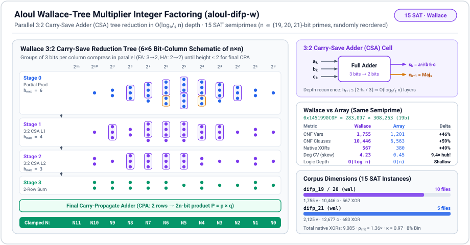

# Aloul Wallace-Multiplier Integer Factoring Benchmarks (`aloul-difp-w`)

## Provenance & Credit

- **Authors:** Fadi A. Aloul, Arathi Ramani, Igor L. Markov, and Karem A. Sakallah (University of Michigan / American University of Sharjah)
- **Upstream Homepage:** [Fadi Aloul — SAT Benchmarks](https://www.aloul.net/benchmarks.html)
- **License:** Classic public academic benchmarks contributed to the SAT 2002 Competition and published on `aloul.net`; no separate upstream `LICENSE` file is bundled in the archives.
- **Sibling Aloul Collections:** [`aloul-dac02-bench/`](../aloul-dac02-bench/README.md), [`aloul-difp-a/`](../aloul-difp-a/README.md), [`aloul-fpga-sb-sat/`](../aloul-fpga-sb-sat/README.md), [`aloul-fpga-sb-uns/`](../aloul-fpga-sb-uns/README.md)
- **Recommended by:** [`@merlin_numa`](https://twitter.com/merlin_numa) (Twitter/X)

## Problem Description

Difficult Integer Factorization Problems (`difp_w`, 15 SAT instances) encoded via **Wallace Tree multipliers** multiplying two $n$-bit primes ($n \in \{19, 20, 21\}$), with variables and clauses randomly reordered.

*Figure: Wallace-tree 3:2 Carry-Save Adder (CSA) parallel bit-column dot-reduction stages ($O(\log_{3/2} n)$ depth) contrasted directly against the array topology on the same 19-bit semiprime across all 15 SAT instances. Regenerated via [`src/gen_diagram.py`](src/gen_diagram.py).*

## Corpus & Data Sizes (Four Formats)

- **`cnf-orig/`** — 15 original native **DIMACS `.cnf.xz`** files (856.7 KB).
- **`aig-converted/`** — 15 exact **Binary AIGER 1.9 `.aig.xz`** conversions (957.9 KB, verified via [Berkeley ABC](https://github.com/berkeley-abc/abc) `read_aiger`).
- **`xcnf-converted/`** — 15 lossless **[CryptoMiniSat](https://github.com/msoos/cryptominisat) `.xcnf.xz`** conversions (546.0 KB, `9,085` extracted native XOR parity clauses).
- **`anf-converted/`** — 15 lossless linear-size **DIMACS-ANF `.anf.xz`** conversions (776.4 KB, generated via [`../src/to_anf.py`](../src/to_anf.py)).
- **[`expected.tsv`](expected.tsv)** — Ground-truth verdict manifest for all 15 instances (**15 SAT / 0 UNSAT**).
- **`src/`** — Standalone converters (`cnf2aig.py`, `cnf2xcnf.py`).

| Format | Directory | Files | Key Dimensions (Range) | Compressed Size |
|---|---|---:|---|---:|
| **DIMACS CNF (origin)** | `cnf-orig/` | 15 | Vars: 1,755–2,125; Clauses: 10,446–12,677 | 856.7 KB |
| **Binary AIGER 1.9** | `aig-converted/` | 15 | Inputs: 1,755–2,125; ANDs: 27,163–32,794 | 957.9 KB |
| **[CryptoMiniSat](https://github.com/msoos/cryptominisat) XCNF** | `xcnf-converted/` | 15 | Native XOR clauses total: 9,085 | 546.0 KB |
| **DIMACS-ANF** | `anf-converted/` | 15 | Vars: 1,789–2,163; Eqs: 6,061–7,348 (deg ≤ 3) | 776.4 KB |
| **Total (4 Formats, Status: 15 SAT / 0 UNSAT)** | | **60** | | **3.06 MB** |

## Comparative 1-Core Benchmark Results (All 15 Instances, Flat `.cnf`, $T_{\max} = 5\;\text{s}$)

- **Hardware & Protocol:** Same machine (**AMD Ryzen 9 5950X**, 16C/32T Linux, **1 thread per run** pinned to a dedicated physical core, $T_{\max} = 5\;\text{s}$, PAR-2 penalty $10,000\;\text{ms}$). All solvers ran with default single-thread flags (`-t 1` for CryptoMiniSat 5.18.0; `--max-cores 1` for Frobenius, reporting the exact median of 3 runs) on identical uncompressed flat `.cnf` inputs; **100% of all 15 instances** were run (no subsampling), all 15/15 Frobenius SAT models were independently verified against 100% of input clauses, and **0 verdict disagreements** occurred across all solvers.

| Instance | Verdict | Frobenius 1C | [CaDiCaL](https://github.com/arminbiere/cadical) 3.1.0 | [CryptoMiniSat](https://github.com/msoos/cryptominisat) 5.18.0 | [dense-solver](https://github.com/libdense/dense-solver) 0.0.4 | [Kissat](https://github.com/arminbiere/kissat) 4.0.4 |
|---|:---:|---:|---:|---:|---:|---:|
| `difp_19_0_wal_rcr` | SAT | **11.62 ms** | 1,396.79 ms | >5 s | >5 s | 2,483.73 ms |
| `difp_19_1_wal_rcr` | SAT | **14.56 ms** | 214.15 ms | >5 s | 807.66 ms | >5 s |
| `difp_19_2_wal_rcr` | SAT | **10.94 ms** | >5 s | >5 s | >5 s | 3,533.64 ms |
| `difp_19_3_wal_rcr` | SAT | **11.08 ms** | 1,620.51 ms | 3,416.57 ms | >5 s | 2,128.49 ms |
| `difp_19_99_wal_rcr` | SAT | **11.02 ms** | >5 s | 354.73 ms | >5 s | >5 s |
| `difp_20_0_wal_rcr` | SAT | **11.42 ms** | >5 s | >5 s | >5 s | 228.69 ms |
| `difp_20_1_wal_rcr` | SAT | **11.26 ms** | >5 s | >5 s | 1,463.82 ms | >5 s |
| `difp_20_2_wal_rcr` | SAT | **11.39 ms** | 4,176.57 ms | 1,675.33 ms | 2,147.64 ms | >5 s |
| `difp_20_3_wal_rcr` | SAT | **11.37 ms** | 2,204.27 ms | 551.79 ms | 1,252.93 ms | 3,651.59 ms |
| `difp_20_99_wal_rcr` | SAT | **12.63 ms** | 1,539.44 ms | 317.03 ms | >5 s | 426.43 ms |
| `difp_21_0_wal_rcr` | SAT | **14.13 ms** | >5 s | 540.73 ms | >5 s | 4,647.90 ms |
| `difp_21_1_wal_rcr` | SAT | **14.37 ms** | >5 s | >5 s | >5 s | >5 s |
| `difp_21_2_wal_rcr` | SAT | **14.98 ms** | >5 s | >5 s | >5 s | >5 s |
| `difp_21_3_wal_rcr` | SAT | **15.09 ms** | >5 s | 1,714.55 ms | >5 s | >5 s |
| `difp_21_99_wal_rcr` | SAT | **14.56 ms** | >5 s | >5 s | >5 s | >5 s |
| **Total (15 files, PAR-2)** | **15/15** | **15/15 — 190.4 ms** *(fastest)* | 6/15 — 101,151.7 ms *(531.18x)* | 7/15 — 88,570.7 ms *(465.11x)* | 4/15 — 115,672.1 ms *(607.43x)* | 7/15 — 97,100.5 ms *(509.90x)* |

*Summary:* Frobenius 1C solves all **15/15** instances (including `difp_21_1_wal_rcr` and `difp_21_2_wal_rcr`, where all four baseline solvers time out at $5\;\text{s}$) in **`190.4 ms` total** (`10.94–15.09 ms` per instance) — **465.1x faster** PAR-2 than CryptoMiniSat 5.18.0, **509.9x faster** than Kissat 4.0.4, **531.2x faster** than CaDiCaL 3.1.0, and **607.4x faster** than dense-solver 0.0.4.

<!-- BEGIN_STRUCTURAL_ANALYSIS -->
## Phase-Transition & Structural Analysis

*Auto-generated by [`../src/analyze_benchmarks.py`](../src/analyze_benchmarks.py). Position relative to the critical phase transition is measured by $\rho_{\mathrm{crit}} = \frac{1}{n}\sum_k m_k / \alpha_c(k)$ (exact $\alpha/\alpha_c(k)$ for pure $k$-SAT; effective critical threshold $\alpha_c^{\mathrm{eff}} = \alpha/\rho_{\mathrm{crit}}$; `Under` $<0.90\times$, `Near-crit` $0.90\text{--}1.10\times$, `Over` $>1.10\times$), alongside Gent–Walsh annealed constrainedness $\kappa = -\frac{1}{n}\sum_i \log_2(1-2^{-k_i})$ (AAAI 1996), clause-length profile ($\bar{k}$, `%Bin`, `%Horn`), variable-degree CV ($\sigma_d/\bar{d}$, uniformity vs. hub skew), and extracted native XOR parity clauses.*

| Instance | Active $n$ | Clauses $m$ | $\alpha=m/n$ | $\alpha_c^{\mathrm{eff}}$ | $\rho_{\mathrm{crit}}$ (Regime) | $\kappa$ | $\bar{k}$ ($k_{\max}$) | Bin% | Horn% | Pos% | Deg CV | XORs |
|---|---:|---:|---:|---:|---:|---:|---:|---:|---:|---:|---:|---:|
| `difp_19_0_wal_rcr` | 1,755 | 10,446 | 5.95 | 4.37 | **1.36x** (Over) | 0.97 | 3.42 (20) | 8% | 56% | 49% | 4.23 | 567 |
| `difp_19_1_wal_rcr` | 1,755 | 10,446 | 5.95 | 4.37 | **1.36x** (Over) | 0.97 | 3.42 (20) | 8% | 56% | 49% | 4.23 | 567 |
| `difp_19_2_wal_rcr` | 1,755 | 10,446 | 5.95 | 4.37 | **1.36x** (Over) | 0.97 | 3.42 (20) | 8% | 56% | 49% | 4.23 | 567 |
| `difp_19_3_wal_rcr` | 1,755 | 10,446 | 5.95 | 4.37 | **1.36x** (Over) | 0.97 | 3.42 (20) | 8% | 56% | 49% | 4.23 | 567 |
| `difp_19_99_wal_rcr` | 1,755 | 10,446 | 5.95 | 4.37 | **1.36x** (Over) | 0.97 | 3.42 (20) | 8% | 56% | 49% | 4.23 | 567 |
| `difp_20_0_wal_rcr` | 1,755 | 10,446 | 5.95 | 4.37 | **1.36x** (Over) | 0.97 | 3.42 (20) | 8% | 56% | 49% | 4.23 | 567 |
| `difp_20_1_wal_rcr` | 1,755 | 10,446 | 5.95 | 4.37 | **1.36x** (Over) | 0.97 | 3.42 (20) | 8% | 56% | 49% | 4.23 | 567 |
| `difp_20_2_wal_rcr` | 1,755 | 10,446 | 5.95 | 4.37 | **1.36x** (Over) | 0.97 | 3.42 (20) | 8% | 56% | 49% | 4.23 | 567 |
| `difp_20_3_wal_rcr` | 1,755 | 10,446 | 5.95 | 4.37 | **1.36x** (Over) | 0.97 | 3.42 (20) | 8% | 56% | 49% | 4.23 | 567 |
| `difp_20_99_wal_rcr` | 1,755 | 10,446 | 5.95 | 4.37 | **1.36x** (Over) | 0.97 | 3.42 (20) | 8% | 56% | 49% | 4.23 | 567 |
| `difp_21_0_wal_rcr` | 2,125 | 12,677 | 5.97 | 4.38 | **1.36x** (Over) | 0.97 | 3.42 (22) | 8% | 56% | 49% | 4.63 | 683 |
| `difp_21_1_wal_rcr` | 2,125 | 12,677 | 5.97 | 4.38 | **1.36x** (Over) | 0.97 | 3.42 (22) | 8% | 56% | 49% | 4.63 | 683 |
| `difp_21_2_wal_rcr` | 2,125 | 12,677 | 5.97 | 4.38 | **1.36x** (Over) | 0.97 | 3.42 (22) | 8% | 56% | 49% | 4.63 | 683 |
| `difp_21_3_wal_rcr` | 2,125 | 12,677 | 5.97 | 4.38 | **1.36x** (Over) | 0.97 | 3.42 (22) | 8% | 56% | 49% | 4.63 | 683 |
| `difp_21_99_wal_rcr` | 2,125 | 12,677 | 5.97 | 4.38 | **1.36x** (Over) | 0.97 | 3.42 (22) | 8% | 56% | 49% | 4.63 | 683 |

**Collection Phase-Transition Summary (15 instances, 4 formats: 15 CNF / 15 AIG / 15 XCNF / 15 ANF):** median $\rho_{\mathrm{crit}} = 1.36\times$ (range `1.36x–1.36x`), median $\kappa = 0.97$, regime split **0 Under / 0 Near-critical / 15 Over**, total extracted native XOR parity clauses = **9,085**, total ANF equations = **97,350**.
<!-- END_STRUCTURAL_ANALYSIS -->

## References

- F. A. Aloul, A. Ramani, I. L. Markov, and K. A. Sakallah, *"Solving Difficult SAT Instances in the Presence of Symmetry"*, Proc. 39th Design Automation Conference (DAC 2002), pp. 731–736.
- F. A. Aloul, A. Ramani, I. L. Markov, and K. A. Sakallah, *"Solving Difficult Instances of Boolean Satisfiability in the Presence of Symmetry"*, IEEE Trans. Computer-Aided Design (TCAD), 22(9), pp. 1117–1137, Sept. 2003.
