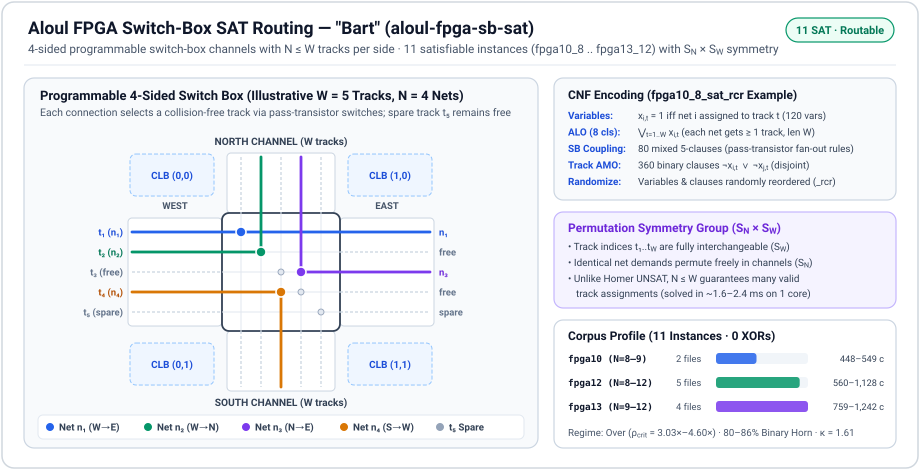

# Aloul FPGA Switch-Box SAT Benchmarks — "Bart" (`aloul-fpga-sb-sat`)

*Figure: Four-sided programmable FPGA switch-box routing schematic ($N \le W$ collision-free tracks with $S_N \times S_W$ permutation symmetry) alongside the `fpga10_8_sat_rcr` CNF anatomy and 11-instance "Bart" corpus profile. Regenerated via [`src/gen_diagram.py`](src/gen_diagram.py).*

## Provenance & Credit

- **Authors:** Fadi A. Aloul, Arathi Ramani, Igor L. Markov, and Karem A. Sakallah (University of Michigan / American University of Sharjah)
- **Upstream Homepage:** [Fadi Aloul — SAT Benchmarks](https://www.aloul.net/benchmarks.html)
- **License:** Classic public academic benchmarks contributed to the SAT 2002 Competition and published on `aloul.net`; no separate upstream `LICENSE` file is bundled in the archives.
- **Sibling Aloul Collections:** [`aloul-dac02-bench/`](../aloul-dac02-bench/README.md), [`aloul-difp-a/`](../aloul-difp-a/README.md), [`aloul-difp-w/`](../aloul-difp-w/README.md), [`aloul-fpga-sb-uns/`](../aloul-fpga-sb-uns/README.md)
- **Recommended by:** [`@merlin_numa`](https://twitter.com/merlin_numa) (Twitter/X)

## Problem Description

Satisfiable FPGA switch-box routing formulas (`fpga10_*`, `fpga12_*`, `fpga13_*`; SAT 2002 *"Bart"* family, 11 instances) with rich permutation symmetry and variables/clauses randomly reordered.

## Corpus & Data Sizes

- **`cnf-orig/`** — 11 original native **DIMACS `.cnf.xz`** files (33.5 KB).
- **`aig-converted/`** — 11 exact **Binary AIGER 1.9 `.aig.xz`** conversions (46.0 KB, verified via [Berkeley ABC](https://github.com/berkeley-abc/abc) `read_aiger`).
- **`xcnf-converted/`** — 11 lossless **[CryptoMiniSat](https://github.com/msoos/cryptominisat) `.xcnf.xz`** conversions (34.0 KB, `0` extracted native XOR parity clauses).
- **`anf-converted/`** — 11 lossless linear-size **DIMACS-ANF `.anf.xz`** conversions (77.0 KB, generated via [`../src/to_anf.py`](../src/to_anf.py)).
- **[`expected.tsv`](expected.tsv)** — Ground-truth verdict manifest for all 11 instances (**11 SAT / 0 UNSAT**).
- **`src/`** — Standalone converters (`cnf2aig.py`, `cnf2xcnf.py`).

| Format | Directory | Files | Key Dimensions (Range) | Compressed Size |
|---|---|---:|---|---:|
| **DIMACS CNF (origin)** | `cnf-orig/` | 11 | Vars: 120–234; Clauses: 448–1,242 | 33.5 KB |
| **Binary AIGER 1.9** | `aig-converted/` | 11 | Inputs: 120–234; ANDs: 1,108–2,995 | 46.0 KB |
| **[CryptoMiniSat](https://github.com/msoos/cryptominisat) XCNF** | `xcnf-converted/` | 11 | Native XOR clauses total: 0 | 34.0 KB |
| **DIMACS-ANF** | `anf-converted/` | 11 | Vars: 336–978; Eqs: 664–1,986 (deg ≤ 3) | 77.0 KB |
| **Total (4 Formats, Status: 11 SAT / 0 UNSAT)** | | **44** | | **190.6 KB** |

## Benchmark Results

- **Hardware & Protocol:** Same machine (**AMD Ryzen 9 5950X**, 16C/32T Linux, **1 thread per run** pinned across 8 dedicated physical cores, $T_{\max} = 5\;\text{s}$, PAR-2 penalty $10,000\;\text{ms}$). All solvers ran with default single-thread flags (`-t 1` for CryptoMiniSat 5.18.0; `--max-cores 1` for Frobenius) on identical uncompressed flat `.cnf` inputs; **100% of all 11 instances** were run (no subsampling), every Frobenius SAT model was independently verified against 100% of input clauses, and **0 verdict disagreements** occurred across all solvers.

| Instance | Verdict | Frobenius 1C | [CaDiCaL](https://github.com/arminbiere/cadical) 3.1.0 | [CryptoMiniSat](https://github.com/msoos/cryptominisat) 5.18.0 | [dense-solver](https://github.com/libdense/dense-solver) 0.0.4 | [Kissat](https://github.com/arminbiere/kissat) 4.0.4 |
|---|:---:|---:|---:|---:|---:|---:|
| `fpga10_8_sat_rcr` | SAT | 1.99 ms | 3.10 ms | 16.05 ms | **1.81 ms** | 8.88 ms |
| `fpga10_9_sat_rcr` | SAT | **1.73 ms** | 3.15 ms | 20.12 ms | 1.90 ms | 11.38 ms |
| `fpga12_10_sat_rcr` | SAT | **2.02 ms** | 4.24 ms | 35.56 ms | 2.14 ms | 18.25 ms |
| `fpga12_11_sat_rcr` | SAT | 2.22 ms | 24.02 ms | 40.51 ms | **2.12 ms** | 35.04 ms |
| `fpga12_12_sat_rcr` | SAT | **1.92 ms** | 31.58 ms | 48.73 ms | 1.94 ms | 18.16 ms |
| `fpga12_8_sat_rcr` | SAT | 1.82 ms | 5.57 ms | 22.23 ms | **1.67 ms** | 12.30 ms |
| `fpga12_9_sat_rcr` | SAT | 1.74 ms | 4.39 ms | 26.29 ms | **1.59 ms** | 15.24 ms |
| `fpga13_10_sat_rcr` | SAT | 1.76 ms | 2.74 ms | 37.01 ms | 1.84 ms | **1.37 ms** |
| `fpga13_11_sat_rcr` | SAT | **2.39 ms** | 5.76 ms | 46.19 ms | 2.47 ms | 19.64 ms |
| `fpga13_12_sat_rcr` | SAT | **1.84 ms** | 4.50 ms | 55.39 ms | 2.02 ms | 21.27 ms |
| `fpga13_9_sat_rcr` | SAT | 1.61 ms | 3.71 ms | 32.31 ms | 1.68 ms | **1.29 ms** |
| **Total (11 files, PAR-2)** | **11/11** | **11/11 — 21.0 ms** *(fastest)* | 11/11 — 92.8 ms *(4.41x)* | 11/11 — 380.4 ms *(18.08x)* | 11/11 — 21.2 ms *(1.01x)* | 11/11 — 162.8 ms *(7.74x)* |

<!-- BEGIN_STRUCTURAL_ANALYSIS -->
## Phase-Transition & Structural Analysis

*Auto-generated by [`../src/analyze_benchmarks.py`](../src/analyze_benchmarks.py). Position relative to the critical phase transition is measured by $\rho_{\mathrm{crit}} = \frac{1}{n}\sum_k m_k / \alpha_c(k)$ (exact $\alpha/\alpha_c(k)$ for pure $k$-SAT; effective critical threshold $\alpha_c^{\mathrm{eff}} = \alpha/\rho_{\mathrm{crit}}$; `Under` $<0.90\times$, `Near-crit` $0.90\text{--}1.10\times$, `Over` $>1.10\times$), alongside Gent–Walsh annealed constrainedness $\kappa = -\frac{1}{n}\sum_i \log_2(1-2^{-k_i})$ (AAAI 1996), clause-length profile ($\bar{k}$, `%Bin`, `%Horn`), variable-degree CV ($\sigma_d/\bar{d}$, uniformity vs. hub skew), and extracted native XOR parity clauses.*

| Instance | Active $n$ | Clauses $m$ | $\alpha=m/n$ | $\alpha_c^{\mathrm{eff}}$ | $\rho_{\mathrm{crit}}$ (Regime) | $\kappa$ | $\bar{k}$ ($k_{\max}$) | Bin% | Horn% | Pos% | Deg CV | XORs |
|---|---:|---:|---:|---:|---:|---:|---:|---:|---:|---:|---:|---:|
| `fpga10_8_sat_rcr` | 120 | 448 | 3.73 | 1.23 | **3.03x** (Over) | 1.28 | 2.68 (10) | 80% | 80% | 33% | 0.14 | 0 |
| `fpga10_9_sat_rcr` | 135 | 549 | 4.07 | 1.21 | **3.36x** (Over) | 1.41 | 2.70 (10) | 82% | 82% | 33% | 0.13 | 0 |
| `fpga12_10_sat_rcr` | 180 | 820 | 4.56 | 1.18 | **3.85x** (Over) | 1.61 | 2.71 (12) | 84% | 84% | 32% | 0.15 | 0 |
| `fpga12_11_sat_rcr` | 198 | 968 | 4.89 | 1.17 | **4.18x** (Over) | 1.74 | 2.73 (12) | 85% | 85% | 32% | 0.14 | 0 |
| `fpga12_12_sat_rcr` | 216 | 1,128 | 5.22 | 1.16 | **4.51x** (Over) | 1.88 | 2.74 (12) | 86% | 86% | 33% | 0.13 | 0 |
| `fpga12_8_sat_rcr` | 144 | 560 | 3.89 | 1.22 | **3.20x** (Over) | 1.34 | 2.66 (12) | 81% | 81% | 32% | 0.18 | 0 |
| `fpga12_9_sat_rcr` | 162 | 684 | 4.22 | 1.20 | **3.52x** (Over) | 1.48 | 2.68 (12) | 83% | 83% | 32% | 0.17 | 0 |
| `fpga13_10_sat_rcr` | 195 | 905 | 4.64 | 1.18 | **3.94x** (Over) | 1.64 | 2.70 (13) | 85% | 85% | 32% | 0.17 | 0 |
| `fpga13_11_sat_rcr` | 215 | 1,070 | 4.98 | 1.17 | **4.27x** (Over) | 1.78 | 2.72 (13) | 86% | 86% | 32% | 0.16 | 0 |
| `fpga13_12_sat_rcr` | 234 | 1,242 | 5.31 | 1.15 | **4.60x** (Over) | 1.91 | 2.73 (13) | 86% | 86% | 32% | 0.15 | 0 |
| `fpga13_9_sat_rcr` | 176 | 759 | 4.31 | 1.19 | **3.62x** (Over) | 1.51 | 2.68 (13) | 83% | 83% | 32% | 0.19 | 0 |

**Collection Phase-Transition Summary (11 instances, 4 formats: 11 CNF / 11 AIG / 11 XCNF / 11 ANF):** median $\rho_{\mathrm{crit}} = 3.85\times$ (range `3.03x–4.60x`), median $\kappa = 1.61$, regime split **0 Under / 0 Near-critical / 11 Over**, total extracted native XOR parity clauses = **0**, total ANF equations = **14,184**.
<!-- END_STRUCTURAL_ANALYSIS -->

## References

- F. A. Aloul, A. Ramani, I. L. Markov, and K. A. Sakallah, *"Solving Difficult SAT Instances in the Presence of Symmetry"*, Proc. 39th Design Automation Conference (DAC 2002), pp. 731–736.
- F. A. Aloul, A. Ramani, I. L. Markov, and K. A. Sakallah, *"Solving Difficult Instances of Boolean Satisfiability in the Presence of Symmetry"*, IEEE Trans. Computer-Aided Design (TCAD), 22(9), pp. 1117–1137, Sept. 2003.
