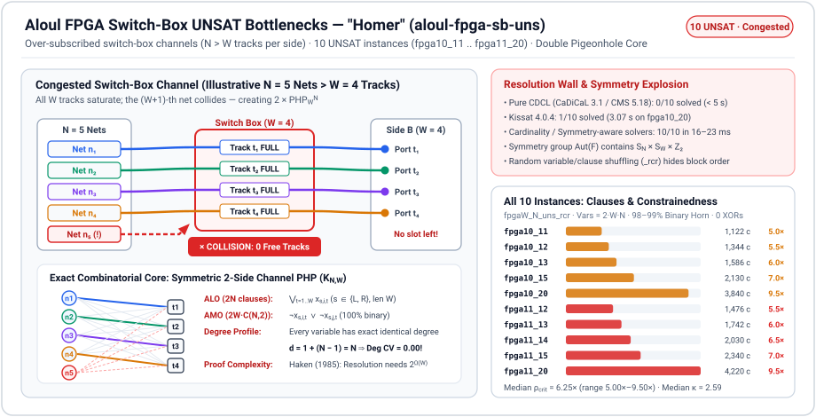

# Aloul FPGA Switch-Box UNSAT Benchmarks — "Homer" (`aloul-fpga-sb-uns`)

*Figure: Congested FPGA switch-box channel bottleneck ($N > W$ nets colliding on saturated tracks) and exact symmetric two-side bipartite pigeonhole core ($2 \times \mathrm{PHP}_W^N$, $\text{Deg CV} = 0.00$) across all 10 UNSAT "Homer" instances. Regenerated via [`src/gen_diagram.py`](src/gen_diagram.py).*

## Provenance & Credit

- **Authors:** Fadi A. Aloul, Arathi Ramani, Igor L. Markov, and Karem A. Sakallah (University of Michigan / American University of Sharjah)
- **Upstream Homepage:** [Fadi Aloul — SAT Benchmarks](https://www.aloul.net/benchmarks.html)
- **License:** Classic public academic benchmarks contributed to the SAT 2002 Competition and published on `aloul.net`; no separate upstream `LICENSE` file is bundled in the archives.
- **Sibling Aloul Collections:** [`aloul-dac02-bench/`](../aloul-dac02-bench/README.md), [`aloul-difp-a/`](../aloul-difp-a/README.md), [`aloul-difp-w/`](../aloul-difp-w/README.md), [`aloul-fpga-sb-sat/`](../aloul-fpga-sb-sat/README.md)
- **Recommended by:** [`@merlin_numa`](https://twitter.com/merlin_numa) (Twitter/X)

## Problem Description

Unsatisfiable FPGA switch-box routing formulas (`fpga10_*`, `fpga11_*`; SAT 2002 *"Homer"* family, 10 instances) with rich permutation symmetry and cardinality bottlenecks, with variables/clauses randomly reordered.

## Corpus & Data Sizes

- **`cnf-orig/`** — 10 original native **DIMACS `.cnf.xz`** files (72.5 KB).
- **`aig-converted/`** — 10 exact **Binary AIGER 1.9 `.aig.xz`** conversions (79.3 KB, verified via [Berkeley ABC](https://github.com/berkeley-abc/abc) `read_aiger`).
- **`xcnf-converted/`** — 10 lossless **[CryptoMiniSat](https://github.com/msoos/cryptominisat) `.xcnf.xz`** conversions (73.1 KB, `0` extracted native XOR parity clauses).
- **`anf-converted/`** — 10 lossless linear-size **DIMACS-ANF `.anf.xz`** conversions (96.1 KB, generated via [`../src/to_anf.py`](../src/to_anf.py)).
- **[`expected.tsv`](expected.tsv)** — Ground-truth verdict manifest for all 10 instances (**0 SAT / 10 UNSAT**).
- **`src/`** — Standalone converters (`cnf2aig.py`, `cnf2xcnf.py`).

| Format | Directory | Files | Key Dimensions (Range) | Compressed Size |
|---|---|---:|---|---:|
| **DIMACS CNF (origin)** | `cnf-orig/` | 10 | Vars: 220–440; Clauses: 1,122–4,220 | 72.5 KB |
| **Binary AIGER 1.9** | `aig-converted/` | 10 | Inputs: 220–440; ANDs: 2,419–8,799 | 79.3 KB |
| **[CryptoMiniSat](https://github.com/msoos/cryptominisat) XCNF** | `xcnf-converted/` | 10 | Native XOR clauses total: 0 | 73.1 KB |
| **DIMACS-ANF** | `anf-converted/` | 10 | Vars: 374–760; Eqs: 1,276–4,540 (deg ≤ 3) | 96.1 KB |
| **Total (4 Formats, Status: 0 SAT / 10 UNSAT)** | | **40** | | **321.0 KB** |

## Benchmark Results

- **Hardware & Protocol:** Same machine (**AMD Ryzen 9 5950X**, 16C/32T Linux, **1 thread per run** pinned across 8 dedicated physical cores, $T_{\max} = 5\;\text{s}$, PAR-2 penalty $10,000\;\text{ms}$). All solvers ran with default single-thread flags (`-t 1` for CryptoMiniSat 5.18.0; `--max-cores 1` for Frobenius) on identical uncompressed flat `.cnf` inputs; **100% of all 10 instances** were run (no subsampling), every Frobenius SAT model was independently verified against 100% of input clauses, and **0 verdict disagreements** occurred across all solvers.

| Instance | Verdict | Frobenius 1C | [CaDiCaL](https://github.com/arminbiere/cadical) 3.1.0 | [CryptoMiniSat](https://github.com/msoos/cryptominisat) 5.18.0 | [dense-solver](https://github.com/libdense/dense-solver) 0.0.4 | [Kissat](https://github.com/arminbiere/kissat) 4.0.4 |
|---|:---:|---:|---:|---:|---:|---:|
| `fpga10_11_uns_rcr` | UNSAT | 1.70 ms | >5 s | >5 s | **1.69 ms** | >5 s |
| `fpga10_12_uns_rcr` | UNSAT | 1.91 ms | >5 s | >5 s | **1.38 ms** | >5 s |
| `fpga10_13_uns_rcr` | UNSAT | 2.35 ms | >5 s | >5 s | **1.56 ms** | >5 s |
| `fpga10_15_uns_rcr` | UNSAT | 2.13 ms | >5 s | >5 s | **2.05 ms** | >5 s |
| `fpga10_20_uns_rcr` | UNSAT | 2.66 ms | >5 s | >5 s | **1.68 ms** | 3,073.81 ms |
| `fpga11_12_uns_rcr` | UNSAT | 1.76 ms | >5 s | >5 s | **1.34 ms** | >5 s |
| `fpga11_13_uns_rcr` | UNSAT | 2.44 ms | >5 s | >5 s | **1.55 ms** | >5 s |
| `fpga11_14_uns_rcr` | UNSAT | 2.21 ms | >5 s | >5 s | **1.48 ms** | >5 s |
| `fpga11_15_uns_rcr` | UNSAT | 2.44 ms | >5 s | >5 s | **1.77 ms** | >5 s |
| `fpga11_20_uns_rcr` | UNSAT | 3.02 ms | >5 s | >5 s | **1.76 ms** | >5 s |
| **Total (10 files, PAR-2)** | **10/10** | 10/10 — 22.6 ms *(1.39x)* | 0/10 — 100,000.0 ms *(6150.06x)* | 0/10 — 100,000.0 ms *(6150.06x)* | **10/10 — 16.3 ms** *(fastest)* | 1/10 — 93,073.8 ms *(5724.10x)* |

<!-- BEGIN_STRUCTURAL_ANALYSIS -->
## Phase-Transition & Structural Analysis

*Auto-generated by [`../src/analyze_benchmarks.py`](../src/analyze_benchmarks.py). Position relative to the critical phase transition is measured by $\rho_{\mathrm{crit}} = \frac{1}{n}\sum_k m_k / \alpha_c(k)$ (exact $\alpha/\alpha_c(k)$ for pure $k$-SAT; effective critical threshold $\alpha_c^{\mathrm{eff}} = \alpha/\rho_{\mathrm{crit}}$; `Under` $<0.90\times$, `Near-crit` $0.90\text{--}1.10\times$, `Over` $>1.10\times$), alongside Gent–Walsh annealed constrainedness $\kappa = -\frac{1}{n}\sum_i \log_2(1-2^{-k_i})$ (AAAI 1996), clause-length profile ($\bar{k}$, `%Bin`, `%Horn`), variable-degree CV ($\sigma_d/\bar{d}$, uniformity vs. hub skew), and extracted native XOR parity clauses.*

| Instance | Active $n$ | Clauses $m$ | $\alpha=m/n$ | $\alpha_c^{\mathrm{eff}}$ | $\rho_{\mathrm{crit}}$ (Regime) | $\kappa$ | $\bar{k}$ ($k_{\max}$) | Bin% | Horn% | Pos% | Deg CV | XORs |
|---|---:|---:|---:|---:|---:|---:|---:|---:|---:|---:|---:|---:|
| `fpga10_11_uns_rcr` | 220 | 1,122 | 5.10 | 1.02 | **5.00x** (Over) | 2.08 | 2.16 (10) | 98% | 98% | 9% | 0.00 | 0 |
| `fpga10_12_uns_rcr` | 240 | 1,344 | 5.60 | 1.02 | **5.50x** (Over) | 2.28 | 2.14 (10) | 98% | 98% | 8% | 0.00 | 0 |
| `fpga10_13_uns_rcr` | 260 | 1,586 | 6.10 | 1.02 | **6.00x** (Over) | 2.49 | 2.13 (10) | 98% | 98% | 8% | 0.00 | 0 |
| `fpga10_15_uns_rcr` | 300 | 2,130 | 7.10 | 1.01 | **7.00x** (Over) | 2.91 | 2.11 (10) | 99% | 99% | 7% | 0.00 | 0 |
| `fpga10_20_uns_rcr` | 400 | 3,840 | 9.60 | 1.01 | **9.50x** (Over) | 3.94 | 2.08 (10) | 99% | 99% | 5% | 0.00 | 0 |
| `fpga11_12_uns_rcr` | 264 | 1,476 | 5.59 | 1.02 | **5.50x** (Over) | 2.28 | 2.15 (11) | 98% | 98% | 8% | 0.00 | 0 |
| `fpga11_13_uns_rcr` | 286 | 1,742 | 6.09 | 1.02 | **6.00x** (Over) | 2.49 | 2.13 (11) | 99% | 99% | 8% | 0.00 | 0 |
| `fpga11_14_uns_rcr` | 308 | 2,030 | 6.59 | 1.01 | **6.50x** (Over) | 2.70 | 2.12 (11) | 99% | 99% | 7% | 0.00 | 0 |
| `fpga11_15_uns_rcr` | 330 | 2,340 | 7.09 | 1.01 | **7.00x** (Over) | 2.91 | 2.12 (11) | 99% | 99% | 7% | 0.00 | 0 |
| `fpga11_20_uns_rcr` | 440 | 4,220 | 9.59 | 1.01 | **9.50x** (Over) | 3.94 | 2.09 (11) | 99% | 99% | 5% | 0.00 | 0 |

**Collection Phase-Transition Summary (10 instances, 4 formats: 10 CNF / 10 AIG / 10 XCNF / 10 ANF):** median $\rho_{\mathrm{crit}} = 6.25\times$ (range `5.00x–9.50x`), median $\kappa = 2.59$, regime split **0 Under / 0 Near-critical / 10 Over**, total extracted native XOR parity clauses = **0**, total ANF equations = **24,008**.
<!-- END_STRUCTURAL_ANALYSIS -->

## References

- F. A. Aloul, A. Ramani, I. L. Markov, and K. A. Sakallah, *"Solving Difficult SAT Instances in the Presence of Symmetry"*, Proc. 39th Design Automation Conference (DAC 2002), pp. 731–736.
- F. A. Aloul, A. Ramani, I. L. Markov, and K. A. Sakallah, *"Solving Difficult Instances of Boolean Satisfiability in the Presence of Symmetry"*, IEEE Trans. Computer-Aided Design (TCAD), 22(9), pp. 1117–1137, Sept. 2003.
