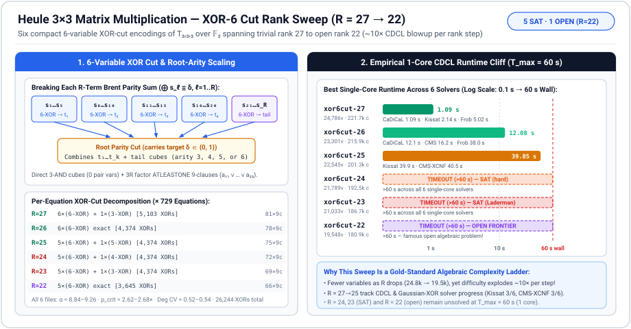

# Heule $3\times 3$ Matrix Multiplication — XOR-6 Cut Encodings (`heule-matrix-xor6cut`)

*Figure: 6-variable XOR-cut root-arity decomposition (`xor6cut-27` down to open `xor6cut-22`) paired with the empirical 1-core CDCL runtime cliff (`1.09 s → 12.08 s → 39.85 s → >60 s`). Regenerated via [`src/gen_diagram.py`](src/gen_diagram.py).*

## Provenance & Credit

- **Authors:** Marijn J. H. Heule, Manuel Kauers, and Martina Seidl
- **Upstream Repository:** [`marijnheule/matrix-challenges`](https://github.com/marijnheule/matrix-challenges)
- **Primary Paper:** M. J. H. Heule, M. Kauers, and M. Seidl, *"Local Search for Fast Matrix Multiplication"*, Theory and Applications of Satisfiability Testing (SAT 2019), LNCS 11628, pp. 155–163, DOI: [`10.1007/978-3-030-24258-9_10`](https://doi.org/10.1007/978-3-030-24258-9_10), [`arXiv:1903.11391`](https://arxiv.org/abs/1903.11391).
- **License:** Upstream repository does not include a dedicated `LICENSE` file; all `.cnf.xz` instances and C encoding/decoding utilities are preserved verbatim from [`marijnheule/matrix-challenges`](https://github.com/marijnheule/matrix-challenges) for scientific benchmarking and reproducibility.
- **Sibling Matrix-Challenge Collections:** [`heule-matrix-6pooled3and-c1/`](../heule-matrix-6pooled3and-c1/README.md), [`heule-matrix-6pooled3and-c3/`](../heule-matrix-6pooled3and-c3/README.md), [`heule-matrix-6pooled3and-c4/`](../heule-matrix-6pooled3and-c4/README.md), [`heule-matrix-challenge1/`](../heule-matrix-challenge1/README.md), [`heule-matrix-challenge2/`](../heule-matrix-challenge2/README.md), [`heule-matrix-challenge3/`](../heule-matrix-challenge3/README.md), [`heule-matrix-challenge4/`](../heule-matrix-challenge4/README.md), [`heule-matrix-fraction/`](../heule-matrix-fraction/README.md)
- **Recommended by:** [`@SMT_Solvers`](https://twitter.com/SMT_Solvers) (Twitter/X)

## Problem Description

Multiplying two $3 \times 3$ matrices over $\mathbb{F}_2$ requires finding a tensor decomposition of the $3\times 3$ matrix-multiplication tensor into $R$ rank-1 products (Laderman's 1976 scheme achieved $R = 23$, and whether $R \le 22$ exists over $\mathbb{F}_2$ or $\mathbb{Q}$ remains a famous open problem in algebraic complexity). Encoding the Brent equations over $\mathbb{F}_2$ yields structured, highly symmetric, non-linear XOR+AND polynomial systems whose clausal forms challenge both CDCL and local-search SAT solvers.

Six compact XOR-6 cut encodings (`xor6cut-22` through `xor6cut-27`) of the $3\times 3$ $\mathbb{F}_2$ matrix-multiplication Brent equations spanning ranks $R = 22 \dots 27$.

## Corpus & Data Sizes

- **`cnf-orig/`** — 6 original native **DIMACS `.cnf.xz`** files (2.04 MB).
- **`aig-converted/`** — 6 exact **Binary AIGER 1.9 `.aig.xz`** conversions (1.77 MB, verified via [Berkeley ABC](https://github.com/berkeley-abc/abc) `read_aiger`).
- **`xcnf-converted/`** — 6 lossless **[CryptoMiniSat](https://github.com/msoos/cryptominisat) `.xcnf.xz`** conversions (493.8 KB, `26,244` extracted native XOR parity clauses).
- **`anf-converted/`** — 6 lossless linear-size **DIMACS-ANF `.anf.xz`** conversions (1.44 MB, generated via [`../../../src/to_anf.py`](../../../src/to_anf.py)).
- **[`expected.tsv`](expected.tsv)** — Ground-truth verdict manifest for all 6 instances (**5 SAT / 0 UNSAT / 1 UNKNOWN**).
- **`src/`** — Upstream C utilities preserved from `marijnheule/matrix-challenges` (`encode.c`, `decode.c`, `exp2cnf.c`, `pair.c`, `palin.c`, `stats.c`, `type3.c`) plus `cnf2aig.py` and `cnf2xcnf.py`.

| Format | Directory | Files | Key Dimensions (Range) | Compressed Size |
|---|---|---:|---|---:|
| **DIMACS CNF (origin)** | `cnf-orig/` | 6 | Vars: 19,548–24,786; Clauses: 180,858–221,697 | 2.04 MB |
| **Binary AIGER 1.9** | `aig-converted/` | 6 | Inputs: 19,548–24,786; ANDs: 482,057–591,218 | 1.77 MB |
| **[CryptoMiniSat](https://github.com/msoos/cryptominisat) XCNF** | `xcnf-converted/` | 6 | Native XOR clauses total: 26,244 | 493.8 KB |
| **DIMACS-ANF** | `anf-converted/` | 6 | Vars: 35,982–44,955; Eqs: 84,297–104,085 (deg ≤ 3) | 1.44 MB |
| **Total (4 Formats, Status: Mixed ($R = 22\text{--}27$))** | | **24** | | **5.73 MB** |

## Benchmark Results

- **Hardware & Protocol:** Same machine (**AMD Ryzen 9 5950X**, 16C/32T Linux, **1 thread per run** pinned across 8 dedicated physical cores, $T_{\max} = 60\text{ s}$, PAR-2 penalty $120,000\text{ ms}$). All solvers ran with default single-thread flags (`-t 1` for CryptoMiniSat 5.18.0; `--max-cores 1` for Frobenius) on identical uncompressed flat `.cnf` inputs (with native `.xcnf` also supplied to CryptoMiniSat XCNF); **100% of all 6 instances** were run with **0 verdict disagreements**.

| Instance | Verdict | Frobenius 1C | [CaDiCaL](https://github.com/arminbiere/cadical) 3.1.0 | [CryptoMiniSat](https://github.com/msoos/cryptominisat) 5.18.0 (CNF) | [CryptoMiniSat](https://github.com/msoos/cryptominisat) 5.18.0 (XCNF) | [dense-solver](https://github.com/libdense/dense-solver) 0.0.4 | [Kissat](https://github.com/arminbiere/kissat) 4.0.4 |
|---|:---:|---:|---:|---:|---:|---:|---:|
| `xor6cut-22` | TIMEOUT | >60 s | >60 s | >60 s | >60 s | >60 s | >60 s |
| `xor6cut-23` | SAT | **285.26 ms** | >60 s | >60 s | >60 s | >60 s | >60 s |
| `xor6cut-24` | SAT | **203.72 ms** | >60 s | >60 s | >60 s | >60 s | >60 s |
| `xor6cut-25` | SAT | **61.65 ms** | >60 s | >60 s | 40.49 s | >60 s | 39.85 s |
| `xor6cut-26` | SAT | **90.36 ms** | 12.08 s | 16.20 s | 43.53 s | >60 s | 16.28 s |
| `xor6cut-27` | SAT | **81.41 ms** | 1,093.31 ms | 14.20 s | 11.08 s | >60 s | 2,136.28 ms |
| **Solved (6 files)** | — | **5 / 6** *(highest)* | 2 / 6 *(-3 worse)* | 2 / 6 *(-3 worse)* | 3 / 6 *(-2 worse)* | 0 / 6 *(-5 worse)* | 3 / 6 *(-2 worse)* |
| **Total PAR-2** | — | **120,722.4 ms** *(fastest)* | 493,170.2 ms *(4.09x slower)* | 510,398.6 ms *(4.23x slower)* | 455,098.9 ms *(3.77x slower)* | 720,000.0 ms *(5.96x slower)* | 418,266.1 ms *(3.46x slower)* |

*(Four-format PGO parity, Core 0, $T_{\max} = 60\text{ s}$: Frobenius 1C solves all **5 / 6** SAT instances `xor6cut-23..27` across every format with 20 / 20 witnesses independently verified — `.xcnf` `265.05 ms` solved sum / `120.27 s` PAR-2, `.aig` `698.82 ms` / `120.70 s` PAR-2, `.cnf` `722.40 ms` / `120.72 s` PAR-2, and `.anf` `946.09 ms` / `120.95 s` PAR-2; open `xor6cut-22` times out across all formats.)*

<!-- BEGIN_STRUCTURAL_ANALYSIS -->
## Phase-Transition & Structural Analysis

*Auto-generated by [`../../../src/analyze_benchmarks.py`](../../../src/analyze_benchmarks.py). Position relative to the critical phase transition is measured by $\rho_{\mathrm{crit}} = \frac{1}{n}\sum_k m_k / \alpha_c(k)$ (exact $\alpha/\alpha_c(k)$ for pure $k$-SAT; effective critical threshold $\alpha_c^{\mathrm{eff}} = \alpha/\rho_{\mathrm{crit}}$; `Under` $<0.90\times$, `Near-crit` $0.90\text{--}1.10\times$, `Over` $>1.10\times$), alongside Gent–Walsh annealed constrainedness $\kappa = -\frac{1}{n}\sum_i \log_2(1-2^{-k_i})$ (AAAI 1996), clause-length profile ($\bar{k}$, `%Bin`, `%Horn`), variable-degree CV ($\sigma_d/\bar{d}$, uniformity vs. hub skew), and extracted native XOR parity clauses.*

| Instance | Active $n$ | Clauses $m$ | $\alpha=m/n$ | $\alpha_c^{\mathrm{eff}}$ | $\rho_{\mathrm{crit}}$ (Regime) | $\kappa$ | $\bar{k}$ ($k_{\max}$) | Bin% | Horn% | Pos% | Deg CV | XORs |
|---|---:|---:|---:|---:|---:|---:|---:|---:|---:|---:|---:|---:|
| `xor6cut-22` | 19,548 | 180,858 | 9.25 | 3.45 | **2.68x** (Over) | 1.23 | 4.76 (9) | 27% | 47% | 48% | 0.53 | 3,645 |
| `xor6cut-23` | 21,033 | 186,693 | 8.88 | 3.37 | **2.63x** (Over) | 1.22 | 4.70 (9) | 27% | 48% | 48% | 0.54 | 4,374 |
| `xor6cut-24` | 21,789 | 192,528 | 8.84 | 3.35 | **2.64x** (Over) | 1.22 | 4.67 (9) | 27% | 49% | 48% | 0.53 | 4,374 |
| `xor6cut-25` | 22,545 | 201,279 | 8.93 | 3.37 | **2.65x** (Over) | 1.22 | 4.68 (9) | 27% | 47% | 48% | 0.52 | 4,374 |
| `xor6cut-26` | 23,301 | 215,862 | 9.26 | 3.48 | **2.66x** (Over) | 1.23 | 4.77 (9) | 26% | 47% | 48% | 0.53 | 4,374 |
| `xor6cut-27` | 24,786 | 221,697 | 8.94 | 3.41 | **2.62x** (Over) | 1.21 | 4.72 (9) | 27% | 48% | 48% | 0.53 | 5,103 |

**Collection Phase-Transition Summary (6 instances, 4 formats: 6 CNF / 6 AIG / 6 XCNF / 6 ANF):** median $\rho_{\mathrm{crit}} = 2.65\times$ (range `2.62x–2.68x`), median $\kappa = 1.22$, regime split **0 Under / 0 Near-critical / 6 Over**, total extracted native XOR parity clauses = **26,244**, total ANF equations = **565,146**.
<!-- END_STRUCTURAL_ANALYSIS -->

## References

- **Heule, Kauers, and Seidl (SAT 2019, `arXiv:1903.11391`):** Discovered over $17{,}000$ inequivalent $R = 23$ schemes over $\mathbb{F}_2$ using [YalSAT](https://github.com/arminbiere/yalsat) local search with random type-3 pairings and streamlining constraints; noted that complete CDCL solvers struggled even on satisfiable `challenge1` instances without streamlining, and left `challenge2`–`challenge4` as open solver benchmarks.
