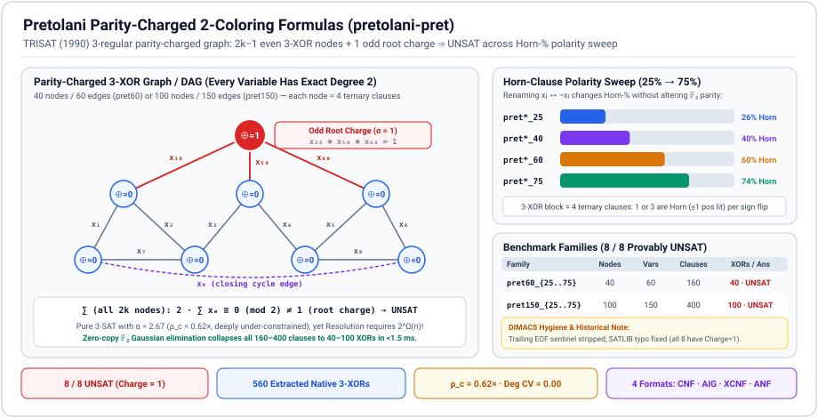

# Pretolani Parity-Charged 2-Coloring Instances (`PRET`)

*Figure: Pretolani `TRISAT` 3-regular parity-charged DAG with single odd root charge ($\sum \sigma(v) \equiv 1 \pmod 2$) and variable-polarity Horn-clause sweep across `{25%, 40%, 60%, 75%}`. Regenerated via [`src/gen_diagram.py`](src/gen_diagram.py).*

## Provenance & Credit

- **Author:** Daniele Pretolani (Second DIMACS Implementation Challenge / SATLIB)
- **Upstream Source:** [SATLIB PRET Benchmark Description & Archive](https://www.cs.ubc.ca/~hoos/SATLIB/Benchmarks/SAT/DIMACS/PRET/descr.html) (`pret.tar.gz`)
- **License:** Classic public academic benchmark archive contributed to the Second DIMACS Implementation Challenge and redistributed by SATLIB; no separate upstream `LICENSE` file is bundled in `pret.tar.gz`.
- **Format Hygiene Note:** The original 1990 DIMACS files in `pret.tar.gz` ended with a trailing `0` EOF sentinel after the final clause (`160` or `400`), which causes strict modern SAT Competition parsers (e.g., [Kissat](https://github.com/arminbiere/kissat), [CaDiCaL](https://github.com/arminbiere/cadical)) to reject the file as having an extra empty clause. The `.cnf.xz` files here preserve every original header comment and clause verbatim while stripping only that trailing sentinel line so all modern solvers parse the exact `p cnf 60 160` / `p cnf 150 400` formulas cleanly.
- **Recommended by:** [`@MMarchidann`](https://twitter.com/MMarchidann) (Twitter/X)

## Problem Description

The `PRET` benchmark family encodes a graph 2-coloring problem on an even-order graph augmented with an odd-parity ("charge") constraint that forces unsatisfiability. Generated by Daniele Pretolani's 1990 `TRISAT` generator, the instances sweep the target percentage of Horn clauses across `{25%, 40%, 60%, 75%}` for $n \in \lbrace 60, 150\rbrace$ propositional variables.

*(Historical note: the SATLIB summary webpage table historically contained a typo listing `pret60_*` and `pret150_*` as satisfiable, whereas the DIMACS file headers and mathematical construction explicitly specify `Charge = 1` / UNSAT.)*

## Corpus & Data Sizes

- **`cnf-orig/`:** All 8 UNSAT `.cnf.xz` files (`10.1 KB`).
- **`aig-converted/`:** 8 exact Binary AIGER 1.9 `.aig.xz` conversions (`10.2 KB`, all 8/8 verified with [Berkeley ABC](https://github.com/berkeley-abc/abc) `read_aiger`).
- **`xcnf-converted/`:** 8 lossless [CryptoMiniSat](https://github.com/msoos/cryptominisat) `.xcnf.xz` conversions (`6.3 KB`, `560` extracted native XOR clauses).
- **`anf-converted/`:** 8 lossless degree-1 linear DIMACS-ANF `.anf.xz` conversions (`4.3 KB`, generated via [`../../../src/to_anf.py`](../../../src/to_anf.py)).
- **[`expected.tsv`](expected.tsv)** — Ground-truth verdict manifest for all 8 instances (**0 SAT / 8 UNSAT**).

| Instance | Vars | Clauses | Target Horn % | `.cnf.xz` | AIG ANDs | `.xcnf.xz` | `.anf.xz` | Status |
|---|---:|---:|---:|---:|---:|---:|---:|:---:|
| `pret60_25` | 60 | 160 | 25% | 0.9 KB | 479 | 0.7 KB | 0.4 KB | UNSAT |
| `pret60_40` | 60 | 160 | 40% | 0.9 KB | 479 | 0.7 KB | 0.4 KB | UNSAT |
| `pret60_60` | 60 | 160 | 60% | 0.9 KB | 479 | 0.7 KB | 0.4 KB | UNSAT |
| `pret60_75` | 60 | 160 | 75% | 0.9 KB | 479 | 0.7 KB | 0.4 KB | UNSAT |
| `pret150_25` | 150 | 400 | 25% | 1.6 KB | 1,199 | 0.9 KB | 0.7 KB | UNSAT |
| `pret150_40` | 150 | 400 | 40% | 1.6 KB | 1,199 | 0.9 KB | 0.7 KB | UNSAT |
| `pret150_60` | 150 | 400 | 60% | 1.6 KB | 1,199 | 0.9 KB | 0.7 KB | UNSAT |
| `pret150_75` | 150 | 400 | 75% | 1.6 KB | 1,199 | 0.9 KB | 0.7 KB | UNSAT |

## Benchmark Results

- **Hardware & Protocol:** Same machine (AMD Ryzen 9 5950X, 16C/32T Linux, 1 core per run, default single-thread flags with `-t 1` for CryptoMiniSat 5.18.0 and `--max-cores 1` for Frobenius, $T_{\max} = 5\text{ s}$, identical flat `.cnf` input, 100% verdict consensus).

| Metric (1C, 8 instances) | Frobenius 1C | [CaDiCaL](https://github.com/arminbiere/cadical) 3.1.0 | [CryptoMiniSat](https://github.com/msoos/cryptominisat) 5.18.0 | [dense-solver](https://github.com/libdense/dense-solver) 0.0.4 | [Kissat](https://github.com/arminbiere/kissat) 4.0.4 |
|---|---:|---:|---:|---:|---:|
| **Solved** | **8 / 8** *(highest)* | **8 / 8** *(highest)* | **8 / 8** *(highest)* | **8 / 8** *(highest)* | **8 / 8** *(highest)* |
| **Total Wall Time** | **4.94 ms** *(fastest)* | 41.53 ms *(8.41x slower)* | 161.74 ms *(32.7x slower)* | 6.43 ms *(1.30x slower)* | 58.45 ms *(11.8x slower)* |
| **Per-Instance Range** | **0.60–0.65 ms** | 4.95–5.38 ms | 18.55–22.15 ms | 0.72–0.98 ms | 4.58–11.04 ms |

<!-- BEGIN_STRUCTURAL_ANALYSIS -->
## Phase-Transition & Structural Analysis

*Auto-generated by [`../../../src/analyze_benchmarks.py`](../../../src/analyze_benchmarks.py). Position relative to the critical phase transition is measured by $\rho_{\mathrm{crit}} = \frac{1}{n}\sum_k m_k / \alpha_c(k)$ (exact $\alpha/\alpha_c(k)$ for pure $k$-SAT; effective critical threshold $\alpha_c^{\mathrm{eff}} = \alpha/\rho_{\mathrm{crit}}$; `Under` $<0.90\times$, `Near-crit` $0.90\text{--}1.10\times$, `Over` $>1.10\times$), alongside Gent–Walsh annealed constrainedness $\kappa = -\frac{1}{n}\sum_i \log_2(1-2^{-k_i})$ (AAAI 1996), clause-length profile ($\bar{k}$, `%Bin`, `%Horn`), variable-degree CV ($\sigma_d/\bar{d}$, uniformity vs. hub skew), and extracted native XOR parity clauses.*

| Instance | Active $n$ | Clauses $m$ | $\alpha=m/n$ | $\alpha_c^{\mathrm{eff}}$ | $\rho_{\mathrm{crit}}$ (Regime) | $\kappa$ | $\bar{k}$ ($k_{\max}$) | Bin% | Horn% | Pos% | Deg CV | XORs |
|---|---:|---:|---:|---:|---:|---:|---:|---:|---:|---:|---:|---:|
| `pret150_25` | 150 | 400 | 2.67 | 4.27 | **0.62x** (Under) | 0.51 | 3.00 (3) | 0% | 26% | 50% | 0.00 | 100 |
| `pret150_40` | 150 | 400 | 2.67 | 4.27 | **0.62x** (Under) | 0.51 | 3.00 (3) | 0% | 40% | 50% | 0.00 | 100 |
| `pret150_60` | 150 | 400 | 2.67 | 4.27 | **0.62x** (Under) | 0.51 | 3.00 (3) | 0% | 60% | 50% | 0.00 | 100 |
| `pret150_75` | 150 | 400 | 2.67 | 4.27 | **0.62x** (Under) | 0.51 | 3.00 (3) | 0% | 74% | 50% | 0.00 | 100 |
| `pret60_25` | 60 | 160 | 2.67 | 4.27 | **0.62x** (Under) | 0.51 | 3.00 (3) | 0% | 26% | 50% | 0.00 | 40 |
| `pret60_40` | 60 | 160 | 2.67 | 4.27 | **0.62x** (Under) | 0.51 | 3.00 (3) | 0% | 41% | 50% | 0.00 | 40 |
| `pret60_60` | 60 | 160 | 2.67 | 4.27 | **0.62x** (Under) | 0.51 | 3.00 (3) | 0% | 61% | 50% | 0.00 | 40 |
| `pret60_75` | 60 | 160 | 2.67 | 4.27 | **0.62x** (Under) | 0.51 | 3.00 (3) | 0% | 74% | 50% | 0.00 | 40 |

**Collection Phase-Transition Summary (8 instances, 4 formats: 8 CNF / 8 AIG / 8 XCNF / 8 ANF):** median $\rho_{\mathrm{crit}} = 0.62\times$ (range `0.62x–0.62x`), median $\kappa = 0.51$, regime split **8 Under / 0 Near-critical / 0 Over**, total extracted native XOR parity clauses = **560**, total ANF equations = **560**.
<!-- END_STRUCTURAL_ANALYSIS -->

## References

- D. Pretolani, *TRISAT Generator & Parity-Charged 2-Coloring Benchmarks*, Second DIMACS Implementation Challenge (1993), archived in [SATLIB](https://www.cs.ubc.ca/~hoos/SATLIB/Benchmarks/SAT/DIMACS/PRET/descr.html).
- H. H. Hoos and T. Stützle, *"SATLIB: An Online Resource for Research on SAT"*, SAT 2000, pp. 283–292.
