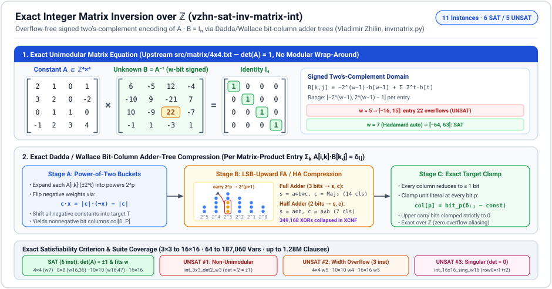

# Exact Integer Matrix Inversion over $\mathbb{Z}$ (`vzhn-sat-inv-matrix-int`)

*Figure: Illustrative schematic generated by [`src/gen_diagram.py`](src/gen_diagram.py) from the upstream matrix `src/matrix/4x4.txt` (exact unimodular integer inversion $A \cdot B = I_4$ over $\mathbb{Z}$ with Dadda/Wallace bit-column adder compression).*

## Provenance & Credit

- **Upstream Author & Source:** **Vladimir Zhilin** ([`@vzhilin_me`](https://twitter.com/vzhilin_me)) — [`https://github.com/vzhn/sat-inv-matrix-py`](https://github.com/vzhn/sat-inv-matrix-py) (commit `6bfcdafea648913655d4d838d8a9adc847925c11`), the Python successor to [`vzhn/sat-inv-matrix`](https://github.com/vzhn/sat-inv-matrix) (Kotlin) and [`vzhn/z3-inv-matrix`](https://github.com/vzhn/z3-inv-matrix) (Z3).
- **Sibling Collection:** Modular ring matrix inversion over $\mathbb{Z}/m\mathbb{Z}$ from the same upstream repository lives in [`../vzhn-sat-inv-matrix-mod/`](../vzhn-sat-inv-matrix-mod/README.md) (15 instances).
- **Expected Verdicts:** **11 instances** (**6 SAT / 5 UNSAT**), recorded in [`expected.tsv`](expected.tsv) and verified mathematically via exact Bareiss determinants and rational Gauss–Jordan inversion, as well as empirically via 100% clause-level and matrix-product model verification and formally verified `cake_lpr` UNSAT proofs (5/5 UNSAT instances).

## Problem Description

### Mathematical Problem & Encoding

Given a fixed constant integer matrix $A \in \mathbb{Z}^{n \times n}$ and a signed two's-complement bit-width $w$, find $B \in [-2^{w-1}, 2^{w-1})^{n \times n}$ satisfying $A \cdot B = I_n$ **exactly over $\mathbb{Z}$** (no wrap-around modulo $2^w$), encoded via [`src/invmatrix.py`](src/invmatrix.py):

- Each entry $B_{k,j}$ is encoded by $w$ Boolean variables $b_{k,j,0}, \dots, b_{k,j,w-1}$ representing $-2^{w-1} b_{k,j,w-1} + \sum_{t=0}^{w-2} 2^t b_{k,j,t}$.
- Each matrix-product entry $\sum_{k=0}^{n-1} A_{i,k} B_{k,j} = \delta_{ij}$ is decomposed into power-of-two weighted bit columns (converting negative weights via $c \cdot x = \lvert c \rvert (\neg x) - \lvert c \rvert$), compressed from LSB upward using Tseitin-encoded Dadda/Wallace full adders (`xor3` + `maj`, 14 clauses) and half adders (`xor2` + `and2`, 7 clauses), and clamped bit-for-bit to the shifted target $T = \delta_{ij} - \text{const}$ with all overflow carry bits clamped to `0`.
- **Exact Satisfiability Semantics:** SAT holds if and only if $A$ is unimodular ($\det A = \pm 1$) and every entry of the unique inverse $B = A^{-1}$ fits in $[-2^{w-1}, 2^{w-1})$. Setting $w$ via the Hadamard cofactor bound (`-w auto`) guarantees every entry fits if an integer inverse exists, yielding three distinct UNSAT mechanisms represented in this collection:
  1. *Non-unimodular* ($\det A \neq \pm 1$, e.g. `int_3x3_det2_w3_unsat` with $\det A = 2$),
  2. *Width-tight overflow* ($\det A = \pm 1$ but $\max \lvert (A^{-1})_{ij} \rvert$ exceeds the $w$-bit signed range, e.g. `int_4x4_w5_unsat`, `int_10x10_w4_unsat`, `int_16x16_w5_unsat`), and
  3. *Singular / rank-deficient* ($\det A = 0$, e.g. `int_16x16_sing_w16_unsat`).

## Corpus & Data Sizes

### Directory Layout & Regeneration

- `cnf-orig/` — Original **DIMACS CNF** encodings (11 `.cnf.xz` files, `10.91 MB` total, max `2.81 MB`).
- `aig-converted/` — Lossless logically equivalent **Binary AIGER 1.9** miter conversions (11 `.aig.xz` files, `14.77 MB` total, max `3.76 MB`).
- `xcnf-converted/` — Lossless **[CryptoMiniSat](https://github.com/msoos/cryptominisat) XCNF** conversions collapsing all exact 2- and 3-input adder-sum XOR blocks into native `x ... 0` parity lines (11 `.xcnf.xz` files, `6.52 MB` total, max `1.61 MB`; `349,168` total native XORs).
- `anf-converted/` — Lossless linear-size **DIMACS-ANF** conversions (11 `.anf.xz` files, `12.50 MB` total, max `3.08 MB`, degree $\le 3$, generated via [`../../../src/to_anf.py`](../../../src/to_anf.py) with `--verify`).
- [`expected.tsv`](expected.tsv) — Exact ground-truth verdicts (`6 SAT / 5 UNSAT`, strict 2-column TSV).
- `diagram.svg` — Illustrative vector diagram generated by [`src/gen_diagram.py`](src/gen_diagram.py).
- `src/` — Upstream [`invmatrix.py`](src/invmatrix.py), verbatim upstream integer matrices (`src/matrix/{4x4,8x8,10x10,16x16}.txt`), converters (`cnf2aig.py`, `cnf2xcnf.py`), reproducible suite generator (`python3 src/generate_suite.py`), and diagram generator (`python3 src/gen_diagram.py`).

### Problem Parameters & Data Sizes (Four Formats)

All 4 upstream integer matrices (`src/matrix/{4x4,8x8,10x10,16x16}.txt`) and the upstream README `3x3 det=2` matrix are included verbatim, alongside controlled width-tight overflow and singular perturbations.

| Format | Directory | Files | Key Dimensions (Range) | Compressed Size |
|---|---|---:|---|---:|
| **DIMACS CNF (origin)** | `cnf-orig/` | 11 | Vars: 64–187,060; Clauses: 242–1,277,080 | 10.91 MB |
| **Binary AIGER 1.9** | `aig-converted/` | 11 | Inputs: 64–187,060; ANDs: 378–3,504,329 | 14.77 MB |
| **[CryptoMiniSat](https://github.com/msoos/cryptominisat) XCNF** | `xcnf-converted/` | 11 | Native XOR clauses total: 349,168 | 6.52 MB |
| **DIMACS-ANF** | `anf-converted/` | 11 | Vars: 64–187,060; Eqs: 140–641,580 (deg $\le 3$) | 12.50 MB |
| **Total (4 Formats, Status: 6 SAT / 5 UNSAT)** | | **44** | | **44.71 MB** |

| Instance | Size | Signed Width | Expected | Vars | Clauses | Native XORs | `.cnf.xz` | `.aig.xz` | `.xcnf.xz` | `.anf.xz` |
|---|:---:|---|:---:|---:|---:|---:|---:|---:|---:|---:|
| `int_3x3_det2_w3_unsat` | $3\times 3$ | $w=3$ (auto, $\det=2$) | UNSAT | 64 | 242 | 18 | 0.9 KB | 0.8 KB | 0.7 KB | 0.9 KB |
| `int_4x4_w5_unsat` | $4\times 4$ | $w=5$ (tight $<6$) | UNSAT | 480 | 2,640 | 200 | 6.7 KB | 11.1 KB | 4.5 KB | 7.2 KB |
| `int_4x4_w7_sat` | $4\times 4$ | $w=7$ (Hadamard auto) | SAT | 672 | 3,792 | 280 | 9.5 KB | 14.6 KB | 6.4 KB | 10.3 KB |
| `int_8x8_w16_sat` | $8\times 8$ | $w=16$ | SAT | 34,560 | 233,136 | 16,768 | 518.8 KB | 755.3 KB | 318.0 KB | 574.4 KB |
| `int_8x8_w36_sat` | $8\times 8$ | $w=36$ (Hadamard auto) | SAT | 77,760 | 527,856 | 37,728 | 1.15 MB | 1.58 MB | 696.3 KB | 1.28 MB |
| `int_10x10_w4_unsat` | $10\times 10$ | $w=4$ (tight $<5$) | UNSAT | 15,540 | 103,570 | 7,570 | 240.5 KB | 346.7 KB | 149.0 KB | 267.3 KB |
| `int_10x10_w16_sat` | $10\times 10$ | $w=16$ | SAT | 63,680 | 432,020 | 31,040 | 962.7 KB | 1.27 MB | 578.8 KB | 1.04 MB |
| `int_10x10_w47_sat` | $10\times 10$ | $w=47$ (Hadamard auto) | SAT | 187,060 | 1,277,080 | 91,180 | 2.81 MB | 3.76 MB | 1.61 MB | 3.08 MB |
| `int_16x16_w5_unsat` | $16\times 16$ | $w=5$ (tight $<6$) | UNSAT | 45,376 | 302,560 | 22,048 | 715.4 KB | 990.1 KB | 443.7 KB | 832.2 KB |
| `int_16x16_sing_w16_unsat` | $16\times 16$ | $w=16$ ($\det=0$) | UNSAT | 146,432 | 991,712 | 71,168 | 2.28 MB | 3.05 MB | 1.39 MB | 2.73 MB |
| `int_16x16_w16_sat` | $16\times 16$ | $w=16$ | SAT | 146,432 | 991,712 | 71,168 | 2.29 MB | 3.05 MB | 1.38 MB | 2.73 MB |

## Benchmark Results

### Single-Core Flat-CNF Comparison ($T_{\max} = 60\text{ s}$)

- **Hardware & Pinning:** AMD Ryzen 9 5950X (16 cores / 32 threads, Linux x86_64), **1 thread pinned strictly to physical core 4** (`taskset -c 4`), executed strictly sequentially (one solver process at a time).
- **Timeout & Metric:** $T_{\max} = 60\text{ s}$ wall-clock time from process start to termination (including parsing); PAR-2 assigns $2 \times T_{\max} = 120\text{ s}$ per timeout.
- **Input Fairness & Default Flags:** Because CryptoMiniSat 5.18.0 and dense-solver 0.0.4 do not read `.xz` archives directly, every solver read the exact same uncompressed flat `.cnf` file using default single-thread search settings: Frobenius (default flags), CaDiCaL 3.1.0 (default flags + `--modelalllits=true` so eliminated variables are emitted in the DIMACS witness for external checking; verified identical conflict count and runtime to bare default), CryptoMiniSat 5.18.0 (default single-thread `-t 1`), dense-solver 0.0.4 (default flags), and Kissat 4.0.4 (default flags).
- **100% Independent Verification:** Zero verdict disagreements across all 5 solvers and [`expected.tsv`](expected.tsv). Every SAT witness produced by every solver (30/30 SAT runs in this table) passed both 100% raw-clause checking against `cnf-orig/*.cnf.xz` (0 unsatisfied clauses) and exact decoded matrix verification ($A \cdot B = I_n$). Every UNSAT instance (5/5) was independently certified with formally verified `cake_lpr` (see below).

| Instance | Expected | Frobenius 1C | [CaDiCaL](https://github.com/arminbiere/cadical) 3.1.0 | [CryptoMiniSat](https://github.com/msoos/cryptominisat) 5.18.0 | [dense-solver](https://github.com/libdense/dense-solver) 0.0.4 | [Kissat](https://github.com/arminbiere/kissat) 4.0.4 |
|---|:---:|---:|---:|---:|---:|---:|
| `int_3x3_det2_w3_unsat` | UNSAT | **0.6 ms** | 3.6 ms | 8.7 ms | 2.1 ms | 2.0 ms |
| `int_4x4_w5_unsat` | UNSAT | **0.9 ms** | 4.4 ms | 9.2 ms | 2.9 ms | 2.5 ms |
| `int_4x4_w7_sat` | SAT | **1.1 ms** | 5.4 ms | 11.3 ms | 3.5 ms | 2.9 ms |
| `int_8x8_w16_sat` | SAT | **85.8 ms** | 229.4 ms | 2.63 s | 816.4 ms | 158.1 ms |
| `int_8x8_w36_sat` | SAT | **190.4 ms** | 1.02 s | 6.82 s | 4.33 s | 375.4 ms |
| `int_10x10_w4_unsat` | UNSAT | **32.2 ms** | 34.7 ms | 1.37 s | 124.0 ms | 49.9 ms |
| `int_10x10_w16_sat` | SAT | **273.7 ms** | 874.0 ms | 4.41 s | 3.10 s | 291.9 ms |
| `int_10x10_w47_sat` | SAT | **569.0 ms** | 3.17 s | 49.81 s | 42.37 s | 1.11 s |
| `int_16x16_w5_unsat` | UNSAT | 507.0 ms | **265.3 ms** | 4.00 s | 1.39 s | 1.90 s |
| `int_16x16_sing_w16_unsat` | UNSAT | **1.18 s** | 1.24 s | 17.89 s | 17.57 s | 2.90 s |
| `int_16x16_w16_sat` | SAT | **7.45 s** | 24.98 s | 19.69 s | 22.39 s | 13.27 s |
| **Solved ($T_{\max}=60\text{ s}$)** | — | **11 / 11** *(highest)* | **11 / 11** *(highest)* | **11 / 11** *(highest)* | **11 / 11** *(highest)* | **11 / 11** *(highest)* |
| **Total PAR-2 ($T_{\max}=60\text{ s}$)** | — | **10.29 s** *(fastest)* | 31.83 s *(3.09x slower)* | 106.65 s *(10.4x slower)* | 92.10 s *(8.95x slower)* | 20.06 s *(1.95x slower)* |

### Format Effects (Frobenius Across All 4 Formats & CryptoMiniSat XCNF, Core 4, $T_{\max} = 60\text{ s}$)

Evaluated on identical uncompressed flat `.cnf`, `.aig`, `.xcnf`, and `.anf` inputs pinned to core 4 (`taskset -c 4`, same-build baseline four-format sweep). All 4 formats agree 100% on every verdict (11/11 solved for Frobenius in every format), and every SAT witness passed 100% raw-clause and exact matrix-product verification.

| Instance | Expected | Frobenius 1C (`.cnf`) | Frobenius 1C (`.aig`) | Frobenius 1C (`.xcnf`) | Frobenius 1C (`.anf`) | [CryptoMiniSat](https://github.com/msoos/cryptominisat) 5.18.0 (`.xcnf`) |
|---|:---:|---:|---:|---:|---:|---:|
| `int_3x3_det2_w3_unsat` | UNSAT | 2.5 ms | **2.2 ms** | 2.4 ms | 2.4 ms | 8.3 ms |
| `int_4x4_w5_unsat` | UNSAT | **2.7 ms** | 3.0 ms | **2.7 ms** | 2.9 ms | 8.9 ms |
| `int_4x4_w7_sat` | SAT | **3.4 ms** | 4.1 ms | 3.6 ms | 3.8 ms | 10.7 ms |
| `int_8x8_w16_sat` | SAT | 1.10 s | 1.19 s | 1.10 s | 882.9 ms | **866.4 ms** |
| `int_8x8_w36_sat` | SAT | 3.62 s | 2.62 s | 6.87 s | **1.80 s** | 3.54 s |
| `int_10x10_w4_unsat` | UNSAT | 64.5 ms | 90.5 ms | **55.9 ms** | 130.1 ms | 306.3 ms |
| `int_10x10_w16_sat` | SAT | **761.4 ms** | 892.6 ms | 5.57 s | 5.53 s | 3.00 s |
| `int_10x10_w47_sat` | SAT | **6.50 s** | 7.71 s | 39.55 s | 14.40 s | >60 s *(T/O)* |
| `int_16x16_w5_unsat` | UNSAT | 684.1 ms | 1.14 s | 578.3 ms | **386.3 ms** | 1.76 s |
| `int_16x16_sing_w16_unsat` | UNSAT | 2.28 s | 2.68 s | **824.2 ms** | 2.77 s | 23.78 s |
| `int_16x16_w16_sat` | SAT | 14.29 s | 22.19 s | **6.08 s** | 13.65 s | 24.94 s |
| **Solved ($T_{\max}=60\text{ s}$)** | — | **11 / 11** *(highest)* | **11 / 11** *(highest)* | **11 / 11** *(highest)* | **11 / 11** *(highest)* | 10 / 11 *(-1 worse)* |
| **Total PAR-2 ($T_{\max}=60\text{ s}$)** | — | **29.31 s** *(fastest)* | 38.52 s *(1.31x slower)* | 60.64 s *(2.07x slower)* | 39.56 s *(1.35x slower)* | 178.22 s *(6.08x slower)* |

**Key Format Observations:**

- **Native `.xcnf` accelerates the largest $16\times 16$ integer systems:** On `int_16x16_w16_sat` (`71,168` native XORs), Frobenius `.xcnf` solves in **6.08 s** (**2.35× faster** than `.cnf` and **2.18× faster** than the fastest `.cnf` baseline Kissat 4.0.4 at `13.27 s`), and `int_16x16_sing_w16_unsat` drops **2.77×** (`824.2 ms` vs `2.28 s`).
- **`.anf` shines on medium/wide adder trees:** Frobenius `.anf` beats `.cnf` by **2.01×** on `int_8x8_w36_sat` (`1.80 s` vs `3.62 s`) and **1.77×** on `int_16x16_w5_unsat` (`386.3 ms` vs `684.1 ms`).
- **Flat `.cnf` remains strongest overall by PAR-2 (`29.31 s`):** On the widest auto-width instance `int_10x10_w47_sat` (`1.28M` clauses, `91,180` XORs), `.cnf` (`6.50 s`) and `.aig` (`7.71 s`) outperform `.anf` (`14.40 s`) and `.xcnf` (`39.55 s`; CryptoMiniSat 5.18.0 `.xcnf` also times out >60 s versus `49.81 s` on `.cnf`).

### Independent UNSAT Proof Certification (5 / 5 Formally Verified)

Every UNSAT instance in this collection (**5 / 5**) was certified via direct LRAT proof emission from Frobenius (`--lrat`) and independently checked by both [`lrat-check`](https://github.com/marijnheule/drat-trim) and formally verified [`cake_lpr`](https://github.com/tanyongkiam/cake_lpr) on core 4 (`taskset -c 4`):

| Instance | Proof Format | Emit Time | Raw LRAT Size | `lrat-check` | `cake_lpr` |
|---|---|---:|---:|---|---|
| `int_3x3_det2_w3_unsat` | direct LRAT | 2.6 ms | 0.2 KB | Verified (18.8 ms) | `s VERIFIED UNSAT` (2.6 ms) |
| `int_4x4_w5_unsat` | direct LRAT | 4.5 ms | 10.6 KB | Verified (19.5 ms) | `s VERIFIED UNSAT` (5.7 ms) |
| `int_10x10_w4_unsat` | direct LRAT | 115.5 ms | 181.7 KB | Verified (44.8 ms) | `s VERIFIED UNSAT` (104.9 ms) |
| `int_16x16_w5_unsat` | direct LRAT | 249.1 ms | 1.03 MB | Verified (199.8 ms) | `s VERIFIED UNSAT` (406.6 ms) |
| `int_16x16_sing_w16_unsat` | direct LRAT | 503.4 ms | 52.7 KB | Verified (303.3 ms) | `s VERIFIED UNSAT` (1,458.9 ms) |

<!-- BEGIN_STRUCTURAL_ANALYSIS -->
## Phase-Transition & Structural Analysis

*Auto-generated by [`../../../src/analyze_benchmarks.py`](../../../src/analyze_benchmarks.py). Position relative to the critical phase transition is measured by $\rho_{\mathrm{crit}} = \frac{1}{n}\sum_k m_k / \alpha_c(k)$ (exact $\alpha/\alpha_c(k)$ for pure $k$-SAT; effective critical threshold $\alpha_c^{\mathrm{eff}} = \alpha/\rho_{\mathrm{crit}}$; `Under` $<0.90\times$, `Near-crit` $0.90\text{--}1.10\times$, `Over` $>1.10\times$), alongside Gent–Walsh annealed constrainedness $\kappa = -\frac{1}{n}\sum_i \log_2(1-2^{-k_i})$ (AAAI 1996), clause-length profile ($\bar{k}$, `%Bin`, `%Horn`), variable-degree CV ($\sigma_d/\bar{d}$, uniformity vs. hub skew), and extracted native XOR parity clauses.*

| Instance | Active $n$ | Clauses $m$ | $\alpha=m/n$ | $\alpha_c^{\mathrm{eff}}$ | $\rho_{\mathrm{crit}}$ (Regime) | $\kappa$ | $\bar{k}$ ($k_{\max}$) | Bin% | Horn% | Pos% | Deg CV | XORs |
|---|---:|---:|---:|---:|---:|---:|---:|---:|---:|---:|---:|---:|
| `int_10x10_w16_sat` | 63,680 | 432,020 | 6.78 | 6.03 | **1.12x** (Over) | 0.96 | 3.55 (4) | 0% | 50% | 50% | 1.51 | 31,040 |
| `int_10x10_w47_sat` | 187,060 | 1,277,080 | 6.83 | 6.15 | **1.11x** (Over) | 0.95 | 3.56 (4) | 0% | 50% | 50% | 1.50 | 91,180 |
| `int_10x10_w4_unsat` | 15,540 | 103,570 | 6.66 | 5.66 | **1.18x** (Over) | 0.99 | 3.52 (4) | 1% | 47% | 50% | 1.57 | 7,570 |
| `int_16x16_sing_w16_unsat` | 146,432 | 991,712 | 6.77 | 6.03 | **1.12x** (Over) | 0.96 | 3.55 (4) | 0% | 46% | 50% | 1.43 | 71,168 |
| `int_16x16_w16_sat` | 146,432 | 991,712 | 6.77 | 6.03 | **1.12x** (Over) | 0.96 | 3.55 (4) | 0% | 46% | 50% | 1.43 | 71,168 |
| `int_16x16_w5_unsat` | 45,376 | 302,560 | 6.67 | 5.74 | **1.16x** (Over) | 0.98 | 3.52 (4) | 1% | 46% | 50% | 1.48 | 22,048 |
| `int_3x3_det2_w3_unsat` | 64 | 242 | 3.78 | 3.12 | **1.21x** (Over) | 1.02 | 3.08 (4) | 5% | 58% | 49% | 0.48 | 18 |
| `int_4x4_w5_unsat` | 480 | 2,640 | 5.50 | 4.39 | **1.25x** (Over) | 1.03 | 3.36 (4) | 3% | 48% | 50% | 0.58 | 200 |
| `int_4x4_w7_sat` | 672 | 3,792 | 5.64 | 4.68 | **1.20x** (Over) | 1.01 | 3.41 (4) | 2% | 48% | 50% | 0.56 | 280 |
| `int_8x8_w16_sat` | 34,560 | 233,136 | 6.75 | 5.98 | **1.13x** (Over) | 0.96 | 3.54 (4) | 0% | 50% | 50% | 1.38 | 16,768 |
| `int_8x8_w36_sat` | 77,760 | 527,856 | 6.79 | 6.09 | **1.11x** (Over) | 0.96 | 3.55 (4) | 0% | 50% | 50% | 1.37 | 37,728 |

**Collection Phase-Transition Summary (11 instances, 4 formats: 11 CNF / 11 AIG / 11 XCNF / 11 ANF):** median $\rho_{\mathrm{crit}} = 1.13\times$ (range `1.11x–1.25x`), median $\kappa = 0.96$, regime split **0 Under / 0 Near-critical / 11 Over**, total extracted native XOR parity clauses = **349,168**, total ANF equations = **2,450,232**.
<!-- END_STRUCTURAL_ANALYSIS -->

## References

- V. Zhilin ([`@vzhilin_me`](https://twitter.com/vzhilin_me)), [*sat-inv-matrix-py: Integer and modular matrix inversion via SAT (Python)*](https://github.com/vzhn/sat-inv-matrix-py), 2026 (building on [`vzhn/sat-inv-matrix`](https://github.com/vzhn/sat-inv-matrix) and [`vzhn/z3-inv-matrix`](https://github.com/vzhn/z3-inv-matrix)).
- A. Biere, T. Faller, K. Fazekas, M. Fleury, N. Froleyks, and F. Pollitt, *[CaDiCaL](https://github.com/arminbiere/cadical) 2.0 / [Kissat](https://github.com/arminbiere/kissat) 4.0*, CAV 2024.
- M. Soos, K. Nohl, and C. Castelluccia, *Extending SAT Solvers to Cryptographic Problems ([CryptoMiniSat](https://github.com/msoos/cryptominisat))*, SAT 2009.
- Y. K. Tan, M. J. H. Heule, and M. O. Myreen, *cake_lpr: Verified Propagation Redundancy Checking in CakeML*, TACAS 2021.
- A. Biere, *The AIGER And-Inverter Graph (AIG) Format Version 20071012*, FMV Technical Report 07/1, JKU Linz, 2007.
