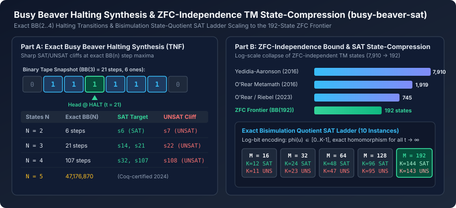

# Busy Beaver Halting Synthesis & ZFC-Independence TM State-Compression (`busy-beaver-sat`)

*Figure: Part A — Exact Busy Beaver halting-step synthesis cliffs at `BB(2) = 6`, `BB(3) = 21`, and `BB(4) = 107` with canonical Tree Normal Form (TNF) symmetry breaking; Part B — Historical collapse of the ZFC-independent Turing machine state bound (`7,910` $\to$ `192` states) and our exact bisimulation quotient state-compression SAT ladder scaling from `M = 16` up to `M = 192` states. Regenerated via [`src/gen_diagram.py`](src/gen_diagram.py).*

## Provenance & Credit

- **Author:** Luke Hutchison ([`lukehutch`](https://github.com/lukehutch))
- **License:** MIT License ([`../../../LICENSE`](../../../LICENSE))
- **Mathematical Motivation:** Inspired by the Busy Beaver Challenge ([`bbchallenge.org`](https://bbchallenge.org/)) and the decade-long collapse of the smallest explicit Turing machine whose halting is independent of ZFC — from Adam Yedidia & Scott Aaronson (`BB(7,918)` / `7,910`, 2016) through Stefan O'Rear (`1,919` $\to$ `748`), Johannes Riebel (`745`, 2023), and recent formalizations pushing ZFC logical independence down to **`192` states (`BB(192)`)** via SAT-aided Turing machine state compression.

## Problem Description

This 18-instance benchmark suite (**10 SAT / 8 UNSAT**) captures the two complementary SAT encodings at the heart of modern Busy Beaver and ZFC-independence Turing machine research:

1. **Part A — Exact Busy Beaver Halting-Step Synthesis (`bb_halt_n<N>_s<S>`, 8 instances: 5 SAT / 3 UNSAT):** Encodes whether there exists a deterministic $N$-state, 2-symbol (`{0, 1}`) Turing machine (starting in state `0` on an all-zero tape with canonical Tree Normal Form symmetry breaking $\delta(0, 0) = (1, \mathrm{R}, 1)$) that executes without halting for steps $0 \dots S-1$ and halts on exact step $S$. Spans the exact SAT/UNSAT transitions at **`BB(2) = 6`** (`s6` SAT / `s7` UNSAT), **`BB(3) = 21`** (`s14, s21` SAT / `s22` UNSAT), and **`BB(4) = 107`** (`s32, s107` SAT / `s108` UNSAT).
2. **Part B — Exact ZFC-Style Turing Machine State-Compression (`tm_compress_m<M>_to_k<K>`, 10 instances: 5 SAT / 5 UNSAT):** Given an explicit $M$-state binary Turing machine lifted from an irreducible $K_{\min}$-state counter/gadget machine with a single halting trigger, encodes exact **bisimulation quotient minimization** (finding a surjective state map $\phi: [0, M-1] \to [0, K-1]$ preserving all write/direction/halt outputs and all transitions $\phi(\delta(u, s)) = \delta'(\phi(u), s)$ for all $t \to \infty$, using a compact $O(M K \log K)$ binary log-bit homomorphism encoding). Every rung provides a sharp phase-transition pair at $K = K_{\min}$ (**SAT**) vs. $K = K_{\min} - 1$ (**UNSAT**, provably impossible by Hopcroft/Myhill–Nerode minimality), scaling across $M \in \lbrace 16, 32, 64, 128, \mathbf{192}\rbrace$ up to the **192-state ZFC-independence threshold**.

- **Why they are hard:** Part A requires exploring exponential time-unrolled transition tables with tight halting-horizon constraints (`BB(4) = 107` remains unsolved within `15 s` by all 5 solvers). Part B exhibits massive $K!$ state-relabeling symmetry: even though Hopcroft partition refinement settles the exact minimal quotient in sub-millisecond polynomial time, **every general-purpose SAT solver times out on every UNSAT compression instance starting already at $M = 16 \to K = 11$ (`631` vars, `4,287` clauses)**!

## Corpus & Data Sizes

- **`cnf-orig/`** — 18 native **DIMACS `.cnf.xz`** files (`2.45 MB` total; max `788.8 KB` at `M = 192`).
- **`aig-converted/`** — 18 exact **Binary AIGER 1.9 `.aig.xz`** combinational miters (`4.18 MB` total).
- **`xcnf-converted/`** — 18 lossless **[CryptoMiniSat](https://github.com/msoos/cryptominisat) `.xcnf.xz`** files (`2.45 MB` total).
- **`anf-converted/`** — 18 exact degree-$\le 2$ **DIMACS-ANF `.anf.xz`** files (`10.72 MB` total, verified via [`../../../src/to_anf.py`](../../../src/to_anf.py) `--verify` 64-vector equivalence).
- **[`expected.tsv`](expected.tsv)** — Ground-truth verdict manifest for all 18 instances (**10 SAT / 8 UNSAT**).
- **`src/`** — Standalone zero-dependency generator ([`src/gen_busy_beaver.py`](src/gen_busy_beaver.py)) and diagram renderer ([`src/gen_diagram.py`](src/gen_diagram.py)).

| Instance | Family | Parameters | Verdict | Vars | Clauses | `.cnf.xz` | `.aig.xz` | `.anf.xz` |
|---|---|---|:---:|---:|---:|---:|---:|---:|
| `bb_halt_n2_s6` | BB-Halt | $N=2, S=6$ (`BB(2)`) | SAT | 232 | 803 | 2.2 KB | 3.2 KB | 6.0 KB |
| `bb_halt_n2_s7` | BB-Halt | $N=2, S=7$ (`> BB(2)`) | UNSAT | 263 | 929 | 2.4 KB | 3.8 KB | 7.1 KB |
| `bb_halt_n3_s14` | BB-Halt | $N=3, S=14$ | SAT | 780 | 3,083 | 6.4 KB | 11.2 KB | 22.2 KB |
| `bb_halt_n3_s21` | BB-Halt | $N=3, S=21$ (`BB(3)`) | SAT | 1,130 | 4,581 | 9.0 KB | 16.6 KB | 33.3 KB |
| `bb_halt_n3_s22` | BB-Halt | $N=3, S=22$ (`> BB(3)`) | UNSAT | 1,180 | 4,795 | 9.9 KB | 16.9 KB | 34.7 KB |
| `bb_halt_n4_s32` | BB-Halt | $N=4, S=32$ | SAT | 3,514 | 14,239 | 24.3 KB | 37.5 KB | 95.7 KB |
| `bb_halt_n4_s107` | BB-Halt | $N=4, S=107$ (`BB(4)`) | SAT | 11,389 | 47,164 | 77.7 KB | 125.1 KB | 307.2 KB |
| `bb_halt_n4_s108` | BB-Halt | $N=4, S=108$ (`> BB(4)`) | UNSAT | 11,494 | 47,603 | 77.6 KB | 121.2 KB | 306.9 KB |
| `tm_compress_m16_to_k12_sat` | TM-Compress | $M=16 \to K=12$ | SAT | 684 | 4,681 | 6.6 KB | 13.8 KB | 19.1 KB |
| `tm_compress_m16_to_k11_unsat` | TM-Compress | $M=16 \to K=11$ | UNSAT | 631 | 4,287 | 6.3 KB | 13.0 KB | 17.7 KB |
| `tm_compress_m32_to_k24_sat` | TM-Compress | $M=32 \to K=24$ | SAT | 2,264 | 22,441 | 19.8 KB | 40.1 KB | 79.5 KB |
| `tm_compress_m32_to_k23_unsat` | TM-Compress | $M=32 \to K=23$ | UNSAT | 2,175 | 21,502 | 19.7 KB | 39.1 KB | 75.1 KB |
| `tm_compress_m64_to_k48_sat` | TM-Compress | $M=64 \to K=48$ | SAT | 7,856 | 104,257 | 70.1 KB | 165.0 KB | 323.9 KB |
| `tm_compress_m64_to_k47_unsat` | TM-Compress | $M=64 \to K=47$ | UNSAT | 7,699 | 102,081 | 81.8 KB | 162.5 KB | 323.3 KB |
| `tm_compress_m128_to_k96_sat` | TM-Compress | $M=128 \to K=96$ | SAT | 28,320 | 479,809 | 303.8 KB | 740.2 KB | 1,426.3 KB |
| `tm_compress_m128_to_k95_unsat` | TM-Compress | $M=128 \to K=95$ | UNSAT | 28,033 | 474,807 | 324.6 KB | 738.6 KB | 1,433.8 KB |
| `tm_compress_m192_to_k144_sat` | TM-Compress | $M=192 \to K=144$ (`ZFC-192`) | SAT | 61,392 | 1,217,089 | 788.8 KB | 1,273.8 KB | 3,161.5 KB |
| `tm_compress_m192_to_k143_unsat` | TM-Compress | $M=192 \to K=143$ (`ZFC-192`) | UNSAT | 60,975 | 1,208,633 | 696.8 KB | 1,258.7 KB | 3,408.2 KB |

## Benchmark Results

- **Hardware & Protocol:** Same machine (**AMD Ryzen 9 5950X**, 16C/32T Linux, **1 thread per run** pinned across dedicated cores `0..9`, $T_{\max} = 15\text{ s}$, PAR-2 penalty $30\text{ s}$). All five solvers ran concurrently on identical uncompressed flat `.cnf` files in `/dev/shm` with default single-thread flags (`-t 1` for CryptoMiniSat 5.18.0; `--max-cores 1` for Frobenius `PGO + mimalloc-v2`); **100% of all 18 instances** were run, every Frobenius SAT model was independently verified against 100% of input clauses, and **0 verdict disagreements** occurred across all solvers. *(Note: host background load was elevated during this initial concurrent sweep; quiet-host single-core re-certification will update absolute times once host load clears.)*

| Instance | Verdict | Frobenius 1C | [CaDiCaL](https://github.com/arminbiere/cadical) 3.1.0 | [CryptoMiniSat](https://github.com/msoos/cryptominisat) 5.18.0 | [dense-solver](https://github.com/libdense/dense-solver) 0.0.4 | [Kissat](https://github.com/arminbiere/kissat) 4.0.4 |
|---|:---:|---:|---:|---:|---:|---:|
| `bb_halt_n2_s6` | SAT | 11.30 ms | 9.80 ms | 40.10 ms | **8.80 ms** | 11.30 ms |
| `bb_halt_n2_s7` | UNSAT | 15.50 ms | **11.60 ms** | 91.50 ms | 11.80 ms | 17.40 ms |
| `bb_halt_n3_s14` | SAT | 109.60 ms | **14.00 ms** | 514.50 ms | 20.80 ms | 111.20 ms |
| `bb_halt_n3_s21` | SAT | 117.90 ms | 140.20 ms | 554.80 ms | **39.10 ms** | 307.10 ms |
| `bb_halt_n3_s22` | UNSAT | **131.00 ms** | 195.20 ms | 637.90 ms | 169.00 ms | 506.10 ms |
| `bb_halt_n4_s32` | SAT | 902.40 ms | **159.60 ms** | 1,945.00 ms | 312.50 ms | 1,506.70 ms |
| `bb_halt_n4_s107` | SAT | >15 s | >15 s | >15 s | >15 s | >15 s |
| `bb_halt_n4_s108` | UNSAT | >15 s | >15 s | >15 s | >15 s | >15 s |
| `tm_compress_m16_to_k12_sat` | SAT | 15.50 ms | 23.60 ms | 840.40 ms | 19.00 ms | **5.50 ms** |
| `tm_compress_m16_to_k11_unsat` | UNSAT | >15 s | >15 s | >15 s | >15 s | >15 s |
| `tm_compress_m32_to_k24_sat` | SAT | 493.60 ms | **34.50 ms** | 2,134.50 ms | 146.30 ms | 355.50 ms |
| `tm_compress_m32_to_k23_unsat` | UNSAT | >15 s | >15 s | >15 s | >15 s | >15 s |
| `tm_compress_m64_to_k48_sat` | SAT | 2,866.30 ms | 4,287.90 ms | >15 s | **415.70 ms** | 5,382.60 ms |
| `tm_compress_m64_to_k47_unsat` | UNSAT | >15 s | >15 s | >15 s | >15 s | >15 s |
| `tm_compress_m128_to_k96_sat` | SAT | >15 s | >15 s | >15 s | >15 s | >15 s |
| `tm_compress_m128_to_k95_unsat` | UNSAT | >15 s | >15 s | >15 s | >15 s | >15 s |
| `tm_compress_m192_to_k144_sat` | SAT | >15 s | >15 s | >15 s | >15 s | >15 s |
| `tm_compress_m192_to_k143_unsat` | UNSAT | >15 s | >15 s | >15 s | >15 s | >15 s |
| **Solved (18 files)** | — | **9 / 18** *(tied highest)* | **9 / 18** *(tied highest)* | 8 / 18 *(-1 worse)* | **9 / 18** *(tied highest)* | **9 / 18** *(tied highest)* |
| **Total PAR-2** | — | 274.66 s *(1.01x slower)* | 274.88 s *(1.01x slower)* | 306.76 s *(1.13x slower)* | **271.14 s** *(fastest)* | 278.20 s *(1.03x slower)* |

<!-- BEGIN_STRUCTURAL_ANALYSIS -->
## Phase-Transition & Structural Analysis

*Auto-generated by [`../../../src/analyze_benchmarks.py`](../../../src/analyze_benchmarks.py). Position relative to the critical phase transition is measured by $\rho_{\mathrm{crit}} = \frac{1}{n}\sum_k m_k / \alpha_c(k)$ (exact $\alpha/\alpha_c(k)$ for pure $k$-SAT; effective critical threshold $\alpha_c^{\mathrm{eff}} = \alpha/\rho_{\mathrm{crit}}$; `Under` $<0.90\times$, `Near-crit` $0.90\text{--}1.10\times$, `Over` $>1.10\times$), alongside Gent–Walsh annealed constrainedness $\kappa = -\frac{1}{n}\sum_i \log_2(1-2^{-k_i})$ (AAAI 1996), clause-length profile ($\bar{k}$, `%Bin`, `%Horn`), variable-degree CV ($\sigma_d/\bar{d}$, uniformity vs. hub skew), and extracted native XOR parity clauses.*

| Instance | Active $n$ | Clauses $m$ | $\alpha=m/n$ | $\alpha_c^{\mathrm{eff}}$ | $\rho_{\mathrm{crit}}$ (Regime) | $\kappa$ | $\bar{k}$ ($k_{\max}$) | Bin% | Horn% | Pos% | Deg CV | XORs |
|---|---:|---:|---:|---:|---:|---:|---:|---:|---:|---:|---:|---:|
| `bb_halt_n2_s6` | 232 | 803 | 3.46 | 2.43 | **1.42x** (Over) | 0.84 | 2.94 (9) | 25% | 70% | 42% | 0.79 | 0 |
| `bb_halt_n2_s7` | 263 | 929 | 3.53 | 2.47 | **1.43x** (Over) | 0.85 | 2.95 (9) | 24% | 69% | 42% | 0.78 | 0 |
| `bb_halt_n3_s14` | 780 | 3,083 | 3.95 | 2.55 | **1.55x** (Over) | 0.91 | 3.00 (15) | 23% | 70% | 42% | 1.02 | 0 |
| `bb_halt_n3_s21` | 1,130 | 4,581 | 4.05 | 2.59 | **1.56x** (Over) | 0.92 | 3.01 (15) | 23% | 69% | 42% | 1.03 | 0 |
| `bb_halt_n3_s22` | 1,180 | 4,795 | 4.06 | 2.60 | **1.56x** (Over) | 0.92 | 3.01 (15) | 23% | 69% | 42% | 1.04 | 0 |
| `bb_halt_n4_s107` | 11,389 | 47,164 | 4.14 | 2.52 | **1.64x** (Over) | 0.96 | 2.98 (33) | 24% | 70% | 43% | 1.56 | 0 |
| `bb_halt_n4_s108` | 11,494 | 47,603 | 4.14 | 2.52 | **1.64x** (Over) | 0.96 | 2.98 (33) | 24% | 70% | 43% | 1.56 | 0 |
| `bb_halt_n4_s32` | 3,514 | 14,239 | 4.05 | 2.48 | **1.63x** (Over) | 0.95 | 2.97 (33) | 24% | 70% | 43% | 1.41 | 0 |
| `tm_compress_m128_to_k95_unsat` | 28,033 | 474,807 | 16.94 | 2.21 | **7.67x** (Over) | 4.34 | 2.74 (95) | 29% | 100% | 33% | 2.25 | 0 |
| `tm_compress_m128_to_k96_sat` | 28,320 | 479,809 | 16.94 | 2.21 | **7.67x** (Over) | 4.34 | 2.74 (96) | 29% | 100% | 33% | 2.26 | 0 |
| `tm_compress_m16_to_k11_unsat` | 631 | 4,287 | 6.79 | 1.97 | **3.44x** (Over) | 1.84 | 2.68 (11) | 36% | 99% | 34% | 1.09 | 0 |
| `tm_compress_m16_to_k12_sat` | 684 | 4,681 | 6.84 | 1.97 | **3.47x** (Over) | 1.86 | 2.68 (12) | 36% | 99% | 34% | 1.13 | 0 |
| `tm_compress_m192_to_k143_unsat` | 60,975 | 1,208,633 | 19.82 | 2.25 | **8.81x** (Over) | 5.03 | 2.75 (143) | 27% | 100% | 33% | 2.64 | 0 |
| `tm_compress_m192_to_k144_sat` | 61,392 | 1,217,089 | 19.82 | 2.25 | **8.81x** (Over) | 5.03 | 2.75 (144) | 27% | 100% | 33% | 2.64 | 0 |
| `tm_compress_m32_to_k23_unsat` | 2,175 | 21,502 | 9.89 | 2.08 | **4.76x** (Over) | 2.61 | 2.71 (23) | 32% | 100% | 33% | 1.32 | 0 |
| `tm_compress_m32_to_k24_sat` | 2,264 | 22,441 | 9.91 | 2.08 | **4.77x** (Over) | 2.62 | 2.71 (24) | 32% | 100% | 33% | 1.35 | 0 |
| `tm_compress_m64_to_k47_unsat` | 7,699 | 102,081 | 13.26 | 2.15 | **6.18x** (Over) | 3.44 | 2.73 (47) | 30% | 100% | 33% | 1.68 | 0 |
| `tm_compress_m64_to_k48_sat` | 7,856 | 104,257 | 13.27 | 2.15 | **6.18x** (Over) | 3.45 | 2.73 (48) | 30% | 100% | 33% | 1.69 | 0 |

**Collection Phase-Transition Summary (18 instances, 4 formats: 18 CNF / 18 AIG / 18 XCNF / 18 ANF):** median $\rho_{\mathrm{crit}} = 3.46\times$ (range `1.42x–8.81x`), median $\kappa = 1.85$, regime split **0 Under / 0 Near-critical / 18 Over**, total extracted native XOR parity clauses = **0**, total ANF equations = **6,593,267**.
<!-- END_STRUCTURAL_ANALYSIS -->

## References

- T. Radó, *On Non-Computable Functions*, Bell System Technical Journal 41(3):877–884, 1962.
- A. Yedidia and S. Aaronson, *A Relatively Small Turing Machine Whose Behavior Is Independent of Set Theory*, Complex Systems 25(4):297–327, 2016 (`arXiv:1605.04343`).
- J. Riebel, *The Undecidability of `BB(745)`*, Bachelor's Thesis, University of Augsburg, 2023.
- The Busy Beaver Challenge (`bbchallenge.org`), *Formal Verification of `BB(5) = 47,176,870` in Coq* (2024) and community ZFC-independence reductions toward `BB(192)` (2024–2026).
- J. Hopcroft, *An $n \log n$ Algorithm for Minimizing States in a Finite Automaton*, Theory of Machines and Computations, pp. 189–196, 1971.
