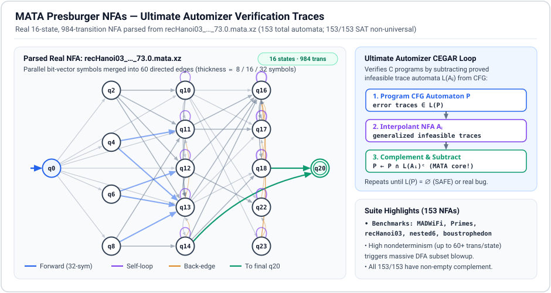

# MATA Presburger Explicit-Complement NFA Benchmarks — Ultimate Automizer (`mata-presburger-nfa-ultimate-automizer`)

*Figure: Real 16-state, 984-transition NFA parsed from `mata-orig/recHanoi03_true-unreach-call_true-termination.c_73.0.mata.xz` (aggregated into 60 weighted directed edges) alongside the Ultimate Automizer CEGAR trace-abstraction loop. Regenerated via [`src/gen_diagram.py`](src/gen_diagram.py).*

## Provenance & Credit

- **Upstream Benchmark Repository:** [`VeriFIT/nfa-bench`](https://github.com/VeriFIT/nfa-bench) (`bench-single-presburger-explicit-complement.input` / Presburger explicit-complement set)
- **Upstream Automata Library:** [`VeriFIT/mata`](https://github.com/VeriFIT/mata) (Brno University of Technology, VeriFIT group)
- **License:** MIT License — see [`LICENSE`](LICENSE) (copied from `VeriFIT/mata`).
- **Companion Collection:** [`mata-presburger-nfa-tptp/`](../mata-presburger-nfa-tptp/README.md)
- **Primary Paper:** D. Chocholatý, T. Fiedor, V. Havlena, L. Holík, M. Hruška, O. Lengál, and J. Síč, *"Mata: A Fast and Simple Finite Automata Library"*, TACAS 2024, LNCS 14570, pp. 130–151, DOI: [`10.1007/978-3-031-57249-4_7`](https://doi.org/10.1007/978-3-031-57249-4_7).
- **Recommended by:** [`@tavisrudd`](https://twitter.com/tavisrudd) (Twitter/X)

## Problem Description

This collection contains non-deterministic finite automata (NFAs) in the `.mata` text format (stored xz-compressed in `mata-orig/`) arising from Presburger arithmetic decision procedures and program verification: **Ultimate Automizer software model checking traces (e.g., `MADWiFi`, `Primes`, `recHanoi03`; 153 `.mata.xz` NFAs)**. The core benchmark task is **explicit NFA complementation** (determinization / subset construction + complementation), where intermediate DFA state spaces can blow up exponentially even for compact input NFAs.

Note: Unlike the propositional SAT collections in this repository, MATA instances represent **finite automata** (`.mata` transition relations over symbolic/explicit alphabets) rather than propositional SAT formulas, so no `.cnf`/`.aig`/`.xcnf`/`.anf` conversion is applied.

## Corpus & Data Sizes

- **`mata-orig/`** — **153 `.mata.xz` automata** (2.61 MB compressed total).
- **[`expected.tsv`](expected.tsv)** — Ground-truth complementation verdicts (**153 SAT / 0 UNSAT**; `SAT` iff $\overline{L(A)} \neq \emptyset$, `UNSAT` iff $L(A) = \Sigma^\ast$; non-emptiness $L(A) \neq \emptyset$ is `SAT` for all 153/153 NFAs).
- **`src/fetch_mata_presburger.py`** — Standalone fetcher script to refresh `mata-orig/` directly from [`VeriFIT/nfa-bench`](https://github.com/VeriFIT/nfa-bench).

## Benchmark Results

- **Hardware & Protocol:** **AMD Ryzen 9 5950X** (16C/32T Linux, **1 thread per run** pinned across 8 dedicated physical cores, $T_{\max} = 5\text{ s}$ per mode, full wall-clock time including in-process `.xz` decompression and `.mata` parsing). **100% of all 153 automata** were run across three Frobenius NFA decision modes: non-emptiness ($L(A) \neq \emptyset$, default), complement/universality (`--mata-complement`, $L(A) = \Sigma^\ast$ iff UNSAT), and explicit complementation (`--mata-explicit-complement`). All SAT/UNSAT complement verdicts agreed **100%** between both complement modes and match [`expected.tsv`](expected.tsv) (0 errors, 0 timeouts).

| Metric (1C, 153 NFAs, $T_{\max} = 5\text{ s}$) | Frobenius 1C — Emptiness (default) | Frobenius 1C — Complement (`--mata-complement`) | Frobenius 1C — Explicit (`--mata-explicit-complement`) |
|---|---:|---:|---:|
| **Solved** | **153 / 153** *(highest)* | **153 / 153** *(highest)* | **153 / 153** *(highest)* |
| **SAT** | 153 | 153 | 153 |
| **UNSAT** | 0 | 0 | 0 |
| **Total Wall Time** | 1,642.03 ms *(1.06x slower)* | **1,552.88 ms** *(fastest)* | 2,105.41 ms *(1.36x slower)* |
| **Min** | **2.05 ms** *(fastest)* | 2.13 ms *(1.04x slower)* | 2.08 ms *(1.01x slower)* |
| **Median** | 4.27 ms *(1.04x slower)* | **4.11 ms** *(fastest)* | 5.96 ms *(1.45x slower)* |
| **Mean** | 10.73 ms *(1.06x slower)* | **10.15 ms** *(fastest)* | 13.76 ms *(1.36x slower)* |
| **Max** | **219.97 ms** *(fastest)* | 221.48 ms *(1.01x slower)* | 292.33 ms *(1.33x slower)* |

### Per-Automaton Timings (All 153 NFAs)

| Automaton | Emptiness Verdict | Frobenius Emptiness | Complement Verdict | Frobenius Complement (`--mata-complement`) | Frobenius Explicit (`--mata-explicit-complement`) |
|---|:---:|---:|:---:|---:|---:|
| `MADWiFi-encode_ie_ok_true-unreach-call.i_17.0` | SAT | 5.23 ms | SAT | 5.34 ms | 8.16 ms |
| `MADWiFi-encode_ie_ok_true-unreach-call.i_7.0` | SAT | 3.71 ms | SAT | 5.77 ms | 3.65 ms |
| `Primes_true-unreach-call.c_127.0` | SAT | 4.21 ms | SAT | 2.31 ms | 2.56 ms |
| `Primes_true-unreach-call.c_1657.0` | SAT | 127.48 ms | SAT | 148.16 ms | 292.33 ms |
| `Primes_true-unreach-call.c_187.0` | SAT | 9.74 ms | SAT | 14.00 ms | 20.84 ms |
| `Primes_true-unreach-call.c_2207.0` | SAT | 3.99 ms | SAT | 3.93 ms | 3.68 ms |
| `Primes_true-unreach-call.c_2317.0` | SAT | 6.58 ms | SAT | 5.19 ms | 6.35 ms |
| `Primes_true-unreach-call.c_237.0` | SAT | 2.59 ms | SAT | 2.17 ms | 2.18 ms |
| `Primes_true-unreach-call.c_276.0` | SAT | 6.33 ms | SAT | 3.23 ms | 3.55 ms |
| `Primes_true-unreach-call.c_297.0` | SAT | 5.43 ms | SAT | 5.21 ms | 6.58 ms |
| `Primes_true-unreach-call.c_597.0` | SAT | 4.91 ms | SAT | 4.62 ms | 5.64 ms |
| `Primes_true-unreach-call.c_657.0` | SAT | 10.45 ms | SAT | 10.17 ms | 14.44 ms |
| `Primes_true-unreach-call.c_670.0` | SAT | 12.71 ms | SAT | 11.76 ms | 10.21 ms |
| `Primes_true-unreach-call.c_671.0` | SAT | 6.68 ms | SAT | 5.95 ms | 7.52 ms |
| `Primes_true-unreach-call.c_673.0` | SAT | 9.71 ms | SAT | 10.08 ms | 17.88 ms |
| `Primes_true-unreach-call.c_678.0` | SAT | 10.87 ms | SAT | 10.40 ms | 17.79 ms |
| `Primes_true-unreach-call.c_798.0` | SAT | 219.97 ms | SAT | 221.48 ms | 277.03 ms |
| `nested6_true-unreach-call.i_7.0` | SAT | 2.40 ms | SAT | 2.44 ms | 2.08 ms |
| `nested9_true-unreach-call.i_1070.0` | SAT | 2.78 ms | SAT | 2.34 ms | 2.55 ms |
| `nested9_true-unreach-call.i_1072.0` | SAT | 5.75 ms | SAT | 4.95 ms | 6.33 ms |
| `nested9_true-unreach-call.i_1107.0` | SAT | 3.92 ms | SAT | 4.10 ms | 6.86 ms |
| `nested9_true-unreach-call.i_1117.0` | SAT | 3.44 ms | SAT | 3.63 ms | 4.06 ms |
| `nested9_true-unreach-call.i_1170.0` | SAT | 4.65 ms | SAT | 3.63 ms | 5.08 ms |
| `nested9_true-unreach-call.i_1172.0` | SAT | 5.29 ms | SAT | 3.53 ms | 5.02 ms |
| `nested9_true-unreach-call.i_1307.0` | SAT | 4.28 ms | SAT | 4.79 ms | 7.14 ms |
| `nested9_true-unreach-call.i_1317.0` | SAT | 2.56 ms | SAT | 2.54 ms | 2.64 ms |
| `nested9_true-unreach-call.i_1337.0` | SAT | 3.65 ms | SAT | 3.57 ms | 4.17 ms |
| `nested9_true-unreach-call.i_1357.0` | SAT | 5.88 ms | SAT | 6.39 ms | 9.23 ms |
| `nested9_true-unreach-call.i_1370.0` | SAT | 3.42 ms | SAT | 3.31 ms | 4.77 ms |
| `nested9_true-unreach-call.i_1371.0` | SAT | 3.72 ms | SAT | 3.78 ms | 4.86 ms |
| `nested9_true-unreach-call.i_1375.0` | SAT | 3.45 ms | SAT | 3.02 ms | 4.01 ms |
| `nested9_true-unreach-call.i_1379.0` | SAT | 3.30 ms | SAT | 3.50 ms | 4.87 ms |
| `nested9_true-unreach-call.i_1427.0` | SAT | 7.78 ms | SAT | 7.60 ms | 10.28 ms |
| `nested9_true-unreach-call.i_1437.0` | SAT | 3.28 ms | SAT | 3.09 ms | 3.64 ms |
| `nested9_true-unreach-call.i_1471.0` | SAT | 3.34 ms | SAT | 3.43 ms | 4.36 ms |
| `nested9_true-unreach-call.i_1475.0` | SAT | 8.73 ms | SAT | 8.67 ms | 21.92 ms |
| `nested9_true-unreach-call.i_1477.0` | SAT | 3.40 ms | SAT | 3.31 ms | 4.45 ms |
| `nested9_true-unreach-call.i_1479.0` | SAT | 3.98 ms | SAT | 3.68 ms | 7.12 ms |
| `nested9_true-unreach-call.i_1575.0` | SAT | 4.27 ms | SAT | 4.90 ms | 9.85 ms |
| `nested9_true-unreach-call.i_1578.0` | SAT | 4.22 ms | SAT | 3.98 ms | 6.00 ms |
| `nested9_true-unreach-call.i_1597.0` | SAT | 8.76 ms | SAT | 8.53 ms | 20.09 ms |
| `nested9_true-unreach-call.i_1676.0` | SAT | 4.84 ms | SAT | 3.96 ms | 6.68 ms |
| `nested9_true-unreach-call.i_1677.0` | SAT | 5.44 ms | SAT | 5.67 ms | 9.12 ms |
| `nested9_true-unreach-call.i_1679.0` | SAT | 12.07 ms | SAT | 7.82 ms | 21.43 ms |
| `nested9_true-unreach-call.i_17.0` | SAT | 2.68 ms | SAT | 2.68 ms | 2.76 ms |
| `nested9_true-unreach-call.i_1703.0` | SAT | 4.81 ms | SAT | 4.54 ms | 7.63 ms |
| `nested9_true-unreach-call.i_1707.0` | SAT | 4.49 ms | SAT | 6.07 ms | 9.01 ms |
| `nested9_true-unreach-call.i_1720.0` | SAT | 4.34 ms | SAT | 4.03 ms | 6.13 ms |
| `nested9_true-unreach-call.i_1722.0` | SAT | 12.24 ms | SAT | 6.73 ms | 14.89 ms |
| `nested9_true-unreach-call.i_1723.0` | SAT | 4.42 ms | SAT | 4.26 ms | 6.30 ms |
| `nested9_true-unreach-call.i_1726.0` | SAT | 4.27 ms | SAT | 4.63 ms | 6.11 ms |
| `nested9_true-unreach-call.i_1728.0` | SAT | 11.65 ms | SAT | 8.55 ms | 15.84 ms |
| `nested9_true-unreach-call.i_1729.0` | SAT | 3.98 ms | SAT | 3.98 ms | 5.96 ms |
| `nested9_true-unreach-call.i_173.0` | SAT | 2.64 ms | SAT | 2.56 ms | 2.64 ms |
| `nested9_true-unreach-call.i_1732.0` | SAT | 4.34 ms | SAT | 4.31 ms | 5.96 ms |
| `nested9_true-unreach-call.i_1736.0` | SAT | 4.28 ms | SAT | 3.96 ms | 5.95 ms |
| `nested9_true-unreach-call.i_1737.0` | SAT | 10.41 ms | SAT | 9.66 ms | 15.35 ms |
| `nested9_true-unreach-call.i_1738.0` | SAT | 4.31 ms | SAT | 4.32 ms | 6.12 ms |
| `nested9_true-unreach-call.i_1739.0` | SAT | 4.22 ms | SAT | 4.08 ms | 6.06 ms |
| `nested9_true-unreach-call.i_1741.0` | SAT | 10.27 ms | SAT | 8.67 ms | 15.01 ms |
| `nested9_true-unreach-call.i_1748.0` | SAT | 3.41 ms | SAT | 3.55 ms | 4.80 ms |
| `nested9_true-unreach-call.i_1749.0` | SAT | 4.16 ms | SAT | 4.15 ms | 5.98 ms |
| `nested9_true-unreach-call.i_175.0` | SAT | 2.75 ms | SAT | 2.62 ms | 3.27 ms |
| `nested9_true-unreach-call.i_1752.0` | SAT | 3.59 ms | SAT | 3.86 ms | 4.93 ms |
| `nested9_true-unreach-call.i_1755.0` | SAT | 10.80 ms | SAT | 6.98 ms | 13.31 ms |
| `nested9_true-unreach-call.i_1758.0` | SAT | 3.82 ms | SAT | 3.73 ms | 4.86 ms |
| `nested9_true-unreach-call.i_1761.0` | SAT | 3.77 ms | SAT | 3.90 ms | 5.06 ms |
| `nested9_true-unreach-call.i_1764.0` | SAT | 6.46 ms | SAT | 7.38 ms | 10.04 ms |
| `nested9_true-unreach-call.i_1767.0` | SAT | 3.66 ms | SAT | 3.42 ms | 4.96 ms |
| `nested9_true-unreach-call.i_1770.0` | SAT | 3.88 ms | SAT | 4.02 ms | 4.72 ms |
| `nested9_true-unreach-call.i_1777.0` | SAT | 4.84 ms | SAT | 4.36 ms | 7.10 ms |
| `nested9_true-unreach-call.i_1778.0` | SAT | 4.25 ms | SAT | 4.19 ms | 5.97 ms |
| `nested9_true-unreach-call.i_1781.0` | SAT | 10.63 ms | SAT | 7.86 ms | 20.55 ms |
| `nested9_true-unreach-call.i_1784.0` | SAT | 3.86 ms | SAT | 4.01 ms | 5.17 ms |
| `nested9_true-unreach-call.i_1785.0` | SAT | 4.71 ms | SAT | 4.59 ms | 7.33 ms |
| `nested9_true-unreach-call.i_1786.0` | SAT | 10.50 ms | SAT | 10.71 ms | 17.36 ms |
| `nested9_true-unreach-call.i_1789.0` | SAT | 4.58 ms | SAT | 4.62 ms | 7.07 ms |
| `nested9_true-unreach-call.i_179.0` | SAT | 2.66 ms | SAT | 2.75 ms | 3.16 ms |
| `nested9_true-unreach-call.i_1792.0` | SAT | 4.00 ms | SAT | 4.15 ms | 7.20 ms |
| `nested9_true-unreach-call.i_1795.0` | SAT | 4.52 ms | SAT | 4.47 ms | 6.87 ms |
| `nested9_true-unreach-call.i_1798.0` | SAT | 11.42 ms | SAT | 8.21 ms | 16.50 ms |
| `nested9_true-unreach-call.i_1817.0` | SAT | 4.91 ms | SAT | 4.71 ms | 7.97 ms |
| `nested9_true-unreach-call.i_1847.0` | SAT | 3.77 ms | SAT | 3.97 ms | 5.18 ms |
| `nested9_true-unreach-call.i_187.0` | SAT | 7.02 ms | SAT | 7.89 ms | 7.78 ms |
| `nested9_true-unreach-call.i_1874.0` | SAT | 3.56 ms | SAT | 3.52 ms | 4.61 ms |
| `nested9_true-unreach-call.i_1875.0` | SAT | 3.92 ms | SAT | 3.88 ms | 4.59 ms |
| `nested9_true-unreach-call.i_1877.0` | SAT | 3.92 ms | SAT | 3.95 ms | 4.51 ms |
| `nested9_true-unreach-call.i_1878.0` | SAT | 3.66 ms | SAT | 3.38 ms | 4.46 ms |
| `nested9_true-unreach-call.i_1879.0` | SAT | 12.65 ms | SAT | 6.14 ms | 14.02 ms |
| `nested9_true-unreach-call.i_1887.0` | SAT | 4.16 ms | SAT | 3.88 ms | 4.73 ms |
| `nested9_true-unreach-call.i_1897.0` | SAT | 3.80 ms | SAT | 3.90 ms | 4.62 ms |
| `nested9_true-unreach-call.i_277.0` | SAT | 7.20 ms | SAT | 5.56 ms | 7.45 ms |
| `nested9_true-unreach-call.i_357.0` | SAT | 2.85 ms | SAT | 2.86 ms | 3.21 ms |
| `nested9_true-unreach-call.i_378.0` | SAT | 2.65 ms | SAT | 2.37 ms | 2.89 ms |
| `nested9_true-unreach-call.i_379.0` | SAT | 2.88 ms | SAT | 2.68 ms | 2.86 ms |
| `nested9_true-unreach-call.i_447.0` | SAT | 2.44 ms | SAT | 2.43 ms | 2.74 ms |
| `nested9_true-unreach-call.i_470.0` | SAT | 8.39 ms | SAT | 7.10 ms | 12.55 ms |
| `nested9_true-unreach-call.i_473.0` | SAT | 2.98 ms | SAT | 3.05 ms | 3.39 ms |
| `nested9_true-unreach-call.i_497.0` | SAT | 3.24 ms | SAT | 3.04 ms | 3.69 ms |
| `nested9_true-unreach-call.i_507.0` | SAT | 8.33 ms | SAT | 8.44 ms | 13.37 ms |
| `nested9_true-unreach-call.i_527.0` | SAT | 2.48 ms | SAT | 2.17 ms | 2.43 ms |
| `nested9_true-unreach-call.i_537.0` | SAT | 2.38 ms | SAT | 2.29 ms | 2.45 ms |
| `nested9_true-unreach-call.i_573.0` | SAT | 2.40 ms | SAT | 2.17 ms | 2.48 ms |
| `nested9_true-unreach-call.i_574.0` | SAT | 2.46 ms | SAT | 2.59 ms | 2.72 ms |
| `nested9_true-unreach-call.i_575.0` | SAT | 5.69 ms | SAT | 4.37 ms | 7.16 ms |
| `nested9_true-unreach-call.i_627.0` | SAT | 2.85 ms | SAT | 2.86 ms | 2.98 ms |
| `nested9_true-unreach-call.i_637.0` | SAT | 3.30 ms | SAT | 3.17 ms | 3.61 ms |
| `nested9_true-unreach-call.i_670.0` | SAT | 5.70 ms | SAT | 7.10 ms | 7.22 ms |
| `nested9_true-unreach-call.i_7.0` | SAT | 2.05 ms | SAT | 2.15 ms | 2.31 ms |
| `nested9_true-unreach-call.i_703.0` | SAT | 4.00 ms | SAT | 4.00 ms | 6.61 ms |
| `nested9_true-unreach-call.i_707.0` | SAT | 4.10 ms | SAT | 4.32 ms | 6.58 ms |
| `nested9_true-unreach-call.i_71.0` | SAT | 2.74 ms | SAT | 2.77 ms | 2.90 ms |
| `nested9_true-unreach-call.i_713.0` | SAT | 9.38 ms | SAT | 10.02 ms | 19.03 ms |
| `nested9_true-unreach-call.i_720.0` | SAT | 5.14 ms | SAT | 4.57 ms | 6.68 ms |
| `nested9_true-unreach-call.i_725.0` | SAT | 4.76 ms | SAT | 4.40 ms | 6.74 ms |
| `nested9_true-unreach-call.i_728.0` | SAT | 7.94 ms | SAT | 9.50 ms | 17.18 ms |
| `nested9_true-unreach-call.i_73.0` | SAT | 2.98 ms | SAT | 2.72 ms | 3.19 ms |
| `nested9_true-unreach-call.i_744.0` | SAT | 3.62 ms | SAT | 3.40 ms | 5.32 ms |
| `nested9_true-unreach-call.i_746.0` | SAT | 4.07 ms | SAT | 4.07 ms | 5.23 ms |
| `nested9_true-unreach-call.i_751.0` | SAT | 3.99 ms | SAT | 3.73 ms | 5.25 ms |
| `nested9_true-unreach-call.i_753.0` | SAT | 8.03 ms | SAT | 8.70 ms | 11.13 ms |
| `nested9_true-unreach-call.i_755.0` | SAT | 3.66 ms | SAT | 3.73 ms | 5.32 ms |
| `nested9_true-unreach-call.i_762.0` | SAT | 3.83 ms | SAT | 4.26 ms | 5.15 ms |
| `nested9_true-unreach-call.i_763.0` | SAT | 12.19 ms | SAT | 7.89 ms | 16.32 ms |
| `nested9_true-unreach-call.i_766.0` | SAT | 3.50 ms | SAT | 3.51 ms | 4.94 ms |
| `nested9_true-unreach-call.i_775.0` | SAT | 3.67 ms | SAT | 3.67 ms | 5.03 ms |
| `nested9_true-unreach-call.i_780.0` | SAT | 3.83 ms | SAT | 3.97 ms | 5.22 ms |
| `nested9_true-unreach-call.i_785.0` | SAT | 4.07 ms | SAT | 4.13 ms | 5.28 ms |
| `nested9_true-unreach-call.i_788.0` | SAT | 7.64 ms | SAT | 9.64 ms | 13.20 ms |
| `nested9_true-unreach-call.i_807.0` | SAT | 4.41 ms | SAT | 4.11 ms | 5.45 ms |
| `nested9_true-unreach-call.i_817.0` | SAT | 4.40 ms | SAT | 4.02 ms | 6.02 ms |
| `nested9_true-unreach-call.i_870.0` | SAT | 8.51 ms | SAT | 8.47 ms | 13.63 ms |
| `nested9_true-unreach-call.i_887.0` | SAT | 3.01 ms | SAT | 2.73 ms | 3.24 ms |
| `nested9_true-unreach-call.i_927.0` | SAT | 2.93 ms | SAT | 2.74 ms | 3.63 ms |
| `nested9_true-unreach-call.i_947.0` | SAT | 3.85 ms | SAT | 3.34 ms | 4.99 ms |
| `recHanoi03_true-unreach-call_true-termination.c_1478.0` | SAT | 8.14 ms | SAT | 7.64 ms | 12.27 ms |
| `recHanoi03_true-unreach-call_true-termination.c_1735.0` | SAT | 4.62 ms | SAT | 5.69 ms | 4.04 ms |
| `recHanoi03_true-unreach-call_true-termination.c_1757.0` | SAT | 5.86 ms | SAT | 5.23 ms | 5.47 ms |
| `recHanoi03_true-unreach-call_true-termination.c_2147.0` | SAT | 2.33 ms | SAT | 2.32 ms | 2.34 ms |
| `recHanoi03_true-unreach-call_true-termination.c_2175.0` | SAT | 15.39 ms | SAT | 8.89 ms | 9.84 ms |
| `recHanoi03_true-unreach-call_true-termination.c_2715.0` | SAT | 6.10 ms | SAT | 5.03 ms | 5.34 ms |
| `recHanoi03_true-unreach-call_true-termination.c_2746.0` | SAT | 78.75 ms | SAT | 79.93 ms | 83.12 ms |
| `recHanoi03_true-unreach-call_true-termination.c_278.0` | SAT | 8.63 ms | SAT | 7.61 ms | 8.25 ms |
| `recHanoi03_true-unreach-call_true-termination.c_287.0` | SAT | 77.45 ms | SAT | 78.81 ms | 81.86 ms |
| `recHanoi03_true-unreach-call_true-termination.c_3227.0` | SAT | 8.63 ms | SAT | 9.04 ms | 9.80 ms |
| `recHanoi03_true-unreach-call_true-termination.c_367.0` | SAT | 80.03 ms | SAT | 83.57 ms | 84.54 ms |
| `recHanoi03_true-unreach-call_true-termination.c_3872.0` | SAT | 2.17 ms | SAT | 2.13 ms | 2.11 ms |
| `recHanoi03_true-unreach-call_true-termination.c_557.0` | SAT | 147.64 ms | SAT | 77.78 ms | 81.18 ms |
| `recHanoi03_true-unreach-call_true-termination.c_597.0` | SAT | 142.76 ms | SAT | 147.09 ms | 158.52 ms |
| `recHanoi03_true-unreach-call_true-termination.c_73.0` | SAT | 3.53 ms | SAT | 3.70 ms | 4.62 ms |
| `recHanoi03_true-unreach-call_true-termination.c_847.0` | SAT | 2.06 ms | SAT | 2.36 ms | 2.43 ms |
| `recHanoi03_true-unreach-call_true-termination.c_874.0` | SAT | 5.99 ms | SAT | 3.27 ms | 4.41 ms |
| `recHanoi03_true-unreach-call_true-termination.c_876.0` | SAT | 5.25 ms | SAT | 6.27 ms | 7.10 ms |

<!-- BEGIN_STRUCTURAL_ANALYSIS -->
## Automata Structural Analysis

*Auto-generated by [`../../../src/analyze_benchmarks.py`](../../../src/analyze_benchmarks.py). Because MATA benchmarks encode non-deterministic finite automata rather than clausal CNF formulas, clause-to-variable phase-transition ratios ($\alpha / \alpha_c$) do not apply; instead we report NFA state, transition, and alphabet densities (transition-to-state ratio $\delta = |\Delta|/|Q|$).*

| Directory | NFAs | States $\lvert Q \rvert$ (Med / Max) | Transitions $\lvert \Delta \rvert$ (Med / Max) | Symbols $\lvert \Sigma \rvert$ (Med / Max) | Transition Density $\lvert \Delta \rvert / \lvert Q \rvert$ (Med) |
|---|---:|---:|---:|---:|---:|
| `mata-orig/` | 153 | 145 / 277 | 10,588 / 1,094,080 | 32 / 1,024 | 66.17 |
<!-- END_STRUCTURAL_ANALYSIS -->

## References

- **Chocholatý et al. (TACAS 2024):** Benchmarked [Mata](https://github.com/VeriFIT/mata) against [Awali](https://gitlab.in2p3.fr/vaucanson/awali), [Automata.net](https://github.com/AutomataDotNet/Automata), [Brics](https://www.brics.dk/automaton/), [DK.Brics](https://www.brics.dk/automaton/), [FAdo](https://fado.dcc.fc.up.pt/), [OpenFST](https://www.openfst.org/), and [VATA](https://github.com/ondrik/libvata) across string-constraint, regex, and Presburger complementation workloads, establishing Mata as a state-of-the-art C++ NFA engine.
- **Ergodis Notes ([`@tavisrudd`](https://twitter.com/tavisrudd)):** Evaluated all 169 entries of `bench-single-presburger-explicit-complement.input` as an automata complementation stress test alongside SAT workloads.
