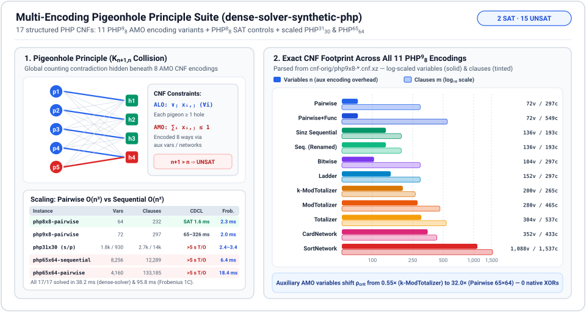

# [dense-solver](https://github.com/libdense/dense-solver) Synthetic Multi-Encoding Pigeonhole Principle Benchmarks (`dense-solver-synthetic-php/`)

*Figure: Complete bipartite pigeonhole graph $K_{5,4}$ illustrating the global counting collision, Pairwise $O(n^3)$ vs. Sequential $O(n^2)$ scaling up to $\mathrm{PHP_{64}^{65}}$, and the exact log-scaled variable/clause footprints parsed across all 11 `php9x8-*` AMO encodings. Regenerated via [`src/gen_diagram.py`](src/gen_diagram.py).*

## Provenance & Credit

- **Author:** Merlin Numa ([`@merlin_numa`](https://twitter.com/merlin_numa) on Twitter/X)
- **Upstream Repository:** [`libdense/dense-solver`](https://github.com/libdense/dense-solver)
- **Zenodo Archive (v0.0.4):** [`zenodo.org/records/24443907`](https://zenodo.org/records/24443907)
- **License & Attribution:** **MIT License** — see [`LICENSE`](LICENSE), [`CITATION.cff`](CITATION.cff), and [`SOURCES.md`](SOURCES.md).
- **Sibling & Related Collections:** [`dense-solver-synthetic-chessboard/`](../../geometric/dense-solver-synthetic-chessboard/README.md) (3 mutilated chessboard domino-tiling UNSAT CNFs from the same upstream synthetic suite), [`dense-solver-public/`](../../competition-suites/dense-solver-public/README.md) (30 SATLIB + SC 2025 public CNFs), [`satlib-dimacs-phole/`](../satlib-dimacs-phole/README.md), and [`zed-adversarial-php/`](../zed-adversarial-php/README.md).
- **Recommended by:** [`@merlin_numa`](https://twitter.com/merlin_numa) (Twitter/X)

## Problem Description

This collection holds the **17 structured Pigeonhole Principle CNFs** shipped with [dense-solver](https://github.com/libdense/dense-solver) 0.0.4 (**2 SAT / 15 UNSAT**):

- **$\mathrm{PHP}^9_8$ across 8 distinct At-Most-One (AMO) CNF encodings (11 UNSAT files):** pairwise, pairwise-functional, Sinz sequential counter, renamed sequential counter, bitwise, ladder, sorting network (`sortnetwrk`), cardinality network (`cardnetwrk`), totalizer, modulo-totalizer (`mtotalizer`), and $k$-modulo-totalizer (`kmtotalizer`) — testing whether solvers recover the global pigeonhole counting obstruction regardless of auxiliary-variable CNF encoding.
- **Large-scale UNSAT scaling (4 UNSAT files):** $\mathrm{PHP_{30}^{31}}$ and $\mathrm{PHP_{64}^{65}}$ in both quadratic pairwise (`133,185` clauses at $65 \times 64$) and linear Sinz sequential (`12,289` clauses at $65 \times 64$) encodings.
- **Satisfiable bijection controls (2 SAT files):** `php8x8-pairwise` and `php8x8-sequential` ($\mathrm{PHP}^8_8$, $8!$ valid matchings).

## Corpus & Data Sizes

- **`cnf-orig/`** — 17 original native **DIMACS `.cnf.xz`** files (113.6 KB).
- **`aig-converted/`** — 17 exact **Binary AIGER 1.9 `.aig.xz`** conversions (190.6 KB, verified via [Berkeley ABC](https://github.com/berkeley-abc/abc) `read_aiger`).
- **`xcnf-converted/`** — 17 lossless **[CryptoMiniSat](https://github.com/msoos/cryptominisat) `.xcnf.xz`** conversions (113.2 KB, `0` extracted native XOR parity clauses).
- **`anf-converted/`** — 17 lossless linear-size **DIMACS-ANF `.anf.xz`** conversions (330.7 KB, generated via [`../../../src/to_anf.py`](../../../src/to_anf.py)).
- **[`expected.tsv`](expected.tsv)** — Ground-truth verdict manifest for all 17 instances (**2 SAT / 15 UNSAT**).
- **`src/`** — Upstream Python generator (`generate.py`), standalone converters (`cnf2aig.py`, `cnf2xcnf.py`), and diagram script (`gen_diagram.py`).

| Format | Directory | Files | Key Dimensions (Range) | Compressed Size |
|---|---|---:|---|---:|
| **DIMACS CNF (origin)** | `cnf-orig/` | 17 | Vars: 64–8,256; Clauses: 168–133,185 | 113.6 KB |
| **Binary AIGER 1.9** | `aig-converted/` | 17 | Inputs: 64–8,256; ANDs: 383–270,399 | 190.6 KB |
| **[CryptoMiniSat](https://github.com/msoos/cryptominisat) XCNF** | `xcnf-converted/` | 17 | Native XOR clauses total: 0 | 113.2 KB |
| **DIMACS-ANF** | `anf-converted/` | 17 | Vars: 104–12,221; Eqs: 208–137,150 (deg ≤ 3) | 330.7 KB |
| **Total (4 Formats, Status: 2 SAT / 15 UNSAT)** | | **68** | | **748.0 KB** |

## Benchmark Results

- **Hardware & Protocol:** Same machine (**AMD Ryzen 9 5950X**, 16C/32T Linux, **1 thread per run** pinned across 8 dedicated physical cores, $T_{\max} = 5\text{ s}$, PAR-2 penalty $10,000\text{ ms}$). All solvers ran with default single-thread flags (`-t 1` for CryptoMiniSat 5.18.0; `--max-cores 1` for Frobenius) on identical uncompressed flat `.cnf` inputs; **100% of all 17 instances** were run (no subsampling), every Frobenius SAT model was independently verified against 100% of input clauses, and **0 verdict disagreements** occurred across all solvers (cross-checked against [`expected.tsv`](expected.tsv)).

| Instance | Verdict | Frobenius 1C | [CaDiCaL](https://github.com/arminbiere/cadical) 3.1.0 | [CryptoMiniSat](https://github.com/msoos/cryptominisat) 5.18.0 | [dense-solver](https://github.com/libdense/dense-solver) 0.0.4 | [Kissat](https://github.com/arminbiere/kissat) 4.0.4 |
|---|:---:|---:|---:|---:|---:|---:|
| `php31x30-pairwise` | UNSAT | **0.97 ms** | >5 s | >5 s | 2.17 ms | >5 s |
| `php31x30-sequential` | UNSAT | **0.77 ms** | >5 s | >5 s | 1.76 ms | >5 s |
| `php65x64-pairwise` | UNSAT | **3.98 ms** | >5 s | >5 s | 10.16 ms | >5 s |
| `php65x64-sequential` | UNSAT | **1.19 ms** | >5 s | >5 s | 3.12 ms | >5 s |
| `php8x8-pairwise` | SAT | **0.69 ms** | 2.42 ms | 8.34 ms | 1.61 ms | 1.62 ms |
| `php8x8-sequential` | SAT | **0.78 ms** | 2.29 ms | 8.76 ms | 1.88 ms | 1.51 ms |
| `php9x8-bitwise` | UNSAT | **0.76 ms** | 41.80 ms | 124.08 ms | 1.35 ms | 20.27 ms |
| `php9x8-cardnetwrk` | UNSAT | **0.80 ms** | 15.06 ms | 40.26 ms | 1.57 ms | 8.07 ms |
| `php9x8-kmtotalizer` | UNSAT | **0.75 ms** | 7.10 ms | 42.50 ms | 1.57 ms | 6.59 ms |
| `php9x8-ladder` | UNSAT | **0.79 ms** | 9.56 ms | 79.77 ms | 1.72 ms | 8.94 ms |
| `php9x8-mtotalizer` | UNSAT | **0.79 ms** | 7.34 ms | 41.70 ms | 1.64 ms | 6.22 ms |
| `php9x8-pairwise` | UNSAT | **0.62 ms** | 280.57 ms | 326.24 ms | 1.46 ms | 65.15 ms |
| `php9x8-pairwise-functional` | UNSAT | **0.71 ms** | 239.77 ms | 291.92 ms | 1.62 ms | 45.89 ms |
| `php9x8-sequential` | UNSAT | **0.64 ms** | 18.54 ms | 45.27 ms | 1.55 ms | 17.62 ms |
| `php9x8-sequential-renamed` | UNSAT | **0.79 ms** | 10.38 ms | 48.68 ms | 1.64 ms | 5.93 ms |
| `php9x8-sortnetwrk` | UNSAT | **1.17 ms** | 11.12 ms | 43.99 ms | 1.64 ms | 7.47 ms |
| `php9x8-totalizer` | UNSAT | **0.86 ms** | 7.18 ms | 40.14 ms | 1.77 ms | 6.63 ms |
| **Solved (17 files)** | — | **17 / 17** *(highest)* | 13 / 17 *(-4 worse)* | 13 / 17 *(-4 worse)* | **17 / 17** *(highest)* | 13 / 17 *(-4 worse)* |
| **Total PAR-2** | — | **17.1 ms** *(fastest)* | 40,653.1 ms *(2,382.53x slower)* | 41,141.6 ms *(2,411.16x slower)* | 38.2 ms *(2.24x slower)* | 40,201.9 ms *(2,356.09x slower)* |

<!-- BEGIN_STRUCTURAL_ANALYSIS -->
## Phase-Transition & Structural Analysis

*Auto-generated by [`../../../src/analyze_benchmarks.py`](../../../src/analyze_benchmarks.py). Position relative to the critical phase transition is measured by $\rho_{\mathrm{crit}} = \frac{1}{n}\sum_k m_k / \alpha_c(k)$ (exact $\alpha/\alpha_c(k)$ for pure $k$-SAT; effective critical threshold $\alpha_c^{\mathrm{eff}} = \alpha/\rho_{\mathrm{crit}}$; `Under` $<0.90\times$, `Near-crit` $0.90\text{--}1.10\times$, `Over` $>1.10\times$), alongside Gent–Walsh annealed constrainedness $\kappa = -\frac{1}{n}\sum_i \log_2(1-2^{-k_i})$ (AAAI 1996), clause-length profile ($\bar{k}$, `%Bin`, `%Horn`), variable-degree CV ($\sigma_d/\bar{d}$, uniformity vs. hub skew), and extracted native XOR parity clauses.*

| Instance | Active $n$ | Clauses $m$ | $\alpha=m/n$ | $\alpha_c^{\mathrm{eff}}$ | $\rho_{\mathrm{crit}}$ (Regime) | $\kappa$ | $\bar{k}$ ($k_{\max}$) | Bin% | Horn% | Pos% | Deg CV | XORs |
|---|---:|---:|---:|---:|---:|---:|---:|---:|---:|---:|---:|---:|
| `php31x30-pairwise` | 930 | 13,981 | 15.03 | 1.00 | **15.0x** (Over) | 6.23 | 2.06 (30) | 100% | 100% | 3% | 0.00 | 0 |
| `php31x30-sequential` | 1,830 | 2,701 | 1.48 | 1.01 | **1.46x** (Over) | 0.61 | 2.32 (30) | 99% | 99% | 43% | 0.16 | 0 |
| `php65x64-pairwise` | 4,160 | 133,185 | 32.02 | 1.00 | **32.0x** (Over) | 13.28 | 2.03 (64) | 100% | 100% | 2% | 0.00 | 0 |
| `php65x64-sequential` | 8,256 | 12,289 | 1.49 | 1.01 | **1.48x** (Over) | 0.61 | 2.33 (64) | 99% | 99% | 43% | 0.15 | 0 |
| `php8x8-pairwise` | 64 | 232 | 3.62 | 1.04 | **3.50x** (Over) | 1.45 | 2.21 (8) | 97% | 97% | 12% | 0.00 | 0 |
| `php8x8-sequential` | 120 | 168 | 1.40 | 1.05 | **1.33x** (Over) | 0.55 | 2.29 (8) | 95% | 95% | 44% | 0.20 | 0 |
| `php9x8-bitwise` | 104 | 297 | 2.86 | 1.03 | **2.77x** (Over) | 1.15 | 2.18 (8) | 97% | 97% | 27% | 0.30 | 0 |
| `php9x8-cardnetwrk` | 352 | 433 | 1.23 | 1.35 | **0.91x** (Near-crit) | 0.44 | 2.40 (8) | 63% | 98% | 46% | 0.35 | 0 |
| `php9x8-kmtotalizer` | 200 | 265 | 1.32 | 2.43 | **0.55x** (Under) | 0.51 | 2.69 (8) | 0% | 48% | 55% | 0.16 | 0 |
| `php9x8-ladder` | 152 | 297 | 1.95 | 1.24 | **1.57x** (Over) | 0.69 | 2.40 (8) | 75% | 73% | 51% | 0.25 | 0 |
| `php9x8-mtotalizer` | 280 | 465 | 1.66 | 2.08 | **0.80x** (Under) | 0.49 | 2.77 (8) | 28% | 65% | 50% | 0.41 | 0 |
| `php9x8-pairwise-functional` | 72 | 549 | 7.62 | 1.02 | **7.50x** (Over) | 3.11 | 2.10 (8) | 98% | 98% | 6% | 0.00 | 0 |
| `php9x8-pairwise` | 72 | 297 | 4.12 | 1.03 | **4.00x** (Over) | 1.66 | 2.18 (8) | 97% | 97% | 11% | 0.00 | 0 |
| `php9x8-sequential-renamed` | 136 | 193 | 1.42 | 1.05 | **1.35x** (Over) | 0.56 | 2.28 (8) | 95% | 73% | 50% | 0.20 | 0 |
| `php9x8-sequential` | 136 | 193 | 1.42 | 1.05 | **1.35x** (Over) | 0.56 | 2.28 (8) | 95% | 95% | 44% | 0.20 | 0 |
| `php9x8-sortnetwrk` | 1,088 | 1,537 | 1.41 | 1.35 | **1.05x** (Near-crit) | 0.49 | 2.35 (8) | 66% | 99% | 44% | 0.39 | 0 |
| `php9x8-totalizer` | 304 | 537 | 1.77 | 1.75 | **1.01x** (Near-crit) | 0.53 | 2.62 (8) | 43% | 98% | 42% | 0.42 | 0 |

**Collection Phase-Transition Summary (17 instances, 4 formats: 17 CNF / 17 AIG / 17 XCNF / 17 ANF):** median $\rho_{\mathrm{crit}} = 1.46\times$ (range `0.55x–32.0x`), median $\kappa = 0.61$, regime split **2 Under / 3 Near-critical / 12 Over**, total extracted native XOR parity clauses = **0**, total ANF equations = **177,838**.
<!-- END_STRUCTURAL_ANALYSIS -->

## References

- M. Numa, *[dense-solver](https://github.com/libdense/dense-solver) v0.0.4*, [GitHub](https://github.com/libdense/dense-solver) and [Zenodo `24443907`](https://zenodo.org/records/24443907) (2026).
- A. Biere, D. Le Berre, E. Lonca, and N. Manthey, *"Detecting Cardinality Constraints in CNF"*, SAT 2014, LNCS 8561, pp. 285–301.
- C. Sinz, *"Towards an Optimal CNF Encoding of Boolean Cardinality Constraints"*, CP 2005, LNCS 3709, pp. 827–831.
- A. Haken, *"The Intractability of Resolution"*, Theoretical Computer Science 39:297–308, 1985.
