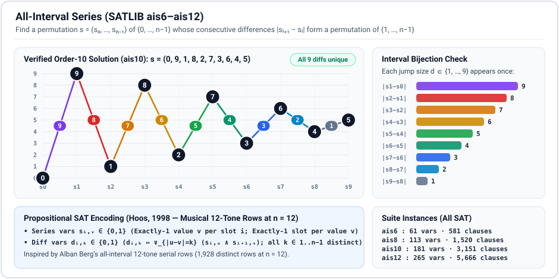

# SATLIB — All-Interval Series (full) (`satlib-ais`)

*Figure: Verified order-10 All-Interval Series permutation $s = (0,9,1,8,2,7,3,6,4,5)$ illustrating the exact bijection of consecutive absolute differences $\lbrace 1,\dots,9\rbrace$ and the SATLIB `ais6`–`ais12` CNF encoding. Regenerated via [`src/gen_diagram.py`](src/gen_diagram.py).*

## Provenance & Credit

- **Upstream Archive:** [SATLIB — Benchmark Problems (UBC)](https://www.cs.ubc.ca/~hoos/SATLIB/benchm.html)
- **SATLIB Curators:** Holger H. Hoos and Thomas Stützle (University of British Columbia / TU Darmstadt)
- **Family Contributors:** Holger H. Hoos & Thomas Stützle (SATLIB)
- **License:** Classic public scientific benchmark collection redistributed by UBC SATLIB for academic SAT research; no separate upstream `LICENSE` file is bundled in the archives.
- **Format Hygiene:** Legacy SATLIB trailing `%` / `0` EOF sentinels were stripped and wrapped multi-line clauses normalized to canonical 1-clause-per-line DIMACS CNF so every modern SAT solver parses all files cleanly.
- **Full SATLIB Archive Manifest:** [`../satlib-archive-uris/`](../../competition-suites/satlib-archive-uris/README.md) (all 97 official UBC SATLIB `.tar.gz` archive URLs; Pretolani's `PRET` formulas live in [`../pretolani-pret/`](../../algebraic/pretolani-pret/README.md)).
- **Recommended by:** [`@jasonslenderman`](https://twitter.com/jasonslenderman) (Twitter/X)

## Problem Description

All-Interval Series (`ais6`, `ais8`, `ais10`, `ais12`) combinatorial permutation problems from the official UBC SATLIB structured benchmark set (all 4 instances).

## Corpus & Data Sizes

- **`cnf-orig/`** — 4 original native **DIMACS `.cnf.xz`** files (13.4 KB).
- **`aig-converted/`** — 4 exact **Binary AIGER 1.9 `.aig.xz`** conversions (19.3 KB, verified via [Berkeley ABC](https://github.com/berkeley-abc/abc) `read_aiger`).
- **`xcnf-converted/`** — 4 lossless **[CryptoMiniSat](https://github.com/msoos/cryptominisat) `.xcnf.xz`** conversions (13.1 KB, `0` extracted native XOR parity clauses).
- **`anf-converted/`** — 4 lossless linear-size **DIMACS-ANF `.anf.xz`** conversions (21.6 KB, generated via [`../../../src/to_anf.py`](../../../src/to_anf.py)).
- **[`expected.tsv`](expected.tsv)** — Ground-truth verdict manifest for all 4 instances (**4 SAT / 0 UNSAT**).
- **`src/`** — Standalone converters (`cnf2aig.py`, `cnf2xcnf.py`).

| Format | Directory | Files | Key Dimensions (Range) | Compressed Size |
|---|---|---:|---|---:|
| **DIMACS CNF (origin)** | `cnf-orig/` | 4 | Vars: 61–265; Clauses: 581–5,666 | 13.4 KB |
| **Binary AIGER 1.9** | `aig-converted/` | 4 | Inputs: 61–265; ANDs: 1,166–10,834 | 19.3 KB |
| **[CryptoMiniSat](https://github.com/msoos/cryptominisat) XCNF** | `xcnf-converted/` | 4 | Native XOR clauses total: 0 | 13.1 KB |
| **DIMACS-ANF** | `anf-converted/` | 4 | Vars: 89–461; Eqs: 609–5,862 (deg ≤ 3) | 21.6 KB |
| **Total (4 Formats, Status: 4 SAT / 0 UNSAT)** | | **16** | | **67.5 KB** |

## Benchmark Results

- **Hardware & Protocol:** Same machine (**AMD Ryzen 9 5950X**, 16C/32T Linux, **1 thread per run** pinned across 8 dedicated physical cores, $T_{\max} = 5\text{ s}$, PAR-2 penalty $10,000\text{ ms}$). All solvers ran with default single-thread flags (`-t 1` for CryptoMiniSat 5.18.0; `--max-cores 1` for Frobenius) on identical uncompressed flat `.cnf` inputs; **100% of all 4 instances** were run (no subsampling), every Frobenius SAT model was independently verified against 100% of input clauses, and **0 verdict disagreements** occurred across all solvers.

| Instance | Verdict | Frobenius 1C | [CaDiCaL](https://github.com/arminbiere/cadical) 3.1.0 | [CryptoMiniSat](https://github.com/msoos/cryptominisat) 5.18.0 | [dense-solver](https://github.com/libdense/dense-solver) 0.0.4 | [Kissat](https://github.com/arminbiere/kissat) 4.0.4 |
|---|:---:|---:|---:|---:|---:|---:|
| `ais10` | SAT | **1.31 ms** | 3.59 ms | 142.57 ms | 7.06 ms | 3.26 ms |
| `ais12` | SAT | **0.91 ms** | 6.15 ms | 256.18 ms | 8.16 ms | 2.21 ms |
| `ais6` | SAT | **0.81 ms** | 2.72 ms | 15.32 ms | 3.56 ms | 1.76 ms |
| `ais8` | SAT | **0.99 ms** | 3.42 ms | 44.85 ms | 2.08 ms | 1.56 ms |
| **Solved (4 files)** | — | **4 / 4** *(highest)* | **4 / 4** *(highest)* | **4 / 4** *(highest)* | **4 / 4** *(highest)* | **4 / 4** *(highest)* |
| **Total PAR-2** | — | **4.0 ms** *(fastest)* | 15.9 ms *(3.96x slower)* | 458.9 ms *(114.35x slower)* | 20.9 ms *(5.21x slower)* | 8.8 ms *(2.19x slower)* |

<!-- BEGIN_STRUCTURAL_ANALYSIS -->
## Phase-Transition & Structural Analysis

*Auto-generated by [`../../../src/analyze_benchmarks.py`](../../../src/analyze_benchmarks.py). Position relative to the critical phase transition is measured by $\rho_{\mathrm{crit}} = \frac{1}{n}\sum_k m_k / \alpha_c(k)$ (exact $\alpha/\alpha_c(k)$ for pure $k$-SAT; effective critical threshold $\alpha_c^{\mathrm{eff}} = \alpha/\rho_{\mathrm{crit}}$; `Under` $<0.90\times$, `Near-crit` $0.90\text{--}1.10\times$, `Over` $>1.10\times$), alongside Gent–Walsh annealed constrainedness $\kappa = -\frac{1}{n}\sum_i \log_2(1-2^{-k_i})$ (AAAI 1996), clause-length profile ($\bar{k}$, `%Bin`, `%Horn`), variable-degree CV ($\sigma_d/\bar{d}$, uniformity vs. hub skew), and extracted native XOR parity clauses.*

| Instance | Active $n$ | Clauses $m$ | $\alpha=m/n$ | $\alpha_c^{\mathrm{eff}}$ | $\rho_{\mathrm{crit}}$ (Regime) | $\kappa$ | $\bar{k}$ ($k_{\max}$) | Bin% | Horn% | Pos% | Deg CV | XORs |
|---|---:|---:|---:|---:|---:|---:|---:|---:|---:|---:|---:|---:|
| `ais10` | 181 | 3,151 | 17.41 | 1.25 | **13.9x** (Over) | 6.19 | 2.30 (10) | 74% | 99% | 14% | 0.16 | 0 |
| `ais12` | 265 | 5,666 | 21.38 | 1.25 | **17.1x** (Over) | 7.62 | 2.29 (12) | 74% | 100% | 13% | 0.16 | 0 |
| `ais6` | 61 | 581 | 9.52 | 1.28 | **7.47x** (Over) | 3.34 | 2.33 (6) | 72% | 98% | 16% | 0.17 | 0 |
| `ais8` | 113 | 1,520 | 13.45 | 1.26 | **10.7x** (Over) | 4.76 | 2.31 (8) | 73% | 99% | 14% | 0.16 | 0 |

**Collection Phase-Transition Summary (4 instances, 4 formats: 4 CNF / 4 AIG / 4 XCNF / 4 ANF):** median $\rho_{\mathrm{crit}} = 12.3\times$ (range `7.47x–17.1x`), median $\kappa = 5.47$, regime split **0 Under / 0 Near-critical / 4 Over**, total extracted native XOR parity clauses = **0**, total ANF equations = **11,334**.
<!-- END_STRUCTURAL_ANALYSIS -->

## References

- H. H. Hoos and T. Stützle, *"SATLIB: An Online Resource for Research on SAT"*, SAT 2000, IOS Press, pp. 283–292 ([`cs.ubc.ca/~hoos/SATLIB/`](https://www.cs.ubc.ca/~hoos/SATLIB/benchm.html)).
- D. S. Johnson and M. A. Trick (eds.), *Cliques, Coloring, and Satisfiability: Second DIMACS Implementation Challenge*, DIMACS Series vol. 26, AMS, 1996.
