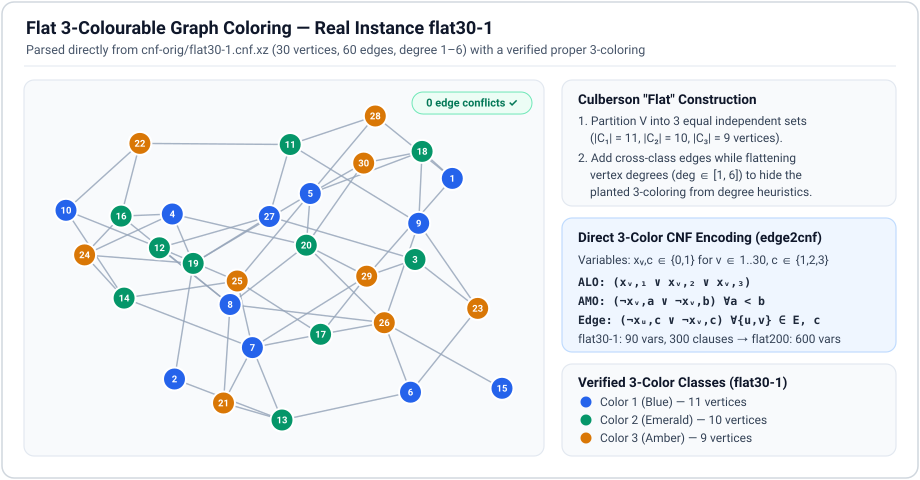

# SATLIB — Flat 3-Colourable Graphs `flat30..200` (sample / 1,700*) (`satlib-flat-gcp`)

*Figure: Real 30-vertex, 60-edge graph parsed directly from `cnf-orig/flat30-1.cnf.xz` with a verified conflict-free 3-coloring illustrating Culberson's degree-flattened independent-set construction and `edge2cnf` encoding. Regenerated via [`src/gen_diagram.py`](src/gen_diagram.py).*

## Provenance & Credit

- **Upstream Archive:** [SATLIB — Benchmark Problems (UBC)](https://www.cs.ubc.ca/~hoos/SATLIB/benchm.html)
- **SATLIB Curators:** Holger H. Hoos and Thomas Stützle (University of British Columbia / TU Darmstadt)
- **Family Contributors:** Joseph Culberson
- **License:** Classic public scientific benchmark collection redistributed by UBC SATLIB for academic SAT research; no separate upstream `LICENSE` file is bundled in the archives.
- **Format Hygiene:** Legacy SATLIB trailing `%` / `0` EOF sentinels were stripped and wrapped multi-line clauses normalized to canonical 1-clause-per-line DIMACS CNF so every modern SAT solver parses all files cleanly.
- **Format Hygiene Note:** Leading `c p ...` comment lines were prefixed as `c - p ...` (zero clause/variable changes) for [CryptoMiniSat](https://github.com/msoos/cryptominisat) 5.18.0 compatibility.
- **Full SATLIB Archive Manifest:** [`../satlib-archive-uris/`](../../competition-suites/satlib-archive-uris/README.md) (all 97 official UBC SATLIB `.tar.gz` archive URLs; Pretolani's `PRET` formulas live in [`../pretolani-pret/`](../../algebraic/pretolani-pret/README.md)).
- **Recommended by:** [`@jasonslenderman`](https://twitter.com/jasonslenderman) (Twitter/X)

## Problem Description

Stratified sample of 8 instances (`flat30` through `flat200`) from the 1,700-instance SATLIB flat 3-colourable graph coloring ensemble (full archive URLs in [`../satlib-archive-uris/`](../../competition-suites/satlib-archive-uris/README.md)).

## Corpus & Data Sizes

- **`cnf-orig/`** — 8 original native **DIMACS `.cnf.xz`** files (19.5 KB).
- **`aig-converted/`** — 8 exact **Binary AIGER 1.9 `.aig.xz`** conversions (21.0 KB, verified via [Berkeley ABC](https://github.com/berkeley-abc/abc) `read_aiger`).
- **`xcnf-converted/`** — 8 lossless **[CryptoMiniSat](https://github.com/msoos/cryptominisat) `.xcnf.xz`** conversions (20.0 KB, `0` extracted native XOR parity clauses).
- **`anf-converted/`** — 8 lossless linear-size **DIMACS-ANF `.anf.xz`** conversions (29.6 KB, generated via [`../../../src/to_anf.py`](../../../src/to_anf.py)).
- **[`expected.tsv`](expected.tsv)** — Ground-truth verdict manifest for all 8 instances (**8 SAT / 0 UNSAT**).
- **`src/`** — Standalone converters (`cnf2aig.py`, `cnf2xcnf.py`).

| Format | Directory | Files | Key Dimensions (Range) | Compressed Size |
|---|---|---:|---|---:|
| **DIMACS CNF (origin)** | `cnf-orig/` | 8 | Vars: 90–600; Clauses: 300–2,237 | 19.5 KB |
| **Binary AIGER 1.9** | `aig-converted/` | 8 | Inputs: 90–600; ANDs: 629–4,673 | 21.0 KB |
| **[CryptoMiniSat](https://github.com/msoos/cryptominisat) XCNF** | `xcnf-converted/` | 8 | Native XOR clauses total: 0 | 20.0 KB |
| **DIMACS-ANF** | `anf-converted/` | 8 | Vars: 90–600; Eqs: 300–2,237 (deg ≤ 3) | 29.6 KB |
| **Total (4 Formats, Status: 8 SAT / 0 UNSAT)** | | **32** | | **90.0 KB** |

## Benchmark Results

- **Hardware & Protocol:** Same machine (**AMD Ryzen 9 5950X**, 16C/32T Linux, **1 thread per run** pinned across 8 dedicated physical cores, $T_{\max} = 5\text{ s}$, PAR-2 penalty $10,000\text{ ms}$). All solvers ran with default single-thread flags (`-t 1` for CryptoMiniSat 5.18.0; `--max-cores 1` for Frobenius) on identical uncompressed flat `.cnf` inputs; **100% of all 8 instances** were run (no subsampling), every Frobenius SAT model was independently verified against 100% of input clauses, and **0 verdict disagreements** occurred across all solvers.

| Instance | Verdict | Frobenius 1C | [CaDiCaL](https://github.com/arminbiere/cadical) 3.1.0 | [CryptoMiniSat](https://github.com/msoos/cryptominisat) 5.18.0 | [dense-solver](https://github.com/libdense/dense-solver) 0.0.4 | [Kissat](https://github.com/arminbiere/kissat) 4.0.4 |
|---|:---:|---:|---:|---:|---:|---:|
| `flat100-1` | SAT | **0.99 ms** | 2.69 ms | 29.35 ms | 1.86 ms | 1.34 ms |
| `flat125-1` | SAT | **1.80 ms** | 4.08 ms | 30.34 ms | 2.81 ms | 7.12 ms |
| `flat150-1` | SAT | **3.08 ms** | 4.84 ms | 39.39 ms | 5.97 ms | 8.30 ms |
| `flat175-1` | SAT | **1.09 ms** | 5.11 ms | 40.35 ms | 2.85 ms | 11.42 ms |
| `flat200-1` | SAT | **1.17 ms** | 7.51 ms | 52.68 ms | 3.47 ms | 12.86 ms |
| `flat30-1` | SAT | **0.76 ms** | 2.15 ms | 10.35 ms | 1.46 ms | 1.31 ms |
| `flat50-1` | SAT | **0.81 ms** | 1.92 ms | 11.26 ms | 1.44 ms | 1.25 ms |
| `flat75-1` | SAT | **0.99 ms** | 2.42 ms | 19.70 ms | 1.47 ms | 4.67 ms |
| **Solved (8 files)** | — | **8 / 8** *(highest)* | **8 / 8** *(highest)* | **8 / 8** *(highest)* | **8 / 8** *(highest)* | **8 / 8** *(highest)* |
| **Total PAR-2** | — | **10.7 ms** *(fastest)* | 30.7 ms *(2.87x slower)* | 233.4 ms *(21.83x slower)* | 21.3 ms *(1.99x slower)* | 48.3 ms *(4.52x slower)* |

<!-- BEGIN_STRUCTURAL_ANALYSIS -->
## Phase-Transition & Structural Analysis

*Auto-generated by [`../../../src/analyze_benchmarks.py`](../../../src/analyze_benchmarks.py). Position relative to the critical phase transition is measured by $\rho_{\mathrm{crit}} = \frac{1}{n}\sum_k m_k / \alpha_c(k)$ (exact $\alpha/\alpha_c(k)$ for pure $k$-SAT; effective critical threshold $\alpha_c^{\mathrm{eff}} = \alpha/\rho_{\mathrm{crit}}$; `Under` $<0.90\times$, `Near-crit` $0.90\text{--}1.10\times$, `Over` $>1.10\times$), alongside Gent–Walsh annealed constrainedness $\kappa = -\frac{1}{n}\sum_i \log_2(1-2^{-k_i})$ (AAAI 1996), clause-length profile ($\bar{k}$, `%Bin`, `%Horn`), variable-degree CV ($\sigma_d/\bar{d}$, uniformity vs. hub skew), and extracted native XOR parity clauses.*

| Instance | Active $n$ | Clauses $m$ | $\alpha=m/n$ | $\alpha_c^{\mathrm{eff}}$ | $\rho_{\mathrm{crit}}$ (Regime) | $\kappa$ | $\bar{k}$ ($k_{\max}$) | Bin% | Horn% | Pos% | Deg CV | XORs |
|---|---:|---:|---:|---:|---:|---:|---:|---:|---:|---:|---:|---:|
| `flat100-1` | 300 | 1,117 | 3.72 | 1.07 | **3.47x** (Over) | 1.47 | 2.09 (3) | 91% | 91% | 13% | 0.23 | 0 |
| `flat125-1` | 375 | 1,403 | 3.74 | 1.07 | **3.49x** (Over) | 1.48 | 2.09 (3) | 91% | 91% | 13% | 0.22 | 0 |
| `flat150-1` | 450 | 1,680 | 3.73 | 1.07 | **3.48x** (Over) | 1.48 | 2.09 (3) | 91% | 91% | 13% | 0.22 | 0 |
| `flat175-1` | 525 | 1,951 | 3.72 | 1.07 | **3.46x** (Over) | 1.47 | 2.09 (3) | 91% | 91% | 13% | 0.23 | 0 |
| `flat200-1` | 600 | 2,237 | 3.73 | 1.07 | **3.47x** (Over) | 1.47 | 2.09 (3) | 91% | 91% | 13% | 0.22 | 0 |
| `flat30-1` | 90 | 300 | 3.33 | 1.08 | **3.08x** (Over) | 1.31 | 2.10 (3) | 90% | 90% | 14% | 0.18 | 0 |
| `flat50-1` | 150 | 545 | 3.63 | 1.08 | **3.38x** (Over) | 1.43 | 2.09 (3) | 91% | 91% | 13% | 0.21 | 0 |
| `flat75-1` | 225 | 840 | 3.73 | 1.07 | **3.48x** (Over) | 1.48 | 2.09 (3) | 91% | 91% | 13% | 0.26 | 0 |

**Collection Phase-Transition Summary (8 instances, 4 formats: 8 CNF / 8 AIG / 8 XCNF / 8 ANF):** median $\rho_{\mathrm{crit}} = 3.47\times$ (range `3.08x–3.49x`), median $\kappa = 1.47$, regime split **0 Under / 0 Near-critical / 8 Over**, total extracted native XOR parity clauses = **0**, total ANF equations = **10,073**.
<!-- END_STRUCTURAL_ANALYSIS -->

## References

- H. H. Hoos and T. Stützle, *"SATLIB: An Online Resource for Research on SAT"*, SAT 2000, IOS Press, pp. 283–292 ([`cs.ubc.ca/~hoos/SATLIB/`](https://www.cs.ubc.ca/~hoos/SATLIB/benchm.html)).
- D. S. Johnson and M. A. Trick (eds.), *Cliques, Coloring, and Satisfiability: Second DIMACS Implementation Challenge*, DIMACS Series vol. 26, AMS, 1996.
