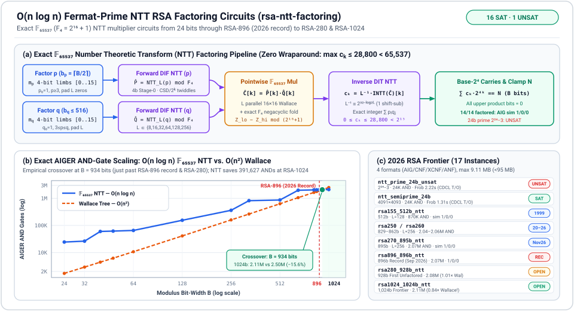

# $O(n \log n)$ Fermat-Prime NTT RSA Factoring Circuits (`rsa-ntt-factoring`)

*Figure: (a) Exact $\mathbb{F}_{65537}$ ($F_4 = 2^{16}+1$) Decimation-in-Frequency / Decimation-in-Time NTT integer factoring pipeline with zero-wraparound exact convolution ($c_k \le 28{,}800 < 2^{15} < 65{,}537$); (b) empirical AIGER AND-gate scaling of $O(n \log n)$ Fermat-prime NTT vs. $O(n^2)$ Wallace trees from 24 bits through RSA-896 (896-bit 2026 world record) to RSA-280 (928b) and RSA-1024 (exact crossover at $B = 934$ bits, saving 391,627 AND gates at 1,024 bits); (c) 17-instance frontier summary. Regenerated via [`src/gen_diagram.py`](src/gen_diagram.py).*

## Provenance & Credit

- **Author:** Luke Hutchison ([`lukehutch`](https://github.com/lukehutch))
- **Challenge Moduli:** Official RSA Factoring Challenge moduli (`RSA-100`, `RSA-155`, `RSA-200`, `RSA-250`, `RSA-260`, `RSA-270`, `RSA-896`, `RSA-280`, `RSA-1024`) originally published by RSA Laboratories (1991), with published prime factorizations through the 2026 896-bit public record (`RSA-896`, Sept 19, 2026, Stephen A. Weis; `RSA-260`, Sept 3, 2026, and `RSA-270`, Nov 12, 2026, Eric Lu / Cognition)
- **License:** MIT License ([`../../../LICENSE`](../../../LICENSE))

## Problem Description

Exact combinational **$O(n \log n)$ Number Theoretic Transform (NTT) integer multiplier** inversion circuits asserting $p \cdot q = N$ (with odd-factor LSBs $p_0 = q_0 = 1$, non-triviality $p \ge 3, q \ge 3$, and symmetry breaking $p \le q$) across 17 instances spanning 24 bits to **1,024 bits** — scaling through every historic RSA Factoring Challenge milestone up to the **896-bit 2026 factoring world record (`RSA-896`)** and immediately beyond to the first unfactored RSA Challenge modulus (**`RSA-280`**, 928 bits) and the classic **`RSA-1024`** cryptographic frontier.

### Exact $\mathbb{F}_{65537}$ Fermat-Prime NTT Circuit Architecture

- **Prime Field:** $\mathbb{F}_{P}$ with Fermat prime $P = F_4 = 2^{16} + 1 = 65{,}537$ and primitive root $g = 3$, giving exact $L$-th primitive roots of unity $\omega_L = 3^{65536 / L} \bmod 65537$ for all powers of two $L \in \lbrace 8, 16, 32, 64, 128, 256 \rbrace$.
- **Factor Limb Packing & Zero-Wraparound Invariant:** For a $B$-bit odd modulus $N$, unknown factors $p$ ($b_p = \lceil B/2 \rceil$ bits) and $q$ ($b_q = \min(\lceil B/2 \rceil + 4, 516)$ bits, accommodating unbalanced RSA factors while keeping $m_p + m_q - 1 \le 256$ through `RSA-1024`) are split into $d = 4$-bit base-16 limbs ($0 \dots 15$) of counts $m_p = \lceil b_p / 4 \rceil$, $m_q = \lceil b_q / 4 \rceil$, zero-padded to $L = 2^{\lceil \log_2(m_p + m_q - 1) \rceil}$. Every linear convolution coefficient satisfies:
  $$0 \le c_k = \sum_{i + j = k} p_i q_j \le \min(m_p, m_q) \cdot 15^2 \le 128 \cdot 225 = 28{,}800 < 2^{15} < 65{,}537 = P$$
  guaranteeing **100% exact integer convolution with zero modular wraparound** on every possible input assignment $(p, q)$.
- **Gate-Optimal $\mathbb{F}_{65537}$ Arithmetic (`src/ntt.rs`):**
  - Canonical 17-bit words in $[0, 65{,}536]$ with zero-mux conditional decrement/increment modular adders and subtractors (`add_mod_f4`, `sub_mod_f4`).
  - **DIF Forward + DIT Inverse NTT** (eliminating bit-reversal permutations, folding Stage-0 zero-padded halves directly on 4-bit input limbs, and pruning dead upper inverse outputs).
  - Because $2^{16} \equiv -1 \pmod{65537}$, $2$ is a primitive 32nd root of unity: **100% of twiddles for $L \le 32$** (all bottom 5 butterfly stages of every transform) and the inverse scale factor $L^{-1} \equiv 2^{32 - \log_2 L} \pmod{65537}$ reduce to a single negacyclic shift-sub (`mul_pow2_mod_f4`), while non-power-of-2 twiddles ($L \in \lbrace 64, 128, 256 \rbrace$) use minimal-weight negacyclic Canonical Signed Digit (CSD) Wallace folding (average weight 2.0 at $L=64$, 5.0 at $L \in \lbrace 128, 256 \rbrace$).
  - Each of the $L$ pointwise field multipliers exploits the canonical invariant ($a_{16} = 1 \implies a_{0..15} = 0$) to compute a 16×16 Wallace product with mutually-exclusive top-bit merges and a single 16-bit `sub_mod_f4`.
  - Exact base-$2^4$ carry propagation reconstructs the full $(b_p + b_q)$-bit product and clamps every bit to $N$ (with all product bits $\ge B$ asserted `0`).

### Zero-Trust Verification

- **Number-Theoretic Ground Truth:** Verified `p * q == N`, $p < q$, and Miller-Rabin primality of both $(p, q)$ on all 14 factored instances (`24b..RSA-896`), primality of `ntt_prime_24b_unsat` ($2^{24} - 3 = 16{,}777{,}213$), and compositeness of unfactored `RSA-280` and `RSA-1024`.
- **Direct On-Disk Binary AIGER 1.9 Simulation:** Every generated `.aig` file was parsed back from disk and simulated directly: all 14 factored instances (including **`rsa896_896b_ntt`** at 2,066,510 AND gates) evaluate to `1` on the exact prime pair $(p, q)$ and `0` on both 1-bit perturbations $(p \oplus 2, q)$ and $(p, q \oplus 2)$ (`1/0/0`).
- **Native Frontend & ANF Verification:** All **17 / 17** `.aig.xz` files parse cleanly in Frobenius (`7.7 ms` for 24b to `222.3 ms` for `rsa1024_1024b_ntt`); ANF conversions (`max_deg = 2`) pass structural + 64-vector forward equivalence checks via `../../../src/to_anf.py --verify` (including `rsa1024_1024b_ntt.anf.xz`).

## Corpus & Data Sizes

### Directory Layout & Regeneration

- `aig-orig/` — Original native **Binary AIGER 1.9** circuits (`17` files, `7.74 MB` total, max `0.95 MB`).
- `cnf-converted/` — Tseitin **DIMACS `.cnf.xz`** conversions (`17` files, `72.80 MB` total, max `9.11 MB`; primary inputs preserved as DIMACS variables $1 \dots (b_p - 1) + (b_q - 1)$).
- `xcnf-converted/` — Native-XOR **[CryptoMiniSat](https://github.com/msoos/cryptominisat) `.xcnf.xz`** conversions (`17` files, `49.52 MB` total, max `6.20 MB`).
- `anf-converted/` — Lossless linear-size **DIMACS-ANF `.anf.xz`** conversions (`17` files, `44.79 MB` total, max `5.58 MB`, exact degree $\le 2$, generated via [`../../../src/to_anf.py`](../../../src/to_anf.py)).
- **[`expected.tsv`](expected.tsv)** — Ground-truth verdict manifest for all 17 instances (**16 SAT / 1 UNSAT**).
- `src/` — Standalone zero-dependency Rust generator & exact Wallace crossover profiler (`cd src && cargo run --release`, plus `--wallace-compare`), and vector diagram script (`src/gen_diagram.py`). All 68 compressed files are strictly `< 95 MB` (largest: `9.11 MB`).

### Problem Parameters, Data Sizes & Empirical NTT vs. Wallace Gate Crossover

Exact AIGER AND-gate counts compare our $O(n \log n)$ $\mathbb{F}_{65537}$ NTT circuit against an exact $O(n^2)$ Wallace-tree multiplier built on the identical `Aig` backend (`src/ntt.rs`, `cargo run --release -- --wallace-compare`). Because $L$ steps in powers of two, the NTT gate count jumps at limb-capacity doublings ($L = 8 \to 16 \to 32 \to 64 \to 128 \to 256$) and then stays nearly flat across $L = 256$ (`663b..1,024b`) while quadratic Wallace climbs steadily — crossing at **`B = 934 bits`** (`2,081,496` NTT vs. `2,083,349` Wallace, `0.999x`), right between **`RSA-280`** (928b, `1.011x`) and **`RSA-1024`** (1,024b, **`0.844x`**, saving **391,627 AND gates**):

| Instance | Bits $B$ | Status / Record | $L$ | Ans | NTT ANDs | Wallace ANDs | NTT / Wal | CNF Vars | CNF Clauses | `.aig.xz` | `.cnf.xz` | `.xcnf.xz` | `.anf.xz` |
|---|---:|---|---:|:---:|---:|---:|---:|---:|---:|---:|---:|---:|---:|
| `ntt_prime_24b_unsat` | 24 | Prime $2^{24}-3$ | 8 | UNSAT | 24,390 | 1,704 | 14.31x | 9,700 | 47,645 | 20.8 KB | 100.6 KB | 71.5 KB | 70.3 KB |
| `ntt_semiprime_24b` | 24 | $4091 \times 4093$ | 8 | SAT | 24,390 | 1,704 | 14.31x | 9,700 | 47,645 | 20.8 KB | 100.6 KB | 71.5 KB | 70.0 KB |
| `ntt_semiprime_32b` | 32 | $65519 \times 65521$ | 8 | SAT | 26,298 | 2,907 | 9.05x | 10,538 | 51,669 | 19.6 KB | 110.4 KB | 76.8 KB | 75.1 KB |
| `ntt_semiprime_40b` | 40 | $1048571 \times 1048573$ | 16 | SAT | 59,884 | 4,420 | 13.55x | 24,201 | 117,983 | 37.4 KB | 252.0 KB | 175.2 KB | 166.9 KB |
| `ntt_semiprime_48b` | 48 | $16777199 \times 16777213$ | 16 | SAT | 61,868 | 6,196 | 9.99x | 25,095 | 122,082 | 38.8 KB | 262.1 KB | 182.6 KB | 170.8 KB |
| `ntt_semiprime_64b` | 64 | 64b balanced semiprime | 16 | SAT | 65,244 | 10,714 | 6.09x | 26,562 | 129,246 | 41.2 KB | 275.6 KB | 192.3 KB | 179.5 KB |
| `ntt_semiprime_128b` | 128 | 128b balanced semiprime | 32 | SAT | 154,686 | 40,893 | 3.78x | 63,926 | 308,751 | 88.0 KB | 661.4 KB | 452.2 KB | 409.4 KB |
| `ntt_semiprime_256b` | 256 | 256b balanced semiprime | 64 | SAT | 361,728 | 159,461 | 2.27x | 151,068 | 726,402 | 187.2 KB | 1.53 MB | 1.05 MB | 975.0 KB |
| `rsa100_330b_ntt` | 330 | RSA-100 (Apr 1991) | 128 | SAT | 819,594 | 263,454 | 3.11x | 340,764 | 1,644,894 | 425.2 KB | 3.51 MB | 2.39 MB | 2.18 MB |
| `rsa155_512b_ntt` | 512 | RSA-155 (Aug 1999) | 128 | SAT | 869,555 | 629,684 | 1.38x | 362,954 | 1,749,395 | 422.4 KB | 3.76 MB | 2.56 MB | 2.30 MB |
| `rsa200_663b_ntt` | 663 | RSA-200 (May 2005) | 256 | SAT | 1,984,637 | 1,056,208 | 1.88x | 814,070 | 3,972,705 | 921.4 KB | 8.61 MB | 5.83 MB | 5.28 MB |
| `rsa250_829b_ntt` | 829 | RSA-250 (Feb 2020, CPU) | 256 | SAT | 2,043,913 | 1,646,760 | 1.24x | 837,929 | 4,091,786 | 964.5 KB | 8.83 MB | 5.99 MB | 5.43 MB |
| `rsa260_862b_ntt` | 862 | RSA-260 (Sep 2026, GPU) | 256 | SAT | 2,055,538 | 1,775,673 | 1.16x | 842,407 | 4,114,616 | 970.6 KB | 8.89 MB | 6.11 MB | 5.46 MB |
| `rsa270_895b_ntt` | 895 | RSA-270 (Nov 2026, GPU) | 256 | SAT | 2,066,510 | 1,917,894 | 1.08x | 846,761 | 4,136,615 | 936.2 KB | 8.95 MB | 6.04 MB | 5.48 MB |
| `rsa896_896b_ntt` | 896 | **RSA-896 (Sep 2026 Record)** | 256 | SAT | 2,066,510 | 1,917,894 | 1.08x | 846,761 | 4,136,615 | 936.2 KB | 8.95 MB | 6.05 MB | 5.48 MB |
| `rsa280_928b_ntt` | 928 | **RSA-280 (1st Unfactored)** | 256 | SAT | 2,078,686 | 2,056,760 | 1.01x | 851,383 | 4,159,977 | 957.5 KB | 8.95 MB | 6.10 MB | 5.52 MB |
| `rsa1024_1024b_ntt` | 1,024 | **RSA-1024 (Unfactored)** | 256 | SAT | **2,111,632** | 2,503,259 | **0.84x** | 864,482 | 4,226,151 | 936.3 KB | 9.11 MB | 6.20 MB | 5.58 MB |

## Benchmark Results

Evaluated on an AMD Ryzen 9 5950X (Linux, 1 dedicated physical core on CCD 0 per run via `taskset -c 0` for all 24b–32b sequential runs with exact median of 3 runs, and dedicated cores `0–6` for 40b–1,024b timeout sweeps; default flags with `--max-cores 1` for Frobenius and `-t 1` for CryptoMiniSat 5.18.0; $T_{\max} = 60\text{ s}$, PAR-2 penalty $120\text{ s}$ per timeout; all 5 solvers operate strictly on identical flat `.cnf` with **zero number-theoretic shortcuts**, 100% SAT models verified against both raw CNF clauses and exact integer $p \cdot q = N$, 0 disagreements):

### 1. Five-Solver Flat-CNF Scaling ($T_{\max} = 60\text{ s}$, 17 Instances)

| Instance | Frobenius 1C | [CaDiCaL](https://github.com/arminbiere/cadical) 3.1.0 | [CryptoMiniSat](https://github.com/msoos/cryptominisat) 5.18.0 (CNF) | [dense-solver](https://github.com/libdense/dense-solver) 0.0.4 | [Kissat](https://github.com/arminbiere/kissat) 4.0.4 |
|---|---:|---:|---:|---:|---:|
| `ntt_prime_24b_unsat` *(UNSAT)* | **2,219.26 ms** | T/O (>60 s) | T/O (>60 s) | T/O (>60 s) | T/O (>60 s) |
| `ntt_semiprime_24b` *(SAT)* | **1,306.24 ms** | T/O (>60 s) | T/O (>60 s) | T/O (>60 s) | T/O (>60 s) |
| `ntt_semiprime_32b` | T/O (>60 s) | T/O (>60 s) | T/O (>60 s) | T/O (>60 s) | T/O (>60 s) |
| `ntt_semiprime_40b` | T/O (>60 s) | T/O (>60 s) | T/O (>60 s) | T/O (>60 s) | T/O (>60 s) |
| `ntt_semiprime_48b` | T/O (>60 s) | T/O (>60 s) | T/O (>60 s) | T/O (>60 s) | T/O (>60 s) |
| `ntt_semiprime_64b` .. `rsa1024_1024b_ntt` *(12 inst.)* | T/O (>60 s) | T/O (>60 s) | T/O (>60 s) | T/O (>60 s) | T/O (>60 s) |
| **Solved (24-bit Tier, 2 inst.)** | **2 / 2** *(highest)* | 0 / 2 *(-2 worse)* | 0 / 2 *(-2 worse)* | 0 / 2 *(-2 worse)* | 0 / 2 *(-2 worse)* |
| **24-bit Tier PAR-2** | **3.53 s** *(fastest)* | 240.00 s *(68.1x slower)* | 240.00 s *(68.1x slower)* | 240.00 s *(68.1x slower)* | 240.00 s *(68.1x slower)* |
| **Solved (Full Suite, 17 inst.)** | **2 / 17** *(highest)* | 0 / 17 *(-2 worse)* | 0 / 17 *(-2 worse)* | 0 / 17 *(-2 worse)* | 0 / 17 *(-2 worse)* |
| **Full-Suite PAR-2 (17 inst.)** | **1,803.53 s** *(fastest)* | 2,040.00 s *(1.13x slower)* | 2,040.00 s *(1.13x slower)* | 2,040.00 s *(1.13x slower)* | 2,040.00 s *(1.13x slower)* |

*Note: [CryptoMiniSat](https://github.com/msoos/cryptominisat) 5.18.0 on native `.xcnf` also timed out (`> 60 s`) on `ntt_prime_24b_unsat`, `ntt_semiprime_24b`, and `ntt_semiprime_32b`.*

### 2. Four-Format Parity & Direct NTT vs. Wallace Solve-Time Comparison (Core 0, $T_{\max} = 60\text{ s}$)

Comparing Frobenius 1C across all 4 compressed repository formats on the solvable 24-bit tier (`taskset -c 0`, exact median of 3 runs, 0 disagreements):

| Instance | Verdict | Frobenius 1C (`.aig.xz`) | Frobenius 1C (`.cnf.xz`) | Frobenius 1C (`.xcnf.xz`) | Frobenius 1C (`.anf.xz`) |
|---|:---:|---:|---:|---:|---:|
| `ntt_prime_24b_unsat` | UNSAT | 1,290.97 ms | 1,267.97 ms | **1,220.80 ms** | T/O (>60 s) |
| `ntt_semiprime_24b` | SAT | 2,023.97 ms | **919.71 ms** | 1,586.00 ms | T/O (>60 s) |

Direct head-to-head solve-time comparison on the **exact same 24b–48b target integers** compiled to $O(n^2)$ Wallace trees vs. $O(n \log n)$ $\mathbb{F}_{65537}$ NTT (identical flat `.cnf`, `taskset -c 0`, $T_{\max} = 60\text{ s}$):

| Target (Bits) | Topology | AND Gates | Frobenius 1C | [CaDiCaL](https://github.com/arminbiere/cadical) 3.1.0 | [Kissat](https://github.com/arminbiere/kissat) 4.0.4 |
|---|---|---:|---:|---:|---:|
| `24b prime` ($2^{24}-3$) | Wallace $O(n^2)$ | 1,704 | **3.22 ms** | 211.38 ms | 183.44 ms |
| `24b prime` ($2^{24}-3$) | $\mathbb{F}_{65537}$ NTT | 24,390 | **2,219.26 ms** | T/O (>60 s) | T/O (>60 s) |
| `24b semiprime` ($4091 \times 4093$) | Wallace $O(n^2)$ | 1,704 | **2.51 ms** | 69.71 ms | 54.65 ms |
| `24b semiprime` ($4091 \times 4093$) | $\mathbb{F}_{65537}$ NTT | 24,390 | **1,306.24 ms** | T/O (>60 s) | T/O (>60 s) |
| `32b semiprime` ($65519 \times 65521$) | Wallace $O(n^2)$ | 2,907 | **3.43 ms** | 131.22 ms | 127.60 ms |
| `32b semiprime` ($65519 \times 65521$) | $\mathbb{F}_{65537}$ NTT | 26,298 | T/O (>60 s) | T/O (>60 s) | T/O (>60 s) |
| `40b semiprime` ($1048571 \times 1048573$) | Wallace $O(n^2)$ | 4,420 | **7.83 ms** | 88.85 ms | 39.99 ms |
| `48b semiprime` ($16777199 \times 16777213$) | Wallace $O(n^2)$ | 6,196 | **5.49 ms** | 378.11 ms | 310.71 ms |

### Why $O(n \log n)$ NTT Beats Wallace on Gate Count Yet Destroys CDCL Propagation Locality

These measurements expose a stark **circuit-size vs. proof-complexity trade-off** in arithmetic SAT encoding:

1. **Asymptotic Gate Victory Above 934 Bits:** Because $O(n^2)$ Wallace circuits scale quadratically with factor width while $\mathbb{F}_{65537}$ NTT scales as $O(n \log n)$, our NTT factoring circuit crosses below Wallace at **`B = 934 bits`** (`RSA-280` sits right on the boundary at `1.01x`) and is already **15.6% smaller** at **`RSA-1024`** (`2.11M` vs. `2.50M` AND gates, saving 391,627 gates).
2. **Catastrophic Loss of LSB-to-MSB Unit Propagation:** In a schoolbook or Wallace multiplier, bit $k$ of the product depends *only* on factor bits $p_0 \dots p_k$ and $q_0 \dots q_k$. Fixing low bits of $(p, q)$ immediately triggers local unit propagation against the clamped LSBs of $N$, letting CDCL solvers prune huge subtrees and solve 24b–48b Wallace instances in `40–378 ms` (`2.5–7.8 ms` in Frobenius). In contrast, the forward $\mathbb{F}_{65537}$ NTT mixes **every** 4-bit limb of $p$ and $q$ globally across all $L$ spectral channels via modular-65537 butterfly add/subtract/twiddle stages before pointwise multiplication, and the inverse NTT mixes all $L$ spectral products globally again before carry propagation. Consequently, clamping the LSBs of $N$ yields **zero local unit propagation** back to individual bits of $p$ or $q$ until almost the entire input assignment is fixed.
3. **Why Only Frobenius Cracks the 24-Bit NTT Tier:** All four pure CDCL / Gaussian-elimination baselines (CaDiCaL 3.1.0, CryptoMiniSat 5.18.0 CNF & XCNF, dense-solver 0.0.4, Kissat 4.0.4) blow up by **`> 860×–1,100×`** from 24-bit Wallace (`55–211 ms`) to 24-bit NTT (`> 60 s`, `0 / 2` solved). Frobenius 1C recovers the combinational gate graph directly from the flat `.cnf` (or native `.aig`/`.xcnf`) and evaluates the compressed circuit frontier with `0` CDCL decisions (`24,443` / `32,764` SIMD frontier steps), solving both 24-bit NTT instances in `1.22–2.22 s` (`0.92–2.02 s` on compressed `.cnf.xz`/`.aig.xz`/`.xcnf.xz`), before the exponential $2^{b_p}$ search barrier blocks even circuit-frontier evaluation at 32 bits (`> 60 s`).

<!-- BEGIN_STRUCTURAL_ANALYSIS -->
## Phase-Transition & Structural Analysis

*Auto-generated by [`../../../src/analyze_benchmarks.py`](../../../src/analyze_benchmarks.py). Position relative to the critical phase transition is measured by $\rho_{\mathrm{crit}} = \frac{1}{n}\sum_k m_k / \alpha_c(k)$ (exact $\alpha/\alpha_c(k)$ for pure $k$-SAT; effective critical threshold $\alpha_c^{\mathrm{eff}} = \alpha/\rho_{\mathrm{crit}}$; `Under` $<0.90\times$, `Near-crit` $0.90\text{--}1.10\times$, `Over` $>1.10\times$), alongside Gent–Walsh annealed constrainedness $\kappa = -\frac{1}{n}\sum_i \log_2(1-2^{-k_i})$ (AAAI 1996), clause-length profile ($\bar{k}$, `%Bin`, `%Horn`), variable-degree CV ($\sigma_d/\bar{d}$, uniformity vs. hub skew), and extracted native XOR parity clauses.*

| Instance | Active $n$ | Clauses $m$ | $\alpha=m/n$ | $\alpha_c^{\mathrm{eff}}$ | $\rho_{\mathrm{crit}}$ (Regime) | $\kappa$ | $\bar{k}$ ($k_{\max}$) | Bin% | Horn% | Pos% | Deg CV | XORs |
|---|---:|---:|---:|---:|---:|---:|---:|---:|---:|---:|---:|---:|
| `ntt_prime_24b_unsat` | 9,700 | 47,645 | 4.91 | 3.18 | **1.54x** (Over) | 0.95 | 3.19 (4) | 17% | 54% | 49% | 0.45 | 3,560 |
| `ntt_semiprime_128b` | 63,926 | 308,751 | 4.83 | 3.17 | **1.52x** (Over) | 0.95 | 3.18 (4) | 17% | 54% | 49% | 0.47 | 25,251 |
| `ntt_semiprime_24b` | 9,700 | 47,645 | 4.91 | 3.18 | **1.54x** (Over) | 0.95 | 3.19 (4) | 17% | 54% | 49% | 0.45 | 3,560 |
| `ntt_semiprime_256b` | 151,068 | 726,402 | 4.81 | 3.17 | **1.52x** (Over) | 0.94 | 3.17 (4) | 16% | 53% | 49% | 0.46 | 61,131 |
| `ntt_semiprime_32b` | 10,538 | 51,669 | 4.90 | 3.18 | **1.54x** (Over) | 0.95 | 3.19 (4) | 17% | 54% | 49% | 0.45 | 3,897 |
| `ntt_semiprime_40b` | 24,201 | 117,983 | 4.88 | 3.17 | **1.54x** (Over) | 0.95 | 3.19 (4) | 17% | 54% | 49% | 0.50 | 9,107 |
| `ntt_semiprime_48b` | 25,095 | 122,082 | 4.86 | 3.17 | **1.54x** (Over) | 0.95 | 3.18 (4) | 17% | 54% | 49% | 0.49 | 9,526 |
| `ntt_semiprime_64b` | 26,562 | 129,246 | 4.87 | 3.18 | **1.53x** (Over) | 0.95 | 3.18 (4) | 17% | 54% | 49% | 0.46 | 10,199 |
| `rsa100_330b_ntt` | 340,764 | 1,644,894 | 4.83 | 3.21 | **1.51x** (Over) | 0.94 | 3.18 (4) | 16% | 53% | 49% | 0.50 | 140,332 |
| `rsa1024_1024b_ntt` | 864,482 | 4,226,151 | 4.89 | 3.30 | **1.48x** (Over) | 0.94 | 3.19 (4) | 15% | 53% | 49% | 0.53 | 367,177 |
| `rsa155_512b_ntt` | 362,954 | 1,749,395 | 4.82 | 3.21 | **1.50x** (Over) | 0.94 | 3.18 (4) | 16% | 53% | 49% | 0.48 | 150,690 |
| `rsa200_663b_ntt` | 814,070 | 3,972,705 | 4.88 | 3.28 | **1.49x** (Over) | 0.94 | 3.19 (4) | 15% | 53% | 49% | 0.54 | 343,290 |
| `rsa250_829b_ntt` | 837,929 | 4,091,786 | 4.88 | 3.29 | **1.48x** (Over) | 0.94 | 3.19 (4) | 15% | 53% | 49% | 0.53 | 354,581 |
| `rsa260_862b_ntt` | 842,407 | 4,114,616 | 4.88 | 3.29 | **1.48x** (Over) | 0.94 | 3.19 (4) | 15% | 53% | 49% | 0.53 | 356,706 |
| `rsa270_895b_ntt` | 846,761 | 4,136,615 | 4.89 | 3.29 | **1.48x** (Over) | 0.94 | 3.19 (4) | 15% | 53% | 49% | 0.53 | 358,766 |
| `rsa280_928b_ntt` | 851,383 | 4,159,977 | 4.89 | 3.29 | **1.48x** (Over) | 0.94 | 3.19 (4) | 15% | 53% | 49% | 0.53 | 360,967 |
| `rsa896_896b_ntt` | 846,761 | 4,136,615 | 4.89 | 3.29 | **1.48x** (Over) | 0.94 | 3.19 (4) | 15% | 53% | 49% | 0.53 | 358,766 |

**Collection Phase-Transition Summary (17 instances, 4 formats: 17 CNF / 17 AIG / 17 XCNF / 17 ANF):** median $\rho_{\mathrm{crit}} = 1.51\times$ (range `1.48x–1.54x`), median $\kappa = 0.94$, regime split **0 Under / 0 Near-critical / 17 Over**, total extracted native XOR parity clauses = **2,917,506**, total ANF equations = **10,833,053**.
<!-- END_STRUCTURAL_ANALYSIS -->

## References

- A. Schönhage and V. Strassen, *Schnelle Multiplikation großer Zahlen*, Computing 7(3–4):281–292, 1971.
- J. M. Pollard, *The Fast Fourier Transform in a Finite Field*, Mathematics of Computation 25(114):365–374, 1971.
- R. C. Agarwal and C. S. Burrus, *Fast Convolution Using Fermat Number Transforms with Applications to Digital Filtering*, IEEE Trans. Acoustics, Speech, and Signal Processing 22(2):87–97, 1974.
- L. M. Leibowitz, *A Simplified Binary Arithmetic for the Fermat Number Transform*, IEEE Trans. Acoustics, Speech, and Signal Processing 24(5):356–359, 1976.
- F. Boudot, P. Gaudry, A. Guillevic, N. Heninger, E. Thomé, and P. Zimmermann, *Factorization of RSA-250*, CADO-NFS / CRYPTO 2020.
- E. Lu (Cognition), *Factorization of RSA-260 (Sept 3, 2026) and RSA-270 (Nov 12, 2026) via GPU CADO-NFS*, 2026.
- S. A. Weis, *Factorization of RSA-896 (Sept 19, 2026 — 896-bit Public Factoring Record)*, 2026.
- D. Kaufmann, A. Biere, and M. Kauers, *Verifying Large Multipliers by Combining SAT and Computer Algebra ([AMulet](https://github.com/d-kaufmann/amulet))*, FMCAD 2019.
