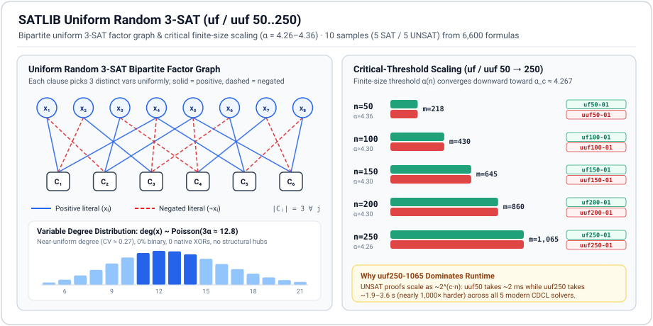

# SATLIB — Uniform Random 3-SAT `uf`/`uuf50..250` (sample / 6,600*) (`satlib-rnd3sat`)

*Figure: Uniform random 3-SAT bipartite factor graph (solid positive / dashed negated literals) and $\mathrm{Poisson}(3\alpha)$ variable-degree profile paired with critical-threshold scaling across `uf`/`uuf50..250` ($\alpha = 4.26\text{--}4.36$). Regenerated via [`src/gen_diagram.py`](src/gen_diagram.py).*

## Provenance & Credit

- **Upstream Archive:** [SATLIB — Benchmark Problems (UBC)](https://www.cs.ubc.ca/~hoos/SATLIB/benchm.html)
- **SATLIB Curators:** Holger H. Hoos and Thomas Stützle (University of British Columbia / TU Darmstadt)
- **Family Contributors:** Holger H. Hoos & Thomas Stützle (UBC SATLIB)
- **License:** Classic public scientific benchmark collection redistributed by UBC SATLIB for academic SAT research; no separate upstream `LICENSE` file is bundled in the archives.
- **Format Hygiene:** Legacy SATLIB trailing `%` / `0` EOF sentinels were stripped and wrapped multi-line clauses normalized to canonical 1-clause-per-line DIMACS CNF so every modern SAT solver parses all files cleanly.
- **Full SATLIB Archive Manifest:** [`../satlib-archive-uris/`](../../competition-suites/satlib-archive-uris/README.md) (all 97 official UBC SATLIB `.tar.gz` archive URLs; Pretolani's `PRET` formulas live in [`../pretolani-pret/`](../../algebraic/pretolani-pret/README.md)).
- **Recommended by:** [`@jasonslenderman`](https://twitter.com/jasonslenderman) (Twitter/X)

## Problem Description

Stratified sample of 10 critical-threshold uniform random 3-SAT instances (`uf`/`uuf50` through `uf`/`uuf250`, 5 SAT / 5 UNSAT) from the 6,600-instance UBC SATLIB RND3SAT collection (full archive URLs in [`../satlib-archive-uris/`](../../competition-suites/satlib-archive-uris/README.md)).

## Corpus & Data Sizes

- **`cnf-orig/`** — 10 original native **DIMACS `.cnf.xz`** files (33.1 KB).
- **`aig-converted/`** — 10 exact **Binary AIGER 1.9 `.aig.xz`** conversions (37.1 KB, verified via [Berkeley ABC](https://github.com/berkeley-abc/abc) `read_aiger`).
- **`xcnf-converted/`** — 10 lossless **[CryptoMiniSat](https://github.com/msoos/cryptominisat) `.xcnf.xz`** conversions (33.6 KB, `0` extracted native XOR parity clauses).
- **`anf-converted/`** — 10 lossless linear-size **DIMACS-ANF `.anf.xz`** conversions (59.2 KB, generated via [`../../../src/to_anf.py`](../../../src/to_anf.py)).
- **[`expected.tsv`](expected.tsv)** — Ground-truth verdict manifest for all 10 instances (**5 SAT / 5 UNSAT**).
- **`src/`** — Standalone converters (`cnf2aig.py`, `cnf2xcnf.py`).

| Format | Directory | Files | Key Dimensions (Range) | Compressed Size |
|---|---|---:|---|---:|
| **DIMACS CNF (origin)** | `cnf-orig/` | 10 | Vars: 50–250; Clauses: 218–1,065 | 33.1 KB |
| **Binary AIGER 1.9** | `aig-converted/` | 10 | Inputs: 50–250; ANDs: 643–3,186 | 37.1 KB |
| **[CryptoMiniSat](https://github.com/msoos/cryptominisat) XCNF** | `xcnf-converted/` | 10 | Native XOR clauses total: 0 | 33.6 KB |
| **DIMACS-ANF** | `anf-converted/` | 10 | Vars: 50–250; Eqs: 218–1,065 (deg ≤ 3) | 59.2 KB |
| **Total (4 Formats, Status: 5 SAT / 5 UNSAT)** | | **40** | | **163.1 KB** |

## Benchmark Results

- **Hardware & Protocol:** Same machine (**AMD Ryzen 9 5950X**, 16C/32T Linux, **1 thread per run** pinned across 8 dedicated physical cores, $T_{\max} = 5\text{ s}$, PAR-2 penalty $10,000\text{ ms}$). All solvers ran with default single-thread flags (`-t 1` for CryptoMiniSat 5.18.0; `--max-cores 1` for Frobenius) on identical uncompressed flat `.cnf` inputs; **100% of all 10 instances** were run (no subsampling), every Frobenius SAT model was independently verified against 100% of input clauses, and **0 verdict disagreements** occurred across all solvers.

| Instance | Verdict | Frobenius 1C | [CaDiCaL](https://github.com/arminbiere/cadical) 3.1.0 | [CryptoMiniSat](https://github.com/msoos/cryptominisat) 5.18.0 | [dense-solver](https://github.com/libdense/dense-solver) 0.0.4 | [Kissat](https://github.com/arminbiere/kissat) 4.0.4 |
|---|:---:|---:|---:|---:|---:|---:|
| `uf100-01` | SAT | **0.80 ms** | 3.25 ms | 21.72 ms | 1.90 ms | 15.96 ms |
| `uf150-01` | SAT | **0.73 ms** | 23.91 ms | 27.54 ms | 9.71 ms | 21.49 ms |
| `uf200-01` | SAT | **1.59 ms** | 136.69 ms | 143.37 ms | 42.63 ms | 88.51 ms |
| `uf250-01` | SAT | **1.20 ms** | 358.23 ms | 42.62 ms | 82.65 ms | 35.79 ms |
| `uf50-01` | SAT | **0.67 ms** | 2.67 ms | 6.55 ms | 1.54 ms | 2.88 ms |
| `uuf100-01` | UNSAT | 4.77 ms | 5.99 ms | 51.67 ms | **2.44 ms** | 24.72 ms |
| `uuf150-01` | UNSAT | **12.32 ms** | 40.66 ms | 66.48 ms | 15.17 ms | 44.73 ms |
| `uuf200-01` | UNSAT | **66.43 ms** | 175.47 ms | 213.71 ms | 113.90 ms | 279.51 ms |
| `uuf250-01` | UNSAT | **986.37 ms** | 2,793.47 ms | 3,560.43 ms | 2,986.46 ms | 1,919.79 ms |
| `uuf50-01` | UNSAT | 2.05 ms | 2.45 ms | 13.42 ms | **1.35 ms** | 2.11 ms |
| **Solved (10 files)** | — | **10 / 10** *(highest)* | **10 / 10** *(highest)* | **10 / 10** *(highest)* | **10 / 10** *(highest)* | **10 / 10** *(highest)* |
| **Total PAR-2** | — | **1,076.9 ms** *(fastest)* | 3,542.8 ms *(3.29x slower)* | 4,147.5 ms *(3.85x slower)* | 3,257.8 ms *(3.03x slower)* | 2,435.5 ms *(2.26x slower)* |

<!-- BEGIN_STRUCTURAL_ANALYSIS -->
## Phase-Transition & Structural Analysis

*Auto-generated by [`../../../src/analyze_benchmarks.py`](../../../src/analyze_benchmarks.py). Position relative to the critical phase transition is measured by $\rho_{\mathrm{crit}} = \frac{1}{n}\sum_k m_k / \alpha_c(k)$ (exact $\alpha/\alpha_c(k)$ for pure $k$-SAT; effective critical threshold $\alpha_c^{\mathrm{eff}} = \alpha/\rho_{\mathrm{crit}}$; `Under` $<0.90\times$, `Near-crit` $0.90\text{--}1.10\times$, `Over` $>1.10\times$), alongside Gent–Walsh annealed constrainedness $\kappa = -\frac{1}{n}\sum_i \log_2(1-2^{-k_i})$ (AAAI 1996), clause-length profile ($\bar{k}$, `%Bin`, `%Horn`), variable-degree CV ($\sigma_d/\bar{d}$, uniformity vs. hub skew), and extracted native XOR parity clauses.*

| Instance | Active $n$ | Clauses $m$ | $\alpha=m/n$ | $\alpha_c^{\mathrm{eff}}$ | $\rho_{\mathrm{crit}}$ (Regime) | $\kappa$ | $\bar{k}$ ($k_{\max}$) | Bin% | Horn% | Pos% | Deg CV | XORs |
|---|---:|---:|---:|---:|---:|---:|---:|---:|---:|---:|---:|---:|
| `uf100-01` | 100 | 430 | 4.30 | 4.27 | **1.01x** (Near-crit) | 0.83 | 3.00 (3) | 0% | 51% | 51% | 0.28 | 0 |
| `uf150-01` | 150 | 645 | 4.30 | 4.27 | **1.01x** (Near-crit) | 0.83 | 3.00 (3) | 0% | 51% | 49% | 0.26 | 0 |
| `uf200-01` | 200 | 860 | 4.30 | 4.27 | **1.01x** (Near-crit) | 0.83 | 3.00 (3) | 0% | 51% | 50% | 0.27 | 0 |
| `uf250-01` | 250 | 1,065 | 4.26 | 4.27 | **1.00x** (Near-crit) | 0.82 | 3.00 (3) | 0% | 49% | 51% | 0.27 | 0 |
| `uf50-01` | 50 | 218 | 4.36 | 4.27 | **1.02x** (Near-crit) | 0.84 | 3.00 (3) | 0% | 47% | 50% | 0.27 | 0 |
| `uuf100-01` | 100 | 430 | 4.30 | 4.27 | **1.01x** (Near-crit) | 0.83 | 3.00 (3) | 0% | 51% | 49% | 0.27 | 0 |
| `uuf150-01` | 150 | 645 | 4.30 | 4.27 | **1.01x** (Near-crit) | 0.83 | 3.00 (3) | 0% | 48% | 51% | 0.28 | 0 |
| `uuf200-01` | 200 | 860 | 4.30 | 4.27 | **1.01x** (Near-crit) | 0.83 | 3.00 (3) | 0% | 47% | 52% | 0.28 | 0 |
| `uuf250-01` | 250 | 1,065 | 4.26 | 4.27 | **1.00x** (Near-crit) | 0.82 | 3.00 (3) | 0% | 52% | 50% | 0.28 | 0 |
| `uuf50-01` | 50 | 218 | 4.36 | 4.27 | **1.02x** (Near-crit) | 0.84 | 3.00 (3) | 0% | 50% | 51% | 0.25 | 0 |

**Collection Phase-Transition Summary (10 instances, 4 formats: 10 CNF / 10 AIG / 10 XCNF / 10 ANF):** median $\rho_{\mathrm{crit}} = 1.01\times$ (range `1.00x–1.02x`), median $\kappa = 0.83$, regime split **0 Under / 10 Near-critical / 0 Over**, total extracted native XOR parity clauses = **0**, total ANF equations = **6,436**.
<!-- END_STRUCTURAL_ANALYSIS -->

## References

- H. H. Hoos and T. Stützle, *"SATLIB: An Online Resource for Research on SAT"*, SAT 2000, IOS Press, pp. 283–292 ([`cs.ubc.ca/~hoos/SATLIB/`](https://www.cs.ubc.ca/~hoos/SATLIB/benchm.html)).
- D. S. Johnson and M. A. Trick (eds.), *Cliques, Coloring, and Satisfiability: Second DIMACS Implementation Challenge*, DIMACS Series vol. 26, AMS, 1996.
