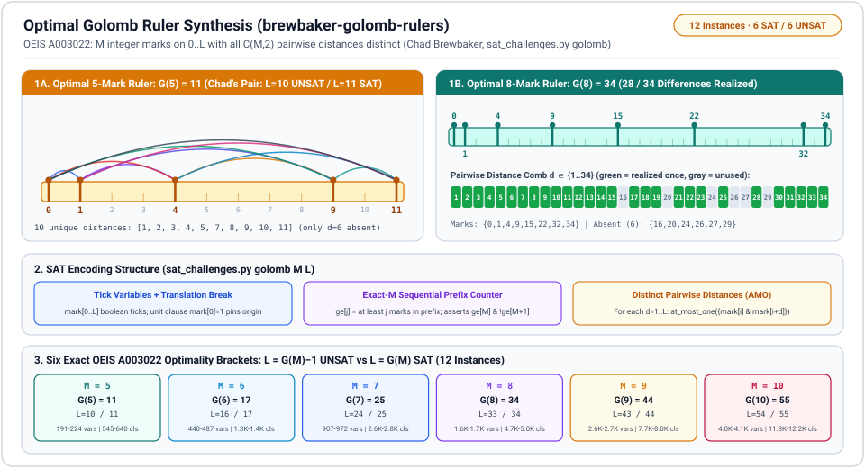

# Optimal Golomb Ruler Synthesis (`brewbaker-golomb-rulers`)

*Figure: Verified optimal Golomb rulers $G(5) = 11$ (`{0, 1, 4, 9, 11}`, 10 distinct distances) and $G(8) = 34$ (`{0, 1, 4, 9, 15, 22, 32, 34}`, 28/34 distances realized), the sequential prefix-counter + pairwise-AMO encoding, and the 12-instance OEIS A003022 ladder (generated by [`src/gen_diagram.py`](src/gen_diagram.py)).*

## Provenance & Credit

- **Upstream Author & Generator:** **Chad Brewbaker** ([`chadbrewbaker`](https://github.com/chadbrewbaker)) — verbatim [`sat_challenges.py`](src/sat_challenges.py) from [GitHub Gist `6f055336fda6009d1e67e0da8c843d19`](https://gist.github.com/chadbrewbaker/6f055336fda6009d1e67e0da8c843d19).
- **Ground-Truth Manifest:** [`expected.tsv`](expected.tsv) records all **12 instances** (**6 SAT / 6 UNSAT**), verified mathematically and cross-checked with 0 disagreements across all 5 solvers (`30/30` SAT models verified clause-by-clause; `6` tractable UNSAT instances formally certified via `drat-trim`, `lrat-check`, and `cake_lpr`).
- **Reproducibility:** Run `python3 src/generate_suite.py` to deterministically regenerate all 4 lossless `.xz` formats and `expected.tsv`, and `python3 src/gen_diagram.py` to regenerate [`diagram.svg`](diagram.svg).

## Problem Description

An **$M$-mark Golomb ruler** of length $L$ is a set of $M$ integer tick positions $0 = a_1 < a_2 < \dots < a_M \le L$ such that all $\binom{M}{2}$ positive pairwise differences $a_j - a_i$ ($1 \le i < j \le M$) are pairwise distinct. An **Optimal Golomb Ruler (OGR)** minimizes $L$ for a given $M$, giving the sequence $G(M)$ ([OEIS A003022](https://oeis.org/A003022)):

$$G(5) = 11, \quad G(6) = 17, \quad G(7) = 25, \quad G(8) = 34, \quad G(9) = 44, \quad G(10) = 55.$$

- **Encoding (`sat_challenges.py golomb M L`):**
  - **Ticks & translation breaking:** Boolean variables `mark[0..L]` with unit clause `mark[0]` pinning the first mark at 0 (no reflection symmetry breaking).
  - **Exact-$M$ cardinality:** Sequential prefix counter `ge[j]` tracking whether the prefix contains at least $j$ marks, asserting `ge[M]` and `¬ge[M+1]`.
  - **Distinct pairwise distances:** For every positive distance $d \in \{1, \dots, L\}$, define pair indicators $p_{i,d} \leftrightarrow \text{mark}[i] \land \text{mark}[i+d]$ and enforce `at_most_one` over $\{p_{0,d}, \dots, p_{L-d,d}\}$ (pairwise for $\le 4$ literals, sequential counter for $> 4$).
- **Complete 6-rung optimality ladder:** Every rung $M \in \{5, 6, 7, 8, 9, 10\}$ pairs tight infeasible $L = G(M) - 1$ (UNSAT) against optimal $L = G(M)$ (SAT), scaling smoothly from ~5 ms (`M=5`) to ~10 s (`M=10`), with **6/6 UNSAT optimality proofs** formally certified by `cake_lpr`.

## Corpus & Data Sizes

All committed files are `xz`-compressed (`preset=6`), lossless, and well under GitHub's `95 MB` per-file limit (`aig-converted/` verified by `abc`, `anf-converted/` verified by [`../src/to_anf.py`](../src/to_anf.py) with `--verify`):

| Format | Directory | Files | Key Dimensions (Range) | Total Size | Max File |
|---|---|---:|---|---:|---:|
| **DIMACS CNF (origin)** | [`cnf-orig/`](cnf-orig/) | 12 | Vars: 191–4,131; Clauses: 545–12,185 | 105.7 KB | 20.3 KB |
| **Binary AIGER 1.9** | [`aig-converted/`](aig-converted/) | 12 | Inputs: 191–4,131; ANDs: 1,224–26,959 | 130.4 KB | 23.7 KB |
| **[CryptoMiniSat](https://github.com/msoos/cryptominisat) XCNF** | [`xcnf-converted/`](xcnf-converted/) | 12 | Total extracted native XORs: 0 | 105.1 KB | 20.2 KB |
| **DIMACS-ANF** | [`anf-converted/`](anf-converted/) | 12 | Vars: 191–4,131; Eqs: 545–12,185 (deg $\le 3$) | 156.2 KB | 30.4 KB |
| **Total (4 Formats)** | | **48** | **6 SAT / 6 UNSAT** | **497.3 KB** | **30.4 KB** |

### Complete Instance Inventory (`expected.tsv`)

| Instance | Expected | Vars | Clauses | Native XORs | `.cnf.xz` | `.aig.xz` | `.xcnf.xz` | `.anf.xz` |
|---|:---:|---:|---:|---:|---:|---:|---:|---:|
| `golomb_m10_l54.cnf` | UNSAT | 4,000 | 11,796 | 0 | 19.4 KB | 23.2 KB | 19.4 KB | 30.1 KB |
| `golomb_m10_l55.cnf` | SAT | 4,131 | 12,185 | 0 | 20.3 KB | 23.7 KB | 20.2 KB | 30.4 KB |
| `golomb_m5_l10.cnf` | UNSAT | 191 | 545 | 0 | 1.5 KB | 2.1 KB | 1.6 KB | 2.1 KB |
| `golomb_m5_l11.cnf` | SAT | 224 | 640 | 0 | 1.7 KB | 2.3 KB | 1.7 KB | 2.4 KB |
| `golomb_m6_l16.cnf` | UNSAT | 440 | 1,268 | 0 | 2.9 KB | 3.9 KB | 2.9 KB | 4.2 KB |
| `golomb_m6_l17.cnf` | SAT | 487 | 1,405 | 0 | 3.1 KB | 3.9 KB | 3.1 KB | 4.5 KB |
| `golomb_m7_l24.cnf` | UNSAT | 907 | 2,637 | 0 | 5.3 KB | 6.7 KB | 5.3 KB | 7.6 KB |
| `golomb_m7_l25.cnf` | SAT | 972 | 2,828 | 0 | 5.6 KB | 8.9 KB | 5.6 KB | 8.0 KB |
| `golomb_m8_l33.cnf` | UNSAT | 1,615 | 4,725 | 0 | 8.7 KB | 10.1 KB | 8.8 KB | 12.7 KB |
| `golomb_m8_l34.cnf` | SAT | 1,700 | 4,976 | 0 | 9.2 KB | 13.0 KB | 9.2 KB | 13.4 KB |
| `golomb_m9_l43.cnf` | UNSAT | 2,624 | 7,712 | 0 | 13.7 KB | 15.5 KB | 13.4 KB | 20.1 KB |
| `golomb_m9_l44.cnf` | SAT | 2,731 | 8,029 | 0 | 14.3 KB | 17.0 KB | 13.9 KB | 20.7 KB |

### Sibling Collections (Chad Brewbaker's `sat_challenges.py`)

This directory is one of **7 single-problem-type collections** built from Chad Brewbaker's [`sat_challenges.py`](https://gist.github.com/chadbrewbaker/6f055336fda6009d1e67e0da8c843d19) (73 instances across 7 problem families, 292 compressed 4-format files):

| Collection | Problem Family | Instances |
|---|---|---:|
| [`brewbaker-tensor-matmul/`](../brewbaker-tensor-matmul/README.md) | Bilinear Matrix Multiplication Tensor Rank (`matmul`) | 10 (6 SAT / 4 UNSAT) |
| [`brewbaker-tensor-dot/`](../brewbaker-tensor-dot/README.md) | Bilinear Inner-Product Tensor Rank (`dot`) | 10 (5 SAT / 5 UNSAT) |
| [`brewbaker-tensor-cross/`](../brewbaker-tensor-cross/README.md) | Bilinear 3D Cross-Product Tensor Rank (`cross`) | 8 (4 SAT / 4 UNSAT) |
| [`brewbaker-sort-networks/`](../brewbaker-sort-networks/README.md) | Minimum-Comparator Sorting Networks (`sort`) | 8 (4 SAT / 4 UNSAT) |
| [`brewbaker-select-networks/`](../brewbaker-select-networks/README.md) | Fixed & Adaptive Selection Networks (`select`) | 12 (6 SAT / 6 UNSAT) |
| **`brewbaker-golomb-rulers/`** *(this collection)* | Optimal Golomb Rulers (`golomb`) | 12 (6 SAT / 6 UNSAT) |
| [`brewbaker-sha256-cec/`](../brewbaker-sha256-cec/README.md) | FIPS 180-4 SHA-256 Ripple-vs-Prefix CEC Miters (`sha256`) | 13 (2 SAT / 11 UNSAT) |

## Benchmark Results

### Single-Core Flat DIMACS `.cnf` Comparison ($T_{\max} = 60\;\text{s}$)

- **Hardware & Isolation:** AMD Ryzen 9 5950X (16 physical cores / 32 threads, 64 MiB L3 cache, Linux x86_64), **strictly pinned to single physical core 9** (`taskset -c 9`), executed strictly sequentially (one single-threaded solver process at a time) on identical uncompressed flat `.cnf` inputs.
- **Solvers & Flags:** Frobenius (`--max-cores 1 --timeout 60`), [CaDiCaL](https://github.com/arminbiere/cadical) 3.1.0 (`-q --modelalllits=true -t 60`), [CryptoMiniSat](https://github.com/msoos/cryptominisat) 5.18.0 (`-t 1 --maxtime 60`), [dense-solver](https://github.com/libdense/dense-solver) 0.0.4 (1 thread, `timeout -k 2s 60.0s`), and [Kissat](https://github.com/arminbiere/kissat) 4.0.4 (`-q --time=60`).
- **Independent Verification:** **0 verdict disagreements** across all 5 solvers and [`expected.tsv`](expected.tsv); **30 / 30 SAT models** passed 100% raw-clause verification against every clause in `cnf-orig/`. PAR-2 scores each timeout as $2 \times T_{\max} = 120\;\text{s}$.

| Instance | Expected | Frobenius 1C | [CaDiCaL](https://github.com/arminbiere/cadical) 3.1.0 | [CryptoMiniSat](https://github.com/msoos/cryptominisat) 5.18.0 | [dense-solver](https://github.com/libdense/dense-solver) 0.0.4 | [Kissat](https://github.com/arminbiere/kissat) 4.0.4 |
|---|:---:|---:|---:|---:|---:|---:|
| `golomb_m10_l54.cnf` | UNSAT | **6.83 s** | 14.36 s | 11.24 s | 19.43 s | 7.39 s |
| `golomb_m10_l55.cnf` | SAT | **163.1 ms** | 2.17 s | 1.18 s | 3.41 s | 1.01 s |
| `golomb_m5_l10.cnf` | UNSAT | 3.8 ms | **3.2 ms** | 30.5 ms | 3.4 ms | 5.4 ms |
| `golomb_m5_l11.cnf` | SAT | 3.4 ms | **3.0 ms** | 33.5 ms | 3.3 ms | 6.1 ms |
| `golomb_m6_l16.cnf` | UNSAT | **5.0 ms** | 5.4 ms | 52.7 ms | 5.5 ms | 15.2 ms |
| `golomb_m6_l17.cnf` | SAT | 4.0 ms | **3.5 ms** | 57.9 ms | 4.5 ms | 15.1 ms |
| `golomb_m7_l24.cnf` | UNSAT | 30.0 ms | 32.4 ms | 99.7 ms | **22.3 ms** | 39.6 ms |
| `golomb_m7_l25.cnf` | SAT | 6.7 ms | **3.8 ms** | 96.5 ms | 16.0 ms | 19.9 ms |
| `golomb_m8_l33.cnf` | UNSAT | **138.4 ms** | 194.9 ms | 270.0 ms | 172.4 ms | 250.4 ms |
| `golomb_m8_l34.cnf` | SAT | **31.3 ms** | 179.8 ms | 197.6 ms | 57.7 ms | 243.3 ms |
| `golomb_m9_l43.cnf` | UNSAT | 1.10 s | 1.34 s | 1.23 s | 1.97 s | **1.05 s** |
| `golomb_m9_l44.cnf` | SAT | 925.6 ms | **483.1 ms** | 794.1 ms | 1.18 s | 520.5 ms |
| **Solved ($T_{\max} = 60\;\text{s}$)** | — | **12 / 12** *(highest)* | **12 / 12** *(highest)* | **12 / 12** *(highest)* | **12 / 12** *(highest)* | **12 / 12** *(highest)* |
| **Total PAR-2** | — | **9.24 s** *(fastest)* | 18.77 s *(2.03x slower)* | 15.29 s *(1.65x slower)* | 26.28 s *(2.84x slower)* | 10.56 s *(1.14x slower)* |

### Four-Format Parity (Frobenius Across `.cnf`, `.aig`, `.xcnf`, `.anf`, Core 9)

Evaluated sequentially on physical core 9 (`taskset -c 9`) using uncompressed flat inputs in all 4 formats (same-build baseline four-format parity sweep). Every solved verdict agrees 100% across all four formats, and every SAT model emitted from `.aig`, `.xcnf`, or `.anf` passed 100% raw-clause verification when projected back onto the original DIMACS CNF variables.

| Instance | Expected | Frobenius 1C (`.cnf`) | Frobenius 1C (`.aig`) | Frobenius 1C (`.xcnf`) | Frobenius 1C (`.anf`) |
|---|:---:|---:|---:|---:|---:|
| `golomb_m10_l54.cnf` | UNSAT | 11.25 s | 10.96 s | **10.93 s** | 11.05 s |
| `golomb_m10_l55.cnf` | SAT | **1.00 s** | 1.03 s | 1.01 s | 1.03 s |
| `golomb_m5_l10.cnf` | UNSAT | 5.0 ms | **4.3 ms** | 4.7 ms | **4.3 ms** |
| `golomb_m5_l11.cnf` | SAT | 5.0 ms | **4.4 ms** | 4.9 ms | **4.4 ms** |
| `golomb_m6_l16.cnf` | UNSAT | 8.1 ms | **7.6 ms** | 8.0 ms | 8.0 ms |
| `golomb_m6_l17.cnf` | SAT | 8.4 ms | 7.9 ms | 8.2 ms | **7.8 ms** |
| `golomb_m7_l24.cnf` | UNSAT | 22.5 ms | 22.3 ms | **21.9 ms** | 22.5 ms |
| `golomb_m7_l25.cnf` | SAT | 15.2 ms | 15.5 ms | **15.0 ms** | 15.6 ms |
| `golomb_m8_l33.cnf` | UNSAT | **170.0 ms** | 171.0 ms | 189.8 ms | 172.3 ms |
| `golomb_m8_l34.cnf` | SAT | 28.2 ms | 27.1 ms | **26.2 ms** | 27.5 ms |
| `golomb_m9_l43.cnf` | UNSAT | **1.18 s** | 1.24 s | 1.22 s | 1.23 s |
| `golomb_m9_l44.cnf` | SAT | **330.2 ms** | 342.6 ms | 340.7 ms | 348.3 ms |

### Independent UNSAT Proof Certification (6 / 6 Formally Verified)

All **6 tractable Frobenius UNSAT instances** ($< 30\;\text{s}$) in this collection were independently certified via both DRAT (`drat-trim`) and direct LRAT (`lrat-check` + formally verified `cake_lpr` outputting `s VERIFIED UNSAT`) on core 9 (`taskset -c 9`):

| Instance | DRAT Size | `drat-trim` | LRAT Size | `lrat-check` | `cake_lpr` |
|---|---:|---|---:|---|---|
| `golomb_m10_l54.cnf` | 50.46 MB | Verified (12878.1 ms) | 437.55 MB | Verified (5382.2 ms) | `s VERIFIED UNSAT` (19361.6 ms) |
| `golomb_m5_l10.cnf` | 26.9 KB | Verified (54.3 ms) | 9.5 KB | Verified (19.3 ms) | `s VERIFIED UNSAT` (3.0 ms) |
| `golomb_m6_l16.cnf` | 87.4 KB | Verified (58.8 ms) | 69.6 KB | Verified (18.7 ms) | `s VERIFIED UNSAT` (5.7 ms) |
| `golomb_m7_l24.cnf` | 256.7 KB | Verified (84.7 ms) | 658.2 KB | Verified (26.8 ms) | `s VERIFIED UNSAT` (24.3 ms) |
| `golomb_m8_l33.cnf` | 1.44 MB | Verified (280.2 ms) | 7.03 MB | Verified (106.6 ms) | `s VERIFIED UNSAT` (220.1 ms) |
| `golomb_m9_l43.cnf` | 7.98 MB | Verified (2796.3 ms) | 58.28 MB | Verified (723.1 ms) | `s VERIFIED UNSAT` (1820.4 ms) |

<!-- BEGIN_STRUCTURAL_ANALYSIS -->
## Phase-Transition & Structural Analysis

*Auto-generated by [`../src/analyze_benchmarks.py`](../src/analyze_benchmarks.py). Position relative to the critical phase transition is measured by $\rho_{\mathrm{crit}} = \frac{1}{n}\sum_k m_k / \alpha_c(k)$ (exact $\alpha/\alpha_c(k)$ for pure $k$-SAT; effective critical threshold $\alpha_c^{\mathrm{eff}} = \alpha/\rho_{\mathrm{crit}}$; `Under` $<0.90\times$, `Near-crit` $0.90\text{--}1.10\times$, `Over` $>1.10\times$), alongside Gent–Walsh annealed constrainedness $\kappa = -\frac{1}{n}\sum_i \log_2(1-2^{-k_i})$ (AAAI 1996), clause-length profile ($\bar{k}$, `%Bin`, `%Horn`), variable-degree CV ($\sigma_d/\bar{d}$, uniformity vs. hub skew), and extracted native XOR parity clauses.*

| Instance | Active $n$ | Clauses $m$ | $\alpha=m/n$ | $\alpha_c^{\mathrm{eff}}$ | $\rho_{\mathrm{crit}}$ (Regime) | $\kappa$ | $\bar{k}$ ($k_{\max}$) | Bin% | Horn% | Pos% | Deg CV | XORs |
|---|---:|---:|---:|---:|---:|---:|---:|---:|---:|---:|---:|---:|
| `golomb_m10_l54` | 4,000 | 11,796 | 2.95 | 1.20 | **2.47x** (Over) | 1.08 | 2.21 (3) | 79% | 91% | 40% | 2.21 | 0 |
| `golomb_m10_l55` | 4,131 | 12,185 | 2.95 | 1.19 | **2.47x** (Over) | 1.09 | 2.21 (3) | 79% | 91% | 40% | 2.23 | 0 |
| `golomb_m5_l10` | 191 | 545 | 2.85 | 1.24 | **2.29x** (Over) | 1.03 | 2.25 (3) | 74% | 85% | 40% | 0.92 | 0 |
| `golomb_m5_l11` | 224 | 640 | 2.86 | 1.24 | **2.30x** (Over) | 1.04 | 2.25 (3) | 74% | 86% | 40% | 0.96 | 0 |
| `golomb_m6_l16` | 440 | 1,268 | 2.88 | 1.23 | **2.35x** (Over) | 1.05 | 2.24 (3) | 75% | 87% | 40% | 1.18 | 0 |
| `golomb_m6_l17` | 487 | 1,405 | 2.89 | 1.23 | **2.35x** (Over) | 1.05 | 2.24 (3) | 76% | 87% | 40% | 1.21 | 0 |
| `golomb_m7_l24` | 907 | 2,637 | 2.91 | 1.22 | **2.39x** (Over) | 1.06 | 2.23 (3) | 77% | 88% | 40% | 1.45 | 0 |
| `golomb_m7_l25` | 972 | 2,828 | 2.91 | 1.21 | **2.40x** (Over) | 1.06 | 2.23 (3) | 77% | 89% | 40% | 1.48 | 0 |
| `golomb_m8_l33` | 1,615 | 4,725 | 2.93 | 1.21 | **2.42x** (Over) | 1.07 | 2.22 (3) | 78% | 90% | 40% | 1.71 | 0 |
| `golomb_m8_l34` | 1,700 | 4,976 | 2.93 | 1.21 | **2.43x** (Over) | 1.07 | 2.22 (3) | 78% | 90% | 40% | 1.74 | 0 |
| `golomb_m9_l43` | 2,624 | 7,712 | 2.94 | 1.20 | **2.45x** (Over) | 1.08 | 2.22 (3) | 78% | 91% | 40% | 1.96 | 0 |
| `golomb_m9_l44` | 2,731 | 8,029 | 2.94 | 1.20 | **2.45x** (Over) | 1.08 | 2.22 (3) | 78% | 91% | 40% | 1.98 | 0 |

**Collection Phase-Transition Summary (12 instances, 4 formats: 12 CNF / 12 AIG / 12 XCNF / 12 ANF):** median $\rho_{\mathrm{crit}} = 2.41\times$ (range `2.29x–2.47x`), median $\kappa = 1.07$, regime split **0 Under / 0 Near-critical / 12 Over**, total extracted native XOR parity clauses = **0**, total ANF equations = **58,746**.
<!-- END_STRUCTURAL_ANALYSIS -->

## References

- Chad Brewbaker ([`chadbrewbaker`](https://github.com/chadbrewbaker)), *SAT challenge problem generator (`sat_challenges.py`)*, [GitHub Gist `6f055336...`](https://gist.github.com/chadbrewbaker/6f055336fda6009d1e67e0da8c843d19).
- G. S. Bloom and S. W. Golomb, *Applications of Numbered Undirected Graphs*, *Proc. IEEE* 65(4):562–570, 1977 ([OEIS A003022](https://oeis.org/A003022)).
- M. D. Atkinson, N. Santoro, and J. Urrutia, *Integer Sets with Distinct Sums and Differences and Carrier Frequency Assignments for Nonlinear Repeaters*, *IEEE Trans. Commun.* 34(6):614–617, 1986.
- A. Biere, T. Faller, K. Fazekas, M. Fleury, N. Froleyks, and F. Pollitt, *[CaDiCaL](https://github.com/arminbiere/cadical) 2.0 / [Kissat](https://github.com/arminbiere/kissat) 4.0*, CAV 2024.
- M. Soos, K. Nohl, and C. Castelluccia, *Extending SAT Solvers to Cryptographic Problems ([CryptoMiniSat](https://github.com/msoos/cryptominisat))*, SAT 2009.
- Y. K. Tan, M. J. H. Heule, and M. O. Myreen, *cake_lpr: Verified Propagation Redundancy Checking in CakeML*, TACAS 2021.
