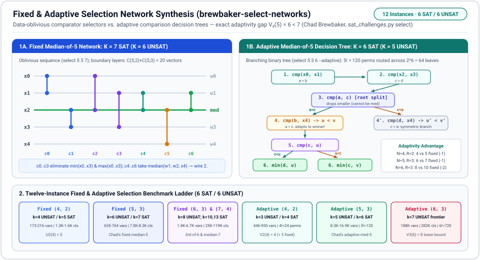

# Fixed & Adaptive Selection Network Synthesis (`brewbaker-select-networks`)

*Figure: Side-by-side comparison of an independently verified 7-comparator fixed median-of-5 network (`select 5 3 7`) against a verified depth-6 adaptive comparison decision tree (`select 5 3 6 --adaptive`), demonstrating the exact adaptivity gap $V_3(5) = 6 < 7$ (generated by [`src/gen_diagram.py`](src/gen_diagram.py)).*

## Provenance & Credit

- **Upstream Author & Generator:** **Chad Brewbaker** ([`chadbrewbaker`](https://github.com/chadbrewbaker)) — verbatim [`sat_challenges.py`](src/sat_challenges.py) from [GitHub Gist `6f055336fda6009d1e67e0da8c843d19`](https://gist.github.com/chadbrewbaker/6f055336fda6009d1e67e0da8c843d19).
- **Ground-Truth Manifest:** [`expected.tsv`](expected.tsv) records all **12 instances** (**6 SAT / 6 UNSAT**), verified mathematically and cross-checked with 0 disagreements across all 5 solvers (`30/30` SAT models verified clause-by-clause; `5` tractable UNSAT instances formally certified via `drat-trim`, `lrat-check`, and `cake_lpr`).
- **Reproducibility:** Run `python3 src/generate_suite.py` to deterministically regenerate all 4 lossless `.xz` formats and `expected.tsv`, and `python3 src/gen_diagram.py` to regenerate [`diagram.svg`](diagram.svg).

## Problem Description

Given $N$ inputs and a target 1-indexed order statistic $R \in \{1, \dots, N\}$ (e.g., median $R = \lceil N/2 \rceil$), `sat_challenges.py select` contrasts two fundamental comparison-based computation models:

1. **Fixed (data-oblivious) selection networks (`select N R K`):** A fixed sequence of at most $K$ compare-exchange gates whose final wire $R-1$ must hold the $R$-th smallest element on every input. By monotonicity of min/max, testing only the two adjacent Boolean Hamming-weight boundary layers ($R-1$ zeros expecting output `1`, and $R$ zeros expecting output `0`, totaling $\binom{N}{R-1} + \binom{N}{R}$ vectors) is both necessary and sufficient.
2. **Adaptive comparison decision trees (`select N R K --adaptive`):** A binary decision tree of worst-case depth $K$ ($2^K - 1$ internal test nodes `test[h,i,j]` and $2^K$ leaf nodes `return[h,i]`) routed over all $N!$ input permutations. Because each internal test may depend on prior outcomes, adaptive selection achieves strictly smaller worst-case cost $V_R(N)$ (Knuth TAOCP Vol. 3 §5.3.3) than fixed comparator networks:
   - **$(N=4, R=2)$:** Fixed requires **5** comparators (`k=4` UNSAT / `k=5` SAT), whereas adaptive needs only **$V_2(4) = 4$** (`k=3` UNSAT / `k=4` SAT).
   - **Median of 5 $(N=5, R=3)$:** Fixed requires **7** comparators (`k=6` UNSAT / `k=7` SAT), whereas adaptive needs only **$V_3(5) = 6$** (`k=5` UNSAT / `k=6` SAT) — Chad Brewbaker's paired adaptivity-gap challenge!
   - **Larger instances:** Fixed `select 6 3` (`k=8` UNSAT / `k=10` SAT), fixed median-of-7 `select 7 4 13` (SAT), and adaptive `select 6 3 7 --adaptive` (UNSAT frontier proving $V_3(6) \ge 8$; $V_3(6) = 8$ by Hadian–Sobel / Knuth §5.3.3).

## Corpus & Data Sizes

All committed files are `xz`-compressed (`preset=6`), lossless, and well under GitHub's `95 MB` per-file limit (`aig-converted/` verified by `abc`, `anf-converted/` verified by [`../src/to_anf.py`](../src/to_anf.py) with `--verify`):

| Format | Directory | Files | Key Dimensions (Range) | Total Size | Max File |
|---|---|---:|---|---:|---:|
| **DIMACS CNF (origin)** | [`cnf-orig/`](cnf-orig/) | 12 | Vars: 173–187,972; Clauses: 690–282,295 | 1.26 MB | 803.8 KB |
| **Binary AIGER 1.9** | [`aig-converted/`](aig-converted/) | 12 | Inputs: 173–187,972; ANDs: 1,920–989,364 | 1.82 MB | 1.06 MB |
| **[CryptoMiniSat](https://github.com/msoos/cryptominisat) XCNF** | [`xcnf-converted/`](xcnf-converted/) | 12 | Total extracted native XORs: 0 | 1.26 MB | 813.3 KB |
| **DIMACS-ANF** | [`anf-converted/`](anf-converted/) | 12 | Vars: 877–1,377,426; Eqs: 1,365–1,471,749 (deg $\le 3$) | 9.17 MB | 7.37 MB |
| **Total (4 Formats)** | | **48** | **6 SAT / 6 UNSAT** | **13.51 MB** | **7.37 MB** |

### Complete Instance Inventory (`expected.tsv`)

| Instance | Expected | Vars | Clauses | Native XORs | `.cnf.xz` | `.aig.xz` | `.xcnf.xz` | `.anf.xz` |
|---|:---:|---:|---:|---:|---:|---:|---:|---:|
| `select_n4_r2_k3_adaptive.cnf` | UNSAT | 446 | 690 | 0 | 2.4 KB | 3.1 KB | 2.4 KB | 7.8 KB |
| `select_n4_r2_k4_adaptive.cnf` | SAT | 950 | 1,442 | 0 | 4.2 KB | 6.0 KB | 4.0 KB | 16.1 KB |
| `select_n4_r2_k4_fixed.cnf` | UNSAT | 173 | 1,268 | 0 | 3.3 KB | 5.7 KB | 3.3 KB | 8.1 KB |
| `select_n4_r2_k5_fixed.cnf` | SAT | 216 | 1,634 | 0 | 3.6 KB | 7.2 KB | 3.7 KB | 11.0 KB |
| `select_n5_r3_k5_adaptive.cnf` | UNSAT | 8,318 | 12,502 | 0 | 34.1 KB | 49.8 KB | 32.9 KB | 204.8 KB |
| `select_n5_r3_k6_adaptive.cnf` | SAT | 16,894 | 25,270 | 0 | 71.8 KB | 93.8 KB | 70.4 KB | 415.7 KB |
| `select_n5_r3_k6_fixed.cnf` | UNSAT | 655 | 6,997 | 0 | 12.8 KB | 25.2 KB | 12.5 KB | 43.1 KB |
| `select_n5_r3_k7_fixed.cnf` | SAT | 764 | 8,283 | 0 | 17.4 KB | 28.9 KB | 17.5 KB | 52.3 KB |
| `select_n6_r3_k10_fixed.cnf` | SAT | 2,271 | 32,138 | 0 | 51.3 KB | 97.7 KB | 50.5 KB | 200.5 KB |
| `select_n6_r3_k7_adaptive.cnf` | UNSAT | 187,972 | 282,295 | 0 | 803.8 KB | 1.06 MB | 813.3 KB | 7.37 MB |
| `select_n6_r3_k8_fixed.cnf` | UNSAT | 1,817 | 25,324 | 0 | 52.4 KB | 78.8 KB | 52.4 KB | 172.0 KB |
| `select_n7_r4_k13_fixed.cnf` | SAT | 6,722 | 119,020 | 0 | 230.2 KB | 387.8 KB | 232.0 KB | 706.2 KB |

### Sibling Collections (Chad Brewbaker's `sat_challenges.py`)

This directory is one of **7 single-problem-type collections** built from Chad Brewbaker's [`sat_challenges.py`](https://gist.github.com/chadbrewbaker/6f055336fda6009d1e67e0da8c843d19) (73 instances across 7 problem families, 292 compressed 4-format files):

| Collection | Problem Family | Instances |
|---|---|---:|
| [`brewbaker-tensor-matmul/`](../brewbaker-tensor-matmul/README.md) | Bilinear Matrix Multiplication Tensor Rank (`matmul`) | 10 (6 SAT / 4 UNSAT) |
| [`brewbaker-tensor-dot/`](../brewbaker-tensor-dot/README.md) | Bilinear Inner-Product Tensor Rank (`dot`) | 10 (5 SAT / 5 UNSAT) |
| [`brewbaker-tensor-cross/`](../brewbaker-tensor-cross/README.md) | Bilinear 3D Cross-Product Tensor Rank (`cross`) | 8 (4 SAT / 4 UNSAT) |
| [`brewbaker-sort-networks/`](../brewbaker-sort-networks/README.md) | Minimum-Comparator Sorting Networks (`sort`) | 8 (4 SAT / 4 UNSAT) |
| **`brewbaker-select-networks/`** *(this collection)* | Fixed & Adaptive Selection Networks (`select`) | 12 (6 SAT / 6 UNSAT) |
| [`brewbaker-golomb-rulers/`](../brewbaker-golomb-rulers/README.md) | Optimal Golomb Rulers (`golomb`) | 12 (6 SAT / 6 UNSAT) |
| [`brewbaker-sha256-cec/`](../brewbaker-sha256-cec/README.md) | FIPS 180-4 SHA-256 Ripple-vs-Prefix CEC Miters (`sha256`) | 13 (2 SAT / 11 UNSAT) |

## Benchmark Results

### Single-Core Flat DIMACS `.cnf` Comparison ($T_{\max} = 60\;\text{s}$)

- **Hardware & Isolation:** AMD Ryzen 9 5950X (16 physical cores / 32 threads, 64 MiB L3 cache, Linux x86_64), **strictly pinned to single physical core 9** (`taskset -c 9`), executed strictly sequentially (one single-threaded solver process at a time) on identical uncompressed flat `.cnf` inputs.
- **Solvers & Flags:** Frobenius (`--max-cores 1 --timeout 60`), [CaDiCaL](https://github.com/arminbiere/cadical) 3.1.0 (`-q --modelalllits=true -t 60`), [CryptoMiniSat](https://github.com/msoos/cryptominisat) 5.18.0 (`-t 1 --maxtime 60`), [dense-solver](https://github.com/libdense/dense-solver) 0.0.4 (1 thread, `timeout -k 2s 60.0s`), and [Kissat](https://github.com/arminbiere/kissat) 4.0.4 (`-q --time=60`).
- **Independent Verification:** **0 verdict disagreements** across all 5 solvers and [`expected.tsv`](expected.tsv); **30 / 30 SAT models** passed 100% raw-clause verification against every clause in `cnf-orig/`. PAR-2 scores each timeout as $2 \times T_{\max} = 120\;\text{s}$.

| Instance | Expected | Frobenius | [CaDiCaL](https://github.com/arminbiere/cadical) 3.1.0 | [CryptoMiniSat](https://github.com/msoos/cryptominisat) 5.18.0 | [dense-solver](https://github.com/libdense/dense-solver) 0.0.4 | [Kissat](https://github.com/arminbiere/kissat) 4.0.4 |
|---|:---:|---:|---:|---:|---:|---:|
| `select_n4_r2_k3_adaptive.cnf` | UNSAT | **1.8 ms** | 3.1 ms | 53.4 ms | 3.1 ms | 14.8 ms |
| `select_n4_r2_k4_adaptive.cnf` | SAT | **3.1 ms** | 4.0 ms | 112.9 ms | 4.1 ms | 22.1 ms |
| `select_n4_r2_k4_fixed.cnf` | UNSAT | **2.5 ms** | 4.8 ms | 41.2 ms | 3.8 ms | 17.9 ms |
| `select_n4_r2_k5_fixed.cnf` | SAT | **2.0 ms** | 3.7 ms | 51.2 ms | 3.4 ms | 23.3 ms |
| `select_n5_r3_k5_adaptive.cnf` | UNSAT | 35.6 ms | 29.1 ms | 868.2 ms | **27.2 ms** | 44.9 ms |
| `select_n5_r3_k6_adaptive.cnf` | SAT | **168.7 ms** | 348.1 ms | 1.47 s | 1.32 s | 814.1 ms |
| `select_n5_r3_k6_fixed.cnf` | UNSAT | **28.3 ms** | 105.0 ms | 288.6 ms | 82.8 ms | 175.2 ms |
| `select_n5_r3_k7_fixed.cnf` | SAT | **6.2 ms** | 6.9 ms | 282.7 ms | 10.3 ms | 33.0 ms |
| `select_n6_r3_k10_fixed.cnf` | SAT | 158.0 ms | 94.4 ms | 705.3 ms | **80.7 ms** | 204.2 ms |
| `select_n6_r3_k7_adaptive.cnf` | UNSAT | **900.8 ms** | 50.15 s | >60 s *(T/O)* | 21.39 s | >60 s *(T/O)* |
| `select_n6_r3_k8_fixed.cnf` | UNSAT | **148.0 ms** | 4.01 s | 6.79 s | 18.71 s | 4.25 s |
| `select_n7_r4_k13_fixed.cnf` | SAT | **505.0 ms** | 1.53 s | 1.28 s | 3.66 s | 746.0 ms |
| **Solved ($T_{\max} = 60\;\text{s}$)** | **12** | **12/12 (6 SAT, 6 UNSAT)** | **12/12 (6 SAT, 6 UNSAT)** | 11/12 (6 SAT, 5 UNSAT) | **12/12 (6 SAT, 6 UNSAT)** | 11/12 (6 SAT, 5 UNSAT) |
| **Total PAR-2** | — | **1.96 s *(mean 0.16 s)*** | 56.29 s *(mean 4.69 s)* | 131.94 s *(mean 11.00 s)* | 45.29 s *(mean 3.77 s)* | 126.35 s *(mean 10.53 s)* |

### Four-Format Parity (Frobenius Across `.cnf`, `.aig`, `.xcnf`, `.anf`, Core 9)

Evaluated sequentially on physical core 9 (`taskset -c 9`) using uncompressed flat inputs in all 4 formats (same-build baseline four-format parity sweep). Every solved verdict agrees 100% across all four formats, and every SAT model emitted from `.aig`, `.xcnf`, or `.anf` passed 100% raw-clause verification when projected back onto the original DIMACS CNF variables.

| Instance | Expected | Frobenius (`.cnf`) | Frobenius (`.aig`) | Frobenius (`.xcnf`) | Frobenius (`.anf`) |
|---|:---:|---:|---:|---:|---:|
| `select_n4_r2_k3_adaptive.cnf` | UNSAT | 4.8 ms | 4.5 ms | 4.5 ms | 4.5 ms |
| `select_n4_r2_k4_adaptive.cnf` | SAT | 7.6 ms | 7.1 ms | 7.5 ms | 9.0 ms |
| `select_n4_r2_k4_fixed.cnf` | UNSAT | 5.2 ms | 5.0 ms | 5.0 ms | 5.4 ms |
| `select_n4_r2_k5_fixed.cnf` | SAT | 5.3 ms | 5.5 ms | 5.1 ms | 6.3 ms |
| `select_n5_r3_k5_adaptive.cnf` | UNSAT | 51.3 ms | 53.1 ms | 50.6 ms | 62.5 ms |
| `select_n5_r3_k6_adaptive.cnf` | SAT | 250.2 ms | 254.0 ms | 248.2 ms | 291.0 ms |
| `select_n5_r3_k6_fixed.cnf` | UNSAT | 67.2 ms | 68.3 ms | 67.3 ms | 70.9 ms |
| `select_n5_r3_k7_fixed.cnf` | SAT | 31.7 ms | 33.1 ms | 31.4 ms | 38.0 ms |
| `select_n6_r3_k10_fixed.cnf` | SAT | 99.4 ms | 100.9 ms | 92.2 ms | 113.4 ms |
| `select_n6_r3_k7_adaptive.cnf` | UNSAT | 50.83 s | 49.85 s | 50.19 s | 51.33 s |
| `select_n6_r3_k8_fixed.cnf` | UNSAT | 3.51 s | 3.56 s | 3.63 s | 3.57 s |
| `select_n7_r4_k13_fixed.cnf` | SAT | 885.9 ms | 653.7 ms | 642.1 ms | 825.4 ms |

### Independent UNSAT Proof Certification (5 / 5 Formally Verified)

All **5 tractable Frobenius UNSAT instances** ($< 30\;\text{s}$) in this collection were independently certified via both DRAT (`drat-trim`) and direct LRAT (`lrat-check` + formally verified `cake_lpr` outputting `s VERIFIED UNSAT`) on core 9 (`taskset -c 9`):

| Instance | DRAT Size | `drat-trim` | LRAT Size | `lrat-check` | `cake_lpr` |
|---|---:|---|---:|---|---|
| `select_n4_r2_k3_adaptive.cnf` | 34.1 KB | Verified (55.3 ms) | 5.4 KB | Verified (19.6 ms) | `s VERIFIED UNSAT` (3.6 ms) |
| `select_n4_r2_k4_fixed.cnf` | 60.3 KB | Verified (56.6 ms) | 21.7 KB | Verified (18.5 ms) | `s VERIFIED UNSAT` (3.9 ms) |
| `select_n5_r3_k5_adaptive.cnf` | 1.43 MB | Verified (190.9 ms) | 224.1 KB | Verified (38.7 ms) | `s VERIFIED UNSAT` (40.7 ms) |
| `select_n5_r3_k6_fixed.cnf` | 544.4 KB | Verified (153.5 ms) | 1.35 MB | Verified (42.0 ms) | `s VERIFIED UNSAT` (55.0 ms) |
| `select_n6_r3_k8_fixed.cnf` | 21.36 MB | Verified (7255.7 ms) | 73.34 MB | Verified (980.6 ms) | `s VERIFIED UNSAT` (2477.0 ms) |

<!-- BEGIN_STRUCTURAL_ANALYSIS -->
## Phase-Transition & Structural Analysis

*Auto-generated by [`../src/analyze_benchmarks.py`](../src/analyze_benchmarks.py). Position relative to the critical phase transition is measured by $\rho_{\mathrm{crit}} = \frac{1}{n}\sum_k m_k / \alpha_c(k)$ (exact $\alpha/\alpha_c(k)$ for pure $k$-SAT; effective critical threshold $\alpha_c^{\mathrm{eff}} = \alpha/\rho_{\mathrm{crit}}$; `Under` $<0.90\times$, `Near-crit` $0.90\text{--}1.10\times$, `Over` $>1.10\times$), alongside Gent–Walsh annealed constrainedness $\kappa = -\frac{1}{n}\sum_i \log_2(1-2^{-k_i})$ (AAAI 1996), clause-length profile ($\bar{k}$, `%Bin`, `%Horn`), variable-degree CV ($\sigma_d/\bar{d}$, uniformity vs. hub skew), and extracted native XOR parity clauses.*

| Instance | Active $n$ | Clauses $m$ | $\alpha=m/n$ | $\alpha_c^{\mathrm{eff}}$ | $\rho_{\mathrm{crit}}$ (Regime) | $\kappa$ | $\bar{k}$ ($k_{\max}$) | Bin% | Horn% | Pos% | Deg CV | XORs |
|---|---:|---:|---:|---:|---:|---:|---:|---:|---:|---:|---:|---:|
| `select_n4_r2_k3_adaptive` | 446 | 690 | 1.55 | 1.80 | **0.86x** (Under) | 0.39 | 3.45 (8) | 52% | 51% | 70% | 1.34 | 0 |
| `select_n4_r2_k4_adaptive` | 950 | 1,442 | 1.52 | 1.85 | **0.82x** (Under) | 0.37 | 3.53 (8) | 50% | 50% | 70% | 1.34 | 0 |
| `select_n4_r2_k4_fixed` | 173 | 1,268 | 7.33 | 3.56 | **2.06x** (Over) | 1.33 | 3.41 (5) | 13% | 71% | 46% | 0.84 | 0 |
| `select_n4_r2_k5_fixed` | 216 | 1,634 | 7.56 | 3.82 | **1.98x** (Over) | 1.32 | 3.44 (5) | 11% | 71% | 46% | 0.81 | 0 |
| `select_n5_r3_k5_adaptive` | 8,318 | 12,502 | 1.50 | 2.36 | **0.64x** (Under) | 0.28 | 4.98 (12) | 41% | 40% | 80% | 3.06 | 0 |
| `select_n5_r3_k6_adaptive` | 16,894 | 25,270 | 1.50 | 2.38 | **0.63x** (Under) | 0.27 | 5.01 (12) | 40% | 40% | 80% | 3.06 | 0 |
| `select_n5_r3_k6_fixed` | 655 | 6,997 | 10.68 | 4.22 | **2.53x** (Over) | 1.75 | 3.58 (6) | 8% | 73% | 46% | 1.12 | 0 |
| `select_n5_r3_k7_fixed` | 764 | 8,283 | 10.84 | 4.38 | **2.48x** (Over) | 1.75 | 3.59 (6) | 7% | 73% | 46% | 1.11 | 0 |
| `select_n6_r3_k10_fixed` | 2,271 | 32,138 | 14.15 | 4.75 | **2.98x** (Over) | 2.21 | 3.69 (7) | 5% | 74% | 46% | 1.37 | 0 |
| `select_n6_r3_k7_adaptive` | 187,972 | 282,295 | 1.50 | 2.79 | **0.54x** (Under) | 0.23 | 6.86 (17) | 35% | 35% | 85% | 7.04 | 0 |
| `select_n6_r3_k8_fixed` | 1,817 | 25,324 | 13.94 | 4.57 | **3.05x** (Over) | 2.21 | 3.67 (7) | 6% | 75% | 46% | 1.39 | 0 |
| `select_n7_r4_k13_fixed` | 6,722 | 119,020 | 17.71 | 4.98 | **3.55x** (Over) | 2.72 | 3.75 (8) | 4% | 76% | 46% | 1.85 | 0 |

**Collection Phase-Transition Summary (12 instances, 4 formats: 12 CNF / 12 AIG / 12 XCNF / 12 ANF):** median $\rho_{\mathrm{crit}} = 2.02\times$ (range `0.54x–3.55x`), median $\kappa = 1.32$, regime split **5 Under / 0 Near-critical / 7 Over**, total extracted native XOR parity clauses = **0**, total ANF equations = **1,946,861**.
<!-- END_STRUCTURAL_ANALYSIS -->

## References

- Chad Brewbaker ([`chadbrewbaker`](https://github.com/chadbrewbaker)), *SAT challenge problem generator (`sat_challenges.py`)*, [GitHub Gist `6f055336...`](https://gist.github.com/chadbrewbaker/6f055336fda6009d1e67e0da8c843d19).
- D. E. Knuth, *The Art of Computer Programming*, Vol. 3: *Sorting and Searching*, Sections 5.3.3 (*Minimum-Comparison Selection*) and 5.3.4 (*Networks for Sorting*), Addison-Wesley, 1998.
- A. C.-C. Yao, *Bounds on Selection Networks*, *SIAM J. Comput.* 9(3):566–582, 1980.
- A. Biere, T. Faller, K. Fazekas, M. Fleury, N. Froleyks, and F. Pollitt, *[CaDiCaL](https://github.com/arminbiere/cadical) 2.0 / [Kissat](https://github.com/arminbiere/kissat) 4.0*, CAV 2024.
- M. Soos, K. Nohl, and C. Castelluccia, *Extending SAT Solvers to Cryptographic Problems ([CryptoMiniSat](https://github.com/msoos/cryptominisat))*, SAT 2009.
- Y. K. Tan, M. J. H. Heule, and M. O. Myreen, *cake_lpr: Verified Propagation Redundancy Checking in CakeML*, TACAS 2021.
