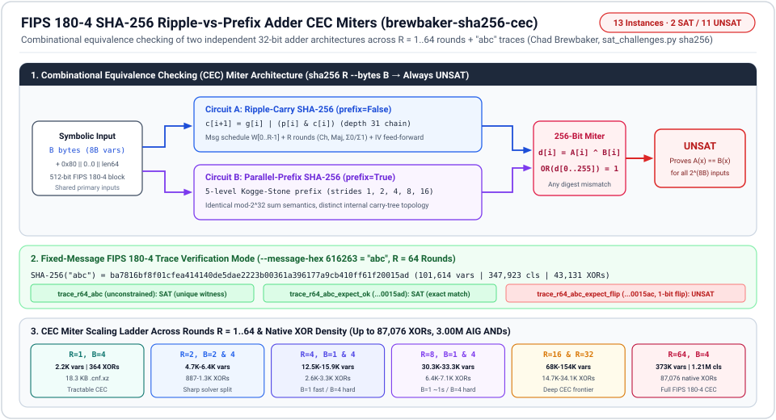

# FIPS 180-4 SHA-256 Ripple-vs-Prefix Adder CEC Miters (`brewbaker-sha256-cec`)

*Figure: Combinational Equivalence Checking (CEC) miter comparing 32-bit ripple-carry (`prefix=False`) against 5-level Kogge–Stone parallel-prefix (`prefix=True`) modular addition inside $R$-round FIPS 180-4 SHA-256, plus the 64-round `"abc"` trace verification mode (generated by [`src/gen_diagram.py`](src/gen_diagram.py)).*

## Provenance & Credit

- **Upstream Author & Generator:** **Chad Brewbaker** ([`chadbrewbaker`](https://github.com/chadbrewbaker)) — verbatim [`sat_challenges.py`](src/sat_challenges.py) from [GitHub Gist `6f055336fda6009d1e67e0da8c843d19`](https://gist.github.com/chadbrewbaker/6f055336fda6009d1e67e0da8c843d19).
- **Ground-Truth Manifest:** [`expected.tsv`](expected.tsv) records all **13 instances** (**2 SAT / 11 UNSAT**), verified mathematically and cross-checked with 0 disagreements across all 5 solvers (`10/10` SAT models verified clause-by-clause; `10` UNSAT instances formally certified via `drat-trim`, `lrat-check`, and `cake_lpr`).
- **Reproducibility:** Run `python3 src/generate_suite.py` to deterministically regenerate all 4 lossless `.xz` formats and `expected.tsv`, and `python3 src/gen_diagram.py` to regenerate [`diagram.svg`](diagram.svg).

## Problem Description

Implements the full NIST [FIPS 180-4](https://doi.org/10.6028/NIST.FIPS.180-4) SHA-256 compression function (standard one-block padding, standard IV, message schedule $W_0, \dots, W_{R-1}$, $R \in \{0, \dots, 64\}$ compression rounds with $\operatorname{Ch}, \operatorname{Maj}, \Sigma_0, \Sigma_1, \sigma_0, \sigma_1$, and final 8-word IV feed-forward) in two complementary SAT modes:

1. **Combinational Equivalence Checking (CEC) Miter Mode (`sha256 R --bytes B`):** Instantiates **two independent bit-blasted copies** of $R$-round SHA-256 over the same symbolic $B$-byte message ($8B$ primary inputs, remaining block bytes constant-folded): Circuit A uses a 32-bit **ripple-carry adder** ($c_{i+1} = g_i \lor (p_i \land c_i)$), while Circuit B uses a 5-level **parallel-prefix carry-lookahead adder** (strides `1, 2, 4, 8, 16`). A 256-bit XOR+OR miter asserts that at least one digest bit differs between Circuit A and Circuit B. Because ripple-carry and parallel-prefix addition compute the identical function $(x + y) \bmod 2^{32}$, **every CEC miter is mathematically UNSAT**.
2. **Fixed-Message Trace Verification Mode (`sha256 64 --message-hex 616263 [--expect ...]`):** Fixes the 3-byte NIST test message `"abc"` (`0x616263`) at full 64 rounds (`101,614` vars, `347,923` clauses, `43,131` native XORs), yielding unique **SAT** witness `ba7816bf8f01cfea414140de5dae2223b00361a396177a9cb410ff61f20015ad` (both unconstrained and with `--expect <valid>`), and **UNSAT** when `--expect` flips the least significant digest bit (`...0015ac`).
- **Extreme native XOR density:** Every 32-bit adder and $\Sigma$/$\sigma$ rotation emits exact 4-clause `xor2` blocks, collapsing into **364 to 87,076 native XOR parity equations** per instance in `xcnf-converted/` (and **287,298 total native XORs** across the 13 instances).

## Corpus & Data Sizes

All committed files are `xz`-compressed (`preset=6`), lossless, and well under GitHub's `95 MB` per-file limit (`aig-converted/` verified by `abc`, `anf-converted/` verified by [`../src/to_anf.py`](../src/to_anf.py) with `--verify`):

| Format | Directory | Files | Key Dimensions (Range) | Total Size | Max File |
|---|---|---:|---|---:|---:|
| **DIMACS CNF (origin)** | [`cnf-orig/`](cnf-orig/) | 13 | Vars: 2,173–373,491; Clauses: 6,786–1,207,452 | 7.17 MB | 2.73 MB |
| **Binary AIGER 1.9** | [`aig-converted/`](aig-converted/) | 13 | Inputs: 2,173–373,491; ANDs: 16,674–3,004,505 | 8.11 MB | 2.69 MB |
| **[CryptoMiniSat](https://github.com/msoos/cryptominisat) XCNF** | [`xcnf-converted/`](xcnf-converted/) | 13 | Total extracted native XORs: 287,298 | 5.06 MB | 2.06 MB |
| **DIMACS-ANF** | [`anf-converted/`](anf-converted/) | 13 | Vars: 2,232–373,744; Eqs: 5,753–946,477 (deg $\le 3$) | 7.23 MB | 2.98 MB |
| **Total (4 Formats)** | | **52** | **2 SAT / 11 UNSAT** | **27.58 MB** | **2.98 MB** |

### Complete Instance Inventory (`expected.tsv`)

| Instance | Expected | Vars | Clauses | Native XORs | `.cnf.xz` | `.aig.xz` | `.xcnf.xz` | `.anf.xz` |
|---|:---:|---:|---:|---:|---:|---:|---:|---:|
| `sha256_cec_r16_b4.cnf` | UNSAT | 67,997 | 218,612 | 14,718 | 498.2 KB | 534.2 KB | 375.1 KB | 506.9 KB |
| `sha256_cec_r1_b4.cnf` | UNSAT | 2,173 | 6,786 | 364 | 18.3 KB | 22.1 KB | 15.4 KB | 21.1 KB |
| `sha256_cec_r2_b2.cnf` | UNSAT | 4,667 | 14,839 | 887 | 37.5 KB | 46.8 KB | 31.1 KB | 42.5 KB |
| `sha256_cec_r2_b4.cnf` | UNSAT | 6,356 | 20,272 | 1,301 | 50.8 KB | 61.3 KB | 41.0 KB | 55.4 KB |
| `sha256_cec_r32_b4.cnf` | UNSAT | 154,313 | 496,952 | 34,110 | 1.11 MB | 1.19 MB | 888.9 KB | 1.19 MB |
| `sha256_cec_r4_b1.cnf` | UNSAT | 12,515 | 40,121 | 2,601 | 99.4 KB | 117.9 KB | 80.2 KB | 109.0 KB |
| `sha256_cec_r4_b4.cnf` | UNSAT | 15,887 | 50,874 | 3,310 | 123.2 KB | 143.4 KB | 98.4 KB | 135.5 KB |
| `sha256_cec_r64_b4.cnf` | UNSAT | 373,491 | 1,207,452 | 87,076 | 2.73 MB | 2.69 MB | 2.06 MB | 2.98 MB |
| `sha256_cec_r8_b1.cnf` | UNSAT | 30,317 | 97,364 | 6,438 | 227.3 KB | 259.9 KB | 175.4 KB | 239.6 KB |
| `sha256_cec_r8_b4.cnf` | UNSAT | 33,257 | 106,774 | 7,100 | 246.1 KB | 280.6 KB | 191.2 KB | 259.5 KB |
| `sha256_trace_r64_abc.cnf` | SAT | 101,614 | 347,923 | 43,131 | 704.8 KB | 929.4 KB | 395.9 KB | 584.0 KB |
| `sha256_trace_r64_abc_expect_flip.cnf` | UNSAT | 101,614 | 348,179 | 43,131 | 705.5 KB | 968.9 KB | 393.2 KB | 589.3 KB |
| `sha256_trace_r64_abc_expect_ok.cnf` | SAT | 101,614 | 348,179 | 43,131 | 705.5 KB | 968.9 KB | 393.4 KB | 586.6 KB |

### Sibling Collections (Chad Brewbaker's `sat_challenges.py`)

This directory is one of **7 single-problem-type collections** built from Chad Brewbaker's [`sat_challenges.py`](https://gist.github.com/chadbrewbaker/6f055336fda6009d1e67e0da8c843d19) (73 instances across 7 problem families, 292 compressed 4-format files):

| Collection | Problem Family | Instances |
|---|---|---:|
| [`brewbaker-tensor-matmul/`](../brewbaker-tensor-matmul/README.md) | Bilinear Matrix Multiplication Tensor Rank (`matmul`) | 10 (6 SAT / 4 UNSAT) |
| [`brewbaker-tensor-dot/`](../brewbaker-tensor-dot/README.md) | Bilinear Inner-Product Tensor Rank (`dot`) | 10 (5 SAT / 5 UNSAT) |
| [`brewbaker-tensor-cross/`](../brewbaker-tensor-cross/README.md) | Bilinear 3D Cross-Product Tensor Rank (`cross`) | 8 (4 SAT / 4 UNSAT) |
| [`brewbaker-sort-networks/`](../brewbaker-sort-networks/README.md) | Minimum-Comparator Sorting Networks (`sort`) | 8 (4 SAT / 4 UNSAT) |
| [`brewbaker-select-networks/`](../brewbaker-select-networks/README.md) | Fixed & Adaptive Selection Networks (`select`) | 12 (6 SAT / 6 UNSAT) |
| [`brewbaker-golomb-rulers/`](../brewbaker-golomb-rulers/README.md) | Optimal Golomb Rulers (`golomb`) | 12 (6 SAT / 6 UNSAT) |
| **`brewbaker-sha256-cec/`** *(this collection)* | FIPS 180-4 SHA-256 Ripple-vs-Prefix CEC Miters (`sha256`) | 13 (2 SAT / 11 UNSAT) |

## Benchmark Results

### Single-Core Flat DIMACS `.cnf` Comparison ($T_{\max} = 60\;\text{s}$)

- **Hardware & Isolation:** AMD Ryzen 9 5950X (16 physical cores / 32 threads, 64 MiB L3 cache, Linux x86_64), **strictly pinned to single physical core 9** (`taskset -c 9`), executed strictly sequentially (one single-threaded solver process at a time) on identical uncompressed flat `.cnf` inputs.
- **Solvers & Flags:** Frobenius (`--max-cores 1 --timeout 60`), [CaDiCaL](https://github.com/arminbiere/cadical) 3.1.0 (`-q --modelalllits=true -t 60`), [CryptoMiniSat](https://github.com/msoos/cryptominisat) 5.18.0 (`-t 1 --maxtime 60`), [dense-solver](https://github.com/libdense/dense-solver) 0.0.4 (1 thread, `timeout -k 2s 60.0s`), and [Kissat](https://github.com/arminbiere/kissat) 4.0.4 (`-q --time=60`).
- **Independent Verification:** **0 verdict disagreements** across all 5 solvers and [`expected.tsv`](expected.tsv); **10 / 10 SAT models** passed 100% raw-clause verification against every clause in `cnf-orig/`. PAR-2 scores each timeout as $2 \times T_{\max} = 120\;\text{s}$.

| Instance | Expected | Frobenius | [CaDiCaL](https://github.com/arminbiere/cadical) 3.1.0 | [CryptoMiniSat](https://github.com/msoos/cryptominisat) 5.18.0 | [dense-solver](https://github.com/libdense/dense-solver) 0.0.4 | [Kissat](https://github.com/arminbiere/kissat) 4.0.4 |
|---|:---:|---:|---:|---:|---:|---:|
| `sha256_cec_r16_b4.cnf` | UNSAT | **1.10 s** | >60 s *(T/O)* | >60 s *(T/O)* | >60 s *(T/O)* | >60 s *(T/O)* |
| `sha256_cec_r1_b4.cnf` | UNSAT | **40.9 ms** | 296.6 ms | 695.2 ms | 378.0 ms | 346.3 ms |
| `sha256_cec_r2_b2.cnf` | UNSAT | **14.4 ms** | 17.86 s | 14.64 s | >60 s *(T/O)* | 10.83 s |
| `sha256_cec_r2_b4.cnf` | UNSAT | **126.2 ms** | >60 s *(T/O)* | >60 s *(T/O)* | >60 s *(T/O)* | 26.01 s |
| `sha256_cec_r32_b4.cnf` | UNSAT | **2.73 s** | >60 s *(T/O)* | >60 s *(T/O)* | >60 s *(T/O)* | >60 s *(T/O)* |
| `sha256_cec_r4_b1.cnf` | UNSAT | **35.9 ms** | 275.3 ms | 1.27 s | 370.0 ms | 243.4 ms |
| `sha256_cec_r4_b4.cnf` | UNSAT | **317.7 ms** | >60 s *(T/O)* | >60 s *(T/O)* | >60 s *(T/O)* | >60 s *(T/O)* |
| `sha256_cec_r64_b4.cnf` | UNSAT | **6.38 s** | >60 s *(T/O)* | >60 s *(T/O)* | >60 s *(T/O)* | >60 s *(T/O)* |
| `sha256_cec_r8_b1.cnf` | UNSAT | 1.16 s | 1.07 s | 2.31 s | 1.42 s | **833.9 ms** |
| `sha256_cec_r8_b4.cnf` | UNSAT | **589.4 ms** | >60 s *(T/O)* | >60 s *(T/O)* | >60 s *(T/O)* | >60 s *(T/O)* |
| `sha256_trace_r64_abc.cnf` | SAT | 67.0 ms | 56.1 ms | 99.6 ms | 3.22 s | **33.3 ms** |
| `sha256_trace_r64_abc_expect_flip.cnf` | UNSAT | 26.0 ms | 48.5 ms | 59.0 ms | 3.26 s | **24.2 ms** |
| `sha256_trace_r64_abc_expect_ok.cnf` | SAT | 52.9 ms | 58.2 ms | 101.9 ms | 3.26 s | **32.4 ms** |
| **Solved ($T_{\max} = 60\;\text{s}$)** | **13** | **13/13 (2 SAT, 11 UNSAT)** | 7/13 (2 SAT, 5 UNSAT) | 7/13 (2 SAT, 5 UNSAT) | 6/13 (2 SAT, 4 UNSAT) | 8/13 (2 SAT, 6 UNSAT) |
| **Total PAR-2** | — | **12.64 s *(mean 0.97 s)*** | 739.66 s *(mean 56.90 s)* | 739.18 s *(mean 56.86 s)* | 851.91 s *(mean 65.53 s)* | 638.35 s *(mean 49.10 s)* |

### Four-Format Parity (Frobenius Across `.cnf`, `.aig`, `.xcnf`, `.anf`, Core 9)

Evaluated sequentially on physical core 9 (`taskset -c 9`) using uncompressed flat inputs in all 4 formats (same-build baseline four-format parity sweep). Every solved verdict agrees 100% across all four formats, and every SAT model emitted from `.aig`, `.xcnf`, or `.anf` passed 100% raw-clause verification when projected back onto the original DIMACS CNF variables.

| Instance | Expected | Native XORs | Frobenius (`.cnf`) | Frobenius (`.aig`) | Frobenius (`.xcnf`) | Frobenius (`.anf`) | [CryptoMiniSat](https://github.com/msoos/cryptominisat) 5.18.0 (`.xcnf`) |
|---|:---:|---:|---:|---:|---:|---:|---:|
| `sha256_cec_r16_b4.cnf` | UNSAT | 14,718 | >60 s | >15 s | >15 s | >15 s | >15 s |
| `sha256_cec_r1_b4.cnf` | UNSAT | 364 | 328.5 ms | 360.3 ms | 352.9 ms | 350.6 ms | 341.3 ms |
| `sha256_cec_r2_b2.cnf` | UNSAT | 887 | 13.0 ms | 28.36 s | 9.3 ms | 31.57 s | 16.44 s |
| `sha256_cec_r2_b4.cnf` | UNSAT | 1,301 | >60 s | >15 s | >15 s | >15 s | >15 s |
| `sha256_cec_r32_b4.cnf` | UNSAT | 34,110 | >60 s | >15 s | >15 s | >15 s | >15 s |
| `sha256_cec_r4_b1.cnf` | UNSAT | 2,601 | 15.8 ms | 310.3 ms | 16.5 ms | 348.1 ms | 815.7 ms |
| `sha256_cec_r4_b4.cnf` | UNSAT | 3,310 | >60 s | >15 s | >15 s | >15 s | >15 s |
| `sha256_cec_r64_b4.cnf` | UNSAT | 87,076 | >60 s | >15 s | >15 s | >15 s | >15 s |
| `sha256_cec_r8_b1.cnf` | UNSAT | 6,438 | 830.2 ms | 748.3 ms | 38.7 ms | 1.31 s | 3.97 s |
| `sha256_cec_r8_b4.cnf` | UNSAT | 7,100 | >60 s | >15 s | >15 s | >15 s | >15 s |
| `sha256_trace_r64_abc.cnf` | SAT | 43,131 | 42.1 ms | 147.2 ms | 132.3 ms | 114.1 ms | 112.3 ms |
| `sha256_trace_r64_abc_expect_flip.cnf` | UNSAT | 43,131 | 18.3 ms | 111.0 ms | 106.1 ms | 77.0 ms | 65.3 ms |
| `sha256_trace_r64_abc_expect_ok.cnf` | SAT | 43,131 | 42.8 ms | 138.9 ms | 138.8 ms | 108.6 ms | 111.3 ms |

### Independent UNSAT Proof Certification (10 Formally Verified)

**10 Frobenius UNSAT instances** in this collection were independently certified via direct LRAT (`lrat-check` + formally verified `cake_lpr` outputting `s VERIFIED UNSAT` + Frobenius `--check-proof`), including all multi-byte CEC miters through full 64-round `sha256_cec_r64_b4.cnf` (`104.95 MB` direct LRAT; the 5 baseline instances were additionally checked via DRAT / `drat-trim`):

| Instance | DRAT Size | `drat-trim` | LRAT Size | `lrat-check` | `cake_lpr` |
|---|---:|---|---:|---|---|
| `sha256_cec_r16_b4.cnf` | — *(direct LRAT)* | — | 15.12 MB | Verified (384.4 ms) | `s VERIFIED UNSAT` (855.1 ms) |
| `sha256_cec_r1_b4.cnf` | 4.37 MB | Verified (449.6 ms) | 10.72 MB | Verified (277.0 ms) | `s VERIFIED UNSAT` (649.9 ms) |
| `sha256_cec_r2_b2.cnf` | 26.78 MB | Verified (34.10 s) | 1096.15 MB | Verified (13878.2 ms) | `s VERIFIED UNSAT` (36304.5 ms) |
| `sha256_cec_r32_b4.cnf` | — *(direct LRAT)* | — | 39.40 MB | Verified (438.4 ms) | `s VERIFIED UNSAT` (1.27 s) |
| `sha256_cec_r4_b1.cnf` | 16.90 MB | Verified (3045.0 ms) | 12.45 MB | Verified (160.0 ms) | `s VERIFIED UNSAT` (405.4 ms) |
| `sha256_cec_r4_b4.cnf` | — *(direct LRAT)* | — | 2.98 MB | Verified (52.8 ms) | `s VERIFIED UNSAT` (111.2 ms) |
| `sha256_cec_r64_b4.cnf` | — *(direct LRAT)* | — | 104.95 MB | Verified (1.09 s) | `s VERIFIED UNSAT` (3.40 s) |
| `sha256_cec_r8_b1.cnf` | 40.13 MB | Verified (11551.3 ms) | 32.11 MB | Verified (384.6 ms) | `s VERIFIED UNSAT` (1516.8 ms) |
| `sha256_cec_r8_b4.cnf` | — *(direct LRAT)* | — | 7.12 MB | Verified (101.7 ms) | `s VERIFIED UNSAT` (254.3 ms) |
| `sha256_trace_r64_abc_expect_flip.cnf` | 7.42 MB | Verified (398.1 ms) | 3.44 MB | Verified (128.6 ms) | `s VERIFIED UNSAT` (391.0 ms) |

<!-- BEGIN_STRUCTURAL_ANALYSIS -->
## Phase-Transition & Structural Analysis

*Auto-generated by [`../src/analyze_benchmarks.py`](../src/analyze_benchmarks.py). Position relative to the critical phase transition is measured by $\rho_{\mathrm{crit}} = \frac{1}{n}\sum_k m_k / \alpha_c(k)$ (exact $\alpha/\alpha_c(k)$ for pure $k$-SAT; effective critical threshold $\alpha_c^{\mathrm{eff}} = \alpha/\rho_{\mathrm{crit}}$; `Under` $<0.90\times$, `Near-crit` $0.90\text{--}1.10\times$, `Over` $>1.10\times$), alongside Gent–Walsh annealed constrainedness $\kappa = -\frac{1}{n}\sum_i \log_2(1-2^{-k_i})$ (AAAI 1996), clause-length profile ($\bar{k}$, `%Bin`, `%Horn`), variable-degree CV ($\sigma_d/\bar{d}$, uniformity vs. hub skew), and extracted native XOR parity clauses.*

| Instance | Active $n$ | Clauses $m$ | $\alpha=m/n$ | $\alpha_c^{\mathrm{eff}}$ | $\rho_{\mathrm{crit}}$ (Regime) | $\kappa$ | $\bar{k}$ ($k_{\max}$) | Bin% | Horn% | Pos% | Deg CV | XORs |
|---|---:|---:|---:|---:|---:|---:|---:|---:|---:|---:|---:|---:|
| `sha256_cec_r16_b4` | 67,997 | 218,612 | 3.22 | 1.65 | **1.95x** (Over) | 0.97 | 2.51 (256) | 49% | 72% | 45% | 0.62 | 14,718 |
| `sha256_cec_r1_b4` | 2,173 | 6,786 | 3.12 | 1.57 | **1.98x** (Over) | 0.97 | 2.48 (62) | 52% | 72% | 45% | 0.61 | 364 |
| `sha256_cec_r2_b2` | 4,667 | 14,839 | 3.18 | 1.61 | **1.98x** (Over) | 0.97 | 2.50 (94) | 51% | 73% | 45% | 0.69 | 887 |
| `sha256_cec_r2_b4` | 6,356 | 20,272 | 3.19 | 1.63 | **1.96x** (Over) | 0.97 | 2.51 (125) | 50% | 71% | 45% | 0.64 | 1,301 |
| `sha256_cec_r32_b4` | 154,313 | 496,952 | 3.22 | 1.65 | **1.95x** (Over) | 0.97 | 2.52 (256) | 48% | 72% | 45% | 0.63 | 34,110 |
| `sha256_cec_r4_b1` | 12,515 | 40,121 | 3.21 | 1.63 | **1.96x** (Over) | 0.97 | 2.51 (206) | 49% | 72% | 45% | 0.73 | 2,601 |
| `sha256_cec_r4_b4` | 15,887 | 50,874 | 3.20 | 1.63 | **1.96x** (Over) | 0.97 | 2.51 (254) | 49% | 71% | 45% | 0.66 | 3,310 |
| `sha256_cec_r64_b4` | 373,491 | 1,207,452 | 3.23 | 1.67 | **1.93x** (Over) | 0.96 | 2.53 (256) | 47% | 71% | 45% | 0.65 | 87,076 |
| `sha256_cec_r8_b1` | 30,317 | 97,364 | 3.21 | 1.64 | **1.96x** (Over) | 0.97 | 2.51 (256) | 49% | 72% | 45% | 0.67 | 6,438 |
| `sha256_cec_r8_b4` | 33,257 | 106,774 | 3.21 | 1.64 | **1.96x** (Over) | 0.97 | 2.51 (256) | 49% | 71% | 45% | 0.64 | 7,100 |
| `sha256_trace_r64_abc` | 101,614 | 347,923 | 3.42 | 2.03 | **1.68x** (Over) | 0.92 | 2.66 (3) | 34% | 61% | 47% | 0.69 | 43,131 |
| `sha256_trace_r64_abc_expect_flip` | 101,614 | 348,179 | 3.43 | 2.03 | **1.69x** (Over) | 0.92 | 2.66 (3) | 34% | 61% | 47% | 0.69 | 43,131 |
| `sha256_trace_r64_abc_expect_ok` | 101,614 | 348,179 | 3.43 | 2.03 | **1.69x** (Over) | 0.92 | 2.66 (3) | 34% | 61% | 47% | 0.69 | 43,131 |

**Collection Phase-Transition Summary (13 instances, 4 formats: 13 CNF / 13 AIG / 13 XCNF / 13 ANF):** median $\rho_{\mathrm{crit}} = 1.96\times$ (range `1.68x–1.98x`), median $\kappa = 0.97$, regime split **0 Under / 0 Near-critical / 13 Over**, total extracted native XOR parity clauses = **287,298**, total ANF equations = **2,444,424**.
<!-- END_STRUCTURAL_ANALYSIS -->

## References

- Chad Brewbaker ([`chadbrewbaker`](https://github.com/chadbrewbaker)), *SAT challenge problem generator (`sat_challenges.py`)*, [GitHub Gist `6f055336...`](https://gist.github.com/chadbrewbaker/6f055336fda6009d1e67e0da8c843d19).
- National Institute of Standards and Technology (NIST), *Secure Hash Standard (SHS)*, FIPS PUB 180-4, [doi:10.6028/NIST.FIPS.180-4](https://doi.org/10.6028/NIST.FIPS.180-4), 2015.
- P. M. Kogge and H. S. Stone, *A Parallel Algorithm for the Efficient Solution of a General Class of Recurrence Equations*, *IEEE Trans. Computers* C-22(8):786–793, 1973.
- A. Biere, T. Faller, K. Fazekas, M. Fleury, N. Froleyks, and F. Pollitt, *[CaDiCaL](https://github.com/arminbiere/cadical) 2.0 / [Kissat](https://github.com/arminbiere/kissat) 4.0*, CAV 2024.
- M. Soos, K. Nohl, and C. Castelluccia, *Extending SAT Solvers to Cryptographic Problems ([CryptoMiniSat](https://github.com/msoos/cryptominisat))*, SAT 2009.
- Y. K. Tan, M. J. H. Heule, and M. O. Myreen, *cake_lpr: Verified Propagation Redundancy Checking in CakeML*, TACAS 2021.
