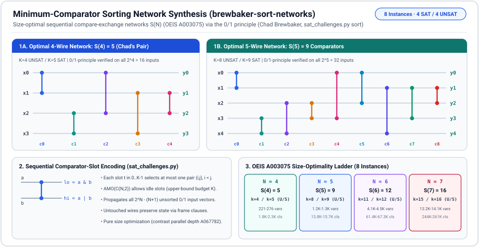

# Minimum-Comparator Sorting Network Synthesis (`brewbaker-sort-networks`)

*Figure: Independently 0/1-principle-verified size-optimal sorting networks for $N=4$ ($S(4)=5$ comparators) and $N=5$ ($S(5)=9$ comparators), the sequential-slot `cmp[t,i,j]` encoding, and the 8-instance OEIS A003075 size-optimality ladder (generated by [`src/gen_diagram.py`](src/gen_diagram.py)).*

## Provenance & Credit

- **Upstream Author & Generator:** **Chad Brewbaker** ([`chadbrewbaker`](https://github.com/chadbrewbaker)) — verbatim [`sat_challenges.py`](src/sat_challenges.py) from [GitHub Gist `6f055336fda6009d1e67e0da8c843d19`](https://gist.github.com/chadbrewbaker/6f055336fda6009d1e67e0da8c843d19).
- **Ground-Truth Manifest:** [`expected.tsv`](expected.tsv) records all **8 instances** (**4 SAT / 4 UNSAT**), verified mathematically and cross-checked with 0 disagreements across all 5 solvers (`20/20` SAT models verified clause-by-clause; `2` tractable UNSAT instances formally certified via `drat-trim`, `lrat-check`, and `cake_lpr`).
- **Reproducibility:** Run `python3 src/generate_suite.py` to deterministically regenerate all 4 lossless `.xz` formats and `expected.tsv`, and `python3 src/gen_diagram.py` to regenerate [`diagram.svg`](diagram.svg).

## Problem Description

Given $N$ input wires and a sequential budget of $K$ compare-exchange gates $(i, j)$ with $0 \le i < j < N$ (mapping $(x_i, x_j) \mapsto (\min(x_i, x_j), \max(x_i, x_j))$), determine whether an $N$-wire sorting network of size at most $K$ exists. By Knuth's **0/1 principle**, a comparator network sorts all permutations of arbitrary keys if and only if it sorts all $2^N$ Boolean vectors in $\lbrace 0, 1\rbrace^N$ (omitting the $N+1$ already-sorted vectors).

- **Exact optimal comparator counts $S(N)$ ([OEIS A003075](https://oeis.org/A003075), Floyd & Knuth 1966; Knuth TAOCP Vol. 3 §5.3.4):**
  - $S(4) = 5$ (`sort_n4_k4` UNSAT / `sort_n4_k5` SAT — Chad Brewbaker's exact reference pair).
  - $S(5) = 9$ (`sort_n5_k8` UNSAT / `sort_n5_k9` SAT).
  - $S(6) = 12$ (`sort_n6_k11` UNSAT / `sort_n6_k12` SAT).
  - $S(7) = 16$ (`sort_n7_k15` UNSAT / `sort_n7_k16` SAT).
- **Pure size optimization (contrast with parallel depth):** Unlike [`../guillochon-oeis-a067782-sortnet/`](../guillochon-oeis-a067782-sortnet/README.md) (which minimizes parallel *depth* with fixed first layer and adjacent last layer), `sat_challenges.py sort N K` encodes **unrestricted sequential comparator count** with one `at_most_one` selector group `cmp[t,i,j]` per slot $t \in \lbrace 0, \dots, K-1\rbrace$ (allowing idle slots so $K$ is a strict upper bound) and zero symmetry breaking.

## Corpus & Data Sizes

All committed files are `xz`-compressed (`preset=6`), lossless, and well under GitHub's `95 MB` per-file limit (`aig-converted/` verified by `abc`, `anf-converted/` verified by [`../src/to_anf.py`](../src/to_anf.py) with `--verify`):

| Format | Directory | Files | Key Dimensions (Range) | Total Size | Max File |
|---|---|---:|---|---:|---:|
| **DIMACS CNF (origin)** | [`cnf-orig/`](cnf-orig/) | 8 | Vars: 221–14,097; Clauses: 1,757–260,897 | 1.26 MB | 496.4 KB |
| **Binary AIGER 1.9** | [`aig-converted/`](aig-converted/) | 8 | Inputs: 221–14,097; ANDs: 5,103–759,792 | 1.89 MB | 776.3 KB |
| **[CryptoMiniSat](https://github.com/msoos/cryptominisat) XCNF** | [`xcnf-converted/`](xcnf-converted/) | 8 | Total extracted native XORs: 0 | 1.26 MB | 494.2 KB |
| **DIMACS-ANF** | [`anf-converted/`](anf-converted/) | 8 | Vars: 1,189–219,057; Eqs: 2,725–465,857 (deg $\le 3$) | 4.09 MB | 1.57 MB |
| **Total (4 Formats)** | | **32** | **4 SAT / 4 UNSAT** | **8.49 MB** | **1.57 MB** |

### Complete Instance Inventory (`expected.tsv`)

| Instance | Expected | Vars | Clauses | Native XORs | `.cnf.xz` | `.aig.xz` | `.xcnf.xz` | `.anf.xz` |
|---|:---:|---:|---:|---:|---:|---:|---:|---:|
| `sort_n4_k4.cnf` | UNSAT | 221 | 1,757 | 0 | 4.3 KB | 7.5 KB | 4.4 KB | 11.0 KB |
| `sort_n4_k5.cnf` | SAT | 276 | 2,255 | 0 | 4.7 KB | 9.7 KB | 4.8 KB | 14.7 KB |
| `sort_n5_k8.cnf` | UNSAT | 1,193 | 13,849 | 0 | 23.3 KB | 43.5 KB | 22.5 KB | 82.0 KB |
| `sort_n5_k9.cnf` | SAT | 1,342 | 15,695 | 0 | 34.7 KB | 51.6 KB | 34.5 KB | 99.8 KB |
| `sort_n6_k11.cnf` | UNSAT | 4,082 | 61,396 | 0 | 126.5 KB | 180.8 KB | 126.1 KB | 428.5 KB |
| `sort_n6_k12.cnf` | SAT | 4,453 | 67,251 | 0 | 135.7 KB | 198.1 KB | 135.1 KB | 454.4 KB |
| `sort_n7_k15.cnf` | UNSAT | 13,216 | 244,038 | 0 | 462.8 KB | 776.3 KB | 465.5 KB | 1.45 MB |
| `sort_n7_k16.cnf` | SAT | 14,097 | 260,897 | 0 | 496.4 KB | 666.2 KB | 494.2 KB | 1.57 MB |

### Sibling Collections (Chad Brewbaker's `sat_challenges.py`)

This directory is one of **7 single-problem-type collections** built from Chad Brewbaker's [`sat_challenges.py`](https://gist.github.com/chadbrewbaker/6f055336fda6009d1e67e0da8c843d19) (73 instances across 7 problem families, 292 compressed 4-format files):

| Collection | Problem Family | Instances |
|---|---|---:|
| [`brewbaker-tensor-matmul/`](../brewbaker-tensor-matmul/README.md) | Bilinear Matrix Multiplication Tensor Rank (`matmul`) | 10 (6 SAT / 4 UNSAT) |
| [`brewbaker-tensor-dot/`](../brewbaker-tensor-dot/README.md) | Bilinear Inner-Product Tensor Rank (`dot`) | 10 (5 SAT / 5 UNSAT) |
| [`brewbaker-tensor-cross/`](../brewbaker-tensor-cross/README.md) | Bilinear 3D Cross-Product Tensor Rank (`cross`) | 8 (4 SAT / 4 UNSAT) |
| **`brewbaker-sort-networks/`** *(this collection)* | Minimum-Comparator Sorting Networks (`sort`) | 8 (4 SAT / 4 UNSAT) |
| [`brewbaker-select-networks/`](../brewbaker-select-networks/README.md) | Fixed & Adaptive Selection Networks (`select`) | 12 (6 SAT / 6 UNSAT) |
| [`brewbaker-golomb-rulers/`](../brewbaker-golomb-rulers/README.md) | Optimal Golomb Rulers (`golomb`) | 12 (6 SAT / 6 UNSAT) |
| [`brewbaker-sha256-cec/`](../brewbaker-sha256-cec/README.md) | FIPS 180-4 SHA-256 Ripple-vs-Prefix CEC Miters (`sha256`) | 13 (2 SAT / 11 UNSAT) |

## Benchmark Results

### Single-Core Flat DIMACS `.cnf` Comparison ($T_{\max} = 60\text{ s}$)

- **Hardware & Isolation:** AMD Ryzen 9 5950X (16 physical cores / 32 threads, 64 MiB L3 cache, Linux x86_64), **strictly pinned to a single physical core** (`taskset -c 8` for Frobenius 1C, median of 3 runs for `< 5 s`; `taskset -c 9` for competitor baselines), executed strictly sequentially (one single-threaded solver process at a time) on identical uncompressed flat `.cnf` inputs.
- **Solvers & Flags:** Frobenius (`--max-cores 1 --timeout 60`), [CaDiCaL](https://github.com/arminbiere/cadical) 3.1.0 (`-q --modelalllits=true -t 60`), [CryptoMiniSat](https://github.com/msoos/cryptominisat) 5.18.0 (`-t 1 --maxtime 60`), [dense-solver](https://github.com/libdense/dense-solver) 0.0.4 (1 thread, `timeout -k 2s 60.0s`), and [Kissat](https://github.com/arminbiere/kissat) 4.0.4 (`-q --time=60`).
- **Independent Verification:** **0 verdict disagreements** across all 5 solvers and [`expected.tsv`](expected.tsv); **20 / 20 SAT models** passed 100% raw-clause verification against every clause in `cnf-orig/`. PAR-2 scores each timeout as $2 \times T_{\max} = 120\text{ s}$.

| Instance | Expected | Frobenius 1C | [CaDiCaL](https://github.com/arminbiere/cadical) 3.1.0 | [CryptoMiniSat](https://github.com/msoos/cryptominisat) 5.18.0 | [dense-solver](https://github.com/libdense/dense-solver) 0.0.4 | [Kissat](https://github.com/arminbiere/kissat) 4.0.4 |
|---|:---:|---:|---:|---:|---:|---:|
| `sort_n4_k4.cnf` | UNSAT | **3.50 ms** | 4.4 ms | 61.8 ms | 3.8 ms | 22.0 ms |
| `sort_n4_k5.cnf` | SAT | 4.91 ms | 6.3 ms | 77.7 ms | **4.9 ms** | 25.1 ms |
| `sort_n5_k8.cnf` | UNSAT | **46.55 ms** | 1.58 s | 1.40 s | 3.88 s | 2.32 s |
| `sort_n5_k9.cnf` | SAT | 18.35 ms | 41.2 ms | 388.6 ms | **14.3 ms** | 67.7 ms |
| `sort_n6_k11.cnf` | UNSAT | **67.02 ms** | >60 s *(T/O)* | >60 s *(T/O)* | >60 s *(T/O)* | >60 s *(T/O)* |
| `sort_n6_k12.cnf` | SAT | **77.89 ms** | 830.0 ms | 864.5 ms | 163.6 ms | 4.40 s |
| `sort_n7_k15.cnf` | UNSAT | **277.48 ms** | >60 s *(T/O)* | >60 s *(T/O)* | >60 s *(T/O)* | >60 s *(T/O)* |
| `sort_n7_k16.cnf` | SAT | **306.47 ms** | 23.17 s | 6.65 s | 37.57 s | 29.71 s |
| **Solved ($T_{\max} = 60\text{ s}$)** | — | **8 / 8** *(highest)* | 6 / 8 *(-2 worse)* | 6 / 8 *(-2 worse)* | 6 / 8 *(-2 worse)* | 6 / 8 *(-2 worse)* |
| **Total PAR-2** | — | **802.17 ms** *(fastest)* | 265.62 s *(331.13x slower)* | 249.44 s *(310.96x slower)* | 281.63 s *(351.09x slower)* | 276.55 s *(344.75x slower)* |

### Four-Format Parity (Frobenius Across `.cnf`, `.aig`, `.xcnf`, `.anf`, Core 9)

Evaluated sequentially on physical core 9 (`taskset -c 9`) using uncompressed flat inputs in all 4 formats (same-build baseline four-format parity sweep). Every solved verdict agrees 100% across all four formats, and every SAT model emitted from `.aig`, `.xcnf`, or `.anf` passed 100% raw-clause verification when projected back onto the original DIMACS CNF variables.

| Instance | Expected | Frobenius 1C (`.cnf`) | Frobenius 1C (`.aig`) | Frobenius 1C (`.xcnf`) | Frobenius 1C (`.anf`) |
|---|:---:|---:|---:|---:|---:|
| `sort_n4_k4.cnf` | UNSAT | 5.7 ms | 6.0 ms | **5.5 ms** | 6.3 ms |
| `sort_n4_k5.cnf` | SAT | 6.4 ms | 6.9 ms | **6.2 ms** | 8.0 ms |
| `sort_n5_k8.cnf` | UNSAT | **1.11 s** | 1.12 s | 1.12 s | 1.12 s |
| `sort_n5_k9.cnf` | SAT | 45.3 ms | 46.6 ms | **43.8 ms** | 56.0 ms |
| `sort_n6_k12.cnf` | SAT | **256.0 ms** | 268.3 ms | 285.0 ms | 301.1 ms |
| `sort_n7_k16.cnf` | SAT | 12.53 s | 12.04 s | 11.73 s | **11.70 s** |

### Independent UNSAT Proof Certification (2 / 2 Formally Verified)

The baseline UNSAT proofs for `sort_n4_k4.cnf` and `sort_n5_k8.cnf` were independently certified via both DRAT (`drat-trim`) and direct LRAT (`lrat-check` + formally verified `cake_lpr` outputting `s VERIFIED UNSAT`) on core 9 (`taskset -c 9`):

| Instance | DRAT Size | `drat-trim` | LRAT Size | `lrat-check` | `cake_lpr` |
|---|---:|---|---:|---|---|
| `sort_n4_k4.cnf` | 90.9 KB | Verified (59.2 ms) | 37.1 KB | Verified (19.4 ms) | `s VERIFIED UNSAT` (5.3 ms) |
| `sort_n5_k8.cnf` | 6.54 MB | Verified (1829.8 ms) | 33.57 MB | Verified (487.8 ms) | `s VERIFIED UNSAT` (1167.5 ms) |

<!-- BEGIN_STRUCTURAL_ANALYSIS -->
## Phase-Transition & Structural Analysis

*Auto-generated by [`../src/analyze_benchmarks.py`](../src/analyze_benchmarks.py). Position relative to the critical phase transition is measured by $\rho_{\mathrm{crit}} = \frac{1}{n}\sum_k m_k / \alpha_c(k)$ (exact $\alpha/\alpha_c(k)$ for pure $k$-SAT; effective critical threshold $\alpha_c^{\mathrm{eff}} = \alpha/\rho_{\mathrm{crit}}$; `Under` $<0.90\times$, `Near-crit` $0.90\text{--}1.10\times$, `Over` $>1.10\times$), alongside Gent–Walsh annealed constrainedness $\kappa = -\frac{1}{n}\sum_i \log_2(1-2^{-k_i})$ (AAAI 1996), clause-length profile ($\bar{k}$, `%Bin`, `%Horn`), variable-degree CV ($\sigma_d/\bar{d}$, uniformity vs. hub skew), and extracted native XOR parity clauses.*

| Instance | Active $n$ | Clauses $m$ | $\alpha=m/n$ | $\alpha_c^{\mathrm{eff}}$ | $\rho_{\mathrm{crit}}$ (Regime) | $\kappa$ | $\bar{k}$ ($k_{\max}$) | Bin% | Horn% | Pos% | Deg CV | XORs |
|---|---:|---:|---:|---:|---:|---:|---:|---:|---:|---:|---:|---:|
| `sort_n4_k4` | 221 | 1,757 | 7.95 | 3.49 | **2.28x** (Over) | 1.54 | 3.38 (5) | 12% | 71% | 46% | 0.99 | 0 |
| `sort_n4_k5` | 276 | 2,255 | 8.17 | 3.78 | **2.16x** (Over) | 1.50 | 3.42 (5) | 10% | 71% | 46% | 0.97 | 0 |
| `sort_n5_k8` | 1,193 | 13,849 | 11.61 | 4.47 | **2.60x** (Over) | 1.90 | 3.60 (6) | 6% | 73% | 46% | 1.35 | 0 |
| `sort_n5_k9` | 1,342 | 15,695 | 11.70 | 4.58 | **2.55x** (Over) | 1.89 | 3.61 (6) | 6% | 73% | 46% | 1.34 | 0 |
| `sort_n6_k11` | 4,082 | 61,396 | 15.04 | 4.82 | **3.12x** (Over) | 2.37 | 3.69 (7) | 4% | 74% | 46% | 1.84 | 0 |
| `sort_n6_k12` | 4,453 | 67,251 | 15.10 | 4.89 | **3.09x** (Over) | 2.36 | 3.69 (7) | 4% | 74% | 46% | 1.84 | 0 |
| `sort_n7_k15` | 13,216 | 244,038 | 18.47 | 5.05 | **3.66x** (Over) | 2.85 | 3.75 (8) | 3% | 76% | 46% | 2.49 | 0 |
| `sort_n7_k16` | 14,097 | 260,897 | 18.51 | 5.09 | **3.64x** (Over) | 2.85 | 3.75 (8) | 3% | 76% | 46% | 2.48 | 0 |

**Collection Phase-Transition Summary (8 instances, 4 formats: 8 CNF / 8 AIG / 8 XCNF / 8 ANF):** median $\rho_{\mathrm{crit}} = 2.84\times$ (range `2.16x–3.66x`), median $\kappa = 2.13$, regime split **0 Under / 0 Near-critical / 8 Over**, total extracted native XOR parity clauses = **0**, total ANF equations = **1,181,300**.
<!-- END_STRUCTURAL_ANALYSIS -->

## References

- Chad Brewbaker ([`chadbrewbaker`](https://github.com/chadbrewbaker)), *SAT challenge problem generator (`sat_challenges.py`)*, [GitHub Gist `6f055336...`](https://gist.github.com/chadbrewbaker/6f055336fda6009d1e67e0da8c843d19).
- D. E. Knuth, *The Art of Computer Programming*, Vol. 3: *Sorting and Searching*, Section 5.3.4 (*Networks for Sorting*), Addison-Wesley, 1998 ([OEIS A003075](https://oeis.org/A003075)).
- M. Codish, L. Cruz-Filipe, M. Frank, and P. Schneider-Kamp, *Twenty-Five Comparators is Optimal when Sorting Nine Inputs (and Twenty-Nine for Ten)*, ICTAI 2014 / *J. Comput. Syst. Sci.* 2016.
- A. Biere, T. Faller, K. Fazekas, M. Fleury, N. Froleyks, and F. Pollitt, *[CaDiCaL](https://github.com/arminbiere/cadical) 2.0 / [Kissat](https://github.com/arminbiere/kissat) 4.0*, CAV 2024.
- M. Soos, K. Nohl, and C. Castelluccia, *Extending SAT Solvers to Cryptographic Problems ([CryptoMiniSat](https://github.com/msoos/cryptominisat))*, SAT 2009.
- Y. K. Tan, M. J. H. Heule, and M. O. Myreen, *cake_lpr: Verified Propagation Redundancy Checking in CakeML*, TACAS 2021.
