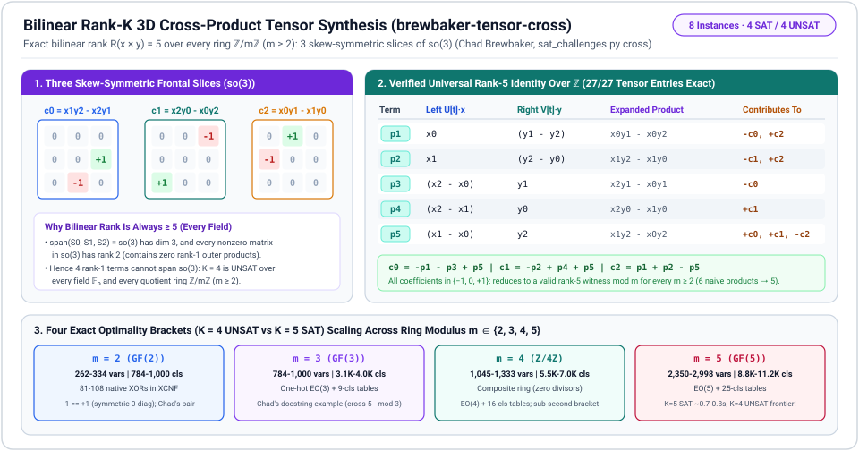

# Bilinear Rank-$K$ 3D Cross-Product Tensor Synthesis (`brewbaker-tensor-cross`)

*Figure: Three skew-symmetric $3\times 3$ frontal slices of the 3D vector cross product $x \times y$, an independently verified 5-product bilinear identity with coefficients in $\lbrace -1, 0, +1\rbrace$ (valid over $\mathbb{Z}$ and every $\mathbb{Z}/m\mathbb{Z}$), and the 4-modulus optimality ladder (generated by [`src/gen_diagram.py`](src/gen_diagram.py)).*

## Provenance & Credit

- **Upstream Author & Generator:** **Chad Brewbaker** ([`chadbrewbaker`](https://github.com/chadbrewbaker)) — verbatim [`sat_challenges.py`](src/sat_challenges.py) from [GitHub Gist `6f055336fda6009d1e67e0da8c843d19`](https://gist.github.com/chadbrewbaker/6f055336fda6009d1e67e0da8c843d19).
- **Ground-Truth Manifest:** [`expected.tsv`](expected.tsv) records all **8 instances** (**4 SAT / 4 UNSAT**), verified mathematically and cross-checked with 0 disagreements across all 5 solvers (`20/20` SAT models verified clause-by-clause; `3` tractable UNSAT instances formally certified via `drat-trim`, `lrat-check`, and `cake_lpr`).
- **Reproducibility:** Run `python3 src/generate_suite.py` to deterministically regenerate all 4 lossless `.xz` formats and `expected.tsv`, and `python3 src/gen_diagram.py` to regenerate [`diagram.svg`](diagram.svg).

## Problem Description

The 3D vector cross product $(x \times y)_o = x_{(o+1)\bmod 3} y_{(o+2)\bmod 3} - x_{(o+2)\bmod 3} y_{(o+1)\bmod 3}$ over $\mathbb{Z}/m\mathbb{Z}$ has $3 \times 3 \times 3$ tensor $T_{i,j,o} = \varepsilon_{ijo}$ (the Levi-Civita symbol), whose three frontal slices $S_0, S_1, S_2$ form a basis of the 3-dimensional Lie algebra $\mathfrak{so}(3)$ of $3\times 3$ skew-symmetric matrices (over $\mathbb{F}_2$, $-1 \equiv +1$, yielding symmetric zero-diagonal matrices of even rank).

- **Exact universal bilinear rank $R(x \times y) = 5$ over every ring $\mathbb{Z}/m\mathbb{Z}$ ($m \ge 2$):**
  - **Lower bound ($K = 4$ UNSAT):** Over any prime field $\mathbb{F}_p$ ($p \mid m$), every nonzero matrix in $\operatorname{span}(S_0, S_1, S_2)$ has rank 2 (none has rank 1). If 4 rank-1 outer products $u_t v_t^\top$ spanned $\mathfrak{so}(3)$, any nonzero vector $w \perp u_1, u_2$ would satisfy $w^\top M \in \operatorname{span}(v_3^\top, v_4^\top) = w^\perp$ (dim 2), forcing a nonzero $M \in \mathfrak{so}(3) \cap \operatorname{span}(u_3 v_3^\top, u_4 v_4^\top)$ to obey $Mw = 0$ and by skew-symmetry $w^\top M = 0$, a contradiction (Brockett & Dobkin 1978; Grigoriev 1978).
  - **Upper bound ($K = 5$ SAT):** Reducing the 6 naive multiplications to 5 works universally over $\mathbb{Z}$ (and therefore every $\mathbb{Z}/m\mathbb{Z}$) via $p_1 = x_0(y_1 - y_2)$, $p_2 = x_1(y_2 - y_0)$, $p_3 = (x_2 - x_0)y_1$, $p_4 = (x_2 - x_1)y_0$, $p_5 = (x_1 - x_0)y_2$, giving $c_0 = -p_1 - p_3 + p_5$, $c_1 = -p_2 + p_4 + p_5$, $c_2 = p_1 + p_2 - p_5$.
- **Scaling across ring modulus $m \in \lbrace 2, 3, 4, 5\rbrace$:** Holding the exact combinatorial problem fixed while scaling $m$ sweeps from 262 variables with 81–108 native XORs ($m=2$) up to 2,998 one-hot variables and 11,224 clauses ($m=5$), where `cross_k4_m5` becomes a clean UNSAT frontier.

## Corpus & Data Sizes

All committed files are `xz`-compressed (`preset=6`), lossless, and well under GitHub's `95 MB` per-file limit (`aig-converted/` verified by `abc`, `anf-converted/` verified by [`../src/to_anf.py`](../src/to_anf.py) with `--verify`):

| Format | Directory | Files | Key Dimensions (Range) | Total Size | Max File |
|---|---|---:|---|---:|---:|
| **DIMACS CNF (origin)** | [`cnf-orig/`](cnf-orig/) | 8 | Vars: 262–2,998; Clauses: 784–11,224 | 78.0 KB | 22.5 KB |
| **Binary AIGER 1.9** | [`aig-converted/`](aig-converted/) | 8 | Inputs: 262–2,998; ANDs: 2,007–30,618 | 126.0 KB | 30.3 KB |
| **[CryptoMiniSat](https://github.com/msoos/cryptominisat) XCNF** | [`xcnf-converted/`](xcnf-converted/) | 8 | Total extracted native XORs: 189 | 76.0 KB | 22.6 KB |
| **DIMACS-ANF** | [`anf-converted/`](anf-converted/) | 8 | Vars: 262–3,664; Eqs: 541–11,890 (deg $\le 3$) | 124.8 KB | 36.1 KB |
| **Total (4 Formats)** | | **32** | **4 SAT / 4 UNSAT** | **404.8 KB** | **36.1 KB** |

### Complete Instance Inventory (`expected.tsv`)

| Instance | Expected | Vars | Clauses | Native XORs | `.cnf.xz` | `.aig.xz` | `.xcnf.xz` | `.anf.xz` |
|---|:---:|---:|---:|---:|---:|---:|---:|---:|
| `cross_k4_m2.cnf` | UNSAT | 262 | 784 | 81 | 2.2 KB | 3.4 KB | 1.5 KB | 1.9 KB |
| `cross_k4_m3.cnf` | UNSAT | 784 | 3,097 | 0 | 6.0 KB | 11.5 KB | 5.8 KB | 9.3 KB |
| `cross_k4_m4.cnf` | UNSAT | 1,045 | 5,455 | 0 | 5.6 KB | 18.1 KB | 5.5 KB | 15.5 KB |
| `cross_k4_m5.cnf` | UNSAT | 2,350 | 8,785 | 0 | 18.0 KB | 26.1 KB | 17.9 KB | 28.4 KB |
| `cross_k5_m2.cnf` | SAT | 334 | 1,000 | 108 | 2.9 KB | 4.2 KB | 2.0 KB | 2.4 KB |
| `cross_k5_m3.cnf` | SAT | 1,000 | 3,952 | 0 | 8.7 KB | 10.6 KB | 8.4 KB | 11.4 KB |
| `cross_k5_m4.cnf` | SAT | 1,333 | 6,967 | 0 | 12.2 KB | 21.9 KB | 12.2 KB | 19.8 KB |
| `cross_k5_m5.cnf` | SAT | 2,998 | 11,224 | 0 | 22.5 KB | 30.3 KB | 22.6 KB | 36.1 KB |

### Sibling Collections (Chad Brewbaker's `sat_challenges.py`)

This directory is one of **7 single-problem-type collections** built from Chad Brewbaker's [`sat_challenges.py`](https://gist.github.com/chadbrewbaker/6f055336fda6009d1e67e0da8c843d19) (73 instances across 7 problem families, 292 compressed 4-format files):

| Collection | Problem Family | Instances |
|---|---|---:|
| [`brewbaker-tensor-matmul/`](../brewbaker-tensor-matmul/README.md) | Bilinear Matrix Multiplication Tensor Rank (`matmul`) | 10 (6 SAT / 4 UNSAT) |
| [`brewbaker-tensor-dot/`](../brewbaker-tensor-dot/README.md) | Bilinear Inner-Product Tensor Rank (`dot`) | 10 (5 SAT / 5 UNSAT) |
| **`brewbaker-tensor-cross/`** *(this collection)* | Bilinear 3D Cross-Product Tensor Rank (`cross`) | 8 (4 SAT / 4 UNSAT) |
| [`brewbaker-sort-networks/`](../brewbaker-sort-networks/README.md) | Minimum-Comparator Sorting Networks (`sort`) | 8 (4 SAT / 4 UNSAT) |
| [`brewbaker-select-networks/`](../brewbaker-select-networks/README.md) | Fixed & Adaptive Selection Networks (`select`) | 12 (6 SAT / 6 UNSAT) |
| [`brewbaker-golomb-rulers/`](../brewbaker-golomb-rulers/README.md) | Optimal Golomb Rulers (`golomb`) | 12 (6 SAT / 6 UNSAT) |
| [`brewbaker-sha256-cec/`](../brewbaker-sha256-cec/README.md) | FIPS 180-4 SHA-256 Ripple-vs-Prefix CEC Miters (`sha256`) | 13 (2 SAT / 11 UNSAT) |

## Benchmark Results

### Single-Core Flat DIMACS `.cnf` Comparison ($T_{\max} = 60\text{ s}$)

- **Hardware & Isolation:** AMD Ryzen 9 5950X (16 physical cores / 32 threads, 64 MiB L3 cache, Linux x86_64), **strictly pinned to single physical core 9** (`taskset -c 9`), executed strictly sequentially (one single-threaded solver process at a time) on identical uncompressed flat `.cnf` inputs.
- **Solvers & Flags:** Frobenius (`--max-cores 1 --timeout 60`), [CaDiCaL](https://github.com/arminbiere/cadical) 3.1.0 (`-q --modelalllits=true -t 60`), [CryptoMiniSat](https://github.com/msoos/cryptominisat) 5.18.0 (`-t 1 --maxtime 60`), [dense-solver](https://github.com/libdense/dense-solver) 0.0.4 (1 thread, `timeout -k 2s 60.0s`), and [Kissat](https://github.com/arminbiere/kissat) 4.0.4 (`-q --time=60`).
- **Independent Verification:** **0 verdict disagreements** across all 5 solvers and [`expected.tsv`](expected.tsv); **20 / 20 SAT models** passed 100% raw-clause verification against every clause in `cnf-orig/`. PAR-2 scores each timeout as $2 \times T_{\max} = 120\text{ s}$.

| Instance | Expected | Frobenius 1C | [CaDiCaL](https://github.com/arminbiere/cadical) 3.1.0 | [CryptoMiniSat](https://github.com/msoos/cryptominisat) 5.18.0 | [dense-solver](https://github.com/libdense/dense-solver) 0.0.4 | [Kissat](https://github.com/arminbiere/kissat) 4.0.4 |
|---|:---:|---:|---:|---:|---:|---:|
| `cross_k4_m2.cnf` | UNSAT | **2.8 ms** | 22.0 ms | 41.2 ms | 14.5 ms | 19.1 ms |
| `cross_k4_m3.cnf` | UNSAT | **35.4 ms** | 24.31 s | 7.45 s | 46.38 s | 1.62 s |
| `cross_k4_m4.cnf` | UNSAT | **42.4 ms** | 4.58 s | 6.25 s | 4.96 s | 507.2 ms |
| `cross_k4_m5.cnf` | UNSAT | **44.0 ms** | >60 s *(T/O)* | >60 s *(T/O)* | >60 s *(T/O)* | >60 s *(T/O)* |
| `cross_k5_m2.cnf` | SAT | 4.3 ms | 4.5 ms | 25.7 ms | **3.5 ms** | 8.6 ms |
| `cross_k5_m3.cnf` | SAT | 20.2 ms | **17.1 ms** | 120.8 ms | 101.3 ms | 37.1 ms |
| `cross_k5_m4.cnf` | SAT | **54.1 ms** | 158.7 ms | 625.9 ms | 215.3 ms | 336.8 ms |
| `cross_k5_m5.cnf` | SAT | **105.3 ms** | 280.7 ms | 481.6 ms | 1.77 s | 692.2 ms |
| **Solved ($T_{\max} = 60\text{ s}$)** | — | **8 / 8** *(highest)* | 7 / 8 *(-1 worse)* | 7 / 8 *(-1 worse)* | 7 / 8 *(-1 worse)* | 7 / 8 *(-1 worse)* |
| **Total PAR-2** | — | **308.6 ms** *(fastest)* | 149.37 s *(484x slower)* | 135.00 s *(437x slower)* | 173.44 s *(562x slower)* | 123.22 s *(399x slower)* |

### Four-Format Parity (Frobenius Across `.cnf`, `.aig`, `.xcnf`, `.anf`, Core 9)

Evaluated sequentially on physical core 9 (`taskset -c 9`) using uncompressed flat inputs in all 4 formats (same-build baseline four-format parity sweep). Every solved verdict agrees 100% across all four formats, and every SAT model emitted from `.aig`, `.xcnf`, or `.anf` passed 100% raw-clause verification when projected back onto the original DIMACS CNF variables.

| Instance | Expected | Native XORs | Frobenius 1C (`.cnf`) | Frobenius 1C (`.aig`) | Frobenius 1C (`.xcnf`) | Frobenius 1C (`.anf`) | [CryptoMiniSat](https://github.com/msoos/cryptominisat) 5.18.0 (`.xcnf`) |
|---|:---:|---:|---:|---:|---:|---:|---:|
| `cross_k4_m2.cnf` | UNSAT | 81 | 17.0 ms | 16.7 ms | 18.0 ms | **12.2 ms** | 41.7 ms |
| `cross_k4_m3.cnf` | UNSAT | 0 | 7.81 s | 7.60 s | 7.65 s | **7.53 s** | — |
| `cross_k4_m4.cnf` | UNSAT | 0 | 419.7 ms | **418.7 ms** | 462.0 ms | 437.7 ms | — |
| `cross_k5_m2.cnf` | SAT | 108 | 23.3 ms | 22.8 ms | 26.0 ms | **8.0 ms** | 23.6 ms |
| `cross_k5_m3.cnf` | SAT | 0 | **32.7 ms** | 33.7 ms | 33.1 ms | 34.3 ms | — |
| `cross_k5_m4.cnf` | SAT | 0 | **411.9 ms** | 415.6 ms | 417.7 ms | 428.3 ms | — |
| `cross_k5_m5.cnf` | SAT | 0 | 767.7 ms | 773.8 ms | **765.1 ms** | 778.7 ms | — |

### Independent UNSAT Proof Certification (3 / 3 Formally Verified)

All **3 tractable Frobenius UNSAT instances** ($< 30\text{ s}$) in this collection were independently certified via both DRAT (`drat-trim`) and direct LRAT (`lrat-check` + formally verified `cake_lpr` outputting `s VERIFIED UNSAT`) on core 9 (`taskset -c 9`):

| Instance | DRAT Size | `drat-trim` | LRAT Size | `lrat-check` | `cake_lpr` |
|---|---:|---|---:|---|---|
| `cross_k4_m2.cnf` | 98.7 KB | Verified (61.9 ms) | 279.0 KB | Verified (22.8 ms) | `s VERIFIED UNSAT` (12.1 ms) |
| `cross_k4_m3.cnf` | 36.11 MB | Verified (4447.7 ms) | 63.38 MB | Verified (883.3 ms) | `s VERIFIED UNSAT` (2220.5 ms) |
| `cross_k4_m4.cnf` | 19.14 MB | Verified (3119.9 ms) | 39.99 MB | Verified (549.3 ms) | `s VERIFIED UNSAT` (1405.8 ms) |

<!-- BEGIN_STRUCTURAL_ANALYSIS -->
## Phase-Transition & Structural Analysis

*Auto-generated by [`../src/analyze_benchmarks.py`](../src/analyze_benchmarks.py). Position relative to the critical phase transition is measured by $\rho_{\mathrm{crit}} = \frac{1}{n}\sum_k m_k / \alpha_c(k)$ (exact $\alpha/\alpha_c(k)$ for pure $k$-SAT; effective critical threshold $\alpha_c^{\mathrm{eff}} = \alpha/\rho_{\mathrm{crit}}$; `Under` $<0.90\times$, `Near-crit` $0.90\text{--}1.10\times$, `Over` $>1.10\times$), alongside Gent–Walsh annealed constrainedness $\kappa = -\frac{1}{n}\sum_i \log_2(1-2^{-k_i})$ (AAAI 1996), clause-length profile ($\bar{k}$, `%Bin`, `%Horn`), variable-degree CV ($\sigma_d/\bar{d}$, uniformity vs. hub skew), and extracted native XOR parity clauses.*

| Instance | Active $n$ | Clauses $m$ | $\alpha=m/n$ | $\alpha_c^{\mathrm{eff}}$ | $\rho_{\mathrm{crit}}$ (Regime) | $\kappa$ | $\bar{k}$ ($k_{\max}$) | Bin% | Horn% | Pos% | Deg CV | XORs |
|---|---:|---:|---:|---:|---:|---:|---:|---:|---:|---:|---:|---:|
| `cross_k4_m2` | 262 | 784 | 2.99 | 1.84 | **1.62x** (Over) | 0.91 | 2.56 (3) | 37% | 69% | 46% | 0.33 | 81 |
| `cross_k4_m3` | 784 | 3,097 | 3.95 | 2.30 | **1.72x** (Over) | 1.01 | 2.73 (3) | 25% | 92% | 34% | 0.46 | 0 |
| `cross_k4_m4` | 1,045 | 5,455 | 5.22 | 2.21 | **2.36x** (Over) | 1.34 | 2.75 (4) | 29% | 95% | 31% | 0.47 | 0 |
| `cross_k4_m5` | 2,350 | 8,785 | 3.74 | 2.08 | **1.80x** (Over) | 0.99 | 2.73 (5) | 33% | 97% | 37% | 0.84 | 0 |
| `cross_k5_m2` | 334 | 1,000 | 2.99 | 1.88 | **1.59x** (Over) | 0.88 | 2.58 (3) | 36% | 68% | 46% | 0.32 | 108 |
| `cross_k5_m3` | 1,000 | 3,952 | 3.95 | 2.31 | **1.71x** (Over) | 1.01 | 2.73 (3) | 25% | 92% | 34% | 0.45 | 0 |
| `cross_k5_m4` | 1,333 | 6,967 | 5.23 | 2.22 | **2.36x** (Over) | 1.33 | 2.75 (4) | 29% | 95% | 31% | 0.46 | 0 |
| `cross_k5_m5` | 2,998 | 11,224 | 3.74 | 2.08 | **1.80x** (Over) | 0.98 | 2.73 (5) | 33% | 97% | 37% | 0.83 | 0 |

**Collection Phase-Transition Summary (8 instances, 4 formats: 8 CNF / 8 AIG / 8 XCNF / 8 ANF):** median $\rho_{\mathrm{crit}} = 1.76\times$ (range `1.59x–2.36x`), median $\kappa = 1.00$, regime split **0 Under / 0 Near-critical / 8 Over**, total extracted native XOR parity clauses = **189**, total ANF equations = **42,479**.
<!-- END_STRUCTURAL_ANALYSIS -->

## References

- Chad Brewbaker ([`chadbrewbaker`](https://github.com/chadbrewbaker)), *SAT challenge problem generator (`sat_challenges.py`)*, [GitHub Gist `6f055336...`](https://gist.github.com/chadbrewbaker/6f055336fda6009d1e67e0da8c843d19).
- R. W. Brockett and D. Dobkin, *On the Optimal Evaluation of a Set of Bilinear Forms*, *Linear Algebra and Its Applications* 19(3):207–235, 1978.
- M. J. H. Heule, M. Kauers, and M. Seidl, *Local Search for Fast Matrix Multiplication*, [arXiv:1903.11391](https://arxiv.org/abs/1903.11391).
- A. Biere, T. Faller, K. Fazekas, M. Fleury, N. Froleyks, and F. Pollitt, *[CaDiCaL](https://github.com/arminbiere/cadical) 2.0 / [Kissat](https://github.com/arminbiere/kissat) 4.0*, CAV 2024.
- M. Soos, K. Nohl, and C. Castelluccia, *Extending SAT Solvers to Cryptographic Problems ([CryptoMiniSat](https://github.com/msoos/cryptominisat))*, SAT 2009.
- Y. K. Tan, M. J. H. Heule, and M. O. Myreen, *cake_lpr: Verified Propagation Redundancy Checking in CakeML*, TACAS 2021.
