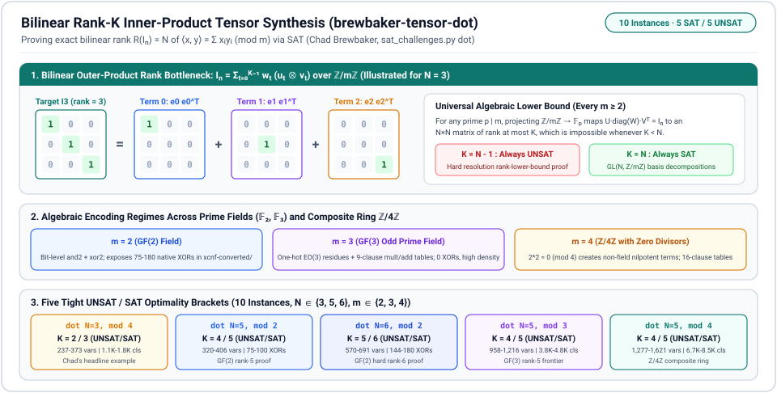

# Bilinear Rank-$K$ Inner-Product Tensor Synthesis (`brewbaker-tensor-dot`)

*Figure: Bilinear outer-product decomposition of the identity tensor $I_N = \sum_{t=0}^{K-1} w_t (u_t \otimes v_t)$ over $\mathbb{Z}/m\mathbb{Z}$, illustrating why $K = N-1$ is universally UNSAT and $K = N$ is SAT across prime fields $\mathbb{F}_2, \mathbb{F}_3$ and composite ring $\mathbb{Z}/4\mathbb{Z}$ (generated by [`src/gen_diagram.py`](src/gen_diagram.py)).*

## Provenance & Credit

- **Upstream Author & Generator:** **Chad Brewbaker** ([`chadbrewbaker`](https://github.com/chadbrewbaker)) — verbatim [`sat_challenges.py`](src/sat_challenges.py) from [GitHub Gist `6f055336fda6009d1e67e0da8c843d19`](https://gist.github.com/chadbrewbaker/6f055336fda6009d1e67e0da8c843d19).
- **Ground-Truth Manifest:** [`expected.tsv`](expected.tsv) records all **10 instances** (**5 SAT / 5 UNSAT**), verified mathematically and cross-checked with 0 disagreements across all 5 solvers (`25/25` SAT models verified clause-by-clause; `4` tractable UNSAT instances formally certified via `drat-trim`, `lrat-check`, and `cake_lpr`).
- **Reproducibility:** Run `python3 src/generate_suite.py` to deterministically regenerate all 4 lossless `.xz` formats and `expected.tsv`, and `python3 src/gen_diagram.py` to regenerate [`diagram.svg`](diagram.svg).

## Problem Description

Given vector dimension $N \ge 1$, product budget $K$, and modulus $m \ge 2$, the scalar inner product $\langle x, y \rangle = \sum_{i=0}^{N-1} x_i y_i \pmod{m}$ has bilinear tensor $T_{i,j,0} = \delta_{ij}$ (the $N \times N$ identity matrix $I_N$). A rank-$K$ bilinear factorization requires vectors $u_t, v_t \in (\mathbb{Z}/m\mathbb{Z})^N$ and scalars $w_t \in \mathbb{Z}/m\mathbb{Z}$ ($0 \le t < K$) satisfying:

$$\sum_{t=0}^{K-1} w_t \, u_{t,i} \, v_{t,j} \equiv \delta_{ij} \pmod{m} \qquad \forall\, 0 \le i, j < N.$$

- **Universal exact rank theorem:** For every $m \ge 2$, pick any prime divisor $p \mid m$; reducing modulo $p$ maps $U^\top \operatorname{diag}(w) V = I_N$ into $\mathbb{F}_p^{N \times N}$, whose rank is at most $K$. Hence $K = N - 1$ is **provably UNSAT** and $K = N$ is **provably SAT** (attained by standard basis vectors or any invertible change of basis in $\operatorname{GL}_N(\mathbb{Z}/m\mathbb{Z})$).
- **Algebraic hardness for SAT solvers:** Although the lower bound $\operatorname{rank}(I_N) = N$ is a one-line theorem of linear algebra, proving UNSAT via propositional resolution over bit-blasted `and2`/`xor2` ($m=2$) or one-hot ring tables ($m \in \{3, 4\}$, including nilpotent zero divisors $2 \cdot 2 \equiv 0 \pmod 4$) produces sharply scaling algebraic refutation benchmarks from milliseconds (`N=3, mod 4`) to tens of seconds (`N=6, mod 2` and `N=5, mod 3`).

## Corpus & Data Sizes

All committed files are `xz`-compressed (`preset=6`), lossless, and well under GitHub's `95 MB` per-file limit (`aig-converted/` verified by `abc`, `anf-converted/` verified by [`../src/to_anf.py`](../src/to_anf.py) with `--verify`):

| Format | Directory | Files | Key Dimensions (Range) | Total Size | Max File |
|---|---|---:|---|---:|---:|
| **DIMACS CNF (origin)** | [`cnf-orig/`](cnf-orig/) | 10 | Vars: 237–1,621; Clauses: 926–8,461 | 67.3 KB | 14.9 KB |
| **Binary AIGER 1.9** | [`aig-converted/`](aig-converted/) | 10 | Inputs: 237–1,621; ANDs: 2,325–23,305 | 109.6 KB | 25.4 KB |
| **[CryptoMiniSat](https://github.com/msoos/cryptominisat) XCNF** | [`xcnf-converted/`](xcnf-converted/) | 10 | Total extracted native XORs: 499 | 62.2 KB | 14.8 KB |
| **DIMACS-ANF** | [`anf-converted/`](anf-converted/) | 10 | Vars: 296–2,026; Eqs: 701–8,866 (deg $\le 3$) | 91.5 KB | 24.1 KB |
| **Total (4 Formats)** | | **40** | **5 SAT / 5 UNSAT** | **330.6 KB** | **25.4 KB** |

### Complete Instance Inventory (`expected.tsv`)

| Instance | Expected | Vars | Clauses | Native XORs | `.cnf.xz` | `.aig.xz` | `.xcnf.xz` | `.anf.xz` |
|---|:---:|---:|---:|---:|---:|---:|---:|---:|
| `dot_n3_k2_m4.cnf` | UNSAT | 237 | 1,143 | 0 | 2.4 KB | 4.5 KB | 2.4 KB | 3.7 KB |
| `dot_n3_k3_m4.cnf` | SAT | 373 | 1,813 | 0 | 3.7 KB | 7.2 KB | 3.7 KB | 5.4 KB |
| `dot_n5_k4_m2.cnf` | UNSAT | 320 | 926 | 75 | 2.7 KB | 3.6 KB | 2.0 KB | 2.5 KB |
| `dot_n5_k4_m3.cnf` | UNSAT | 958 | 3,777 | 0 | 8.3 KB | 13.2 KB | 8.1 KB | 11.0 KB |
| `dot_n5_k4_m4.cnf` | UNSAT | 1,277 | 6,659 | 0 | 12.0 KB | 21.4 KB | 11.8 KB | 19.1 KB |
| `dot_n5_k5_m2.cnf` | SAT | 406 | 1,176 | 100 | 3.1 KB | 4.5 KB | 2.3 KB | 2.9 KB |
| `dot_n5_k5_m3.cnf` | SAT | 1,216 | 4,796 | 0 | 10.5 KB | 16.1 KB | 10.2 KB | 14.4 KB |
| `dot_n5_k5_m4.cnf` | SAT | 1,621 | 8,461 | 0 | 14.9 KB | 25.4 KB | 14.8 KB | 24.1 KB |
| `dot_n6_k5_m2.cnf` | UNSAT | 570 | 1,693 | 144 | 4.4 KB | 6.3 KB | 3.1 KB | 3.9 KB |
| `dot_n6_k6_m2.cnf` | SAT | 691 | 2,053 | 180 | 5.3 KB | 7.4 KB | 3.8 KB | 4.5 KB |

### Sibling Collections (Chad Brewbaker's `sat_challenges.py`)

This directory is one of **7 single-problem-type collections** built from Chad Brewbaker's [`sat_challenges.py`](https://gist.github.com/chadbrewbaker/6f055336fda6009d1e67e0da8c843d19) (73 instances across 7 problem families, 292 compressed 4-format files):

| Collection | Problem Family | Instances |
|---|---|---:|
| [`brewbaker-tensor-matmul/`](../brewbaker-tensor-matmul/README.md) | Bilinear Matrix Multiplication Tensor Rank (`matmul`) | 10 (6 SAT / 4 UNSAT) |
| **`brewbaker-tensor-dot/`** *(this collection)* | Bilinear Inner-Product Tensor Rank (`dot`) | 10 (5 SAT / 5 UNSAT) |
| [`brewbaker-tensor-cross/`](../brewbaker-tensor-cross/README.md) | Bilinear 3D Cross-Product Tensor Rank (`cross`) | 8 (4 SAT / 4 UNSAT) |
| [`brewbaker-sort-networks/`](../brewbaker-sort-networks/README.md) | Minimum-Comparator Sorting Networks (`sort`) | 8 (4 SAT / 4 UNSAT) |
| [`brewbaker-select-networks/`](../brewbaker-select-networks/README.md) | Fixed & Adaptive Selection Networks (`select`) | 12 (6 SAT / 6 UNSAT) |
| [`brewbaker-golomb-rulers/`](../brewbaker-golomb-rulers/README.md) | Optimal Golomb Rulers (`golomb`) | 12 (6 SAT / 6 UNSAT) |
| [`brewbaker-sha256-cec/`](../brewbaker-sha256-cec/README.md) | FIPS 180-4 SHA-256 Ripple-vs-Prefix CEC Miters (`sha256`) | 13 (2 SAT / 11 UNSAT) |

## Benchmark Results

### Single-Core Flat DIMACS `.cnf` Comparison ($T_{\max} = 60\;\text{s}$)

- **Hardware & Isolation:** AMD Ryzen 9 5950X (16 physical cores / 32 threads, 64 MiB L3 cache, Linux x86_64), **strictly pinned to single physical core 9** (`taskset -c 9`), executed strictly sequentially (one single-threaded solver process at a time) on identical uncompressed flat `.cnf` inputs.
- **Solvers & Flags:** Frobenius (`--max-cores 1 --timeout 60`), [CaDiCaL](https://github.com/arminbiere/cadical) 3.1.0 (`-q --modelalllits=true -t 60`), [CryptoMiniSat](https://github.com/msoos/cryptominisat) 5.18.0 (`-t 1 --maxtime 60`), [dense-solver](https://github.com/libdense/dense-solver) 0.0.4 (1 thread, `timeout -k 2s 60.0s`), and [Kissat](https://github.com/arminbiere/kissat) 4.0.4 (`-q --time=60`).
- **Independent Verification:** **0 verdict disagreements** across all 5 solvers and [`expected.tsv`](expected.tsv); **25 / 25 SAT models** passed 100% raw-clause verification against every clause in `cnf-orig/`. PAR-2 scores each timeout as $2 \times T_{\max} = 120\;\text{s}$.

| Instance | Expected | Frobenius | [CaDiCaL](https://github.com/arminbiere/cadical) 3.1.0 | [CryptoMiniSat](https://github.com/msoos/cryptominisat) 5.18.0 | [dense-solver](https://github.com/libdense/dense-solver) 0.0.4 | [Kissat](https://github.com/arminbiere/kissat) 4.0.4 |
|---|:---:|---:|---:|---:|---:|---:|
| `dot_n3_k2_m4.cnf` | UNSAT | 6.1 ms | 6.2 ms | 41.7 ms | **5.8 ms** | 17.9 ms |
| `dot_n3_k3_m4.cnf` | SAT | 3.6 ms | 4.4 ms | 47.7 ms | **3.5 ms** | 25.2 ms |
| `dot_n5_k4_m2.cnf` | UNSAT | **16.6 ms** | 56.0 ms | 71.8 ms | 29.4 ms | 96.6 ms |
| `dot_n5_k4_m3.cnf` | UNSAT | 13.82 s | 34.70 s | 20.41 s | >60 s *(T/O)* | **8.85 s** |
| `dot_n5_k4_m4.cnf` | UNSAT | **290.9 ms** | 41.95 s | >60 s *(T/O)* | >60 s *(T/O)* | 1.09 s |
| `dot_n5_k5_m2.cnf` | SAT | 19.8 ms | 10.0 ms | 65.8 ms | **4.6 ms** | 5.1 ms |
| `dot_n5_k5_m3.cnf` | SAT | **11.0 ms** | 30.3 ms | 253.8 ms | 12.1 ms | 51.6 ms |
| `dot_n5_k5_m4.cnf` | SAT | **16.6 ms** | 78.0 ms | 275.9 ms | 325.0 ms | 119.0 ms |
| `dot_n6_k5_m2.cnf` | UNSAT | **196.2 ms** | 4.52 s | 6.65 s | 23.06 s | 4.66 s |
| `dot_n6_k6_m2.cnf` | SAT | 22.3 ms | 3.6 ms | 72.9 ms | 4.4 ms | **2.3 ms** |
| **Solved ($T_{\max} = 60\;\text{s}$)** | **10** | **10/10 (5 SAT, 5 UNSAT)** | **10/10 (5 SAT, 5 UNSAT)** | 9/10 (5 SAT, 4 UNSAT) | 8/10 (5 SAT, 3 UNSAT) | **10/10 (5 SAT, 5 UNSAT)** |
| **Total PAR-2** | — | **14.40 s *(mean 1.44 s)*** | 81.36 s *(mean 8.14 s)* | 147.89 s *(mean 14.79 s)* | 263.45 s *(mean 26.34 s)* | 14.91 s *(mean 1.49 s)* |

### Four-Format Parity (Frobenius Across `.cnf`, `.aig`, `.xcnf`, `.anf`, Core 9)

Evaluated sequentially on physical core 9 (`taskset -c 9`) using uncompressed flat inputs in all 4 formats (same-build baseline four-format parity sweep). Every solved verdict agrees 100% across all four formats, and every SAT model emitted from `.aig`, `.xcnf`, or `.anf` passed 100% raw-clause verification when projected back onto the original DIMACS CNF variables.

| Instance | Expected | Native XORs | Frobenius (`.cnf`) | Frobenius (`.aig`) | Frobenius (`.xcnf`) | Frobenius (`.anf`) | [CryptoMiniSat](https://github.com/msoos/cryptominisat) 5.18.0 (`.xcnf`) |
|---|:---:|---:|---:|---:|---:|---:|---:|
| `dot_n3_k2_m4.cnf` | UNSAT | 0 | 11.3 ms | 10.8 ms | 10.8 ms | 10.6 ms | — |
| `dot_n3_k3_m4.cnf` | SAT | 0 | 8.8 ms | 8.8 ms | 8.4 ms | 8.9 ms | — |
| `dot_n5_k4_m2.cnf` | UNSAT | 75 | 42.7 ms | 42.1 ms | 42.1 ms | 53.7 ms | 114.2 ms |
| `dot_n5_k4_m3.cnf` | UNSAT | 0 | 13.46 s | 13.43 s | 13.31 s | 13.48 s | — |
| `dot_n5_k4_m4.cnf` | UNSAT | 0 | 441.5 ms | 440.0 ms | 444.3 ms | 444.5 ms | — |
| `dot_n5_k5_m2.cnf` | SAT | 100 | 10.1 ms | 5.0 ms | 4.6 ms | 4.9 ms | 20.0 ms |
| `dot_n5_k5_m3.cnf` | SAT | 0 | 35.3 ms | 26.8 ms | 26.1 ms | 27.9 ms | — |
| `dot_n5_k5_m4.cnf` | SAT | 0 | 485.3 ms | 365.3 ms | 349.4 ms | 365.2 ms | — |
| `dot_n6_k5_m2.cnf` | UNSAT | 144 | 11.87 s | 11.55 s | 11.49 s | 6.91 s | 18.36 s |
| `dot_n6_k6_m2.cnf` | SAT | 180 | 5.2 ms | 5.5 ms | 4.8 ms | 7.5 ms | 44.5 ms |

### Independent UNSAT Proof Certification (4 / 4 Formally Verified)

All **4 tractable Frobenius UNSAT instances** ($< 30\;\text{s}$) in this collection were independently certified via both DRAT (`drat-trim`) and direct LRAT (`lrat-check` + formally verified `cake_lpr` outputting `s VERIFIED UNSAT`) on core 9 (`taskset -c 9`):

| Instance | DRAT Size | `drat-trim` | LRAT Size | `lrat-check` | `cake_lpr` |
|---|---:|---|---:|---|---|
| `dot_n3_k2_m4.cnf` | 58.9 KB | Verified (57.8 ms) | 79.3 KB | Verified (19.8 ms) | `s VERIFIED UNSAT` (5.9 ms) |
| `dot_n5_k4_m2.cnf` | 909.3 KB | Verified (148.3 ms) | 1.82 MB | Verified (39.2 ms) | `s VERIFIED UNSAT` (57.1 ms) |
| `dot_n5_k4_m3.cnf` | 156.25 MB | Verified (41084.9 ms) | 289.17 MB | Verified (3956.4 ms) | `s VERIFIED UNSAT` (10218.0 ms) |
| `dot_n6_k5_m2.cnf` | 26.95 MB | Verified (3115.2 ms) | 66.07 MB | Verified (795.2 ms) | `s VERIFIED UNSAT` (2029.0 ms) |

<!-- BEGIN_STRUCTURAL_ANALYSIS -->
## Phase-Transition & Structural Analysis

*Auto-generated by [`../src/analyze_benchmarks.py`](../src/analyze_benchmarks.py). Position relative to the critical phase transition is measured by $\rho_{\mathrm{crit}} = \frac{1}{n}\sum_k m_k / \alpha_c(k)$ (exact $\alpha/\alpha_c(k)$ for pure $k$-SAT; effective critical threshold $\alpha_c^{\mathrm{eff}} = \alpha/\rho_{\mathrm{crit}}$; `Under` $<0.90\times$, `Near-crit` $0.90\text{--}1.10\times$, `Over` $>1.10\times$), alongside Gent–Walsh annealed constrainedness $\kappa = -\frac{1}{n}\sum_i \log_2(1-2^{-k_i})$ (AAAI 1996), clause-length profile ($\bar{k}$, `%Bin`, `%Horn`), variable-degree CV ($\sigma_d/\bar{d}$, uniformity vs. hub skew), and extracted native XOR parity clauses.*

| Instance | Active $n$ | Clauses $m$ | $\alpha=m/n$ | $\alpha_c^{\mathrm{eff}}$ | $\rho_{\mathrm{crit}}$ (Regime) | $\kappa$ | $\bar{k}$ ($k_{\max}$) | Bin% | Horn% | Pos% | Deg CV | XORs |
|---|---:|---:|---:|---:|---:|---:|---:|---:|---:|---:|---:|---:|
| `dot_n3_k2_m4` | 237 | 1,143 | 4.82 | 2.12 | **2.27x** (Over) | 1.27 | 2.72 (4) | 31% | 95% | 31% | 0.45 | 0 |
| `dot_n3_k3_m4` | 373 | 1,813 | 4.86 | 2.14 | **2.27x** (Over) | 1.27 | 2.73 (4) | 31% | 95% | 31% | 0.42 | 0 |
| `dot_n5_k4_m2` | 320 | 926 | 2.89 | 1.70 | **1.70x** (Over) | 0.90 | 2.51 (3) | 43% | 76% | 45% | 0.70 | 75 |
| `dot_n5_k4_m3` | 958 | 3,777 | 3.94 | 2.31 | **1.71x** (Over) | 1.00 | 2.73 (3) | 25% | 92% | 34% | 0.77 | 0 |
| `dot_n5_k4_m4` | 1,277 | 6,659 | 5.21 | 2.22 | **2.35x** (Over) | 1.33 | 2.75 (4) | 29% | 95% | 31% | 0.77 | 0 |
| `dot_n5_k5_m2` | 406 | 1,176 | 2.90 | 1.73 | **1.67x** (Over) | 0.88 | 2.53 (3) | 43% | 74% | 46% | 0.69 | 100 |
| `dot_n5_k5_m3` | 1,216 | 4,796 | 3.94 | 2.31 | **1.71x** (Over) | 1.00 | 2.74 (3) | 25% | 92% | 33% | 0.76 | 0 |
| `dot_n5_k5_m4` | 1,621 | 8,461 | 5.22 | 2.22 | **2.35x** (Over) | 1.33 | 2.75 (4) | 29% | 95% | 31% | 0.77 | 0 |
| `dot_n6_k5_m2` | 570 | 1,693 | 2.97 | 1.73 | **1.71x** (Over) | 0.91 | 2.53 (3) | 43% | 74% | 46% | 0.85 | 144 |
| `dot_n6_k6_m2` | 691 | 2,053 | 2.97 | 1.75 | **1.69x** (Over) | 0.89 | 2.54 (3) | 42% | 74% | 46% | 0.84 | 180 |

**Collection Phase-Transition Summary (10 instances, 4 formats: 10 CNF / 10 AIG / 10 XCNF / 10 ANF):** median $\rho_{\mathrm{crit}} = 1.71\times$ (range `1.67x–2.35x`), median $\kappa = 1.00$, regime split **0 Under / 0 Near-critical / 10 Over**, total extracted native XOR parity clauses = **499**, total ANF equations = **31,876**.
<!-- END_STRUCTURAL_ANALYSIS -->

## References

- Chad Brewbaker ([`chadbrewbaker`](https://github.com/chadbrewbaker)), *SAT challenge problem generator (`sat_challenges.py`)*, [GitHub Gist `6f055336...`](https://gist.github.com/chadbrewbaker/6f055336fda6009d1e67e0da8c843d19).
- P. Bürgisser, M. Clausen, and M. A. Shokrollahi, *Algebraic Complexity Theory*, Springer, 1997.
- M. J. H. Heule, M. Kauers, and M. Seidl, *Local Search for Fast Matrix Multiplication*, [arXiv:1903.11391](https://arxiv.org/abs/1903.11391).
- A. Biere, T. Faller, K. Fazekas, M. Fleury, N. Froleyks, and F. Pollitt, *[CaDiCaL](https://github.com/arminbiere/cadical) 2.0 / [Kissat](https://github.com/arminbiere/kissat) 4.0*, CAV 2024.
- M. Soos, K. Nohl, and C. Castelluccia, *Extending SAT Solvers to Cryptographic Problems ([CryptoMiniSat](https://github.com/msoos/cryptominisat))*, SAT 2009.
- Y. K. Tan, M. J. H. Heule, and M. O. Myreen, *cake_lpr: Verified Propagation Redundancy Checking in CakeML*, TACAS 2021.
