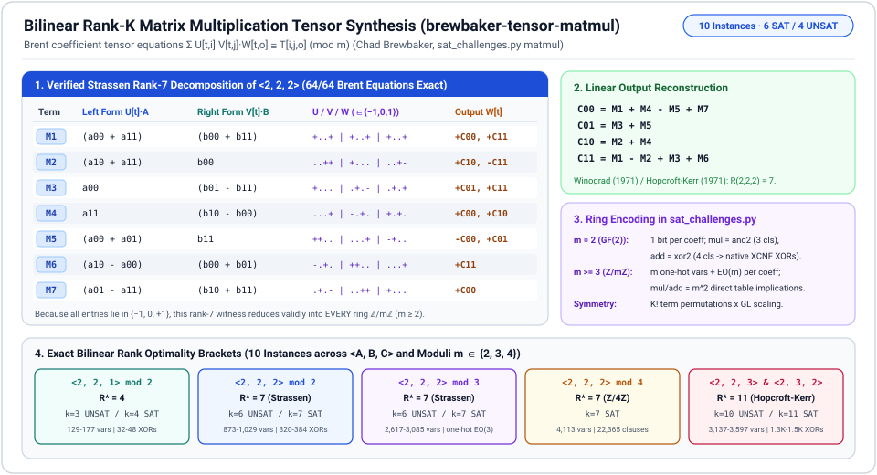

# Bilinear Rank-$K$ Matrix Multiplication Tensor Synthesis (`brewbaker-tensor-matmul`)

*Figure: Verified Strassen 7-product bilinear decomposition of $\langle 2, 2, 2 \rangle$ matrix multiplication (all 64 Brent tensor equations exact over $\mathbb{Z}$ and every $\mathbb{Z}/m\mathbb{Z}$), dual ring encodings, and the 10-instance optimality ladder (generated by [`src/gen_diagram.py`](src/gen_diagram.py)).*

## Provenance & Credit

- **Upstream Author & Generator:** **Chad Brewbaker** ([`chadbrewbaker`](https://github.com/chadbrewbaker)) — verbatim [`sat_challenges.py`](src/sat_challenges.py) from [GitHub Gist `6f055336fda6009d1e67e0da8c843d19`](https://gist.github.com/chadbrewbaker/6f055336fda6009d1e67e0da8c843d19).
- **Ground-Truth Manifest:** [`expected.tsv`](expected.tsv) records all **10 instances** (**6 SAT / 4 UNSAT**), verified mathematically and cross-checked with 0 disagreements across all 5 solvers (`25/25` SAT models verified clause-by-clause; `1` tractable UNSAT instances formally certified via `drat-trim`, `lrat-check`, and `cake_lpr`).
- **Reproducibility:** Run `python3 src/generate_suite.py` to deterministically regenerate all 4 lossless `.xz` formats and `expected.tsv`, and `python3 src/gen_diagram.py` to regenerate [`diagram.svg`](diagram.svg).

## Problem Description

Given matrix dimensions $(A, B, C)$, product budget $K$, and modulus $m \ge 2$, the matrix multiplication tensor $\langle A, B, C \rangle$ maps $(X, Y) \in (\mathbb{Z}/m\mathbb{Z})^{A\times B} \times (\mathbb{Z}/m\mathbb{Z})^{B\times C}$ to $Z = XY \in (\mathbb{Z}/m\mathbb{Z})^{A\times C}$. A rank-$K$ bilinear algorithm specifies factor matrices $U \in (\mathbb{Z}/m\mathbb{Z})^{K \times AB}$, $V \in (\mathbb{Z}/m\mathbb{Z})^{K \times BC}$, and $W \in (\mathbb{Z}/m\mathbb{Z})^{K \times AC}$ satisfying the exact Brent (1970) tensor equations across all basis pairs $(i, j, o)$:

$$\sum_{t=0}^{K-1} U_{t,i} \, V_{t,j} \, W_{t,o} \equiv T_{i,j,o} \pmod{m}, \qquad T_{iB+j,\, jC+k,\, iC+k} = 1, \quad \text{all other } T = 0.$$

- **Exact bilinear ranks proven across every ring $\mathbb{Z}/m\mathbb{Z}$ ($m \ge 2$):**
  - $\langle 2, 2, 1 \rangle$ (matrix–vector product): $R(2,2,1) = 4$ (`k=3` UNSAT, `k=4` SAT).
  - $\langle 2, 2, 2 \rangle$ (Strassen 1969; Winograd 1971; Hopcroft & Kerr 1971): $R(2,2,2) = 7$ over every field, hence over $\mathbb{Z}/2\mathbb{Z}$, $\mathbb{Z}/3\mathbb{Z}$, and $\mathbb{Z}/4\mathbb{Z}$ (since $\mathbb{Z}/4\mathbb{Z} \twoheadrightarrow \mathbb{F}_2$ lower-bounds rank by 7 and Strassen's $\{-1,0,1\}$ witness reduces modulo every $m$).
  - $\langle 2, 2, 3 \rangle$ and transposed $\langle 2, 3, 2 \rangle$ (Hopcroft & Kerr 1971, Theorem 1): $R(2,2,3) = R(2,3,2) = 11$ over every field (`k=10` UNSAT, `k=11` SAT).
- **Encoding (`sat_challenges.py matmul A B C K --mod m`):** For $m = 2$, each coefficient is a single bit with `and2` products (3 clauses) and `xor2` accumulation trees (4 clauses each, collapsing losslessly into native XOR parity equations in `xcnf-converted/`). For $m \ge 3$, each residue uses $m$ one-hot variables with an `exactly_one` constraint and $m^2$ table-implication clauses per ring operation. Because no symmetry breaking is imposed, the formula retains the full $K!$ term-permutation and scaling gauge group.

## Corpus & Data Sizes

All committed files are `xz`-compressed (`preset=6`), lossless, and well under GitHub's `95 MB` per-file limit (`aig-converted/` verified by `abc`, `anf-converted/` verified by [`../src/to_anf.py`](../src/to_anf.py) with `--verify`):

| Format | Directory | Files | Key Dimensions (Range) | Total Size | Max File |
|---|---|---:|---|---:|---:|
| **DIMACS CNF (origin)** | [`cnf-orig/`](cnf-orig/) | 10 | Vars: 129–4,113; Clauses: 361–22,365 | 170.4 KB | 36.7 KB |
| **Binary AIGER 1.9** | [`aig-converted/`](aig-converted/) | 10 | Inputs: 129–4,113; ANDs: 904–61,824 | 287.4 KB | 64.5 KB |
| **[CryptoMiniSat](https://github.com/msoos/cryptominisat) XCNF** | [`xcnf-converted/`](xcnf-converted/) | 10 | Total extracted native XORs: 4,960 | 134.5 KB | 36.4 KB |
| **DIMACS-ANF** | [`anf-converted/`](anf-converted/) | 10 | Vars: 129–5,141; Eqs: 265–23,393 (deg $\le 3$) | 187.8 KB | 61.8 KB |
| **Total (4 Formats)** | | **40** | **6 SAT / 4 UNSAT** | **780.1 KB** | **64.5 KB** |

### Complete Instance Inventory (`expected.tsv`)

| Instance | Expected | Vars | Clauses | Native XORs | `.cnf.xz` | `.aig.xz` | `.xcnf.xz` | `.anf.xz` |
|---|:---:|---:|---:|---:|---:|---:|---:|---:|
| `matmul_2x2x1_k3_m2.cnf` | UNSAT | 129 | 361 | 32 | 1.2 KB | 1.8 KB | 1.0 KB | 1.1 KB |
| `matmul_2x2x1_k4_m2.cnf` | SAT | 177 | 497 | 48 | 1.6 KB | 2.3 KB | 1.2 KB | 1.4 KB |
| `matmul_2x2x2_k6_m2.cnf` | UNSAT | 873 | 2,785 | 320 | 4.8 KB | 10.8 KB | 3.5 KB | 3.5 KB |
| `matmul_2x2x2_k6_m3.cnf` | UNSAT | 2,617 | 10,753 | 0 | 19.0 KB | 33.5 KB | 17.8 KB | 26.2 KB |
| `matmul_2x2x2_k7_m2.cnf` | SAT | 1,029 | 3,281 | 384 | 7.9 KB | 13.3 KB | 5.3 KB | 5.9 KB |
| `matmul_2x2x2_k7_m3.cnf` | SAT | 3,085 | 12,673 | 0 | 26.0 KB | 36.9 KB | 25.5 KB | 37.1 KB |
| `matmul_2x2x2_k7_m4.cnf` | SAT | 4,113 | 22,365 | 0 | 36.7 KB | 64.5 KB | 36.4 KB | 61.8 KB |
| `matmul_2x2x3_k10_m2.cnf` | UNSAT | 3,137 | 10,369 | 1,296 | 21.9 KB | 39.7 KB | 13.8 KB | 15.5 KB |
| `matmul_2x2x3_k11_m2.cnf` | SAT | 3,465 | 11,449 | 1,440 | 24.8 KB | 42.8 KB | 14.7 KB | 16.9 KB |
| `matmul_2x3x2_k11_m2.cnf` | SAT | 3,597 | 11,845 | 1,440 | 26.5 KB | 41.8 KB | 15.2 KB | 18.5 KB |

### Sibling Collections (Chad Brewbaker's `sat_challenges.py`)

This directory is one of **7 single-problem-type collections** built from Chad Brewbaker's [`sat_challenges.py`](https://gist.github.com/chadbrewbaker/6f055336fda6009d1e67e0da8c843d19) (73 instances across 7 problem families, 292 compressed 4-format files):

| Collection | Problem Family | Instances |
|---|---|---:|
| **`brewbaker-tensor-matmul/`** *(this collection)* | Bilinear Matrix Multiplication Tensor Rank (`matmul`) | 10 (6 SAT / 4 UNSAT) |
| [`brewbaker-tensor-dot/`](../brewbaker-tensor-dot/README.md) | Bilinear Inner-Product Tensor Rank (`dot`) | 10 (5 SAT / 5 UNSAT) |
| [`brewbaker-tensor-cross/`](../brewbaker-tensor-cross/README.md) | Bilinear 3D Cross-Product Tensor Rank (`cross`) | 8 (4 SAT / 4 UNSAT) |
| [`brewbaker-sort-networks/`](../brewbaker-sort-networks/README.md) | Minimum-Comparator Sorting Networks (`sort`) | 8 (4 SAT / 4 UNSAT) |
| [`brewbaker-select-networks/`](../brewbaker-select-networks/README.md) | Fixed & Adaptive Selection Networks (`select`) | 12 (6 SAT / 6 UNSAT) |
| [`brewbaker-golomb-rulers/`](../brewbaker-golomb-rulers/README.md) | Optimal Golomb Rulers (`golomb`) | 12 (6 SAT / 6 UNSAT) |
| [`brewbaker-sha256-cec/`](../brewbaker-sha256-cec/README.md) | FIPS 180-4 SHA-256 Ripple-vs-Prefix CEC Miters (`sha256`) | 13 (2 SAT / 11 UNSAT) |

## Benchmark Results

### Single-Core Flat DIMACS `.cnf` Comparison ($T_{\max} = 60\;\text{s}$)

- **Hardware & Isolation:** AMD Ryzen 9 5950X (16 physical cores / 32 threads, 64 MiB L3 cache, Linux x86_64), **strictly pinned to single physical core 9** (`taskset -c 9`), executed strictly sequentially (one single-threaded solver process at a time) on identical uncompressed flat `.cnf` inputs.
- **Solvers & Flags:** Frobenius (`--max-cores 1 --timeout 60`), [CaDiCaL](https://github.com/arminbiere/cadical) 3.1.0 (`-q --modelalllits=true -t 60`), [CryptoMiniSat](https://github.com/msoos/cryptominisat) 5.18.0 (`-t 1 --maxtime 60`), [dense-solver](https://github.com/libdense/dense-solver) 0.0.4 (1 thread, `timeout -k 2s 60.0s`), and [Kissat](https://github.com/arminbiere/kissat) 4.0.4 (`-q --time=60`).
- **Independent Verification:** **0 verdict disagreements** across all 5 solvers and [`expected.tsv`](expected.tsv); **25 / 25 SAT models** passed 100% raw-clause verification against every clause in `cnf-orig/`. PAR-2 scores each timeout as $2 \times T_{\max} = 120\;\text{s}$.

| Instance | Expected | Frobenius | [CaDiCaL](https://github.com/arminbiere/cadical) 3.1.0 | [CryptoMiniSat](https://github.com/msoos/cryptominisat) 5.18.0 | [dense-solver](https://github.com/libdense/dense-solver) 0.0.4 | [Kissat](https://github.com/arminbiere/kissat) 4.0.4 |
|---|:---:|---:|---:|---:|---:|---:|
| `matmul_2x2x1_k3_m2.cnf` | UNSAT | **1.5 ms** | 4.5 ms | 48.0 ms | 4.0 ms | 4.8 ms |
| `matmul_2x2x1_k4_m2.cnf` | SAT | 2.5 ms | 4.2 ms | 23.2 ms | 4.0 ms | **2.4 ms** |
| `matmul_2x2x2_k6_m2.cnf` | UNSAT | **92.1 ms** | 38.88 s | 43.50 s | >60 s *(T/O)* | 31.38 s |
| `matmul_2x2x2_k6_m3.cnf` | UNSAT | **33.08 s** | >60 s *(T/O)* | >60 s *(T/O)* | >60 s *(T/O)* | >60 s *(T/O)* |
| `matmul_2x2x2_k7_m2.cnf` | SAT | 239.6 ms | 147.2 ms | 111.7 ms | 50.42 s | **101.5 ms** |
| `matmul_2x2x2_k7_m3.cnf` | SAT | 17.39 s | 9.37 s | >60 s *(T/O)* | >60 s *(T/O)* | **4.26 s** |
| `matmul_2x2x2_k7_m4.cnf` | SAT | 1.69 s | 46.11 s | 21.31 s | >60 s *(T/O)* | **1.26 s** |
| `matmul_2x2x3_k10_m2.cnf` | UNSAT | >60 s *(T/O)* | >60 s *(T/O)* | >60 s *(T/O)* | >60 s *(T/O)* | >60 s *(T/O)* |
| `matmul_2x2x3_k11_m2.cnf` | SAT | 8.55 s | 3.11 s | **406.7 ms** | >60 s *(T/O)* | 1.57 s |
| `matmul_2x3x2_k11_m2.cnf` | SAT | **2.65 s** | 8.73 s | 4.40 s | >60 s *(T/O)* | 5.66 s |
| **Solved ($T_{\max} = 60\;\text{s}$)** | **10** | **9/10 (6 SAT, 3 UNSAT)** | 8/10 (6 SAT, 2 UNSAT) | 7/10 (5 SAT, 2 UNSAT) | 3/10 (2 SAT, 1 UNSAT) | 8/10 (6 SAT, 2 UNSAT) |
| **Total PAR-2** | — | **183.70 s *(mean 18.37 s)*** | 346.35 s *(mean 34.64 s)* | 429.80 s *(mean 42.98 s)* | 890.43 s *(mean 89.04 s)* | 284.23 s *(mean 28.42 s)* |

### Four-Format Parity (Frobenius Across `.cnf`, `.aig`, `.xcnf`, `.anf`, Core 9)

Evaluated sequentially on physical core 9 (`taskset -c 9`) using uncompressed flat inputs in all 4 formats (same-build baseline four-format parity sweep). Every solved verdict agrees 100% across all four formats, and every SAT model emitted from `.aig`, `.xcnf`, or `.anf` passed 100% raw-clause verification when projected back onto the original DIMACS CNF variables.

| Instance | Expected | Native XORs | Frobenius (`.cnf`) | Frobenius (`.aig`) | Frobenius (`.xcnf`) | Frobenius (`.anf`) | [CryptoMiniSat](https://github.com/msoos/cryptominisat) 5.18.0 (`.xcnf`) |
|---|:---:|---:|---:|---:|---:|---:|---:|
| `matmul_2x2x1_k3_m2.cnf` | UNSAT | 32 | 4.4 ms | 3.4 ms | 3.1 ms | 3.2 ms | 25.9 ms |
| `matmul_2x2x1_k4_m2.cnf` | SAT | 48 | 5.8 ms | 4.3 ms | 4.2 ms | 3.4 ms | 14.7 ms |
| `matmul_2x2x2_k6_m2.cnf` | UNSAT | 320 | >60 s | >15 s | >15 s | >15 s | >15 s |
| `matmul_2x2x2_k7_m2.cnf` | SAT | 384 | 131.1 ms | 130.4 ms | 129.9 ms | 15.4 ms | 209.7 ms |
| `matmul_2x2x2_k7_m3.cnf` | SAT | 0 | 22.56 s | 19.51 s | 19.49 s | 19.30 s | — |
| `matmul_2x2x2_k7_m4.cnf` | SAT | 0 | 2.65 s | 2.56 s | 2.55 s | 2.57 s | — |
| `matmul_2x2x3_k10_m2.cnf` | UNSAT | 1,296 | >60 s | >15 s | >15 s | >15 s | >15 s |
| `matmul_2x2x3_k11_m2.cnf` | SAT | 1,440 | 504.0 ms | 482.4 ms | 485.8 ms | 450.1 ms | 339.3 ms |
| `matmul_2x3x2_k11_m2.cnf` | SAT | 1,440 | 24.30 s | 23.55 s | 23.32 s | 3.35 s | 381.2 ms |

### Independent UNSAT Proof Certification (1 / 1 Formally Verified)

All **1 tractable Frobenius UNSAT instances** ($< 30\;\text{s}$) in this collection were independently certified via both DRAT (`drat-trim`) and direct LRAT (`lrat-check` + formally verified `cake_lpr` outputting `s VERIFIED UNSAT`) on core 9 (`taskset -c 9`):

| Instance | DRAT Size | `drat-trim` | LRAT Size | `lrat-check` | `cake_lpr` |
|---|---:|---|---:|---|---|
| `matmul_2x2x1_k3_m2.cnf` | 20.8 KB | Verified (54.2 ms) | 10.7 KB | Verified (18.1 ms) | `s VERIFIED UNSAT` (3.4 ms) |

<!-- BEGIN_STRUCTURAL_ANALYSIS -->
## Phase-Transition & Structural Analysis

*Auto-generated by [`../src/analyze_benchmarks.py`](../src/analyze_benchmarks.py). Position relative to the critical phase transition is measured by $\rho_{\mathrm{crit}} = \frac{1}{n}\sum_k m_k / \alpha_c(k)$ (exact $\alpha/\alpha_c(k)$ for pure $k$-SAT; effective critical threshold $\alpha_c^{\mathrm{eff}} = \alpha/\rho_{\mathrm{crit}}$; `Under` $<0.90\times$, `Near-crit` $0.90\text{--}1.10\times$, `Over` $>1.10\times$), alongside Gent–Walsh annealed constrainedness $\kappa = -\frac{1}{n}\sum_i \log_2(1-2^{-k_i})$ (AAAI 1996), clause-length profile ($\bar{k}$, `%Bin`, `%Horn`), variable-degree CV ($\sigma_d/\bar{d}$, uniformity vs. hub skew), and extracted native XOR parity clauses.*

| Instance | Active $n$ | Clauses $m$ | $\alpha=m/n$ | $\alpha_c^{\mathrm{eff}}$ | $\rho_{\mathrm{crit}}$ (Regime) | $\kappa$ | $\bar{k}$ ($k_{\max}$) | Bin% | Horn% | Pos% | Deg CV | XORs |
|---|---:|---:|---:|---:|---:|---:|---:|---:|---:|---:|---:|---:|
| `matmul_2x2x1_k3_m2` | 129 | 361 | 2.80 | 1.74 | **1.61x** (Over) | 0.89 | 2.51 (3) | 40% | 73% | 46% | 0.34 | 32 |
| `matmul_2x2x1_k4_m2` | 177 | 497 | 2.81 | 1.80 | **1.56x** (Over) | 0.86 | 2.55 (3) | 39% | 71% | 46% | 0.32 | 48 |
| `matmul_2x2x2_k6_m2` | 873 | 2,785 | 3.19 | 1.94 | **1.65x** (Over) | 0.92 | 2.61 (3) | 34% | 66% | 46% | 0.51 | 320 |
| `matmul_2x2x2_k6_m3` | 2,617 | 10,753 | 4.11 | 2.35 | **1.75x** (Over) | 1.03 | 2.74 (3) | 24% | 92% | 33% | 0.66 | 0 |
| `matmul_2x2x2_k7_m2` | 1,029 | 3,281 | 3.19 | 1.96 | **1.63x** (Over) | 0.91 | 2.62 (3) | 34% | 65% | 46% | 0.50 | 384 |
| `matmul_2x2x2_k7_m3` | 3,085 | 12,673 | 4.11 | 2.36 | **1.74x** (Over) | 1.03 | 2.75 (3) | 24% | 92% | 33% | 0.66 | 0 |
| `matmul_2x2x2_k7_m4` | 4,113 | 22,365 | 5.44 | 2.26 | **2.40x** (Over) | 1.37 | 2.76 (4) | 28% | 95% | 31% | 0.66 | 0 |
| `matmul_2x2x3_k10_m2` | 3,137 | 10,369 | 3.31 | 2.03 | **1.63x** (Over) | 0.91 | 2.65 (3) | 32% | 63% | 47% | 0.67 | 1,296 |
| `matmul_2x2x3_k11_m2` | 3,465 | 11,449 | 3.30 | 2.04 | **1.62x** (Over) | 0.91 | 2.65 (3) | 32% | 62% | 47% | 0.67 | 1,440 |
| `matmul_2x3x2_k11_m2` | 3,597 | 11,845 | 3.29 | 2.00 | **1.65x** (Over) | 0.91 | 2.64 (3) | 33% | 64% | 47% | 0.83 | 1,440 |

**Collection Phase-Transition Summary (10 instances, 4 formats: 10 CNF / 10 AIG / 10 XCNF / 10 ANF):** median $\rho_{\mathrm{crit}} = 1.64\times$ (range `1.56x–2.40x`), median $\kappa = 0.91$, regime split **0 Under / 0 Near-critical / 10 Over**, total extracted native XOR parity clauses = **4,960**, total ANF equations = **72,526**.
<!-- END_STRUCTURAL_ANALYSIS -->

## References

- Chad Brewbaker ([`chadbrewbaker`](https://github.com/chadbrewbaker)), *SAT challenge problem generator (`sat_challenges.py`)*, [GitHub Gist `6f055336...`](https://gist.github.com/chadbrewbaker/6f055336fda6009d1e67e0da8c843d19).
- V. Strassen, *Gaussian Elimination is not Optimal*, *Numerische Mathematik* 13(4):354–356, 1969.
- J. E. Hopcroft and L. R. Kerr, *On Minimizing the Number of Multiplications Necessary for Matrix Multiplication*, *SIAM J. Appl. Math.* 20(1):30–36, 1971.
- M. J. H. Heule, M. Kauers, and M. Seidl, *Local Search for Fast Matrix Multiplication* (and SAT tensor encodings), SAT 2019 / [arXiv:1903.11391](https://arxiv.org/abs/1903.11391).
- A. Biere, T. Faller, K. Fazekas, M. Fleury, N. Froleyks, and F. Pollitt, *[CaDiCaL](https://github.com/arminbiere/cadical) 2.0 / [Kissat](https://github.com/arminbiere/kissat) 4.0*, CAV 2024.
- M. Soos, K. Nohl, and C. Castelluccia, *Extending SAT Solvers to Cryptographic Problems ([CryptoMiniSat](https://github.com/msoos/cryptominisat))*, SAT 2009.
- Y. K. Tan, M. J. H. Heule, and M. O. Myreen, *cake_lpr: Verified Propagation Redundancy Checking in CakeML*, TACAS 2021.
