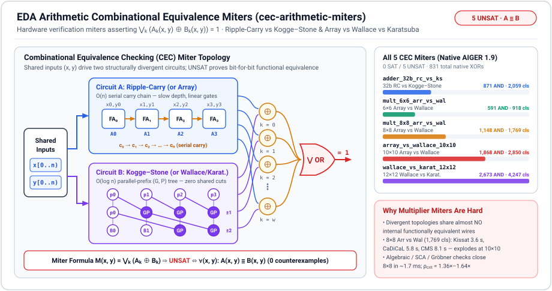

# EDA Arithmetic Combinational Equivalence Checking (CEC) Miters (`cec-arithmetic-miters`)

*Figure: Combinational Equivalence Checking (CEC) miter architecture comparing structurally divergent circuits (serial Ripple-Carry vs. logarithmic Kogge–Stone prefix adder; Array vs. Wallace vs. Karatsuba multipliers) through bitwise $\oplus$ and $\bigvee = 1$ UNSAT verification. Regenerated via [`src/gen_diagram.py`](src/gen_diagram.py).*

## Provenance & Credit

- **Author:** Luke Hutchison ([`lukehutch`](https://github.com/lukehutch))
- **License:** MIT License ([`../LICENSE`](../LICENSE))

## Problem Description

Unsatisfiable hardware verification **Combinational Equivalence Checking (CEC)** miter circuits asserting $\bigvee_k (A_k(x, y) \oplus B_k(x, y)) = 1$ across pairs of functionally identical but structurally distinct arithmetic architectures:
- **32-bit Ripple-Carry vs. Kogge–Stone** logarithmic parallel-prefix adder (`cec_adder_32b_rc_vs_ks`)
- **Array vs. Wallace-tree** multipliers ($6\times 6$, $8\times 8$, $10\times 10$)
- **Wallace-tree vs. Karatsuba** recursive multiplier ($12\times 12$)

- **Origin:** **Original** circuit generator (MIT [`../LICENSE`](../LICENSE)), modeled on industrial EDA multiplier equivalence benchmarks ([HWMCC](https://hwmcc.github.io/); Kaufmann, Biere, & Kauers, [AMulet](https://github.com/d-kaufmann/amulet), FMCAD 2019).
- **Why they are hard:** Multiplier miters between structurally divergent topologies (Array vs. Wallace vs. Karatsuba) have few internal equivalent wires, causing pure CDCL solvers to scale exponentially ($3.6\text{--}8.1\;\text{s}$ at $8\times 8$, exploding rapidly at $10\times 10$ and $12\times 12$).

## Corpus & Data Sizes

### Directory Layout & Regeneration

- `aig-orig/` — Original native **Binary AIGER 1.9** circuits (`9.4 KB`, verified with [Berkeley ABC](https://github.com/berkeley-abc/abc)).
- `cnf-converted/` — Tseitin **DIMACS `.cnf.xz`** conversions (`28.6 KB`).
- `xcnf-converted/` — Native-XOR **[CryptoMiniSat](https://github.com/msoos/cryptominisat) `.xcnf.xz`** conversions (`20.7 KB`).
- `anf-converted/` — Lossless linear-size **DIMACS-ANF `.anf.xz`** conversions (`23.8 KB`, degree $\le 2$, generated via [`../src/to_anf.py`](../src/to_anf.py)).
- **[`expected.tsv`](expected.tsv)** — Ground-truth verdict manifest for all 5 instances (**0 SAT / 5 UNSAT**).
- `src/` — Standalone zero-dependency Rust generator crate (`cd src && cargo run --release`).

### Problem Parameters & Data Sizes

| Instance | Circuit A vs. Circuit B | Width | Ans | AIG Inputs | AIG ANDs | `.aig.xz` | CNF Vars | CNF Clauses | `.cnf.xz` | `.xcnf.xz` | `.anf.xz` |
|---|---|---:|:---:|---:|---:|---:|---:|---:|---:|---:|---:|
| `cec_adder_32b_rc_vs_ks` | Ripple-Carry vs. Kogge–Stone Adder | 32b | UNSAT | 64 | 871 | 1.5 KB | 606 | 2,059 | 5.6 KB | 4.5 KB | 3.5 KB |
| `cec_mult_6x6_arr_vs_wal` | Array vs. Wallace Multiplier | 6×6 | UNSAT | 12 | 591 | 0.9 KB | 183 | 918 | 2.5 KB | 1.7 KB | 2.0 KB |
| `cec_mult_8x8_arr_vs_wal` | Array vs. Wallace Multiplier | 8×8 | UNSAT | 16 | 1,148 | 1.4 KB | 340 | 1,769 | 4.4 KB | 3.2 KB | 3.7 KB |
| `cec_array_vs_wallace_10x10` | Array vs. Wallace Multiplier | 10×10 | UNSAT | 20 | 1,868 | 2.1 KB | 530 | 2,850 | 6.6 KB | 4.3 KB | 5.7 KB |
| `cec_wallace_vs_karat_12x12` | Wallace vs. Karatsuba Multiplier | 12×12 | UNSAT | 24 | 2,673 | 3.4 KB | 814 | 4,247 | 9.5 KB | 6.9 KB | 8.9 KB |

## Benchmark Results

Evaluated sequentially on an AMD Ryzen 9 5950X (16C/32T Linux, 1 core/thread per run, default flags with `-t 1` for CryptoMiniSat 5.18.0 and `--max-cores 1` for Frobenius; exact median of 3 runs; $T_{\max} = 5{,}000\;\text{s}$):

| Instance | Frobenius 1C | [CaDiCaL](https://github.com/arminbiere/cadical) 3.1.0 | [CryptoMiniSat](https://github.com/msoos/cryptominisat) 5.18.0 (CNF) | [CryptoMiniSat](https://github.com/msoos/cryptominisat) 5.18.0 (XCNF) | [dense-solver](https://github.com/libdense/dense-solver) 0.0.4 | [Kissat](https://github.com/arminbiere/kissat) 4.0.4 |
|---|---:|---:|---:|---:|---:|---:|
| `cec_adder_32b_rc_vs_ks` | **7.53 ms** | 36.21 ms | 146.85 ms | 78.33 ms | 19.59 ms | 46.70 ms |
| `cec_mult_6x6_arr_vs_wal` | **0.92 ms** | 146.33 ms | 494.59 ms | 285.64 ms | 67.47 ms | 213.67 ms |
| `cec_mult_8x8_arr_vs_wal` | **1.19 ms** | 5,831.30 ms | 8,148.17 ms | 3,300.73 ms | 10.17 s | 3,598.79 ms |

### Supplementary Full-Corpus Coverage ($T_{\max} = 60\;\text{s}$)

Remaining two larger multiplier miter instances evaluated on identical uncompressed flat `.cnf` (and `.xcnf` for CryptoMiniSat 5.18.0 XCNF) inputs, pinned to a single physical core (`1` thread per run, `--max-cores 1` for Frobenius, `-t 1` for CryptoMiniSat 5.18.0, $T_{\max} = 60\;\text{s}$):

| Instance | Verdict | Frobenius 1C | [CaDiCaL](https://github.com/arminbiere/cadical) 3.1.0 | [CryptoMiniSat](https://github.com/msoos/cryptominisat) 5.18.0 (CNF) | [CryptoMiniSat](https://github.com/msoos/cryptominisat) 5.18.0 (XCNF) | [dense-solver](https://github.com/libdense/dense-solver) 0.0.4 | [Kissat](https://github.com/arminbiere/kissat) 4.0.4 |
|---|:---:|---:|---:|---:|---:|---:|---:|
| `cec_array_vs_wallace_10x10` | UNSAT | **1.46 ms** | >60 s (T/O) | >60 s (T/O) | >60 s (T/O) | >60 s (T/O) | >60 s (T/O) |
| `cec_wallace_vs_karat_12x12` | UNSAT | **2.15 ms** | >60 s (T/O) | >60 s (T/O) | >60 s (T/O) | >60 s (T/O) | >60 s (T/O) |

*(Frobenius 1C proves both `cec_array_vs_wallace_10x10` (**`1.46 ms`**) and `cec_wallace_vs_karat_12x12` (**`2.15 ms`**) UNSAT — closing all **5/5** miters in **`13.25 ms`** total where all five external baseline configurations time out past $60\;\text{s}$.)*

<!-- BEGIN_STRUCTURAL_ANALYSIS -->
## Phase-Transition & Structural Analysis

*Auto-generated by [`../src/analyze_benchmarks.py`](../src/analyze_benchmarks.py). Position relative to the critical phase transition is measured by $\rho_{\mathrm{crit}} = \frac{1}{n}\sum_k m_k / \alpha_c(k)$ (exact $\alpha/\alpha_c(k)$ for pure $k$-SAT; effective critical threshold $\alpha_c^{\mathrm{eff}} = \alpha/\rho_{\mathrm{crit}}$; `Under` $<0.90\times$, `Near-crit` $0.90\text{--}1.10\times$, `Over` $>1.10\times$), alongside Gent–Walsh annealed constrainedness $\kappa = -\frac{1}{n}\sum_i \log_2(1-2^{-k_i})$ (AAAI 1996), clause-length profile ($\bar{k}$, `%Bin`, `%Horn`), variable-degree CV ($\sigma_d/\bar{d}$, uniformity vs. hub skew), and extracted native XOR parity clauses.*

| Instance | Active $n$ | Clauses $m$ | $\alpha=m/n$ | $\alpha_c^{\mathrm{eff}}$ | $\rho_{\mathrm{crit}}$ (Regime) | $\kappa$ | $\bar{k}$ ($k_{\max}$) | Bin% | Horn% | Pos% | Deg CV | XORs |
|---|---:|---:|---:|---:|---:|---:|---:|---:|---:|---:|---:|---:|
| `cec_adder_32b_rc_vs_ks` | 606 | 2,059 | 3.40 | 2.07 | **1.64x** (Over) | 0.88 | 2.77 (4) | 35% | 64% | 47% | 0.57 | 125 |
| `cec_array_vs_wallace_10x10` | 530 | 2,850 | 5.38 | 3.95 | **1.36x** (Over) | 0.92 | 3.34 (4) | 10% | 55% | 49% | 0.32 | 206 |
| `cec_mult_6x6_arr_vs_wal` | 183 | 918 | 5.02 | 3.69 | **1.36x** (Over) | 0.90 | 3.30 (4) | 12% | 56% | 49% | 0.38 | 68 |
| `cec_mult_8x8_arr_vs_wal` | 340 | 1,769 | 5.20 | 3.81 | **1.36x** (Over) | 0.91 | 3.32 (4) | 11% | 56% | 49% | 0.34 | 131 |
| `cec_wallace_vs_karat_12x12` | 814 | 4,247 | 5.22 | 3.66 | **1.42x** (Over) | 0.93 | 3.30 (4) | 12% | 57% | 49% | 0.35 | 301 |

**Collection Phase-Transition Summary (5 instances, 4 formats: 5 CNF / 5 AIG / 5 XCNF / 5 ANF):** median $\rho_{\mathrm{crit}} = 1.36\times$ (range `1.36x–1.64x`), median $\kappa = 0.91$, regime split **0 Under / 0 Near-critical / 5 Over**, total extracted native XOR parity clauses = **831**, total ANF equations = **3,819**.
<!-- END_STRUCTURAL_ANALYSIS -->

## References

- P. M. Kogge and H. S. Stone, *A Parallel Algorithm for the Efficient Solution of a General Class of Recurrence Equations*, IEEE Trans. Computers C-22(8):786–793, 1973.
- D. Kaufmann, A. Biere, and M. Kauers, *Verifying Large Multipliers by Combining SAT and Computer Algebra ([AMulet](https://github.com/d-kaufmann/amulet))*, FMCAD 2019.
- A. Mishchenko, S. Chatterjee, R. Jiang, and R. K. Brayton, *FRAIGs: A Unifying Representation for Logic Synthesis and Verification*, ERL Technical Report, UC Berkeley, 2005.
