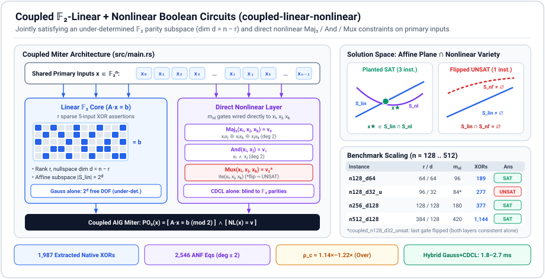

# Coupled Linear + Nonlinear Circuits (`coupled-linear-nonlinear`)

*Figure: Dual-branch coupled miter intersecting an under-determined $\mathbb{F}_2$ parity subspace ($\dim d = n-r$) with direct nonlinear $\mathrm{Maj}_3/\mathrm{And}/\mathrm{Mux}$ gates, contrasting planted SAT vs. flipped-gate UNSAT. Regenerated via [`src/gen_diagram.py`](src/gen_diagram.py).*

## Provenance & Credit

- **Author:** Luke Hutchison ([`lukehutch`](https://github.com/lukehutch))
- **License:** MIT License ([`../LICENSE`](../LICENSE))

## Problem Description

Hybrid algebraic–Boolean benchmark circuits (3 SAT + 1 UNSAT) coupling an under-determined system of sparse 5-variable $\mathbb{F}_2$ linear parity constraints ($\mathrm{rank} = r$, nullspace dimension $d = n - r$) with a layer of nonlinear Boolean gates ($\mathrm{Maj}_3$, $\mathrm{And}$, $\mathrm{Mux}$) directly over primary inputs. The three SAT instances are consistent with a planted secret assignment $x^{\star} \in \mathbb{F}_2^n$; the UNSAT instance (`coupled_n128_d32_unsat`) flips the final nonlinear gate polarity so both the linear layer ($d = 32$) and nonlinear gates are individually consistent while their coupled intersection is unsatisfiable.

- **Origin:** **Original** benchmark suite (MIT [`../LICENSE`](../LICENSE)) coupling $\mathbb{F}_2$-linear parity constraints with nonlinear Boolean gates ($\mathrm{Maj}_3$, $\mathrm{And}$, $\mathrm{Mux}$).
- **Why they are interesting:** Pure linear algebra cannot handle the nonlinear $\mathrm{Maj}_3/\mathrm{And}/\mathrm{Mux}$ layer, while standard CDCL solvers must jointly satisfy both the $r$-equation parity layer and the nonlinear gate constraints.

## Corpus & Data Sizes

### Directory Layout & Regeneration

- `aig-orig/` — Original native **Binary AIGER 1.9** circuits (`19.0 KB`, verified with [Berkeley ABC](https://github.com/berkeley-abc/abc)).
- `cnf-converted/` — Tseitin **DIMACS `.cnf.xz`** conversions (`43.4 KB`).
- `xcnf-converted/` — Native-XOR **[CryptoMiniSat](https://github.com/msoos/cryptominisat) `.xcnf.xz`** conversions (`25.7 KB`).
- `anf-converted/` — Lossless linear-size **DIMACS-ANF `.anf.xz`** conversions (`16.7 KB`, degree $\le 2$, generated via [`../src/to_anf.py`](../src/to_anf.py)).
- **[`expected.tsv`](expected.tsv)** — Ground-truth verdict manifest for all 4 instances (**3 SAT / 1 UNSAT**).
- `src/` — Standalone zero-dependency Rust generator crate (`cd src && cargo run --release`).

### Problem Parameters & Data Sizes

| Instance | Inputs $n$ | Linear Eqs $r$ | Nullspace $d$ | Nonlinear Gates | Seed | Ans | AIG ANDs | `.aig.xz` | CNF Vars | CNF Clauses | `.cnf.xz` | `.xcnf.xz` | `.anf.xz` |
|---|---:|---:|---:|---:|---:|:---:|---:|---:|---:|---:|---:|---:|---:|
| `coupled_n128_d64` | 128 | 64 | 64 | 96 | `0xFEEDFACE115122A2` | SAT | 1,161 | 2.1 KB | 411 | 1,640 | 4.7 KB | 2.9 KB | 1.9 KB |
| `coupled_n128_d32_unsat` | 128 | 96 | 32 | 84 (last flipped) | `0xCAFEBABE0003` | UNSAT | 1,514 | 2.6 KB | 488 | 2,036 | 5.7 KB | 3.1 KB | 2.1 KB |
| `coupled_n256_d128` | 256 | 128 | 128 | 180 | `0xFEEDFACE11912322` | SAT | 2,292 | 4.0 KB | 809 | 3,222 | 9.0 KB | 5.7 KB | 3.6 KB |
| `coupled_n512_d128` | 512 | 384 | 128 | 420 | `0xFEEDFACE10912022` | SAT | 6,489 | 10.4 KB | 2,074 | 9,001 | 24.1 KB | 14.1 KB | 9.2 KB |

## Benchmark Results

Evaluated sequentially on the same AMD Ryzen 9 5950X machine (16C/32T Linux, 1 core/thread per run, default flags with `-t 1` for CryptoMiniSat 5.18.0 and `--max-cores 1` for Frobenius; exact median of 3 runs; $T_{\max} = 5{,}000\;\text{s}$ on SAT instances, $T_{\max} = 30\;\text{s}$ on `coupled_n128_d32_unsat`):

| Instance | Frobenius 1C | [CaDiCaL](https://github.com/arminbiere/cadical) 3.1.0 | [CryptoMiniSat](https://github.com/msoos/cryptominisat) 5.18.0 (CNF) | [CryptoMiniSat](https://github.com/msoos/cryptominisat) 5.18.0 (XCNF) | [dense-solver](https://github.com/libdense/dense-solver) 0.0.4 | [Kissat](https://github.com/arminbiere/kissat) 4.0.4 |
|---|---:|---:|---:|---:|---:|---:|
| `coupled_n128_d64` | **1.22 ms** *(fastest)* | 2.83 ms *(2.3x slower)* | 22.02 ms *(18.1x slower)* | 21.39 ms *(17.6x slower)* | 3.18 ms *(2.6x slower)* | 1.99 ms *(1.6x slower)* |
| `coupled_n128_d32_unsat` | **1.35 ms** *(fastest)* | 2.63 ms *(1.9x slower)* | 71.15 ms *(52.6x slower)* | 24.73 ms *(18.3x slower)* | 2.83 ms *(2.1x slower)* | 14.75 ms *(10.9x slower)* |
| `coupled_n256_d128` | **1.73 ms** *(fastest)* | 3.74 ms *(2.2x slower)* | 56.09 ms *(32.5x slower)* | 23.62 ms *(13.7x slower)* | 4.96 ms *(2.9x slower)* | 3.98 ms *(2.3x slower)* |
| `coupled_n512_d128` | **1.37 ms** *(fastest)* | 5.51 ms *(4.0x slower)* | 7.24 ms *(5.3x slower)* | 5.65 ms *(4.1x slower)* | 6.96 ms *(5.1x slower)* | 3.63 ms *(2.6x slower)* |
| **Solved (4 instances)** | **4 / 4** *(highest)* | **4 / 4** *(highest)* | **4 / 4** *(highest)* | **4 / 4** *(highest)* | **4 / 4** *(highest)* | **4 / 4** *(highest)* |
| **Total PAR-2** | **5.67 ms** *(fastest)* | 14.71 ms *(2.59x slower)* | 156.50 ms *(27.6x slower)* | 75.39 ms *(13.3x slower)* | 17.93 ms *(3.16x slower)* | 24.35 ms *(4.29x slower)* |

<!-- BEGIN_STRUCTURAL_ANALYSIS -->
## Phase-Transition & Structural Analysis

*Auto-generated by [`../src/analyze_benchmarks.py`](../src/analyze_benchmarks.py). Position relative to the critical phase transition is measured by $\rho_{\mathrm{crit}} = \frac{1}{n}\sum_k m_k / \alpha_c(k)$ (exact $\alpha/\alpha_c(k)$ for pure $k$-SAT; effective critical threshold $\alpha_c^{\mathrm{eff}} = \alpha/\rho_{\mathrm{crit}}$; `Under` $<0.90\times$, `Near-crit` $0.90\text{--}1.10\times$, `Over` $>1.10\times$), alongside Gent–Walsh annealed constrainedness $\kappa = -\frac{1}{n}\sum_i \log_2(1-2^{-k_i})$ (AAAI 1996), clause-length profile ($\bar{k}$, `%Bin`, `%Horn`), variable-degree CV ($\sigma_d/\bar{d}$, uniformity vs. hub skew), and extracted native XOR parity clauses.*

| Instance | Active $n$ | Clauses $m$ | $\alpha=m/n$ | $\alpha_c^{\mathrm{eff}}$ | $\rho_{\mathrm{crit}}$ (Regime) | $\kappa$ | $\bar{k}$ ($k_{\max}$) | Bin% | Horn% | Pos% | Deg CV | XORs |
|---|---:|---:|---:|---:|---:|---:|---:|---:|---:|---:|---:|---:|
| `coupled_n128_d32_unsat` | 488 | 2,036 | 4.17 | 3.67 | **1.14x** (Over) | 0.97 | 3.17 (4) | 3% | 48% | 50% | 0.89 | 277 |
| `coupled_n128_d64` | 411 | 1,640 | 3.99 | 3.36 | **1.19x** (Over) | 0.99 | 3.08 (4) | 4% | 50% | 50% | 0.78 | 189 |
| `coupled_n256_d128` | 809 | 3,222 | 3.98 | 3.41 | **1.17x** (Over) | 0.98 | 3.09 (4) | 4% | 50% | 50% | 0.82 | 377 |
| `coupled_n512_d128` | 2,074 | 9,001 | 4.34 | 3.56 | **1.22x** (Over) | 1.03 | 3.13 (4) | 3% | 48% | 50% | 0.93 | 1,144 |

**Collection Phase-Transition Summary (4 instances, 4 formats: 4 CNF / 4 AIG / 4 XCNF / 4 ANF):** median $\rho_{\mathrm{crit}} = 1.18\times$ (range `1.14x–1.22x`), median $\kappa = 0.99$, regime split **0 Under / 0 Near-critical / 4 Over**, total extracted native XOR parity clauses = **1,987**, total ANF equations = **2,546**.
<!-- END_STRUCTURAL_ANALYSIS -->

## References

- A. Biere et al., *[CaDiCaL](https://github.com/arminbiere/cadical) 2.0 / [Kissat](https://github.com/arminbiere/kissat) 4.0*, CAV 2024.
- M. Soos, K. Nohl, and C. Castelluccia, *Extending SAT Solvers to Cryptographic Problems*, SAT 2009.
