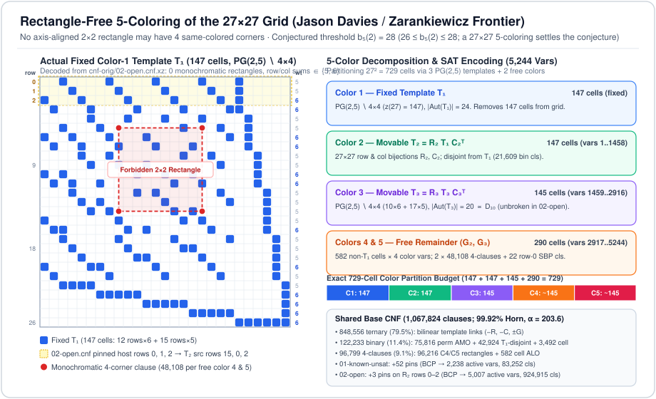

# Rectangle-Free 5-Coloring of the $27 \times 27$ Grid (`davies-rectangle-free-27`)

*Actual decoded $27 \times 27$ fixed Color-1 template $T_1$ (`147` cells, zero monochromatic rectangles, extracted directly from `cnf-orig/02-open.cnf.xz`) alongside the five-color template decomposition (`147 + 147 + 145 + 290 = 729` cells) and clause architecture. Generated reproducibly by [`src/gen_diagram.py`](src/gen_diagram.py).*

## Provenance & Credit

- **Author & Contributor:** **Jason Davies**, [`rectangle-free-27-dimacs.zip`](https://www.jasondavies.com/tmp/rectangle-free-27-dimacs.zip) (archive SHA-256: `05d1ac5785c11ec5dfa019dac69e8cd2ee4f153ea9488e85dfd95cd13e36f4ad`).
- **Integrity & Manifest:** Both input DIMACS CNFs in `cnf-orig/` decompress byte-for-byte to match upstream [`SHA256SUMS`](SHA256SUMS); Jason Davies' original description is preserved verbatim in [`UPSTREAM_README.txt`](UPSTREAM_README.txt).
- **[`expected.tsv`](expected.tsv)** — Ground-truth verdict manifest for all 2 instances (**0 SAT / 1 UNSAT / 1 UNKNOWN**).

## Mathematical Background & Historical Lineage

A **$c$-coloring of an $m \times n$ grid** assigns each cell $(r, c) \in \{0, \dots, m-1\} \times \{0, \dots, n-1\}$ one of $c$ colors. The coloring is **rectangle-free** if no two distinct rows $r_1 < r_2$ and two distinct columns $c_1 < c_2$ have all four corners $(r_1, c_1), (r_1, c_2), (r_2, c_1), (r_2, c_2)$ assigned the same color. Equivalently, viewing the grid as the edges of the complete bipartite graph $K_{m,n}$, a rectangle-free $c$-coloring is an edge $c$-coloring of $K_{m,n}$ avoiding monochromatic $K_{2,2} \cong C_4$ subgraphs.

Two classical extremal quantities govern this problem:
- The **Zarankiewicz number** $z(n) = z(n, n; 2, 2)$ (Zarankiewicz 1951; Kővári–Sós–Turán 1954; Reiman 1958): the maximum number of $1$s in a $C_4$-free $n \times n$ binary matrix (i.e., the largest single color class).
- The **diagonal multicolor bipartite Ramsey number** $b_c(2)$: the least $n$ such that *every* $c$-coloring of $K_{n,n}$ contains a monochromatic $C_4$. By the pigeonhole principle, $c \cdot z(n) < n^2$ immediately proves $b_c(2) \le n$.

### From the $17 \times 17$ Challenge ($c = 4$) to the $27 \times 27$ Frontier ($c = 5$)

1. **The 2009 $17 \times 17$ 4-Coloring Challenge:** Fenner, Gasarch, Glover, and Purewal (*"Rectangle-Free Coloring of Grids"*, [`arXiv:1005.3750`](https://arxiv.org/abs/1005.3750)) mapped the rectangle-free grid coloring frontier for $c \le 4$, and in November 2009 William Gasarch posed the famous [**\$289.00 $17 \times 17$ Challenge**](https://blog.computationalcomplexity.org/2009/11/17x17-challenge-worth-28900-this-is-not.html) (\$1 per cell) asking whether a $17 \times 17$ grid admits a rectangle-free 4-coloring.
2. **2012 Solution ($17 \times 17$ and $18 \times 18$, $b_4(2) = 19$):** In February 2012, Bernd Steinbach and Christian Posthoff (ISMVL 2012) solved the challenge by enforcing a 4-fold $90^\circ$ rotation symmetry across the four colors, constructing explicit rectangle-free 4-colorings of both $17 \times 17$ and $18 \times 18$. Because $4 \cdot z(19) = 4 \cdot 88 = 352 < 361 = 19^2$, this settled $b_4(2) = 19$.
3. **2020 Shift-Pattern SAT Method (`arXiv:2012.12582`):** Because 4-fold rotation symmetry does not generalize to $c = 5$ colors, Zhenjun Liu, Leroy Chew, and Marijn J. H. Heule (*"Avoiding Monochromatic Rectangles Using Shift Patterns"*, [`arXiv:2012.12582`](https://arxiv.org/abs/2012.12582)) introduced satisfiability-preserving internal *shift-pattern* symmetries, finding a new non-isomorphic $18 \times 18$ 4-coloring in under $1\;\text{s}$ with CaDiCaL (which truncates directly to $17 \times 17$) and initiating template-based SAT attacks on the 5-coloring frontier.
4. **The 5-Coloring Frontier & Conjecture ($26 \le b_5(2) \le 28$):** Janusz Dybizbański, Tomasz Dzido, and Stanisław P. Radziszowski (*"On Some Zarankiewicz Numbers and Bipartite Ramsey Numbers for Quadrilateral"*, 2014, [`zr14.pdf`](https://cs.rit.edu/~spr/PUBL/zr14.pdf)) established:
   - **Theorem 7 & Theorem 8 / Theorem 10:** $26 \le b_5(2) \le 28$. Specifically, for $n = 28 = k^2 + k - 2$ ($k = 5$), Theorem 3 yields $z(28) \le 156$, so $5 \cdot 156 = 780 < 784 = 28^2$, proving $28 \times 28$ is impossible ($b_5(2) \le 28$).
   - **Conjecture 5:** For any prime power $k$, $z(k^2 + k - 3) = k^3 + 2k^2 - 6k + 2$. At $k = 5$, this predicts $z(27) = 147$ (attained by deleting 4 points and 4 lines with 9 incidences from the $31 \times 31$ incidence matrix of the projective plane $\mathrm{PG}(2, 5)$).
   - **Conjecture 11:** $b_5(2) = 28$. Because any rectangle-free 5-coloring of a $27 \times 27$ grid crops immediately to $26 \times 26$ by dropping one row and one column, **a single valid $27 \times 27$ 5-coloring proves $b_5(2) = 28$ and settles Conjecture 11**.

## Exact Structural Anatomy of the DIMACS Encodings

Both instances share **5,244 variables** and an identical **1,067,824-clause base formula**, differing only in the trailing unit clauses that pin partial row/column images of the movable templates. Because $27^2 = 729$ and $z(27)$ is conjectured to be $147$, any 5-coloring must average $729 / 5 = 145.8$ cells per color; the encoding fixes three near-extremal $\mathrm{PG}(2,5)$-derived templates of sizes `147`, `147`, and `145` (covering `439` cells) and leaves the remaining `290` cells to be rectangle-free 2-colored by colors 4 and 5:

### 1. Decoded $\mathrm{PG}(2, 5)$ Templates ($T_1 = T_2$ and $T_3$)

- **Fixed Color-1 Template $T_1$ & Movable Color-2 Template $T_2$ (`147` cells, $T_1 = T_2$):**
  - Exact row and column weight distribution: `15` rows of weight `5` and `12` rows of weight `6` ($15 \times 5 + 12 \times 6 = 147$; identical column profile), with pairwise row intersections strictly in $\{0, 1\}$ (`330` pairs meet in `1` column, `21` pairs are disjoint — zero $2 \times 2$ rectangles).
  - Realizes $\mathrm{PG}(2, 5)$ ($31 \times 31$, weight `6`) minus a $4 \times 4$ submatrix containing $z(4) = 9$ ones ($186 - 48 + 9 = 147$), producing non-intersection cliques of sizes `(3, 4, 4, 4)` among the 15 weight-5 rows.
  - Self-dual ($T_1 \cong T_1^\top$) with exact automorphism group $\lvert\mathrm{Aut}(T_1)\rvert = 24$ (row/column orbits `[3, 12, 12]`).
- **Movable Color-3 Template $T_3$ (`145` cells):**
  - Exact row and column weight distribution: `17` rows of weight `5` and `10` rows of weight `6` ($17 \times 5 + 10 \times 6 = 145$; `320` pairs meet in `1` column, `31` pairs disjoint — zero $2 \times 2$ rectangles), realizing $\mathrm{PG}(2, 5)$ minus a 7-edge $4 \times 4$ submatrix (`(2, 5, 5, 5)` non-intersection cliques).
  - Self-dual ($T_3 \cong T_3^\top$) with exact dihedral automorphism group $\mathrm{Aut}(T_3) \cong D_{10}$ of order **20** (row/column orbits `[2, 5, 10, 10]`).

### 2. Variable Partition (`5,244` Variables)

| Variable Range | Count | Meaning |
|---|---:|---|
| `1..729` ($R_2$) | 729 | $27 \times 27$ row-permutation bijection for movable template $T_2$: $R_2[r, r'] = \text{var}(27r + r' + 1)$ |
| `730..1458` ($C_2$) | 729 | $27 \times 27$ column-permutation bijection for movable template $T_2$ |
| `1459..2187` ($R_3$) | 729 | $27 \times 27$ row-permutation bijection for movable template $T_3$ |
| `2188..2916` ($C_3$) | 729 | $27 \times 27$ column-permutation bijection for movable template $T_3$ |
| `2917..5244` ($G_0, G_1, G_2, G_3$) | 2,328 | $582 \times 4$ color-indicator variables (colors 2, 3, 4, 5) for the $729 - 147 = 582$ non-$T_1$ cells in row-major order |

### 3. Clause Accounting (`1,067,824` Shared Base Clauses; `99.92%` Horn, $\alpha = 203.6$)

| Clause Family | Length | Count | Exact Combinatorial Formula |
|---|---:|---:|---|
| Permutation ALO ($R_2, C_2, R_3, C_3$) | 27 | 216 | $4 \times (27 \text{ rows} + 27 \text{ cols})$ |
| Permutation pairwise AMO ($R_2, C_2, R_3, C_3$) | 2 | 75,816 | $4 \times 54 \times \binom{27}{2}$ |
| Disjointness of $T_2$ from fixed $T_1$ ($\neg R_2 \lor \neg C_2$) | 2 | 21,609 | $147 \times 147$ |
| Disjointness of $T_3$ from fixed $T_1$ ($\neg R_3 \lor \neg C_3$) | 2 | 21,315 | $147 \times 145$ |
| Bilinear linking $T_2 \to G_0$ ($\neg R_2 \lor \neg C_2 \lor +G_0$) | 3 | 85,554 | $582 \times 147$ |
| Bilinear linking $\overline{T_2} \to \neg G_0$ ($\neg R_2 \lor \neg C_2 \lor -G_0$) | 3 | 338,724 | $582 \times (729 - 147)$ |
| Bilinear linking $T_3 \to G_1$ ($\neg R_3 \lor \neg C_3 \lor +G_1$) | 3 | 84,390 | $582 \times 145$ |
| Bilinear linking $\overline{T_3} \to \neg G_1$ ($\neg R_3 \lor \neg C_3 \lor -G_1$) | 3 | 339,888 | $582 \times (729 - 145)$ |
| Cell color ALO ($G_0 \lor G_1 \lor G_2 \lor G_3$) | 4 | 582 | $729 - 147$ non-$T_1$ cells |
| Cell color pairwise AMO ($\neg G_a \lor \neg G_b$) | 2 | 3,492 | $582 \times \binom{4}{2}$ |
| Monochromatic rectangle avoidance (colors 4 & 5) | 4 | 96,216 | $2 \times 48{,}108$ non-$T_1$ $2 \times 2$ rectangles |
| Color 4 vs. Color 5 row-0 symmetry breaking | 1..22 | 22 | First-appearance ordering across row 0's `22` non-$T_1$ cells |
| **Shared Base Total** | **1..27** | **1,067,824** | **Exact match** (`848,556` ternary = `79.5%`) |

### 4. Exact Difference Between `01-known-unsat` and `02-open`

- **`01-known-unsat.cnf` (`1,067,876` clauses = base + `52` unit clauses):** Pins 13 row images and 13 column images of $T_2$ plus 13 row images and 13 column images of $T_3$. Pure level-0 unit propagation immediately fixes **3,006 / 5,244 variables** (`+129` true, `-2,877` false), collapsing the formula **12.8×** down to **`2,238` active variables** and **`83,252` clauses** (`10,893` binary, `15,106` ternary, `57,139` 4-clauses) and breaking all template automorphisms.
- **`02-open.cnf` (`1,067,827` clauses = base + `3` unit clauses: `16 0`, `28 0`, `57 0`):** Pins only the first three row images of $T_2$ (host rows `0, 1, 2` $\mapsto$ source rows `15, 0, 2`). Level-0 unit propagation fixes only **237 / 5,244 variables**, leaving **`5,007` active variables** and **`924,915` clauses** (`108,395` binary, `719,840` ternary, `96,452` 4-clauses). While these three pins reduce $\mathrm{Stab}_{\mathrm{Aut}(T_1)}(0,1,2)$ and $\mathrm{Stab}_{\mathrm{Aut}(T_2)}(15,0,2)$ to the trivial group, **the full order-20 dihedral automorphism group $\mathrm{Aut}(T_3) \cong D_{10}$ acting on $(R_3, C_3)$ remains 100% unbroken** in `02-open.cnf`.

## Directory Layout & Four-Format Corpus

- `cnf-orig/` — Exact unmodified `xz`-compressed DIMACS CNFs matching [`SHA256SUMS`](SHA256SUMS) (`1.70 MB` total; excludes any `.out` files).
- `aig-converted/` — Exact logically equivalent Binary AIGER 1.9 `.aig.xz` miters (`3.42 MB` total, 2/2 verified with [Berkeley ABC](https://github.com/berkeley-abc/abc) `read_aiger`, `0` errors).
- `xcnf-converted/` — Lossless [CryptoMiniSat](https://github.com/msoos/cryptominisat) `.xcnf.xz` conversions (`1.72 MB` total; `0` native XOR parity blocks).
- `anf-converted/` — Lossless linear-size degree-$\le 3$ DIMACS-ANF `.anf.xz` conversions (`2.25 MB` total, generated via [`../src/to_anf.py`](../src/to_anf.py)).
- `src/` — Format converters (`cnf2aig.py`, `cnf2xcnf.py`) and SVG generator ([`src/gen_diagram.py`](src/gen_diagram.py)).

| Instance | Status | Vars | Clauses | `.cnf.xz` | `.aig.xz` (ANDs) | `.xcnf.xz` (XORs) | `.anf.xz` (Eqs) |
|---|:---:|---:|---:|---:|---:|---:|---:|
| `01-known-unsat` | **UNSAT** | 5,244 | 1,067,876 | 872.3 KB | 1.74 MB (`3,002,828`) | 880.7 KB (`0`) | 1.10 MB (`1,170,048`) |
| `02-open` | **UNKNOWN** *(Open)* | 5,244 | 1,067,827 | 872.2 KB | 1.68 MB (`3,002,781`) | 880.6 KB (`0`) | 1.15 MB (`1,169,999`) |

## Comparative 1-Core Benchmark Results

- **Hardware & Protocol:** Same machine — **AMD Ryzen 9 5950X** (16 cores / 32 threads, 64 MiB L3, Linux x86_64), **1 thread pinned per run** (`taskset -c 2` or `taskset -c 3`), identical uncompressed flat DIMACS `.cnf` inputs, default single-thread flags (Frobenius 1C default / `--timeout`, [CaDiCaL](https://github.com/arminbiere/cadical) 3.1.0 `-t`, [CryptoMiniSat](https://github.com/msoos/cryptominisat) 5.18.0 `--maxtime -t 1`, [dense-solver](https://github.com/libdense/dense-solver) 0.0.4 default under `timeout`, [Kissat](https://github.com/arminbiere/kissat) 4.0.4 `--time=`). Zero verdict disagreements across all solvers.
- **Note on Jason Davies' 300 s pilot:** In [`UPSTREAM_README.txt`](UPSTREAM_README.txt), CaDiCaL 1.9.5 solved `01-known-unsat.cnf` in `236.82` CPU s (`drat-trim`: `446.90` CPU s), while CaDiCaL 3.1.0 and Kissat 4.0.4 reached the `300` CPU s pilot limit. Extending the single-core cutoff to **$T_{\max} = 600\;\text{s}$** cleanly closes `01-known-unsat.cnf` across four of the five solvers.

### 1. Calibration Case `01-known-unsat.cnf` ($T_{\max} = 600\;\text{s}$, 1 Core, Flat `.cnf`)

| Solver (1C, $T_{\max} = 600\;\text{s}$) | Verdict | Wall Time | CPU Time | Conflicts | Propagations | Peak RSS |
|---|:---:|---:|---:|---:|---:|---:|
| **Frobenius 1C** *(default)* | **UNSAT** | 558.10 s | 551.04 s | 9,465,516 | 1,360.6M | 178 MB |
| **Frobenius 1C** *(with `--proof` DRAT)*\* | **UNSAT** | **180.15 s** | **177.63 s** | 10,846,271 | 697.6M | 140 MB |
| [CaDiCaL](https://github.com/arminbiere/cadical) 3.1.0 | **UNSAT** | 339.43 s | 334.99 s | 10,609,175 | 807.0M | 116 MB |
| [CryptoMiniSat](https://github.com/msoos/cryptominisat) 5.18.0 | **UNSAT** | 414.78 s | 412.04 s | 6,888,425 | 550.0M | 95 MB |
| [dense-solver](https://github.com/libdense/dense-solver) 0.0.4 | T/O | >600 s | 594.97 s | — | — | 367 MB |
| [Kissat](https://github.com/arminbiere/kissat) 4.0.4 | **UNSAT** | 570.57 s | 561.66 s | 8,472,695 | 977.1M | 70 MB |

*\*Independent UNSAT Proof Verification: Frobenius's `--proof` run on `01-known-unsat.cnf` emitted an `899 MB` binary DRAT proof (`62,591 / 1,067,876` core clauses, `4,281,269` core lemmas, `0` RAT steps, `351,803,675` resolution steps) verified independently by [`drat-trim`](https://github.com/marijnheule/drat-trim) (`s VERIFIED`, `1,373.32 s`, producing a `3.0 GB` LRAT certificate) and formally verified [`cake_lpr`](https://github.com/tanyongkiam/cake_lpr) (`s VERIFIED UNSAT`, `84.11 s`).*

### 2. Open Branch `02-open.cnf` (Phase 1 Single-Core Profiling Baseline)

`02-open.cnf` remains **UNRESOLVED (UNKNOWN)** across all evaluated solvers within Phase 1 single-core profiling budgets (a dedicated 3-hour solve attempt is scheduled for Phase 2):

| Solver (1C, Flat `.cnf`) | Budget | Verdict | Conflicts (Rate) | Propagations (Rate) | Peak RSS |
|---|---:|:---:|---:|---:|---:|
| **Frobenius 1C** | 900 s *(15 min)* | T/O *(Open)* | 13,254,464 (`14,727/s`) | 4,051.1M (`4.50M/s`) | 238 MB |
| [CaDiCaL](https://github.com/arminbiere/cadical) 3.1.0 | 180 s *(3 min)* | T/O *(Open)* | 1,431,113 (`8,051/s`) | 455.5M (`2.56M/s`) | 256 MB |
| [Kissat](https://github.com/arminbiere/kissat) 4.0.4 | 180 s *(3 min)* | T/O *(Open)* | 1,400,468 (`7,871/s`) | 763.4M (`4.29M/s`) | 98 MB |

<!-- BEGIN_STRUCTURAL_ANALYSIS -->
## Phase-Transition & Structural Analysis

*Auto-generated by [`../src/analyze_benchmarks.py`](../src/analyze_benchmarks.py). Position relative to the critical phase transition is measured by $\rho_{\mathrm{crit}} = \frac{1}{n}\sum_k m_k / \alpha_c(k)$ (exact $\alpha/\alpha_c(k)$ for pure $k$-SAT; effective critical threshold $\alpha_c^{\mathrm{eff}} = \alpha/\rho_{\mathrm{crit}}$; `Under` $<0.90\times$, `Near-crit` $0.90\text{--}1.10\times$, `Over` $>1.10\times$), alongside Gent–Walsh annealed constrainedness $\kappa = -\frac{1}{n}\sum_i \log_2(1-2^{-k_i})$ (AAAI 1996), clause-length profile ($\bar{k}$, `%Bin`, `%Horn`), variable-degree CV ($\sigma_d/\bar{d}$, uniformity vs. hub skew), and extracted native XOR parity clauses.*

| Instance | Active $n$ | Clauses $m$ | $\alpha=m/n$ | $\alpha_c^{\mathrm{eff}}$ | $\rho_{\mathrm{crit}}$ (Regime) | $\kappa$ | $\bar{k}$ ($k_{\max}$) | Bin% | Horn% | Pos% | Deg CV | XORs |
|---|---:|---:|---:|---:|---:|---:|---:|---:|---:|---:|---:|---:|
| `01-known-unsat` | 5,244 | 1,067,876 | 203.64 | 3.23 | **63.1x** (Over) | 42.58 | 2.98 (27) | 11% | 100% | 6% | 0.24 | 0 |
| `02-open` | 5,244 | 1,067,827 | 203.63 | 3.23 | **63.1x** (Over) | 42.57 | 2.98 (27) | 11% | 100% | 6% | 0.24 | 0 |

**Collection Phase-Transition Summary (2 instances, 4 formats: 2 CNF / 2 AIG / 2 XCNF / 2 ANF):** median $\rho_{\mathrm{crit}} = 63.1\times$ (range `63.1x–63.1x`), median $\kappa = 42.57$, regime split **0 Under / 0 Near-critical / 2 Over**, total extracted native XOR parity clauses = **0**, total ANF equations = **2,340,047**.
<!-- END_STRUCTURAL_ANALYSIS -->

## References

- J. Davies, [*Rectangle-Free Five-Colouring of a 27 by 27 Grid — DIMACS Benchmarks*](https://www.jasondavies.com/tmp/rectangle-free-27-dimacs.zip), 2026.
- Z. Liu, L. Chew, and M. J. H. Heule, *"Avoiding Monochromatic Rectangles Using Shift Patterns"*, [`arXiv:2012.12582`](https://arxiv.org/abs/2012.12582), 2020.
- J. Dybizbański, T. Dzido, and S. P. Radziszowski, *"On Some Zarankiewicz Numbers and Bipartite Ramsey Numbers for Quadrilateral"*, [`cs.rit.edu/~spr/PUBL/zr14.pdf`](https://cs.rit.edu/~spr/PUBL/zr14.pdf), 2014 ($b_4(2) = 19$, $26 \le b_5(2) \le 28$, Conjecture $b_5(2) = 28$).
- S. Fenner, W. Gasarch, C. Glover, and S. Purewal, *"Rectangle-Free Coloring of Grids"*, [`arXiv:1005.3750`](https://arxiv.org/abs/1005.3750), 2010.
- W. Gasarch, [*The $17 \times 17$ Challenge. Worth \$289.00. This is not a joke.*](https://blog.computationalcomplexity.org/2009/11/17x17-challenge-worth-28900-this-is-not.html), Computational Complexity Blog, November 2009.
- B. Steinbach and C. Posthoff, *"Extremely Complex 4-Colored Rectangle-Free Grids: Solution of Open Multiple-Valued Problems"*, Proc. 42nd IEEE ISMVL, pp. 37–44, 2012.
- K. Zarankiewicz, *"Problem P101"*, Colloquium Mathematicum 2:301, 1951.
