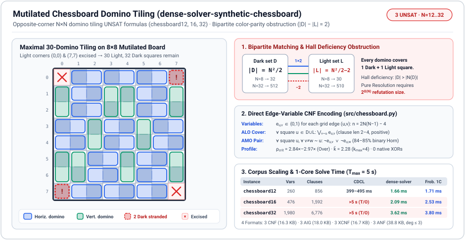

# [dense-solver](https://github.com/libdense/dense-solver) Synthetic Mutilated Chessboard Tiling Benchmarks (`dense-solver-synthetic-chessboard/`)

*Figure: Maximal 30-domino packing on an $8 \times 8$ opposite-corner mutilated chessboard stranding 2 dark squares, paired with the bipartite Hall parity obstruction ($\lvert D \rvert = N^2/2 \neq N^2/2 - 2 = \lvert L \rvert$), direct edge-variable CNF encoding, and scaling across `chessboard12`, `chessboard16`, and `chessboard32`. Regenerated via [`src/gen_diagram.py`](src/gen_diagram.py).*

## Provenance & Credit

- **Author:** Merlin Numa ([`@merlin_numa`](https://twitter.com/merlin_numa) on Twitter/X)
- **Upstream Repository:** [`libdense/dense-solver`](https://github.com/libdense/dense-solver)
- **Zenodo Archive (v0.0.4):** [`zenodo.org/records/24443907`](https://zenodo.org/records/24443907)
- **License & Attribution:** **MIT License** — see [`LICENSE`](LICENSE), [`CITATION.cff`](CITATION.cff), and [`SOURCES.md`](SOURCES.md).
- **Sibling & Companion Collections:** [`dense-solver-synthetic-php/`](../dense-solver-synthetic-php/README.md) (17 multi-encoding Pigeonhole Principle CNFs from the same upstream synthetic suite) and [`dense-solver-public/`](../dense-solver-public/README.md) (30 SATLIB + SC 2025 public CNFs).
- **Recommended by:** [`@merlin_numa`](https://twitter.com/merlin_numa) (Twitter/X)

## Problem Description

This collection holds the **3 Mutilated Chessboard domino-tiling UNSAT CNFs** (`chessboard12`, `chessboard16`, `chessboard32`) shipped with [dense-solver](https://github.com/libdense/dense-solver) 0.0.4 (0 SAT / 3 UNSAT):

- **Problem:** Given an $N \times N$ chessboard ($N \in \{12, 16, 32\}$) with two opposite same-color corners $(0,0)$ and $(N-1, N-1)$ removed, cover every remaining square with disjoint $1 \times 2$ dominoes.
- **Obstruction:** Removing two opposite light corners leaves $N^2/2$ dark squares and $N^2/2 - 2$ light squares. Because every domino covers one dark and one light square, no perfect matching exists (bipartite Hall deficiency $\lvert D \rvert - \lvert L \rvert = 2$). Pure Resolution / CDCL refutations require $2^{\Omega(N)}$ size, whereas cardinality/matching solvers refute all three boards in milliseconds.
- **Generator:** [`src/chessboard.py`](src/chessboard.py) encodes one Boolean variable per adjacent board edge, an At-Least-One covering clause per square (length 2–4), and pairwise At-Most-One binary conflict clauses around each square.

## Corpus & Data Sizes

- **`cnf-orig/`** — 3 original native **DIMACS `.cnf.xz`** files (16.3 KB).
- **`aig-converted/`** — 3 exact **Binary AIGER 1.9 `.aig.xz`** conversions (18.0 KB, verified via [Berkeley ABC](https://github.com/berkeley-abc/abc) `read_aiger`).
- **`xcnf-converted/`** — 3 lossless **[CryptoMiniSat](https://github.com/msoos/cryptominisat) `.xcnf.xz`** conversions (16.7 KB, `0` extracted native XOR parity clauses).
- **`anf-converted/`** — 3 lossless linear-size **DIMACS-ANF `.anf.xz`** conversions (38.8 KB, generated via [`../src/to_anf.py`](../src/to_anf.py)).
- **[`expected.tsv`](expected.tsv)** — Ground-truth verdict manifest for all 3 instances (**0 SAT / 3 UNSAT**).
- **`src/`** — Upstream Python generator (`chessboard.py`), standalone converters (`cnf2aig.py`, `cnf2xcnf.py`), and diagram script (`gen_diagram.py`).

| Format | Directory | Files | Key Dimensions (Range) | Compressed Size |
|---|---|---:|---|---:|
| **DIMACS CNF (origin)** | `cnf-orig/` | 3 | Vars: 260–1,980; Clauses: 856–6,776 | 16.3 KB |
| **Binary AIGER 1.9** | `aig-converted/` | 3 | Inputs: 260–1,980; ANDs: 1,947–15,467 | 18.0 KB |
| **[CryptoMiniSat](https://github.com/msoos/cryptominisat) XCNF** | `xcnf-converted/` | 3 | Native XOR clauses total: 0 | 16.7 KB |
| **DIMACS-ANF** | `anf-converted/` | 3 | Vars: 360–2,880; Eqs: 956–7,676 (deg ≤ 3) | 38.8 KB |
| **Total (4 Formats, Status: 0 SAT / 3 UNSAT)** | | **12** | | **89.8 KB** |

## Benchmark Results

- **Hardware & Protocol:** Same machine (**AMD Ryzen 9 5950X**, 16C/32T Linux, **1 thread per run** pinned across 8 dedicated physical cores, $T_{\max} = 5\;\text{s}$, PAR-2 penalty $10,000\;\text{ms}$). All solvers ran with default single-thread flags (`-t 1` for CryptoMiniSat 5.18.0; `--max-cores 1` for Frobenius) on identical uncompressed flat `.cnf` inputs; **100% of all 3 instances** were run (no subsampling), and **0 verdict disagreements** occurred across all solvers (cross-checked against [`expected.tsv`](expected.tsv)).

| Instance | Verdict | Frobenius 1C | [CaDiCaL](https://github.com/arminbiere/cadical) 3.1.0 | [CryptoMiniSat](https://github.com/msoos/cryptominisat) 5.18.0 | [dense-solver](https://github.com/libdense/dense-solver) 0.0.4 | [Kissat](https://github.com/arminbiere/kissat) 4.0.4 |
|---|:---:|---:|---:|---:|---:|---:|
| `chessboard12` | UNSAT | **0.85 ms** | 421.38 ms | 494.60 ms | 1.66 ms | 399.35 ms |
| `chessboard16` | UNSAT | **0.99 ms** | >5 s | >5 s | 2.09 ms | >5 s |
| `chessboard32` | UNSAT | **2.19 ms** | >5 s | >5 s | 3.62 ms | >5 s |
| **Total (3 files, PAR-2)** | **3/3** | **3/3 — 4.0 ms** *(fastest)* | 1/3 — 20,421.4 ms *(5,058.56x)* | 1/3 — 20,494.6 ms *(5,076.69x)* | 3/3 — 7.4 ms *(1.83x)* | 1/3 — 20,399.3 ms *(5,053.08x)* |

<!-- BEGIN_STRUCTURAL_ANALYSIS -->
## Phase-Transition & Structural Analysis

*Auto-generated by [`../src/analyze_benchmarks.py`](../src/analyze_benchmarks.py). Position relative to the critical phase transition is measured by $\rho_{\mathrm{crit}} = \frac{1}{n}\sum_k m_k / \alpha_c(k)$ (exact $\alpha/\alpha_c(k)$ for pure $k$-SAT; effective critical threshold $\alpha_c^{\mathrm{eff}} = \alpha/\rho_{\mathrm{crit}}$; `Under` $<0.90\times$, `Near-crit` $0.90\text{--}1.10\times$, `Over` $>1.10\times$), alongside Gent–Walsh annealed constrainedness $\kappa = -\frac{1}{n}\sum_i \log_2(1-2^{-k_i})$ (AAAI 1996), clause-length profile ($\bar{k}$, `%Bin`, `%Horn`), variable-degree CV ($\sigma_d/\bar{d}$, uniformity vs. hub skew), and extracted native XOR parity clauses.*

| Instance | Active $n$ | Clauses $m$ | $\alpha=m/n$ | $\alpha_c^{\mathrm{eff}}$ | $\rho_{\mathrm{crit}}$ (Regime) | $\kappa$ | $\bar{k}$ ($k_{\max}$) | Bin% | Horn% | Pos% | Deg CV | XORs |
|---|---:|---:|---:|---:|---:|---:|---:|---:|---:|---:|---:|---:|
| `chessboard12` | 260 | 856 | 3.29 | 1.16 | **2.84x** (Over) | 1.21 | 2.28 (4) | 84% | 83% | 27% | 0.11 | 0 |
| `chessboard16` | 476 | 1,592 | 3.34 | 1.16 | **2.89x** (Over) | 1.23 | 2.28 (4) | 84% | 84% | 26% | 0.10 | 0 |
| `chessboard32` | 1,980 | 6,776 | 3.42 | 1.15 | **2.97x** (Over) | 1.26 | 2.28 (4) | 85% | 85% | 26% | 0.07 | 0 |

**Collection Phase-Transition Summary (3 instances, 4 formats: 3 CNF / 3 AIG / 3 XCNF / 3 ANF):** median $\rho_{\mathrm{crit}} = 2.89\times$ (range `2.84x–2.97x`), median $\kappa = 1.23$, regime split **0 Under / 0 Near-critical / 3 Over**, total extracted native XOR parity clauses = **0**, total ANF equations = **10,420**.
<!-- END_STRUCTURAL_ANALYSIS -->

## References

- M. Numa, *[dense-solver](https://github.com/libdense/dense-solver) v0.0.4*, [GitHub](https://github.com/libdense/dense-solver) and [Zenodo `24443907`](https://zenodo.org/records/24443907) (2026).
- M. J. H. Heule, B. Kiesl, and A. Biere, *"Clausal Proofs of Mutilated Chessboards"*, NFM 2019, LNCS 11460, pp. 204–210.
- P. Hall, *"On Representatives of Subsets"*, J. London Math. Soc. s1-10(1), pp. 26–30, 1935.
