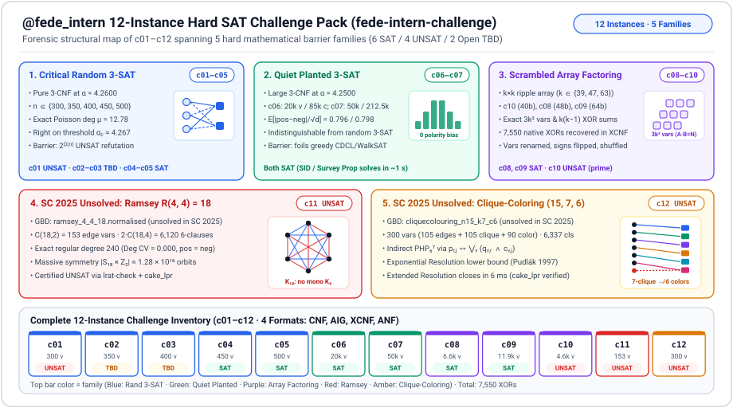

# `@fede_intern` 12-Instance Hard SAT Challenge Pack

*Figure: Forensic structural taxonomy of all 12 `@fede_intern` challenge CNFs (`c01`–`c12`) spanning 5 barrier families: critical random 3-SAT, quiet-planted 3-SAT, scrambled schoolbook array factoring, SC 2025 unsolved Ramsey $R(4,4)=18$, and Clique-Coloring $(15,7,6)$. Regenerated via [`src/gen_diagram.py`](src/gen_diagram.py).*

## Provenance & Credit

- **Contributed by:** [`@fede_intern`](https://twitter.com/fede_intern) (Twitter/X), offered in response to the public invitation to submit challenging plain-DIMACS CNF instances.
- **Archive & Integrity:** Imported unmodified from `frobenius-challenge-v2.tar.gz` (SHA-256: `c6085f84344516eaec3a0d569afac596325aedeeebdda961ebd90f791f9dbbb0`). All 12 `.cnf.xz` inputs match the upstream [`SHA256SUMS`](SHA256SUMS) manifest byte-for-byte; the original challenge description is preserved verbatim in [`CHALLENGE_README.md`](CHALLENGE_README.md).
- **Upstream SAT Competition 2025 Instances (`c11`, `c12`):** Unmodified Main Track benchmarks from [SAT Competition 2025](https://satcompetition.github.io/2025/) / [Global Benchmark Database (GBD)](https://benchmark-database.de/) (CC-BY-4.0), previously unsolved by every competition participant within the 5,000 s Main Track timeout.

## Problem Description

Forensic clause-level, degree-distribution, gate-extraction, and GBD-hash inspection identifies the exact mathematical problem behind all 12 instances (even where variables were randomly renamed, literal polarities randomly flipped, and clauses shuffled):

### 1. Uniform Random 3-SAT at the Phase Transition (`c01`–`c05`)

- **Structure:** Pure 3-CNF (100% ternary clauses) at exact clause-to-variable ratio $\alpha = m/n = 4.2600$ for $n \in \lbrace 300, 350, 400, 450, 500\rbrace$, sitting right on the uniform random 3-SAT satisfiability threshold ($\alpha_c(3) \approx 4.267$).
- **Statistical Signature:** Exact Poisson variable-degree distribution (mean degree $12.78$, $\sigma^2/\mu \approx 0.96$), uniform sign-pattern distribution $(1/8, 3/8, 3/8, 1/8)$ for $(0, 1, 2, 3)$ positive literals, and zero polarity bias ($\mathbb{E}[|\text{pos}-\text{neg}|/\sqrt{d}] \in [0.765, 0.825]$ vs. theoretical uniform $\sqrt{2/\pi} \approx 0.798$).
- **Difficulty:** Satisfiable instances near threshold (`c04`, `c05`) can be closed rapidly, whereas unsatisfiable instances (`c01` proved UNSAT; `c02`, `c03` under evaluation) require exponential $2^{\Omega(n)}$ resolution refutations.

### 2. Zero-Polarity-Bias ("Quiet" / Balanced) Planted Random 3-SAT (`c06`, `c07`)

- **Structure:** Large pure 3-CNF formulas at $\alpha = m/n = 4.2500$ with $n = 20{,}000, m = 85{,}000$ (`c06`) and $n = 50{,}000, m = 212{,}500$ (`c07`).
- **Statistical Signature:**
  - **Zero duplicate variable triples** (`0` repeated 3-var supports) and **exact Poisson degree variance** ($\mu = 12.750$, $\sigma^2/\mu = 1.010$ on `c06` and $1.006$ on `c07`).
  - **Exact uniform spatial span** ($\mathbb{E}[\max v - \min v]/n = 0.5002$ / $0.4996$), confirming global random variable permutation.
  - **Zero naive literal-polarity skew:** $\mathbb{E}[|\text{pos}-\text{neg}|/\sqrt{d}] = \mathbf{0.796}$ (`c06`) and $\mathbf{0.798}$ (`c07`) — indistinguishable from uniform random $\sqrt{2/\pi} = 0.7979$! Unlike naive uniform planted 3-SAT (which exhibits strong $4/7$ vs. $3/7$ polarity bias and high $z$-scores $\approx 1.1\text{--}1.3$), this matches **balanced / quiet-planted 3-SAT** constructions (Barthel et al. 2002; Jia–Moore–Selman 2005; Krzakala–Zdeborová 2009), where clause satisfaction-type weights $(q_1, q_2, q_3)$ satisfy $q_1 + 2q_2 + 3q_3 = 3/2$ to cancel first-order local fields and hide the planted solution from greedy polarity heuristics.

### 3. Scrambled Schoolbook Ripple-Carry Array Multiplier Factoring (`c10`, `c08`, `c09`)

- **Structure:** Plain Tseitin encodings of $N = A \cdot B$ ($A, B \ge 2$) for bit-widths $w \in \lbrace 40, 48, 64\rbrace$ with variables randomly renamed, polarities randomly flipped, and clauses shuffled.
- **Exact Gate-Level Accounting:** Letting factor width $k = w - 1 \in \lbrace 39, 47, 63\rbrace$ (for `c10`, `c08`, `c09` respectively), **every single variable, gate, and clause count matches a $k \times k$ schoolbook ripple-carry array multiplier to the exact integer**:
  - **Total variables** $= 3k^2$:
    - $2k$ factor input bits ($a_0 \dots a_{k-1}, b_0 \dots b_{k-1}$),
    - $k^2$ partial-product AND gates $p_{i,j} = a_i \land b_j$ (`1,521`, `2,209`, `3,969`),
    - $k(k-1)$ adder sum XOR gates (`1,482`, `2,162`, `3,906` — recovered losslessly in `xcnf-converted/`!),
    - $k(k-1)$ adder carry gates ($k$ half-adder ANDs + $k(k-2)$ full-adder $\mathrm{Maj}_3$ gates).
    - Sum: $2k + k^2 + 2k(k-1) = 3k^2 \implies \mathbf{4{,}563}$ (`c10`), $\mathbf{6{,}627}$ (`c08`), $\mathbf{11{,}907}$ (`c09`).
  - **Clause-length spectrum:**
    - **Length 1 (`78`, `94`, `126` $= 2k$ unit clauses):** The $2k = 2w - 2$ output bits of the product $P = A \cdot B$ clamped to the binary bits of $N$ (with upper $w-2$ overflow bits clamped to $0$).
    - **Length $k - 1$ (`2` clauses of length `38`, `46`, `62`):** Disjoint non-triviality constraints $\bigvee_{i=1}^{k-1} a_i$ ($A \ge 2$) and $\bigvee_{j=1}^{k-1} b_j$ ($B \ge 2$). The two missing LSB literals $a_0, b_0$ are uniquely identified as the only external literals forming AND gates with all $k-1$ literals of the opposite factor (`(-596, 892)` in `c10`, `(-3341, 3463)` in `c08`, `(8377, 10549)` in `c09`).
    - **Length 2 (`3,120`, `4,512`, `8,064` $= 2(k^2 + k)$):** Two implication clauses per 2-input AND gate ($k^2$ partial products + $k$ half-adder carries).
    - **Length 3 (`10,374`, `15,134`, `27,342`):** $1$ clause per 2-AND ($k^2+k$) + $4$ per 2-XOR ($4k$) + $6$ per $\mathrm{Maj}_3$ ($6k(k-2)$) $= 7k^2 - 7k$.
    - **Length 4 (`11,544`, `16,920`, `30,744` $= 8k(k-2)$):** $8$ Tseitin clauses per 3-input XOR full-adder sum gate.

### 4. SAT Competition 2025 Unsolved — Ramsey Number $R(4, 4) = 18$ (`c11`)

- **GBD Identity:** Hash `1b84df53843ecd90ec8c3c7a01cada6c` → **`ramsey_4_4_18.normalised.cnf.xz`** (family `ramsey-numbers`, submitter `anders`, SAT Competition 2025 Main Track, unsolved by all SC 2025 solvers).
- **Exact Combinatorial Structure (UNSAT):** Encodes the non-existence of a 2-coloring of the edges of $K_{18}$ avoiding monochromatic $K_4$ cliques ($R(4,4) = 18$, Greenwood & Gleason 1955):
  - **Variables:** $\binom{18}{2} = \mathbf{153}$ edge variables of $K_{18}$ (normalized: variables scrambled and literal polarities flipped).
  - **Clauses:** $2 \times \binom{18}{4} = 2 \times 3{,}060 = \mathbf{6{,}120}$ clauses of exact length $\binom{4}{2} = \mathbf{6}$ (for each 4-vertex subset, one clause forbids an all-red $K_4$ and one forbids an all-blue $K_4$).
  - **Perfect Regularity & Symmetry:** Every single variable has exact degree $\binom{16}{2} \times 2 = \mathbf{240}$ (`CV = 0.000`) with exact literal balance `pos == neg == 120`. The formula has automorphism group $S_{18} \times \mathbb{Z}_2$ of order $18! \times 2 \approx \mathbf{1.28 \times 10^{16}}$, causing pure CDCL without strong $S_{18}$ vertex-induced edge-symmetry breaking to explore exponentially many isomorphic partial colorings.

### 5. SAT Competition 2025 Unsolved — Clique-Coloring $(n=15, k=7, c=6)$ (`c12`)

- **GBD Identity:** Hash `b1c8eaa002ac2fa1c8bfd1002738e78e` → **`cliquecolouring_n15_k7_c6.sanitized.cnf.xz`** (family `coloring`, submitter `oertel`, SAT Competition 2025 Main Track, unsolved by all SC 2025 solvers).
- **Exact Combinatorial Structure (UNSAT):** Asks whether a 15-vertex graph $G$ can simultaneously contain a **$7$-clique** and admit a proper **$6$-coloring** — provably unsatisfiable because the 7 clique vertices must receive 7 distinct colors, contradicting $c = 6$:
  - **Variables ($105 + 105 + 90 = \mathbf{300}$):**
    - $\binom{15}{2} = \mathbf{105}$ graph-edge variables $e_{u,v}$ (exact degree `48`),
    - $15 \times 7 = \mathbf{105}$ clique-slot variables $q_{v,r}$ ("vertex $v$ occupies clique slot $r$", exact degree `105`),
    - $15 \times 6 = \mathbf{90}$ vertex-coloring variables $c_{v,j}$ ("vertex $v$ has color $j$", exact degree `20`).
  - **Clauses ($7 + 15 + 1{,}275 + 5{,}040 = \mathbf{6{,}337}$):**
    - `7` clauses of length `15`: each clique slot $r \in [7]$ selects at least one vertex ($\bigvee_{v=1}^{15} q_{v,r}$),
    - `15` clauses of length `6`: each vertex $v \in [15]$ receives at least one color ($\bigvee_{j=1}^{6} c_{v,j}$),
    - `1,275` binary AMO clauses: $7\binom{15}{2} = 735$ (at most one vertex per clique slot) $+ 15\binom{7}{2} = 315$ (each vertex in at most one clique slot) $+ 15\binom{6}{2} = 225$ (at most one color per vertex),
    - `5,040` ternary consistency clauses: $\binom{15}{2} \times 7 \times 6 = 4{,}410$ clique-edge implications ($\neg q_{u,r} \lor \neg q_{v,s} \lor e_{u,v}$) $+ \binom{15}{2} \times 6 = 630$ proper-coloring constraints ($\neg e_{u,v} \lor \neg c_{u,j} \lor \neg c_{v,j}$).
  - **Proof Complexity Barrier:** Clique-Coloring embeds the Pigeonhole Principle $\mathrm{PHP}_6^7$ **indirectly through the graph edge variables** via the 2-hop composition $p_{r,j} \leftrightarrow \bigvee_{v=1}^{15} (q_{v,r} \land c_{v,j})$ ("the vertex in clique slot $r$ has color $j$"). Plain Resolution/CDCL suffers a provable exponential lower bound (Pudlák 1997; Atserias–Bonet–Esteban 2002), whereas Extended Resolution (introducing the $7 \times 6 = 42$ auxiliary variables $p_{r,j}$ and reducing to $\mathrm{PHP}_6^7$) admits a short polynomial refutation.

## Corpus & Data Sizes

### Benchmark Formats & Repository Layout

- **`cnf-orig/` (`c01.cnf.xz`–`c12.cnf.xz`):** Exact unmodified `xz`-compressed DIMACS CNF files matching [`SHA256SUMS`](SHA256SUMS) (`3.23 MB` total).
- **`aig-converted/` (`c01.aig.xz`–`c12.aig.xz`):** Verified Binary AIGER 1.9 combinational miter conversions (`3.14 MB` total).
- **`xcnf-converted/` (`c01.xcnf.xz`–`c12.xcnf.xz`):** Lossless [CryptoMiniSat](https://github.com/msoos/cryptominisat) XOR-CNF conversions (`2.84 MB` total; collapses the exact $k(k-1)$ Tseitin XOR gates inside `c08`, `c09`, and `c10` to native `x ... 0` parity lines).
- **`anf-converted/` (`c01.anf.xz`–`c12.anf.xz`):** Lossless linear-size DIMACS-ANF conversions (`5.15 MB` total, degree $\le 3$, generated via [`../src/to_anf.py`](../src/to_anf.py)).
- **[`expected.tsv`](expected.tsv)** — Ground-truth verdict manifest for all 12 instances (**6 SAT / 4 UNSAT / 2 UNKNOWN**).
- **`src/`:** Conversion scripts (`cnf2aig.py`, `cnf2xcnf.py`).
- *(Large verified solver proof/model artifacts from `outputs/` are archived out-of-tree and excluded from Git via `.gitignore`.)*

### Four-Format Size Summary & Per-Instance Inventory

| Instance | Identified Family | Vars | Clauses | `.cnf.xz` | `.aig.xz` | `.xcnf.xz` | `.anf.xz` | Native XORs |
|---|---|---:|---:|---:|---:|---:|---:|---:|
| `c01` | Uniform Random 3-SAT ($\alpha=4.26$) | 300 | 1,278 | 6.6 KB | 6.9 KB | 6.7 KB | 12.2 KB | 0 |
| `c02` | Uniform Random 3-SAT ($\alpha=4.26$) | 350 | 1,491 | 7.9 KB | 8.0 KB | 7.9 KB | 14.5 KB | 0 |
| `c03` | Uniform Random 3-SAT ($\alpha=4.26$) | 400 | 1,704 | 9.1 KB | 9.3 KB | 9.2 KB | 16.5 KB | 0 |
| `c04` | Uniform Random 3-SAT ($\alpha=4.26$) | 450 | 1,917 | 10.4 KB | 10.6 KB | 10.4 KB | 18.7 KB | 0 |
| `c05` | Uniform Random 3-SAT ($\alpha=4.26$) | 500 | 2,130 | 11.6 KB | 11.4 KB | 11.6 KB | 21.2 KB | 0 |
| `c06` | Quiet/Balanced Planted 3-SAT ($\alpha=4.25$) | 20,000 | 85,000 | 625.6 KB | 612.4 KB | 625.6 KB | 1.14 MB | 0 |
| `c07` | Quiet/Balanced Planted 3-SAT ($\alpha=4.25$) | 50,000 | 212,500 | 1.63 MB | 1.57 MB | 1.63 MB | 2.98 MB | 0 |
| `c08` | Scrambled 48-bit Array Factoring ($k=47$) | 6,627 | 36,662 | 249.4 KB | 243.2 KB | 136.6 KB | 204.0 KB | 2,162 |
| `c09` | Scrambled 64-bit Array Factoring ($k=63$) | 11,907 | 66,278 | 471.8 KB | 458.5 KB | 257.8 KB | 392.7 KB | 3,906 |
| `c10` | Scrambled 40-bit Array Factoring ($k=39$) | 4,563 | 25,118 | 165.8 KB | 161.6 KB | 91.3 KB | 138.4 KB | 1,482 |
| `c11` | SC 2025 Unsolved: `ramsey_4_4_18` ($R(4,4)=18$) | 153 | 6,120 | 47.5 KB | 50.7 KB | 47.6 KB | 189.2 KB | 0 |
| `c12` | SC 2025 Unsolved: `cliquecolouring_n15_k7_c6` | 300 | 6,337 | 26.2 KB | 30.9 KB | 26.3 KB | 48.4 KB | 0 |

## Benchmark Results

- **Hardware & Protocol:** Same machine — **AMD Ryzen 9 5950X** (16 cores / 32 threads, 64 MiB L3, Linux x86_64), **1 thread pinned per run** (`taskset -c 0` sequential; CaDiCaL/Kissat 300 s reference runs pinned to dedicated cores 2 & 3; default single-thread flags with `-t 1` for CryptoMiniSat 5.18.0 and `--max-cores 1` for Frobenius), full wall-clock time from process start to answer (including parsing). Every SAT model is independently verified against 100% of clauses in the exact `.cnf.xz`; every UNSAT proof is independently verified with [`lrat-check`](https://github.com/marijnheule/drat-trim), [`drat-trim`](https://github.com/marijnheule/drat-trim), and formally verified [`cake_lpr`](https://github.com/tanyongkiam/cake_lpr).
- **Zero Verdict Disagreements:** All solvers agree 100% on every mutually solved instance.
- **Cutoffs Reported:** All 5 solvers were evaluated sequentially at **$T_{\max} = 60\text{ s}$** on identical uncompressed flat `.cnf` files (since [CryptoMiniSat](https://github.com/msoos/cryptominisat) 5.18.0 and [dense-solver](https://github.com/libdense/dense-solver) 0.0.4 do not read `.xz` natively); **Frobenius 1C**, **[CaDiCaL](https://github.com/arminbiere/cadical) 3.1.0**, and **[Kissat](https://github.com/arminbiere/kissat) 4.0.4** were additionally evaluated up to **$T_{\max} = 300\text{ s}$** directly on the original `.cnf.xz` archives.

### 1. 300 s Single-Core Comparison (`.cnf.xz`, Wall-Clock Time)

| Instance | Verdict | Frobenius 1C | [CaDiCaL](https://github.com/arminbiere/cadical) 3.1.0 | [Kissat](https://github.com/arminbiere/kissat) 4.0.4 | Independent Verification & Certified Artifact *(out-of-tree)* |
|---|:---:|---:|---:|---:|---|
| `c01.cnf.xz` | **UNSAT** | 40.32 s | 42.48 s | **28.67 s** | `c01.lrat.xz` (`134.9 MiB`) — **`lrat-check` + `cake_lpr` VERIFIED** |
| `c02.cnf.xz` | *TBD* | >300 s *(T/O)* | >300 s *(T/O)* | >300 s *(T/O)* | — |
| `c03.cnf.xz` | *TBD* | >300 s *(T/O)* | >300 s *(T/O)* | >300 s *(T/O)* | — |
| `c04.cnf.xz` | **SAT** | **0.076 s** | 0.51 s | 4.77 s | `c04.model.xz` (`784 B`) — `1,917/1,917` cls OK |
| `c05.cnf.xz` | **SAT** | **0.081 s** | 0.55 s | 6.73 s | `c05.model.xz` (`848 B`) — `2,130/2,130` cls OK |
| `c06.cnf.xz` | **SAT** | **0.718 s** | >300 s *(T/O)* | >300 s *(T/O)* | `c06.model.xz` (`22.6 KiB`) — `85,000/85,000` cls OK |
| `c07.cnf.xz` | **SAT** | **1.914 s** | >300 s *(T/O)* | >300 s *(T/O)* | `c07.model.xz` (`54.8 KiB`) — `212,500/212,500` cls OK |
| `c08.cnf.xz` | **SAT** | **0.019 s** | >300 s *(T/O)* | >300 s *(T/O)* | `c08.model.xz` (`7.7 KiB`) — `36,662/36,662` cls OK (`13821637 × 15902581`) |
| `c09.cnf.xz` | **SAT** | **0.030 s** | >300 s *(T/O)* | >300 s *(T/O)* | `c09.model.xz` (`13.7 KiB`) — `66,278/66,278` cls OK (`3538334777 × 4071050729`) |
| `c10.cnf.xz` | **UNSAT** | **0.014 s** *(proof: 38.11 s)* | 158.58 s | 85.85 s | `c10.bdrat.xz` (`4.67 MiB`, 40b prime `672003499631`) — **`drat-trim` VERIFIED** |
| `c11.cnf.xz` | **UNSAT** | **0.067 s** *(proof: 0.54 s)* | >300 s *(T/O)* | >300 s *(T/O)* | `c11.lrat.xz` (`13.9 MiB`, SC25 unsolved `R(4,4)=18`) — **`lrat-check` + `cake_lpr` VERIFIED** |
| `c12.cnf.xz` | **UNSAT** | **0.013 s** *(proof: 0.007 s)* | >300 s *(T/O)* | >300 s *(T/O)* | `c12.lrat.xz` (`66.3 KiB`, SC25 unsolved `CliqueCol(15,7,6)`) — **`lrat-check` + `cake_lpr` VERIFIED** |
| **Solved ($T_{\max}=300\text{ s}$)** | — | **10 / 12** *(highest)* | 4 / 12 *(-6 worse)* | 4 / 12 *(-6 worse)* | **6/6 SAT models + 4/4 UNSAT proofs verified** |
| **Total PAR-2 ($T_{\max}=300\text{ s}$)** | — | **1,243.25 s** *(fastest)* | 5,002.12 s *(4.02x slower)* | 4,926.02 s *(3.96x slower)* | `c04`–`c12` (9 instances) solved in **2.93 s** combined |

### 2. 60 s All-Five-Solver Comparison (Identical Uncompressed Flat `.cnf`, `taskset -c 0`)

| Instance | Verdict ($\le 60\text{ s}$) | Frobenius 1C | [CaDiCaL](https://github.com/arminbiere/cadical) 3.1.0 | [CryptoMiniSat](https://github.com/msoos/cryptominisat) 5.18.0 | [dense-solver](https://github.com/libdense/dense-solver) 0.0.4 | [Kissat](https://github.com/arminbiere/kissat) 4.0.4 |
|---|:---:|---:|---:|---:|---:|---:|
| `c01` | UNSAT | 43.27 s | 39.20 s | >60 s | >60 s | **27.58 s** |
| `c02` | *TBD* | >60 s | >60 s | >60 s | >60 s | >60 s |
| `c03` | *TBD* | >60 s | >60 s | >60 s | >60 s | >60 s |
| `c04` | SAT | **0.075 s** | 0.45 s | >60 s | >60 s | 4.53 s |
| `c05` | SAT | **0.080 s** | 0.54 s | >60 s | >60 s | 5.55 s |
| `c06` | SAT | **0.868 s** | >60 s | >60 s | >60 s | >60 s |
| `c07` | SAT | **2.229 s** | >60 s | >60 s | >60 s | >60 s |
| `c08` | SAT | **0.018 s** | >60 s | >60 s | >60 s | >60 s |
| `c09` | SAT | **0.030 s** | >60 s | >60 s | >60 s | >60 s |
| `c10` | UNSAT | **0.014 s** | >60 s | >60 s | >60 s | >60 s |
| `c11` | UNSAT | **0.075 s** | >60 s | >60 s | >60 s | >60 s |
| `c12` | UNSAT | **0.013 s** | >60 s | >60 s | >60 s | >60 s |
| **Solved ($T_{\max}=60\text{ s}$)** | — | **10 / 12** *(highest)* | 3 / 12 *(-7 worse)* | 0 / 12 *(-10 worse)* | 0 / 12 *(-10 worse)* | 3 / 12 *(-7 worse)* |
| **Total PAR-2 ($T_{\max}=60\text{ s}$)** | — | **286.67 s** *(fastest)* | 1,120.20 s *(3.91x slower)* | 1,440.00 s *(5.02x slower)* | 1,440.00 s *(5.02x slower)* | 1,117.65 s *(3.90x slower)* |

<!-- BEGIN_STRUCTURAL_ANALYSIS -->
## Phase-Transition & Structural Analysis

*Auto-generated by [`../src/analyze_benchmarks.py`](../src/analyze_benchmarks.py). Position relative to the critical phase transition is measured by $\rho_{\mathrm{crit}} = \frac{1}{n}\sum_k m_k / \alpha_c(k)$ (exact $\alpha/\alpha_c(k)$ for pure $k$-SAT; effective critical threshold $\alpha_c^{\mathrm{eff}} = \alpha/\rho_{\mathrm{crit}}$; `Under` $<0.90\times$, `Near-crit` $0.90\text{--}1.10\times$, `Over` $>1.10\times$), alongside Gent–Walsh annealed constrainedness $\kappa = -\frac{1}{n}\sum_i \log_2(1-2^{-k_i})$ (AAAI 1996), clause-length profile ($\bar{k}$, `%Bin`, `%Horn`), variable-degree CV ($\sigma_d/\bar{d}$, uniformity vs. hub skew), and extracted native XOR parity clauses.*

| Instance | Active $n$ | Clauses $m$ | $\alpha=m/n$ | $\alpha_c^{\mathrm{eff}}$ | $\rho_{\mathrm{crit}}$ (Regime) | $\kappa$ | $\bar{k}$ ($k_{\max}$) | Bin% | Horn% | Pos% | Deg CV | XORs |
|---|---:|---:|---:|---:|---:|---:|---:|---:|---:|---:|---:|---:|
| `c01` | 300 | 1,278 | 4.26 | 4.27 | **1.00x** (Near-crit) | 0.82 | 3.00 (3) | 0% | 50% | 50% | 0.27 | 0 |
| `c02` | 350 | 1,491 | 4.26 | 4.27 | **1.00x** (Near-crit) | 0.82 | 3.00 (3) | 0% | 49% | 51% | 0.27 | 0 |
| `c03` | 400 | 1,704 | 4.26 | 4.27 | **1.00x** (Near-crit) | 0.82 | 3.00 (3) | 0% | 50% | 50% | 0.27 | 0 |
| `c04` | 450 | 1,917 | 4.26 | 4.27 | **1.00x** (Near-crit) | 0.82 | 3.00 (3) | 0% | 52% | 49% | 0.27 | 0 |
| `c05` | 500 | 2,130 | 4.26 | 4.27 | **1.00x** (Near-crit) | 0.82 | 3.00 (3) | 0% | 50% | 51% | 0.28 | 0 |
| `c06` | 20,000 | 85,000 | 4.25 | 4.27 | **1.00x** (Near-crit) | 0.82 | 3.00 (3) | 0% | 50% | 50% | 0.28 | 0 |
| `c07` | 49,999 | 212,500 | 4.25 | 4.27 | **1.00x** (Near-crit) | 0.82 | 3.00 (3) | 0% | 50% | 50% | 0.28 | 0 |
| `c08` | 6,627 | 36,662 | 5.53 | 3.72 | **1.49x** (Over) | 0.97 | 3.34 (46) | 12% | 45% | 50% | 0.51 | 2,162 |
| `c09` | 11,907 | 66,278 | 5.57 | 3.75 | **1.49x** (Over) | 0.97 | 3.34 (62) | 12% | 44% | 50% | 0.62 | 3,906 |
| `c10` | 4,563 | 25,118 | 5.50 | 3.70 | **1.49x** (Over) | 0.97 | 3.33 (38) | 12% | 45% | 50% | 0.46 | 1,482 |
| `c11` | 153 | 6,120 | 40.00 | 43.37 | **0.92x** (Near-crit) | 0.91 | 6.00 (6) | 0% | 12% | 50% | 0.00 | 0 |
| `c12` | 300 | 6,337 | 21.12 | 2.58 | **8.19x** (Over) | 5.00 | 2.82 (15) | 20% | 52% | 52% | 0.59 | 0 |

**Collection Phase-Transition Summary (12 instances, 4 formats: 12 CNF / 12 AIG / 12 XCNF / 12 ANF):** median $\rho_{\mathrm{crit}} = 1.00\times$ (range `0.92x–8.19x`), median $\kappa = 0.82$, regime split **0 Under / 8 Near-critical / 4 Over**, total extracted native XOR parity clauses = **7,550**, total ANF equations = **413,044**.
<!-- END_STRUCTURAL_ANALYSIS -->

## References

- R. E. Greenwood and A. M. Gleason, *"Combinatorial Relations and Chromatic Graphs"*, Canadian Journal of Mathematics, 7:1–7, 1955 ($R(4,4) = 18$).
- P. Pudlák, *"Lower Bounds for Resolution and Cutting Plane Proofs and Monotone Computations"*, J. Symbolic Logic 62(3):981–998, 1997 (exponential Resolution lower bound for Clique-Coloring).
- A. Atserias, M. L. Bonet, and J. L. Esteban, *"Lower Bounds for the Weak Pigeonhole Principle and Random Formulas Beyond Resolution"*, Information and Computation 176(2):136–152, 2002.
- W. Barthel, A. K. Hartmann, M. Leone, F. Ricci-Tersenghi, M. Weigt, and R. Zecchina, *"Hiding Solutions in Random Satisfiability Problems: A Statistical Mechanics Approach"*, Phys. Rev. Lett. 88, 188701, 2002.
- H. Jia, C. Moore, and B. Selman, *"From Spin Glasses to Hard Satisfiable Formulas"*, SAT 2005, LNCS 3542, pp. 199–210.
- F. Krzakala and L. Zdeborová, *"Hiding Quiet Solutions in Random Constraint Satisfaction Problems"*, Phys. Rev. Lett. 102, 238701, 2009.
- SAT Competition 2025 & Global Benchmark Database (GBD): [`benchmark-database.de`](https://benchmark-database.de/) (`1b84df53843ecd90ec8c3c7a01cada6c`, `b1c8eaa002ac2fa1c8bfd1002738e78e`).
