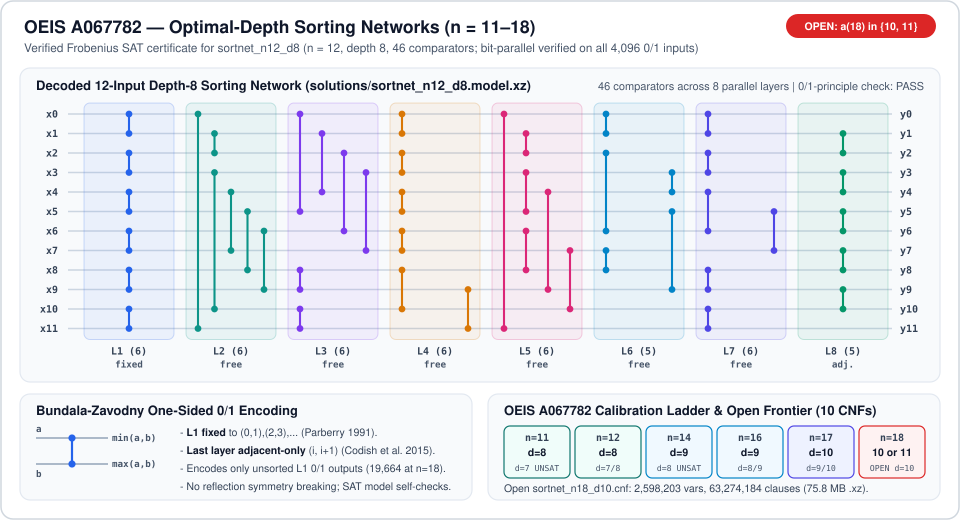

# OEIS A067782 — Optimal-Depth Sorting Networks (`guillochon-oeis-a067782-sortnet`)

*Independently verified 12-input depth-8 sorting network (`46` comparators, bit-parallel verified on all $2^{12} = 4{,}096$ binary inputs) decoded directly from [`solutions/sortnet_n12_d8.model.xz`](solutions/sortnet_n12_d8.model.xz), alongside the Bundala–Závodný encoding summary and OEIS A067782 depth ladder (generated by [`src/gen_diagram.py`](src/gen_diagram.py)).*

## Provenance & Credit

- **Author & Maintainer:** James Guillochon ([`@spallingerrer`](https://twitter.com/spallingerrer)) — [`https://github.com/guillochon/oeis-sat-instances`](https://github.com/guillochon/oeis-sat-instances) (`sequences/A067782/`, imported from upstream `main` commit `ba6430c`, 2026-11-23).
- **License:** Upstream generator, verifier, and validation code is MIT-licensed ([`LICENSE`](LICENSE)); all generated DIMACS CNF instances are released into the public domain (CC0).
- **Integrity:** All **10 / 10** `.cnf.xz` files in [`cnf-orig/`](cnf-orig/) are exact unmodified upstream files matching [`src/upstream/sequences/A067782/cnf/SHA256SUMS`](src/upstream/sequences/A067782/cnf/SHA256SUMS) byte-for-byte upon decompression.
- **Ground Truth Manifest:** [`expected.tsv`](expected.tsv) lists all **10 instances** (**4 SAT / 5 UNSAT / 1 UNKNOWN** open OEIS frontier target).

## Problem Description

[OEIS A067782](https://oeis.org/A067782) gives $a(n)$, the minimum parallel depth of an $n$-input comparator sorting network. A comparator $(i, j)$ with $i < j$ maps $(x_i, x_j) \mapsto (\min(x_i, x_j), \max(x_i, x_j))$, and comparators operating on disjoint channels execute simultaneously in one parallel layer.

- **Known exact values ($n \le 17$):** $a(11) = a(12) = 8$, $a(14) = a(16) = 9$ (Bundala & Závodný 2014), and $a(17) = 10$ (Ehlers & Müller 2014/2015).
- **Open question ($n = 18$):** Does an 18-input sorting network of depth 10 exist? Depth 11 is achievable (`sortnet_n18_d11.cnf` is SAT), and monotonicity gives $a(18) \ge a(17) = 10$, so $a(18) \in \{10, 11\}$.
- **Target instance `sortnet_n18_d10.cnf`:**
  - **SAT** settles $a(18) = 10$ with an explicit comparator network independently checked across all $2^{18} = 262{,}144$ 0/1 inputs in milliseconds via `decode_verify.py`.
  - **UNSAT** (with a machine-checkable DRAT/LRAT proof accepted by `drat-trim` / `cake_lpr`) settles $a(18) = 11$.

### Encoding Architecture (`gen_depth_cnf.py`)

The Bundala–Závodný (2014) sound-and-complete one-sided upper-bound encoding over the 0/1 principle:

- **Fixed first layer (Parberry 1991):** Layer 1 is fixed to $(0, 1), (2, 3), \dots, (2\lfloor n/2\rfloor - 2, 2\lfloor n/2\rfloor - 1)$ without loss of optimality; only the distinct unsorted 0/1 outputs of Layer 1 (`19,664` vectors at $n = 18$) are propagated through the remaining $d - 1$ layers.
- **Comparator variables & mutual exclusion:** One variable per candidate comparator $(i, j)$ in each free layer, constrained so each wire participates in at most one comparator per layer.
- **One-sided value bounds:** For each input vector with $k$ ones, the network output must satisfy $y_c = 0$ for all $c < n - k$ (since comparators preserve Hamming weight, this is equivalent to full sorting).
- **Adjacent-only last layer (Codish et al. 2015):** Layer $d$ restricts comparators to adjacent pairs $(i, i+1)$, which holds for every non-redundant sorting network.
- **No reflection symmetry breaking** beyond the fixed first layer, keeping the CNF straightforward to audit. Instances scale from `23,116` variables / `326,695` clauses (`n=11, d=7`) up to `2,922,974` variables / `71,667,732` clauses (`n=18, d=11`).

## Corpus & Data Sizes

### Repository Layout & Four-Format Inventory

All committed files are `xz`-compressed and strictly respect GitHub's `< 95 MB` per-file size limit:

| Directory | Files | Total Size | Max File Size | Notes |
|---|---:|---:|---:|---|
| `cnf-orig/` | 10 | 298.46 MB | 88.93 MB (`sortnet_n18_d11.cnf.xz`) | Exact unmodified upstream `.cnf.xz` files (`10/10` SHA-256 verified) |
| `xcnf-converted/` | 10 | 297.68 MB | 88.43 MB (`sortnet_n18_d11.xcnf.xz`) | Lossless CryptoMiniSat `.xcnf.xz` conversions (`0` native XOR parity blocks) |
| `aig-converted/` | 6 | 111.71 MB | 51.43 MB (`sortnet_n16_d9.aig.xz`) | Binary AIGER 1.9 miters (`.aig.xz`). The 4 largest instances (`n17_d9`, `n17_d10`, `n18_d10`, `n18_d11`) are omitted via `format_exclusions.tsv` because `sortnet_n17_d9.aig.xz` measures `113.45 MB > 95 MB` (`n18_d11` exceeds `220 MB`). |
| `anf-converted/` | 6 | 112.99 MB | 52.72 MB (`sortnet_n16_d9.anf.xz`) | Lossless linear-size degree-$\le 3$ DIMACS-ANF (`.anf.xz`). Same 4 largest instances omitted via `format_exclusions.tsv` (`sortnet_n17_d9.anf.xz` measures `118.43 MB > 95 MB`). |
| `solutions/` | 1 | 46.8 KB | 46.8 KB (`sortnet_n12_d8.model.xz`) | **1** verified SAT model (`sortnet_n12_d8.model.xz`) + [`solutions/SHA256SUMS`](solutions/SHA256SUMS) |
| `src/` | — | — | — | [`src/gen_diagram.py`](src/gen_diagram.py) + verbatim upstream generator, verifier, `.map.json` sidecars, and `SHA256SUMS` under [`src/upstream/`](src/upstream/) |

See [`format_exclusions.tsv`](format_exclusions.tsv) for the machine-checked manifest of the 4 `aig-converted/` and 4 `anf-converted/` omissions exceeding GitHub's `95 MB` per-file size cap.

#### Complete Instance Inventory & Ground-Truth Verdicts (`expected.tsv`)

| Instance | Expected | Variables | Clauses | `.cnf.xz` | `.xcnf.xz` | `.aig.xz` | `.anf.xz` |
|---|:---:|---:|---:|---:|---:|---:|---:|
| `sortnet_n11_d7.cnf` | UNSAT | 23,116 | 326,695 | 402.0 KB | 412.6 KB | 1.10 MB | 1.05 MB |
| `sortnet_n12_d7.cnf` | UNSAT | 38,303 | 592,653 | 775.1 KB | 744.9 KB | 1.96 MB | 1.93 MB |
| `sortnet_n12_d8.cnf` | SAT | 45,959 | 721,647 | 1.07 MB | 1.07 MB | 2.50 MB | 2.58 MB |
| `sortnet_n14_d8.cnf` | UNSAT | 164,061 | 3,024,241 | 4.41 MB | 4.43 MB | 11.00 MB | 10.66 MB |
| `sortnet_n16_d8.cnf` | UNSAT | 570,847 | 12,072,374 | 16.07 MB | 15.92 MB | 43.72 MB | 44.06 MB |
| `sortnet_n16_d9.cnf` | SAT | 665,983 | 14,246,446 | 19.09 MB | 19.37 MB | 51.43 MB | 52.72 MB |
| `sortnet_n17_d10.cnf` | SAT | 1,627,177 | 37,367,427 | 47.71 MB | 47.71 MB | — *(>95 MB)* | — *(>95 MB)* |
| `sortnet_n17_d9.cnf` | UNSAT | 1,423,784 | 32,414,930 | 44.19 MB | 43.75 MB | — *(>95 MB)* | — *(>95 MB)* |
| `sortnet_n18_d10.cnf` | **UNKNOWN** *(Open)* | 2,598,203 | 63,274,184 | 75.81 MB | 75.84 MB | — *(>95 MB)* | — *(>95 MB)* |
| `sortnet_n18_d11.cnf` | SAT | 2,922,974 | 71,667,732 | 88.93 MB | 88.43 MB | — *(>95 MB)* | — *(>95 MB)* |

### Sibling Collections (`guillochon/oeis-sat-instances`)

This directory is one of **9 single-problem-type collections** split from James Guillochon's [`guillochon/oeis-sat-instances`](https://github.com/guillochon/oeis-sat-instances) suite (`112` instances across `13` OEIS sequences):

| Collection | OEIS Sequence(s) | Combinatorial Problem | Instances |
|---|---|---|---:|
| **`guillochon-oeis-a067782-sortnet/`** *(this collection)* | [A067782](https://oeis.org/A067782) | Optimal-Depth Sorting Networks $a(n)$ | 10 (4 SAT / 5 UNSAT / 1 Open) |
| [`guillochon-oeis-a171081-vdw/`](../guillochon-oeis-a171081-vdw/) | [A171081](https://oeis.org/A171081) / [A007783](https://oeis.org/A007783) | Van der Waerden Numbers $w(2; 3, t)$ | 22 (11 SAT / 10 UNSAT / 1 Open) |
| [`guillochon-oeis-a250000-queens/`](../guillochon-oeis-a250000-queens/) | [A250000](https://oeis.org/A250000) | Peaceable Coexisting Armies of Queens | 20 (10 SAT / 9 UNSAT / 1 Open) |
| [`guillochon-oeis-a350304-zarankiewicz/`](../guillochon-oeis-a350304-zarankiewicz/) | [A350304](https://oeis.org/A350304) (+3 related) | Zarankiewicz Numbers $z(n; 3)$ ($K_{3,3}$-Free Matrices) | 20 (8 SAT / 8 UNSAT / 4 Open) |
| [`guillochon-oeis-grid-sq-any/`](../guillochon-oeis-grid-sq-any/) | [A240443](https://oeis.org/A240443) | Square Grid — No Arbitrary-Orientation Square (`sq-any`) | 8 (4 SAT / 3 UNSAT / 1 Open) |
| [`guillochon-oeis-grid-sq-axis/`](../guillochon-oeis-grid-sq-axis/) | [A227133](https://oeis.org/A227133) / [A152125](https://oeis.org/A152125) | Square Grid — No Axis-Aligned Square (`sq-axis`) | 8 (4 SAT / 3 UNSAT / 1 Open) |
| [`guillochon-oeis-grid-tri-any/`](../guillochon-oeis-grid-tri-any/) | [A240114](https://oeis.org/A240114) / [A319159](https://oeis.org/A319159) | Triangular Grid — No Arbitrary Equilateral Triangle (`tri-any`) | 8 (4 SAT / 3 UNSAT / 1 Open) |
| [`guillochon-oeis-grid-tri-axis/`](../guillochon-oeis-grid-tri-axis/) | [A227308](https://oeis.org/A227308) / [A227116](https://oeis.org/A227116) | Triangular Grid — No Axis-Aligned Equilateral Triangle (`tri-axis`) | 8 (4 SAT / 3 UNSAT / 1 Open) |
| [`guillochon-oeis-grid-tri-up/`](../guillochon-oeis-grid-tri-up/) | [A157795](https://oeis.org/A157795) / [A319158](https://oeis.org/A319158) | Triangular Grid — No Upward Equilateral Triangle (`tri-up`) | 8 (4 SAT / 3 UNSAT / 1 Open) |

## Benchmark Results

### Benchmark Protocol & Hardware Parameters

- **Hardware:** AMD Ryzen 9 5950X (16 physical cores / 32 threads, 64 MiB L3 cache, 128 GiB RAM, Linux x86_64).
- **CPU Pinning & Isolation:** Strictly pinned to a single physical core (`taskset -c 1` for all 60 s 5-solver calibration runs; `taskset -c 0` or `taskset -c 1` for extended open-frontier runs), **1 thread per solver run** (`--max-cores 1`). All 5 solvers ran strictly sequentially on identical uncompressed flat `.cnf` inputs so solvers without native `.xz` streaming compete on identical inputs.
- **Solvers & Exact Flags:**
  - Frobenius v0.1.0 (`--timeout 60`, 1 thread)
  - [CaDiCaL](https://github.com/arminbiere/cadical) 3.1.0 (`-q --modelalllits=true -t 60`)
  - [CryptoMiniSat](https://github.com/msoos/cryptominisat) 5.18.0 (`-t 1 --maxtime 60`)
  - [dense-solver](https://github.com/libdense/dense-solver) 0.0.4 (1 thread, GNU `timeout -k 2s 60.0s`)
  - [Kissat](https://github.com/arminbiere/kissat) 4.0.4 (`-q --time=60`)
- **Independent Verification:**
  - **SAT models:** Every SAT output from every solver was checked both clause-by-clause against 100% of clauses in the original `.cnf.xz` AND decoded/verified by James Guillochon's independent combinatorial verifier (`decode_verify.py` / `verify.py`). Zero invalid models, zero verdict disagreements.

### Comparative Single-Core Calibration Results ($T_{\max} = 60\;\text{s}$)

Three smallest calibration rungs evaluated on identical uncompressed flat `.cnf` files (`taskset -c 1`, 1 thread):

| Instance | Expected | Frobenius | [CaDiCaL](https://github.com/arminbiere/cadical) 3.1.0 | [CryptoMiniSat](https://github.com/msoos/cryptominisat) 5.18.0 | [dense-solver](https://github.com/libdense/dense-solver) 0.0.4 | [Kissat](https://github.com/arminbiere/kissat) 4.0.4 |
|---|:---:|---:|---:|---:|---:|---:|
| `sortnet_n11_d7.cnf` | UNSAT | >60 s | >60 s | >60 s | >60 s | >60 s |
| `sortnet_n12_d7.cnf` | UNSAT | >60 s | >60 s | >60 s | >60 s | >60 s |
| `sortnet_n12_d8.cnf` | SAT | **8.66 s** | >60 s | >60 s | >60 s | 13.50 s |
| **Solved ($T_{\max} = 60\;\text{s}$)** | **1 / 3** | **1 / 3** (1 SAT, 0 UNSAT) | 0 / 3 (0 SAT, 0 UNSAT) | 0 / 3 (0 SAT, 0 UNSAT) | 0 / 3 (0 SAT, 0 UNSAT) | **1 / 3** (1 SAT, 0 UNSAT) |
| **Total PAR-2 ($T_{\max} = 60\;\text{s}$)** | — | **248.66 s** *(mean 82.89 s)* | 360.00 s *(mean 120.00 s)* | 360.00 s *(mean 120.00 s)* | 360.00 s *(mean 120.00 s)* | 253.50 s *(mean 84.50 s)* |

- **Upstream reference timings:** Frobenius solved `sortnet_n12_d8.cnf` in **`8.66 s`** (`1.56×` faster than Kissat 4.0.4 at `13.50 s`, while CaDiCaL 3.1.0, CryptoMiniSat 5.18.0, and dense-solver 0.0.4 all timed out at `>60 s`; an independently verified 46-comparator network is committed in [`solutions/sortnet_n12_d8.model.xz`](solutions/sortnet_n12_d8.model.xz)). In James Guillochon's upstream baseline (CaDiCaL 1.5.3 via PySAT on an Intel i5-12600K), `sortnet_n12_d8.cnf` required `111 s` (SAT), `sortnet_n11_d7.cnf` required `1,264 s` (UNSAT), and `sortnet_n12_d7.cnf` required `2,142 s` (UNSAT).

### Open OEIS Frontier Run (3,600 s, Single-Core Pinned)

Evaluated directly with Frobenius (`--max-cores 1`, pinned to physical core `0`, native `.cnf.xz` ingestion). Completed cleanly with zero crashes or OOMs:

| Open Target | OEIS Frontier | Budget | Pinning | Conflicts | Decisions | Propagations | Status |
|---|---|---:|---|---:|---:|---:|:---:|
| `sortnet_n18_d10.cnf` | $a(18) \in \{10, 11\}$ (`2,598,203` vars, `63,274,184` cls) | 3,600 s | `taskset -c 0` | 378,304 | 2,832,125 | 13,462,134,613 | Open (`UNKNOWN`) |

### Supplementary Full-Corpus Coverage ($T_{\max} = 60\;\text{s}$, Single-Core Pinned)

Remaining 6 corpus instances evaluated with Frobenius (`--max-cores 1 --timeout 60`, single physical core pinned per run, uncompressed flat `.cnf` input) to provide explicit coverage across all `10 / 10` instances in `cnf-orig/`:

| Instance | Expected | Frobenius 1C | Conflicts | Decisions | Propagations |
|---|:---:|---:|---:|---:|---:|
| `sortnet_n14_d8.cnf` | UNSAT | >60 s | 56,320 | 288,526 | 301,662,018 |
| `sortnet_n16_d8.cnf` | UNSAT | >60 s | 22,528 | 157,227 | 246,585,574 |
| `sortnet_n16_d9.cnf` | SAT | >60 s | 24,128 | 172,676 | 271,228,042 |
| `sortnet_n17_d9.cnf` | UNSAT | >60 s | 9,920 | 76,460 | 225,039,188 |
| `sortnet_n17_d10.cnf` | SAT | >60 s | 10,048 | 87,645 | 194,136,958 |
| `sortnet_n18_d11.cnf` | SAT | >60 s | 7,040 | 84,043 | 161,741,942 |

### Verified Solutions (`solutions/`)

Checksums verified with `sha256sum -c` against [`solutions/SHA256SUMS`](solutions/SHA256SUMS):

| Solution File | Size | SHA-256 (prefix) | Independent Verification Result |
|---|---:|---|---|
| [`solutions/sortnet_n12_d8.model.xz`](solutions/sortnet_n12_d8.model.xz) | 46.8 KB | `3a99169a075a` | 721,647/721,647 cls OK; `decode_verify.py`: `n=12, depth 8, 46 comparators: SORTS all 2^n inputs` |

<!-- BEGIN_STRUCTURAL_ANALYSIS -->
## Phase-Transition & Structural Analysis

*Auto-generated by [`../src/analyze_benchmarks.py`](../src/analyze_benchmarks.py). Position relative to the critical phase transition is measured by $\rho_{\mathrm{crit}} = \frac{1}{n}\sum_k m_k / \alpha_c(k)$ (exact $\alpha/\alpha_c(k)$ for pure $k$-SAT; effective critical threshold $\alpha_c^{\mathrm{eff}} = \alpha/\rho_{\mathrm{crit}}$; `Under` $<0.90\times$, `Near-crit` $0.90\text{--}1.10\times$, `Over` $>1.10\times$), alongside Gent–Walsh annealed constrainedness $\kappa = -\frac{1}{n}\sum_i \log_2(1-2^{-k_i})$ (AAAI 1996), clause-length profile ($\bar{k}$, `%Bin`, `%Horn`), variable-degree CV ($\sigma_d/\bar{d}$, uniformity vs. hub skew), and extracted native XOR parity clauses.*

| Instance | Active $n$ | Clauses $m$ | $\alpha=m/n$ | $\alpha_c^{\mathrm{eff}}$ | $\rho_{\mathrm{crit}}$ (Regime) | $\kappa$ | $\bar{k}$ ($k_{\max}$) | Bin% | Horn% | Pos% | Deg CV | XORs |
|---|---:|---:|---:|---:|---:|---:|---:|---:|---:|---:|---:|---:|
| `sortnet_n11_d7` | 23,116 | 326,695 | 14.13 | 3.30 | **4.29x** (Over) | 2.79 | 3.12 (11) | 13% | 94% | 33% | 2.80 | 0 |
| `sortnet_n12_d7` | 38,303 | 592,653 | 15.47 | 3.34 | **4.64x** (Over) | 3.04 | 3.12 (12) | 13% | 94% | 33% | 3.32 | 0 |
| `sortnet_n12_d8` | 45,959 | 721,647 | 15.70 | 3.55 | **4.43x** (Over) | 3.00 | 3.15 (12) | 11% | 94% | 33% | 3.28 | 0 |
| `sortnet_n14_d8` | 164,061 | 3,024,241 | 18.43 | 3.62 | **5.09x** (Over) | 3.48 | 3.16 (14) | 10% | 95% | 33% | 5.36 | 0 |
| `sortnet_n16_d8` | 570,847 | 12,072,374 | 21.15 | 3.67 | **5.76x** (Over) | 3.96 | 3.17 (16) | 10% | 96% | 33% | 8.78 | 0 |
| `sortnet_n16_d9` | 665,983 | 14,246,446 | 21.39 | 3.84 | **5.57x** (Over) | 3.93 | 3.19 (16) | 8% | 96% | 32% | 8.71 | 0 |
| `sortnet_n17_d10` | 1,627,177 | 37,367,427 | 22.96 | 3.99 | **5.76x** (Over) | 4.14 | 3.21 (17) | 7% | 96% | 32% | 11.92 | 0 |
| `sortnet_n17_d9` | 1,423,784 | 32,414,930 | 22.77 | 3.86 | **5.90x** (Over) | 4.17 | 3.20 (17) | 8% | 96% | 32% | 11.99 | 0 |
| `sortnet_n18_d10` | 2,598,203 | 63,274,184 | 24.35 | 4.00 | **6.08x** (Over) | 4.38 | 3.21 (18) | 7% | 96% | 32% | 14.22 | 0 |
| `sortnet_n18_d11` | 2,922,974 | 71,667,732 | 24.52 | 4.11 | **5.96x** (Over) | 4.36 | 3.22 (18) | 6% | 96% | 32% | 14.16 | 0 |

**Collection Phase-Transition Summary (10 instances, 4 formats: 10 CNF / 6 AIG / 10 XCNF / 6 ANF):** median $\rho_{\mathrm{crit}} = 5.67\times$ (range `4.29x–6.08x`), median $\kappa = 3.94$, regime split **0 Under / 0 Near-critical / 10 Over**, total extracted native XOR parity clauses = **0**, total ANF equations = **39,380,276**.
<!-- END_STRUCTURAL_ANALYSIS -->

## References

- James Guillochon ([`@spallingerrer`](https://twitter.com/spallingerrer)), *OEIS SAT instances*, [`https://github.com/guillochon/oeis-sat-instances`](https://github.com/guillochon/oeis-sat-instances) (2026).
- D. Bundala and J. Závodný, *"Optimal Sorting Networks"*, LATA 2014, LNCS 8370, pp. 236–247 ([OEIS A067782](https://oeis.org/A067782)).
- M. Codish, L. Cruz-Filipe, M. Frank, and P. Schneider-Kamp, *"Sorting Networks: The End Game"*, LATA 2015 / *J. Comput. Syst. Sci.* 2016.
- T. Ehlers and M. Müller, *"New Bounds on Optimal Sorting Networks"*, CiE 2015 ($a(17) = 10$).
- I. Parberry, *"A Computer-Assisted Optimal Depth Lower Bound for Nine-Input Sorting Networks"*, *Mathematical Systems Theory* 24:101–116, 1991.
