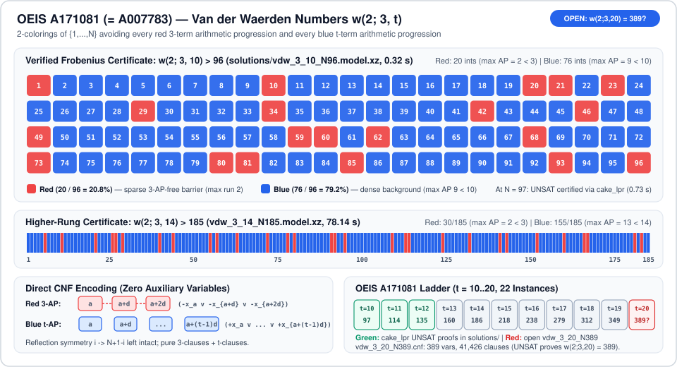

# OEIS A171081 / A007783 — Van der Waerden Numbers $w(2; 3, t)$ (`guillochon-oeis-a171081-vdw`)

*Independently verified Frobenius 2-colorings for $w(2; 3, 10) > 96$ ([`solutions/vdw_3_10_N96.model.xz`](solutions/vdw_3_10_N96.model.xz)) and $w(2; 3, 14) > 185$ ([`solutions/vdw_3_14_N185.model.xz`](solutions/vdw_3_14_N185.model.xz)) alongside the direct CNF clause structure and OEIS A171081 calibration ladder (generated by [`src/gen_diagram.py`](src/gen_diagram.py)).*

## Provenance & Credit

- **Author & Maintainer:** James Guillochon ([`@spallingerrer`](https://twitter.com/spallingerrer)) — [`https://github.com/guillochon/oeis-sat-instances`](https://github.com/guillochon/oeis-sat-instances) (`sequences/A171081/`, imported from upstream `main` commit `ba6430c`, 2026-11-23).
- **License:** Upstream generator, verifier, and validation code is MIT-licensed ([`LICENSE`](LICENSE)); all generated DIMACS CNF instances are released into the public domain (CC0).
- **Integrity:** All **22 / 22** `.cnf.xz` files in [`cnf-orig/`](cnf-orig/) are exact unmodified upstream files matching [`src/upstream/sequences/A171081/cnf/SHA256SUMS`](src/upstream/sequences/A171081/cnf/SHA256SUMS) byte-for-byte upon decompression.
- **Ground Truth Manifest:** [`expected.tsv`](expected.tsv) lists all **22 instances** (**11 SAT / 10 UNSAT / 1 UNKNOWN** open OEIS frontier target).

## Problem Description

The off-diagonal two-color **Van der Waerden number** $w(2; 3, t)$ ([OEIS A171081](https://oeis.org/A171081), equal to [OEIS A007783](https://oeis.org/A007783) for $t \ge 3$) is the smallest positive integer $N$ such that every red/blue coloring of $\{1, \dots, N\}$ contains either a monochromatic **red 3-term arithmetic progression** ($\{a, a+d, a+2d\}$) or a monochromatic **blue $t$-term arithmetic progression** ($\{a, a+d, \dots, a+(t-1)d\}$).

- **Known exact values ($t = 10 \dots 19$):** $w(2;3,10) = 97$, $w(2;3,11) = 114$, $w(2;3,12) = 135$, $w(2;3,13) = 160$, $w(2;3,14) = 186$, $w(2;3,15) = 218$, $w(2;3,16) = 238$, $w(2;3,17) = 279$, $w(2;3,18) = 312$, and $w(2;3,19) = 349$ (Ahmed, Kullmann, and Snevily 2014).
- **Open question ($t = 20$):** Is $w(2; 3, 20) = 389$? Ahmed, Kullmann, and Snevily (2014) constructed an explicit witness coloring of $\{1, \dots, 388\}$ proving $w(2; 3, 20) \ge 389$ (`vdw_3_20_N388.cnf` is SAT) and conjectured equality.
- **Target instance `vdw_3_20_N389.cnf`:**
  - **UNSAT** (with a machine-checkable DRAT/LRAT proof accepted by `drat-trim` / `cake_lpr`) settles $w(2; 3, 20) = 389$ and adds a new OEIS term.
  - **SAT** refutes the conjecture ($w(2; 3, 20) \ge 390$) and is independently checked in under a second by `verify.py`.

### Encoding Architecture (`gen_vdw.py`)

- **Variables:** Exactly $N$ Boolean variables (`96`–`389`), where $x_i = \text{true}$ iff integer $i \in \{1, \dots, N\}$ is colored red (zero auxiliary variables).
- **Forbidden red 3-AP clauses:** One all-negative ternary clause $(\neg x_a \lor \neg x_{a+d} \lor \neg x_{a+2d})$ for every 3-term arithmetic progression in $\{1, \dots, N\}$.
- **Forbidden blue $t$-AP clauses:** One all-positive $t$-literal clause $(x_a \lor x_{a+d} \lor \dots \lor x_{a+(t-1)d})$ for every $t$-term arithmetic progression in $\{1, \dots, N\}$.
- **Symmetry:** No symmetry breaking; the reflection $i \mapsto N + 1 - i$ is left intact. Despite tiny variable counts (`389` variables and `41,426` clauses at $t = 20, N = 389$), the UNSAT rungs scale steeply in CDCL hardness.

## Corpus & Data Sizes

### Repository Layout & Four-Format Inventory

All committed files are `xz`-compressed and strictly respect GitHub's `< 95 MB` per-file size limit:

| Directory | Files | Total Size | Max File Size | Notes |
|---|---:|---:|---:|---|
| `cnf-orig/` | 22 | 518.6 KB | 44.6 KB (`vdw_3_20_N388.cnf.xz`) | Exact unmodified upstream `.cnf.xz` files (`22/22` SHA-256 verified) |
| `xcnf-converted/` | 22 | 529.0 KB | 51.1 KB (`vdw_3_20_N389.xcnf.xz`) | Lossless CryptoMiniSat `.xcnf.xz` conversions (`0` native XOR parity blocks) |
| `aig-converted/` | 22 | 630.8 KB | 65.7 KB (`vdw_3_20_N389.aig.xz`) | Exact Binary AIGER 1.9 combinational miters (`.aig.xz`) |
| `anf-converted/` | 22 | 2.49 MB | 275.0 KB (`vdw_3_20_N389.anf.xz`) | Lossless linear-size degree-$\le 3$ DIMACS-ANF conversions (`.anf.xz`) |
| `solutions/` | 8 | 108.44 MB | 88.05 MB (`vdw_3_12_N135.bdrat.xz`) | **5** verified SAT models (`.model.xz`) + **3** formally verified UNSAT proofs (`.lrat.xz` / `.bdrat.xz`) + [`solutions/SHA256SUMS`](solutions/SHA256SUMS) |
| `src/` | — | — | — | [`src/gen_diagram.py`](src/gen_diagram.py) + verbatim upstream generator, verifier, `.map.json` sidecars, and `SHA256SUMS` under [`src/upstream/`](src/upstream/) |

#### Complete Instance Inventory & Ground-Truth Verdicts (`expected.tsv`)

| Instance | Expected | Variables | Clauses | `.cnf.xz` | `.xcnf.xz` | `.aig.xz` | `.anf.xz` |
|---|:---:|---:|---:|---:|---:|---:|---:|
| `vdw_3_10_N96.cnf` | SAT | 96 | 2,721 | 4.5 KB | 4.5 KB | 6.8 KB | 19.8 KB |
| `vdw_3_10_N97.cnf` | UNSAT | 97 | 2,779 | 4.4 KB | 4.5 KB | 7.1 KB | 20.5 KB |
| `vdw_3_11_N113.cnf` | SAT | 113 | 3,719 | 6.8 KB | 7.0 KB | 9.7 KB | 26.7 KB |
| `vdw_3_11_N114.cnf` | UNSAT | 114 | 3,786 | 6.9 KB | 7.1 KB | 9.6 KB | 29.2 KB |
| `vdw_3_12_N134.cnf` | SAT | 134 | 5,172 | 10.0 KB | 9.6 KB | 11.3 KB | 39.6 KB |
| `vdw_3_12_N135.cnf` | UNSAT | 135 | 5,251 | 10.7 KB | 10.0 KB | 11.3 KB | 39.7 KB |
| `vdw_3_13_N159.cnf` | SAT | 159 | 7,216 | 12.8 KB | 13.6 KB | 15.9 KB | 44.1 KB |
| `vdw_3_13_N160.cnf` | UNSAT | 160 | 7,308 | 13.9 KB | 13.0 KB | 16.3 KB | 40.8 KB |
| `vdw_3_14_N185.cnf` | SAT | 185 | 9,689 | 17.9 KB | 17.2 KB | 18.4 KB | 74.9 KB |
| `vdw_3_14_N186.cnf` | UNSAT | 186 | 9,795 | 16.7 KB | 17.4 KB | 18.8 KB | 75.9 KB |
| `vdw_3_15_N217.cnf` | SAT | 217 | 13,239 | 21.4 KB | 21.3 KB | 25.3 KB | 104.2 KB |
| `vdw_3_15_N218.cnf` | UNSAT | 218 | 13,362 | 22.1 KB | 22.8 KB | 25.5 KB | 104.5 KB |
| `vdw_3_16_N237.cnf` | SAT | 237 | 15,679 | 26.9 KB | 25.7 KB | 25.3 KB | 111.6 KB |
| `vdw_3_16_N238.cnf` | UNSAT | 238 | 15,812 | 25.0 KB | 28.0 KB | 29.3 KB | 110.7 KB |
| `vdw_3_17_N278.cnf` | SAT | 278 | 21,460 | 31.1 KB | 31.1 KB | 40.1 KB | 154.3 KB |
| `vdw_3_17_N279.cnf` | UNSAT | 279 | 21,616 | 31.9 KB | 34.4 KB | 40.5 KB | 153.6 KB |
| `vdw_3_18_N311.cnf` | SAT | 311 | 26,716 | 43.4 KB | 36.9 KB | 39.4 KB | 175.8 KB |
| `vdw_3_18_N312.cnf` | UNSAT | 312 | 26,889 | 36.7 KB | 35.7 KB | 36.1 KB | 182.9 KB |
| `vdw_3_19_N348.cnf` | SAT | 348 | 33,294 | 42.4 KB | 46.7 KB | 55.7 KB | 237.6 KB |
| `vdw_3_19_N349.cnf` | UNSAT | 349 | 33,487 | 43.9 KB | 43.9 KB | 57.9 KB | 200.4 KB |
| `vdw_3_20_N388.cnf` | SAT | 388 | 41,212 | 44.6 KB | 47.4 KB | 64.6 KB | 272.1 KB |
| `vdw_3_20_N389.cnf` | **UNKNOWN** *(Open)* | 389 | 41,426 | 44.5 KB | 51.1 KB | 65.7 KB | 275.0 KB |

### Sibling Collections (`guillochon/oeis-sat-instances`)

This directory is one of **9 single-problem-type collections** split from James Guillochon's [`guillochon/oeis-sat-instances`](https://github.com/guillochon/oeis-sat-instances) suite (`112` instances across `13` OEIS sequences):

| Collection | OEIS Sequence(s) | Combinatorial Problem | Instances |
|---|---|---|---:|
| [`guillochon-oeis-a067782-sortnet/`](../guillochon-oeis-a067782-sortnet/) | [A067782](https://oeis.org/A067782) | Optimal-Depth Sorting Networks $a(n)$ | 10 (4 SAT / 5 UNSAT / 1 Open) |
| **`guillochon-oeis-a171081-vdw/`** *(this collection)* | [A171081](https://oeis.org/A171081) / [A007783](https://oeis.org/A007783) | Van der Waerden Numbers $w(2; 3, t)$ | 22 (11 SAT / 10 UNSAT / 1 Open) |
| [`guillochon-oeis-a250000-queens/`](../guillochon-oeis-a250000-queens/) | [A250000](https://oeis.org/A250000) | Peaceable Coexisting Armies of Queens | 20 (10 SAT / 9 UNSAT / 1 Open) |
| [`guillochon-oeis-a350304-zarankiewicz/`](../guillochon-oeis-a350304-zarankiewicz/) | [A350304](https://oeis.org/A350304) (+3 related) | Zarankiewicz Numbers $z(n; 3)$ ($K_{3,3}$-Free Matrices) | 20 (8 SAT / 8 UNSAT / 4 Open) |
| [`guillochon-oeis-grid-sq-any/`](../guillochon-oeis-grid-sq-any/) | [A240443](https://oeis.org/A240443) | Square Grid — No Arbitrary-Orientation Square (`sq-any`) | 8 (4 SAT / 3 UNSAT / 1 Open) |
| [`guillochon-oeis-grid-sq-axis/`](../guillochon-oeis-grid-sq-axis/) | [A227133](https://oeis.org/A227133) / [A152125](https://oeis.org/A152125) | Square Grid — No Axis-Aligned Square (`sq-axis`) | 8 (4 SAT / 3 UNSAT / 1 Open) |
| [`guillochon-oeis-grid-tri-any/`](../guillochon-oeis-grid-tri-any/) | [A240114](https://oeis.org/A240114) / [A319159](https://oeis.org/A319159) | Triangular Grid — No Arbitrary Equilateral Triangle (`tri-any`) | 8 (4 SAT / 3 UNSAT / 1 Open) |
| [`guillochon-oeis-grid-tri-axis/`](../guillochon-oeis-grid-tri-axis/) | [A227308](https://oeis.org/A227308) / [A227116](https://oeis.org/A227116) | Triangular Grid — No Axis-Aligned Equilateral Triangle (`tri-axis`) | 8 (4 SAT / 3 UNSAT / 1 Open) |
| [`guillochon-oeis-grid-tri-up/`](../guillochon-oeis-grid-tri-up/) | [A157795](https://oeis.org/A157795) / [A319158](https://oeis.org/A319158) | Triangular Grid — No Upward Equilateral Triangle (`tri-up`) | 8 (4 SAT / 3 UNSAT / 1 Open) |

## Benchmark Results

### Benchmark Protocol & Hardware Parameters

- **Hardware:** AMD Ryzen 9 5950X (16 physical cores / 32 threads, 64 MiB L3 cache, 128 GiB RAM, Linux x86_64).
- **CPU Pinning & Isolation:** Strictly pinned to a single physical core (`taskset -c 1` for all 60 s 5-solver calibration runs; `taskset -c 0` or `taskset -c 1` for extended open-frontier runs), **1 thread per solver run** (`--max-cores 1`). All 5 solvers ran strictly sequentially on identical uncompressed flat `.cnf` inputs so solvers without native `.xz` streaming compete on identical inputs.
- **Solvers & Exact Flags:**
  - Frobenius v0.1.0 (`--timeout 60`, 1 thread)
  - [CaDiCaL](https://github.com/arminbiere/cadical) 3.1.0 (`-q --modelalllits=true -t 60`)
  - [CryptoMiniSat](https://github.com/msoos/cryptominisat) 5.18.0 (`-t 1 --maxtime 60`)
  - [dense-solver](https://github.com/libdense/dense-solver) 0.0.4 (1 thread, GNU `timeout -k 2s 60.0s`)
  - [Kissat](https://github.com/arminbiere/kissat) 4.0.4 (`-q --time=60`)
- **Independent Verification:**
  - **SAT models:** Every SAT output from every solver was checked both clause-by-clause against 100% of clauses in the original `.cnf.xz` AND decoded/verified by James Guillochon's independent combinatorial verifier (`decode_verify.py` / `verify.py`). Zero invalid models, zero verdict disagreements.
  - **UNSAT proofs:** Every Frobenius UNSAT result was re-run with proof emission (`--lrat` or `--proof` binary-DRAT) and triple-certified with [`drat-trim`](https://github.com/marijnheule/drat-trim) (`s VERIFIED`), [`lrat-check`](https://github.com/marijnheule/drat-trim) (`c VERIFIED`), and formally verified [`cake_lpr`](https://github.com/tanyongkiam/cake_lpr) (`s VERIFIED UNSAT`).

### Comparative Single-Core Calibration Results ($T_{\max} = 60\;\text{s}$)

Seven calibration rungs spanning $t = 10 \dots 13$ evaluated sequentially on identical uncompressed flat `.cnf` files (`taskset -c 1`, 1 thread). **Frobenius** ranks **#1 overall** (`7 / 7` solved, Total PAR-2 = **`49.84 s`**, **2.38× faster** than #2 Kissat 4.0.4 at `118.59 s`) and **#1 on all three UNSAT rungs**:

| Instance | Expected | Frobenius | [CaDiCaL](https://github.com/arminbiere/cadical) 3.1.0 | [CryptoMiniSat](https://github.com/msoos/cryptominisat) 5.18.0 | [dense-solver](https://github.com/libdense/dense-solver) 0.0.4 | [Kissat](https://github.com/arminbiere/kissat) 4.0.4 |
|---|:---:|---:|---:|---:|---:|---:|
| `vdw_3_10_N96.cnf` | SAT | 0.32 s | 0.17 s | 1.00 s | 0.17 s | **0.16 s** |
| `vdw_3_10_N97.cnf` | UNSAT | **0.73 s** | 0.99 s | 1.30 s | 0.74 s | 0.92 s |
| `vdw_3_11_N113.cnf` | SAT | 0.13 s | 0.33 s | 0.76 s | **0.01 s** | 0.35 s |
| `vdw_3_11_N114.cnf` | UNSAT | **3.80 s** | 6.96 s | 7.44 s | 6.78 s | 7.22 s |
| `vdw_3_12_N134.cnf` | SAT | 8.40 s | **1.18 s** | 38.88 s | 42.64 s | 49.18 s |
| `vdw_3_12_N135.cnf` | UNSAT | **35.62 s** | >60 s | >60 s | >60 s | 51.28 s |
| `vdw_3_13_N159.cnf` | SAT | **0.84 s** | 1.13 s | 10.74 s | 2.82 s | 9.48 s |
| **Solved ($T_{\max} = 60\;\text{s}$)** | **7 / 7** | **7 / 7** (4 SAT, 3 UNSAT) | 6 / 7 (4 SAT, 2 UNSAT) | 6 / 7 (4 SAT, 2 UNSAT) | 6 / 7 (4 SAT, 2 UNSAT) | **7 / 7** (4 SAT, 3 UNSAT) |
| **Total PAR-2 ($T_{\max} = 60\;\text{s}$)** | — | **49.84 s** *(mean 7.12 s)* | 130.76 s *(mean 18.68 s)* | 180.12 s *(mean 25.73 s)* | 173.16 s *(mean 24.74 s)* | 118.59 s *(mean 16.94 s)* |

- **Extended sweep milestone:** Beyond the 60 s cutoff, Frobenius also solved `vdw_3_14_N185.cnf` (SAT) in **`78.14 s`**, archived in [`solutions/vdw_3_14_N185.model.xz`](solutions/vdw_3_14_N185.model.xz).

### Open OEIS Frontier Run (600 s, Single-Core Pinned)

Evaluated directly with Frobenius (`--max-cores 1`, pinned to physical core `1`, native `.cnf.xz` ingestion):

| Open Target | OEIS Frontier | Budget | Pinning | Conflicts | Decisions | Propagations | Status |
|---|---|---:|---|---:|---:|---:|:---:|
| `vdw_3_20_N389.cnf` | Conjectured $w(2; 3, 20) = 389$ (`389` vars, `41,426` cls) | 600 s | `taskset -c 1` | 27,716,416 | 52,769,345 | 1,265,007,830 | Open (`UNKNOWN`) |

### Verified Solutions & Certified Proofs (`solutions/`)

All **8 verified files** (**5 SAT models + 3 formally certified UNSAT proofs**, all `< 95 MB`) match [`solutions/SHA256SUMS`](solutions/SHA256SUMS) (`sha256sum -c` PASS):

#### Certified UNSAT Proofs (3 / 3 `drat-trim` + `lrat-check` + `cake_lpr` `s VERIFIED UNSAT`)

| Solution File | Raw Proof Size | Compressed Size | SHA-256 (prefix) | Verification Pipeline |
|---|---:|---:|---|---|
| [`solutions/vdw_3_10_N97.lrat.xz`](solutions/vdw_3_10_N97.lrat.xz) | 11.02 MB (LRAT) | 2.75 MB | `0c2f82e11cf6` | Native `--lrat` (`0.80 s`) → `lrat-check` (`0.27 s`) + `cake_lpr` **`s VERIFIED UNSAT`** (`0.38 s`) |
| [`solutions/vdw_3_11_N114.lrat.xz`](solutions/vdw_3_11_N114.lrat.xz) | 72.97 MB (LRAT) | 17.64 MB | `1c9d0f89b02b` | Native `--lrat` (`3.80 s`) → `lrat-check` (`0.94 s`) + `cake_lpr` **`s VERIFIED UNSAT`** (`2.29 s`) |
| [`solutions/vdw_3_12_N135.bdrat.xz`](solutions/vdw_3_12_N135.bdrat.xz) | 223.26 MB (BDRAT) | 88.05 MB | `dca475c290cd` | `--proof` (`49.12 s`) → `drat-trim -i -L` (`66.02 s`, 631 MB LRAT >95 MB xz) → `lrat-check` (`10.20 s`) + `cake_lpr` **`s VERIFIED UNSAT`** (`18.14 s`) |

#### Verified SAT Models (5 / 5 Raw-Clause + Upstream `verify.py` PASS)

| Solution File | Size | SHA-256 (prefix) | Independent Verification Result |
|---|---:|---|---|
| [`solutions/vdw_3_10_N96.model.xz`](solutions/vdw_3_10_N96.model.xz) | 248 B | `7408a3acf3e0` | 2,721/2,721 cls OK; `verify.py`: `VALID, so w(2;3,10) > 96` |
| [`solutions/vdw_3_11_N113.model.xz`](solutions/vdw_3_11_N113.model.xz) | 280 B | `12fbdcaed011` | 3,719/3,719 cls OK; `verify.py`: `VALID, so w(2;3,11) > 113` |
| [`solutions/vdw_3_12_N134.model.xz`](solutions/vdw_3_12_N134.model.xz) | 312 B | `acda663e1621` | 5,172/5,172 cls OK; `verify.py`: `VALID, so w(2;3,12) > 134` |
| [`solutions/vdw_3_13_N159.model.xz`](solutions/vdw_3_13_N159.model.xz) | 336 B | `f50a280af983` | 7,216/7,216 cls OK; `verify.py`: `VALID, so w(2;3,13) > 159` |
| [`solutions/vdw_3_14_N185.model.xz`](solutions/vdw_3_14_N185.model.xz) | 376 B | `f6df63c12da8` | 9,689/9,689 cls OK; `verify.py`: `VALID, so w(2;3,14) > 185` |

<!-- BEGIN_STRUCTURAL_ANALYSIS -->
## Phase-Transition & Structural Analysis

*Auto-generated by [`../src/analyze_benchmarks.py`](../src/analyze_benchmarks.py). Position relative to the critical phase transition is measured by $\rho_{\mathrm{crit}} = \frac{1}{n}\sum_k m_k / \alpha_c(k)$ (exact $\alpha/\alpha_c(k)$ for pure $k$-SAT; effective critical threshold $\alpha_c^{\mathrm{eff}} = \alpha/\rho_{\mathrm{crit}}$; `Under` $<0.90\times$, `Near-crit` $0.90\text{--}1.10\times$, `Over` $>1.10\times$), alongside Gent–Walsh annealed constrainedness $\kappa = -\frac{1}{n}\sum_i \log_2(1-2^{-k_i})$ (AAAI 1996), clause-length profile ($\bar{k}$, `%Bin`, `%Horn`), variable-degree CV ($\sigma_d/\bar{d}$, uniformity vs. hub skew), and extracted native XOR parity clauses.*

| Instance | Active $n$ | Clauses $m$ | $\alpha=m/n$ | $\alpha_c^{\mathrm{eff}}$ | $\rho_{\mathrm{crit}}$ (Regime) | $\kappa$ | $\bar{k}$ ($k_{\max}$) | Bin% | Horn% | Pos% | Deg CV | XORs |
|---|---:|---:|---:|---:|---:|---:|---:|---:|---:|---:|---:|---:|
| `vdw_3_10_N96` | 96 | 2,721 | 28.34 | 5.14 | **5.51x** (Over) | 4.53 | 4.20 (10) | 0% | 83% | 41% | 0.26 | 0 |
| `vdw_3_10_N97` | 97 | 2,779 | 28.65 | 5.14 | **5.57x** (Over) | 4.58 | 4.20 (10) | 0% | 83% | 41% | 0.26 | 0 |
| `vdw_3_11_N113` | 113 | 3,719 | 32.91 | 5.06 | **6.51x** (Over) | 5.35 | 4.25 (11) | 0% | 84% | 41% | 0.26 | 0 |
| `vdw_3_11_N114` | 114 | 3,786 | 33.21 | 5.06 | **6.57x** (Over) | 5.40 | 4.26 (11) | 0% | 84% | 41% | 0.26 | 0 |
| `vdw_3_12_N134` | 134 | 5,172 | 38.60 | 4.99 | **7.74x** (Over) | 6.36 | 4.31 (12) | 0% | 85% | 40% | 0.26 | 0 |
| `vdw_3_12_N135` | 135 | 5,251 | 38.90 | 4.99 | **7.79x** (Over) | 6.41 | 4.31 (12) | 0% | 85% | 40% | 0.26 | 0 |
| `vdw_3_13_N159` | 159 | 7,216 | 45.38 | 4.93 | **9.20x** (Over) | 7.56 | 4.35 (13) | 0% | 86% | 40% | 0.26 | 0 |
| `vdw_3_13_N160` | 160 | 7,308 | 45.67 | 4.93 | **9.26x** (Over) | 7.61 | 4.35 (13) | 0% | 86% | 40% | 0.26 | 0 |
| `vdw_3_14_N185` | 185 | 9,689 | 52.37 | 4.88 | **10.7x** (Over) | 8.81 | 4.39 (14) | 0% | 87% | 40% | 0.26 | 0 |
| `vdw_3_14_N186` | 186 | 9,795 | 52.66 | 4.88 | **10.8x** (Over) | 8.86 | 4.39 (14) | 0% | 87% | 40% | 0.26 | 0 |
| `vdw_3_15_N217` | 217 | 13,239 | 61.01 | 4.84 | **12.6x** (Over) | 10.36 | 4.43 (15) | 0% | 88% | 40% | 0.26 | 0 |
| `vdw_3_15_N218` | 218 | 13,362 | 61.29 | 4.84 | **12.7x** (Over) | 10.40 | 4.43 (15) | 0% | 88% | 40% | 0.26 | 0 |
| `vdw_3_16_N237` | 237 | 15,679 | 66.16 | 4.80 | **13.8x** (Over) | 11.32 | 4.46 (16) | 0% | 89% | 40% | 0.26 | 0 |
| `vdw_3_16_N238` | 238 | 15,812 | 66.44 | 4.80 | **13.8x** (Over) | 11.37 | 4.46 (16) | 0% | 89% | 40% | 0.26 | 0 |
| `vdw_3_17_N278` | 278 | 21,460 | 77.19 | 4.77 | **16.2x** (Over) | 13.29 | 4.49 (17) | 0% | 89% | 40% | 0.26 | 0 |
| `vdw_3_17_N279` | 279 | 21,616 | 77.48 | 4.77 | **16.2x** (Over) | 13.34 | 4.49 (17) | 0% | 89% | 40% | 0.26 | 0 |
| `vdw_3_18_N311` | 311 | 26,716 | 85.90 | 4.74 | **18.1x** (Over) | 14.88 | 4.51 (18) | 0% | 90% | 40% | 0.26 | 0 |
| `vdw_3_18_N312` | 312 | 26,889 | 86.18 | 4.75 | **18.2x** (Over) | 14.93 | 4.51 (18) | 0% | 90% | 40% | 0.26 | 0 |
| `vdw_3_19_N348` | 348 | 33,294 | 95.67 | 4.72 | **20.3x** (Over) | 16.66 | 4.53 (19) | 0% | 90% | 40% | 0.26 | 0 |
| `vdw_3_19_N349` | 349 | 33,487 | 95.95 | 4.72 | **20.3x** (Over) | 16.71 | 4.53 (19) | 0% | 90% | 40% | 0.26 | 0 |
| `vdw_3_20_N388` | 388 | 41,212 | 106.2 | 4.70 | **22.6x** (Over) | 18.59 | 4.56 (20) | 0% | 91% | 40% | 0.26 | 0 |
| `vdw_3_20_N389` | 389 | 41,426 | 106.5 | 4.70 | **22.7x** (Over) | 18.64 | 4.56 (20) | 0% | 91% | 40% | 0.26 | 0 |

**Collection Phase-Transition Summary (22 instances, 4 formats: 22 CNF / 22 AIG / 22 XCNF / 22 ANF):** median $\rho_{\mathrm{crit}} = 12.6\times$ (range `5.51x–22.7x`), median $\kappa = 10.38$, regime split **0 Under / 0 Near-critical / 22 Over**, total extracted native XOR parity clauses = **0**, total ANF equations = **897,761**.
<!-- END_STRUCTURAL_ANALYSIS -->

## References

- James Guillochon ([`@spallingerrer`](https://twitter.com/spallingerrer)), *OEIS SAT instances*, [`https://github.com/guillochon/oeis-sat-instances`](https://github.com/guillochon/oeis-sat-instances) (2026).
- T. Ahmed, O. Kullmann, and H. Snevily, *"On the van der Waerden numbers $w(2; 3, t)$"*, *Discrete Applied Mathematics* 174:27–51, 2014 ([OEIS A171081](https://oeis.org/A171081), [OEIS A007783](https://oeis.org/A007783)).
