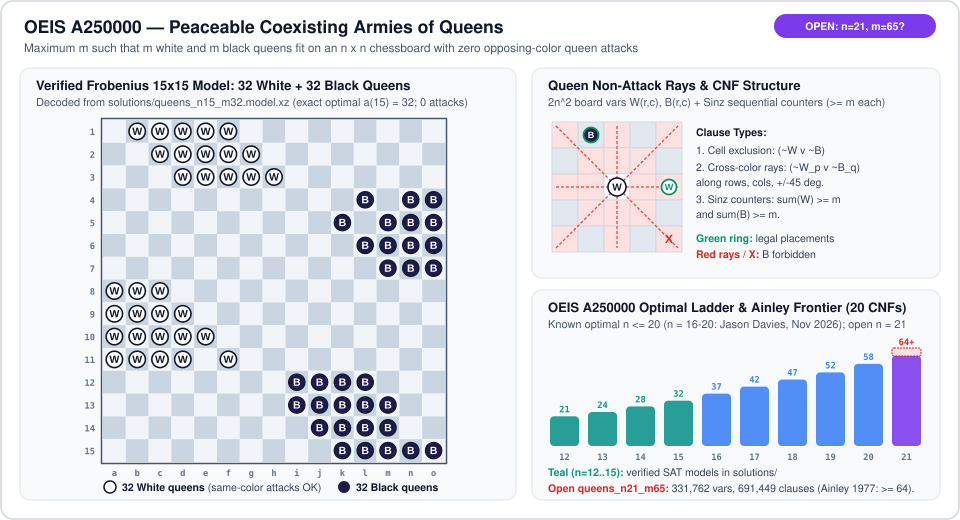

# OEIS A250000 — Peaceable Coexisting Armies of Queens (`guillochon-oeis-a250000-queens`)

*Independently verified Frobenius $15 \times 15$ peaceable queens solution (`32` white + `32` black queens, `0` opposing-color attacks) decoded directly from [`solutions/queens_n15_m32.model.xz`](solutions/queens_n15_m32.model.xz), alongside the queen attack-ray constraints and OEIS A250000 optimal ladder (generated by [`src/gen_diagram.py`](src/gen_diagram.py)).*

## Provenance & Credit

- **Author & Maintainer:** James Guillochon ([`@spallingerrer`](https://twitter.com/spallingerrer)) — [`https://github.com/guillochon/oeis-sat-instances`](https://github.com/guillochon/oeis-sat-instances) (`sequences/A250000/`, imported from upstream `main` commit `ba6430c`, 2026-11-23).
- **License:** Upstream generator, verifier, and validation code is MIT-licensed ([`LICENSE`](LICENSE)); all generated DIMACS CNF instances are released into the public domain (CC0).
- **Integrity:** All **20 / 20** `.cnf.xz` files in [`cnf-orig/`](cnf-orig/) are exact unmodified upstream files matching [`src/upstream/sequences/A250000/cnf/SHA256SUMS`](src/upstream/sequences/A250000/cnf/SHA256SUMS) byte-for-byte upon decompression.
- **Ground Truth Manifest:** [`expected.tsv`](expected.tsv) lists all **20 instances** (**10 SAT / 9 UNSAT / 1 UNKNOWN** open OEIS frontier target).

## Problem Description

[OEIS A250000](https://oeis.org/A250000) gives $a(n)$, the largest integer $m$ such that $m$ white queens and $m$ black queens can be placed on an $n \times n$ chessboard so that no white queen attacks any black queen along a row, column, or diagonal (queens of the same color may attack each other freely).

- **Known exact values ($n = 12 \dots 20$):** $a(12) = 21$, $a(13) = 24$, $a(14) = 28$, $a(15) = 32$, $a(16) = 37$, $a(17) = 42$, $a(18) = 47$, $a(19) = 52$, and $a(20) = 58$ ($n \le 15$ classically; $n = 16 \dots 20$ confirmed optimal by exhaustive search by Jason Davies, Nov 2026).
- **Open question ($n = 21$):** Can $65$ white and $65$ black queens coexist peaceably on a $21 \times 21$ board? Ainley (1977) gave constructions achieving $\lfloor 7n^2/48 \rfloor$ for most $n \le 30$, giving $a(21) \ge 64$ (`queens_n21_m64.cnf` is SAT).
- **Target instance `queens_n21_m65.cnf`:**
  - **UNSAT** (with a machine-checkable DRAT/LRAT proof accepted by `drat-trim` / `cake_lpr`) proves $a(21) = 64$ and settles the OEIS term.
  - **SAT** beats Ainley's 1977 construction ($a(21) \ge 65$) and is checked in milliseconds by `verify.py`.

### Encoding Architecture (`gen_queens.py`)

- **Board variables:** $2n^2$ Boolean variables $W(r, c)$ (`1..n^2`) and $B(r, c)$ (`n^2+1..2n^2`) indicating whether square $(r, c)$ holds a white or black queen.
- **Non-attack binary clauses:** Cell exclusion $(\neg W(r,c) \lor \neg B(r,c))$ plus pairwise binary clauses $(\neg W(r,c) \lor \neg B(r',c'))$ for every pair of squares sharing a row, column, or $\pm 45^\circ$ diagonal.
- **Cardinality constraints:** Two Sinz sequential counters (Sinz 2005) enforcing $\sum W(r,c) \ge m$ and $\sum B(r,c) \ge m$.
- **Symmetry:** No symmetry breaking; all 8 dihedral board symmetries ($D_4$) and the white/black color swap remain intact. Formulas scale from `35,180` variables / `75,162` clauses (`n=12, m=22`) up to `332,642` variables / `693,207` clauses (`n=21, m=64`).

## Corpus & Data Sizes

### Repository Layout & Four-Format Inventory

All committed files are `xz`-compressed and strictly respect GitHub's `< 95 MB` per-file size limit:

| Directory | Files | Total Size | Max File Size | Notes |
|---|---:|---:|---:|---|
| `cnf-orig/` | 20 | 5.56 MB | 657.9 KB (`queens_n21_m65.cnf.xz`) | Exact unmodified upstream `.cnf.xz` files (`20/20` SHA-256 verified) |
| `xcnf-converted/` | 20 | 5.48 MB | 613.0 KB (`queens_n21_m65.xcnf.xz`) | Lossless CryptoMiniSat `.xcnf.xz` conversions (`0` native XOR parity blocks) |
| `aig-converted/` | 20 | 7.01 MB | 873.1 KB (`queens_n21_m65.aig.xz`) | Exact Binary AIGER 1.9 combinational miters (`.aig.xz`) |
| `anf-converted/` | 20 | 12.51 MB | 1.42 MB (`queens_n21_m65.anf.xz`) | Lossless linear-size degree-$\le 3$ DIMACS-ANF conversions (`.anf.xz`) |
| `solutions/` | 4 | 132.5 KB | 46.8 KB (`queens_n15_m32.model.xz`) | **4** verified SAT models (`n=12..15`) + [`solutions/SHA256SUMS`](solutions/SHA256SUMS) |
| `src/` | — | — | — | [`src/gen_diagram.py`](src/gen_diagram.py) + verbatim upstream generator, verifier, `.map.json` sidecars, and `SHA256SUMS` under [`src/upstream/`](src/upstream/) |

#### Complete Instance Inventory & Ground-Truth Verdicts (`expected.tsv`)

| Instance | Expected | Variables | Clauses | `.cnf.xz` | `.xcnf.xz` | `.aig.xz` | `.anf.xz` |
|---|:---:|---:|---:|---:|---:|---:|---:|
| `queens_n12_m21.cnf` | SAT | 35,466 | 75,732 | 81.7 KB | 83.4 KB | 108.1 KB | 144.7 KB |
| `queens_n12_m22.cnf` | UNSAT | 35,180 | 75,162 | 65.2 KB | 69.4 KB | 111.0 KB | 156.7 KB |
| `queens_n13_m24.cnf` | SAT | 49,058 | 104,311 | 87.8 KB | 89.7 KB | 132.0 KB | 194.5 KB |
| `queens_n13_m25.cnf` | UNSAT | 48,722 | 103,641 | 106.7 KB | 102.4 KB | 138.9 KB | 187.5 KB |
| `queens_n14_m28.cnf` | SAT | 65,912 | 139,662 | 123.6 KB | 137.3 KB | 182.3 KB | 244.6 KB |
| `queens_n14_m29.cnf` | UNSAT | 65,522 | 138,884 | 128.8 KB | 141.7 KB | 166.0 KB | 261.7 KB |
| `queens_n15_m32.cnf` | SAT | 86,914 | 183,575 | 164.1 KB | 178.8 KB | 261.7 KB | 339.5 KB |
| `queens_n15_m33.cnf` | UNSAT | 86,466 | 182,681 | 144.5 KB | 180.4 KB | 237.7 KB | 335.5 KB |
| `queens_n16_m37.cnf` | SAT | 112,202 | 236,348 | 199.8 KB | 223.2 KB | 276.4 KB | 435.9 KB |
| `queens_n16_m38.cnf` | UNSAT | 111,692 | 235,330 | 207.8 KB | 182.3 KB | 278.0 KB | 434.1 KB |
| `queens_n17_m42.cnf` | SAT | 142,850 | 300,147 | 263.2 KB | 266.1 KB | 326.0 KB | 582.4 KB |
| `queens_n17_m43.cnf` | UNSAT | 142,274 | 298,997 | 279.6 KB | 239.0 KB | 313.4 KB | 543.2 KB |
| `queens_n18_m47.cnf` | SAT | 179,590 | 376,456 | 349.7 KB | 306.0 KB | 362.1 KB | 793.8 KB |
| `queens_n18_m48.cnf` | UNSAT | 178,944 | 375,166 | 348.3 KB | 303.1 KB | 381.8 KB | 770.7 KB |
| `queens_n19_m52.cnf` | SAT | 223,202 | 466,855 | 426.0 KB | 423.5 KB | 488.4 KB | 913.4 KB |
| `queens_n19_m53.cnf` | UNSAT | 222,482 | 465,417 | 406.3 KB | 428.2 KB | 626.5 KB | 999.7 KB |
| `queens_n20_m58.cnf` | SAT | 273,716 | 571,426 | 472.0 KB | 447.2 KB | 548.0 KB | 1.20 MB |
| `queens_n20_m59.cnf` | UNSAT | 272,918 | 569,832 | 526.6 KB | 476.0 KB | 546.0 KB | 1.20 MB |
| `queens_n21_m64.cnf` | SAT | 332,642 | 693,207 | 523.6 KB | 592.8 KB | 652.7 KB | 1.36 MB |
| `queens_n21_m65.cnf` | **UNKNOWN** *(Open)* | 331,762 | 691,449 | 657.9 KB | 613.0 KB | 873.1 KB | 1.42 MB |

### Sibling Collections (`guillochon/oeis-sat-instances`)

This directory is one of **9 single-problem-type collections** split from James Guillochon's [`guillochon/oeis-sat-instances`](https://github.com/guillochon/oeis-sat-instances) suite (`112` instances across `13` OEIS sequences):

| Collection | OEIS Sequence(s) | Combinatorial Problem | Instances |
|---|---|---|---:|
| [`guillochon-oeis-a067782-sortnet/`](../guillochon-oeis-a067782-sortnet/) | [A067782](https://oeis.org/A067782) | Optimal-Depth Sorting Networks $a(n)$ | 10 (4 SAT / 5 UNSAT / 1 Open) |
| [`guillochon-oeis-a171081-vdw/`](../guillochon-oeis-a171081-vdw/) | [A171081](https://oeis.org/A171081) / [A007783](https://oeis.org/A007783) | Van der Waerden Numbers $w(2; 3, t)$ | 22 (11 SAT / 10 UNSAT / 1 Open) |
| **`guillochon-oeis-a250000-queens/`** *(this collection)* | [A250000](https://oeis.org/A250000) | Peaceable Coexisting Armies of Queens | 20 (10 SAT / 9 UNSAT / 1 Open) |
| [`guillochon-oeis-a350304-zarankiewicz/`](../guillochon-oeis-a350304-zarankiewicz/) | [A350304](https://oeis.org/A350304) (+3 related) | Zarankiewicz Numbers $z(n; 3)$ ($K_{3,3}$-Free Matrices) | 20 (8 SAT / 8 UNSAT / 4 Open) |
| [`guillochon-oeis-grid-sq-any/`](../guillochon-oeis-grid-sq-any/) | [A240443](https://oeis.org/A240443) | Square Grid — No Arbitrary-Orientation Square (`sq-any`) | 8 (4 SAT / 3 UNSAT / 1 Open) |
| [`guillochon-oeis-grid-sq-axis/`](../guillochon-oeis-grid-sq-axis/) | [A227133](https://oeis.org/A227133) / [A152125](https://oeis.org/A152125) | Square Grid — No Axis-Aligned Square (`sq-axis`) | 8 (4 SAT / 3 UNSAT / 1 Open) |
| [`guillochon-oeis-grid-tri-any/`](../guillochon-oeis-grid-tri-any/) | [A240114](https://oeis.org/A240114) / [A319159](https://oeis.org/A319159) | Triangular Grid — No Arbitrary Equilateral Triangle (`tri-any`) | 8 (4 SAT / 3 UNSAT / 1 Open) |
| [`guillochon-oeis-grid-tri-axis/`](../guillochon-oeis-grid-tri-axis/) | [A227308](https://oeis.org/A227308) / [A227116](https://oeis.org/A227116) | Triangular Grid — No Axis-Aligned Equilateral Triangle (`tri-axis`) | 8 (4 SAT / 3 UNSAT / 1 Open) |
| [`guillochon-oeis-grid-tri-up/`](../guillochon-oeis-grid-tri-up/) | [A157795](https://oeis.org/A157795) / [A319158](https://oeis.org/A319158) | Triangular Grid — No Upward Equilateral Triangle (`tri-up`) | 8 (4 SAT / 3 UNSAT / 1 Open) |

## Benchmark Results

### Benchmark Protocol & Hardware Parameters

- **Hardware:** AMD Ryzen 9 5950X (16 physical cores / 32 threads, 64 MiB L3 cache, 128 GiB RAM, Linux x86_64).
- **CPU Pinning & Isolation:** Strictly pinned to a single physical core (`taskset -c 1` for all 60 s 5-solver calibration runs; `taskset -c 0` or `taskset -c 1` for extended open-frontier runs), **1 thread per solver run** (`--max-cores 1`). All 5 solvers ran strictly sequentially on identical uncompressed flat `.cnf` inputs so solvers without native `.xz` streaming compete on identical inputs.
- **Solvers & Exact Flags:**
  - Frobenius v0.1.0 (`--timeout 60`, 1 thread)
  - [CaDiCaL](https://github.com/arminbiere/cadical) 3.1.0 (`-q --modelalllits=true -t 60`; note: `--modelalllits=true` prints complete witnesses without changing search behavior)
  - [CryptoMiniSat](https://github.com/msoos/cryptominisat) 5.18.0 (`-t 1 --maxtime 60`)
  - [dense-solver](https://github.com/libdense/dense-solver) 0.0.4 (1 thread, GNU `timeout -k 2s 60.0s`)
  - [Kissat](https://github.com/arminbiere/kissat) 4.0.4 (`-q --time=60`)
- **Independent Verification:**
  - **SAT models:** Every SAT output from every solver was checked both clause-by-clause against 100% of clauses in the original `.cnf.xz` AND decoded/verified by James Guillochon's independent combinatorial verifier (`decode_verify.py` / `verify.py`). Zero invalid models, zero verdict disagreements.

### Comparative Single-Core Calibration Results ($T_{\max} = 60\;\text{s}$)

Five calibration rungs spanning $n = 12, 13, 15$ evaluated sequentially on identical uncompressed flat `.cnf` files (`taskset -c 1`, 1 thread):

| Instance | Expected | Frobenius | [CaDiCaL](https://github.com/arminbiere/cadical) 3.1.0 | [CryptoMiniSat](https://github.com/msoos/cryptominisat) 5.18.0 | [dense-solver](https://github.com/libdense/dense-solver) 0.0.4 | [Kissat](https://github.com/arminbiere/kissat) 4.0.4 |
|---|:---:|---:|---:|---:|---:|---:|
| `queens_n12_m21.cnf` | SAT | **0.62 s** | 3.79 s | >60 s | >60 s | 29.62 s |
| `queens_n12_m22.cnf` | UNSAT | >60 s | >60 s | >60 s | >60 s | >60 s |
| `queens_n13_m24.cnf` | SAT | 11.83 s | **1.82 s** | 51.87 s | >60 s | 3.89 s |
| `queens_n13_m25.cnf` | UNSAT | >60 s | >60 s | >60 s | >60 s | >60 s |
| `queens_n15_m32.cnf` | SAT | >60 s *(3.84 s on `.cnf.xz`)* | **9.70 s** | >60 s | >60 s | >60 s |
| **Solved ($T_{\max} = 60\;\text{s}$)** | **3 / 5** | 2 / 5 (2 SAT, 0 UNSAT) | **3 / 5** (3 SAT, 0 UNSAT) | 1 / 5 (1 SAT, 0 UNSAT) | 0 / 5 (0 SAT, 0 UNSAT) | 2 / 5 (2 SAT, 0 UNSAT) |
| **Total PAR-2 ($T_{\max} = 60\;\text{s}$)** | — | 372.45 s *(mean 74.49 s)* | **255.31 s** *(mean 51.06 s)* | 531.87 s *(mean 106.37 s)* | 600.00 s *(mean 120.00 s)* | 393.51 s *(mean 78.70 s)* |

- **Extended sweep milestones:** Frobenius also produced verified optimal SAT models for `queens_n14_m28.cnf` and `queens_n15_m32.cnf` (`3.84 s` native `.cnf.xz`), all archived in [`solutions/`](solutions/). Note: on `A250000`, CaDiCaL 3.1.0 requires `--modelalllits=true` so unassigned literals are emitted in printed witnesses; default `--modelalllits=false` omits unassigned variables and fails raw-clause checks.

### Open OEIS Frontier Run (600 s, Single-Core Pinned)

Evaluated directly with Frobenius (`--max-cores 1`, pinned to physical core `1`, native `.cnf.xz` ingestion):

| Open Target | OEIS Frontier | Budget | Pinning | Conflicts | Decisions | Propagations | Status |
|---|---|---:|---|---:|---:|---:|:---:|
| `queens_n21_m65.cnf` | Peaceable queens $a(21) \ge 64$ (`331,762` vars, `691,449` cls) | 600 s | `taskset -c 1` | 1,320,960 | 4,679,688 | 4,155,524,610 | Open (`UNKNOWN`) |

### Supplementary Full-Corpus Coverage ($T_{\max} = 60\;\text{s}$, Single-Core Pinned)

Remaining 13 corpus instances evaluated with Frobenius (`--max-cores 1 --timeout 60`, single physical core pinned per run, uncompressed flat `.cnf` input) to provide explicit coverage across all `20 / 20` instances in `cnf-orig/`:

| Instance | Expected | Frobenius 1C | Conflicts | Decisions | Propagations |
|---|:---:|---:|---:|---:|---:|
| `queens_n14_m29.cnf` | UNSAT | >60 s | 961,984 | 2,446,537 | 373,649,984 |
| `queens_n15_m33.cnf` | UNSAT | >60 s | 843,008 | 2,330,605 | 384,642,738 |
| `queens_n16_m37.cnf` | SAT | >60 s | 701,184 | 2,041,591 | 363,374,161 |
| `queens_n16_m38.cnf` | UNSAT | >60 s | 691,136 | 2,114,765 | 376,009,337 |
| `queens_n17_m42.cnf` | SAT | >60 s | 642,816 | 1,837,931 | 378,200,586 |
| `queens_n17_m43.cnf` | UNSAT | >60 s | 626,944 | 1,922,017 | 379,734,099 |
| `queens_n18_m47.cnf` | SAT | >60 s | 508,544 | 1,527,601 | 339,923,187 |
| `queens_n18_m48.cnf` | UNSAT | >60 s | 512,640 | 1,633,087 | 337,945,952 |
| `queens_n19_m52.cnf` | SAT | >60 s | 372,352 | 1,340,266 | 304,955,191 |
| `queens_n19_m53.cnf` | UNSAT | >60 s | 412,096 | 1,242,343 | 325,757,494 |
| `queens_n20_m58.cnf` | SAT | >60 s | 351,424 | 1,268,412 | 341,296,960 |
| `queens_n20_m59.cnf` | UNSAT | >60 s | 308,800 | 1,089,641 | 323,105,508 |
| `queens_n21_m64.cnf` | SAT | >60 s | 233,408 | 995,044 | 305,906,368 |

### Verified Solutions (`solutions/`)

All **4 verified SAT models** ($n = 12 \dots 15$) match [`solutions/SHA256SUMS`](solutions/SHA256SUMS) (`sha256sum -c` PASS) and passed both 100% raw-clause verification and upstream `verify.py`:

| Solution File | Size | SHA-256 (prefix) | Independent Verification Result |
|---|---:|---|---|
| [`solutions/queens_n12_m21.model.xz`](solutions/queens_n12_m21.model.xz) | 21.3 KB | `0d5ce3ca86b9` | 75,732/75,732 cls OK; `verify.py`: `21 W, 21 B, 0 attacks: VALID` |
| [`solutions/queens_n13_m24.model.xz`](solutions/queens_n13_m24.model.xz) | 28.3 KB | `caabc9a9a895` | 104,311/104,311 cls OK; `verify.py`: `24 W, 24 B, 0 attacks: VALID` |
| [`solutions/queens_n14_m28.model.xz`](solutions/queens_n14_m28.model.xz) | 36.1 KB | `ad98c678e582` | 139,662/139,662 cls OK; `verify.py`: `28 W, 28 B, 0 attacks: VALID` |
| [`solutions/queens_n15_m32.model.xz`](solutions/queens_n15_m32.model.xz) | 46.8 KB | `44b133042158` | 183,575/183,575 cls OK; `verify.py`: `32 W, 32 B, 0 attacks: VALID` |

<!-- BEGIN_STRUCTURAL_ANALYSIS -->
## Phase-Transition & Structural Analysis

*Auto-generated by [`../src/analyze_benchmarks.py`](../src/analyze_benchmarks.py). Position relative to the critical phase transition is measured by $\rho_{\mathrm{crit}} = \frac{1}{n}\sum_k m_k / \alpha_c(k)$ (exact $\alpha/\alpha_c(k)$ for pure $k$-SAT; effective critical threshold $\alpha_c^{\mathrm{eff}} = \alpha/\rho_{\mathrm{crit}}$; `Under` $<0.90\times$, `Near-crit` $0.90\text{--}1.10\times$, `Over` $>1.10\times$), alongside Gent–Walsh annealed constrainedness $\kappa = -\frac{1}{n}\sum_i \log_2(1-2^{-k_i})$ (AAAI 1996), clause-length profile ($\bar{k}$, `%Bin`, `%Horn`), variable-degree CV ($\sigma_d/\bar{d}$, uniformity vs. hub skew), and extracted native XOR parity clauses.*

| Instance | Active $n$ | Clauses $m$ | $\alpha=m/n$ | $\alpha_c^{\mathrm{eff}}$ | $\rho_{\mathrm{crit}}$ (Regime) | $\kappa$ | $\bar{k}$ ($k_{\max}$) | Bin% | Horn% | Pos% | Deg CV | XORs |
|---|---:|---:|---:|---:|---:|---:|---:|---:|---:|---:|---:|---:|
| `queens_n12_m21` | 35,466 | 75,732 | 2.14 | 1.54 | **1.39x** (Over) | 0.67 | 2.45 (3) | 54% | 54% | 57% | 2.67 | 0 |
| `queens_n12_m22` | 35,180 | 75,162 | 2.14 | 1.54 | **1.39x** (Over) | 0.67 | 2.45 (3) | 54% | 54% | 57% | 2.67 | 0 |
| `queens_n13_m24` | 49,058 | 104,311 | 2.13 | 1.55 | **1.38x** (Over) | 0.67 | 2.46 (3) | 54% | 54% | 57% | 2.87 | 0 |
| `queens_n13_m25` | 48,722 | 103,641 | 2.13 | 1.55 | **1.38x** (Over) | 0.67 | 2.46 (3) | 54% | 54% | 57% | 2.86 | 0 |
| `queens_n14_m28` | 65,912 | 139,662 | 2.12 | 1.55 | **1.37x** (Over) | 0.66 | 2.46 (3) | 53% | 53% | 57% | 3.06 | 0 |
| `queens_n14_m29` | 65,522 | 138,884 | 2.12 | 1.55 | **1.37x** (Over) | 0.66 | 2.46 (3) | 53% | 53% | 57% | 3.06 | 0 |
| `queens_n15_m32` | 86,914 | 183,575 | 2.11 | 1.56 | **1.36x** (Over) | 0.66 | 2.46 (3) | 53% | 53% | 57% | 3.26 | 0 |
| `queens_n15_m33` | 86,466 | 182,681 | 2.11 | 1.56 | **1.36x** (Over) | 0.66 | 2.46 (3) | 53% | 53% | 57% | 3.25 | 0 |
| `queens_n16_m37` | 112,202 | 236,348 | 2.11 | 1.56 | **1.35x** (Over) | 0.66 | 2.47 (3) | 53% | 53% | 57% | 3.44 | 0 |
| `queens_n16_m38` | 111,692 | 235,330 | 2.11 | 1.56 | **1.35x** (Over) | 0.66 | 2.47 (3) | 53% | 53% | 57% | 3.44 | 0 |
| `queens_n17_m42` | 142,850 | 300,147 | 2.10 | 1.56 | **1.34x** (Over) | 0.65 | 2.47 (3) | 53% | 53% | 57% | 3.63 | 0 |
| `queens_n17_m43` | 142,274 | 298,997 | 2.10 | 1.56 | **1.34x** (Over) | 0.65 | 2.47 (3) | 53% | 53% | 57% | 3.63 | 0 |
| `queens_n18_m47` | 179,590 | 376,456 | 2.10 | 1.57 | **1.34x** (Over) | 0.65 | 2.47 (3) | 53% | 53% | 58% | 3.82 | 0 |
| `queens_n18_m48` | 178,944 | 375,166 | 2.10 | 1.57 | **1.34x** (Over) | 0.65 | 2.47 (3) | 53% | 53% | 58% | 3.82 | 0 |
| `queens_n19_m52` | 223,202 | 466,855 | 2.09 | 1.57 | **1.33x** (Over) | 0.65 | 2.47 (3) | 52% | 52% | 58% | 4.01 | 0 |
| `queens_n19_m53` | 222,482 | 465,417 | 2.09 | 1.57 | **1.33x** (Over) | 0.65 | 2.47 (3) | 53% | 52% | 58% | 4.01 | 0 |
| `queens_n20_m58` | 273,716 | 571,426 | 2.09 | 1.57 | **1.33x** (Over) | 0.65 | 2.47 (3) | 52% | 52% | 58% | 4.20 | 0 |
| `queens_n20_m59` | 272,918 | 569,832 | 2.09 | 1.57 | **1.33x** (Over) | 0.65 | 2.47 (3) | 52% | 52% | 58% | 4.19 | 0 |
| `queens_n21_m64` | 332,642 | 693,207 | 2.08 | 1.57 | **1.32x** (Over) | 0.65 | 2.48 (3) | 52% | 52% | 58% | 4.39 | 0 |
| `queens_n21_m65` | 331,762 | 691,449 | 2.08 | 1.57 | **1.32x** (Over) | 0.65 | 2.48 (3) | 52% | 52% | 58% | 4.38 | 0 |

**Collection Phase-Transition Summary (20 instances, 4 formats: 20 CNF / 20 AIG / 20 XCNF / 20 ANF):** median $\rho_{\mathrm{crit}} = 1.35\times$ (range `1.32x–1.39x`), median $\kappa = 0.66$, regime split **0 Under / 0 Near-critical / 20 Over**, total extracted native XOR parity clauses = **0**, total ANF equations = **6,284,278**.
<!-- END_STRUCTURAL_ANALYSIS -->

## References

- James Guillochon ([`@spallingerrer`](https://twitter.com/spallingerrer)), *OEIS SAT instances*, [`https://github.com/guillochon/oeis-sat-instances`](https://github.com/guillochon/oeis-sat-instances) (2026).
- S. Ainley, *Mathematical Puzzles*, Bell & Sons, 1977 ([OEIS A250000](https://oeis.org/A250000)).
- R. Bosch, *"Peaceably Coexisting Armies of Queens"*, *Optima* 62:6–9, 1999.
- C. Sinz, *"Towards an Optimal CNF Encoding of Boolean Cardinality Constraints"*, CP 2005, LNCS 3709, pp. 827–831.
