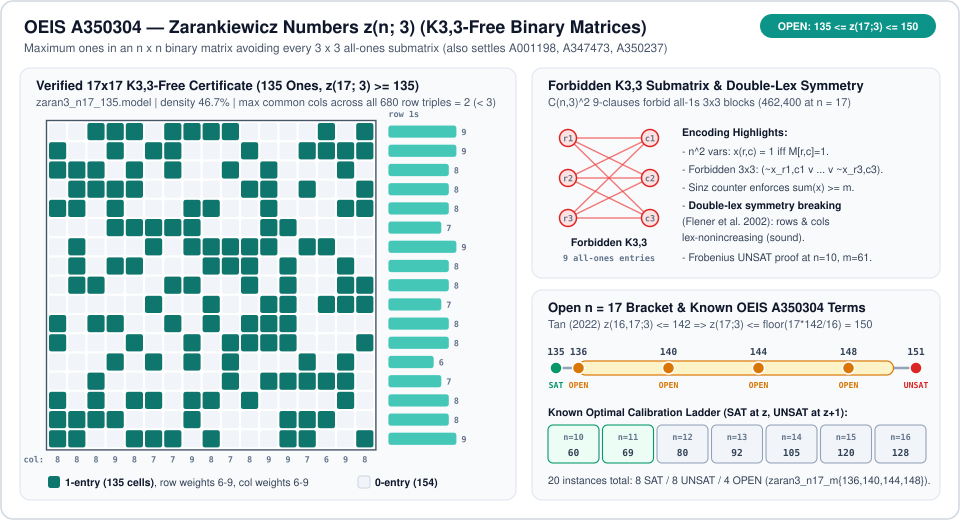

# OEIS A350304 — Zarankiewicz Numbers $z(n; 3)$ ($K_{3,3}$-Free Binary Matrices) (`guillochon-oeis-a350304-zarankiewicz`)

*Independently verified $17 \times 17$ $K_{3,3}$-free binary matrix with `135` ones (`zaran3_n17_135.model`, max common columns of any 3 rows $= 2 < 3$), alongside row/column weight marginals, the forbidden $K_{3,3}$ structure, and the open $n = 17$ bracket $135 \le z(17; 3) \le 150$ (generated by [`src/gen_diagram.py`](src/gen_diagram.py)).*

## Provenance & Credit

- **Author & Maintainer:** James Guillochon ([`@spallingerrer`](https://twitter.com/spallingerrer)) — [`https://github.com/guillochon/oeis-sat-instances`](https://github.com/guillochon/oeis-sat-instances) (`sequences/A350304/`, imported from upstream `main` commit `ba6430c`, 2026-11-23).
- **License:** Upstream generator, verifier, and validation code is MIT-licensed ([`LICENSE`](LICENSE)); all generated DIMACS CNF instances are released into the public domain (CC0).
- **Integrity:** All **20 / 20** `.cnf.xz` files in [`cnf-orig/`](cnf-orig/) are exact unmodified upstream files matching [`src/upstream/sequences/A350304/cnf/SHA256SUMS`](src/upstream/sequences/A350304/cnf/SHA256SUMS) byte-for-byte upon decompression.
- **Ground Truth Manifest:** [`expected.tsv`](expected.tsv) lists all **20 instances** (**8 SAT / 8 UNSAT / 4 UNKNOWN** open $n = 17$ bracket targets).

## Problem Description

The **Zarankiewicz number** $z(n; 3) = z(n, n; 3, 3)$ ([OEIS A350304](https://oeis.org/A350304)) is the maximum number of $1$-entries in an $n \times n$ binary matrix containing no $3 \times 3$ all-ones submatrix (equivalently, the maximum number of edges in a $K_{3,3}$-free subgraph of $K_{n,n}$). Settling $z(17; 3)$ simultaneously determines the next term of four OEIS sequences: [A350304](https://oeis.org/A350304) ($z$), [A001198](https://oeis.org/A001198) ($z + 1$), [A347473](https://oeis.org/A347473) ($n^2 - z - 1$), and [A350237](https://oeis.org/A350237) ($n^2 - z$).

- **Known exact values ($n = 10 \dots 16$):** $z(10;3) = 60$, $z(11;3) = 69$, $z(12;3) = 80$, $z(13;3) = 92$, $z(14;3) = 105$, $z(15;3) = 120$, and $z(16;3) = 128$ (Tan 2022, via SAT).
- **Open bracket at $n = 17$ ($135 \le z(17; 3) \le 150$):**
  - **Lower bound $135$:** Witnessed by the verified simulated-annealing matrix preserved in [`src/upstream/sequences/A350304/certificates/zaran3_n17_135.model`](src/upstream/sequences/A350304/certificates/zaran3_n17_135.model) (`zaran3_n17_m135.cnf` is SAT).
  - **Upper bound $150$:** Tan's bound $z(16, 17; 3) \le 142$ implies by row-deletion averaging that $z(17; 3) \le \lfloor 17 \cdot 142 / 16 \rfloor = 150$, so `zaran3_n17_m151.cnf` is proven UNSAT.
  - **Open target bracket (`zaran3_n17_m{136,140,144,148}.cnf`):** Any SAT model raises the lower bound (checked independently in milliseconds by `verify.py`); any DRAT/LRAT-certified UNSAT proof lowers the upper bound.

### Encoding Architecture (`gen_zaran.py`)

- **Matrix variables:** $n^2$ entry variables $x(r, c)$ (`1..n^2`).
- **Forbidden $K_{3,3}$ clauses:** One 9-literal all-negative clause per triple of rows and triple of columns ($\binom{n}{3}^2$ clauses; `462,400` at $n = 17$).
- **Cardinality constraint:** Sinz sequential counter (Sinz 2005) enforcing at least $m$ ones.
- **Double-lexicographic symmetry breaking (Flener et al. 2002):** Rows and columns are each constrained to be lexicographically non-increasing (sound, since every binary matrix can be permuted into double-lex order). This dramatically reduces search space (`--no-symbreak` disables it in `gen_zaran.py`).

## Corpus & Data Sizes

### Repository Layout & Four-Format Inventory

All committed files are `xz`-compressed and strictly respect GitHub's `< 95 MB` per-file size limit:

| Directory | Files | Total Size | Max File Size | Notes |
|---|---:|---:|---:|---|
| `cnf-orig/` | 20 | 4.13 MB | 401.4 KB (`zaran3_n17_m140.cnf.xz`) | Exact unmodified upstream `.cnf.xz` files (`20/20` SHA-256 verified) |
| `xcnf-converted/` | 20 | 4.19 MB | 431.6 KB (`zaran3_n17_m135.xcnf.xz`) | Lossless CryptoMiniSat `.xcnf.xz` conversions (`0` native XOR parity blocks) |
| `aig-converted/` | 20 | 13.02 MB | 1.28 MB (`zaran3_n17_m136.aig.xz`) | Exact Binary AIGER 1.9 combinational miters (`.aig.xz`) |
| `anf-converted/` | 20 | 95.14 MB | 10.23 MB (`zaran3_n17_m148.anf.xz`) | Lossless linear-size degree-$\le 3$ DIMACS-ANF conversions (`.anf.xz`) |
| `solutions/` | 3 | 42.61 MB | 42.60 MB (`zaran3_n10_m61.lrat.xz`) | **2** verified SAT models (`n=10, 11`) + **1** formally verified UNSAT proof (`zaran3_n10_m61.lrat.xz`) + [`solutions/SHA256SUMS`](solutions/SHA256SUMS) |
| `src/` | — | — | — | [`src/gen_diagram.py`](src/gen_diagram.py) + verbatim upstream generator, verifier, `.map.json` sidecars, and `SHA256SUMS` under [`src/upstream/`](src/upstream/), plus the upstream $17 \times 17$ SA certificate `certificates/zaran3_n17_135.model` |

#### Complete Instance Inventory & Ground-Truth Verdicts (`expected.tsv`)

| Instance | Expected | Variables | Clauses | `.cnf.xz` | `.xcnf.xz` | `.aig.xz` | `.anf.xz` |
|---|:---:|---:|---:|---:|---:|---:|---:|
| `zaran3_n10_m60.cnf` | SAT | 4,222 | 22,883 | 26.4 KB | 23.3 KB | 72.4 KB | 343.1 KB |
| `zaran3_n10_m61.cnf` | UNSAT | 4,123 | 22,686 | 27.1 KB | 26.7 KB | 73.8 KB | 322.8 KB |
| `zaran3_n11_m69.cnf` | SAT | 6,561 | 40,393 | 48.0 KB | 45.3 KB | 122.6 KB | 635.1 KB |
| `zaran3_n11_m70.cnf` | UNSAT | 6,441 | 40,154 | 46.0 KB | 45.8 KB | 121.3 KB | 613.9 KB |
| `zaran3_n12_m80.cnf` | SAT | 9,538 | 67,531 | 75.5 KB | 77.5 KB | 193.2 KB | 1.09 MB |
| `zaran3_n12_m81.cnf` | UNSAT | 9,395 | 67,246 | 76.1 KB | 76.4 KB | 188.4 KB | 1.03 MB |
| `zaran3_n13_m92.cnf` | SAT | 13,393 | 108,647 | 110.9 KB | 110.9 KB | 310.2 KB | 1.86 MB |
| `zaran3_n13_m93.cnf` | UNSAT | 13,225 | 108,312 | 115.6 KB | 108.8 KB | 307.3 KB | 1.74 MB |
| `zaran3_n14_m105.cnf` | SAT | 18,279 | 169,130 | 146.9 KB | 150.5 KB | 455.7 KB | 2.86 MB |
| `zaran3_n14_m106.cnf` | UNSAT | 18,084 | 168,741 | 140.9 KB | 146.6 KB | 444.5 KB | 3.03 MB |
| `zaran3_n15_m120.cnf` | SAT | 24,137 | 255,388 | 202.3 KB | 213.1 KB | 666.6 KB | 4.55 MB |
| `zaran3_n15_m121.cnf` | UNSAT | 23,913 | 254,941 | 203.3 KB | 203.1 KB | 636.3 KB | 4.56 MB |
| `zaran3_n16_m128.cnf` | SAT | 33,346 | 380,387 | 272.2 KB | 270.8 KB | 917.4 KB | 7.08 MB |
| `zaran3_n16_m129.cnf` | UNSAT | 33,091 | 379,878 | 300.3 KB | 294.9 KB | 937.2 KB | 6.95 MB |
| `zaran3_n17_m135.cnf` | SAT | 45,153 | 552,806 | 384.0 KB | 431.6 KB | 1.26 MB | 9.91 MB |
| `zaran3_n17_m136.cnf` | **UNKNOWN** *(Open)* | 44,865 | 552,231 | 394.7 KB | 399.3 KB | 1.28 MB | 9.59 MB |
| `zaran3_n17_m140.cnf` | **UNKNOWN** *(Open)* | 43,713 | 549,931 | 401.4 KB | 404.9 KB | 1.27 MB | 9.34 MB |
| `zaran3_n17_m144.cnf` | **UNKNOWN** *(Open)* | 42,561 | 547,631 | 394.8 KB | 372.7 KB | 1.27 MB | 9.23 MB |
| `zaran3_n17_m148.cnf` | **UNKNOWN** *(Open)* | 41,409 | 545,331 | 375.8 KB | 402.5 KB | 1.21 MB | 10.23 MB |
| `zaran3_n17_m151.cnf` | UNSAT | 40,545 | 543,606 | 385.9 KB | 389.5 KB | 1.27 MB | 10.18 MB |

### Sibling Collections (`guillochon/oeis-sat-instances`)

This directory is one of **9 single-problem-type collections** split from James Guillochon's [`guillochon/oeis-sat-instances`](https://github.com/guillochon/oeis-sat-instances) suite (`112` instances across `13` OEIS sequences):

| Collection | OEIS Sequence(s) | Combinatorial Problem | Instances |
|---|---|---|---:|
| [`guillochon-oeis-a067782-sortnet/`](../guillochon-oeis-a067782-sortnet/) | [A067782](https://oeis.org/A067782) | Optimal-Depth Sorting Networks $a(n)$ | 10 (4 SAT / 5 UNSAT / 1 Open) |
| [`guillochon-oeis-a171081-vdw/`](../guillochon-oeis-a171081-vdw/) | [A171081](https://oeis.org/A171081) / [A007783](https://oeis.org/A007783) | Van der Waerden Numbers $w(2; 3, t)$ | 22 (11 SAT / 10 UNSAT / 1 Open) |
| [`guillochon-oeis-a250000-queens/`](../guillochon-oeis-a250000-queens/) | [A250000](https://oeis.org/A250000) | Peaceable Coexisting Armies of Queens | 20 (10 SAT / 9 UNSAT / 1 Open) |
| **`guillochon-oeis-a350304-zarankiewicz/`** *(this collection)* | [A350304](https://oeis.org/A350304) (+3 related) | Zarankiewicz Numbers $z(n; 3)$ ($K_{3,3}$-Free Matrices) | 20 (8 SAT / 8 UNSAT / 4 Open) |
| [`guillochon-oeis-grid-sq-any/`](../guillochon-oeis-grid-sq-any/) | [A240443](https://oeis.org/A240443) | Square Grid — No Arbitrary-Orientation Square (`sq-any`) | 8 (4 SAT / 3 UNSAT / 1 Open) |
| [`guillochon-oeis-grid-sq-axis/`](../guillochon-oeis-grid-sq-axis/) | [A227133](https://oeis.org/A227133) / [A152125](https://oeis.org/A152125) | Square Grid — No Axis-Aligned Square (`sq-axis`) | 8 (4 SAT / 3 UNSAT / 1 Open) |
| [`guillochon-oeis-grid-tri-any/`](../guillochon-oeis-grid-tri-any/) | [A240114](https://oeis.org/A240114) / [A319159](https://oeis.org/A319159) | Triangular Grid — No Arbitrary Equilateral Triangle (`tri-any`) | 8 (4 SAT / 3 UNSAT / 1 Open) |
| [`guillochon-oeis-grid-tri-axis/`](../guillochon-oeis-grid-tri-axis/) | [A227308](https://oeis.org/A227308) / [A227116](https://oeis.org/A227116) | Triangular Grid — No Axis-Aligned Equilateral Triangle (`tri-axis`) | 8 (4 SAT / 3 UNSAT / 1 Open) |
| [`guillochon-oeis-grid-tri-up/`](../guillochon-oeis-grid-tri-up/) | [A157795](https://oeis.org/A157795) / [A319158](https://oeis.org/A319158) | Triangular Grid — No Upward Equilateral Triangle (`tri-up`) | 8 (4 SAT / 3 UNSAT / 1 Open) |

## Benchmark Results

### Benchmark Protocol & Hardware Parameters

- **Hardware:** AMD Ryzen 9 5950X (16 physical cores / 32 threads, 64 MiB L3 cache, 128 GiB RAM, Linux x86_64).
- **CPU Pinning & Isolation:** Strictly pinned to a single physical core (`taskset -c 1` for all 60 s 5-solver calibration runs; `taskset -c 0` or `taskset -c 1` for extended open-frontier runs), **1 thread per solver run** (`--max-cores 1`). All 5 solvers ran strictly sequentially on identical uncompressed flat `.cnf` inputs so solvers without native `.xz` streaming compete on identical inputs.
- **Solvers & Exact Flags:**
  - Frobenius v0.1.0 (`--timeout 60`, 1 thread)
  - [CaDiCaL](https://github.com/arminbiere/cadical) 3.1.0 (`-q --modelalllits=true -t 60`)
  - [CryptoMiniSat](https://github.com/msoos/cryptominisat) 5.18.0 (`-t 1 --maxtime 60`)
  - [dense-solver](https://github.com/libdense/dense-solver) 0.0.4 (1 thread, GNU `timeout -k 2s 60.0s`)
  - [Kissat](https://github.com/arminbiere/kissat) 4.0.4 (`-q --time=60`)
- **Independent Verification:**
  - **SAT models:** Every SAT output from every solver was checked both clause-by-clause against 100% of clauses in the original `.cnf.xz` AND decoded/verified by James Guillochon's independent combinatorial verifier (`decode_verify.py` / `verify.py`). Zero invalid models, zero verdict disagreements.
  - **UNSAT proofs:** Every Frobenius UNSAT result was re-run with proof emission (`--lrat` or `--proof` binary-DRAT) and triple-certified with [`drat-trim`](https://github.com/marijnheule/drat-trim) (`s VERIFIED`), [`lrat-check`](https://github.com/marijnheule/drat-trim) (`c VERIFIED`), and formally verified [`cake_lpr`](https://github.com/tanyongkiam/cake_lpr) (`s VERIFIED UNSAT`).

### Comparative Single-Core Calibration Results ($T_{\max} = 60\;\text{s}$)

Two $n = 10$ calibration rungs evaluated sequentially on identical uncompressed flat `.cnf` files (`taskset -c 1`, 1 thread). **Frobenius** is **#1 fastest overall (`23.14 s` PAR-2 vs. `31.02 s` for Kissat 4.0.4 and `33.87 s` for CaDiCaL 3.1.0)** and **#1 fastest on the UNSAT optimality proof `zaran3_n10_m61.cnf`** (`18.80 s`):

| Instance | Expected | Frobenius | [CaDiCaL](https://github.com/arminbiere/cadical) 3.1.0 | [CryptoMiniSat](https://github.com/msoos/cryptominisat) 5.18.0 | [dense-solver](https://github.com/libdense/dense-solver) 0.0.4 | [Kissat](https://github.com/arminbiere/kissat) 4.0.4 |
|---|:---:|---:|---:|---:|---:|---:|
| `zaran3_n10_m60.cnf` | SAT | 4.34 s | 7.35 s | 5.84 s | **2.03 s** | 4.69 s |
| `zaran3_n10_m61.cnf` | UNSAT | **18.80 s** | 26.52 s | 40.54 s | >60 s | 26.33 s |
| **Solved ($T_{\max} = 60\;\text{s}$)** | **2 / 2** | **2 / 2** (1 SAT, 1 UNSAT) | **2 / 2** (1 SAT, 1 UNSAT) | **2 / 2** (1 SAT, 1 UNSAT) | 1 / 2 (1 SAT, 0 UNSAT) | **2 / 2** (1 SAT, 1 UNSAT) |
| **Total PAR-2 ($T_{\max} = 60\;\text{s}$)** | — | **23.14 s** *(mean 11.57 s)* | 33.87 s *(mean 16.93 s)* | 46.38 s *(mean 23.19 s)* | 122.03 s *(mean 61.02 s)* | 31.02 s *(mean 15.51 s)* |

- **Extended sweep milestone:** Frobenius also solved `zaran3_n11_m69.cnf` (SAT), verified and archived in [`solutions/zaran3_n11_m69.model.xz`](solutions/zaran3_n11_m69.model.xz).

### Open OEIS Frontier Runs (Single-Core Pinned)

Evaluated directly with Frobenius (`--max-cores 1`, pinned to physical core `1`, native `.cnf.xz` ingestion):

| Open Target | OEIS Frontier | Budget | Pinning | Conflicts | Decisions | Propagations | Status |
|---|---|---:|---|---:|---:|---:|:---:|
| `zaran3_n17_m136.cnf` | Zarankiewicz $135 \le z(17; 3) \le 150$ (`44,865` vars, `552,231` cls) | 600 s | `taskset -c 1` | 7,684,224 | 14,572,944 | 3,070,229,112 | Open (`UNKNOWN`) |
| `zaran3_n17_m140.cnf` | Zarankiewicz $n = 17$ upper bracket (`43,713` vars, `549,931` cls) | 15 s | `taskset -c 1` | — | — | — | Open (`UNKNOWN`) |
| `zaran3_n17_m144.cnf` | Zarankiewicz $n = 17$ upper bracket (`42,561` vars, `547,631` cls) | 15 s | `taskset -c 1` | — | — | — | Open (`UNKNOWN`) |
| `zaran3_n17_m148.cnf` | Zarankiewicz $n = 17$ upper bracket (`41,409` vars, `545,331` cls) | 15 s | `taskset -c 1` | — | — | — | Open (`UNKNOWN`) |

### Supplementary Full-Corpus Coverage ($T_{\max} = 60\;\text{s}$, Single-Core Pinned)

Remaining 13 corpus instances evaluated with Frobenius (`--max-cores 1 --timeout 60`, single physical core pinned per run, uncompressed flat `.cnf` input) to provide explicit coverage across all `20 / 20` instances in `cnf-orig/`:

| Instance | Expected | Frobenius 1C | Conflicts | Decisions | Propagations |
|---|:---:|---:|---:|---:|---:|
| `zaran3_n11_m70.cnf` | UNSAT | >60 s | 2,713,856 | 4,211,470 | 215,641,931 |
| `zaran3_n12_m80.cnf` | SAT | >60 s | 2,324,608 | 3,947,764 | 241,807,949 |
| `zaran3_n12_m81.cnf` | UNSAT | >60 s | 2,347,008 | 3,896,558 | 243,223,417 |
| `zaran3_n13_m92.cnf` | SAT | >60 s | 2,070,080 | 3,451,761 | 253,456,834 |
| `zaran3_n13_m93.cnf` | UNSAT | >60 s | 2,050,624 | 3,468,264 | 264,042,226 |
| `zaran3_n14_m105.cnf` | SAT | >60 s | 1,613,696 | 2,849,798 | 252,442,090 |
| `zaran3_n14_m106.cnf` | UNSAT | >60 s | 1,533,568 | 2,826,492 | 237,034,290 |
| `zaran3_n15_m120.cnf` | SAT | >60 s | 1,353,216 | 2,345,942 | 246,692,669 |
| `zaran3_n15_m121.cnf` | UNSAT | >60 s | 1,417,216 | 2,418,681 | 236,026,138 |
| `zaran3_n16_m128.cnf` | SAT | >60 s | 947,392 | 1,857,441 | 185,973,055 |
| `zaran3_n16_m129.cnf` | UNSAT | >60 s | 1,044,480 | 1,900,397 | 193,691,393 |
| `zaran3_n17_m135.cnf` | SAT | >60 s | 683,200 | 1,421,813 | 187,323,555 |
| `zaran3_n17_m151.cnf` | UNSAT | >60 s | 780,480 | 1,459,372 | 175,656,839 |

### Verified Solutions & Certified Proofs (`solutions/`)

All **3 verified files** (**2 SAT models + 1 formally certified UNSAT proof**) match [`solutions/SHA256SUMS`](solutions/SHA256SUMS) (`sha256sum -c` PASS):

#### Certified UNSAT Proof (1 / 1 `drat-trim` + `lrat-check` + `cake_lpr` `s VERIFIED UNSAT`)

| Solution File | Raw Proof Size | Compressed Size | SHA-256 (prefix) | Verification Pipeline |
|---|---:|---:|---|---|
| [`solutions/zaran3_n10_m61.lrat.xz`](solutions/zaran3_n10_m61.lrat.xz) | 211.05 MB (LRAT) | 42.60 MB | `6178ed99f639` | `--proof` (`33.72 s`) → `drat-trim -i -L` (`35.89 s`) → `lrat-check` (`2.64 s`) + `cake_lpr` **`s VERIFIED UNSAT`** (`5.94 s`) |

#### Verified SAT Models (2 / 2 Raw-Clause + Upstream `verify.py` PASS)

| Solution File | Size | SHA-256 (prefix) | Independent Verification Result |
|---|---:|---|---|
| [`solutions/zaran3_n10_m60.model.xz`](solutions/zaran3_n10_m60.model.xz) | 3.6 KB | `b09d75e9d12e` | 22,883/22,883 cls OK; `verify.py`: `60 ones, max common cols = 2: VALID` |
| [`solutions/zaran3_n11_m69.model.xz`](solutions/zaran3_n11_m69.model.xz) | 5.1 KB | `27d297721864` | 40,393/40,393 cls OK; `verify.py`: `69 ones, max common cols = 2: VALID` |

*Upstream lower-bound certificate:* [`src/upstream/sequences/A350304/certificates/zaran3_n17_135.model`](src/upstream/sequences/A350304/certificates/zaran3_n17_135.model) provides a verified $17 \times 17$ $K_{3,3}$-free matrix with `135` ones (`max common cols = 2`).

<!-- BEGIN_STRUCTURAL_ANALYSIS -->
## Phase-Transition & Structural Analysis

*Auto-generated by [`../src/analyze_benchmarks.py`](../src/analyze_benchmarks.py). Position relative to the critical phase transition is measured by $\rho_{\mathrm{crit}} = \frac{1}{n}\sum_k m_k / \alpha_c(k)$ (exact $\alpha/\alpha_c(k)$ for pure $k$-SAT; effective critical threshold $\alpha_c^{\mathrm{eff}} = \alpha/\rho_{\mathrm{crit}}$; `Under` $<0.90\times$, `Near-crit` $0.90\text{--}1.10\times$, `Over` $>1.10\times$), alongside Gent–Walsh annealed constrainedness $\kappa = -\frac{1}{n}\sum_i \log_2(1-2^{-k_i})$ (AAAI 1996), clause-length profile ($\bar{k}$, `%Bin`, `%Horn`), variable-degree CV ($\sigma_d/\bar{d}$, uniformity vs. hub skew), and extracted native XOR parity clauses.*

| Instance | Active $n$ | Clauses $m$ | $\alpha=m/n$ | $\alpha_c^{\mathrm{eff}}$ | $\rho_{\mathrm{crit}}$ (Regime) | $\kappa$ | $\bar{k}$ ($k_{\max}$) | Bin% | Horn% | Pos% | Deg CV | XORs |
|---|---:|---:|---:|---:|---:|---:|---:|---:|---:|---:|---:|---:|
| `zaran3_n10_m60` | 4,222 | 22,883 | 5.42 | 4.41 | **1.23x** (Over) | 0.62 | 6.60 (9) | 18% | 82% | 8% | 5.70 | 0 |
| `zaran3_n10_m61` | 4,123 | 22,686 | 5.50 | 4.48 | **1.23x** (Over) | 0.62 | 6.64 (9) | 18% | 82% | 8% | 5.65 | 0 |
| `zaran3_n11_m69` | 6,561 | 40,393 | 6.16 | 4.99 | **1.23x** (Over) | 0.62 | 6.89 (9) | 16% | 84% | 7% | 6.61 | 0 |
| `zaran3_n11_m70` | 6,441 | 40,154 | 6.23 | 5.06 | **1.23x** (Over) | 0.62 | 6.92 (9) | 16% | 84% | 7% | 6.56 | 0 |
| `zaran3_n12_m80` | 9,538 | 67,531 | 7.08 | 5.72 | **1.24x** (Over) | 0.62 | 7.17 (9) | 14% | 86% | 6% | 7.44 | 0 |
| `zaran3_n12_m81` | 9,395 | 67,246 | 7.16 | 5.78 | **1.24x** (Over) | 0.62 | 7.19 (9) | 14% | 86% | 6% | 7.39 | 0 |
| `zaran3_n13_m92` | 13,393 | 108,647 | 8.11 | 6.53 | **1.24x** (Over) | 0.62 | 7.40 (9) | 12% | 88% | 5% | 8.26 | 0 |
| `zaran3_n13_m93` | 13,225 | 108,312 | 8.19 | 6.59 | **1.24x** (Over) | 0.62 | 7.41 (9) | 12% | 88% | 5% | 8.21 | 0 |
| `zaran3_n14_m105` | 18,279 | 169,130 | 9.25 | 7.42 | **1.25x** (Over) | 0.63 | 7.60 (9) | 11% | 89% | 4% | 9.06 | 0 |
| `zaran3_n14_m106` | 18,084 | 168,741 | 9.33 | 7.49 | **1.25x** (Over) | 0.63 | 7.61 (9) | 11% | 89% | 4% | 9.01 | 0 |
| `zaran3_n15_m120` | 24,137 | 255,388 | 10.58 | 8.46 | **1.25x** (Over) | 0.63 | 7.77 (9) | 9% | 91% | 4% | 9.81 | 0 |
| `zaran3_n15_m121` | 23,913 | 254,941 | 10.66 | 8.52 | **1.25x** (Over) | 0.63 | 7.78 (9) | 9% | 91% | 4% | 9.77 | 0 |
| `zaran3_n16_m128` | 33,346 | 380,387 | 11.41 | 9.09 | **1.25x** (Over) | 0.63 | 7.86 (9) | 9% | 91% | 3% | 10.86 | 0 |
| `zaran3_n16_m129` | 33,091 | 379,878 | 11.48 | 9.15 | **1.25x** (Over) | 0.63 | 7.87 (9) | 9% | 91% | 3% | 10.82 | 0 |
| `zaran3_n17_m135` | 45,153 | 552,806 | 12.24 | 9.73 | **1.26x** (Over) | 0.64 | 7.94 (9) | 8% | 92% | 3% | 11.95 | 0 |
| `zaran3_n17_m136` | 44,865 | 552,231 | 12.31 | 9.79 | **1.26x** (Over) | 0.64 | 7.94 (9) | 8% | 92% | 3% | 11.91 | 0 |
| `zaran3_n17_m140` | 43,713 | 549,931 | 12.58 | 10.00 | **1.26x** (Over) | 0.64 | 7.97 (9) | 8% | 92% | 3% | 11.77 | 0 |
| `zaran3_n17_m144` | 42,561 | 547,631 | 12.87 | 10.22 | **1.26x** (Over) | 0.64 | 7.99 (9) | 8% | 92% | 3% | 11.62 | 0 |
| `zaran3_n17_m148` | 41,409 | 545,331 | 13.17 | 10.45 | **1.26x** (Over) | 0.64 | 8.01 (9) | 8% | 92% | 3% | 11.48 | 0 |
| `zaran3_n17_m151` | 40,545 | 543,606 | 13.41 | 10.64 | **1.26x** (Over) | 0.64 | 8.03 (9) | 7% | 93% | 3% | 11.36 | 0 |

**Collection Phase-Transition Summary (20 instances, 4 formats: 20 CNF / 20 AIG / 20 XCNF / 20 ANF):** median $\rho_{\mathrm{crit}} = 1.25\times$ (range `1.23x–1.26x`), median $\kappa = 0.63$, regime split **0 Under / 0 Near-critical / 20 Over**, total extracted native XOR parity clauses = **0**, total ANF equations = **31,936,933**.
<!-- END_STRUCTURAL_ANALYSIS -->

## References

- James Guillochon ([`@spallingerrer`](https://twitter.com/spallingerrer)), *OEIS SAT instances*, [`https://github.com/guillochon/oeis-sat-instances`](https://github.com/guillochon/oeis-sat-instances) (2026).
- S. Tan, *"New Zarankiewicz Numbers via SAT"*, 2022 ([OEIS A350304](https://oeis.org/A350304), [A001198](https://oeis.org/A001198), [A347473](https://oeis.org/A347473), [A350237](https://oeis.org/A350237)).
- P. Flener, A. M. Frisch, B. Hnich, Z. Kızıltan, I. Miguel, J. Pearson, and T. Walsh, *"Breaking Row and Column Symmetries in Matrix Models"*, CP 2002, LNCS 2470, pp. 462–476.
- C. Sinz, *"Towards an Optimal CNF Encoding of Boolean Cardinality Constraints"*, CP 2005, LNCS 3709, pp. 827–831.
