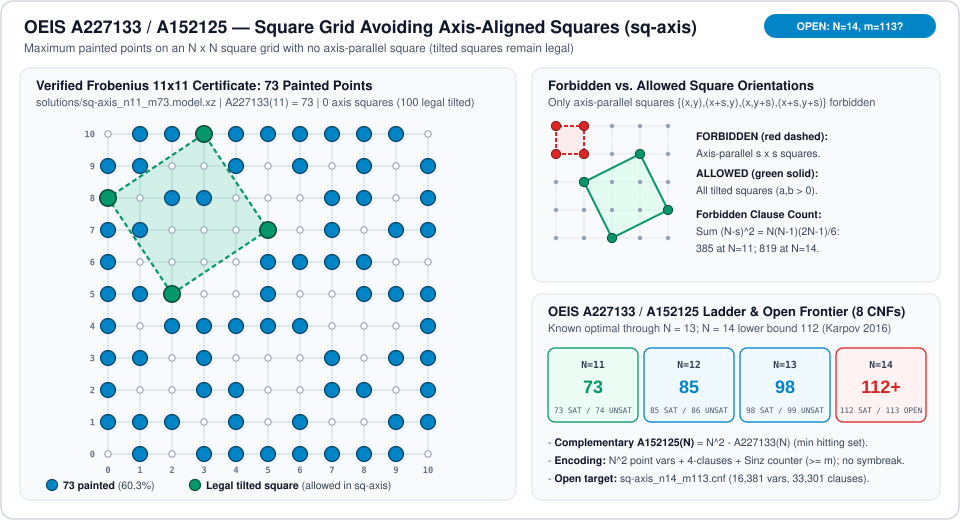

# OEIS A227133 / A152125 — Square-Grid No-Axis-Aligned-Square (`guillochon-oeis-grid-sq-axis`)

*Independently verified Frobenius $11 \times 11$ solution (`73` painted points, zero axis-aligned squares; green dashed overlay highlights one of the `100` legal tilted squares present in the configuration) decoded directly from [`solutions/sq-axis_n11_m73.model.xz`](solutions/sq-axis_n11_m73.model.xz), alongside the forbidden vs. allowed orientation schematic and OEIS A227133 / A152125 ladder (generated by [`src/gen_diagram.py`](src/gen_diagram.py)).*

## Provenance & Credit

- **Author & Maintainer:** James Guillochon ([`@spallingerrer`](https://twitter.com/spallingerrer)) — [`https://github.com/guillochon/oeis-sat-instances`](https://github.com/guillochon/oeis-sat-instances) (`sequences/point-patterns/`, pattern `sq-axis`, imported from upstream `main` commit `ba6430c`, 2026-11-23).
- **License:** Upstream generator, verifier, and validation code is MIT-licensed ([`LICENSE`](LICENSE)); all generated DIMACS CNF instances are released into the public domain (CC0).
- **Integrity:** All **8 / 8** `.cnf.xz` files in [`cnf-orig/`](cnf-orig/) are exact unmodified upstream files matching [`src/upstream/sequences/point-patterns/cnf/SHA256SUMS`](src/upstream/sequences/point-patterns/cnf/SHA256SUMS) byte-for-byte upon decompression.
- **Ground Truth Manifest:** [`expected.tsv`](expected.tsv) lists all **8 instances** (**4 SAT / 3 UNSAT / 1 UNKNOWN** open OEIS frontier target).

## Problem Description

[OEIS A227133](https://oeis.org/A227133) gives $a(N)$, the maximum number of points that can be painted on an $N \times N$ square grid $\{0, \dots, N-1\}^2$ such that **no four painted points form an axis-aligned square** $\{(x, y), (x+s, y), (x, y+s), (x+s, y+s)\}$ (tilted squares remain allowed). Its complementary hitting-set sequence [OEIS A152125](https://oeis.org/A152125) gives the minimum points to remove so every axis-aligned square is hit: $\text{A152125}(N) = N^2 - \text{A227133}(N)$.

- **Known exact values ($N = 11, 12, 13$):** $a(11) = 73$, $a(12) = 85$, and $a(13) = 98$.
- **Open question ($N = 14$):** Can $113$ points be painted on a $14 \times 14$ grid without forming an axis-aligned square? Karpov (2016) established $a(14) \ge 112$ (`sq-axis_n14_m112.cnf` is SAT).
- **Target instance `sq-axis_n14_m113.cnf`:**
  - **SAT** raises the lower bound to $a(14) \ge 113$ (checked independently in milliseconds by `verify.py`).
  - **UNSAT** (with a machine-checkable DRAT/LRAT proof) settles both $\text{A227133}(14) = 112$ and $\text{A152125}(14) = 84$.

### Encoding Architecture (`gen_points.py sq-axis N M`)

- **Point variables:** $N^2$ Boolean variables (`1..N^2`), one per lattice point $(x, y) \in \{0, \dots, N-1\}^2$.
- **Forbidden axis-square 4-clauses:** One all-negative 4-clause for every axis-aligned square of side $s \in \{1, \dots, N-1\}$ ($\sum_{s=1}^{N-1} (N - s)^2 = N(N-1)(2N-1)/6$ clauses: `385` at $N = 11$, `819` at $N = 14$).
- **Cardinality constraint:** Sinz sequential counter (Sinz 2005) enforcing at least $m$ painted points.
- **Symmetry:** No symmetry breaking; all 8 symmetries of the square ($D_4$) remain intact.

## Corpus & Data Sizes

### Repository Layout & Four-Format Inventory

All committed files are `xz`-compressed and strictly respect GitHub's `< 95 MB` per-file size limit:

| Directory | Files | Total Size | Max File Size | Notes |
|---|---:|---:|---:|---|
| `cnf-orig/` | 8 | 204.8 KB | 39.9 KB (`sq-axis_n14_m112.cnf.xz`) | Exact unmodified upstream `.cnf.xz` files (`8/8` SHA-256 verified) |
| `xcnf-converted/` | 8 | 205.7 KB | 40.3 KB (`sq-axis_n14_m112.xcnf.xz`) | Lossless CryptoMiniSat `.xcnf.xz` conversions (`0` native XOR parity blocks) |
| `aig-converted/` | 8 | 276.1 KB | 52.1 KB (`sq-axis_n14_m113.aig.xz`) | Exact Binary AIGER 1.9 combinational miters (`.aig.xz`) |
| `anf-converted/` | 8 | 421.0 KB | 75.8 KB (`sq-axis_n14_m112.anf.xz`) | Lossless linear-size degree-$\le 3$ DIMACS-ANF conversions (`.anf.xz`) |
| `solutions/` | 1 | 4.7 KB | 4.7 KB (`sq-axis_n11_m73.model.xz`) | **1** verified SAT model (`sq-axis_n11_m73.model.xz`) + [`solutions/SHA256SUMS`](solutions/SHA256SUMS) |
| `src/` | — | — | — | [`src/gen_diagram.py`](src/gen_diagram.py) + verbatim upstream generator, verifier, `.map.json` sidecars, and `SHA256SUMS` under [`src/upstream/`](src/upstream/) |

#### Complete Instance Inventory & Ground-Truth Verdicts (`expected.tsv`)

| Instance | Expected | Variables | Clauses | `.cnf.xz` | `.xcnf.xz` | `.aig.xz` | `.anf.xz` |
|---|:---:|---:|---:|---:|---:|---:|---:|
| `sq-axis_n11_m73.cnf` | SAT | 5,881 | 11,977 | 14.7 KB | 14.5 KB | 20.1 KB | 32.9 KB |
| `sq-axis_n11_m74.cnf` | UNSAT | 5,761 | 11,738 | 15.0 KB | 14.3 KB | 20.5 KB | 32.6 KB |
| `sq-axis_n12_m85.cnf` | SAT | 8,581 | 17,464 | 20.8 KB | 21.5 KB | 27.6 KB | 42.3 KB |
| `sq-axis_n12_m86.cnf` | UNSAT | 8,438 | 17,179 | 20.7 KB | 20.7 KB | 27.4 KB | 42.4 KB |
| `sq-axis_n13_m98.cnf` | SAT | 12,097 | 24,603 | 28.8 KB | 28.9 KB | 42.4 KB | 59.4 KB |
| `sq-axis_n13_m99.cnf` | UNSAT | 11,929 | 24,268 | 26.1 KB | 26.4 KB | 38.4 KB | 60.7 KB |
| `sq-axis_n14_m112.cnf` | SAT | 16,576 | 33,690 | 39.9 KB | 40.3 KB | 47.6 KB | 75.8 KB |
| `sq-axis_n14_m113.cnf` | **UNKNOWN** *(Open)* | 16,381 | 33,301 | 38.8 KB | 39.1 KB | 52.1 KB | 74.8 KB |

### Sibling Collections (`guillochon/oeis-sat-instances`)

This directory is one of **9 single-problem-type collections** split from James Guillochon's [`guillochon/oeis-sat-instances`](https://github.com/guillochon/oeis-sat-instances) suite (`112` instances across `13` OEIS sequences):

| Collection | OEIS Sequence(s) | Combinatorial Problem | Instances |
|---|---|---|---:|
| [`guillochon-oeis-a067782-sortnet/`](../guillochon-oeis-a067782-sortnet/) | [A067782](https://oeis.org/A067782) | Optimal-Depth Sorting Networks $a(n)$ | 10 (4 SAT / 5 UNSAT / 1 Open) |
| [`guillochon-oeis-a171081-vdw/`](../guillochon-oeis-a171081-vdw/) | [A171081](https://oeis.org/A171081) / [A007783](https://oeis.org/A007783) | Van der Waerden Numbers $w(2; 3, t)$ | 22 (11 SAT / 10 UNSAT / 1 Open) |
| [`guillochon-oeis-a250000-queens/`](../guillochon-oeis-a250000-queens/) | [A250000](https://oeis.org/A250000) | Peaceable Coexisting Armies of Queens | 20 (10 SAT / 9 UNSAT / 1 Open) |
| [`guillochon-oeis-a350304-zarankiewicz/`](../guillochon-oeis-a350304-zarankiewicz/) | [A350304](https://oeis.org/A350304) (+3 related) | Zarankiewicz Numbers $z(n; 3)$ ($K_{3,3}$-Free Matrices) | 20 (8 SAT / 8 UNSAT / 4 Open) |
| [`guillochon-oeis-grid-sq-any/`](../guillochon-oeis-grid-sq-any/) | [A240443](https://oeis.org/A240443) | Square Grid — No Arbitrary-Orientation Square (`sq-any`) | 8 (4 SAT / 3 UNSAT / 1 Open) |
| **`guillochon-oeis-grid-sq-axis/`** *(this collection)* | [A227133](https://oeis.org/A227133) / [A152125](https://oeis.org/A152125) | Square Grid — No Axis-Aligned Square (`sq-axis`) | 8 (4 SAT / 3 UNSAT / 1 Open) |
| [`guillochon-oeis-grid-tri-any/`](../guillochon-oeis-grid-tri-any/) | [A240114](https://oeis.org/A240114) / [A319159](https://oeis.org/A319159) | Triangular Grid — No Arbitrary Equilateral Triangle (`tri-any`) | 8 (4 SAT / 3 UNSAT / 1 Open) |
| [`guillochon-oeis-grid-tri-axis/`](../guillochon-oeis-grid-tri-axis/) | [A227308](https://oeis.org/A227308) / [A227116](https://oeis.org/A227116) | Triangular Grid — No Axis-Aligned Equilateral Triangle (`tri-axis`) | 8 (4 SAT / 3 UNSAT / 1 Open) |
| [`guillochon-oeis-grid-tri-up/`](../guillochon-oeis-grid-tri-up/) | [A157795](https://oeis.org/A157795) / [A319158](https://oeis.org/A319158) | Triangular Grid — No Upward Equilateral Triangle (`tri-up`) | 8 (4 SAT / 3 UNSAT / 1 Open) |

## Benchmark Results

### Benchmark Protocol & Hardware Parameters

- **Hardware:** AMD Ryzen 9 5950X (16 physical cores / 32 threads, 64 MiB L3 cache, 128 GiB RAM, Linux x86_64).
- **CPU Pinning & Isolation:** Strictly pinned to a single physical core (`taskset -c 1` for all 60 s 5-solver calibration runs; `taskset -c 0` or `taskset -c 1` for extended open-frontier runs), **1 thread per solver run** (`--max-cores 1`). All 5 solvers ran strictly sequentially on identical uncompressed flat `.cnf` inputs so solvers without native `.xz` streaming compete on identical inputs.
- **Solvers & Exact Flags:**
  - Frobenius v0.1.0 (`--timeout 60`, 1 thread)
  - [CaDiCaL](https://github.com/arminbiere/cadical) 3.1.0 (`-q --modelalllits=true -t 60`)
  - [CryptoMiniSat](https://github.com/msoos/cryptominisat) 5.18.0 (`-t 1 --maxtime 60`)
  - [dense-solver](https://github.com/libdense/dense-solver) 0.0.4 (1 thread, GNU `timeout -k 2s 60.0s`)
  - [Kissat](https://github.com/arminbiere/kissat) 4.0.4 (`-q --time=60`)
- **Independent Verification:**
  - **SAT models:** Every SAT output from every solver was checked both clause-by-clause against 100% of clauses in the original `.cnf.xz` AND decoded/verified by James Guillochon's independent combinatorial verifier (`decode_verify.py` / `verify.py`). Zero invalid models, zero verdict disagreements.

### Comparative Single-Core Calibration Results ($T_{\max} = 60\;\text{s}$)

Two $N = 11$ calibration rungs evaluated sequentially on identical uncompressed flat `.cnf` files (`taskset -c 1`, 1 thread). Only Frobenius and CaDiCaL 3.1.0 solve `sq-axis_n11_m73.cnf` within 60 s:

| Instance | Expected | Frobenius | [CaDiCaL](https://github.com/arminbiere/cadical) 3.1.0 | [CryptoMiniSat](https://github.com/msoos/cryptominisat) 5.18.0 | [dense-solver](https://github.com/libdense/dense-solver) 0.0.4 | [Kissat](https://github.com/arminbiere/kissat) 4.0.4 |
|---|:---:|---:|---:|---:|---:|---:|
| `sq-axis_n11_m73.cnf` | SAT | 52.51 s | **2.32 s** | >60 s | >60 s | >60 s |
| `sq-axis_n11_m74.cnf` | UNSAT | >60 s | >60 s | >60 s | >60 s | >60 s |
| **Solved ($T_{\max} = 60\;\text{s}$)** | **1 / 2** | **1 / 2** (1 SAT, 0 UNSAT) | **1 / 2** (1 SAT, 0 UNSAT) | 0 / 2 (0 SAT, 0 UNSAT) | 0 / 2 (0 SAT, 0 UNSAT) | 0 / 2 (0 SAT, 0 UNSAT) |
| **Total PAR-2 ($T_{\max} = 60\;\text{s}$)** | — | 172.51 s *(mean 86.25 s)* | **122.32 s** *(mean 61.16 s)* | 240.00 s *(mean 120.00 s)* | 240.00 s *(mean 120.00 s)* | 240.00 s *(mean 120.00 s)* |

### Open OEIS Frontier Run (180 s, Single-Core Pinned)

Evaluated directly with Frobenius (`--max-cores 1`, pinned to physical core `1`, native `.cnf.xz` ingestion):

| Open Target | OEIS Frontier | Budget | Pinning | Conflicts | Decisions | Propagations | Status |
|---|---|---:|---|---:|---:|---:|:---:|
| `sq-axis_n14_m113.cnf` | `sq-axis` $14 \times 14$ ($a(14) \ge 112$; `16,381` vars, `33,301` cls) | 180 s | `taskset -c 1` | — | — | — | Open (`UNKNOWN`) |

### Verified Solutions (`solutions/`)

Checksums verified with `sha256sum -c` against [`solutions/SHA256SUMS`](solutions/SHA256SUMS):

| Solution File | Size | SHA-256 (prefix) | Independent Verification Result |
|---|---:|---|---|
| [`solutions/sq-axis_n11_m73.model.xz`](solutions/sq-axis_n11_m73.model.xz) | 4.7 KB | `9214a9edb429` | 11,977/11,977 cls OK; `verify.py`: `73 painted, 0 forbidden: VALID` |

<!-- BEGIN_STRUCTURAL_ANALYSIS -->
## Phase-Transition & Structural Analysis

*Auto-generated by [`../src/analyze_benchmarks.py`](../src/analyze_benchmarks.py). Position relative to the critical phase transition is measured by $\rho_{\mathrm{crit}} = \frac{1}{n}\sum_k m_k / \alpha_c(k)$ (exact $\alpha/\alpha_c(k)$ for pure $k$-SAT; effective critical threshold $\alpha_c^{\mathrm{eff}} = \alpha/\rho_{\mathrm{crit}}$; `Under` $<0.90\times$, `Near-crit` $0.90\text{--}1.10\times$, `Over` $>1.10\times$), alongside Gent–Walsh annealed constrainedness $\kappa = -\frac{1}{n}\sum_i \log_2(1-2^{-k_i})$ (AAAI 1996), clause-length profile ($\bar{k}$, `%Bin`, `%Horn`), variable-degree CV ($\sigma_d/\bar{d}$, uniformity vs. hub skew), and extracted native XOR parity clauses.*

| Instance | Active $n$ | Clauses $m$ | $\alpha=m/n$ | $\alpha_c^{\mathrm{eff}}$ | $\rho_{\mathrm{crit}}$ (Regime) | $\kappa$ | $\bar{k}$ ($k_{\max}$) | Bin% | Horn% | Pos% | Deg CV | XORs |
|---|---:|---:|---:|---:|---:|---:|---:|---:|---:|---:|---:|---:|
| `sq-axis_n11_m73` | 5,881 | 11,977 | 2.04 | 1.63 | **1.25x** (Over) | 0.62 | 2.53 (4) | 50% | 52% | 57% | 1.58 | 0 |
| `sq-axis_n11_m74` | 5,761 | 11,738 | 2.04 | 1.63 | **1.25x** (Over) | 0.62 | 2.53 (4) | 50% | 52% | 57% | 1.57 | 0 |
| `sq-axis_n12_m85` | 8,581 | 17,464 | 2.04 | 1.63 | **1.25x** (Over) | 0.62 | 2.53 (4) | 50% | 52% | 57% | 1.74 | 0 |
| `sq-axis_n12_m86` | 8,438 | 17,179 | 2.04 | 1.63 | **1.25x** (Over) | 0.62 | 2.53 (4) | 50% | 52% | 57% | 1.73 | 0 |
| `sq-axis_n13_m98` | 12,097 | 24,603 | 2.03 | 1.63 | **1.25x** (Over) | 0.62 | 2.53 (4) | 50% | 52% | 58% | 1.90 | 0 |
| `sq-axis_n13_m99` | 11,929 | 24,268 | 2.03 | 1.63 | **1.25x** (Over) | 0.62 | 2.53 (4) | 50% | 52% | 57% | 1.89 | 0 |
| `sq-axis_n14_m112` | 16,576 | 33,690 | 2.03 | 1.63 | **1.24x** (Over) | 0.61 | 2.52 (4) | 50% | 52% | 58% | 2.05 | 0 |
| `sq-axis_n14_m113` | 16,381 | 33,301 | 2.03 | 1.63 | **1.24x** (Over) | 0.61 | 2.52 (4) | 50% | 52% | 58% | 2.04 | 0 |

**Collection Phase-Transition Summary (8 instances, 4 formats: 8 CNF / 8 AIG / 8 XCNF / 8 ANF):** median $\rho_{\mathrm{crit}} = 1.25\times$ (range `1.24x–1.25x`), median $\kappa = 0.62$, regime split **0 Under / 0 Near-critical / 8 Over**, total extracted native XOR parity clauses = **0**, total ANF equations = **178,940**.
<!-- END_STRUCTURAL_ANALYSIS -->

## References

- James Guillochon ([`@spallingerrer`](https://twitter.com/spallingerrer)), *OEIS SAT instances*, [`https://github.com/guillochon/oeis-sat-instances`](https://github.com/guillochon/oeis-sat-instances) (2026).
- OEIS Foundation Inc., *Entries [A227133](https://oeis.org/A227133) and [A152125](https://oeis.org/A152125): Axis-aligned square-free subsets of the $n \times n$ grid* (D. Karpov 2016 lower bound $a(14) \ge 112$).
- C. Sinz, *"Towards an Optimal CNF Encoding of Boolean Cardinality Constraints"*, CP 2005, LNCS 3709, pp. 827–831.
