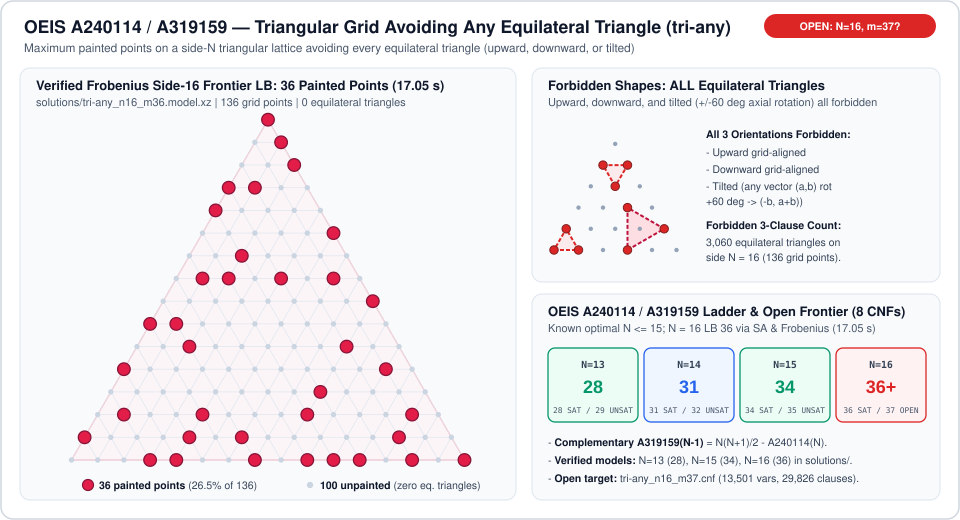

# OEIS A240114 / A319159 — Triangular-Grid No-Arbitrary-Equilateral-Triangle (`guillochon-oeis-grid-tri-any`)

*Independently verified Frobenius side-16 triangular-grid frontier lower-bound solution (`36` painted points, zero equilateral triangles of any orientation, solved from scratch in `17.05 s`) decoded directly from [`solutions/tri-any_n16_m36.model.xz`](solutions/tri-any_n16_m36.model.xz), alongside all three forbidden triangle orientations and the OEIS A240114 / A319159 ladder (generated by [`src/gen_diagram.py`](src/gen_diagram.py)).*

## Provenance & Credit

- **Author & Maintainer:** James Guillochon ([`@spallingerrer`](https://twitter.com/spallingerrer)) — [`https://github.com/guillochon/oeis-sat-instances`](https://github.com/guillochon/oeis-sat-instances) (`sequences/point-patterns/`, pattern `tri-any`, imported from upstream `main` commit `ba6430c`, 2026-11-23).
- **License:** Upstream generator, verifier, and validation code is MIT-licensed ([`LICENSE`](LICENSE)); all generated DIMACS CNF instances are released into the public domain (CC0).
- **Integrity:** All **8 / 8** `.cnf.xz` files in [`cnf-orig/`](cnf-orig/) are exact unmodified upstream files matching [`src/upstream/sequences/point-patterns/cnf/SHA256SUMS`](src/upstream/sequences/point-patterns/cnf/SHA256SUMS) byte-for-byte upon decompression.
- **Ground Truth Manifest:** [`expected.tsv`](expected.tsv) lists all **8 instances** (**4 SAT / 3 UNSAT / 1 UNKNOWN** open OEIS frontier target).

## Problem Description

[OEIS A240114](https://oeis.org/A240114) gives $a(N)$, the maximum number of points that can be painted on a side-$N$ triangular lattice ($\{(x, y) \in \mathbb{Z}_{\ge 0}^2 : x + y \le N - 1\}$, containing $N(N+1)/2$ points) such that **no three painted points form the vertices of an equilateral triangle of any orientation** (upward, downward, or tilted). Its complementary hitting-set sequence is [OEIS A319159](https://oeis.org/A319159) with $\text{A319159}(N - 1) = N(N+1)/2 - \text{A240114}(N)$.

- **Known exact values ($N = 13, 14, 15$):** $a(13) = 28$, $a(14) = 31$, and $a(15) = 34$.
- **Open question ($N = 16$):** Can $37$ points be painted on a side-16 triangular lattice (`136` points) without forming any equilateral triangle? James Guillochon established the newly published lower bound $a(16) \ge 36$ via simulated annealing ([`src/upstream/sequences/point-patterns/certificates/tri-any_n16_36.model`](src/upstream/sequences/point-patterns/certificates/tri-any_n16_36.model)), and Frobenius independently recovered a verified `36`-point solution from scratch via pure SAT in `17.05 s` ([`solutions/tri-any_n16_m36.model.xz`](solutions/tri-any_n16_m36.model.xz)).
- **Target instance `tri-any_n16_m37.cnf`:**
  - **SAT** improves the lower bound to $a(16) \ge 37$ (checked independently in milliseconds by `verify.py`).
  - **UNSAT** (with a machine-checkable DRAT/LRAT proof) settles both $\text{A240114}(16) = 36$ and $\text{A319159}(15) = 100$.

### Encoding Architecture (`gen_points.py tri-any N M`)

- **Point variables:** $P = N(N+1)/2$ Boolean variables (`1..P`) in axial coordinates $(x, y)$ with $x, y \ge 0, x + y \le N - 1$.
- **Forbidden equilateral-triangle 3-clauses:** For every pair $(p, q)$ with axial difference $(a, b) = q - p$, rotating by $\pm 60^\circ$ gives third-vertex candidates $p + (-b, a+b)$ and $p + (a+b, -a)$; every valid lattice triple yields one all-negative 3-clause (`3,060` forbidden equilateral triangles at $N = 16$).
- **Cardinality constraint:** Sinz sequential counter (Sinz 2005) enforcing at least $m$ painted points.
- **Symmetry:** No symmetry breaking; all 6 symmetries of the equilateral triangle ($D_3$) remain intact.

## Corpus & Data Sizes

### Repository Layout & Four-Format Inventory

All committed files are `xz`-compressed and strictly respect GitHub's `< 95 MB` per-file size limit:

| Directory | Files | Total Size | Max File Size | Notes |
|---|---:|---:|---:|---|
| `cnf-orig/` | 8 | 195.3 KB | 32.7 KB (`tri-any_n16_m36.cnf.xz`) | Exact unmodified upstream `.cnf.xz` files (`8/8` SHA-256 verified) |
| `xcnf-converted/` | 8 | 198.9 KB | 33.7 KB (`tri-any_n16_m37.xcnf.xz`) | Lossless CryptoMiniSat `.xcnf.xz` conversions (`0` native XOR parity blocks) |
| `aig-converted/` | 8 | 291.5 KB | 54.7 KB (`tri-any_n16_m37.aig.xz`) | Exact Binary AIGER 1.9 combinational miters (`.aig.xz`) |
| `anf-converted/` | 8 | 379.3 KB | 66.2 KB (`tri-any_n16_m37.anf.xz`) | Lossless linear-size degree-$\le 3$ DIMACS-ANF conversions (`.anf.xz`) |
| `solutions/` | 3 | 20.6 KB | 8.7 KB (`tri-any_n16_m36.model.xz`) | **3** verified SAT models (`N=13, 15, 16`) + [`solutions/SHA256SUMS`](solutions/SHA256SUMS) |
| `src/` | — | — | — | [`src/gen_diagram.py`](src/gen_diagram.py) + verbatim upstream generator, verifier, `.map.json` sidecars, and `SHA256SUMS` under [`src/upstream/`](src/upstream/), plus upstream SA certificate `certificates/tri-any_n16_36.model` |

#### Complete Instance Inventory & Ground-Truth Verdicts (`expected.tsv`)

| Instance | Expected | Variables | Clauses | `.cnf.xz` | `.xcnf.xz` | `.aig.xz` | `.anf.xz` |
|---|:---:|---:|---:|---:|---:|---:|---:|
| `tri-any_n13_m28.cnf` | SAT | 5,761 | 12,732 | 16.4 KB | 17.2 KB | 21.6 KB | 30.1 KB |
| `tri-any_n13_m29.cnf` | UNSAT | 5,671 | 12,553 | 16.1 KB | 16.1 KB | 22.8 KB | 32.4 KB |
| `tri-any_n14_m31.cnf` | SAT | 7,801 | 17,242 | 21.4 KB | 22.8 KB | 32.5 KB | 40.1 KB |
| `tri-any_n14_m32.cnf` | UNSAT | 7,697 | 17,035 | 21.7 KB | 22.6 KB | 28.7 KB | 39.7 KB |
| `tri-any_n15_m34.cnf` | SAT | 10,354 | 22,881 | 26.5 KB | 25.3 KB | 40.6 KB | 57.6 KB |
| `tri-any_n15_m35.cnf` | UNSAT | 10,235 | 22,644 | 28.7 KB | 27.9 KB | 40.0 KB | 52.5 KB |
| `tri-any_n16_m36.cnf` | SAT | 13,636 | 30,095 | 32.7 KB | 33.3 KB | 50.7 KB | 60.7 KB |
| `tri-any_n16_m37.cnf` | **UNKNOWN** *(Open)* | 13,501 | 29,826 | 31.9 KB | 33.7 KB | 54.7 KB | 66.2 KB |

### Sibling Collections (`guillochon/oeis-sat-instances`)

This directory is one of **9 single-problem-type collections** split from James Guillochon's [`guillochon/oeis-sat-instances`](https://github.com/guillochon/oeis-sat-instances) suite (`112` instances across `13` OEIS sequences):

| Collection | OEIS Sequence(s) | Combinatorial Problem | Instances |
|---|---|---|---:|
| [`guillochon-oeis-a067782-sortnet/`](../guillochon-oeis-a067782-sortnet/) | [A067782](https://oeis.org/A067782) | Optimal-Depth Sorting Networks $a(n)$ | 10 (4 SAT / 5 UNSAT / 1 Open) |
| [`guillochon-oeis-a171081-vdw/`](../guillochon-oeis-a171081-vdw/) | [A171081](https://oeis.org/A171081) / [A007783](https://oeis.org/A007783) | Van der Waerden Numbers $w(2; 3, t)$ | 22 (11 SAT / 10 UNSAT / 1 Open) |
| [`guillochon-oeis-a250000-queens/`](../guillochon-oeis-a250000-queens/) | [A250000](https://oeis.org/A250000) | Peaceable Coexisting Armies of Queens | 20 (10 SAT / 9 UNSAT / 1 Open) |
| [`guillochon-oeis-a350304-zarankiewicz/`](../guillochon-oeis-a350304-zarankiewicz/) | [A350304](https://oeis.org/A350304) (+3 related) | Zarankiewicz Numbers $z(n; 3)$ ($K_{3,3}$-Free Matrices) | 20 (8 SAT / 8 UNSAT / 4 Open) |
| [`guillochon-oeis-grid-sq-any/`](../guillochon-oeis-grid-sq-any/) | [A240443](https://oeis.org/A240443) | Square Grid — No Arbitrary-Orientation Square (`sq-any`) | 8 (4 SAT / 3 UNSAT / 1 Open) |
| [`guillochon-oeis-grid-sq-axis/`](../guillochon-oeis-grid-sq-axis/) | [A227133](https://oeis.org/A227133) / [A152125](https://oeis.org/A152125) | Square Grid — No Axis-Aligned Square (`sq-axis`) | 8 (4 SAT / 3 UNSAT / 1 Open) |
| **`guillochon-oeis-grid-tri-any/`** *(this collection)* | [A240114](https://oeis.org/A240114) / [A319159](https://oeis.org/A319159) | Triangular Grid — No Arbitrary Equilateral Triangle (`tri-any`) | 8 (4 SAT / 3 UNSAT / 1 Open) |
| [`guillochon-oeis-grid-tri-axis/`](../guillochon-oeis-grid-tri-axis/) | [A227308](https://oeis.org/A227308) / [A227116](https://oeis.org/A227116) | Triangular Grid — No Axis-Aligned Equilateral Triangle (`tri-axis`) | 8 (4 SAT / 3 UNSAT / 1 Open) |
| [`guillochon-oeis-grid-tri-up/`](../guillochon-oeis-grid-tri-up/) | [A157795](https://oeis.org/A157795) / [A319158](https://oeis.org/A319158) | Triangular Grid — No Upward Equilateral Triangle (`tri-up`) | 8 (4 SAT / 3 UNSAT / 1 Open) |

## Benchmark Results

### Benchmark Protocol & Hardware Parameters

- **Hardware:** AMD Ryzen 9 5950X (16 physical cores / 32 threads, 64 MiB L3 cache, 128 GiB RAM, Linux x86_64).
- **CPU Pinning & Isolation:** Strictly pinned to a single physical core (`taskset -c 1` for all 60 s 5-solver calibration runs; `taskset -c 0` or `taskset -c 1` for extended open-frontier runs), **1 thread per solver run** (`--max-cores 1`). All 5 solvers ran strictly sequentially on identical uncompressed flat `.cnf` inputs so solvers without native `.xz` streaming compete on identical inputs.
- **Solvers & Exact Flags:**
  - Frobenius v0.1.0 (`--timeout 60`, 1 thread)
  - [CaDiCaL](https://github.com/arminbiere/cadical) 3.1.0 (`-q --modelalllits=true -t 60`)
  - [CryptoMiniSat](https://github.com/msoos/cryptominisat) 5.18.0 (`-t 1 --maxtime 60`)
  - [dense-solver](https://github.com/libdense/dense-solver) 0.0.4 (1 thread, GNU `timeout -k 2s 60.0s`)
  - [Kissat](https://github.com/arminbiere/kissat) 4.0.4 (`-q --time=60`)
- **Independent Verification:**
  - **SAT models:** Every SAT output from every solver was checked both clause-by-clause against 100% of clauses in the original `.cnf.xz` AND decoded/verified by James Guillochon's independent combinatorial verifier (`decode_verify.py` / `verify.py`). Zero invalid models, zero verdict disagreements.

### Comparative Single-Core Calibration Results ($T_{\max} = 60\;\text{s}$)

Two $N = 13$ calibration rungs evaluated sequentially on identical uncompressed flat `.cnf` files (`taskset -c 1`, 1 thread):

| Instance | Expected | Frobenius 1C | [CaDiCaL](https://github.com/arminbiere/cadical) 3.1.0 | [CryptoMiniSat](https://github.com/msoos/cryptominisat) 5.18.0 | [dense-solver](https://github.com/libdense/dense-solver) 0.0.4 | [Kissat](https://github.com/arminbiere/kissat) 4.0.4 |
|---|:---:|---:|---:|---:|---:|---:|
| `tri-any_n13_m28.cnf` | SAT | **0.29 s** | 0.56 s | 37.60 s | >60 s | 27.19 s |
| `tri-any_n13_m29.cnf` | UNSAT | >60 s | >60 s | >60 s | >60 s | >60 s |
| **Solved ($T_{\max} = 60\;\text{s}$)** | — | **1 / 2** *(highest)* | **1 / 2** *(highest)* | **1 / 2** *(highest)* | 0 / 2 *(-1 worse)* | **1 / 2** *(highest)* |
| **Total PAR-2 ($T_{\max} = 60\;\text{s}$)** | — | **120.29 s** *(fastest)* | 120.56 s *(1.002x slower)* | 157.60 s *(1.31x slower)* | 240.00 s *(2.00x slower)* | 147.19 s *(1.22x slower)* |

- **Frontier lower-bound milestone:** Beyond the 2-instance 60 s calibration slice, Frobenius independently recovered from scratch (pure SAT, zero annealing hints) both `tri-any_n15_m34.cnf` and James Guillochon's newly published side-16 lower bound `tri-any_n16_m36.cnf` (**`17.05 s`**), both archived in [`solutions/`](solutions/).

### Open OEIS Frontier Run (600 s, Single-Core Pinned)

Evaluated directly with Frobenius (`--max-cores 1`, pinned to physical core `1`, native `.cnf.xz` ingestion):

| Open Target | OEIS Frontier | Budget | Pinning | Conflicts | Decisions | Propagations | Status |
|---|---|---:|---|---:|---:|---:|:---:|
| `tri-any_n16_m37.cnf` | `tri-any` side 16 ($a(16) \ge 36$; `13,501` vars, `29,826` cls) | 600 s | `taskset -c 1` | 16,233,792 | 24,068,775 | 2,585,454,611 | Open (`UNKNOWN`) |

### Supplementary Full-Corpus Coverage ($T_{\max} = 60\;\text{s}$, Single-Core Pinned)

Remaining 3 corpus instances evaluated with Frobenius (`--max-cores 1 --timeout 60`, single physical core pinned per run, uncompressed flat `.cnf` input) to provide explicit coverage across all `8 / 8` instances in `cnf-orig/`:

| Instance | Expected | Frobenius 1C | Conflicts | Decisions | Propagations |
|---|:---:|---:|---:|---:|---:|
| `tri-any_n14_m31.cnf` | SAT | >60 s | 2,859,008 | 4,199,246 | 218,188,693 |
| `tri-any_n14_m32.cnf` | UNSAT | >60 s | 2,800,256 | 4,180,935 | 222,665,821 |
| `tri-any_n15_m35.cnf` | UNSAT | >60 s | 2,701,760 | 4,207,951 | 240,869,882 |

### Verified Solutions (`solutions/`)

All **3 verified SAT models** match [`solutions/SHA256SUMS`](solutions/SHA256SUMS) (`sha256sum -c` PASS) and passed both raw-clause checks and upstream `verify.py`:

| Solution File | Size | SHA-256 (prefix) | Independent Verification Result |
|---|---:|---|---|
| [`solutions/tri-any_n13_m28.model.xz`](solutions/tri-any_n13_m28.model.xz) | 4.5 KB | `21677128b674` | 12,732/12,732 cls OK; `verify.py`: `28 painted, 0 forbidden: VALID` |
| [`solutions/tri-any_n15_m34.model.xz`](solutions/tri-any_n15_m34.model.xz) | 7.3 KB | `45a6b8c0e64b` | 22,881/22,881 cls OK; `verify.py`: `34 painted, 0 forbidden: VALID` |
| [`solutions/tri-any_n16_m36.model.xz`](solutions/tri-any_n16_m36.model.xz) | 8.7 KB | `f10a10734ce9` | 30,095/30,095 cls OK; `verify.py`: `36 painted, 0 forbidden: VALID` (frontier LB) |

*Upstream simulated-annealing certificate:* [`src/upstream/sequences/point-patterns/certificates/tri-any_n16_36.model`](src/upstream/sequences/point-patterns/certificates/tri-any_n16_36.model).

<!-- BEGIN_STRUCTURAL_ANALYSIS -->
## Phase-Transition & Structural Analysis

*Auto-generated by [`../src/analyze_benchmarks.py`](../src/analyze_benchmarks.py). Position relative to the critical phase transition is measured by $\rho_{\mathrm{crit}} = \frac{1}{n}\sum_k m_k / \alpha_c(k)$ (exact $\alpha/\alpha_c(k)$ for pure $k$-SAT; effective critical threshold $\alpha_c^{\mathrm{eff}} = \alpha/\rho_{\mathrm{crit}}$; `Under` $<0.90\times$, `Near-crit` $0.90\text{--}1.10\times$, `Over` $>1.10\times$), alongside Gent–Walsh annealed constrainedness $\kappa = -\frac{1}{n}\sum_i \log_2(1-2^{-k_i})$ (AAAI 1996), clause-length profile ($\bar{k}$, `%Bin`, `%Horn`), variable-degree CV ($\sigma_d/\bar{d}$, uniformity vs. hub skew), and extracted native XOR parity clauses.*

| Instance | Active $n$ | Clauses $m$ | $\alpha=m/n$ | $\alpha_c^{\mathrm{eff}}$ | $\rho_{\mathrm{crit}}$ (Regime) | $\kappa$ | $\bar{k}$ ($k_{\max}$) | Bin% | Horn% | Pos% | Deg CV | XORs |
|---|---:|---:|---:|---:|---:|---:|---:|---:|---:|---:|---:|---:|
| `tri-any_n13_m28` | 5,761 | 12,732 | 2.21 | 1.71 | **1.30x** (Over) | 0.66 | 2.54 (3) | 45% | 56% | 52% | 2.34 | 0 |
| `tri-any_n13_m29` | 5,671 | 12,553 | 2.21 | 1.71 | **1.30x** (Over) | 0.66 | 2.54 (3) | 45% | 56% | 52% | 2.33 | 0 |
| `tri-any_n14_m31` | 7,801 | 17,242 | 2.21 | 1.71 | **1.29x** (Over) | 0.66 | 2.54 (3) | 45% | 56% | 53% | 2.53 | 0 |
| `tri-any_n14_m32` | 7,697 | 17,035 | 2.21 | 1.71 | **1.29x** (Over) | 0.66 | 2.54 (3) | 45% | 56% | 52% | 2.52 | 0 |
| `tri-any_n15_m34` | 10,354 | 22,881 | 2.21 | 1.71 | **1.29x** (Over) | 0.66 | 2.54 (3) | 45% | 56% | 53% | 2.72 | 0 |
| `tri-any_n15_m35` | 10,235 | 22,644 | 2.21 | 1.71 | **1.29x** (Over) | 0.66 | 2.54 (3) | 45% | 56% | 53% | 2.72 | 0 |
| `tri-any_n16_m36` | 13,636 | 30,095 | 2.21 | 1.71 | **1.29x** (Over) | 0.65 | 2.54 (3) | 45% | 55% | 53% | 2.92 | 0 |
| `tri-any_n16_m37` | 13,501 | 29,826 | 2.21 | 1.71 | **1.29x** (Over) | 0.65 | 2.54 (3) | 45% | 56% | 53% | 2.92 | 0 |

**Collection Phase-Transition Summary (8 instances, 4 formats: 8 CNF / 8 AIG / 8 XCNF / 8 ANF):** median $\rho_{\mathrm{crit}} = 1.29\times$ (range `1.29x–1.30x`), median $\kappa = 0.66$, regime split **0 Under / 0 Near-critical / 8 Over**, total extracted native XOR parity clauses = **0**, total ANF equations = **165,008**.
<!-- END_STRUCTURAL_ANALYSIS -->

## References

- James Guillochon ([`@spallingerrer`](https://twitter.com/spallingerrer)), *OEIS SAT instances*, [`https://github.com/guillochon/oeis-sat-instances`](https://github.com/guillochon/oeis-sat-instances) (2026).
- OEIS Foundation Inc., *Entries [A240114](https://oeis.org/A240114) and [A319159](https://oeis.org/A319159): Equilateral-triangle-free subsets of the triangular grid*.
- C. Sinz, *"Towards an Optimal CNF Encoding of Boolean Cardinality Constraints"*, CP 2005, LNCS 3709, pp. 827–831.
