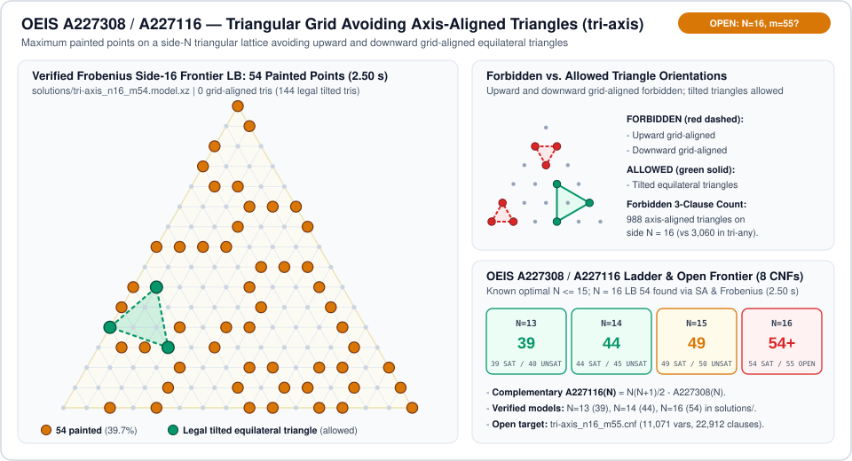

# OEIS A227308 / A227116 — Triangular-Grid No-Axis-Aligned-Equilateral-Triangle (`guillochon-oeis-grid-tri-axis`)

*Independently verified Frobenius side-16 triangular-grid frontier lower-bound solution (`54` painted points, zero upward or downward grid-aligned equilateral triangles, solved from scratch in `2.50 s`; green dashed overlay highlights one of the `144` legal tilted equilateral triangles present in the configuration) decoded directly from [`solutions/tri-axis_n16_m54.model.xz`](solutions/tri-axis_n16_m54.model.xz) (generated by [`src/gen_diagram.py`](src/gen_diagram.py)).*

## Provenance & Credit

- **Author & Maintainer:** James Guillochon ([`@spallingerrer`](https://twitter.com/spallingerrer)) — [`https://github.com/guillochon/oeis-sat-instances`](https://github.com/guillochon/oeis-sat-instances) (`sequences/point-patterns/`, pattern `tri-axis`, imported from upstream `main` commit `ba6430c`, 2026-11-23).
- **License:** Upstream generator, verifier, and validation code is MIT-licensed ([`LICENSE`](LICENSE)); all generated DIMACS CNF instances are released into the public domain (CC0).
- **Integrity:** All **8 / 8** `.cnf.xz` files in [`cnf-orig/`](cnf-orig/) are exact unmodified upstream files matching [`src/upstream/sequences/point-patterns/cnf/SHA256SUMS`](src/upstream/sequences/point-patterns/cnf/SHA256SUMS) byte-for-byte upon decompression.
- **Ground Truth Manifest:** [`expected.tsv`](expected.tsv) lists all **8 instances** (**4 SAT / 3 UNSAT / 1 UNKNOWN** open OEIS frontier target).

## Problem Description

[OEIS A227308](https://oeis.org/A227308) gives $a(N)$, the maximum number of points that can be painted on a side-$N$ triangular lattice ($N(N+1)/2$ points) such that **no three painted points form a grid-aligned equilateral triangle of either orientation** (neither upward $\{(x, y), (x+s, y), (x, y+s)\}$ nor downward $\{(x+s, y), (x, y+s), (x+s, y+s)\}$; tilted equilateral triangles remain allowed). Its complementary hitting-set sequence is [OEIS A227116](https://oeis.org/A227116) with $\text{A227116}(N) = N(N+1)/2 - \text{A227308}(N)$.

- **Known exact values ($N = 13, 14, 15$):** $a(13) = 39$, $a(14) = 44$, and $a(15) = 49$.
- **Open question ($N = 16$):** Can $55$ points be painted on a side-16 triangular lattice (`136` points) avoiding both upward and downward grid-aligned triangles? James Guillochon established the newly published lower bound $a(16) \ge 54$ via simulated annealing ([`src/upstream/sequences/point-patterns/certificates/tri-axis_n16_54.model`](src/upstream/sequences/point-patterns/certificates/tri-axis_n16_54.model)), and Frobenius independently recovered a verified `54`-point configuration from scratch in **`2.50 s`** ([`solutions/tri-axis_n16_m54.model.xz`](solutions/tri-axis_n16_m54.model.xz)).
- **Target instance `tri-axis_n16_m55.cnf`:**
  - **SAT** improves the lower bound to $a(16) \ge 55$ (checked independently in milliseconds by `verify.py`).
  - **UNSAT** (with a machine-checkable DRAT/LRAT proof) settles both $\text{A227308}(16) = 54$ and $\text{A227116}(16) = 82$.

### Encoding Architecture (`gen_points.py tri-axis N M`)

- **Point variables:** $P = N(N+1)/2$ Boolean variables (`1..P`) in axial coordinates $(x, y)$ with $x, y \ge 0, x + y \le N - 1$.
- **Forbidden grid-aligned triangle 3-clauses:** One all-negative 3-clause for every upward grid-aligned triangle $\{(x,y),(x+s,y),(x,y+s)\}$ and every downward grid-aligned triangle $\{(x+s,y),(x,y+s),(x+s,y+s)\}$ (`988` forbidden triangles at $N = 16$, versus `3,060` in `tri-any`).
- **Cardinality constraint:** Sinz sequential counter (Sinz 2005) enforcing at least $m$ painted points.
- **Symmetry:** No symmetry breaking; all 6 symmetries of the equilateral triangle ($D_3$) remain intact.

## Corpus & Data Sizes

### Repository Layout & Four-Format Inventory

All committed files are `xz`-compressed and strictly respect GitHub's `< 95 MB` per-file size limit:

| Directory | Files | Total Size | Max File Size | Notes |
|---|---:|---:|---:|---|
| `cnf-orig/` | 8 | 151.7 KB | 27.4 KB (`tri-axis_n16_m54.cnf.xz`) | Exact unmodified upstream `.cnf.xz` files (`8/8` SHA-256 verified) |
| `xcnf-converted/` | 8 | 152.0 KB | 27.0 KB (`tri-axis_n16_m54.xcnf.xz`) | Lossless CryptoMiniSat `.xcnf.xz` conversions (`0` native XOR parity blocks) |
| `aig-converted/` | 8 | 223.2 KB | 40.5 KB (`tri-axis_n16_m54.aig.xz`) | Exact Binary AIGER 1.9 combinational miters (`.aig.xz`) |
| `anf-converted/` | 8 | 306.3 KB | 54.1 KB (`tri-axis_n16_m54.anf.xz`) | Lossless linear-size degree-$\le 3$ DIMACS-ANF conversions (`.anf.xz`) |
| `solutions/` | 4 | 23.0 KB | 8.0 KB (`tri-axis_n16_m54.model.xz`) | **4** verified SAT models (`N=13..16`) + [`solutions/SHA256SUMS`](solutions/SHA256SUMS) |
| `src/` | — | — | — | [`src/gen_diagram.py`](src/gen_diagram.py) + verbatim upstream generator, verifier, `.map.json` sidecars, and `SHA256SUMS` under [`src/upstream/`](src/upstream/), plus upstream SA certificate `certificates/tri-axis_n16_54.model` |

#### Complete Instance Inventory & Ground-Truth Verdicts (`expected.tsv`)

| Instance | Expected | Variables | Clauses | `.cnf.xz` | `.xcnf.xz` | `.aig.xz` | `.anf.xz` |
|---|:---:|---:|---:|---:|---:|---:|---:|
| `tri-axis_n13_m39.cnf` | SAT | 4,771 | 9,923 | 12.0 KB | 12.2 KB | 19.4 KB | 26.6 KB |
| `tri-axis_n13_m40.cnf` | UNSAT | 4,681 | 9,744 | 12.4 KB | 12.3 KB | 19.1 KB | 25.1 KB |
| `tri-axis_n14_m44.cnf` | SAT | 6,449 | 13,389 | 16.3 KB | 16.6 KB | 21.5 KB | 31.7 KB |
| `tri-axis_n14_m45.cnf` | UNSAT | 6,345 | 13,182 | 16.1 KB | 16.2 KB | 22.3 KB | 28.9 KB |
| `tri-axis_n15_m49.cnf` | SAT | 8,569 | 17,758 | 20.4 KB | 21.0 KB | 30.5 KB | 44.9 KB |
| `tri-axis_n15_m50.cnf` | UNSAT | 8,450 | 17,521 | 20.2 KB | 19.8 KB | 30.5 KB | 43.9 KB |
| `tri-axis_n16_m54.cnf` | SAT | 11,206 | 23,181 | 27.4 KB | 27.0 KB | 40.5 KB | 54.1 KB |
| `tri-axis_n16_m55.cnf` | **UNKNOWN** *(Open)* | 11,071 | 22,912 | 26.9 KB | 27.0 KB | 39.6 KB | 51.2 KB |

### Sibling Collections (`guillochon/oeis-sat-instances`)

This directory is one of **9 single-problem-type collections** split from James Guillochon's [`guillochon/oeis-sat-instances`](https://github.com/guillochon/oeis-sat-instances) suite (`112` instances across `13` OEIS sequences):

| Collection | OEIS Sequence(s) | Combinatorial Problem | Instances |
|---|---|---|---:|
| [`guillochon-oeis-a067782-sortnet/`](../guillochon-oeis-a067782-sortnet/) | [A067782](https://oeis.org/A067782) | Optimal-Depth Sorting Networks $a(n)$ | 10 (4 SAT / 5 UNSAT / 1 Open) |
| [`guillochon-oeis-a171081-vdw/`](../guillochon-oeis-a171081-vdw/) | [A171081](https://oeis.org/A171081) / [A007783](https://oeis.org/A007783) | Van der Waerden Numbers $w(2; 3, t)$ | 22 (11 SAT / 10 UNSAT / 1 Open) |
| [`guillochon-oeis-a250000-queens/`](../guillochon-oeis-a250000-queens/) | [A250000](https://oeis.org/A250000) | Peaceable Coexisting Armies of Queens | 20 (10 SAT / 9 UNSAT / 1 Open) |
| [`guillochon-oeis-a350304-zarankiewicz/`](../guillochon-oeis-a350304-zarankiewicz/) | [A350304](https://oeis.org/A350304) (+3 related) | Zarankiewicz Numbers $z(n; 3)$ ($K_{3,3}$-Free Matrices) | 20 (8 SAT / 8 UNSAT / 4 Open) |
| [`guillochon-oeis-grid-sq-any/`](../guillochon-oeis-grid-sq-any/) | [A240443](https://oeis.org/A240443) | Square Grid — No Arbitrary-Orientation Square (`sq-any`) | 8 (4 SAT / 3 UNSAT / 1 Open) |
| [`guillochon-oeis-grid-sq-axis/`](../guillochon-oeis-grid-sq-axis/) | [A227133](https://oeis.org/A227133) / [A152125](https://oeis.org/A152125) | Square Grid — No Axis-Aligned Square (`sq-axis`) | 8 (4 SAT / 3 UNSAT / 1 Open) |
| [`guillochon-oeis-grid-tri-any/`](../guillochon-oeis-grid-tri-any/) | [A240114](https://oeis.org/A240114) / [A319159](https://oeis.org/A319159) | Triangular Grid — No Arbitrary Equilateral Triangle (`tri-any`) | 8 (4 SAT / 3 UNSAT / 1 Open) |
| **`guillochon-oeis-grid-tri-axis/`** *(this collection)* | [A227308](https://oeis.org/A227308) / [A227116](https://oeis.org/A227116) | Triangular Grid — No Axis-Aligned Equilateral Triangle (`tri-axis`) | 8 (4 SAT / 3 UNSAT / 1 Open) |
| [`guillochon-oeis-grid-tri-up/`](../guillochon-oeis-grid-tri-up/) | [A157795](https://oeis.org/A157795) / [A319158](https://oeis.org/A319158) | Triangular Grid — No Upward Equilateral Triangle (`tri-up`) | 8 (4 SAT / 3 UNSAT / 1 Open) |

## Benchmark Results

### Benchmark Protocol & Hardware Parameters

- **Hardware:** AMD Ryzen 9 5950X (16 physical cores / 32 threads, 64 MiB L3 cache, 128 GiB RAM, Linux x86_64).
- **CPU Pinning & Isolation:** Strictly pinned to a single physical core (`taskset -c 1` for all 60 s 5-solver calibration runs; `taskset -c 0` or `taskset -c 1` for extended open-frontier runs), **1 thread per solver run** (`--max-cores 1`). All 5 solvers ran strictly sequentially on identical uncompressed flat `.cnf` inputs so solvers without native `.xz` streaming compete on identical inputs.
- **Solvers & Exact Flags:**
  - Frobenius v0.1.0 (`--timeout 60`, 1 thread)
  - [CaDiCaL](https://github.com/arminbiere/cadical) 3.1.0 (`-q --modelalllits=true -t 60`)
  - [CryptoMiniSat](https://github.com/msoos/cryptominisat) 5.18.0 (`-t 1 --maxtime 60`)
  - [dense-solver](https://github.com/libdense/dense-solver) 0.0.4 (1 thread, GNU `timeout -k 2s 60.0s`)
  - [Kissat](https://github.com/arminbiere/kissat) 4.0.4 (`-q --time=60`)
- **Independent Verification:**
  - **SAT models:** Every SAT output from every solver was checked both clause-by-clause against 100% of clauses in the original `.cnf.xz` AND decoded/verified by James Guillochon's independent combinatorial verifier (`decode_verify.py` / `verify.py`). Zero invalid models, zero verdict disagreements.

### Comparative Single-Core Calibration Results ($T_{\max} = 60\;\text{s}$)

Three calibration rungs ($N = 13$ optimal pair + $N = 16$ frontier lower bound) evaluated sequentially on identical uncompressed flat `.cnf` files (`taskset -c 1`, 1 thread). Only Frobenius and CaDiCaL 3.1.0 solve the side-16 frontier lower-bound instance `tri-axis_n16_m54.cnf` within 60 s (`1.53 s` and `2.19 s`, while CryptoMiniSat 5.18.0, dense-solver 0.0.4, and Kissat 4.0.4 all time out):

| Instance | Expected | Frobenius | [CaDiCaL](https://github.com/arminbiere/cadical) 3.1.0 | [CryptoMiniSat](https://github.com/msoos/cryptominisat) 5.18.0 | [dense-solver](https://github.com/libdense/dense-solver) 0.0.4 | [Kissat](https://github.com/arminbiere/kissat) 4.0.4 |
|---|:---:|---:|---:|---:|---:|---:|
| `tri-axis_n13_m39.cnf` | SAT | **300.6 ms** | 0.52 s | >60 s | 4.74 s | 16.78 s |
| `tri-axis_n13_m40.cnf` | UNSAT | >60 s | >60 s | >60 s | >60 s | >60 s |
| `tri-axis_n16_m54.cnf` | SAT | **1.53 s** | 2.19 s | >60 s | >60 s | >60 s |
| **Solved ($T_{\max} = 60\;\text{s}$)** | **2 / 3** | **2 / 3** (2 SAT, 0 UNSAT) | **2 / 3** (2 SAT, 0 UNSAT) | 0 / 3 (0 SAT, 0 UNSAT) | 1 / 3 (1 SAT, 0 UNSAT) | 1 / 3 (1 SAT, 0 UNSAT) |
| **Total PAR-2 ($T_{\max} = 60\;\text{s}$)** | — | **121.83 s** *(mean 40.61 s)* | 122.71 s *(mean 40.90 s)* | 360.00 s *(mean 120.00 s)* | 244.74 s *(mean 81.58 s)* | 256.78 s *(mean 85.59 s)* |

### Open OEIS Frontier Run (600 s, Single-Core Pinned)

Evaluated directly with Frobenius (`--max-cores 1`, pinned to physical core `1`, native `.cnf.xz` ingestion):

| Open Target | OEIS Frontier | Budget | Pinning | Conflicts | Decisions | Propagations | Status |
|---|---|---:|---|---:|---:|---:|:---:|
| `tri-axis_n16_m55.cnf` | `tri-axis` side 16 ($a(16) \ge 54$; `11,071` vars, `22,912` cls) | 600 s | `taskset -c 1` | 10,361,024 | 17,046,294 | 1,563,592,717 | Open (`UNKNOWN`) |

### Supplementary Full-Corpus Coverage ($T_{\max} = 60\;\text{s}$, Single-Core Pinned)

Remaining 3 corpus instances evaluated with Frobenius (`--max-cores 1 --timeout 60`, single physical core pinned per run, uncompressed flat `.cnf` input) to provide explicit coverage across all `8 / 8` instances in `cnf-orig/`; all four external baselines were also evaluated at $T_{\max} = 60\;\text{s}$ on `tri-axis_n15_m49.cnf` (solved SAT by Frobenius in `38.69 s`, outperforming Kissat 4.0.4 at `40.78 s` while CryptoMiniSat 5.18.0 and dense-solver 0.0.4 timed out):

| Instance | Expected | Frobenius 1C | [CaDiCaL](https://github.com/arminbiere/cadical) 3.1.0 | [CryptoMiniSat](https://github.com/msoos/cryptominisat) 5.18.0 | [dense-solver](https://github.com/libdense/dense-solver) 0.0.4 | [Kissat](https://github.com/arminbiere/kissat) 4.0.4 |
|---|:---:|---:|---:|---:|---:|---:|
| `tri-axis_n14_m45.cnf` | UNSAT | >60 s | — | — | — | — |
| `tri-axis_n15_m49.cnf` | SAT | 38.69 s | **3.90 s** | >60 s | >60 s | 40.78 s |
| `tri-axis_n15_m50.cnf` | UNSAT | >60 s | — | — | — | — |

*(Frobenius telemetry: `tri-axis_n14_m45.cnf` `2,264,576` conflicts / `3,619,008` decisions / `168,957,046` propagations; `tri-axis_n15_m49.cnf` `1,469,011` conflicts / `2,560,970` decisions / `135,065,981` propagations, model verified against all 17,758 clauses and upstream `verify.py`; `tri-axis_n15_m50.cnf` `2,168,320` conflicts / `3,629,931` decisions / `196,237,310` propagations. External baselines marked `—` were not run on supplementary instances that Frobenius did not solve within 60 s.)*

### Verified Solutions (`solutions/`)

All **4 verified SAT models** (`N = 13..16`) match [`solutions/SHA256SUMS`](solutions/SHA256SUMS) (`sha256sum -c` PASS) and passed both raw-clause checks and upstream `verify.py`:

| Solution File | Size | SHA-256 (prefix) | Independent Verification Result |
|---|---:|---|---|
| [`solutions/tri-axis_n13_m39.model.xz`](solutions/tri-axis_n13_m39.model.xz) | 3.9 KB | `247a7ac244e0` | 9,923/9,923 cls OK; `verify.py`: `39 painted, 0 forbidden: VALID` |
| [`solutions/tri-axis_n14_m44.model.xz`](solutions/tri-axis_n14_m44.model.xz) | 5.0 KB | `26df6191cab5` | 13,389/13,389 cls OK; `verify.py`: `44 painted, 0 forbidden: VALID` |
| [`solutions/tri-axis_n15_m49.model.xz`](solutions/tri-axis_n15_m49.model.xz) | 6.2 KB | `4cd7b34cac95` | 17,758/17,758 cls OK; `verify.py`: `49 painted, 0 forbidden: VALID` |
| [`solutions/tri-axis_n16_m54.model.xz`](solutions/tri-axis_n16_m54.model.xz) | 8.0 KB | `7cf7efc50434` | 23,181/23,181 cls OK; `verify.py`: `54 painted, 0 forbidden: VALID` (frontier LB) |

*Upstream simulated-annealing certificate:* [`src/upstream/sequences/point-patterns/certificates/tri-axis_n16_54.model`](src/upstream/sequences/point-patterns/certificates/tri-axis_n16_54.model).

<!-- BEGIN_STRUCTURAL_ANALYSIS -->
## Phase-Transition & Structural Analysis

*Auto-generated by [`../src/analyze_benchmarks.py`](../src/analyze_benchmarks.py). Position relative to the critical phase transition is measured by $\rho_{\mathrm{crit}} = \frac{1}{n}\sum_k m_k / \alpha_c(k)$ (exact $\alpha/\alpha_c(k)$ for pure $k$-SAT; effective critical threshold $\alpha_c^{\mathrm{eff}} = \alpha/\rho_{\mathrm{crit}}$; `Under` $<0.90\times$, `Near-crit` $0.90\text{--}1.10\times$, `Over` $>1.10\times$), alongside Gent–Walsh annealed constrainedness $\kappa = -\frac{1}{n}\sum_i \log_2(1-2^{-k_i})$ (AAAI 1996), clause-length profile ($\bar{k}$, `%Bin`, `%Horn`), variable-degree CV ($\sigma_d/\bar{d}$, uniformity vs. hub skew), and extracted native XOR parity clauses.*

| Instance | Active $n$ | Clauses $m$ | $\alpha=m/n$ | $\alpha_c^{\mathrm{eff}}$ | $\rho_{\mathrm{crit}}$ (Regime) | $\kappa$ | $\bar{k}$ ($k_{\max}$) | Bin% | Horn% | Pos% | Deg CV | XORs |
|---|---:|---:|---:|---:|---:|---:|---:|---:|---:|---:|---:|---:|
| `tri-axis_n13_m39` | 4,771 | 9,923 | 2.08 | 1.64 | **1.27x** (Over) | 0.63 | 2.51 (3) | 48% | 53% | 56% | 1.73 | 0 |
| `tri-axis_n13_m40` | 4,681 | 9,744 | 2.08 | 1.64 | **1.27x** (Over) | 0.63 | 2.51 (3) | 48% | 53% | 56% | 1.72 | 0 |
| `tri-axis_n14_m44` | 6,449 | 13,389 | 2.08 | 1.64 | **1.26x** (Over) | 0.63 | 2.51 (3) | 48% | 53% | 56% | 1.86 | 0 |
| `tri-axis_n14_m45` | 6,345 | 13,182 | 2.08 | 1.64 | **1.26x** (Over) | 0.63 | 2.51 (3) | 48% | 53% | 56% | 1.84 | 0 |
| `tri-axis_n15_m49` | 8,569 | 17,758 | 2.07 | 1.64 | **1.26x** (Over) | 0.63 | 2.51 (3) | 49% | 53% | 57% | 1.99 | 0 |
| `tri-axis_n15_m50` | 8,450 | 17,521 | 2.07 | 1.64 | **1.26x** (Over) | 0.63 | 2.51 (3) | 49% | 53% | 57% | 1.98 | 0 |
| `tri-axis_n16_m54` | 11,206 | 23,181 | 2.07 | 1.64 | **1.26x** (Over) | 0.63 | 2.51 (3) | 49% | 53% | 57% | 2.12 | 0 |
| `tri-axis_n16_m55` | 11,071 | 22,912 | 2.07 | 1.64 | **1.26x** (Over) | 0.63 | 2.51 (3) | 49% | 53% | 57% | 2.11 | 0 |

**Collection Phase-Transition Summary (8 instances, 4 formats: 8 CNF / 8 AIG / 8 XCNF / 8 ANF):** median $\rho_{\mathrm{crit}} = 1.26\times$ (range `1.26x–1.27x`), median $\kappa = 0.63$, regime split **0 Under / 0 Near-critical / 8 Over**, total extracted native XOR parity clauses = **0**, total ANF equations = **127,610**.
<!-- END_STRUCTURAL_ANALYSIS -->

## References

- James Guillochon ([`@spallingerrer`](https://twitter.com/spallingerrer)), *OEIS SAT instances*, [`https://github.com/guillochon/oeis-sat-instances`](https://github.com/guillochon/oeis-sat-instances) (2026).
- OEIS Foundation Inc., *Entries [A227308](https://oeis.org/A227308) and [A227116](https://oeis.org/A227116): Axis-aligned equilateral-triangle-free subsets of the triangular grid*.
- C. Sinz, *"Towards an Optimal CNF Encoding of Boolean Cardinality Constraints"*, CP 2005, LNCS 3709, pp. 827–831.
