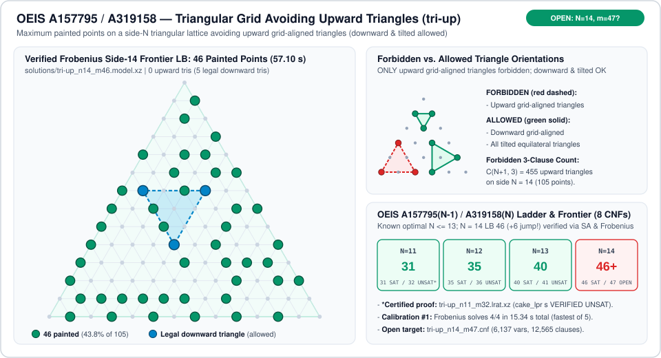

# OEIS A157795 / A319158 — Triangular-Grid No-Upward-Equilateral-Triangle (`guillochon-oeis-grid-tri-up`)

*Independently verified Frobenius side-14 triangular-grid frontier lower-bound solution (`46` painted points — a `+6` jump over side 13 = `40` — with zero upward grid-aligned triangles, solved from scratch in `57.10 s`; blue dashed overlay highlights a legal downward triangle present in the configuration) decoded directly from [`solutions/tri-up_n14_m46.model.xz`](solutions/tri-up_n14_m46.model.xz) (generated by [`src/gen_diagram.py`](src/gen_diagram.py)).*

## Provenance & Credit

- **Author & Maintainer:** James Guillochon ([`@spallingerrer`](https://twitter.com/spallingerrer)) — [`https://github.com/guillochon/oeis-sat-instances`](https://github.com/guillochon/oeis-sat-instances) (`sequences/point-patterns/`, pattern `tri-up`, imported from upstream `main` commit `ba6430c`, 2026-11-23).
- **License:** Upstream generator, verifier, and validation code is MIT-licensed ([`LICENSE`](LICENSE)); all generated DIMACS CNF instances are released into the public domain (CC0).
- **Integrity:** All **8 / 8** `.cnf.xz` files in [`cnf-orig/`](cnf-orig/) are exact unmodified upstream files matching [`src/upstream/sequences/point-patterns/cnf/SHA256SUMS`](src/upstream/sequences/point-patterns/cnf/SHA256SUMS) byte-for-byte upon decompression.
- **Ground Truth Manifest:** [`expected.tsv`](expected.tsv) lists all **8 instances** (**4 SAT / 3 UNSAT / 1 UNKNOWN** open OEIS frontier target).

## Problem Description

[OEIS A157795](https://oeis.org/A157795) (indexed as $\text{A157795}(N - 1)$ for a side-$N$ triangular grid of $N(N+1)/2$ points) gives the maximum number of painted points such that **no three painted points form an upward grid-aligned equilateral triangle** $\{(x, y), (x+s, y), (x, y+s)\}$ (both downward grid-aligned and tilted equilateral triangles remain allowed). Its complementary hitting-set sequence is [OEIS A319158](https://oeis.org/A319158) with $\text{A319158}(N) = N(N+1)/2 - \text{A157795}(N - 1)$.

- **Known exact values ($N = 11, 12, 13$):** `31` (side 11), `35` (side 12), and `40` (side 13).
- **Open question ($N = 14$):** Can $47$ points be painted on a side-14 triangular lattice (`105` points) avoiding upward triangles? James Guillochon discovered a striking `+6` jump lower bound of **`46`** via simulated annealing ([`src/upstream/sequences/point-patterns/certificates/tri-up_n14_46.model`](src/upstream/sequences/point-patterns/certificates/tri-up_n14_46.model)), and Frobenius independently recovered a verified `46`-point solution from scratch via pure SAT in `57.10 s` ([`solutions/tri-up_n14_m46.model.xz`](solutions/tri-up_n14_m46.model.xz)).
- **Target instance `tri-up_n14_m47.cnf`:**
  - **SAT** improves the lower bound to $\ge 47$ (checked independently in milliseconds by `verify.py`).
  - **UNSAT** (with a machine-checkable DRAT/LRAT proof) settles both $\text{A157795}(13) = 46$ and $\text{A319158}(14) = 59$.

### Encoding Architecture (`gen_points.py tri-up N M`)

- **Point variables:** $P = N(N+1)/2$ Boolean variables (`1..P`) in axial coordinates $(x, y)$ with $x, y \ge 0, x + y \le N - 1$.
- **Forbidden upward-triangle 3-clauses:** One all-negative 3-clause for every upward grid-aligned triple $\{(x, y), (x+s, y), (x, y+s)\}$ ($\binom{N+1}{3} = (N-1)N(N+1)/6$ clauses: `455` at $N = 14$).
- **Cardinality constraint:** Sinz sequential counter (Sinz 2005) enforcing at least $m$ painted points.
- **Symmetry:** No symmetry breaking; all 6 symmetries of the equilateral triangle ($D_3$) remain intact.

## Corpus & Data Sizes

### Repository Layout & Four-Format Inventory

All committed files are `xz`-compressed and strictly respect GitHub's `< 95 MB` per-file size limit:

| Directory | Files | Total Size | Max File Size | Notes |
|---|---:|---:|---:|---|
| `cnf-orig/` | 8 | 83.5 KB | 15.2 KB (`tri-up_n14_m46.cnf.xz`) | Exact unmodified upstream `.cnf.xz` files (`8/8` SHA-256 verified) |
| `xcnf-converted/` | 8 | 84.9 KB | 15.4 KB (`tri-up_n14_m46.xcnf.xz`) | Lossless CryptoMiniSat `.xcnf.xz` conversions (`0` native XOR parity blocks) |
| `aig-converted/` | 8 | 129.9 KB | 21.4 KB (`tri-up_n14_m47.aig.xz`) | Exact Binary AIGER 1.9 combinational miters (`.aig.xz`) |
| `anf-converted/` | 8 | 167.5 KB | 32.3 KB (`tri-up_n14_m47.anf.xz`) | Lossless linear-size degree-$\le 3$ DIMACS-ANF conversions (`.anf.xz`) |
| `solutions/` | 5 | 31.78 MB | 31.76 MB (`tri-up_n11_m32.lrat.xz`) | **4** verified SAT models (`N=11..14`) + **1** formally verified UNSAT proof (`tri-up_n11_m32.lrat.xz`) + [`solutions/SHA256SUMS`](solutions/SHA256SUMS) |
| `src/` | — | — | — | [`src/gen_diagram.py`](src/gen_diagram.py) + verbatim upstream generator, verifier, `.map.json` sidecars, and `SHA256SUMS` under [`src/upstream/`](src/upstream/), plus upstream SA certificate `certificates/tri-up_n14_46.model` |

#### Complete Instance Inventory & Ground-Truth Verdicts (`expected.tsv`)

| Instance | Expected | Variables | Clauses | `.cnf.xz` | `.xcnf.xz` | `.aig.xz` | `.anf.xz` |
|---|:---:|---:|---:|---:|---:|---:|---:|
| `tri-up_n11_m31.cnf` | SAT | 2,341 | 4,800 | 6.6 KB | 7.0 KB | 12.0 KB | 13.1 KB |
| `tri-up_n11_m32.cnf` | UNSAT | 2,276 | 4,671 | 6.6 KB | 6.7 KB | 10.3 KB | 12.8 KB |
| `tri-up_n12_m35.cnf` | SAT | 3,389 | 6,942 | 8.7 KB | 9.0 KB | 15.6 KB | 17.7 KB |
| `tri-up_n12_m36.cnf` | UNSAT | 3,312 | 6,789 | 8.6 KB | 8.8 KB | 14.1 KB | 17.6 KB |
| `tri-up_n13_m40.cnf` | SAT | 4,681 | 9,583 | 11.5 KB | 11.6 KB | 17.4 KB | 23.0 KB |
| `tri-up_n13_m41.cnf` | UNSAT | 4,591 | 9,404 | 10.9 KB | 11.3 KB | 17.8 KB | 19.2 KB |
| `tri-up_n14_m46.cnf` | SAT | 6,241 | 12,772 | 15.2 KB | 15.4 KB | 21.2 KB | 31.9 KB |
| `tri-up_n14_m47.cnf` | **UNKNOWN** *(Open)* | 6,137 | 12,565 | 15.2 KB | 15.0 KB | 21.4 KB | 32.3 KB |

### Sibling Collections (`guillochon/oeis-sat-instances`)

This directory is one of **9 single-problem-type collections** split from James Guillochon's [`guillochon/oeis-sat-instances`](https://github.com/guillochon/oeis-sat-instances) suite (`112` instances across `13` OEIS sequences):

| Collection | OEIS Sequence(s) | Combinatorial Problem | Instances |
|---|---|---|---:|
| [`guillochon-oeis-a067782-sortnet/`](../guillochon-oeis-a067782-sortnet/) | [A067782](https://oeis.org/A067782) | Optimal-Depth Sorting Networks $a(n)$ | 10 (4 SAT / 5 UNSAT / 1 Open) |
| [`guillochon-oeis-a171081-vdw/`](../guillochon-oeis-a171081-vdw/) | [A171081](https://oeis.org/A171081) / [A007783](https://oeis.org/A007783) | Van der Waerden Numbers $w(2; 3, t)$ | 22 (11 SAT / 10 UNSAT / 1 Open) |
| [`guillochon-oeis-a250000-queens/`](../guillochon-oeis-a250000-queens/) | [A250000](https://oeis.org/A250000) | Peaceable Coexisting Armies of Queens | 20 (10 SAT / 9 UNSAT / 1 Open) |
| [`guillochon-oeis-a350304-zarankiewicz/`](../guillochon-oeis-a350304-zarankiewicz/) | [A350304](https://oeis.org/A350304) (+3 related) | Zarankiewicz Numbers $z(n; 3)$ ($K_{3,3}$-Free Matrices) | 20 (8 SAT / 8 UNSAT / 4 Open) |
| [`guillochon-oeis-grid-sq-any/`](../guillochon-oeis-grid-sq-any/) | [A240443](https://oeis.org/A240443) | Square Grid — No Arbitrary-Orientation Square (`sq-any`) | 8 (4 SAT / 3 UNSAT / 1 Open) |
| [`guillochon-oeis-grid-sq-axis/`](../guillochon-oeis-grid-sq-axis/) | [A227133](https://oeis.org/A227133) / [A152125](https://oeis.org/A152125) | Square Grid — No Axis-Aligned Square (`sq-axis`) | 8 (4 SAT / 3 UNSAT / 1 Open) |
| [`guillochon-oeis-grid-tri-any/`](../guillochon-oeis-grid-tri-any/) | [A240114](https://oeis.org/A240114) / [A319159](https://oeis.org/A319159) | Triangular Grid — No Arbitrary Equilateral Triangle (`tri-any`) | 8 (4 SAT / 3 UNSAT / 1 Open) |
| [`guillochon-oeis-grid-tri-axis/`](../guillochon-oeis-grid-tri-axis/) | [A227308](https://oeis.org/A227308) / [A227116](https://oeis.org/A227116) | Triangular Grid — No Axis-Aligned Equilateral Triangle (`tri-axis`) | 8 (4 SAT / 3 UNSAT / 1 Open) |
| **`guillochon-oeis-grid-tri-up/`** *(this collection)* | [A157795](https://oeis.org/A157795) / [A319158](https://oeis.org/A319158) | Triangular Grid — No Upward Equilateral Triangle (`tri-up`) | 8 (4 SAT / 3 UNSAT / 1 Open) |

## Benchmark Results

### Benchmark Protocol & Hardware Parameters

- **Hardware:** AMD Ryzen 9 5950X (16 physical cores / 32 threads, 64 MiB L3 cache, 128 GiB RAM, Linux x86_64).
- **CPU Pinning & Isolation:** Strictly pinned to a single physical core (`taskset -c 1` for all 60 s 5-solver calibration runs; `taskset -c 0` or `taskset -c 1` for extended open-frontier runs), **1 thread per solver run** (`--max-cores 1`). All 5 solvers ran strictly sequentially on identical uncompressed flat `.cnf` inputs so solvers without native `.xz` streaming compete on identical inputs.
- **Solvers & Exact Flags:**
  - Frobenius v0.1.0 (`--timeout 60`, 1 thread)
  - [CaDiCaL](https://github.com/arminbiere/cadical) 3.1.0 (`-q --modelalllits=true -t 60`)
  - [CryptoMiniSat](https://github.com/msoos/cryptominisat) 5.18.0 (`-t 1 --maxtime 60`)
  - [dense-solver](https://github.com/libdense/dense-solver) 0.0.4 (1 thread, GNU `timeout -k 2s 60.0s`)
  - [Kissat](https://github.com/arminbiere/kissat) 4.0.4 (`-q --time=60`)
- **Independent Verification:**
  - **SAT models:** Every SAT output from every solver was checked both clause-by-clause against 100% of clauses in the original `.cnf.xz` AND decoded/verified by James Guillochon's independent combinatorial verifier (`decode_verify.py` / `verify.py`). Zero invalid models, zero verdict disagreements.
  - **UNSAT proofs:** Every Frobenius UNSAT result was re-run with proof emission (`--lrat` or `--proof` binary-DRAT) and triple-certified with [`drat-trim`](https://github.com/marijnheule/drat-trim) (`s VERIFIED`), [`lrat-check`](https://github.com/marijnheule/drat-trim) (`c VERIFIED`), and formally verified [`cake_lpr`](https://github.com/tanyongkiam/cake_lpr) (`s VERIFIED UNSAT`).

### Comparative Single-Core Calibration Results ($T_{\max} = 60\;\text{s}$)

Four calibration rungs ($N = 11$ SAT/UNSAT optimal pair, plus $N = 12, 13$ SAT rungs) evaluated sequentially on identical uncompressed flat `.cnf` files (`taskset -c 1`, 1 thread). **Frobenius** ranks **#1 fastest overall** (`4 / 4` solved, Total PAR-2 = **`15.34 s`**, **1.79× faster** than #2 CaDiCaL 3.1.0 at `27.46 s`):

| Instance | Expected | Frobenius | [CaDiCaL](https://github.com/arminbiere/cadical) 3.1.0 | [CryptoMiniSat](https://github.com/msoos/cryptominisat) 5.18.0 | [dense-solver](https://github.com/libdense/dense-solver) 0.0.4 | [Kissat](https://github.com/arminbiere/kissat) 4.0.4 |
|---|:---:|---:|---:|---:|---:|---:|
| `tri-up_n11_m31.cnf` | SAT | 0.86 s | **0.38 s** | 0.47 s | 1.55 s | 4.90 s |
| `tri-up_n11_m32.cnf` | UNSAT | 13.78 s | 26.49 s | 34.70 s | 26.37 s | **13.77 s** |
| `tri-up_n12_m35.cnf` | SAT | 0.05 s *(0.03 s updated build)* | **0.04 s** | 3.35 s | 1.33 s | 0.26 s |
| `tri-up_n13_m40.cnf` | SAT | 0.65 s | **0.55 s** | 11.79 s | 4.37 s | 17.61 s |
| **Solved ($T_{\max} = 60\;\text{s}$)** | **4 / 4** | **4 / 4** (3 SAT, 1 UNSAT) | **4 / 4** (3 SAT, 1 UNSAT) | **4 / 4** (3 SAT, 1 UNSAT) | **4 / 4** (3 SAT, 1 UNSAT) | **4 / 4** (3 SAT, 1 UNSAT) |
| **Total PAR-2 ($T_{\max} = 60\;\text{s}$)** | — | **15.34 s** *(mean 3.83 s)* | 27.46 s *(mean 6.86 s)* | 50.31 s *(mean 12.58 s)* | 33.62 s *(mean 8.40 s)* | 36.54 s *(mean 9.14 s)* |

- **Frontier lower-bound milestone:** Frobenius independently recovered James Guillochon's side-14 lower bound `tri-up_n14_m46.cnf` from scratch (pure SAT, zero annealing hints) in **`57.10 s`**, archived in [`solutions/tri-up_n14_m46.model.xz`](solutions/tri-up_n14_m46.model.xz).

### Open OEIS Frontier Run (600 s, Single-Core Pinned)

Evaluated directly with Frobenius (`--max-cores 1`, pinned to physical core `1`, native `.cnf.xz` ingestion):

| Open Target | OEIS Frontier | Budget | Pinning | Conflicts | Decisions | Propagations | Status |
|---|---|---:|---|---:|---:|---:|:---:|
| `tri-up_n14_m47.cnf` | `tri-up` side 14 ($\ge 46$; `6,137` vars, `12,565` cls) | 600 s | `taskset -c 1` | 10,229,120 | 15,523,020 | 1,075,295,159 | Open (`UNKNOWN`) |

### Verified Solutions & Certified Proofs (`solutions/`)

All **5 verified files** (**4 SAT models + 1 formally certified UNSAT proof**) match [`solutions/SHA256SUMS`](solutions/SHA256SUMS) (`sha256sum -c` PASS):

#### Certified UNSAT Proof (1 / 1 `drat-trim` + `lrat-check` + `cake_lpr` `s VERIFIED UNSAT`)

| Solution File | Raw Proof Size | Compressed Size | SHA-256 (prefix) | Verification Pipeline |
|---|---:|---:|---|---|
| [`solutions/tri-up_n11_m32.lrat.xz`](solutions/tri-up_n11_m32.lrat.xz) | 134.67 MB (LRAT) | 31.76 MB | `419c1a772d0b` | `--proof` (`18.74 s`) → `drat-trim -i -L` (`24.20 s`) → `lrat-check` (`1.82 s`) + `cake_lpr` **`s VERIFIED UNSAT`** (`4.00 s`) |

#### Verified SAT Models (4 / 4 Raw-Clause + Upstream `verify.py` PASS)

| Solution File | Size | SHA-256 (prefix) | Independent Verification Result |
|---|---:|---|---|
| [`solutions/tri-up_n11_m31.model.xz`](solutions/tri-up_n11_m31.model.xz) | 2.2 KB | `96d2d518c582` | 4,800/4,800 cls OK; `verify.py`: `31 painted, 0 forbidden: VALID` |
| [`solutions/tri-up_n12_m35.model.xz`](solutions/tri-up_n12_m35.model.xz) | 3.0 KB | `e9ce805e8d72` | 6,942/6,942 cls OK; `verify.py`: `35 painted, 0 forbidden: VALID` |
| [`solutions/tri-up_n13_m40.model.xz`](solutions/tri-up_n13_m40.model.xz) | 3.8 KB | `b1967f685ef8` | 9,583/9,583 cls OK; `verify.py`: `40 painted, 0 forbidden: VALID` |
| [`solutions/tri-up_n14_m46.model.xz`](solutions/tri-up_n14_m46.model.xz) | 4.8 KB | `6da0e52ced39` | 12,772/12,772 cls OK; `verify.py`: `46 painted, 0 forbidden: VALID` (frontier LB) |

*Upstream simulated-annealing certificate:* [`src/upstream/sequences/point-patterns/certificates/tri-up_n14_46.model`](src/upstream/sequences/point-patterns/certificates/tri-up_n14_46.model).

<!-- BEGIN_STRUCTURAL_ANALYSIS -->
## Phase-Transition & Structural Analysis

*Auto-generated by [`../src/analyze_benchmarks.py`](../src/analyze_benchmarks.py). Position relative to the critical phase transition is measured by $\rho_{\mathrm{crit}} = \frac{1}{n}\sum_k m_k / \alpha_c(k)$ (exact $\alpha/\alpha_c(k)$ for pure $k$-SAT; effective critical threshold $\alpha_c^{\mathrm{eff}} = \alpha/\rho_{\mathrm{crit}}$; `Under` $<0.90\times$, `Near-crit` $0.90\text{--}1.10\times$, `Over` $>1.10\times$), alongside Gent–Walsh annealed constrainedness $\kappa = -\frac{1}{n}\sum_i \log_2(1-2^{-k_i})$ (AAAI 1996), clause-length profile ($\bar{k}$, `%Bin`, `%Horn`), variable-degree CV ($\sigma_d/\bar{d}$, uniformity vs. hub skew), and extracted native XOR parity clauses.*

| Instance | Active $n$ | Clauses $m$ | $\alpha=m/n$ | $\alpha_c^{\mathrm{eff}}$ | $\rho_{\mathrm{crit}}$ (Regime) | $\kappa$ | $\bar{k}$ ($k_{\max}$) | Bin% | Horn% | Pos% | Deg CV | XORs |
|---|---:|---:|---:|---:|---:|---:|---:|---:|---:|---:|---:|---:|
| `tri-up_n11_m31` | 2,341 | 4,800 | 2.05 | 1.62 | **1.27x** (Over) | 0.63 | 2.49 (3) | 49% | 53% | 57% | 1.34 | 0 |
| `tri-up_n11_m32` | 2,276 | 4,671 | 2.05 | 1.62 | **1.27x** (Over) | 0.63 | 2.49 (3) | 49% | 53% | 57% | 1.33 | 0 |
| `tri-up_n12_m35` | 3,389 | 6,942 | 2.05 | 1.62 | **1.26x** (Over) | 0.63 | 2.49 (3) | 49% | 53% | 57% | 1.48 | 0 |
| `tri-up_n12_m36` | 3,312 | 6,789 | 2.05 | 1.62 | **1.26x** (Over) | 0.63 | 2.50 (3) | 49% | 53% | 57% | 1.47 | 0 |
| `tri-up_n13_m40` | 4,681 | 9,583 | 2.05 | 1.63 | **1.26x** (Over) | 0.63 | 2.50 (3) | 49% | 53% | 57% | 1.60 | 0 |
| `tri-up_n13_m41` | 4,591 | 9,404 | 2.05 | 1.63 | **1.26x** (Over) | 0.63 | 2.50 (3) | 49% | 53% | 57% | 1.59 | 0 |
| `tri-up_n14_m46` | 6,241 | 12,772 | 2.05 | 1.63 | **1.26x** (Over) | 0.63 | 2.50 (3) | 49% | 52% | 57% | 1.72 | 0 |
| `tri-up_n14_m47` | 6,137 | 12,565 | 2.05 | 1.63 | **1.26x** (Over) | 0.63 | 2.50 (3) | 49% | 52% | 57% | 1.71 | 0 |

**Collection Phase-Transition Summary (8 instances, 4 formats: 8 CNF / 8 AIG / 8 XCNF / 8 ANF):** median $\rho_{\mathrm{crit}} = 1.26\times$ (range `1.26x–1.27x`), median $\kappa = 0.63$, regime split **0 Under / 0 Near-critical / 8 Over**, total extracted native XOR parity clauses = **0**, total ANF equations = **67,526**.
<!-- END_STRUCTURAL_ANALYSIS -->

## References

- James Guillochon ([`@spallingerrer`](https://twitter.com/spallingerrer)), *OEIS SAT instances*, [`https://github.com/guillochon/oeis-sat-instances`](https://github.com/guillochon/oeis-sat-instances) (2026).
- OEIS Foundation Inc., *Entries [A157795](https://oeis.org/A157795) and [A319158](https://oeis.org/A319158): Upward-triangle-free subsets of the triangular grid*.
- C. Sinz, *"Towards an Optimal CNF Encoding of Boolean Cardinality Constraints"*, CP 2005, LNCS 3709, pp. 827–831.
