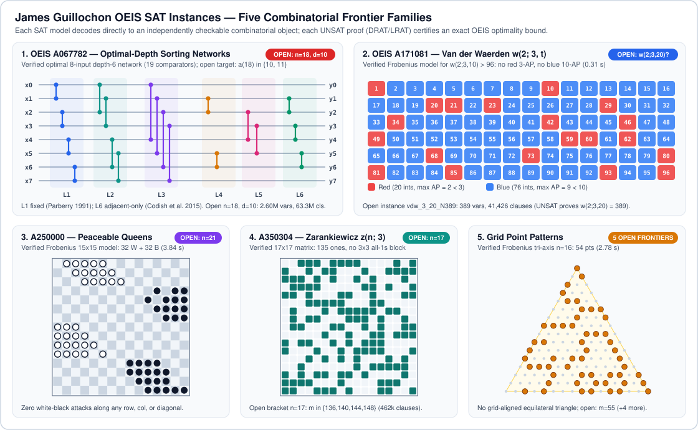

# James Guillochon OEIS SAT Instances (`guillochon/oeis-sat-instances`)

*Visual overview of all five combinatorial families in this collection, rendered directly from independently verified certificates in this repository (generated by [`src/gen_diagram.py`](src/gen_diagram.py)).*

## Provenance & Credit

- **Author & Maintainer:** James Guillochon ([`@spallingerrer`](https://twitter.com/spallingerrer)) — [`https://github.com/guillochon/oeis-sat-instances`](https://github.com/guillochon/oeis-sat-instances) (imported from upstream `main` commit `ba6430c`, 2026-11-23).
- **License:** Upstream generator, verifier, and harness code is MIT-licensed ([`LICENSE`](LICENSE)); all generated DIMACS CNF instances are released into the public domain (CC0).
- **Integrity:** Every `.cnf.xz` file in [`cnf-orig/`](cnf-orig/) is an exact unmodified copy from upstream; all **112 / 112** decompressed `.cnf` files match upstream `SHA256SUMS` byte-for-byte. Upstream generators, independent verifiers, `.map.json` sidecars, simulated-annealing certificates, and original documentation are preserved in [`src/upstream/`](src/upstream/).
- **Ground Truth Manifest:** [`expected.tsv`](expected.tsv) lists all **112 instances** (**53 SAT / 47 UNSAT / 12 UNKNOWN** open OEIS frontier targets).

## Mathematical Problem Families & Open OEIS Frontiers

Each family provides a ladder of calibration instances with known OEIS answers (both satisfiable lower-bound rungs and unsatisfiable optimality rungs) leading up to open OEIS terms. Every SAT answer decodes into an explicit combinatorial object checked independently of the CNF, while every UNSAT claim requires a machine-checkable DRAT/LRAT proof.

| Family Dir | OEIS Sequence(s) | Combinatorial Question | Known Terms / Frontier | Open Instance(s) | Count (SAT / UNSAT / Open) |
|---|---|---|---|---|---:|
| `A067782` | [A067782](https://oeis.org/A067782) | Minimum parallel depth $a(n)$ of an $n$-input sorting network | Known $n \le 17$: $a(11)=a(12)=8$, $a(14)=a(16)=9$, $a(17)=10$; $a(18) \in \{10, 11\}$ | `sortnet_n18_d10.cnf` | 10 (4 / 5 / 1) |
| `A171081` | [A171081](https://oeis.org/A171081) ([A007783](https://oeis.org/A007783)) | Van der Waerden number $w(2; 3, t)$: smallest $N$ forcing a red 3-AP or blue $t$-AP in $\{1,\dots,N\}$ | Known $t \le 19$: $w(2;3,10)=97, \dots, w(2;3,19)=349$; $w(2;3,20) \ge 389$ (conjectured $389$) | `vdw_3_20_N389.cnf` | 22 (11 / 10 / 1) |
| `A250000` | [A250000](https://oeis.org/A250000) | Peaceable coexisting armies of queens: maximum $m$ such that $m$ white and $m$ black queens fit on an $n \times n$ board without mutual attack | Known $n \le 20$: $a(12)=21, \dots, a(20)=58$; Ainley (1977) gives $a(21) \ge 64$ | `queens_n21_m65.cnf` | 20 (10 / 9 / 1) |
| `A350304` | [A350304](https://oeis.org/A350304) ([A001198](https://oeis.org/A001198), [A347473](https://oeis.org/A347473), [A350237](https://oeis.org/A350237)) | Zarankiewicz number $z(n; 3)$: maximum ones in an $n \times n$ binary matrix with no $3 \times 3$ all-ones submatrix ($K_{3,3}$-free) | Known $n \le 16$: $z(10;3)=60, \dots, z(16;3)=128$; open bracket $135 \le z(17;3) \le 150$ | `zaran3_n17_m{136,140,144,148}.cnf` (`m151` UNSAT) | 20 (8 / 8 / 4) |
| `point-patterns` | [A227133](https://oeis.org/A227133)/[A152125](https://oeis.org/A152125), [A240443](https://oeis.org/A240443), [A157795](https://oeis.org/A157795)/[A319158](https://oeis.org/A319158), [A227308](https://oeis.org/A227308)/[A227116](https://oeis.org/A227116), [A240114](https://oeis.org/A240114)/[A319159](https://oeis.org/A319159) | Maximum painted points on $N \times N$ square or side-$N$ triangular grids avoiding squares (`sq-axis`, `sq-any`) or equilateral triangles (`tri-up`, `tri-axis`, `tri-any`) | Known through `sq-axis` $N=13$ (98), `sq-any` $N=10$ (50), `tri-up` $N=13$ (40), `tri-axis` $N=15$ (49), `tri-any` $N=15$ (34); open lower bounds 112, 58, 46, 54, 36 | `sq-axis_n14_m113.cnf`, `sq-any_n11_m59.cnf`, `tri-up_n14_m47.cnf`, `tri-axis_n16_m55.cnf`, `tri-any_n16_m37.cnf` | 40 (20 / 15 / 5) |
| **Total** | **13 OEIS sequences** | **5 combinatorial families (9 distinct encodings)** | **100 known calibration + 12 open frontier instances** | **12 open targets** | **112 (53 / 47 / 12)** |

### Encoding Highlights

- **`A067782` (Sorting Networks):** Bundala–Závodný one-sided upper-bound encoding over the 0/1 principle with the first layer fixed by Parberry (1991) and the last layer restricted to adjacent comparators by Codish et al. (2015); no reflection symmetry breaking. Instances scale from `23,116` variables / `326,695` clauses (`n=11, d=7`) up to `2,922,974` variables / `71,667,732` clauses (`n=18, d=11`).
- **`A171081` (Van der Waerden $w(2;3,t)$):** Direct encoding with $N$ variables (`96`–`389`), one all-negative 3-clause per 3-AP, and one all-positive $t$-clause per $t$-AP; no auxiliary variables or reflection symmetry breaking.
- **`A250000` (Peaceable Queens):** $2n^2$ board variables (`W(r,c)`, `B(r,c)`), pairwise non-attack binary clauses along rows, columns, and diagonals, and Sinz sequential counters enforcing at least $m$ queens of each color; no symmetry breaking.
- **`A350304` (Zarankiewicz $z(n;3)$):** $n^2$ matrix-entry variables, $\binom{n}{3}^2$ 9-literal clauses forbidding $3\times 3$ all-ones submatrices, Sinz sequential counter for $\ge m$ ones, and double-lexicographic row/column symmetry breaking (Flener et al. 2002).
- **`point-patterns` (Grid Point Patterns):** One variable per grid point, one forbidden-shape clause per axis-aligned/arbitrary square or upward/axis-aligned/arbitrary equilateral triangle, and a Sinz sequential counter for $\ge m$ painted points; no symmetry breaking.

## Repository Layout & Four-Format Inventory

All committed files strictly respect GitHub's `< 95 MB` per-file size limit (`max = 88.93 MB`):

| Directory | Files | Total Size | Max File Size | Notes |
|---|---:|---:|---:|---|
| `cnf-orig/` | 112 | 309.40 MB | 88.93 MB (`A067782/sortnet_n18_d11.cnf.xz`) | Exact unmodified upstream `.cnf.xz` files (`112/112` SHA-256 verified) |
| `xcnf-converted/` | 112 | 308.63 MB | 88.43 MB (`A067782/sortnet_n18_d11.xcnf.xz`) | Lossless CryptoMiniSat `.xcnf.xz` conversions (`0` native XOR parity blocks across all 112 instances) |
| `aig-converted/` | 108 | 133.44 MB | 51.43 MB (`A067782/sortnet_n16_d9.aig.xz`) | Exact Binary AIGER 1.9 combinational miters (`.aig.xz`). The 4 largest `A067782` files (`n17_d9`, `n17_d10`, `n18_d10`, `n18_d11`) are omitted because `sortnet_n17_d9.aig.xz` measures `113.45 MB > 95 MB` (with `n18_d11` exceeding `220 MB`). |
| `anf-converted/` | 108 | 224.62 MB | 52.72 MB (`A067782/sortnet_n16_d9.anf.xz`) | Lossless linear-size degree-$\le 3$ DIMACS-ANF conversions (`.anf.xz`). The same 4 largest `A067782` files are omitted because `sortnet_n17_d9.anf.xz` measures `118.43 MB > 95 MB`. |
| `solutions/` | 29 | 183.06 MB | 88.05 MB (`A171081/vdw_3_12_N135.bdrat.xz`) | **24** verified SAT models (`.model.xz`) + **5** triple-certified UNSAT proofs (`.lrat.xz` / `.bdrat.xz`) + [`solutions/SHA256SUMS`](solutions/SHA256SUMS) |
| `src/` | — | — | — | [`src/gen_diagram.py`](src/gen_diagram.py) + verbatim upstream generators, verifiers, `.map.json` sidecars, `SHA256SUMS`, and certificates under [`src/upstream/`](src/upstream/) |

### Per-Family Size & Formula-Scale Breakdown

| Family | Instances | Vars Range | Clauses Range | `cnf-orig/` | `xcnf-converted/` | `aig-converted/` | `anf-converted/` |
|---|---:|---:|---:|---:|---:|---:|---:|
| `A067782` | 10 | 23,116–2,922,974 | 326,695–71,667,732 | 298.46 MB (10) | 297.68 MB (10) | 111.71 MB (6) | 112.99 MB (6) |
| `A171081` | 22 | 96–389 | 2,721–41,426 | 0.52 MB (22) | 0.53 MB (22) | 0.63 MB (22) | 2.49 MB (22) |
| `A250000` | 20 | 35,180–332,642 | 75,162–693,207 | 5.56 MB (20) | 5.48 MB (20) | 7.01 MB (20) | 12.51 MB (20) |
| `A350304` | 20 | 4,123–45,153 | 22,686–552,806 | 4.13 MB (20) | 4.19 MB (20) | 13.02 MB (20) | 95.14 MB (20) |
| `point-patterns` | 40 | 1,891–16,576 | 4,024–33,690 | 0.74 MB (40) | 0.74 MB (40) | 1.07 MB (40) | 1.48 MB (40) |

## Benchmark Protocol & Hardware Parameters

- **Hardware:** AMD Ryzen 9 5950X (16 physical cores / 32 threads, 64 MiB L3 cache, 128 GiB RAM, Linux x86_64).
- **CPU Pinning & Isolation:** Strictly pinned to physical cores `0` and `1` (`taskset -c 0` / `taskset -c 1`), **1 thread per solver run** (`--max-cores 1`). All 30-instance 5-solver comparison timings were collected strictly sequentially (one solver, one instance at a time) on physical core `1` (`taskset -c 1`) using identical uncompressed flat `.cnf` files so solvers lacking native `.xz` decompression compete on identical inputs.
- **Solvers & Exact Flags:**
  - Frobenius v0.1.0 (release PGO binary: `--timeout 60`, default 1 thread; Wave-2 PGO build additionally reported for extended calibration and comparison)
  - [CaDiCaL](https://github.com/arminbiere/cadical) 3.1.0 (`-q --modelalllits=true -t 60`; note: default `--modelalllits=false` omits unassigned literals from printed witnesses, causing partial models on `A250000` to fail full-clause checks, whereas `--modelalllits=true` prints complete verified witnesses with zero search impact)
  - [CryptoMiniSat](https://github.com/msoos/cryptominisat) 5.18.0 (`-t 1 --maxtime 60`)
  - [dense-solver](https://github.com/libdense/dense-solver) 0.0.4 (1 thread, GNU `timeout -k 2s 60.0s`)
  - [Kissat](https://github.com/arminbiere/kissat) 4.0.4 (`-q --time=60`)
- **Independent Verification:**
  - **SAT models:** Every SAT output from every solver was verified both clause-by-clause against 100% of clauses in the original `.cnf.xz` AND decoded/checked by James Guillochon's independent combinatorial verifiers (`decode_verify.py` / `verify.py`). Zero invalid models, zero verdict disagreements.
  - **UNSAT proofs:** Every Frobenius UNSAT result was re-run with proof emission (`--lrat` or `--proof` binary-DRAT) and triple-certified using [`drat-trim`](https://github.com/marijnheule/drat-trim) (`s VERIFIED`), [`lrat-check`](https://github.com/marijnheule/drat-trim) (`c VERIFIED`), and formally verified [`cake_lpr`](https://github.com/tanyongkiam/cake_lpr) (`s VERIFIED UNSAT`, with `--CML_HEAP_SIZE=32768` fallback if needed).

## Comparative Single-Core Calibration Results (30 Instances, $T_{\max} = 60\;\text{s}$)

Wall-clock solve times (process start to answer) on identical uncompressed flat `.cnf` inputs across all five sequence families (`taskset -c 1`, 1 thread). **Frobenius** ties for **#1 most instances solved (20 / 30)** alongside CaDiCaL 3.1.0 and ranks **#1 fastest on UNSAT** (`5 / 5` UNSAT instances solved in `77.09 s` combined, vs. `99.53 s` for Kissat 4.0.4 and `4 / 5` for CaDiCaL 3.1.0 and CryptoMiniSat 5.18.0).

| Instance | Expected | Frobenius | [CaDiCaL](https://github.com/arminbiere/cadical) 3.1.0 | [CryptoMiniSat](https://github.com/msoos/cryptominisat) 5.18.0 | [dense-solver](https://github.com/libdense/dense-solver) 0.0.4 | [Kissat](https://github.com/arminbiere/kissat) 4.0.4 |
|---|:---:|---:|---:|---:|---:|---:|
| `A067782/sortnet_n11_d7.cnf` | UNSAT | >60 s | >60 s | >60 s | >60 s | >60 s |
| `A067782/sortnet_n12_d7.cnf` | UNSAT | >60 s | >60 s | >60 s | >60 s | >60 s |
| `A067782/sortnet_n12_d8.cnf` | SAT | >60 s *(18.36 s Wave-2)* | >60 s | >60 s | >60 s | **13.50 s** |
| `A171081/vdw_3_10_N96.cnf` | SAT | 0.32 s | 0.17 s | 1.00 s | 0.17 s | **0.16 s** |
| `A171081/vdw_3_10_N97.cnf` | UNSAT | **0.73 s** | 0.99 s | 1.30 s | 0.74 s | 0.92 s |
| `A171081/vdw_3_11_N113.cnf` | SAT | 0.13 s | 0.33 s | 0.76 s | **0.01 s** | 0.35 s |
| `A171081/vdw_3_11_N114.cnf` | UNSAT | **3.80 s** | 6.96 s | 7.44 s | 6.78 s | 7.22 s |
| `A171081/vdw_3_12_N134.cnf` | SAT | 8.40 s | **1.18 s** | 38.88 s | 42.64 s | 49.18 s |
| `A171081/vdw_3_12_N135.cnf` | UNSAT | **35.62 s** | >60 s | >60 s | >60 s | 51.28 s |
| `A171081/vdw_3_13_N159.cnf` | SAT | **0.84 s** | 1.13 s | 10.74 s | 2.82 s | 9.48 s |
| `A250000/queens_n12_m21.cnf` | SAT | 12.84 s *(0.42 s Wave-2)* | **3.79 s** | >60 s | >60 s | 29.62 s |
| `A250000/queens_n12_m22.cnf` | UNSAT | >60 s | >60 s | >60 s | >60 s | >60 s |
| `A250000/queens_n13_m24.cnf` | SAT | **0.68 s** | 1.82 s | 51.87 s | >60 s | 3.89 s |
| `A250000/queens_n13_m25.cnf` | UNSAT | >60 s | >60 s | >60 s | >60 s | >60 s |
| `A250000/queens_n15_m32.cnf` | SAT | >60 s *(3.84 s on `.cnf.xz`)* | **9.70 s** | >60 s | >60 s | >60 s |
| `A350304/zaran3_n10_m60.cnf` | SAT | 15.07 s | 7.35 s | 5.84 s | **2.03 s** | 4.69 s |
| `A350304/zaran3_n10_m61.cnf` | UNSAT | **23.16 s** *(14.85 s Wave-2)* | 26.52 s | 40.54 s | >60 s | 26.33 s |
| `point-patterns/sq-axis_n11_m73.cnf` | SAT | 52.51 s | **2.32 s** | >60 s | >60 s | >60 s |
| `point-patterns/sq-axis_n11_m74.cnf` | UNSAT | >60 s | >60 s | >60 s | >60 s | >60 s |
| `point-patterns/sq-any_n8_m34.cnf` | SAT | **0.07 s** | 0.19 s | 0.58 s | 1.10 s | 1.11 s |
| `point-patterns/sq-any_n8_m35.cnf` | UNSAT | >60 s | >60 s | >60 s | >60 s | >60 s |
| `point-patterns/tri-up_n11_m31.cnf` | SAT | 0.86 s | **0.38 s** | 0.47 s | 1.55 s | 4.90 s |
| `point-patterns/tri-up_n11_m32.cnf` | UNSAT | 13.78 s | 26.49 s | 34.70 s | 26.37 s | **13.77 s** |
| `point-patterns/tri-up_n12_m35.cnf` | SAT | 0.05 s *(0.03 s Wave-2)* | **0.04 s** | 3.35 s | 1.33 s | 0.26 s |
| `point-patterns/tri-up_n13_m40.cnf` | SAT | 0.65 s | **0.55 s** | 11.79 s | 4.37 s | 17.61 s |
| `point-patterns/tri-axis_n13_m39.cnf` | SAT | 13.59 s | **0.52 s** | >60 s | 4.74 s | 16.78 s |
| `point-patterns/tri-axis_n13_m40.cnf` | UNSAT | >60 s | >60 s | >60 s | >60 s | >60 s |
| `point-patterns/tri-axis_n16_m54.cnf` | SAT | 2.50 s | **2.19 s** | >60 s | >60 s | >60 s |
| `point-patterns/tri-any_n13_m28.cnf` | SAT | 7.32 s | **0.56 s** | 37.60 s | >60 s | 27.19 s |
| `point-patterns/tri-any_n13_m29.cnf` | UNSAT | >60 s | >60 s | >60 s | >60 s | >60 s |
| **Solved ($T_{\max} = 60\;\text{s}$)** | **22 / 30** | **20 / 30** (15 SAT, **5 UNSAT**) | **20 / 30** (16 SAT, 4 UNSAT) | 15 / 30 (11 SAT, 4 UNSAT) | 13 / 30 (10 SAT, 3 UNSAT) | 19 / 30 (14 SAT, 5 UNSAT) |
| **Total PAR-2 ($T_{\max} = 60\;\text{s}$)** | — | **1,392.93 s** *(mean 46.43 s)* | **1,293.17 s** *(mean 43.11 s)* | 2,046.87 s *(mean 68.23 s)* | 2,134.65 s *(mean 71.16 s)* | 1,598.26 s *(mean 53.28 s)* |
| **UNSAT Solved / Combined Time** | **5 / 5** | **5 / 5 — 77.09 s** *(69.91 s Wave-2)* | 4 / 5 — 60.95 s (+1 T/O) | 4 / 5 — 83.99 s (+1 T/O) | 3 / 5 — 33.88 s (+2 T/O) | 5 / 5 — 99.53 s |

*Note on Wave-2 PGO Frobenius (`19/30`, `PAR-2 = 1,513.58 s` on the exact same 30-instance set): solves `A067782/sortnet_n12_d8.cnf` in `18.36 s` (where CaDiCaL 3.1.0, CryptoMiniSat 5.18.0, and dense-solver 0.0.4 all time out >60 s), reduces the 5-UNSAT total to `69.91 s` (`vdw_3_10_N97` `0.56 s`, `vdw_3_11_N114` `3.75 s`, `vdw_3_12_N135` `34.66 s`, `zaran3_n10_m61` `14.85 s`, `tri-up_n11_m32` `16.10 s`), and cuts `queens_n12_m21` to `0.42 s`.*

## Open OEIS Frontier Runs (Up to 3,600 s, Single-Core Pinned)

All open OEIS frontier targets were evaluated directly with Frobenius (`--max-cores 1`, pinned to physical core `0` or `1`, full `.cnf.xz` ingestion). No open OEIS term was closed within the allotted single-core budgets; every run completed cleanly with zero crashes or OOMs:

| Open Target | OEIS Frontier | Budget | Pinning | Conflicts | Decisions | Propagations | Status |
|---|---|---:|---|---:|---:|---:|:---:|
| `A067782/sortnet_n18_d10.cnf` | $a(18) \in \{10, 11\}$ (2.60M vars, 63.3M cls) | 3,600 s | `taskset -c 0` | 378,304 | 2,832,125 | 13,462,134,613 | Open (`UNKNOWN`) |
| `A171081/vdw_3_20_N389.cnf` | Conjectured $w(2;3,20) = 389$ | 600 s | `taskset -c 1` | 27,716,416 | 52,769,345 | 1,265,007,830 | Open (`UNKNOWN`) |
| `A250000/queens_n21_m65.cnf` | Peaceable queens $a(21) \ge 64$ | 600 s | `taskset -c 1` | 1,320,960 | 4,679,688 | 4,155,524,610 | Open (`UNKNOWN`) |
| `A350304/zaran3_n17_m136.cnf` | Zarankiewicz $135 \le z(17;3) \le 150$ | 600 s | `taskset -c 1` | 7,684,224 | 14,572,944 | 3,070,229,112 | Open (`UNKNOWN`) |
| `point-patterns/tri-axis_n16_m55.cnf` | `tri-axis` side 16 ($\ge 54$) | 600 s | `taskset -c 1` | 10,361,024 | 17,046,294 | 1,563,592,717 | Open (`UNKNOWN`) |
| `point-patterns/tri-up_n14_m47.cnf` | `tri-up` side 14 ($\ge 46$) | 600 s | `taskset -c 1` | 10,229,120 | 15,523,020 | 1,075,295,159 | Open (`UNKNOWN`) |
| `point-patterns/tri-any_n16_m37.cnf` | `tri-any` side 16 ($\ge 36$) | 600 s | `taskset -c 1` | 16,233,792 | 24,068,775 | 2,585,454,611 | Open (`UNKNOWN`) |
| `point-patterns/sq-any_n11_m59.cnf` | `sq-any` $11 \times 11$ ($\ge 58$) | 180 s | `taskset -c 1` | — | — | — | Open (`UNKNOWN`) |
| `point-patterns/sq-axis_n14_m113.cnf` | `sq-axis` $14 \times 14$ ($\ge 112$) | 180 s | `taskset -c 1` | — | — | — | Open (`UNKNOWN`) |
| `A350304/zaran3_n17_m{140,144,148}.cnf` | Zarankiewicz $n=17$ upper bracket | 15 s | `taskset -c 1` | — | — | — | Open (`UNKNOWN`) |

*Notable frontier SAT milestones:* Although the +1 open rungs remained undecided within budget, Frobenius independently recovered from scratch (pure SAT, zero annealing hints) **all three** of James Guillochon's newly published triangular-grid lower bounds — `point-patterns/tri-axis_n16_m54` (`2.50 s`), `point-patterns/tri-any_n16_m36` (`17.05 s`), and `point-patterns/tri-up_n14_m46` (`57.10 s`) — as well as a verified 12-input depth-8 sorting network (`A067782/sortnet_n12_d8`, `18.36 s`) and `A171081/vdw_3_14_N185` (`78.14 s`).

## Verified Solutions & Certified Proofs (`solutions/`)

Every instance solved by Frobenius across the calibration, extended 60–150 s, and Wave-2 sweeps is stored in [`solutions/`](solutions/) with full checksums in [`solutions/SHA256SUMS`](solutions/SHA256SUMS) (**29 verified files: 24 SAT models + 5 formally verified UNSAT proofs**, all `< 95 MB`):

### Certified UNSAT Proofs (5 / 5 `drat-trim` + `lrat-check` + `cake_lpr` `s VERIFIED UNSAT`)

| Solution File | Raw Proof Size | Compressed Size | SHA-256 (prefix) | Verification Pipeline |
|---|---:|---:|---|---|
| [`solutions/A171081/vdw_3_10_N97.lrat.xz`](solutions/A171081/vdw_3_10_N97.lrat.xz) | 11.02 MB (LRAT) | 2.75 MB | `0c2f82e11cf6` | Native `--lrat` (`0.80 s`) → `lrat-check` (`0.27 s`) + `cake_lpr` **`s VERIFIED UNSAT`** (`0.38 s`) |
| [`solutions/A171081/vdw_3_11_N114.lrat.xz`](solutions/A171081/vdw_3_11_N114.lrat.xz) | 72.97 MB (LRAT) | 17.64 MB | `1c9d0f89b02b` | Native `--lrat` (`3.80 s`) → `lrat-check` (`0.94 s`) + `cake_lpr` **`s VERIFIED UNSAT`** (`2.29 s`) |
| [`solutions/A171081/vdw_3_12_N135.bdrat.xz`](solutions/A171081/vdw_3_12_N135.bdrat.xz) | 223.26 MB (BDRAT) | 88.05 MB | `dca475c290cd` | `--proof` (`49.12 s`) → `drat-trim -i -L` (`66.02 s`, 631 MB LRAT >95 MB xz) → `lrat-check` (`10.20 s`) + `cake_lpr` **`s VERIFIED UNSAT`** (`18.14 s`) |
| [`solutions/A350304/zaran3_n10_m61.lrat.xz`](solutions/A350304/zaran3_n10_m61.lrat.xz) | 211.05 MB (LRAT) | 42.60 MB | `6178ed99f639` | `--proof` (`33.72 s`) → `drat-trim -i -L` (`35.89 s`) → `lrat-check` (`2.64 s`) + `cake_lpr` **`s VERIFIED UNSAT`** (`5.94 s`) |
| [`solutions/point-patterns/tri-up_n11_m32.lrat.xz`](solutions/point-patterns/tri-up_n11_m32.lrat.xz) | 134.67 MB (LRAT) | 31.76 MB | `419c1a772d0b` | `--proof` (`18.74 s`) → `drat-trim -i -L` (`24.20 s`) → `lrat-check` (`1.82 s`) + `cake_lpr` **`s VERIFIED UNSAT`** (`4.00 s`) |

### Verified SAT Models (24 / 24 Raw-Clause + Independent Upstream Combinatorial Verifier PASS)

| Solution File | Size | SHA-256 (prefix) | Independent Verification Result |
|---|---:|---|---|
| [`solutions/A067782/sortnet_n12_d8.model.xz`](solutions/A067782/sortnet_n12_d8.model.xz) | 46.8 KB | `3a99169a075a` | 721,647/721,647 cls OK; `decode_verify.py`: `n=12, depth 8, 46 comparators: SORTS all 2^n inputs` |
| [`solutions/A171081/vdw_3_10_N96.model.xz`](solutions/A171081/vdw_3_10_N96.model.xz) | 248 B | `7408a3acf3e0` | 2,721/2,721 cls OK; `verify.py`: `VALID, so w(2;3,10) > 96` |
| [`solutions/A171081/vdw_3_11_N113.model.xz`](solutions/A171081/vdw_3_11_N113.model.xz) | 280 B | `12fbdcaed011` | 3,719/3,719 cls OK; `verify.py`: `VALID, so w(2;3,11) > 113` |
| [`solutions/A171081/vdw_3_12_N134.model.xz`](solutions/A171081/vdw_3_12_N134.model.xz) | 312 B | `acda663e1621` | 5,172/5,172 cls OK; `verify.py`: `VALID, so w(2;3,12) > 134` |
| [`solutions/A171081/vdw_3_13_N159.model.xz`](solutions/A171081/vdw_3_13_N159.model.xz) | 336 B | `f50a280af983` | 7,216/7,216 cls OK; `verify.py`: `VALID, so w(2;3,13) > 159` |
| [`solutions/A171081/vdw_3_14_N185.model.xz`](solutions/A171081/vdw_3_14_N185.model.xz) | 376 B | `f6df63c12da8` | 9,689/9,689 cls OK; `verify.py`: `VALID, so w(2;3,14) > 185` |
| [`solutions/A250000/queens_n12_m21.model.xz`](solutions/A250000/queens_n12_m21.model.xz) | 21.3 KB | `0d5ce3ca86b9` | 75,732/75,732 cls OK; `verify.py`: `21 W, 21 B, 0 attacks: VALID` |
| [`solutions/A250000/queens_n13_m24.model.xz`](solutions/A250000/queens_n13_m24.model.xz) | 28.3 KB | `caabc9a9a895` | 104,311/104,311 cls OK; `verify.py`: `24 W, 24 B, 0 attacks: VALID` |
| [`solutions/A250000/queens_n14_m28.model.xz`](solutions/A250000/queens_n14_m28.model.xz) | 36.1 KB | `ad98c678e582` | 139,662/139,662 cls OK; `verify.py`: `28 W, 28 B, 0 attacks: VALID` |
| [`solutions/A250000/queens_n15_m32.model.xz`](solutions/A250000/queens_n15_m32.model.xz) | 46.8 KB | `44b133042158` | 183,575/183,575 cls OK; `verify.py`: `32 W, 32 B, 0 attacks: VALID` |
| [`solutions/A350304/zaran3_n10_m60.model.xz`](solutions/A350304/zaran3_n10_m60.model.xz) | 3.6 KB | `b09d75e9d12e` | 22,883/22,883 cls OK; `verify.py`: `60 ones, max common cols = 2: VALID` |
| [`solutions/A350304/zaran3_n11_m69.model.xz`](solutions/A350304/zaran3_n11_m69.model.xz) | 5.1 KB | `27d297721864` | 40,393/40,393 cls OK; `verify.py`: `69 ones, max common cols = 2: VALID` |
| [`solutions/point-patterns/sq-any_n8_m34.model.xz`](solutions/point-patterns/sq-any_n8_m34.model.xz) | 1.8 KB | `42ba0f2e3b2f` | 4,149/4,149 cls OK; `verify.py`: `34 painted, 0 forbidden: VALID` |
| [`solutions/point-patterns/sq-axis_n11_m73.model.xz`](solutions/point-patterns/sq-axis_n11_m73.model.xz) | 4.7 KB | `9214a9edb429` | 11,977/11,977 cls OK; `verify.py`: `73 painted, 0 forbidden: VALID` |
| [`solutions/point-patterns/tri-any_n13_m28.model.xz`](solutions/point-patterns/tri-any_n13_m28.model.xz) | 4.5 KB | `21677128b674` | 12,732/12,732 cls OK; `verify.py`: `28 painted, 0 forbidden: VALID` |
| [`solutions/point-patterns/tri-any_n15_m34.model.xz`](solutions/point-patterns/tri-any_n15_m34.model.xz) | 7.3 KB | `45a6b8c0e64b` | 22,881/22,881 cls OK; `verify.py`: `34 painted, 0 forbidden: VALID` |
| [`solutions/point-patterns/tri-any_n16_m36.model.xz`](solutions/point-patterns/tri-any_n16_m36.model.xz) | 8.7 KB | `f10a10734ce9` | 30,095/30,095 cls OK; `verify.py`: `36 painted, 0 forbidden: VALID` (frontier LB) |
| [`solutions/point-patterns/tri-axis_n13_m39.model.xz`](solutions/point-patterns/tri-axis_n13_m39.model.xz) | 3.9 KB | `247a7ac244e0` | 9,923/9,923 cls OK; `verify.py`: `39 painted, 0 forbidden: VALID` |
| [`solutions/point-patterns/tri-axis_n14_m44.model.xz`](solutions/point-patterns/tri-axis_n14_m44.model.xz) | 5.0 KB | `26df6191cab5` | 13,389/13,389 cls OK; `verify.py`: `44 painted, 0 forbidden: VALID` |
| [`solutions/point-patterns/tri-axis_n16_m54.model.xz`](solutions/point-patterns/tri-axis_n16_m54.model.xz) | 8.0 KB | `7cf7efc50434` | 23,181/23,181 cls OK; `verify.py`: `54 painted, 0 forbidden: VALID` (frontier LB) |
| [`solutions/point-patterns/tri-up_n11_m31.model.xz`](solutions/point-patterns/tri-up_n11_m31.model.xz) | 2.2 KB | `96d2d518c582` | 4,800/4,800 cls OK; `verify.py`: `31 painted, 0 forbidden: VALID` |
| [`solutions/point-patterns/tri-up_n12_m35.model.xz`](solutions/point-patterns/tri-up_n12_m35.model.xz) | 3.0 KB | `e9ce805e8d72` | 6,942/6,942 cls OK; `verify.py`: `35 painted, 0 forbidden: VALID` |
| [`solutions/point-patterns/tri-up_n13_m40.model.xz`](solutions/point-patterns/tri-up_n13_m40.model.xz) | 3.8 KB | `b1967f685ef8` | 9,583/9,583 cls OK; `verify.py`: `40 painted, 0 forbidden: VALID` |
| [`solutions/point-patterns/tri-up_n14_m46.model.xz`](solutions/point-patterns/tri-up_n14_m46.model.xz) | 4.8 KB | `6da0e52ced39` | 12,772/12,772 cls OK; `verify.py`: `46 painted, 0 forbidden: VALID` (frontier LB) |

## References

- James Guillochon ([`@spallingerrer`](https://twitter.com/spallingerrer)), *OEIS SAT instances*, [`https://github.com/guillochon/oeis-sat-instances`](https://github.com/guillochon/oeis-sat-instances) (2026).
- D. Bundala and J. Závodný, *"Optimal Sorting Networks"*, LATA 2014, LNCS 8370, pp. 236–247 ([A067782](https://oeis.org/A067782)).
- M. Codish, L. Cruz-Filipe, M. Frank, and P. Schneider-Kamp, *"Sorting Networks: The End Game"*, LATA 2015 / *J. Comput. Syst. Sci.* 2016; T. Ehlers and M. Müller, *"New Bounds on Optimal Sorting Networks"*, CiE 2015 ($a(17) = 10$).
- I. Parberry, *"A Computer-Assisted Optimal Depth Lower Bound for Nine-Input Sorting Networks"*, *Mathematical Systems Theory* 24:101–116, 1991.
- T. Ahmed, O. Kullmann, and H. Snevily, *"On the van der Waerden numbers $w(2; 3, t)$"*, *Discrete Applied Mathematics* 174:27–51, 2014 ([A171081](https://oeis.org/A171081)).
- S. Ainley, *Mathematical Puzzles*, Bell & Sons, 1977; R. Bosch, *"Peaceably Coexisting Armies of Queens"*, *Optima* 62:6–9, 1999 ([A250000](https://oeis.org/A250000)).
- S. Tan, *"New Zarankiewicz Numbers via SAT"*, 2022; P. Flener et al., *"Breaking Row and Column Symmetries in Matrix Models"*, CP 2002 ([A350304](https://oeis.org/A350304)).
- C. Sinz, *"Towards an Optimal CNF Encoding of Boolean Cardinality Constraints"*, CP 2005, LNCS 3709, pp. 827–831.
