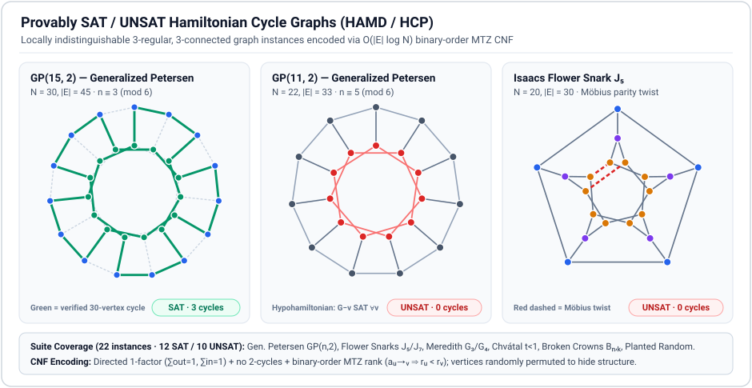

# Provably SAT/UNSAT Hamiltonian Cycle (HAMD / HCP) Benchmarks (`hamd-hamiltonian-cycle`)

## Provenance & Credit

- **Author:** Luke Hutchison ([`lukehutch`](https://github.com/lukehutch))
- **License:** MIT License ([`../LICENSE`](../LICENSE))

## Overview & Origin

A 22-instance provably Hamiltonian (12 SAT) and provably non-Hamiltonian (10 UNSAT) graph benchmark suite encoded into compact $O(|E|\log N)$ strict binary-order Miller–Tucker–Zemlin (MTZ) flat DIMACS CNFs (following Van Vi et al., *StructHCP*, 2026). Every single graph is **non-trivial by construction** (all undirected instances satisfy $\delta(G) \ge 3$ and 2-connectivity with zero cut-vertices/bridges; directed Broken Crowns satisfy $\delta^+, \delta^- \ge 2$; every instance is randomly vertex-relabeled with a deterministic seed so vertex indices leak zero structure):

1. **Generalized Petersen Graphs $GP(n, 2)$** (Watkins 1969; Alspach 1983; Haythorpe 2019 FHCP): 3-regular, 3-connected ($N = 2n$); provably UNSAT for $n \equiv 5 \pmod 6$ ($GP(11,2), GP(17,2)$) and provably SAT with exactly 3 cycles for $n \equiv 3 \pmod 6$ ($GP(15,2), GP(21,2)$).
2. **Isaacs Flower Snarks $J_k$** (Isaacs 1975; Haythorpe 2019): 3-regular, cyclically 6-edge-connected non-Hamiltonian snarks ($J_5, J_7$, UNSAT) plus minimal $+1$-edge Hamiltonian perturbation ($J_7+e$, SAT).
3. **Meredith $k$-Regular $k$-Connected Non-Hamiltonian Graphs $G_k$** (Meredith 1973; Adler et al. 2022): $K_{k, k-1}$ vertex inflation of the Petersen $k$-multigraph ($G_3$: $N=50$, $G_4$: $N=70$, UNSAT) — locally indistinguishable from Hamiltonian expanders.
4. **Chvátal Toughness Obstructions $\mathrm{Chv}(s, q)$** (Chvátal 1973): High-density ($\rho = 0.26\text{--}0.41$), high-degree ($\delta \ge 6$), $s$-connected graphs violating toughness $t(G) = s/(s+1) < 1$ (UNSAT).
5. **Haythorpe Broken Crown Directed Graphs $\mathcal{B}_{n, k}$** (Haythorpe 2019): Asymmetric directed graphs ($N \in \{31, 51\}$) with *provably exact* $k = 0$ (UNSAT) or $k = 1$ unique (SAT) directed Hamiltonian cycles.
6. **Planted Tunable-Density Random Graphs** (Vandegriend & Culberson 1998): Hidden randomly permuted Hamiltonian cycle inside sparse ($\rho = 0.06$), medium ($\rho = 0.18$), dense ($\rho = 0.30\text{--}0.35$), and very-dense ($\rho = 0.50$, $N = 80$, `28,389` CNF vars) graphs (SAT).

- **Origin:** **Original** parameterized generator (MIT [`../LICENSE`](../LICENSE)), instantiating classic graph-theoretic families (Watkins 1969; Chvátal 1973; Meredith 1973; Isaacs 1975; [Haythorpe FHCP / Broken Crowns](https://arxiv.org/abs/1902.10351); Vandegriend & Culberson 1998) in compact binary-order MTZ CNF ([StructHCP](https://arxiv.org/abs/2610.14780)).

*Figure: Representative 3-regular, 3-connected HAMD benchmark families comparing Hamiltonian $GP(15,2)$ (SAT, verified 30-vertex cycle) against hypohamiltonian $GP(11,2)$ and Isaacs Flower Snark $J_5$ (UNSAT). Regenerated via [`src/gen_diagram.py`](src/gen_diagram.py).*

## Directory Layout & Regeneration

- `cnf-orig/` — Original native **DIMACS CNF** encodings (22 `.cnf.xz` files, `478.7 KB`, compact binary-order MTZ).
- `aig-converted/` — Exact logically equivalent **Binary AIGER 1.9 `.aig.xz`** conversions (22 files, `699.0 KB`, all 22/22 verified with [Berkeley ABC](https://github.com/berkeley-abc/abc)).
- `xcnf-converted/` — Lossless **[CryptoMiniSat](https://github.com/msoos/cryptominisat) `.xcnf.xz`** conversions (22 files, `481.0 KB`).
- `anf-converted/` — Lossless linear-size **DIMACS-ANF `.anf.xz`** conversions (22 files, `1.70 MB`, degree $\le 3$, generated via [`../src/to_anf.py`](../src/to_anf.py)).
- **[`expected.tsv`](expected.tsv)** — Ground-truth verdict manifest for all 22 instances (**12 SAT / 10 UNSAT**).
- `src/` — Standalone zero-dependency Rust generator crate (`cd src && cargo run --release`) plus `cnf2xcnf.py`.

## Problem Parameters & Data Sizes

| Instance | Family | $N$ | $E$ | $\rho$ | Ans | CNF Vars | CNF Clauses | CNF (`.cnf.xz`) Size | AIG ANDs | AIG (`.aig.xz`) Size |
|---|---|---:|---:|---:|:---:|---:|---:|---:|---:|---:|
| `hamd_snark_j5_unsat` | Flower Snark | 20 | 30 | 0.158 | UNSAT | 371 | 949 | 3.4 KB | 2,639 | 4.2 KB |
| `hamd_gp_11_2_unsat` | Gen. Petersen | 22 | 33 | 0.143 | UNSAT | 411 | 1,052 | 3.7 KB | 2,927 | 4.9 KB |
| `hamd_snark_j7_unsat` | Flower Snark | 28 | 42 | 0.111 | UNSAT | 531 | 1,361 | 4.4 KB | 3,791 | 6.0 KB |
| `hamd_gp_17_2_unsat` | Gen. Petersen | 34 | 51 | 0.091 | UNSAT | 780 | 1,958 | 6.0 KB | 5,519 | 8.2 KB |
| `hamd_meredith_k3_n50_unsat` | Meredith $G_3$ | 50 | 75 | 0.061 | UNSAT | 1,164 | 2,926 | 8.8 KB | 8,255 | 11.9 KB |
| `hamd_meredith_k4_n70_unsat` | Meredith $G_4$ | 70 | 140 | 0.058 | UNSAT | 2,395 | 6,566 | 18.6 KB | 18,579 | 25.7 KB |
| `hamd_chvatal_s3_q5_dense_unsat` | Chvátal $t<1$ | 23 | 103 | 0.407 | UNSAT | 1,450 | 3,910 | 10.2 KB | 10,635 | 15.4 KB |
| `hamd_chvatal_s4_q6_med_unsat` | Chvátal $t<1$ | 34 | 146 | 0.260 | UNSAT | 2,250 | 6,463 | 16.7 KB | 17,821 | 25.0 KB |
| `hamd_chvatal_s4_q7_dense_unsat` | Chvátal $t<1$ | 39 | 251 | 0.339 | UNSAT | 4,066 | 11,268 | 26.8 KB | 31,095 | 41.3 KB |
| `hamd_broken_crown_n8_v31_k0_unsat` | Broken Crown | 31 | 74 | 0.080 | UNSAT | 500 | 1,141 | 4.0 KB | 3,241 | 5.2 KB |
| `hamd_broken_crown_n8_v31_k1_sat` | Broken Crown | 31 | 75 | 0.081 | SAT | 505 | 1,162 | 4.0 KB | 3,301 | 5.3 KB |
| `hamd_broken_crown_n12_v51_k1_sat` | Broken Crown | 51 | 123 | 0.048 | SAT | 1,019 | 2,308 | 7.1 KB | 6,633 | 9.7 KB |
| `hamd_gp_15_2_sat` | Gen. Petersen | 30 | 45 | 0.103 | SAT | 571 | 1,464 | 4.6 KB | 4,079 | 6.4 KB |
| `hamd_snark_j7_plus_e_sat` | Flower Snark $+e$ | 28 | 43 | 0.114 | SAT | 541 | 1,402 | 4.5 KB | 3,903 | 6.2 KB |
| `hamd_gp_21_2_sat` | Gen. Petersen | 42 | 63 | 0.073 | SAT | 972 | 2,442 | 7.3 KB | 6,887 | 10.1 KB |
| `hamd_planted_n24_med_sat` | Planted Med | 24 | 50 | 0.181 | SAT | 575 | 1,704 | 4.9 KB | 4,681 | 7.4 KB |
| `hamd_planted_n40_sparse_sat` | Planted Sparse | 40 | 94 | 0.121 | SAT | 1,326 | 3,936 | 11.0 KB | 10,935 | 15.7 KB |
| `hamd_planted_n40_dense_sat` | Planted Dense | 40 | 273 | 0.350 | SAT | 4,402 | 12,249 | 30.8 KB | 33,781 | 45.2 KB |
| `hamd_planted_n64_sparse_sat` | Planted Sparse | 64 | 202 | 0.100 | SAT | 3,162 | 8,908 | 25.7 KB | 24,671 | 34.5 KB |
| `hamd_planted_n64_dense_sat` | Planted Dense | 64 | 605 | 0.300 | SAT | 9,750 | 27,592 | 65.1 KB | 76,131 | 97.1 KB |
| `hamd_planted_n100_sparse_sat` | Planted Sparse | 100 | 297 | 0.060 | SAT | 5,197 | 14,769 | 39.3 KB | 41,307 | 55.5 KB |
| `hamd_planted_n80_vdense_sat` | Planted VDense | 80 | 1,580 | 0.500 | SAT | 28,389 | 82,446 | 172.0 KB | 229,525 | 258.0 KB |

## Benchmark Results (1-Core, Flat DIMACS `.cnf`, $T_{\max} = 15\;\text{s}$)

Evaluated sequentially on an AMD Ryzen 9 5950X (16C/32T Linux, 1 core/thread per run, default flags with `-t 1` for CryptoMiniSat 5.18.0 and `--max-cores 1` for Frobenius; exact median of 3 runs; **10/10 UNSAT LRAT proofs** emitted by Frobenius verified `s VERIFIED UNSAT` in HOL4/CakeML [`cake_lpr`](https://github.com/tanyongkiam/cake_lpr) and `c VERIFIED` in [`lrat-check`](https://github.com/marijnheule/drat-trim); **12/12 SAT cycles** independently verified):

| Instance | Frobenius 1C | [CaDiCaL](https://github.com/arminbiere/cadical) 3.1.0 | [CryptoMiniSat](https://github.com/msoos/cryptominisat) 5.18.0 | [dense-solver](https://github.com/libdense/dense-solver) 0.0.4 | [Kissat](https://github.com/arminbiere/kissat) 4.0.4 | Formal Verification |
|---|---:|---:|---:|---:|---:|---|
| `hamd_snark_j5_unsat` | **4.81 ms** | 15.8 ms | 63.9 ms | 8.57 ms | 32.2 ms | [`cake_lpr`](https://github.com/tanyongkiam/cake_lpr) + [`lrat-check`](https://github.com/marijnheule/drat-trim) OK (`1,205` lines) |
| `hamd_gp_11_2_unsat` | **4.14 ms** | 64.7 ms | 167.2 ms | 14.05 ms | 114.2 ms | [`cake_lpr`](https://github.com/tanyongkiam/cake_lpr) + [`lrat-check`](https://github.com/marijnheule/drat-trim) OK (`1,926` lines) |
| `hamd_snark_j7_unsat` | **7.51 ms** | 63.9 ms | 114.7 ms | 37.88 ms | 113.9 ms | [`cake_lpr`](https://github.com/tanyongkiam/cake_lpr) + [`lrat-check`](https://github.com/marijnheule/drat-trim) OK (`6,254` lines) |
| `hamd_gp_17_2_unsat` | **8.99 ms** | 316.7 ms | 466.9 ms | 107.57 ms | 773.5 ms | [`cake_lpr`](https://github.com/tanyongkiam/cake_lpr) + [`lrat-check`](https://github.com/marijnheule/drat-trim) OK (`13,461` lines) |
| `hamd_meredith_k3_n50_unsat` | **1.51 ms** | 267.1 ms | 570.6 ms | 42.88 ms | 315.1 ms | ER-LRAT [`cake_lpr`](https://github.com/tanyongkiam/cake_lpr) OK (`387,813` lines) |
| `hamd_meredith_k4_n70_unsat` | **3.42 ms** | >15 s (T/O) | 12,466.0 ms | 6,676.97 ms | >15 s (T/O) | ER-LRAT [`cake_lpr`](https://github.com/tanyongkiam/cake_lpr) OK (`1,322,451` lines) |
| `hamd_chvatal_s3_q5_dense_unsat` | **1.76 ms** | >15 s (T/O) | >15 s (T/O) | >15 s | >15 s (T/O) | ER-LRAT [`cake_lpr`](https://github.com/tanyongkiam/cake_lpr) OK (`18,747` lines) |
| `hamd_chvatal_s4_q6_med_unsat` | **3.09 ms** | >15 s (T/O) | >15 s (T/O) | >15 s | >15 s (T/O) | ER-LRAT [`cake_lpr`](https://github.com/tanyongkiam/cake_lpr) OK (`55,971` lines) |
| `hamd_chvatal_s4_q7_dense_unsat` | **5.21 ms** | >15 s (T/O) | >15 s (T/O) | >15 s | >15 s (T/O) | ER-LRAT [`cake_lpr`](https://github.com/tanyongkiam/cake_lpr) OK (`91,235` lines) |
| `hamd_broken_crown_n8_v31_k0_unsat` | 70.29 ms | **12.2 ms** | 114.9 ms | 3.74 ms | 66.2 ms | [`cake_lpr`](https://github.com/tanyongkiam/cake_lpr) + [`lrat-check`](https://github.com/marijnheule/drat-trim) OK (`420` lines) |
| `hamd_broken_crown_n8_v31_k1_sat` | 57.10 ms | **20.2 ms** | 170.7 ms | 4.19 ms | 69.4 ms | Cycle + CNF OK |
| `hamd_broken_crown_n12_v51_k1_sat` | 103.98 ms | 168.7 ms | 318.5 ms | 8.34 ms | **66.5 ms** | Cycle + CNF OK |
| `hamd_gp_15_2_sat` | **0.91 ms** | 65.2 ms | 167.4 ms | 10.25 ms | 268.2 ms | Cycle + CNF OK |
| `hamd_snark_j7_plus_e_sat` | **0.80 ms** | 63.8 ms | 114.0 ms | 3.57 ms | 64.0 ms | Cycle + CNF OK |
| `hamd_gp_21_2_sat` | **1.36 ms** | 172.7 ms | 267.5 ms | 110.07 ms | 114.6 ms | Cycle + CNF OK |
| `hamd_planted_n24_med_sat` | **0.93 ms** | 16.8 ms | 114.4 ms | 5.53 ms | 65.3 ms | Cycle + CNF OK |
| `hamd_planted_n40_sparse_sat` | **2.11 ms** | 33.2 ms | 216.2 ms | 4.99 ms | 165.5 ms | Cycle + CNF OK |
| `hamd_planted_n40_dense_sat` | **6.68 ms** | 115.6 ms | 566.9 ms | 42.15 ms | 516.3 ms | Cycle + CNF OK |
| `hamd_planted_n64_sparse_sat` | **4.67 ms** | 614.9 ms | 3,420.4 ms | 915.71 ms | 1,517.0 ms | Cycle + CNF OK |
| `hamd_planted_n64_dense_sat` | **16.22 ms** | >15 s (T/O) | 8,211.6 ms | >15 s | 8,099.2 ms | Cycle + CNF OK |
| `hamd_planted_n100_sparse_sat` | **8.32 ms** | 1,016.6 ms | 1,320.8 ms | 1,435.92 ms | 669.8 ms | Cycle + CNF OK |
| `hamd_planted_n80_vdense_sat` | **58.62 ms** | 10,564.7 ms | >15 s (T/O) | >15 s | 7,838.6 ms | Cycle + CNF OK |
| **TOTAL (22 instances, PAR-2)** | **22/22 (372.43 ms)** | 17/22 (163,592.80 ms) | 18/22 (148,852.60 ms) | 17/22 (159,432.38 ms) | 18/22 (140,869.50 ms) | **10/10 [`cake_lpr`](https://github.com/tanyongkiam/cake_lpr) + 12/12 HC** |

<!-- BEGIN_STRUCTURAL_ANALYSIS -->
## Phase-Transition & Structural Analysis

*Auto-generated by [`../src/analyze_benchmarks.py`](../src/analyze_benchmarks.py). Position relative to the critical phase transition is measured by $\rho_{\mathrm{crit}} = \frac{1}{n}\sum_k m_k / \alpha_c(k)$ (exact $\alpha/\alpha_c(k)$ for pure $k$-SAT; effective critical threshold $\alpha_c^{\mathrm{eff}} = \alpha/\rho_{\mathrm{crit}}$; `Under` $<0.90\times$, `Near-crit` $0.90\text{--}1.10\times$, `Over` $>1.10\times$), alongside Gent–Walsh annealed constrainedness $\kappa = -\frac{1}{n}\sum_i \log_2(1-2^{-k_i})$ (AAAI 1996), clause-length profile ($\bar{k}$, `%Bin`, `%Horn`), variable-degree CV ($\sigma_d/\bar{d}$, uniformity vs. hub skew), and extracted native XOR parity clauses.*

| Instance | Active $n$ | Clauses $m$ | $\alpha=m/n$ | $\alpha_c^{\mathrm{eff}}$ | $\rho_{\mathrm{crit}}$ (Regime) | $\kappa$ | $\bar{k}$ ($k_{\max}$) | Bin% | Horn% | Pos% | Deg CV | XORs |
|---|---:|---:|---:|---:|---:|---:|---:|---:|---:|---:|---:|---:|
| `hamd_broken_crown_n12_v51_k1_sat` | 1,019 | 2,308 | 2.26 | 3.00 | **0.75x** (Under) | 0.43 | 3.30 (7) | 22% | 70% | 44% | 0.58 | 0 |
| `hamd_broken_crown_n8_v31_k0_unsat` | 500 | 1,141 | 2.28 | 2.74 | **0.83x** (Under) | 0.46 | 3.23 (4) | 26% | 70% | 43% | 0.56 | 0 |
| `hamd_broken_crown_n8_v31_k1_sat` | 505 | 1,162 | 2.30 | 2.72 | **0.85x** (Under) | 0.46 | 3.23 (5) | 26% | 71% | 43% | 0.58 | 0 |
| `hamd_chvatal_s3_q5_dense_unsat` | 1,450 | 3,910 | 2.70 | 2.06 | **1.31x** (Over) | 0.65 | 3.06 (22) | 40% | 79% | 43% | 1.65 | 0 |
| `hamd_chvatal_s4_q6_med_unsat` | 2,250 | 6,463 | 2.87 | 2.28 | **1.26x** (Over) | 0.64 | 3.14 (28) | 34% | 77% | 42% | 1.69 | 0 |
| `hamd_chvatal_s4_q7_dense_unsat` | 4,066 | 11,268 | 2.77 | 2.25 | **1.23x** (Over) | 0.63 | 3.14 (38) | 35% | 78% | 43% | 2.15 | 0 |
| `hamd_gp_11_2_unsat` | 411 | 1,052 | 2.56 | 2.61 | **0.98x** (Near-crit) | 0.53 | 3.18 (4) | 27% | 73% | 42% | 0.62 | 0 |
| `hamd_gp_15_2_sat` | 571 | 1,464 | 2.56 | 2.63 | **0.97x** (Near-crit) | 0.53 | 3.19 (4) | 27% | 73% | 42% | 0.62 | 0 |
| `hamd_gp_17_2_unsat` | 780 | 1,958 | 2.51 | 2.90 | **0.87x** (Under) | 0.49 | 3.26 (4) | 23% | 72% | 42% | 0.63 | 0 |
| `hamd_gp_21_2_sat` | 972 | 2,442 | 2.51 | 2.91 | **0.86x** (Under) | 0.49 | 3.26 (4) | 23% | 72% | 42% | 0.63 | 0 |
| `hamd_meredith_k3_n50_unsat` | 1,164 | 2,926 | 2.51 | 2.92 | **0.86x** (Under) | 0.49 | 3.26 (4) | 23% | 72% | 42% | 0.63 | 0 |
| `hamd_meredith_k4_n70_unsat` | 2,395 | 6,566 | 2.74 | 2.91 | **0.94x** (Near-crit) | 0.53 | 3.29 (4) | 23% | 73% | 42% | 0.79 | 0 |
| `hamd_planted_n100_sparse_sat` | 5,197 | 14,769 | 2.84 | 2.60 | **1.09x** (Near-crit) | 0.59 | 3.23 (11) | 28% | 75% | 42% | 1.11 | 0 |
| `hamd_planted_n24_med_sat` | 575 | 1,704 | 2.96 | 2.31 | **1.28x** (Over) | 0.66 | 3.12 (6) | 34% | 76% | 39% | 0.80 | 0 |
| `hamd_planted_n40_dense_sat` | 4,402 | 12,249 | 2.78 | 2.24 | **1.24x** (Over) | 0.63 | 3.14 (20) | 35% | 78% | 43% | 1.83 | 0 |
| `hamd_planted_n40_sparse_sat` | 1,326 | 3,936 | 2.97 | 2.49 | **1.19x** (Over) | 0.63 | 3.19 (8) | 30% | 75% | 40% | 0.89 | 0 |
| `hamd_planted_n64_dense_sat` | 9,750 | 27,592 | 2.83 | 2.22 | **1.27x** (Over) | 0.65 | 3.14 (25) | 36% | 78% | 43% | 2.19 | 0 |
| `hamd_planted_n64_sparse_sat` | 3,162 | 8,908 | 2.82 | 2.39 | **1.18x** (Over) | 0.61 | 3.17 (10) | 32% | 76% | 42% | 1.16 | 0 |
| `hamd_planted_n80_vdense_sat` | 28,389 | 82,446 | 2.90 | 2.37 | **1.23x** (Over) | 0.64 | 3.20 (49) | 32% | 77% | 43% | 3.21 | 0 |
| `hamd_snark_j5_unsat` | 371 | 949 | 2.56 | 2.60 | **0.98x** (Near-crit) | 0.53 | 3.18 (4) | 28% | 73% | 42% | 0.61 | 0 |
| `hamd_snark_j7_plus_e_sat` | 541 | 1,402 | 2.59 | 2.61 | **0.99x** (Near-crit) | 0.54 | 3.18 (4) | 28% | 73% | 41% | 0.63 | 0 |
| `hamd_snark_j7_unsat` | 531 | 1,361 | 2.56 | 2.63 | **0.98x** (Near-crit) | 0.53 | 3.19 (4) | 27% | 73% | 42% | 0.62 | 0 |

**Collection Phase-Transition Summary (22 instances, 4 formats: 22 CNF / 22 AIG / 22 XCNF / 22 ANF):** median $\rho_{\mathrm{crit}} = 0.99\times$ (range `0.75x–1.31x`), median $\kappa = 0.54$, regime split **6 Under / 7 Near-critical / 9 Over**, total extracted native XOR parity clauses = **0**, total ANF equations = **298,001**.
<!-- END_STRUCTURAL_ANALYSIS -->

## References

- V. Chvátal, *Tough Graphs and Hamiltonian Circuits*, Discrete Mathematics 5(3):215–228, 1973.
- G. H. J. Meredith, *Regular $n$-Valent $n$-Connected Non-Hamiltonian Non-$n$-Edge-Colorable Graphs*, JCTB 14(1):55–60, 1973.
- R. Isaacs, *Infinite Families of Nontrivial Trivalent Graphs Which Are Not Tait Colorable*, Amer. Math. Monthly 82(3):221–239, 1975.
- M. Haythorpe, *FHCP Challenge Set: The First Set of Structurally Diverse Instances of the Hamiltonian Cycle Problem*, J. Experimental Algorithmics 24(1), 2019; *Broken Crown Graphs*, arXiv:1902.10351, 2019.
- B. Vandegriend and J. Culberson, *The $G_{n, m}$ Phase Transition Is Not Hard for the Hamiltonian Cycle Problem*, JAIR 9:219–245, 1998.
- Q. Van Vi, T. Van Kieu, and K. Van To, *StructHCP: Structure-Aware SAT–CEGAR for the Hamiltonian Cycle Problem*, arXiv:2610.14780, 2026.
- Y. K. Tan, M. J. H. Heule, and M. O. Myreen, *cake\_lpr: Verified Propagation Redundancy Checking in CakeML*, TACAS 2021.
