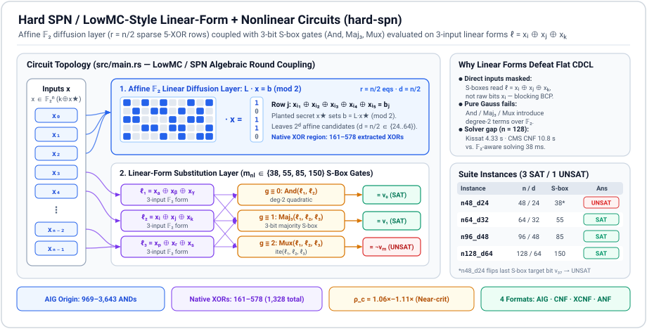

# Hard SPN / LowMC-Style Linear-Form + Nonlinear Circuits (`hard-spn`)

*Figure: LowMC/SPN-style circuit coupling a sparse 5-input $\mathbb{F}_2$ affine diffusion matrix $L x = b$ ($r = n/2$) with nonlinear $\mathrm{And}/\mathrm{Maj}_3/\mathrm{Mux}$ S-box gates fed by 3-input linear forms $\ell = x_i \oplus x_j \oplus x_k$. Regenerated via [`src/gen_diagram.py`](src/gen_diagram.py).*

## Provenance & Credit

- **Author:** Luke Hutchison ([`lukehutch`](https://github.com/lukehutch))
- **License:** MIT License ([`../LICENSE`](../LICENSE))

## Problem Description

Substitution–Permutation Network (SPN) / LowMC-style algebraic cryptanalysis benchmarks pairing a dense $\mathbb{F}_2$ linear diffusion layer ($r = n/2$ sparse 5-input parity assertions) with nonlinear $\mathrm{And}$, $\mathrm{Maj}_3$, and $\mathrm{Mux}$ S-box gates evaluated on **3-input $\mathbb{F}_2$ linear forms** $\ell_a = x_i \oplus x_j \oplus x_k$ rather than raw input wires. Both satisfiable planted instances ($n \in \lbrace 64, 96, 128\rbrace$) and a deep unsatisfiable flipped-target instance (`spn_unsat_n48_d24`) are included.

- **Origin:** **Original** benchmark suite (MIT [`../LICENSE`](../LICENSE)), modeled on algebraic LowMC-style ciphers (Albrecht et al., [EUROCRYPT 2015](https://eprint.iacr.org/2016/687)).
- **Why they are hard:** Feeding 3-input linear forms into nonlinear gates couples the affine diffusion layer with nonlinear S-box constraints, making flat clausal propagation challenging: at $n = 128$, [Kissat](https://github.com/arminbiere/kissat) 4.0.4 takes `4,330 ms`, [CaDiCaL](https://github.com/arminbiere/cadical) 3.1.0 takes `2,137 ms`, and [CryptoMiniSat](https://github.com/msoos/cryptominisat) CNF takes `10,805 ms`.

## Corpus & Data Sizes

### Directory Layout & Regeneration

- `aig-orig/` — Original native **Binary AIGER 1.9** circuits (`12.3 KB`, verified with [Berkeley ABC](https://github.com/berkeley-abc/abc)).
- `cnf-converted/` — Tseitin **DIMACS `.cnf.xz`** conversions (`29.6 KB`).
- `xcnf-converted/` — Native-XOR **[CryptoMiniSat](https://github.com/msoos/cryptominisat) `.xcnf.xz`** conversions (`12.8 KB`).
- `anf-converted/` — Lossless linear-size **DIMACS-ANF `.anf.xz`** conversions (`12.1 KB`, degree $\le 2$, generated via [`../src/to_anf.py`](../src/to_anf.py)).
- **[`expected.tsv`](expected.tsv)** — Ground-truth verdict manifest for all 4 instances (**3 SAT / 1 UNSAT**).
- `src/` — Standalone zero-dependency Rust generator crate (`cd src && cargo run --release`).

### Problem Parameters & Data Sizes

| Instance | Inputs $n$ | Linear Eqs $r$ | Nullspace $d$ | Nonlinear S-box Gates | Seed | Ans | AIG ANDs | `.aig.xz` | CNF Vars | CNF Clauses | `.cnf.xz` | `.xcnf.xz` | `.anf.xz` |
|---|---:|---:|---:|---:|---:|:---:|---:|---:|---:|---:|---:|---:|---:|
| `spn_unsat_n48_d24` | 48 | 24 | 24 | 38 (last flipped) | `0x777788889999AAAA` | UNSAT | 969 | 1.6 KB | 247 | 1,363 | 3.8 KB | 1.6 KB | 1.5 KB |
| `spn_sat_n64_d32` | 64 | 32 | 32 | 55 | `0x13572468ABCD0064` | SAT | 1,395 | 2.1 KB | 350 | 1,984 | 5.3 KB | 2.2 KB | 2.1 KB |
| `spn_sat_n96_d48` | 96 | 48 | 48 | 85 | `0x13572468ABCD0096` | SAT | 2,205 | 3.2 KB | 539 | 3,060 | 7.6 KB | 3.4 KB | 3.1 KB |
| `spn_sat_n128_d64` | 128 | 64 | 64 | 150 | `0x13572468ABCD7981` | SAT | 3,643 | 5.3 KB | 856 | 5,104 | 12.8 KB | 5.5 KB | 5.4 KB |

## Benchmark Results

Evaluated sequentially on an AMD Ryzen 9 5950X (16C/32T Linux, 1 core/thread per run, default flags with `-t 1` for CryptoMiniSat 5.18.0 and `--max-cores 1` for Frobenius; exact median of 3 runs; $T_{\max} = 5{,}000\text{ s}$):

| Instance | Frobenius 1C | [CaDiCaL](https://github.com/arminbiere/cadical) 3.1.0 | [CryptoMiniSat](https://github.com/msoos/cryptominisat) 5.18.0 (CNF) | [CryptoMiniSat](https://github.com/msoos/cryptominisat) 5.18.0 (XCNF) | [dense-solver](https://github.com/libdense/dense-solver) 0.0.4 | [Kissat](https://github.com/arminbiere/kissat) 4.0.4 |
|---|---:|---:|---:|---:|---:|---:|
| `spn_unsat_n48_d24` | **1.90 ms** | 22.35 ms | 58.31 ms | 27.06 ms | 6.97 ms | 32.47 ms |
| `spn_sat_n64_d32` | **1.80 ms** | 30.83 ms | 77.31 ms | 27.36 ms | 9.47 ms | 84.09 ms |
| `spn_sat_n96_d48` | **5.29 ms** | 176.70 ms | 247.54 ms | 105.45 ms | 267.05 ms | 326.02 ms |
| `spn_sat_n128_d64` | **36.85 ms** | 2,136.73 ms | 10,804.67 ms | 1,850.59 ms | 59,819.29 ms | 4,329.94 ms |
| **Solved (4 instances)** | **4 / 4** *(highest)* | **4 / 4** *(highest)* | **4 / 4** *(highest)* | **4 / 4** *(highest)* | **4 / 4** *(highest)* | **4 / 4** *(highest)* |
| **Total PAR-2** | **45.84 ms** *(fastest)* | 2,366.61 ms *(51.6x slower)* | 11,187.83 ms *(244x slower)* | 2,010.46 ms *(43.9x slower)* | 60,102.78 ms *(1,311x slower)* | 4,772.52 ms *(104x slower)* |

<!-- BEGIN_STRUCTURAL_ANALYSIS -->
## Phase-Transition & Structural Analysis

*Auto-generated by [`../src/analyze_benchmarks.py`](../src/analyze_benchmarks.py). Position relative to the critical phase transition is measured by $\rho_{\mathrm{crit}} = \frac{1}{n}\sum_k m_k / \alpha_c(k)$ (exact $\alpha/\alpha_c(k)$ for pure $k$-SAT; effective critical threshold $\alpha_c^{\mathrm{eff}} = \alpha/\rho_{\mathrm{crit}}$; `Under` $<0.90\times$, `Near-crit` $0.90\text{--}1.10\times$, `Over` $>1.10\times$), alongside Gent–Walsh annealed constrainedness $\kappa = -\frac{1}{n}\sum_i \log_2(1-2^{-k_i})$ (AAAI 1996), clause-length profile ($\bar{k}$, `%Bin`, `%Horn`), variable-degree CV ($\sigma_d/\bar{d}$, uniformity vs. hub skew), and extracted native XOR parity clauses.*

| Instance | Active $n$ | Clauses $m$ | $\alpha=m/n$ | $\alpha_c^{\mathrm{eff}}$ | $\rho_{\mathrm{crit}}$ (Regime) | $\kappa$ | $\bar{k}$ ($k_{\max}$) | Bin% | Horn% | Pos% | Deg CV | XORs |
|---|---:|---:|---:|---:|---:|---:|---:|---:|---:|---:|---:|---:|
| `spn_sat_n128_d64` | 856 | 5,104 | 5.96 | 5.38 | **1.11x** (Over) | 0.95 | 3.61 (4) | 2% | 51% | 50% | 1.42 | 578 |
| `spn_sat_n64_d32` | 350 | 1,984 | 5.67 | 5.31 | **1.07x** (Near-crit) | 0.92 | 3.60 (4) | 2% | 51% | 50% | 1.28 | 231 |
| `spn_sat_n96_d48` | 539 | 3,060 | 5.68 | 5.31 | **1.07x** (Near-crit) | 0.92 | 3.59 (4) | 2% | 51% | 50% | 1.26 | 358 |
| `spn_unsat_n48_d24` | 247 | 1,363 | 5.52 | 5.21 | **1.06x** (Near-crit) | 0.91 | 3.58 (4) | 2% | 50% | 50% | 1.17 | 161 |

**Collection Phase-Transition Summary (4 instances, 4 formats: 4 CNF / 4 AIG / 4 XCNF / 4 ANF):** median $\rho_{\mathrm{crit}} = 1.07\times$ (range `1.06x–1.11x`), median $\kappa = 0.92$, regime split **0 Under / 3 Near-critical / 1 Over**, total extracted native XOR parity clauses = **1,328**, total ANF equations = **1,825**.
<!-- END_STRUCTURAL_ANALYSIS -->

## References

- M. R. Albrecht, C. Rechberger, T. Schneider, T. Tiessen, and M. Zohner, *Ciphers for MPC and FHE (LowMC)*, EUROCRYPT 2015, LNCS 9056.
- M. Soos, K. Nohl, and C. Castelluccia, *Extending SAT Solvers to Cryptographic Problems*, SAT 2009.
