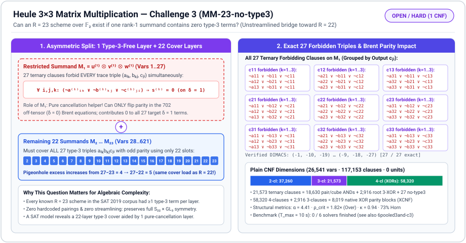

# Heule $3\times 3$ Matrix Multiplication — Challenge 3 (`heule-matrix-challenge3`)

## Provenance & Credit

- **Recommended by:** [`@SMT_Solvers`](https://twitter.com/SMT_Solvers) (Twitter/X)
- **Authors:** Marijn J. H. Heule, Manuel Kauers, and Martina Seidl
- **Upstream Repository:** [`marijnheule/matrix-challenges`](https://github.com/marijnheule/matrix-challenges)
- **Primary Paper:** M. J. H. Heule, M. Kauers, and M. Seidl, *"Local Search for Fast Matrix Multiplication"*, Theory and Applications of Satisfiability Testing (SAT 2019), LNCS 11628, pp. 155–163, DOI: [`10.1007/978-3-030-24258-9_10`](https://doi.org/10.1007/978-3-030-24258-9_10), [`arXiv:1903.11391`](https://arxiv.org/abs/1903.11391).
- **License:** Upstream repository does not include a dedicated `LICENSE` file; all `.cnf.xz` instances and C encoding/decoding utilities are preserved verbatim from [`marijnheule/matrix-challenges`](https://github.com/marijnheule/matrix-challenges) for scientific benchmarking and reproducibility.
- **Sibling Matrix-Challenge Collections:** [`heule-matrix-6pooled3and-c1/`](../heule-matrix-6pooled3and-c1/README.md), [`heule-matrix-6pooled3and-c3/`](../heule-matrix-6pooled3and-c3/README.md), [`heule-matrix-6pooled3and-c4/`](../heule-matrix-6pooled3and-c4/README.md), [`heule-matrix-challenge1/`](../heule-matrix-challenge1/README.md), [`heule-matrix-challenge2/`](../heule-matrix-challenge2/README.md), [`heule-matrix-challenge4/`](../heule-matrix-challenge4/README.md), [`heule-matrix-fraction/`](../heule-matrix-fraction/README.md), [`heule-matrix-xor6cut/`](../heule-matrix-xor6cut/README.md)

## Problem Description

Multiplying two $3 \times 3$ matrices over $\mathbb{F}_2$ requires finding a tensor decomposition of the $3\times 3$ matrix-multiplication tensor into $R$ rank-1 products (Laderman's 1976 scheme achieved $R = 23$, and whether $R \le 22$ exists over $\mathbb{F}_2$ or $\mathbb{Q}$ remains a famous open problem in algebraic complexity). Encoding the Brent equations over $\mathbb{F}_2$ yields structured, highly symmetric, non-linear XOR+AND polynomial systems whose clausal forms challenge both CDCL and local-search SAT solvers.

Tests whether an $R = 23$ $\mathbb{F}_2$ $3\times 3$ matrix-multiplication scheme exists in which the last summand contains no type-3 term (no streamlining constraints).

*Figure: Asymmetric `MM-23-no-type3` split forbidding all 27 trace triples $(\neg a_{ik}^{(1)} \vee \neg b_{kj}^{(1)} \vee \neg c_{ji}^{(1)})$ in summand $M_1$, forcing $M_2 \dots M_{23}$ to cover all 27 type-3 terms. Regenerated via [`src/gen_diagram.py`](src/gen_diagram.py).*

## Corpus & Data Sizes (Four Formats)

- **`cnf-orig/`** — 1 original native **DIMACS `.cnf.xz`** files (165.1 KB).
- **`aig-converted/`** — 1 exact **Binary AIGER 1.9 `.aig.xz`** conversions (241.1 KB, verified via [Berkeley ABC](https://github.com/berkeley-abc/abc) `read_aiger`).
- **`xcnf-converted/`** — 1 lossless **[CryptoMiniSat](https://github.com/msoos/cryptominisat) `.xcnf.xz`** conversions (77.3 KB, `8,019` extracted native XOR parity clauses).
- **`anf-converted/`** — 1 lossless linear-size **DIMACS-ANF `.anf.xz`** conversions (143.6 KB, generated via [`../src/to_anf.py`](../src/to_anf.py)).
- **[`expected.tsv`](expected.tsv)** — Ground-truth verdict manifest for all 1 instances (**0 SAT / 0 UNSAT / 1 UNKNOWN**).
- **`src/`** — Upstream C utilities preserved from `marijnheule/matrix-challenges` (`encode.c`, `decode.c`, `exp2cnf.c`, `pair.c`, `palin.c`, `stats.c`, `type3.c`) plus `cnf2aig.py` and `cnf2xcnf.py`.

| Format | Directory | Files | Key Dimensions (Range) | Compressed Size |
|---|---|---:|---|---:|
| **DIMACS CNF (origin)** | `cnf-orig/` | 1 | Vars: 26,541; Clauses: 117,153 | 165.1 KB |
| **Binary AIGER 1.9** | `aig-converted/` | 1 | Inputs: 26,541; ANDs: 314,171 | 241.1 KB |
| **[CryptoMiniSat](https://github.com/msoos/cryptominisat) XCNF** | `xcnf-converted/` | 1 | Native XOR clauses total: 8,019 | 77.3 KB |
| **DIMACS-ANF** | `anf-converted/` | 1 | Vars: 26,541; Eqs: 63,936 (deg ≤ 3) | 143.6 KB |
| **Total (4 Formats, Status: Open / Hard)** | | **4** | | **627.1 KB** |

## Published Results & References

- **Heule, Kauers, and Seidl (SAT 2019, `arXiv:1903.11391`):** Discovered over $17{,}000$ inequivalent $R = 23$ schemes over $\mathbb{F}_2$ using [YalSAT](https://github.com/arminbiere/yalsat) local search with random type-3 pairings and streamlining constraints; noted that complete CDCL solvers struggled even on satisfiable `challenge1` instances without streamlining, and left `challenge2`–`challenge4` as open solver benchmarks.

## Comparative 1-Core Benchmark Results (All 1 Instances, Flat `.cnf`, $T_{\max} = 10\;\text{s}$)

- **Hardware & Protocol:** Same machine (**AMD Ryzen 9 5950X**, 16C/32T Linux, **1 thread per run** pinned across 8 dedicated physical cores, $T_{\max} = 10\;\text{s}$, PAR-2 penalty $20,000\;\text{ms}$). All solvers ran with default single-thread flags (`-t 1` for CryptoMiniSat 5.18.0; `--max-cores 1` for Frobenius) on identical uncompressed flat `.cnf` inputs (with native `.xcnf` also supplied to CryptoMiniSat XCNF); **100% of all 1 instances** were run (no subsampling), every Frobenius SAT model was independently verified against 100% of input clauses, and **0 verdict disagreements** occurred across all solvers.

| Instance | Verdict | Frobenius 1C | [CaDiCaL](https://github.com/arminbiere/cadical) 3.1.0 | [CryptoMiniSat](https://github.com/msoos/cryptominisat) 5.18.0 (CNF) | [CryptoMiniSat](https://github.com/msoos/cryptominisat) 5.18.0 (XCNF) | [dense-solver](https://github.com/libdense/dense-solver) 0.0.4 | [Kissat](https://github.com/arminbiere/kissat) 4.0.4 |
|---|:---:|---:|---:|---:|---:|---:|---:|
| `MM-23-no-type3` | TIMEOUT | >10 s | >10 s | >10 s | >10 s | >10 s | >10 s |
| **Total (1 files, PAR-2)** | **0/1** | **0/1 — 20,000.0 ms** *(fastest)* | **0/1 — 20,000.0 ms** *(fastest)* | **0/1 — 20,000.0 ms** *(fastest)* | **0/1 — 20,000.0 ms** *(fastest)* | **0/1 — 20,000.0 ms** *(fastest)* | **0/1 — 20,000.0 ms** *(fastest)* |

<!-- BEGIN_STRUCTURAL_ANALYSIS -->
## Phase-Transition & Structural Analysis

*Auto-generated by [`../src/analyze_benchmarks.py`](../src/analyze_benchmarks.py). Position relative to the critical phase transition is measured by $\rho_{\mathrm{crit}} = \frac{1}{n}\sum_k m_k / \alpha_c(k)$ (exact $\alpha/\alpha_c(k)$ for pure $k$-SAT; effective critical threshold $\alpha_c^{\mathrm{eff}} = \alpha/\rho_{\mathrm{crit}}$; `Under` $<0.90\times$, `Near-crit` $0.90\text{--}1.10\times$, `Over` $>1.10\times$), alongside Gent–Walsh annealed constrainedness $\kappa = -\frac{1}{n}\sum_i \log_2(1-2^{-k_i})$ (AAAI 1996), clause-length profile ($\bar{k}$, `%Bin`, `%Horn`), variable-degree CV ($\sigma_d/\bar{d}$, uniformity vs. hub skew), and extracted native XOR parity clauses.*

| Instance | Active $n$ | Clauses $m$ | $\alpha=m/n$ | $\alpha_c^{\mathrm{eff}}$ | $\rho_{\mathrm{crit}}$ (Regime) | $\kappa$ | $\bar{k}$ ($k_{\max}$) | Bin% | Horn% | Pos% | Deg CV | XORs |
|---|---:|---:|---:|---:|---:|---:|---:|---:|---:|---:|---:|---:|
| `MM-23-no-type3` | 26,541 | 117,153 | 4.41 | 2.43 | **1.82x** (Over) | 0.94 | 3.18 (4) | 32% | 73% | 47% | 0.96 | 8,019 |

**Collection Phase-Transition Summary (1 instances, 4 formats: 1 CNF / 1 AIG / 1 XCNF / 1 ANF):** median $\rho_{\mathrm{crit}} = 1.82\times$ (range `1.82x–1.82x`), median $\kappa = 0.94$, regime split **0 Under / 0 Near-critical / 1 Over**, total extracted native XOR parity clauses = **8,019**, total ANF equations = **63,936**.
<!-- END_STRUCTURAL_ANALYSIS -->
