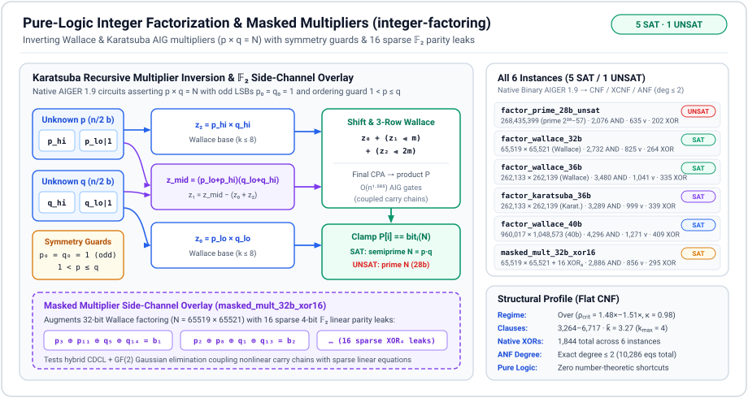

# Pure-Logic Integer Factorization & Masked Multiplier Circuits (`integer-factoring`)

## Provenance & Credit

- **Author:** Luke Hutchison ([`lukehutch`](https://github.com/lukehutch))
- **License:** MIT License ([`../LICENSE`](../LICENSE))

## Overview & Origin

Bit-level combinational multiplier inversion benchmarks asserting $p \cdot q = N$ (with odd-factor LSBs fixed to $1$ and $p \ge q$ / equal-half-bit symmetry breaking) across **Wallace-tree** and **Karatsuba** multiplier topologies, including a 28-bit prime UNSAT instance, 32–40-bit balanced semiprimes, and a 32-bit Wallace multiplier augmented with 16 sparse 4-bit $\mathbb{F}_2$ parity leakage constraints (`masked_mult_32b_xor16`, modeling side-channel / masked hardware cryptanalysis).

- **Origin:** **Original** circuit generator (MIT [`../LICENSE`](../LICENSE)), motivated by classic bit-blasted factoring SAT benchmarks (Purdom & Sabry 2004; Srebrny 2004) and multiplier verification benchmarks (Kaufmann, Biere, & Kauers, [AMulet](https://github.com/d-kaufmann/amulet), FMCAD 2019).
- **Why they are hard:** Bit-level carry chains create high-treewidth nonlinear arithmetic constraints; Karatsuba multiplication further couples partial products via extra adders/subtractors.

*Figure: Recursive Karatsuba multiplier inversion ($z_0, z_1, z_2$ with Wallace base case, odd-LSB / $1 < p \le q$ symmetry guards, and clamped target $N$) plus the 16 sparse 4-bit $\mathbb{F}_2$ parity leakage overlay of `masked_mult_32b_xor16` across all 6 instances. Regenerated via [`src/gen_diagram.py`](src/gen_diagram.py).*

## Directory Layout & Regeneration

- `aig-orig/` — Original native **Binary AIGER 1.9** circuits (`20.9 KB`, verified with [Berkeley ABC](https://github.com/berkeley-abc/abc)).
- `cnf-converted/` — Tseitin **DIMACS `.cnf.xz`** conversions (`62.9 KB`).
- `xcnf-converted/` — Native-XOR **[CryptoMiniSat](https://github.com/msoos/cryptominisat) `.xcnf.xz`** conversions (`45.9 KB`).
- `anf-converted/` — Lossless linear-size **DIMACS-ANF `.anf.xz`** conversions (`62.5 KB`, degree $\le 2$, generated via [`../src/to_anf.py`](../src/to_anf.py)).
- **[`expected.tsv`](expected.tsv)** — Ground-truth verdict manifest for all 6 instances (**5 SAT / 1 UNSAT**).
- `src/` — Standalone zero-dependency Rust generator crate (`cd src && cargo run --release`).

## Problem Parameters & Data Sizes

| Instance | Target $N$ | Factors $(p, q)$ | Topology | Ans | AIG ANDs | `.aig.xz` | CNF Vars | CNF Clauses | `.cnf.xz` | `.xcnf.xz` | `.anf.xz` |
|---|---:|---|---|:---:|---:|---:|---:|---:|---:|---:|---:|
| `factor_prime_28b_unsat` | `268,435,399` | prime ($2^{28}-57$) | Wallace | UNSAT | 2,076 | 2.5 KB | 635 | 3,264 | 7.2 KB | 5.3 KB | 6.8 KB |
| `factor_wallace_32b` | `4,292,870,399` | `65519 × 65521` | Wallace | SAT | 2,732 | 3.1 KB | 825 | 4,286 | 9.1 KB | 6.7 KB | 9.1 KB |
| `factor_wallace_36b` | `68,715,282,487` | `262133 × 262139` | Wallace | SAT | 3,480 | 3.7 KB | 1,041 | 5,451 | 11.5 KB | 8.2 KB | 11.6 KB |
| `factor_karatsuba_36b` | `68,715,282,487` | `262133 × 262139` | Karatsuba | SAT | 3,289 | 3.9 KB | 999 | 5,231 | 11.3 KB | 8.4 KB | 11.5 KB |
| `factor_wallace_40b` | `1,006,647,906,441` | `960017 × 1048573` | Wallace | SAT | 4,296 | 4.4 KB | 1,271 | 6,717 | 14.1 KB | 10.4 KB | 14.4 KB |
| `masked_mult_32b_xor16` | `4,292,870,399` | `65519 × 65521` + 16 XOR4 leaks | Wallace + $\mathbb{F}_2$ | SAT | 2,886 | 3.3 KB | 856 | 4,486 | 9.7 KB | 6.9 KB | 9.1 KB |

## Benchmark Results (1-Core, Flat DIMACS `.cnf` Input)

Evaluated sequentially on an AMD Ryzen 9 5950X (16C/32T Linux, 1 core/thread per run, default flags with `-t 1` for CryptoMiniSat 5.18.0 and `--max-cores 1` for Frobenius; exact median of 3 runs; $T_{\max} = 5{,}000\;\text{s}$; all solvers operate strictly on flat `.cnf` with **zero number-theoretic shortcuts**):

| Instance | Frobenius 1C | [CaDiCaL](https://github.com/arminbiere/cadical) 3.1.0 | [CryptoMiniSat](https://github.com/msoos/cryptominisat) 5.18.0 (CNF) | [CryptoMiniSat](https://github.com/msoos/cryptominisat) 5.18.0 (XCNF) | [dense-solver](https://github.com/libdense/dense-solver) 0.0.4 *($T=30\;\text{s}$)* | [Kissat](https://github.com/arminbiere/kissat) 4.0.4 |
|---|---:|---:|---:|---:|---:|---:|
| `factor_prime_28b_unsat` | **2.05 ms** | 5.99 ms | 75.60 ms | 38.82 ms | 6.19 ms | 25.29 ms |
| `factor_wallace_32b` | **2.79 ms** | 5.60 ms | 121.22 ms | 82.24 ms | 9.12 ms | 25.43 ms |
| `factor_wallace_36b` | **3.11 ms** | 8.05 ms | 151.32 ms | 51.40 ms | 9.22 ms | 27.58 ms |
| `factor_karatsuba_36b` | **9.56 ms** | 39.46 ms | 146.49 ms | 81.61 ms | 10.11 ms | 39.72 ms |
| `factor_wallace_40b` | **3.16 ms** | 695.57 ms | 774.73 ms | 61.26 ms | 1,516.31 ms | 383.26 ms |
| `masked_mult_32b_xor16` | **2.91 ms** | 5.89 ms | 50.11 ms | 72.80 ms | 4.48 ms | 17.79 ms |

<!-- BEGIN_STRUCTURAL_ANALYSIS -->
## Phase-Transition & Structural Analysis

*Auto-generated by [`../src/analyze_benchmarks.py`](../src/analyze_benchmarks.py). Position relative to the critical phase transition is measured by $\rho_{\mathrm{crit}} = \frac{1}{n}\sum_k m_k / \alpha_c(k)$ (exact $\alpha/\alpha_c(k)$ for pure $k$-SAT; effective critical threshold $\alpha_c^{\mathrm{eff}} = \alpha/\rho_{\mathrm{crit}}$; `Under` $<0.90\times$, `Near-crit` $0.90\text{--}1.10\times$, `Over` $>1.10\times$), alongside Gent–Walsh annealed constrainedness $\kappa = -\frac{1}{n}\sum_i \log_2(1-2^{-k_i})$ (AAAI 1996), clause-length profile ($\bar{k}$, `%Bin`, `%Horn`), variable-degree CV ($\sigma_d/\bar{d}$, uniformity vs. hub skew), and extracted native XOR parity clauses.*

| Instance | Active $n$ | Clauses $m$ | $\alpha=m/n$ | $\alpha_c^{\mathrm{eff}}$ | $\rho_{\mathrm{crit}}$ (Regime) | $\kappa$ | $\bar{k}$ ($k_{\max}$) | Bin% | Horn% | Pos% | Deg CV | XORs |
|---|---:|---:|---:|---:|---:|---:|---:|---:|---:|---:|---:|---:|
| `factor_karatsuba_36b` | 999 | 5,231 | 5.24 | 3.54 | **1.48x** (Over) | 0.97 | 3.27 (4) | 13% | 58% | 49% | 0.38 | 339 |
| `factor_prime_28b_unsat` | 635 | 3,264 | 5.14 | 3.41 | **1.51x** (Over) | 0.98 | 3.25 (4) | 14% | 59% | 49% | 0.40 | 202 |
| `factor_wallace_32b` | 825 | 4,286 | 5.20 | 3.45 | **1.51x** (Over) | 0.98 | 3.26 (4) | 14% | 59% | 49% | 0.40 | 264 |
| `factor_wallace_36b` | 1,041 | 5,451 | 5.24 | 3.48 | **1.50x** (Over) | 0.98 | 3.27 (4) | 14% | 59% | 49% | 0.42 | 335 |
| `factor_wallace_40b` | 1,271 | 6,717 | 5.28 | 3.52 | **1.50x** (Over) | 0.98 | 3.28 (4) | 13% | 59% | 49% | 0.43 | 409 |
| `masked_mult_32b_xor16` | 856 | 4,486 | 5.24 | 3.49 | **1.50x** (Over) | 0.99 | 3.27 (4) | 13% | 58% | 49% | 0.55 | 295 |

**Collection Phase-Transition Summary (6 instances, 4 formats: 6 CNF / 6 AIG / 6 XCNF / 6 ANF):** median $\rho_{\mathrm{crit}} = 1.50\times$ (range `1.48x–1.51x`), median $\kappa = 0.98$, regime split **0 Under / 0 Near-critical / 6 Over**, total extracted native XOR parity clauses = **1,844**, total ANF equations = **10,286**.
<!-- END_STRUCTURAL_ANALYSIS -->

## References

- D. Kaufmann, A. Biere, and M. Kauers, *Verifying Large Multipliers by Combining SAT and Computer Algebra ([AMulet](https://github.com/d-kaufmann/amulet))*, FMCAD 2019.
- C. S. Wallace, *A Suggestion for a Fast Multiplier*, IEEE Trans. Electronic Computers 13(1):14–17, 1964.
- A. Karatsuba and Y. Ofman, *Multiplication of Many-Digital Numbers by Automatic Computers*, Doklady Akad. Nauk SSSR 145:293–294, 1962.
