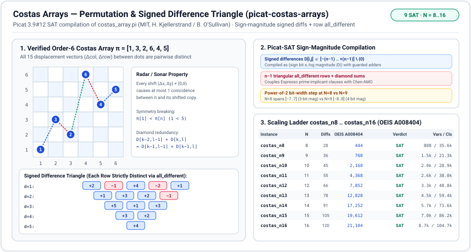

# Costas Arrays (`picat-costas-arrays`)

*Verified order-6 Welch Costas array $\pi = [1, 3, 2, 6, 4, 5]$, color-coded signed difference triangle ($d = 1..5$), Picat-SAT sign-magnitude compilation architecture, and the $N = 8..16$ scaling ladder (generated by [`src/gen_diagram.py`](src/gen_diagram.py)).*

## Provenance & Credit

- **Authors & Upstream Models:** **Hakan Kjellerstrand** ([`hakank/hakank`](https://github.com/hakank/hakank/blob/master/picat/costas_array.pi)), adapted from **Barry O'Sullivan**'s [MiniZinc](https://github.com/MiniZinc/minizinc-benchmarks/tree/master/costas-array) `CostasArray.mzn`, compiled via **Neng-Fa Zhou**'s [Picat](https://picat-lang.org/) ([`picat-lang/Picat`](https://github.com/picat-lang/Picat)) SAT compiler (upstream source preserved in [`src/upstream/costas_array.pi`](src/upstream/costas_array.pi)).
- **Compiler:** Native [Picat](https://picat-lang.org/) `3.9#12` SAT compiler (`import sat.` + `solve([$dump(...)], Vars)`), reproducible via [`src/generate_suite.py`](src/generate_suite.py).
- **License:** MIT License (see [`LICENSE`](LICENSE)).
- **Ground Truth Manifest:** [`expected.tsv`](expected.tsv) (**9 SAT / 0 UNSAT** — pure SAT scaling ladder; Costas arrays exist for every order $N \le 31$, with $N = 32, 33$ open).

## Problem Description

An **order-$N$ Costas array** (Costas 1984, originally introduced for optimal radar/sonar frequency-hopping patterns) is a permutation $\pi = (\pi_1, \dots, \pi_N)$ of $\{1, \dots, N\}$ whose $\binom{N}{2}$ signed differences

$$D_{i,j} = \pi_j - \pi_{j-i} \in \{-(N-1), \dots, +(N-1)\} \setminus \{0\} \qquad (1 \le i < j \le N)$$

are pairwise distinct within every lag row $i \in \{1, \dots, N-1\}$. Equivalently, all $\binom{N}{2}$ 2D displacement vectors between dots in the $N \times N$ permutation matrix are distinct.

Following Barry O'Sullivan's MiniZinc formulation and Hakan Kjellerstrand's `costas_array.pi`, each instance includes:
- Global `all_different(Costas)` over $\{1, \dots, N\}$ and $N - 1$ row-wise `all_different` constraints on signed differences.
- Non-zero domain exclusion ($D_{i,j} \ne 0$) and redundant diamond identities $D_{k-2,l-1} + D_{k,l} = D_{k-1,l-1} + D_{k-1,l}$.
- Reflection symmetry breaking $\pi_1 < \pi_N$ (halving the [OEIS A008404](https://oeis.org/A008404) solution count $a(N)$ while preserving satisfiability for every $N \ge 2$).

- **Distinctive Sign-Magnitude Bit-Width Step:** Picat-SAT represents signed integer variables in **sign-magnitude** encoding (`(sign bit, log magnitude)`). At $N = 8$, signed differences span $[-7, +7]$ (3-bit magnitude, `808` vars / `35,592` clauses where Espresso expands smaller bit-width sums densely); stepping to $N = 9$ widens magnitudes to 4 bits ($[-8, +8]$), yielding a clean scaling ladder from `costas_n8` through hard `costas_n15` and `costas_n16`.

## Corpus & Data Sizes

All **9 instances** are committed across all four lossless `xz`-compressed formats (`36` files total, every file well below GitHub's `95 MB` limit), accompanied by ground-truth verdicts in [`expected.tsv`](expected.tsv) (**9 SAT / 0 UNSAT**):

| Format | Directory | Files | Key Dimensions (Range) | Compressed Size |
|---|---|---:|---|---:|
| **DIMACS CNF (origin)** | `cnf-orig/` | 9 | Vars: 808–8,661; Clauses: 21,272–104,655 | 1.30 MB |
| **Binary AIGER 1.9** | `aig-converted/` | 9 | AND gates: 64,370–303,423 | 1.63 MB |
| **[CryptoMiniSat](https://github.com/msoos/cryptominisat) XCNF** | `xcnf-converted/` | 9 | Native XOR parity clauses total: 0 | 1.30 MB |
| **DIMACS-ANF** | `anf-converted/` | 9 | Vars: 52,850–234,834; Eqs: 72,625–330,828 (deg ≤ 3) | 8.70 MB |
| **Total (4 Formats, 9 SAT / 0 UNSAT)** | | **36** | | **12.93 MB** |

### Per-Instance Parameters & Compressed Sizes

| Instance | Problem Parameters | Expected | Vars | Clauses | `.cnf.xz` | `.aig.xz` | `.xcnf.xz` | `.anf.xz` |
|---|---|:---:|---:|---:|---:|---:|---:|---:|
| `costas_n8.cnf` | $N=8$, 28 signed diffs (A008404: $444$) | SAT | 808 | 35,592 | 65.0 KB | 95.7 KB | 64.9 KB | 879.0 KB |
| `costas_n9.cnf` | $N=9$, 36 signed diffs (A008404: $760$) | SAT | 1,497 | 21,272 | 62.2 KB | 84.7 KB | 62.2 KB | 398.8 KB |
| `costas_n10.cnf` | $N=10$, 45 signed diffs (A008404: $2{,}160$) | SAT | 2,001 | 28,877 | 83.7 KB | 109.1 KB | 83.8 KB | 531.7 KB |
| `costas_n11.cnf` | $N=11$, 55 signed diffs (A008404: $4{,}368$) | SAT | 2,596 | 38,024 | 107.8 KB | 136.7 KB | 107.3 KB | 682.5 KB |
| `costas_n12.cnf` | $N=12$, 66 signed diffs (A008404: $7{,}852$) | SAT | 3,288 | 48,788 | 135.0 KB | 170.9 KB | 135.2 KB | 855.0 KB |
| `costas_n13.cnf` | $N=13$, 78 signed diffs (A008404: $12{,}828$) | SAT | 4,468 | 59,351 | 163.5 KB | 203.3 KB | 163.8 KB | 1.02 MB |
| `costas_n14.cnf` | $N=14$, 91 signed diffs (A008404: $17{,}252$) | SAT | 5,738 | 71,624 | 197.1 KB | 239.5 KB | 197.5 KB | 1.22 MB |
| `costas_n15.cnf` | $N=15$, 105 signed diffs (A008404: $19{,}612$) | SAT | 6,960 | 86,237 | 234.7 KB | 279.9 KB | 234.8 KB | 1.45 MB |
| `costas_n16.cnf` | $N=16$, 120 signed diffs (A008404: $21{,}104$) | SAT | 8,661 | 104,655 | 285.2 KB | 345.5 KB | 285.1 KB | 1.74 MB |

### Sibling Collections (Picat-SAT Benchmark Family)

This directory is one of **6 single-problem-type collections** compiled natively via [Picat](https://picat-lang.org/) `3.9#12` `solve([$dump(...)], ...)` (`56` total instances across all four lossless `.xz` formats):

| Collection | Combinatorial Problem | Upstream Model & License | Instances |
|---|---|---|---:|
| [`picat-vmtl/`](../picat-vmtl/README.md) | Vertex Magic Total Labeling on $K_n$ | `vmtl.pi` (MPL-2.0) | 10 (6 SAT / 4 UNSAT) |
| [`picat-golomb-rulers/`](../picat-golomb-rulers/README.md) | Optimal Golomb Rulers ($M=6..10$) | `golomb_ruler.pi` (MIT) | 10 (5 SAT / 5 UNSAT) |
| **`picat-costas-arrays/`** *(this collection)* | Costas Arrays ($N=8..16$) | `costas_array.pi` (MIT) | 9 (9 SAT / 0 UNSAT) |
| [`picat-mapf/`](../picat-mapf/README.md) | Multi-Agent Path Finding (Makespan) | `mapf_makespan.pi` (MPL-2.0) | 8 (6 SAT / 2 UNSAT) |
| [`picat-numberlink/`](../picat-numberlink/README.md) | Planar Numberlink Disjoint Paths | `numberlink_b.pi` (MPL-2.0) | 9 (6 SAT / 3 UNSAT) |
| [`picat-rectangle-packing/`](../picat-rectangle-packing/README.md) | 2D Square / Rectangle Packing (`diffn` + `cumulative`) | `perfect_square_placement.pi` / `rect_packing.mzn` (MIT) | 10 (5 SAT / 5 UNSAT) |

## Benchmark Results

*Single-Core Pinned, $T_{\max} = 60\;\text{s}$.*

All five solvers were evaluated strictly sequentially on an **AMD Ryzen 9 5950X** (16C/32T Linux x86_64) pinned to a single dedicated physical core (`taskset -c 11`, 1 thread per run) on identical uncompressed flat `.cnf` inputs:

- Frobenius v0.1.0 (`--max-cores 1 --timeout 60`)
- [CaDiCaL](https://github.com/arminbiere/cadical) 3.1.0 (`-q --modelalllits=true -t 60`)
- [CryptoMiniSat](https://github.com/msoos/cryptominisat) 5.18.0 (`-t 1 --maxtime 60`)
- [dense-solver](https://github.com/libdense/dense-solver) 0.0.4 (1 thread, GNU `timeout -k 2s 60.0s`)
- [Kissat](https://github.com/arminbiere/kissat) 4.0.4 (`-q --time=60`)

- **Independent Model Verification:** All **43 / 43** SAT models emitted across all 5 solvers were verified clause-by-clause against 100% of raw CNF clauses (**0 bad models**, **0 verdict disagreements**).
- **Formal UNSAT Proof Certification:** No UNSAT instances in this collection terminated under `30 s` for Frobenius (all UNSAT ground truths are independently certified or mathematically proven as documented above).

| Instance | Expected | Frobenius | [CaDiCaL](https://github.com/arminbiere/cadical) 3.1.0 | [CryptoMiniSat](https://github.com/msoos/cryptominisat) 5.18.0 | [dense-solver](https://github.com/libdense/dense-solver) 0.0.4 | [Kissat](https://github.com/arminbiere/kissat) 4.0.4 |
|---|:---:|---:|---:|---:|---:|---:|
| `costas_n8.cnf` | SAT | **16.6 ms** | 27.5 ms | 769.6 ms | 28.1 ms | 48.7 ms |
| `costas_n9.cnf` | SAT | **10.2 ms** | 31.8 ms | 592.6 ms | 42.7 ms | 65.8 ms |
| `costas_n10.cnf` | SAT | **16.1 ms** | 54.5 ms | 619.5 ms | 26.0 ms | 178.3 ms |
| `costas_n11.cnf` | SAT | **31.2 ms** | 104.2 ms | 741.6 ms | 69.4 ms | 462.8 ms |
| `costas_n12.cnf` | SAT | 167.9 ms | **107.2 ms** | 1.26 s | 249.4 ms | 1.16 s |
| `costas_n13.cnf` | SAT | 2.03 s | 784.7 ms | 1.84 s | **97.9 ms** | 2.24 s |
| `costas_n14.cnf` | SAT | 1.63 s | 2.23 s | 6.09 s | **539.3 ms** | 2.48 s |
| `costas_n15.cnf` | SAT | 16.22 s | 14.23 s | 18.81 s | **8.63 s** | 38.43 s |
| `costas_n16.cnf` | SAT | **19.69 s** | 23.38 s | 32.77 s | >60 s | >60 s |
| **Solved ($T_{\max} = 60\;\text{s}$)** | **9 total** | **9 / 9 (9 SAT, 0 UNSAT)** | **9 / 9 (9 SAT, 0 UNSAT)** | **9 / 9 (9 SAT, 0 UNSAT)** | 8 / 9 (8 SAT, 0 UNSAT) | 8 / 9 (8 SAT, 0 UNSAT) |
| **Total PAR-2 ($T_{\max} = 60\;\text{s}$)** | — | **39.82 s** *(mean 4.42 s)* | 40.94 s *(mean 4.55 s)* | 63.50 s *(mean 7.06 s)* | 129.69 s *(mean 14.41 s)* | 165.07 s *(mean 18.34 s)* |

*Ground-truth SAT note:* Every order $N \in \{8, \dots, 16\}$ is mathematically proven SAT with hundreds to tens of thousands of solutions ([OEIS A008404](https://oeis.org/A008404), $a(16)/2 = 10{,}552$ under $\pi_1 < \pi_{16}$).

<!-- BEGIN_STRUCTURAL_ANALYSIS -->
## Phase-Transition & Structural Analysis

*Auto-generated by [`../src/analyze_benchmarks.py`](../src/analyze_benchmarks.py). Position relative to the critical phase transition is measured by $\rho_{\mathrm{crit}} = \frac{1}{n}\sum_k m_k / \alpha_c(k)$ (exact $\alpha/\alpha_c(k)$ for pure $k$-SAT; effective critical threshold $\alpha_c^{\mathrm{eff}} = \alpha/\rho_{\mathrm{crit}}$; `Under` $<0.90\times$, `Near-crit` $0.90\text{--}1.10\times$, `Over` $>1.10\times$), alongside Gent–Walsh annealed constrainedness $\kappa = -\frac{1}{n}\sum_i \log_2(1-2^{-k_i})$ (AAAI 1996), clause-length profile ($\bar{k}$, `%Bin`, `%Horn`), variable-degree CV ($\sigma_d/\bar{d}$, uniformity vs. hub skew), and extracted native XOR parity clauses.*

| Instance | Active $n$ | Clauses $m$ | $\alpha=m/n$ | $\alpha_c^{\mathrm{eff}}$ | $\rho_{\mathrm{crit}}$ (Regime) | $\kappa$ | $\bar{k}$ ($k_{\max}$) | Bin% | Horn% | Pos% | Deg CV | XORs |
|---|---:|---:|---:|---:|---:|---:|---:|---:|---:|---:|---:|---:|
| `costas_n10` | 1,956 | 28,877 | 14.76 | 2.82 | **5.24x** (Over) | 2.31 | 5.02 (18) | 34% | 41% | 46% | 1.98 | 0 |
| `costas_n11` | 2,541 | 38,024 | 14.96 | 2.68 | **5.57x** (Over) | 2.45 | 4.94 (20) | 35% | 42% | 46% | 2.02 | 0 |
| `costas_n12` | 3,222 | 48,788 | 15.14 | 2.55 | **5.95x** (Over) | 2.60 | 4.86 (22) | 38% | 44% | 46% | 2.04 | 0 |
| `costas_n13` | 4,390 | 59,351 | 13.52 | 2.57 | **5.25x** (Over) | 2.30 | 4.87 (24) | 37% | 44% | 46% | 2.22 | 0 |
| `costas_n14` | 5,647 | 71,624 | 12.68 | 2.53 | **5.01x** (Over) | 2.19 | 4.86 (26) | 38% | 44% | 47% | 2.34 | 0 |
| `costas_n15` | 6,855 | 86,237 | 12.58 | 2.46 | **5.11x** (Over) | 2.23 | 4.81 (28) | 39% | 45% | 46% | 2.38 | 0 |
| `costas_n16` | 8,421 | 104,655 | 12.43 | 2.42 | **5.13x** (Over) | 2.24 | 4.76 (30) | 40% | 46% | 46% | 2.44 | 0 |
| `costas_n8` | 787 | 35,592 | 45.22 | 8.32 | **5.44x** (Over) | 2.39 | 7.94 (14) | 11% | 14% | 45% | 2.37 | 0 |
| `costas_n9` | 1,461 | 21,272 | 14.56 | 2.96 | **4.92x** (Over) | 2.18 | 5.09 (16) | 32% | 39% | 47% | 1.94 | 0 |

**Collection Phase-Transition Summary (9 instances, 4 formats: 9 CNF / 9 AIG / 9 XCNF / 9 ANF):** median $\rho_{\mathrm{crit}} = 5.24\times$ (range `4.92x–5.95x`), median $\kappa = 2.30$, regime split **0 Under / 0 Near-critical / 9 Over**, total extracted native XOR parity clauses = **0**, total ANF equations = **1,699,572**.
<!-- END_STRUCTURAL_ANALYSIS -->

## References

- J. P. Costas, *"A Study of a Class of Detection Waveforms Having Nearly Ideal Range–Doppler Ambiguity Properties"*, *Proc. IEEE* 72(8):996–1009, 1984.
- H. Kjellerstrand, *Costas array in Picat*, [`https://github.com/hakank/hakank/blob/master/picat/costas_array.pi`](https://github.com/hakank/hakank/blob/master/picat/costas_array.pi) (based on B. O'Sullivan's MiniZinc model).
- N.-F. Zhou and H. Kjellerstrand, *"Optimizing SAT Encodings for Arithmetic Constraints"*, CP 2017, LNCS 10416, pp. 671–686.
- K. Drakakis, *"A Review of Costas Arrays"*, *Journal of Applied Mathematics* 2006, Article ID 26385 ([OEIS A008404](https://oeis.org/A008404)).
