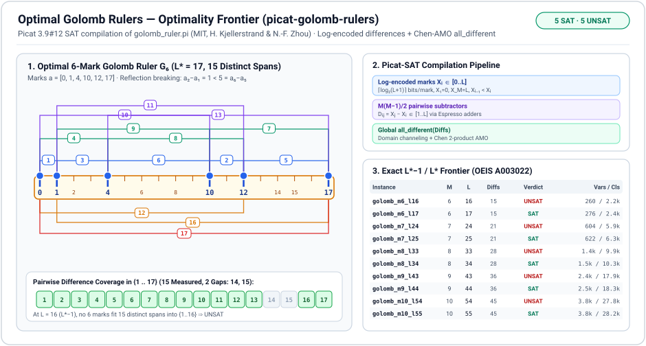

# Optimal Golomb Rulers (`picat-golomb-rulers`)

*Verified optimal 6-mark Golomb ruler $G_6$ ($[0, 1, 4, 10, 12, 17]$, $L^* = 17$, all 15 pairwise spans distinct), Picat-SAT log-arithmetic compilation pipeline, and exact $L^*-1$ / $L^*$ optimality brackets for $M = 6..10$ (generated by [`src/gen_diagram.py`](src/gen_diagram.py)).*

## Provenance & Credit

- **Authors & Upstream Models:** **Hakan Kjellerstrand** ([`hakank/hakank`](https://github.com/hakank/hakank/blob/master/picat/golomb_ruler.pi)) and **Neng-Fa Zhou** ([Picat](https://picat-lang.org/) / [`picat-lang/Picat`](https://github.com/picat-lang/Picat)), aligned with the [MiniZinc](https://github.com/MiniZinc/minizinc-benchmarks/tree/master/golomb) `golomb` formulation (upstream source preserved in [`src/upstream/golomb_ruler.pi`](src/upstream/golomb_ruler.pi)).
- **Compiler:** Native [Picat](https://picat-lang.org/) `3.9#12` SAT compiler (`import sat.` + `solve([$dump(...)], Vars)`), reproducible via [`src/generate_suite.py`](src/generate_suite.py).
- **License:** MIT License (see [`LICENSE`](LICENSE)).
- **Ground Truth Manifest:** [`expected.tsv`](expected.tsv) (**5 SAT / 5 UNSAT**).

## Mathematical Problem & Picat-SAT Encoding

An **$M$-mark Golomb ruler** of length $L$ places strictly increasing integer marks $0 = x_1 < x_2 < \dots < x_M = L$ such that all $\binom{M}{2}$ pairwise distances $d_{ij} = x_j - x_i$ ($1 \le i < j \le M$) are pairwise distinct. Finding the minimum achievable length $L^*(M)$ defines [OEIS A003022](https://oeis.org/A003022):

$$L^*(6) = 17, \quad L^*(7) = 25, \quad L^*(8) = 34, \quad L^*(9) = 44, \quad L^*(10) = 55.$$

Each mark count $M \in \{6, 7, 8, 9, 10\}$ is represented by an exact **optimality bracket pair**:
- **Tight UNSAT ($L = L^*(M) - 1$):** Proves optimality of $L^*(M)$ by refuting every ruler of length $L^*-1$.
- **Optimal SAT ($L = L^*(M)$):** Certifies attainability with an explicit minimum-length ruler.

All instances include standard reflection symmetry breaking ($x_2 - x_1 < x_M - x_{M-1}$). Picat-SAT compiles each mark $x_i \in [0, L]$ in log-binary representation, lowers all $\binom{M}{2}$ subtractions $d_{ij} = x_j - x_i$ via Espresso-minimized adders, and channels domain indicators into Chen 2-product `all_different(Diffs)` constraints — producing razor-sharp optimality transitions in under `4,000` variables.

## Corpus & Four-Format Inventory

All **10 instances** are committed across all four lossless `xz`-compressed formats (`40` files total, every file well below GitHub's `95 MB` limit), accompanied by ground-truth verdicts in [`expected.tsv`](expected.tsv) (**5 SAT / 5 UNSAT**):

| Format | Directory | Files | Key Dimensions (Range) | Compressed Size |
|---|---|---:|---|---:|
| **DIMACS CNF (origin)** | `cnf-orig/` | 10 | Vars: 260–3,845; Clauses: 2,223–28,167 | 242.1 KB |
| **Binary AIGER 1.9** | `aig-converted/` | 10 | AND gates: 5,381–66,381 | 404.8 KB |
| **[CryptoMiniSat](https://github.com/msoos/cryptominisat) XCNF** | `xcnf-converted/` | 10 | Native XOR parity clauses total: 0 | 242.7 KB |
| **DIMACS-ANF** | `anf-converted/` | 10 | Vars: 1,065–17,380; Eqs: 3,028–41,702 (deg ≤ 3) | 787.0 KB |
| **Total (4 Formats, 5 SAT / 5 UNSAT)** | | **40** | | **1.64 MB** |

### Per-Instance Parameters & Compressed Sizes

| Instance | Problem Parameters | Expected | Vars | Clauses | `.cnf.xz` | `.aig.xz` | `.xcnf.xz` | `.anf.xz` |
|---|---|:---:|---:|---:|---:|---:|---:|---:|
| `golomb_m6_l16.cnf` | $M=6$, $L=16 = L^*-1$ (15 diffs) | UNSAT | 260 | 2,223 | 5.1 KB | 8.8 KB | 5.1 KB | 13.0 KB |
| `golomb_m6_l17.cnf` | $M=6$, $L=17 = L^*$ (15 diffs) | SAT | 276 | 2,425 | 5.4 KB | 9.5 KB | 5.5 KB | 13.9 KB |
| `golomb_m7_l24.cnf` | $M=7$, $L=24 = L^*-1$ (21 diffs) | UNSAT | 604 | 5,934 | 11.1 KB | 21.0 KB | 11.1 KB | 32.8 KB |
| `golomb_m7_l25.cnf` | $M=7$, $L=25 = L^*$ (21 diffs) | SAT | 622 | 6,258 | 11.5 KB | 22.1 KB | 11.5 KB | 34.0 KB |
| `golomb_m8_l33.cnf` | $M=8$, $L=33 = L^*-1$ (28 diffs) | UNSAT | 1,439 | 9,885 | 19.2 KB | 32.0 KB | 19.3 KB | 58.1 KB |
| `golomb_m8_l34.cnf` | $M=8$, $L=34 = L^*$ (28 diffs) | SAT | 1,492 | 10,335 | 20.1 KB | 33.3 KB | 20.1 KB | 63.3 KB |
| `golomb_m9_l43.cnf` | $M=9$, $L=43 = L^*-1$ (36 diffs) | UNSAT | 2,390 | 17,863 | 33.0 KB | 52.3 KB | 32.9 KB | 111.1 KB |
| `golomb_m9_l44.cnf` | $M=9$, $L=44 = L^*$ (36 diffs) | SAT | 2,473 | 18,347 | 33.7 KB | 56.7 KB | 34.0 KB | 114.4 KB |
| `golomb_m10_l54.cnf` | $M=10$, $L=54 = L^*-1$ (45 diffs) | UNSAT | 3,822 | 27,776 | 51.4 KB | 81.5 KB | 51.7 KB | 172.1 KB |
| `golomb_m10_l55.cnf` | $M=10$, $L=55 = L^*$ (45 diffs) | SAT | 3,845 | 28,167 | 51.6 KB | 87.4 KB | 51.4 KB | 174.3 KB |

## Benchmark Results (Single-Core Pinned, $T_{\max} = 60\;\text{s}$)

All five solvers were evaluated strictly sequentially on an **AMD Ryzen 9 5950X** (16C/32T Linux x86_64) pinned to a single dedicated physical core (`taskset -c 11`, 1 thread per run) on identical uncompressed flat `.cnf` inputs:

- Frobenius v0.1.0 (`--max-cores 1 --timeout 60`)
- [CaDiCaL](https://github.com/arminbiere/cadical) 3.1.0 (`-q --modelalllits=true -t 60`)
- [CryptoMiniSat](https://github.com/msoos/cryptominisat) 5.18.0 (`-t 1 --maxtime 60`)
- [dense-solver](https://github.com/libdense/dense-solver) 0.0.4 (1 thread, GNU `timeout -k 2s 60.0s`)
- [Kissat](https://github.com/arminbiere/kissat) 4.0.4 (`-q --time=60`)

- **Independent Model Verification:** All **25 / 25** SAT models emitted across all 5 solvers were verified clause-by-clause against 100% of raw CNF clauses (**0 bad models**, **0 verdict disagreements**).
- **Formal UNSAT Proof Certification:** All **5** tractable (`< 30 s`) Frobenius UNSAT verdicts (`golomb_m6_l16`, `golomb_m7_l24`, `golomb_m8_l33`, `golomb_m9_l43`, `golomb_m10_l54`) were independently certified by `drat-trim`, `lrat-check`, and `cake_lpr` (`s VERIFIED UNSAT`).

| Instance | Expected | Frobenius | [CaDiCaL](https://github.com/arminbiere/cadical) 3.1.0 | [CryptoMiniSat](https://github.com/msoos/cryptominisat) 5.18.0 | [dense-solver](https://github.com/libdense/dense-solver) 0.0.4 | [Kissat](https://github.com/arminbiere/kissat) 4.0.4 |
|---|:---:|---:|---:|---:|---:|---:|
| `golomb_m6_l16.cnf` | UNSAT | 11.0 ms | **5.5 ms** | 77.2 ms | 6.7 ms | 27.2 ms |
| `golomb_m6_l17.cnf` | SAT | 10.4 ms | **5.7 ms** | 93.4 ms | 7.0 ms | 26.7 ms |
| `golomb_m7_l24.cnf` | UNSAT | 28.7 ms | 22.6 ms | 376.9 ms | **20.6 ms** | 45.0 ms |
| `golomb_m7_l25.cnf` | SAT | 24.1 ms | **7.4 ms** | 327.3 ms | 12.5 ms | 28.4 ms |
| `golomb_m8_l33.cnf` | UNSAT | 208.5 ms | 209.4 ms | 615.3 ms | **123.0 ms** | 235.3 ms |
| `golomb_m8_l34.cnf` | SAT | 40.9 ms | **30.3 ms** | 552.9 ms | 94.8 ms | 214.7 ms |
| `golomb_m9_l43.cnf` | UNSAT | **937.7 ms** | 1.17 s | 1.40 s | 1.76 s | 1.09 s |
| `golomb_m9_l44.cnf` | SAT | **250.3 ms** | 924.7 ms | 1.41 s | 768.4 ms | 258.9 ms |
| `golomb_m10_l54.cnf` | UNSAT | **5.62 s** | 6.00 s | 6.55 s | 12.49 s | 6.56 s |
| `golomb_m10_l55.cnf` | SAT | **2.84 s** | 5.55 s | 7.13 s | 3.21 s | 6.32 s |
| **Solved ($T_{\max} = 60\;\text{s}$)** | **10 total** | **10 / 10 (5 SAT, 5 UNSAT)** | **10 / 10 (5 SAT, 5 UNSAT)** | **10 / 10 (5 SAT, 5 UNSAT)** | **10 / 10 (5 SAT, 5 UNSAT)** | **10 / 10 (5 SAT, 5 UNSAT)** |
| **Total PAR-2 ($T_{\max} = 60\;\text{s}$)** | — | **9.97 s** *(mean 1.00 s)* | 13.92 s *(mean 1.39 s)* | 18.53 s *(mean 1.85 s)* | 18.49 s *(mean 1.85 s)* | 14.81 s *(mean 1.48 s)* |

## Sibling Collections (Picat-SAT Benchmark Family)

This directory is one of **6 single-problem-type collections** compiled natively via [Picat](https://picat-lang.org/) `3.9#12` `solve([$dump(...)], ...)` (`56` total instances across all four lossless `.xz` formats):

| Collection | Combinatorial Problem | Upstream Model & License | Instances |
|---|---|---|---:|
| [`picat-vmtl/`](../picat-vmtl/README.md) | Vertex Magic Total Labeling on $K_n$ | `vmtl.pi` (MPL-2.0) | 10 (6 SAT / 4 UNSAT) |
| **`picat-golomb-rulers/`** *(this collection)* | Optimal Golomb Rulers ($M=6..10$) | `golomb_ruler.pi` (MIT) | 10 (5 SAT / 5 UNSAT) |
| [`picat-costas-arrays/`](../picat-costas-arrays/README.md) | Costas Arrays ($N=8..16$) | `costas_array.pi` (MIT) | 9 (9 SAT / 0 UNSAT) |
| [`picat-mapf/`](../picat-mapf/README.md) | Multi-Agent Path Finding (Makespan) | `mapf_makespan.pi` (MPL-2.0) | 8 (6 SAT / 2 UNSAT) |
| [`picat-numberlink/`](../picat-numberlink/README.md) | Planar Numberlink Disjoint Paths | `numberlink_b.pi` (MPL-2.0) | 9 (6 SAT / 3 UNSAT) |
| [`picat-rectangle-packing/`](../picat-rectangle-packing/README.md) | 2D Square / Rectangle Packing (`diffn` + `cumulative`) | `perfect_square_placement.pi` / `rect_packing.mzn` (MIT) | 10 (5 SAT / 5 UNSAT) |

<!-- BEGIN_STRUCTURAL_ANALYSIS -->
## Phase-Transition & Structural Analysis

*Auto-generated by [`../src/analyze_benchmarks.py`](../src/analyze_benchmarks.py). Position relative to the critical phase transition is measured by $\rho_{\mathrm{crit}} = \frac{1}{n}\sum_k m_k / \alpha_c(k)$ (exact $\alpha/\alpha_c(k)$ for pure $k$-SAT; effective critical threshold $\alpha_c^{\mathrm{eff}} = \alpha/\rho_{\mathrm{crit}}$; `Under` $<0.90\times$, `Near-crit` $0.90\text{--}1.10\times$, `Over` $>1.10\times$), alongside Gent–Walsh annealed constrainedness $\kappa = -\frac{1}{n}\sum_i \log_2(1-2^{-k_i})$ (AAAI 1996), clause-length profile ($\bar{k}$, `%Bin`, `%Horn`), variable-degree CV ($\sigma_d/\bar{d}$, uniformity vs. hub skew), and extracted native XOR parity clauses.*

| Instance | Active $n$ | Clauses $m$ | $\alpha=m/n$ | $\alpha_c^{\mathrm{eff}}$ | $\rho_{\mathrm{crit}}$ (Regime) | $\kappa$ | $\bar{k}$ ($k_{\max}$) | Bin% | Horn% | Pos% | Deg CV | XORs |
|---|---:|---:|---:|---:|---:|---:|---:|---:|---:|---:|---:|---:|
| `golomb_m10_l54` | 3,822 | 27,776 | 7.27 | 1.17 | **6.20x** (Over) | 2.61 | 2.64 (51) | 84% | 87% | 41% | 1.70 | 0 |
| `golomb_m10_l55` | 3,845 | 28,167 | 7.33 | 1.17 | **6.27x** (Over) | 2.63 | 2.63 (52) | 85% | 87% | 41% | 1.89 | 0 |
| `golomb_m6_l16` | 260 | 2,223 | 8.55 | 1.28 | **6.70x** (Over) | 2.88 | 2.60 (13) | 76% | 82% | 32% | 0.83 | 0 |
| `golomb_m6_l17` | 276 | 2,425 | 8.79 | 1.26 | **6.99x** (Over) | 3.00 | 2.58 (14) | 77% | 84% | 32% | 0.90 | 0 |
| `golomb_m7_l24` | 604 | 5,934 | 9.82 | 1.21 | **8.09x** (Over) | 3.42 | 2.60 (21) | 81% | 85% | 32% | 0.99 | 0 |
| `golomb_m7_l25` | 622 | 6,258 | 10.06 | 1.21 | **8.33x** (Over) | 3.52 | 2.59 (22) | 81% | 86% | 31% | 1.05 | 0 |
| `golomb_m8_l33` | 1,439 | 9,885 | 6.87 | 1.20 | **5.70x** (Over) | 2.41 | 2.62 (30) | 82% | 86% | 39% | 1.53 | 0 |
| `golomb_m8_l34` | 1,492 | 10,335 | 6.93 | 1.21 | **5.72x** (Over) | 2.41 | 2.66 (31) | 81% | 84% | 40% | 1.55 | 0 |
| `golomb_m9_l43` | 2,390 | 17,863 | 7.47 | 1.18 | **6.32x** (Over) | 2.66 | 2.65 (40) | 83% | 87% | 40% | 1.62 | 0 |
| `golomb_m9_l44` | 2,473 | 18,347 | 7.42 | 1.19 | **6.26x** (Over) | 2.64 | 2.65 (41) | 83% | 86% | 40% | 1.54 | 0 |

**Collection Phase-Transition Summary (10 instances, 4 formats: 10 CNF / 10 AIG / 10 XCNF / 10 ANF):** median $\rho_{\mathrm{crit}} = 6.30\times$ (range `5.70x–8.33x`), median $\kappa = 2.65$, regime split **0 Under / 0 Near-critical / 10 Over**, total extracted native XOR parity clauses = **0**, total ANF equations = **189,424**.
<!-- END_STRUCTURAL_ANALYSIS -->

## References

- H. Kjellerstrand, *Golomb ruler in Picat*, [`https://github.com/hakank/hakank/blob/master/picat/golomb_ruler.pi`](https://github.com/hakank/hakank/blob/master/picat/golomb_ruler.pi).
- N.-F. Zhou and H. Kjellerstrand, *"The Picat-SAT Compiler"*, PADL 2016, LNCS 9585, pp. 48–62.
- N.-F. Zhou and H. Kjellerstrand, *"Optimizing SAT Encodings for Arithmetic Constraints"*, CP 2017, LNCS 10416, pp. 671–686.
- B. M. Smith, K. Stergiou, and T. Walsh, *"Using Auxiliary Variables and Implied Constraints to Model Non-Binary Problems"* (Golomb Rulers), AAAI 2000 ([OEIS A003022](https://oeis.org/A003022)).
