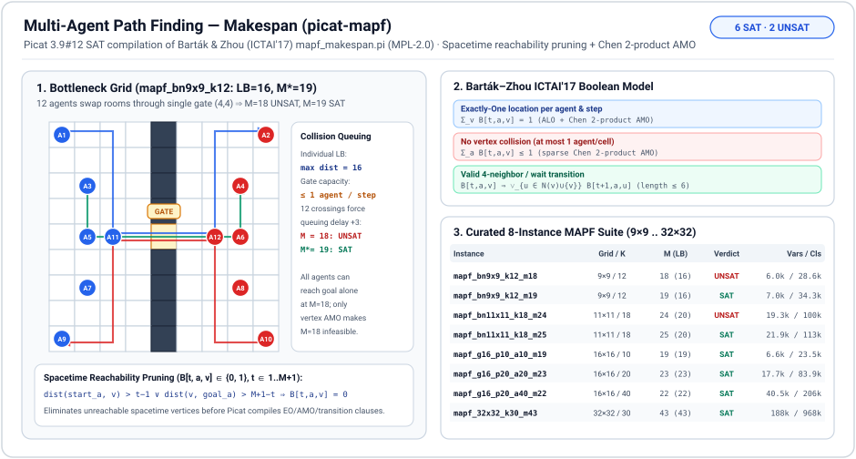

# Multi-Agent Path Finding — Makespan (`picat-mapf`)

*Two-room $9 \times 9$ single-cell doorway bottleneck grid (`mapf_bn9x9_k12`, $\mathrm{LB} = 16$, collision-forced $M = 18$ UNSAT vs. $M^\ast = 19$ SAT), spacetime reachability pruning, Barták–Zhou ICTAI'17 Boolean model, and 8-instance scaling table up to $32 \times 32$ (generated by [`src/gen_diagram.py`](src/gen_diagram.py)).*

## Provenance & Credit

- **Authors & Upstream Models:** **Roman Barták** and **Neng-Fa Zhou** (with R. Stern, E. Boyarski, and P. Surynek) — [Picat](https://picat-lang.org/) ([`picat-lang/Picat`](https://github.com/picat-lang/Picat)), [`https://picat-lang.org/sat/mapf_makespan.pi`](https://picat-lang.org/sat/mapf_makespan.pi) (ICTAI 2017, MPL-2.0), plus upstream ICTAI'17 / [MiniZinc `ma-path-finding`](https://github.com/MiniZinc/minizinc-benchmarks/tree/master/ma-path-finding) obstacle grids (`ins_g16_p10_a10`, `ins_g16_p20_a20`, `ins_g16_p20_a40`, MIT). All upstream sources are preserved in [`src/upstream/`](src/upstream/).
- **Compiler:** Native [Picat](https://picat-lang.org/) `3.9#12` SAT compiler (`import sat.` + `solve([$dump(...)], B)`), reproducible via [`src/generate_suite.py`](src/generate_suite.py).
- **License:** Mozilla Public License 2.0 (MPL-2.0, see [`LICENSE`](LICENSE)); MiniZinc `.dzn` grid data files are MIT-licensed.
- **Ground Truth Manifest:** [`expected.tsv`](expected.tsv) (**6 SAT / 2 UNSAT**).

## Problem Description

Given an undirected grid graph $G = (V, E)$ with obstacles and $K$ agents with start–goal pairs $(s_a, g_a)$, the **Makespan Multi-Agent Path Finding (MAPF)** decision problem asks whether all $K$ agents can simultaneously move from $s_a$ to $g_a$ within horizon $M$ steps (at each step moving to a 4-connected neighbor or waiting in place) without any two agents occupying the same vertex at the same time step.

Following Barták, Zhou, Stern, Boyarski, and Surynek (ICTAI 2017, `mapf_makespan.pi`), Picat-SAT allocates a 3D Boolean spacetime tensor $B[t, a, v] \in \lbrace 0, 1\rbrace$ for $t \in \lbrace 1, \dots, M+1\rbrace$:
1. **Spacetime reachability pruning:** Fixes $B[t, a, v] = 0$ whenever $\operatorname{dist}(s_a, v) > t - 1$ or $\operatorname{dist}(v, g_a) > M + 1 - t$ before SAT compilation.
2. **Exactly-One location per agent/time:** $\sum_{v=1}^{N} B[t, a, v] = 1$ (ALO + Chen 2-product AMO).
3. **Vertex collision avoidance:** $\sum_{a=1}^{K} B[t, a, v] \le 1$ (sparse Chen 2-product AMO).
4. **Valid transitions:** $B[t, a, v] \implies \bigvee_{u \in N(v) \cup \lbrace v\rbrace} B[t+1, a, u]$.

The suite pairs **two genuine collision-forced makespan brackets** where $M^\ast > \mathrm{LB}$ (`bn9x9_k12`: $\mathrm{LB}=16$, $M=18$ UNSAT vs. $M^\ast=19$ SAT; `bn11x11_k18`: $\mathrm{LB}=20$, $M=24$ UNSAT vs. $M^\ast=25$ SAT — every agent can reach its goal individually at $M^\ast-1$, so only vertex-collision queuing at the 1-cell gate makes $M^\ast-1$ unsatisfiable) with **four upstream obstacle grids** scaling up to the verbatim built-in `32×32` 30-agent `mapf_makespan.pi` instance (`187,798` vars / `968,458` clauses).

## Corpus & Data Sizes

All **8 instances** are committed across all four lossless `xz`-compressed formats (`32` files total, every file well below GitHub's `95 MB` limit), accompanied by ground-truth verdicts in [`expected.tsv`](expected.tsv) (**6 SAT / 2 UNSAT**):

| Format | Directory | Files | Key Dimensions (Range) | Compressed Size |
|---|---|---:|---|---:|
| **DIMACS CNF (origin)** | `cnf-orig/` | 8 | Vars: 5,979–187,798; Clauses: 23,512–968,458 | 2.64 MB |
| **Binary AIGER 1.9** | `aig-converted/` | 8 | AND gates: 63,006–2,436,177 | 4.40 MB |
| **[CryptoMiniSat](https://github.com/msoos/cryptominisat) XCNF** | `xcnf-converted/` | 8 | Native XOR parity clauses total: 0 | 2.65 MB |
| **DIMACS-ANF** | `anf-converted/` | 8 | Vars: 18,411–621,417; Eqs: 37,277–1,402,077 (deg ≤ 3) | 9.67 MB |
| **Total (4 Formats, 6 SAT / 2 UNSAT)** | | **32** | | **19.35 MB** |

### Per-Instance Parameters & Compressed Sizes

| Instance | Problem Parameters | Expected | Vars | Clauses | `.cnf.xz` | `.aig.xz` | `.xcnf.xz` | `.anf.xz` |
|---|---|:---:|---:|---:|---:|---:|---:|---:|
| `mapf_32x32_k30_m43.cnf` | Built-in $32\times 32$ (`mapf_makespan.pi`), $N=820, K=30, M=43$ | SAT | 187,798 | 968,458 | 1.60 MB | 2.74 MB | 1.60 MB | 6.04 MB |
| `mapf_bn9x9_k12_m18.cnf` | $9\times 9$ gate, $N=73, K=12, M=18$ ($M^\ast-1$, $\mathrm{LB}=16$) | UNSAT | 5,979 | 28,578 | 50.8 KB | 78.3 KB | 50.9 KB | 187.2 KB |
| `mapf_bn9x9_k12_m19.cnf` | $9\times 9$ gate, $N=73, K=12, M=19$ ($M^\ast$, $\mathrm{LB}=16$) | SAT | 7,000 | 34,302 | 59.4 KB | 93.2 KB | 59.9 KB | 222.4 KB |
| `mapf_bn11x11_k18_m24.cnf` | $11\times 11$ gate, $N=111, K=18, M=24$ ($M^\ast-1$, $\mathrm{LB}=20$) | UNSAT | 19,277 | 100,026 | 180.0 KB | 276.1 KB | 176.8 KB | 641.8 KB |
| `mapf_bn11x11_k18_m25.cnf` | $11\times 11$ gate, $N=111, K=18, M=25$ ($M^\ast$, $\mathrm{LB}=20$) | SAT | 21,914 | 113,244 | 198.9 KB | 317.5 KB | 200.8 KB | 726.7 KB |
| `mapf_g16_p10_a10_m19.cnf` | Upstream $16\times 16$ (10% obs), $N=231, K=10, M=19$ | SAT | 6,599 | 23,512 | 46.0 KB | 67.4 KB | 45.9 KB | 191.8 KB |
| `mapf_g16_p20_a20_m23.cnf` | Upstream $16\times 16$ (20% obs), $N=205, K=20, M=23$ | SAT | 17,651 | 83,883 | 156.2 KB | 249.1 KB | 156.0 KB | 524.2 KB |
| `mapf_g16_p20_a40_m22.cnf` | Upstream $16\times 16$ (20% obs), $N=205, K=40, M=22$ | SAT | 40,473 | 206,294 | 381.6 KB | 615.8 KB | 383.4 KB | 1.19 MB |

### Sibling Collections (Picat-SAT Benchmark Family)

This directory is one of **6 single-problem-type collections** compiled natively via [Picat](https://picat-lang.org/) `3.9#12` `solve([$dump(...)], ...)` (`56` total instances across all four lossless `.xz` formats):

| Collection | Combinatorial Problem | Upstream Model & License | Instances |
|---|---|---|---:|
| [`picat-vmtl/`](../picat-vmtl/README.md) | Vertex Magic Total Labeling on $K_n$ | `vmtl.pi` (MPL-2.0) | 10 (6 SAT / 4 UNSAT) |
| [`picat-golomb-rulers/`](../picat-golomb-rulers/README.md) | Optimal Golomb Rulers ($M=6..10$) | `golomb_ruler.pi` (MIT) | 10 (5 SAT / 5 UNSAT) |
| [`picat-costas-arrays/`](../picat-costas-arrays/README.md) | Costas Arrays ($N=8..16$) | `costas_array.pi` (MIT) | 9 (9 SAT / 0 UNSAT) |
| **`picat-mapf/`** *(this collection)* | Multi-Agent Path Finding (Makespan) | `mapf_makespan.pi` (MPL-2.0) | 8 (6 SAT / 2 UNSAT) |
| [`picat-numberlink/`](../picat-numberlink/README.md) | Planar Numberlink Disjoint Paths | `numberlink_b.pi` (MPL-2.0) | 9 (6 SAT / 3 UNSAT) |
| [`picat-rectangle-packing/`](../picat-rectangle-packing/README.md) | 2D Square / Rectangle Packing (`diffn` + `cumulative`) | `perfect_square_placement.pi` / `rect_packing.mzn` (MIT) | 10 (5 SAT / 5 UNSAT) |

## Benchmark Results

*Single-Core Pinned, $T_{\max} = 60\text{ s}$.*

All five solvers were evaluated strictly sequentially on an **AMD Ryzen 9 5950X** (16C/32T Linux x86_64) pinned to a single dedicated physical core (`taskset -c 11`, 1 thread per run) on identical uncompressed flat `.cnf` inputs:

- Frobenius v0.1.0 (`--max-cores 1 --timeout 60`)
- [CaDiCaL](https://github.com/arminbiere/cadical) 3.1.0 (`-q --modelalllits=true -t 60`)
- [CryptoMiniSat](https://github.com/msoos/cryptominisat) 5.18.0 (`-t 1 --maxtime 60`)
- [dense-solver](https://github.com/libdense/dense-solver) 0.0.4 (1 thread, GNU `timeout -k 2s 60.0s`)
- [Kissat](https://github.com/arminbiere/kissat) 4.0.4 (`-q --time=60`)

- **Independent Model Verification:** All **30 / 30** SAT models emitted across all 5 solvers were verified clause-by-clause against 100% of raw CNF clauses (**0 bad models**, **0 verdict disagreements**).
- **Formal UNSAT Proof Certification:** All **2** tractable (`< 30 s`) Frobenius UNSAT verdicts (`mapf_bn9x9_k12_m18`, `mapf_bn11x11_k18_m24`) were independently certified by `drat-trim`, `lrat-check`, and `cake_lpr` (`s VERIFIED UNSAT`).

| Instance | Expected | Frobenius 1C | [CaDiCaL](https://github.com/arminbiere/cadical) 3.1.0 | [CryptoMiniSat](https://github.com/msoos/cryptominisat) 5.18.0 | [dense-solver](https://github.com/libdense/dense-solver) 0.0.4 | [Kissat](https://github.com/arminbiere/kissat) 4.0.4 |
|---|:---:|---:|---:|---:|---:|---:|
| `mapf_32x32_k30_m43.cnf` | SAT | **87.0 ms** | 379.7 ms | 3.70 s | 1.65 s | 157.2 ms |
| `mapf_bn9x9_k12_m18.cnf` | UNSAT | 22.0 ms | **12.6 ms** | 556.4 ms | 148.6 ms | 37.2 ms |
| `mapf_bn9x9_k12_m19.cnf` | SAT | 25.7 ms | **18.9 ms** | 583.7 ms | 189.9 ms | 44.2 ms |
| `mapf_bn11x11_k18_m24.cnf` | UNSAT | **94.0 ms** | 271.6 ms | 867.7 ms | 805.2 ms | 285.7 ms |
| `mapf_bn11x11_k18_m25.cnf` | SAT | **73.0 ms** | 331.1 ms | 869.8 ms | 858.8 ms | 252.4 ms |
| `mapf_g16_p10_a10_m19.cnf` | SAT | 8.8 ms | 10.9 ms | 564.1 ms | 213.6 ms | **6.9 ms** |
| `mapf_g16_p20_a20_m23.cnf` | SAT | 40.6 ms | 31.7 ms | 1.01 s | 734.2 ms | **14.2 ms** |
| `mapf_g16_p20_a40_m22.cnf` | SAT | **129.8 ms** | 206.9 ms | 1.43 s | 1.73 s | 197.4 ms |
| **Solved ($T_{\max} = 60\text{ s}$)** | — | **8 / 8** *(highest)* | **8 / 8** *(highest)* | **8 / 8** *(highest)* | **8 / 8** *(highest)* | **8 / 8** *(highest)* |
| **Total PAR-2 ($T_{\max} = 60\text{ s}$)** | — | **0.48 s** *(fastest)* | 1.26 s *(2.62x slower)* | 9.58 s *(20.0x slower)* | 6.32 s *(13.2x slower)* | 1.00 s *(2.08x slower)* |

<!-- BEGIN_STRUCTURAL_ANALYSIS -->
## Phase-Transition & Structural Analysis

*Auto-generated by [`../src/analyze_benchmarks.py`](../src/analyze_benchmarks.py). Position relative to the critical phase transition is measured by $\rho_{\mathrm{crit}} = \frac{1}{n}\sum_k m_k / \alpha_c(k)$ (exact $\alpha/\alpha_c(k)$ for pure $k$-SAT; effective critical threshold $\alpha_c^{\mathrm{eff}} = \alpha/\rho_{\mathrm{crit}}$; `Under` $<0.90\times$, `Near-crit` $0.90\text{--}1.10\times$, `Over` $>1.10\times$), alongside Gent–Walsh annealed constrainedness $\kappa = -\frac{1}{n}\sum_i \log_2(1-2^{-k_i})$ (AAAI 1996), clause-length profile ($\bar{k}$, `%Bin`, `%Horn`), variable-degree CV ($\sigma_d/\bar{d}$, uniformity vs. hub skew), and extracted native XOR parity clauses.*

| Instance | Active $n$ | Clauses $m$ | $\alpha=m/n$ | $\alpha_c^{\mathrm{eff}}$ | $\rho_{\mathrm{crit}}$ (Regime) | $\kappa$ | $\bar{k}$ ($k_{\max}$) | Bin% | Horn% | Pos% | Deg CV | XORs |
|---|---:|---:|---:|---:|---:|---:|---:|---:|---:|---:|---:|---:|
| `mapf_32x32_k30_m43` | 187,798 | 968,458 | 5.16 | 1.17 | **4.42x** (Over) | 1.86 | 2.60 (486) | 85% | 85% | 43% | 0.26 | 0 |
| `mapf_bn11x11_k18_m24` | 19,277 | 100,026 | 5.19 | 1.16 | **4.48x** (Over) | 1.88 | 2.58 (99) | 85% | 85% | 40% | 0.21 | 0 |
| `mapf_bn11x11_k18_m25` | 21,914 | 113,244 | 5.17 | 1.16 | **4.47x** (Over) | 1.88 | 2.58 (103) | 86% | 86% | 41% | 0.20 | 0 |
| `mapf_bn9x9_k12_m18` | 5,979 | 28,578 | 4.78 | 1.18 | **4.07x** (Over) | 1.71 | 2.60 (69) | 84% | 84% | 40% | 0.22 | 0 |
| `mapf_bn9x9_k12_m19` | 7,000 | 34,302 | 4.90 | 1.17 | **4.18x** (Over) | 1.76 | 2.59 (71) | 84% | 84% | 40% | 0.23 | 0 |
| `mapf_g16_p10_a10_m19` | 6,599 | 23,512 | 3.56 | 1.24 | **2.86x** (Over) | 1.22 | 2.80 (99) | 79% | 79% | 51% | 0.21 | 0 |
| `mapf_g16_p20_a20_m23` | 17,651 | 83,883 | 4.75 | 1.17 | **4.07x** (Over) | 1.72 | 2.56 (127) | 84% | 84% | 41% | 0.24 | 0 |
| `mapf_g16_p20_a40_m22` | 40,473 | 206,294 | 5.10 | 1.14 | **4.46x** (Over) | 1.88 | 2.50 (136) | 86% | 86% | 40% | 0.22 | 0 |

**Collection Phase-Transition Summary (8 instances, 4 formats: 8 CNF / 8 AIG / 8 XCNF / 8 ANF):** median $\rho_{\mathrm{crit}} = 4.30\times$ (range `2.86x–4.48x`), median $\kappa = 1.81$, regime split **0 Under / 0 Near-critical / 8 Over**, total extracted native XOR parity clauses = **0**, total ANF equations = **2,234,843**.
<!-- END_STRUCTURAL_ANALYSIS -->

## References

- R. Barták, N.-F. Zhou, R. Stern, E. Boyarski, and P. Surynek, *"Modeling and Solving the Multi-agent Pathfinding Problem in Picat"*, IEEE ICTAI 2017, pp. 959–966.
- N.-F. Zhou, Picat MAPF makespan model, [`https://picat-lang.org/sat/mapf_makespan.pi`](https://picat-lang.org/sat/mapf_makespan.pi).
- MiniZinc Benchmarks (`ma-path-finding`), [`https://github.com/MiniZinc/minizinc-benchmarks/tree/master/ma-path-finding`](https://github.com/MiniZinc/minizinc-benchmarks/tree/master/ma-path-finding).
- J. Chen, *"A New SAT Encoding of the At-Most-One Constraint"*, ModRef 2010.
