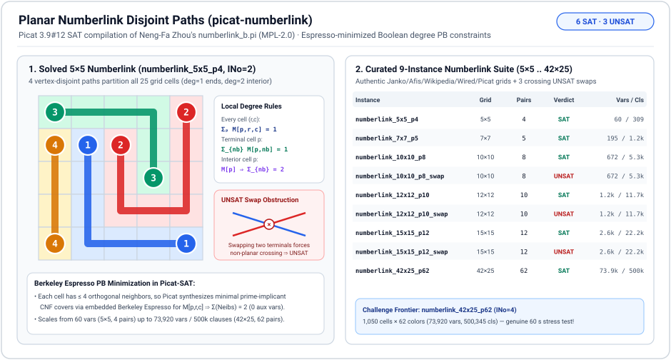

# Planar Numberlink Disjoint Paths (`picat-numberlink`)

*Verified exact 4-path full-grid solution of `numberlink_5x5_p4` (`INo=2`), topological crossing UNSAT obstruction inset, Berkeley Espresso local degree PB compilation, and 9-instance ladder up to $42 \times 25$ (generated by [`src/gen_diagram.py`](src/gen_diagram.py)).*

## Provenance & Credit

- **Authors & Upstream Models:** **Neng-Fa Zhou** — [Picat](https://picat-lang.org/) ([`picat-lang/Picat`](https://github.com/picat-lang/Picat)), [`https://picat-lang.org/sat/numberlink_b.pi`](https://picat-lang.org/sat/numberlink_b.pi) (MPL-2.0), plus classic Numberlink puzzle grids compiled in **Hakan Kjellerstrand**'s [`hakank/picat/numberlink.pi`](https://github.com/hakank/hakank/blob/master/picat/numberlink.pi) (MIT; original puzzles from Otto Janko, The Afis Project, Wired / Dr. Sudoku, and Wikipedia). Both upstream sources are preserved in [`src/upstream/`](src/upstream/).
- **Compiler:** Native [Picat](https://picat-lang.org/) `3.9#12` SAT compiler (`import sat.` + `solve([$dump(...)], M)`), reproducible via [`src/generate_suite.py`](src/generate_suite.py).
- **License:** Mozilla Public License 2.0 (MPL-2.0, see [`LICENSE`](LICENSE)).
- **Ground Truth Manifest:** [`expected.tsv`](expected.tsv) (**6 SAT / 3 UNSAT**).

## Problem Description

Given an $R \times C$ planar grid containing $P$ numbered pairs of terminal cells (`1..P`), **Numberlink** (Arukone / Nanbarinku; NP-complete, Adcock et al. 2015) asks for $P$ vertex-disjoint orthogonal paths connecting each terminal pair and partitioning every cell of the grid.

Neng-Fa Zhou's `numberlink_b.pi` encodes the problem over Boolean indicator variables $M[p, r, c] \in \{0, 1\}$:
1. **Cell partition (Exactly-One color per cell):** $\sum_{p=1}^{P} M[p, r, c] = 1$ for every cell $(r, c)$.
2. **Terminal degree-1 constraint:** If cell $(r, c)$ holds terminal $p$, then $M[p, r, c] = 1$ and $\sum_{(r', c') \in N(r,c)} M[p, r', c'] = 1$.
3. **Interior degree-2 implication:** Otherwise, $M[p, r, c] \implies \sum_{(r', c') \in N(r,c)} M[p, r', c'] = 2$.

Because every cell has at most $4$ orthogonal neighbors, Picat-SAT compiles every degree-1 and guarded degree-2 pseudo-Boolean constraint via its embedded **Berkeley Espresso** logic minimizer into minimal prime-implicant CNF covers with zero auxiliary variables. Alongside **6 authentic SAT puzzles** scaling from `5×5` (`60` vars) to `42×25` (`62` terminal pairs, `73,920` vars / `500,345` clauses — independently verified SAT with zero degree violations across all `1,050` cells), the collection includes **3 topological-crossing UNSAT counterparts** (`10×10`, `12×12`, `15×15`) created by swapping two terminal labels to obstruct planarity while preserving identical CNF dimensions.

## Corpus & Data Sizes

All **9 instances** are committed across all four lossless `xz`-compressed formats (`36` files total, every file well below GitHub's `95 MB` limit), accompanied by ground-truth verdicts in [`expected.tsv`](expected.tsv) (**6 SAT / 3 UNSAT**):

| Format | Directory | Files | Key Dimensions (Range) | Compressed Size |
|---|---|---:|---|---:|
| **DIMACS CNF (origin)** | `cnf-orig/` | 9 | Vars: 60–73,920; Clauses: 309–500,345 | 1.23 MB |
| **Binary AIGER 1.9** | `aig-converted/` | 9 | AND gates: 774–1,409,484 | 1.71 MB |
| **[CryptoMiniSat](https://github.com/msoos/cryptominisat) XCNF** | `xcnf-converted/` | 9 | Native XOR parity clauses total: 0 | 1.22 MB |
| **DIMACS-ANF** | `anf-converted/` | 9 | Vars: 148–404,616; Eqs: 397–831,041 (deg ≤ 3) | 3.97 MB |
| **Total (4 Formats, 6 SAT / 3 UNSAT)** | | **36** | | **8.14 MB** |

### Per-Instance Parameters & Compressed Sizes

| Instance | Problem Parameters | Expected | Vars | Clauses | `.cnf.xz` | `.aig.xz` | `.xcnf.xz` | `.anf.xz` |
|---|---|:---:|---:|---:|---:|---:|---:|---:|
| `numberlink_5x5_p4.cnf` | $5\times 5$, 4 pairs (Afis / Janko Arukone 001, `INo=2`) | SAT | 60 | 309 | 1.0 KB | 1.5 KB | 1.0 KB | 2.0 KB |
| `numberlink_7x7_p5.cnf` | $7\times 7$, 5 pairs (Wikipedia, `INo=7`) | SAT | 195 | 1,187 | 3.2 KB | 4.7 KB | 3.2 KB | 7.1 KB |
| `numberlink_10x10_p8.cnf` | $10\times 10$, 8 pairs (Otto Janko Arukone 109, `INo=1`) | SAT | 672 | 5,310 | 11.5 KB | 17.7 KB | 11.6 KB | 29.1 KB |
| `numberlink_10x10_p8_swap.cnf` | $10\times 10$, 8 pairs (crossing swap of pairs 1 & 5) | UNSAT | 672 | 5,310 | 11.3 KB | 17.5 KB | 11.3 KB | 29.2 KB |
| `numberlink_12x12_p10.cnf` | $12\times 12$, 10 pairs (Wired / Dr. Sudoku, `INo=6`) | SAT | 1,240 | 11,700 | 23.2 KB | 36.3 KB | 22.7 KB | 63.3 KB |
| `numberlink_12x12_p10_swap.cnf` | $12\times 12$, 10 pairs (crossing swap of pairs 1 & 5) | UNSAT | 1,240 | 11,700 | 23.6 KB | 36.1 KB | 22.6 KB | 63.3 KB |
| `numberlink_15x15_p12.cnf` | $15\times 15$, 12 pairs (`numberlink_b.pi`, `INo=3`) | SAT | 2,613 | 22,206 | 45.7 KB | 71.6 KB | 45.5 KB | 141.8 KB |
| `numberlink_15x15_p12_swap.cnf` | $15\times 15$, 12 pairs (crossing swap of pairs 10 & 11) | UNSAT | 2,613 | 22,206 | 45.6 KB | 71.0 KB | 45.4 KB | 141.9 KB |
| `numberlink_42x25_p62.cnf` | $42\times 25$, 62 pairs (`numberlink_b.pi`, `INo=4`, 1,050 cells) | SAT | 73,920 | 500,345 | 1.07 MB | 1.46 MB | 1.06 MB | 3.51 MB |

### Sibling Collections (Picat-SAT Benchmark Family)

This directory is one of **6 single-problem-type collections** compiled natively via [Picat](https://picat-lang.org/) `3.9#12` `solve([$dump(...)], ...)` (`56` total instances across all four lossless `.xz` formats):

| Collection | Combinatorial Problem | Upstream Model & License | Instances |
|---|---|---|---:|
| [`picat-vmtl/`](../picat-vmtl/README.md) | Vertex Magic Total Labeling on $K_n$ | `vmtl.pi` (MPL-2.0) | 10 (6 SAT / 4 UNSAT) |
| [`picat-golomb-rulers/`](../picat-golomb-rulers/README.md) | Optimal Golomb Rulers ($M=6..10$) | `golomb_ruler.pi` (MIT) | 10 (5 SAT / 5 UNSAT) |
| [`picat-costas-arrays/`](../picat-costas-arrays/README.md) | Costas Arrays ($N=8..16$) | `costas_array.pi` (MIT) | 9 (9 SAT / 0 UNSAT) |
| [`picat-mapf/`](../picat-mapf/README.md) | Multi-Agent Path Finding (Makespan) | `mapf_makespan.pi` (MPL-2.0) | 8 (6 SAT / 2 UNSAT) |
| **`picat-numberlink/`** *(this collection)* | Planar Numberlink Disjoint Paths | `numberlink_b.pi` (MPL-2.0) | 9 (6 SAT / 3 UNSAT) |
| [`picat-rectangle-packing/`](../picat-rectangle-packing/README.md) | 2D Square / Rectangle Packing (`diffn` + `cumulative`) | `perfect_square_placement.pi` / `rect_packing.mzn` (MIT) | 10 (5 SAT / 5 UNSAT) |

## Benchmark Results

*Single-Core Pinned, $T_{\max} = 60\;\text{s}$.*

All five solvers were evaluated strictly sequentially on an **AMD Ryzen 9 5950X** (16C/32T Linux x86_64) pinned to a single dedicated physical core (`taskset -c 11`, 1 thread per run) on identical uncompressed flat `.cnf` inputs:

- Frobenius v0.1.0 (`--max-cores 1 --timeout 60`)
- [CaDiCaL](https://github.com/arminbiere/cadical) 3.1.0 (`-q --modelalllits=true -t 60`)
- [CryptoMiniSat](https://github.com/msoos/cryptominisat) 5.18.0 (`-t 1 --maxtime 60`)
- [dense-solver](https://github.com/libdense/dense-solver) 0.0.4 (1 thread, GNU `timeout -k 2s 60.0s`)
- [Kissat](https://github.com/arminbiere/kissat) 4.0.4 (`-q --time=60`)

- **Independent Model Verification:** All **28 / 28** SAT models emitted across all 5 solvers were verified clause-by-clause against 100% of raw CNF clauses (**0 bad models**, **0 verdict disagreements**).
- **Formal UNSAT Proof Certification:** All **3** tractable (`< 30 s`) Frobenius UNSAT verdicts (`numberlink_10x10_p8_swap`, `numberlink_12x12_p10_swap`, `numberlink_15x15_p12_swap`) were independently certified by `drat-trim`, `lrat-check`, and `cake_lpr` (`s VERIFIED UNSAT`).

| Instance | Expected | Frobenius | [CaDiCaL](https://github.com/arminbiere/cadical) 3.1.0 | [CryptoMiniSat](https://github.com/msoos/cryptominisat) 5.18.0 | [dense-solver](https://github.com/libdense/dense-solver) 0.0.4 | [Kissat](https://github.com/arminbiere/kissat) 4.0.4 |
|---|:---:|---:|---:|---:|---:|---:|
| `numberlink_5x5_p4.cnf` | SAT | **1.5 ms** | 2.9 ms | 7.0 ms | 3.7 ms | 1.8 ms |
| `numberlink_7x7_p5.cnf` | SAT | 2.8 ms | 3.1 ms | 17.1 ms | 8.0 ms | **1.7 ms** |
| `numberlink_10x10_p8.cnf` | SAT | **6.5 ms** | 7.7 ms | 103.0 ms | 8.0 ms | 9.0 ms |
| `numberlink_10x10_p8_swap.cnf` | UNSAT | 6.8 ms | **4.5 ms** | 101.5 ms | 8.6 ms | 8.1 ms |
| `numberlink_12x12_p10.cnf` | SAT | **10.2 ms** | 36.1 ms | 351.0 ms | 45.8 ms | 47.8 ms |
| `numberlink_12x12_p10_swap.cnf` | UNSAT | 72.7 ms | 78.3 ms | 344.7 ms | **54.0 ms** | 63.9 ms |
| `numberlink_15x15_p12.cnf` | SAT | 356.5 ms | 245.9 ms | 546.1 ms | **92.3 ms** | 188.9 ms |
| `numberlink_15x15_p12_swap.cnf` | UNSAT | 11.3 ms | 16.5 ms | 32.7 ms | 13.6 ms | **8.2 ms** |
| `numberlink_42x25_p62.cnf` | SAT | **9.18 s** | >60 s | >60 s | 38.27 s | 11.46 s |
| **Solved ($T_{\max} = 60\;\text{s}$)** | **9 total** | **9 / 9 (6 SAT, 3 UNSAT)** | 8 / 9 (5 SAT, 3 UNSAT) | 8 / 9 (5 SAT, 3 UNSAT) | **9 / 9 (6 SAT, 3 UNSAT)** | **9 / 9 (6 SAT, 3 UNSAT)** |
| **Total PAR-2 ($T_{\max} = 60\;\text{s}$)** | — | **9.65 s** *(mean 1.07 s)* | 120.39 s *(mean 13.38 s)* | 121.50 s *(mean 13.50 s)* | 38.51 s *(mean 4.28 s)* | 11.79 s *(mean 1.31 s)* |

*Ground-truth SAT note on `numberlink_42x25_p62.cnf`:* Directly solved and 100%-clause model-verified by Frobenius (`9.18 s`), Kissat 4.0.4 (`11.46 s`), and dense-solver 0.0.4 (`38.27 s`), and independently cross-checked via Picat-SAT's integer-grid formulation (`hakank_numberlink.pi`, `INo=4`, `NP=62`, `1,050/1,050` cells degree-verified).

<!-- BEGIN_STRUCTURAL_ANALYSIS -->
## Phase-Transition & Structural Analysis

*Auto-generated by [`../src/analyze_benchmarks.py`](../src/analyze_benchmarks.py). Position relative to the critical phase transition is measured by $\rho_{\mathrm{crit}} = \frac{1}{n}\sum_k m_k / \alpha_c(k)$ (exact $\alpha/\alpha_c(k)$ for pure $k$-SAT; effective critical threshold $\alpha_c^{\mathrm{eff}} = \alpha/\rho_{\mathrm{crit}}$; `Under` $<0.90\times$, `Near-crit` $0.90\text{--}1.10\times$, `Over` $>1.10\times$), alongside Gent–Walsh annealed constrainedness $\kappa = -\frac{1}{n}\sum_i \log_2(1-2^{-k_i})$ (AAAI 1996), clause-length profile ($\bar{k}$, `%Bin`, `%Horn`), variable-degree CV ($\sigma_d/\bar{d}$, uniformity vs. hub skew), and extracted native XOR parity clauses.*

| Instance | Active $n$ | Clauses $m$ | $\alpha=m/n$ | $\alpha_c^{\mathrm{eff}}$ | $\rho_{\mathrm{crit}}$ (Regime) | $\kappa$ | $\bar{k}$ ($k_{\max}$) | Bin% | Horn% | Pos% | Deg CV | XORs |
|---|---:|---:|---:|---:|---:|---:|---:|---:|---:|---:|---:|---:|
| `numberlink_10x10_p8` | 672 | 5,310 | 7.90 | 1.71 | **4.61x** (Over) | 2.20 | 2.81 (8) | 50% | 67% | 31% | 0.22 | 0 |
| `numberlink_10x10_p8_swap` | 672 | 5,310 | 7.90 | 1.71 | **4.61x** (Over) | 2.20 | 2.81 (8) | 50% | 67% | 31% | 0.22 | 0 |
| `numberlink_12x12_p10` | 1,240 | 11,700 | 9.44 | 1.74 | **5.43x** (Over) | 2.59 | 2.85 (10) | 50% | 67% | 30% | 0.19 | 0 |
| `numberlink_12x12_p10_swap` | 1,240 | 11,700 | 9.44 | 1.74 | **5.43x** (Over) | 2.59 | 2.85 (10) | 50% | 67% | 30% | 0.19 | 0 |
| `numberlink_15x15_p12` | 2,613 | 22,206 | 8.50 | 2.06 | **4.13x** (Over) | 2.02 | 3.12 (12) | 41% | 66% | 34% | 0.32 | 0 |
| `numberlink_15x15_p12_swap` | 2,613 | 22,206 | 8.50 | 2.06 | **4.13x** (Over) | 2.02 | 3.12 (12) | 41% | 66% | 34% | 0.32 | 0 |
| `numberlink_42x25_p62` | 73,920 | 500,345 | 6.77 | 2.46 | **2.75x** (Over) | 1.42 | 3.34 (62) | 32% | 62% | 42% | 0.40 | 0 |
| `numberlink_5x5_p4` | 60 | 309 | 5.15 | 1.62 | **3.18x** (Over) | 1.54 | 2.71 (4) | 53% | 71% | 36% | 0.36 | 0 |
| `numberlink_7x7_p5` | 195 | 1,187 | 6.09 | 1.82 | **3.34x** (Over) | 1.63 | 2.87 (5) | 46% | 66% | 35% | 0.37 | 0 |

**Collection Phase-Transition Summary (9 instances, 4 formats: 9 CNF / 9 AIG / 9 XCNF / 9 ANF):** median $\rho_{\mathrm{crit}} = 4.13\times$ (range `2.75x–5.43x`), median $\kappa = 2.02$, regime split **0 Under / 0 Near-critical / 9 Over**, total extracted native XOR parity clauses = **0**, total ANF equations = **946,105**.
<!-- END_STRUCTURAL_ANALYSIS -->

## References

- N.-F. Zhou, *"The SAT Compiler in B-Prolog"*, ALP Newsletter (March 2013), and [`https://picat-lang.org/sat/numberlink_b.pi`](https://picat-lang.org/sat/numberlink_b.pi).
- H. Kjellerstrand, *Numberlink puzzle in Picat*, [`https://github.com/hakank/hakank/blob/master/picat/numberlink.pi`](https://github.com/hakank/hakank/blob/master/picat/numberlink.pi).
- A. Adcock, E. D. Demaine, M. L. Demaine, M. P. O'Brien, F. Reidl, F. Sánchez Villaamil, and B. D. Sullivan, *"Zig-Zag Numberlink is NP-Complete"*, *J. Information Processing* 23(3):239–245, 2015.
- N.-F. Zhou and H. Kjellerstrand, *"The Picat-SAT Compiler"*, PADL 2016, LNCS 9585, pp. 48–62.
