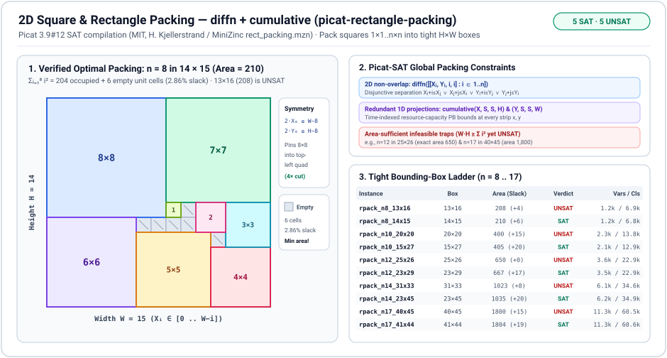

# 2D Square & Rectangle Packing — `diffn` + `cumulative` (`picat-rectangle-packing`)

*Verified optimal 2D packing of squares $1\times 1 \dots 8\times 8$ inside a $14 \times 15$ bounding box (`rpack_n8_14x15`, area $210 = 204 + 6$ empty slack cells), Picat-SAT `diffn` + redundant `cumulative` constraint compilation, and 10-instance UNSAT/SAT ladder across $n = 8..17$ (generated by [`src/gen_diagram.py`](src/gen_diagram.py)).*

## Provenance & Credit

- **Authors & Upstream Models:** **Hakan Kjellerstrand** ([`hakank/picat/perfect_square_placement.pi`](https://github.com/hakank/hakank/blob/master/picat/perfect_square_placement.pi), MIT), [MiniZinc `rectangle-packing`](https://github.com/MiniZinc/minizinc-benchmarks/tree/master/rectangle-packing) (`rect_packing.mzn`, University of Melbourne / NICTA, MIT), and **Neng-Fa Zhou** ([Picat](https://picat-lang.org/) / [`picat-lang/Picat`](https://github.com/picat-lang/Picat)). Both upstream reference models are preserved in [`src/upstream/`](src/upstream/).
- **Compiler:** Native [Picat](https://picat-lang.org/) `3.9#12` SAT compiler (`import sat.` + `solve([$dump(...)], X ++ Y)`), reproducible via [`src/generate_suite.py`](src/generate_suite.py).
- **License:** MIT License (see [`LICENSE`](LICENSE)).
- **Ground Truth Manifest:** [`expected.tsv`](expected.tsv) (**5 SAT / 5 UNSAT**).

## Problem Description

The **Consecutive Squares 2D Rectangle Packing Problem** (Korf 2003; Simonis & O'Sullivan 2008; MiniZinc `rectangle-packing`) asks whether $n$ axis-aligned squares of side lengths $1 \times 1, 2 \times 2, \dots, n \times n$ (total occupied area $A_{\min}(n) = \sum_{i=1}^n i^2 = \frac{n(n+1)(2n+1)}{6}$) can be placed without overlap inside a fixed $H \times W$ integer bounding box.

For every $i \in \lbrace 1, \dots, n\rbrace$, Picat-SAT introduces log-encoded origin coordinates $X_i \in [0, W - i]$ and $Y_i \in [0, H - i]$ subject to:
1. **2D non-overlap (`diffn`):** Every pair $i < j$ separates horizontally or vertically: $(X_i + i \le X_j) \lor (X_j + j \le X_i) \lor (Y_i + i \le Y_j) \lor (Y_j + j \le Y_i)$.
2. **Redundant 1D resource projections (`cumulative`):** Both `cumulative(X, S, S, H)` and `cumulative(Y, S, S, W)` enforce that squares intersecting any vertical strip $x$ sum in height to $\le H$ and any horizontal strip $y$ sum in width to $\le W$ — exercising Picat-SAT's time-indexed scheduling/PB compilation.
3. **Centroid reflection symmetry breaking:** $2 X_n \le W - n$ and $2 Y_n \le H - n$ pins the largest square $n \times n$ into the top-left quadrant (4× search reduction).

Every UNSAT instance in the ladder satisfies $H \cdot W \ge A_{\min}(n)$ (strictly area-sufficient — including exact zero-slack $25 \times 26 = 650$ for $n=12$ and tight $+15$-cell $40 \times 45 = 1{,}800$ for $n=17$), so infeasibility arises purely from 2D geometric packing obstructions rather than trivial area shortage.

## Corpus & Data Sizes

All **10 instances** are committed across all four lossless `xz`-compressed formats (`40` files total, every file well below GitHub's `95 MB` limit), accompanied by ground-truth verdicts in [`expected.tsv`](expected.tsv) (**5 SAT / 5 UNSAT**):

| Format | Directory | Files | Key Dimensions (Range) | Compressed Size |
|---|---|---:|---|---:|
| **DIMACS CNF (origin)** | `cnf-orig/` | 10 | Vars: 1,154–11,321; Clauses: 6,781–60,571 | 733.1 KB |
| **Binary AIGER 1.9** | `aig-converted/` | 10 | AND gates: 18,470–174,108 | 1.24 MB |
| **[CryptoMiniSat](https://github.com/msoos/cryptominisat) XCNF** | `xcnf-converted/` | 10 | Native XOR parity clauses total: 171 | 731.2 KB |
| **DIMACS-ANF** | `anf-converted/` | 10 | Vars: 2,109–32,705; Eqs: 7,736–81,877 (deg ≤ 3) | 2.07 MB |
| **Total (4 Formats, 5 SAT / 5 UNSAT)** | | **40** | | **4.73 MB** |

### Per-Instance Parameters & Compressed Sizes

| Instance | Problem Parameters | Expected | Vars | Clauses | `.cnf.xz` | `.aig.xz` | `.xcnf.xz` | `.anf.xz` |
|---|---|:---:|---:|---:|---:|---:|---:|---:|
| `rpack_n8_13x16.cnf` | $n=8$ ($\Sigma i^2=204$), box $13\times 16 = 208$ ($+4$ slack) | UNSAT | 1,197 | 6,932 | 18.9 KB | 33.5 KB | 19.0 KB | 46.8 KB |
| `rpack_n8_14x15.cnf` | $n=8$ ($\Sigma i^2=204$), box $14\times 15 = 210$ ($+6$, optimal) | SAT | 1,154 | 6,781 | 18.6 KB | 33.1 KB | 18.6 KB | 46.1 KB |
| `rpack_n10_15x27.cnf` | $n=10$ ($\Sigma i^2=385$), box $15\times 27 = 405$ ($+20$, optimal) | SAT | 2,095 | 12,869 | 33.6 KB | 60.2 KB | 33.5 KB | 87.5 KB |
| `rpack_n10_20x20.cnf` | $n=10$ ($\Sigma i^2=385$), box $20\times 20 = 400$ ($+15$ slack) | UNSAT | 2,340 | 13,761 | 37.0 KB | 63.0 KB | 36.9 KB | 91.3 KB |
| `rpack_n12_23x29.cnf` | $n=12$ ($\Sigma i^2=650$), box $23\times 29 = 667$ ($+17$, optimal) | SAT | 3,538 | 22,874 | 59.1 KB | 103.2 KB | 58.9 KB | 153.6 KB |
| `rpack_n12_25x26.cnf` | $n=12$ ($\Sigma i^2=650$), box $25\times 26 = 650$ ($+0$ exact area!) | UNSAT | 3,550 | 22,855 | 59.4 KB | 103.7 KB | 59.0 KB | 151.8 KB |
| `rpack_n14_23x45.cnf` | $n=14$ ($\Sigma i^2=1{,}015$), box $23\times 45 = 1{,}035$ ($+20$, optimal) | SAT | 6,216 | 34,933 | 93.5 KB | 159.6 KB | 93.4 KB | 266.4 KB |
| `rpack_n14_31x33.cnf` | $n=14$ ($\Sigma i^2=1{,}015$), box $31\times 33 = 1{,}023$ ($+8$ slack) | UNSAT | 6,103 | 34,565 | 92.3 KB | 160.0 KB | 92.3 KB | 274.5 KB |
| `rpack_n17_40x45.cnf` | $n=17$ ($\Sigma i^2=1{,}785$), box $40\times 45 = 1{,}800$ ($+15$ slack) | UNSAT | 11,304 | 60,537 | 160.3 KB | 274.7 KB | 159.6 KB | 498.3 KB |
| `rpack_n17_41x44.cnf` | $n=17$ ($\Sigma i^2=1{,}785$), box $41\times 44 = 1{,}804$ ($+19$, tight SAT) | SAT | 11,321 | 60,571 | 160.5 KB | 274.6 KB | 159.9 KB | 498.5 KB |

### Sibling Collections (Picat-SAT Benchmark Family)

This directory is one of **6 single-problem-type collections** compiled natively via [Picat](https://picat-lang.org/) `3.9#12` `solve([$dump(...)], ...)` (`56` total instances across all four lossless `.xz` formats):

| Collection | Combinatorial Problem | Upstream Model & License | Instances |
|---|---|---|---:|
| [`picat-vmtl/`](../picat-vmtl/README.md) | Vertex Magic Total Labeling on $K_n$ | `vmtl.pi` (MPL-2.0) | 10 (6 SAT / 4 UNSAT) |
| [`picat-golomb-rulers/`](../picat-golomb-rulers/README.md) | Optimal Golomb Rulers ($M=6..10$) | `golomb_ruler.pi` (MIT) | 10 (5 SAT / 5 UNSAT) |
| [`picat-costas-arrays/`](../picat-costas-arrays/README.md) | Costas Arrays ($N=8..16$) | `costas_array.pi` (MIT) | 9 (9 SAT / 0 UNSAT) |
| [`picat-mapf/`](../picat-mapf/README.md) | Multi-Agent Path Finding (Makespan) | `mapf_makespan.pi` (MPL-2.0) | 8 (6 SAT / 2 UNSAT) |
| [`picat-numberlink/`](../picat-numberlink/README.md) | Planar Numberlink Disjoint Paths | `numberlink_b.pi` (MPL-2.0) | 9 (6 SAT / 3 UNSAT) |
| **`picat-rectangle-packing/`** *(this collection)* | 2D Square / Rectangle Packing (`diffn` + `cumulative`) | `perfect_square_placement.pi` / `rect_packing.mzn` (MIT) | 10 (5 SAT / 5 UNSAT) |

## Benchmark Results

*Single-Core Pinned, $T_{\max} = 60\text{ s}$.*

All five solvers were evaluated strictly sequentially on an **AMD Ryzen 9 5950X** (16C/32T Linux x86_64) pinned to a single dedicated physical core (`taskset -c 11`, 1 thread per run) on identical uncompressed flat `.cnf` inputs:

- Frobenius v0.1.0 (`--max-cores 1 --timeout 60`)
- [CaDiCaL](https://github.com/arminbiere/cadical) 3.1.0 (`-q --modelalllits=true -t 60`)
- [CryptoMiniSat](https://github.com/msoos/cryptominisat) 5.18.0 (`-t 1 --maxtime 60`)
- [dense-solver](https://github.com/libdense/dense-solver) 0.0.4 (1 thread, GNU `timeout -k 2s 60.0s`)
- [Kissat](https://github.com/arminbiere/kissat) 4.0.4 (`-q --time=60`)

- **Independent Model Verification:** All **25 / 25** SAT models emitted across all 5 solvers were verified clause-by-clause against 100% of raw CNF clauses (**0 bad models**, **0 verdict disagreements**).
- **Formal UNSAT Proof Certification:** All **5** tractable (`< 30 s`) Frobenius UNSAT verdicts (`rpack_n8_13x16`, `rpack_n10_20x20`, `rpack_n12_25x26`, `rpack_n14_31x33`, `rpack_n17_40x45`) were independently certified by `drat-trim`, `lrat-check`, and `cake_lpr` (`s VERIFIED UNSAT`).

| Instance | Expected | Frobenius 1C | [CaDiCaL](https://github.com/arminbiere/cadical) 3.1.0 | [CryptoMiniSat](https://github.com/msoos/cryptominisat) 5.18.0 | [dense-solver](https://github.com/libdense/dense-solver) 0.0.4 | [Kissat](https://github.com/arminbiere/kissat) 4.0.4 |
|---|:---:|---:|---:|---:|---:|---:|
| `rpack_n8_13x16.cnf` | UNSAT | **5.5 ms** | 5.8 ms | 283.4 ms | 8.6 ms | 32.7 ms |
| `rpack_n8_14x15.cnf` | SAT | **6.4 ms** | 8.7 ms | 271.5 ms | 8.4 ms | 30.3 ms |
| `rpack_n10_15x27.cnf` | SAT | **10.7 ms** | 12.5 ms | 386.3 ms | 11.3 ms | 38.3 ms |
| `rpack_n10_20x20.cnf` | UNSAT | **10.6 ms** | 15.0 ms | 388.2 ms | 12.0 ms | 41.5 ms |
| `rpack_n12_23x29.cnf` | SAT | **32.2 ms** | 36.9 ms | 652.2 ms | 38.0 ms | 72.3 ms |
| `rpack_n12_25x26.cnf` | UNSAT | 17.1 ms | **15.8 ms** | 649.6 ms | 16.2 ms | 50.2 ms |
| `rpack_n14_23x45.cnf` | SAT | 231.8 ms | **43.1 ms** | 977.5 ms | 122.7 ms | 214.0 ms |
| `rpack_n14_31x33.cnf` | UNSAT | 32.2 ms | 36.2 ms | 546.0 ms | **26.4 ms** | 75.7 ms |
| `rpack_n17_40x45.cnf` | UNSAT | **1.46 s** | 3.68 s | 2.42 s | 3.83 s | 4.12 s |
| `rpack_n17_41x44.cnf` | SAT | **377.9 ms** | 857.0 ms | 2.21 s | 2.82 s | 546.9 ms |
| **Solved ($T_{\max} = 60\text{ s}$)** | — | **10 / 10** *(highest)* | **10 / 10** *(highest)* | **10 / 10** *(highest)* | **10 / 10** *(highest)* | **10 / 10** *(highest)* |
| **Total PAR-2 ($T_{\max} = 60\text{ s}$)** | — | **2.19 s** *(fastest)* | 4.71 s *(2.15x slower)* | 8.78 s *(4.01x slower)* | 6.90 s *(3.15x slower)* | 5.22 s *(2.38x slower)* |

<!-- BEGIN_STRUCTURAL_ANALYSIS -->
## Phase-Transition & Structural Analysis

*Auto-generated by [`../src/analyze_benchmarks.py`](../src/analyze_benchmarks.py). Position relative to the critical phase transition is measured by $\rho_{\mathrm{crit}} = \frac{1}{n}\sum_k m_k / \alpha_c(k)$ (exact $\alpha/\alpha_c(k)$ for pure $k$-SAT; effective critical threshold $\alpha_c^{\mathrm{eff}} = \alpha/\rho_{\mathrm{crit}}$; `Under` $<0.90\times$, `Near-crit` $0.90\text{--}1.10\times$, `Over` $>1.10\times$), alongside Gent–Walsh annealed constrainedness $\kappa = -\frac{1}{n}\sum_i \log_2(1-2^{-k_i})$ (AAAI 1996), clause-length profile ($\bar{k}$, `%Bin`, `%Horn`), variable-degree CV ($\sigma_d/\bar{d}$, uniformity vs. hub skew), and extracted native XOR parity clauses.*

| Instance | Active $n$ | Clauses $m$ | $\alpha=m/n$ | $\alpha_c^{\mathrm{eff}}$ | $\rho_{\mathrm{crit}}$ (Regime) | $\kappa$ | $\bar{k}$ ($k_{\max}$) | Bin% | Horn% | Pos% | Deg CV | XORs |
|---|---:|---:|---:|---:|---:|---:|---:|---:|---:|---:|---:|---:|
| `rpack_n10_15x27` | 2,068 | 12,869 | 6.22 | 3.44 | **1.81x** (Over) | 1.25 | 3.05 (6) | 9% | 52% | 49% | 1.83 | 9 |
| `rpack_n10_20x20` | 2,310 | 13,761 | 5.96 | 3.16 | **1.88x** (Over) | 1.25 | 3.00 (6) | 13% | 53% | 49% | 1.89 | 18 |
| `rpack_n12_23x29` | 3,500 | 22,874 | 6.54 | 3.59 | **1.82x** (Over) | 1.29 | 3.07 (6) | 8% | 53% | 46% | 1.92 | 22 |
| `rpack_n12_25x26` | 3,512 | 22,855 | 6.51 | 3.57 | **1.82x** (Over) | 1.29 | 3.06 (6) | 8% | 53% | 47% | 1.93 | 22 |
| `rpack_n14_23x45` | 6,155 | 34,933 | 5.68 | 3.57 | **1.59x** (Over) | 1.11 | 3.18 (13) | 9% | 49% | 51% | 2.17 | 24 |
| `rpack_n14_31x33` | 6,042 | 34,565 | 5.72 | 3.59 | **1.60x** (Over) | 1.12 | 3.22 (11) | 9% | 48% | 52% | 2.15 | 24 |
| `rpack_n17_40x45` | 11,208 | 60,537 | 5.40 | 3.58 | **1.51x** (Over) | 1.05 | 3.26 (13) | 9% | 48% | 52% | 2.41 | 26 |
| `rpack_n17_41x44` | 11,225 | 60,571 | 5.40 | 3.58 | **1.51x** (Over) | 1.05 | 3.27 (13) | 9% | 48% | 52% | 2.41 | 26 |
| `rpack_n8_13x16` | 1,178 | 6,932 | 5.88 | 3.11 | **1.89x** (Over) | 1.24 | 3.00 (6) | 13% | 51% | 50% | 1.71 | 0 |
| `rpack_n8_14x15` | 1,136 | 6,781 | 5.97 | 3.18 | **1.88x** (Over) | 1.25 | 3.01 (6) | 13% | 51% | 50% | 1.69 | 0 |

**Collection Phase-Transition Summary (10 instances, 4 formats: 10 CNF / 10 AIG / 10 XCNF / 10 ANF):** median $\rho_{\mathrm{crit}} = 1.81\times$ (range `1.51x–1.89x`), median $\kappa = 1.25$, regime split **0 Under / 0 Near-critical / 10 Over**, total extracted native XOR parity clauses = **171**, total ANF equations = **350,943**.
<!-- END_STRUCTURAL_ANALYSIS -->

## References

- R. E. Korf, *"Optimal Rectangle Packing: Initial Results"*, ICAPS 2003, pp. 287–295; and *"Optimal Rectangle Packing: New Results"*, ICAPS 2004.
- H. Simonis and B. O'Sullivan, *"Search Strategies for Rectangle Packing"*, CP 2008, LNCS 5202, pp. 52–66.
- H. Kjellerstrand, *Perfect square placement in Picat*, [`https://github.com/hakank/hakank/blob/master/picat/perfect_square_placement.pi`](https://github.com/hakank/hakank/blob/master/picat/perfect_square_placement.pi).
- MiniZinc Benchmarks (`rectangle-packing`), [`https://github.com/MiniZinc/minizinc-benchmarks/tree/master/rectangle-packing`](https://github.com/MiniZinc/minizinc-benchmarks/tree/master/rectangle-packing).
- N.-F. Zhou and H. Kjellerstrand, *"The Picat-SAT Compiler"*, PADL 2016, LNCS 9585, pp. 48–62.
