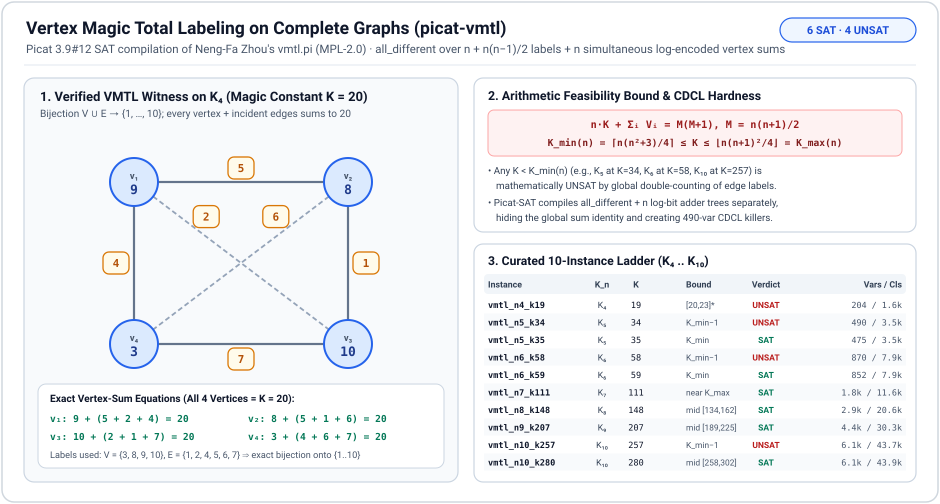

# Vertex Magic Total Labeling on $K_n$ (`picat-vmtl`)

*Verified Vertex Magic Total Labeling witness on $K_4$ ($K = 20$), global double-counting feasibility bounds $K_{\min}(n) \le K \le K_{\max}(n)$, and 10-instance scaling ladder across $K_4..K_{10}$ (generated by [`src/gen_diagram.py`](src/gen_diagram.py)).*

## Provenance & Credit

- **Author & Upstream Model:** **Neng-Fa Zhou** — [Picat](https://picat-lang.org/) ([`picat-lang/Picat`](https://github.com/picat-lang/Picat)), [`https://picat-lang.org/sat/vmtl.pi`](https://picat-lang.org/sat/vmtl.pi) (preserved verbatim in [`src/upstream/vmtl.pi`](src/upstream/vmtl.pi)).
- **Compiler:** Native [Picat](https://picat-lang.org/) `3.9#12` SAT compiler (`import sat.` + `solve([$dump(...)], Vars)`), reproducible via [`src/generate_suite.py`](src/generate_suite.py).
- **License:** Mozilla Public License 2.0 (MPL-2.0, see [`LICENSE`](LICENSE)).
- **Ground Truth Manifest:** [`expected.tsv`](expected.tsv) (**6 SAT / 4 UNSAT**).

## Problem Description

A **Vertex Magic Total Labeling (VMTL)** of the complete graph $K_n$ assigns distinct integers from $\{1, 2, \dots, M\}$ with $M = n + \binom{n}{2} = \frac{n(n+1)}{2}$ to all $n$ vertices $V_1, \dots, V_n$ and all $\binom{n}{2}$ undirected edges $E_{ij}$ ($1 \le i < j \le n$) such that every vertex weight equals a fixed magic constant $K$:

$$V_i + \sum_{j \ne i} E_{ij} = K \qquad (i = 1, \dots, n).$$

Summing across all $n$ vertices double-counts every edge label while counting each vertex label once, yielding the exact global identity:

$$n K + \sum_{i=1}^{n} V_i = 2 \sum_{\ell=1}^{M} \ell = M(M+1).$$

Because $V_1, \dots, V_n$ are $n$ distinct integers in $\{1, \dots, M\}$, $\frac{n(n+1)}{2} \le \sum_{i=1}^n V_i \le nM - \frac{n(n-1)}{2}$, giving the sharp arithmetic feasibility interval:

$$K_{\min}(n) = \left\lceil \frac{n(n^2+3)}{4} \right\rceil \le K \le \left\lfloor \frac{n(n+1)^2}{4} \right\rfloor = K_{\max}(n).$$

- **Why Picat-SAT VMTL Challenges CDCL:** Picat compiles the single global `all_different(Vars)` over $M$ log-encoded variables alongside $n$ separate multi-operand integer adder trees (using Berkeley Espresso prime-implicant minimization). While `vmtl_n5_k34.cnf` ($490$ variables), `vmtl_n6_k58.cnf` ($870$ variables), and `vmtl_n10_k257.cnf` ($6{,}065$ variables) are provably UNSAT by the 3-line global double-counting bound $K < K_{\min}(n)$, that global linear invariant is invisible to bit-level clause resolution, turning even $490$-variable instances into formidable CDCL refutation killers. At $K_4$, $K=19$ is additionally infeasible (only $K \in \{20, 21, 23\}$ admit a VMTL of $K_4$), providing a fast certifiable UNSAT anchor (`vmtl_n4_k19.cnf`).

## Corpus & Data Sizes

All **10 instances** are committed across all four lossless `xz`-compressed formats (`40` files total, every file well below GitHub's `95 MB` limit), accompanied by ground-truth verdicts in [`expected.tsv`](expected.tsv) (**6 SAT / 4 UNSAT**):

| Format | Directory | Files | Key Dimensions (Range) | Compressed Size |
|---|---|---:|---|---:|
| **DIMACS CNF (origin)** | `cnf-orig/` | 10 | Vars: 204–6,095; Clauses: 1,562–43,865 | 353.2 KB |
| **Binary AIGER 1.9** | `aig-converted/` | 10 | AND gates: 4,004–107,559 | 578.0 KB |
| **[CryptoMiniSat](https://github.com/msoos/cryptominisat) XCNF** | `xcnf-converted/` | 10 | Native XOR parity clauses total: 0 | 354.8 KB |
| **DIMACS-ANF** | `anf-converted/` | 10 | Vars: 1,034–32,660; Eqs: 2,392–70,430 (deg ≤ 3) | 1.23 MB |
| **Total (4 Formats, 6 SAT / 4 UNSAT)** | | **40** | | **2.49 MB** |

### Per-Instance Parameters & Compressed Sizes

| Instance | Problem Parameters | Expected | Vars | Clauses | `.cnf.xz` | `.aig.xz` | `.xcnf.xz` | `.anf.xz` |
|---|---|:---:|---:|---:|---:|---:|---:|---:|
| `vmtl_n4_k19.cnf` | $K_4$, $M=10$, $K=19$ (infeasible boundary) | UNSAT | 204 | 1,562 | 3.8 KB | 6.4 KB | 3.8 KB | 11.4 KB |
| `vmtl_n5_k34.cnf` | $K_5$, $M=15$, $K=34 = K_{\min}-1$ | UNSAT | 490 | 3,535 | 8.2 KB | 14.1 KB | 8.3 KB | 25.0 KB |
| `vmtl_n5_k35.cnf` | $K_5$, $M=15$, $K=35 = K_{\min}$ | SAT | 475 | 3,480 | 8.1 KB | 13.8 KB | 8.2 KB | 24.6 KB |
| `vmtl_n6_k58.cnf` | $K_6$, $M=21$, $K=58 = K_{\min}-1$ | UNSAT | 870 | 7,935 | 16.9 KB | 27.6 KB | 17.0 KB | 51.0 KB |
| `vmtl_n6_k59.cnf` | $K_6$, $M=21$, $K=59 = K_{\min}$ | SAT | 852 | 7,869 | 16.7 KB | 27.6 KB | 16.8 KB | 50.8 KB |
| `vmtl_n7_k111.cnf` | $K_7$, $M=28$, $K=111$ (near $K_{\max}=112$) | SAT | 1,813 | 11,571 | 25.0 KB | 36.7 KB | 25.1 KB | 83.8 KB |
| `vmtl_n8_k148.cnf` | $K_8$, $M=36$, $K=148$ (mid $[134, 162]$) | SAT | 2,888 | 20,612 | 43.4 KB | 67.3 KB | 43.9 KB | 153.5 KB |
| `vmtl_n9_k207.cnf` | $K_9$, $M=45$, $K=207$ (mid $[189, 225]$) | SAT | 4,356 | 30,258 | 62.7 KB | 101.3 KB | 62.8 KB | 226.9 KB |
| `vmtl_n10_k257.cnf` | $K_{10}$, $M=55$, $K=257 = K_{\min}-1$ | UNSAT | 6,065 | 43,705 | 84.3 KB | 142.5 KB | 84.5 KB | 317.1 KB |
| `vmtl_n10_k280.cnf` | $K_{10}$, $M=55$, $K=280$ (mid $[258, 302]$) | SAT | 6,095 | 43,865 | 84.1 KB | 140.7 KB | 84.4 KB | 318.2 KB |

### Sibling Collections (Picat-SAT Benchmark Family)

This directory is one of **6 single-problem-type collections** compiled natively via [Picat](https://picat-lang.org/) `3.9#12` `solve([$dump(...)], ...)` (`56` total instances across all four lossless `.xz` formats):

| Collection | Combinatorial Problem | Upstream Model & License | Instances |
|---|---|---|---:|
| **`picat-vmtl/`** *(this collection)* | Vertex Magic Total Labeling on $K_n$ | `vmtl.pi` (MPL-2.0) | 10 (6 SAT / 4 UNSAT) |
| [`picat-golomb-rulers/`](../picat-golomb-rulers/README.md) | Optimal Golomb Rulers ($M=6..10$) | `golomb_ruler.pi` (MIT) | 10 (5 SAT / 5 UNSAT) |
| [`picat-costas-arrays/`](../picat-costas-arrays/README.md) | Costas Arrays ($N=8..16$) | `costas_array.pi` (MIT) | 9 (9 SAT / 0 UNSAT) |
| [`picat-mapf/`](../picat-mapf/README.md) | Multi-Agent Path Finding (Makespan) | `mapf_makespan.pi` (MPL-2.0) | 8 (6 SAT / 2 UNSAT) |
| [`picat-numberlink/`](../picat-numberlink/README.md) | Planar Numberlink Disjoint Paths | `numberlink_b.pi` (MPL-2.0) | 9 (6 SAT / 3 UNSAT) |
| [`picat-rectangle-packing/`](../picat-rectangle-packing/README.md) | 2D Square / Rectangle Packing (`diffn` + `cumulative`) | `perfect_square_placement.pi` / `rect_packing.mzn` (MIT) | 10 (5 SAT / 5 UNSAT) |

## Benchmark Results

*Single-Core Pinned, $T_{\max} = 60\;\text{s}$.*

All five solvers were evaluated strictly sequentially on an **AMD Ryzen 9 5950X** (16C/32T Linux x86_64) pinned to a single dedicated physical core (`taskset -c 11`, 1 thread per run) on identical uncompressed flat `.cnf` inputs:

- Frobenius v0.1.0 (`--max-cores 1 --timeout 60`)
- [CaDiCaL](https://github.com/arminbiere/cadical) 3.1.0 (`-q --modelalllits=true -t 60`)
- [CryptoMiniSat](https://github.com/msoos/cryptominisat) 5.18.0 (`-t 1 --maxtime 60`)
- [dense-solver](https://github.com/libdense/dense-solver) 0.0.4 (1 thread, GNU `timeout -k 2s 60.0s`)
- [Kissat](https://github.com/arminbiere/kissat) 4.0.4 (`-q --time=60`)

- **Independent Model Verification:** All **30 / 30** SAT models emitted across all 5 solvers were verified clause-by-clause against 100% of raw CNF clauses (**0 bad models**, **0 verdict disagreements**).
- **Formal UNSAT Proof Certification:** All **1** tractable (`< 30 s`) Frobenius UNSAT verdicts (`vmtl_n4_k19`) were independently certified by `drat-trim`, `lrat-check`, and `cake_lpr` (`s VERIFIED UNSAT`).

| Instance | Expected | Frobenius | [CaDiCaL](https://github.com/arminbiere/cadical) 3.1.0 | [CryptoMiniSat](https://github.com/msoos/cryptominisat) 5.18.0 | [dense-solver](https://github.com/libdense/dense-solver) 0.0.4 | [Kissat](https://github.com/arminbiere/kissat) 4.0.4 |
|---|:---:|---:|---:|---:|---:|---:|
| `vmtl_n4_k19.cnf` | UNSAT | **48.2 ms** | 49.7 ms | 162.0 ms | **48.4 ms** | 95.9 ms |
| `vmtl_n5_k34.cnf` | UNSAT | >60 s | >60 s | >60 s | >60 s | **37.19 s** |
| `vmtl_n5_k35.cnf` | SAT | **89.5 ms** | 123.8 ms | 645.9 ms | 172.0 ms | 204.2 ms |
| `vmtl_n6_k58.cnf` | UNSAT | >60 s | >60 s | >60 s | >60 s | >60 s |
| `vmtl_n6_k59.cnf` | SAT | 1.76 s | **1.03 s** | 3.62 s | 1.24 s | 1.95 s |
| `vmtl_n7_k111.cnf` | SAT | **824.0 ms** | 2.38 s | 6.24 s | 24.50 s | 12.83 s |
| `vmtl_n8_k148.cnf` | SAT | **186.0 ms** | 260.4 ms | 704.8 ms | 939.2 ms | 1.44 s |
| `vmtl_n9_k207.cnf` | SAT | 2.80 s | 5.07 s | **2.10 s** | 4.25 s | 5.06 s |
| `vmtl_n10_k257.cnf` | UNSAT | >60 s | >60 s | >60 s | >60 s | >60 s |
| `vmtl_n10_k280.cnf` | SAT | 8.83 s | 4.08 s | 10.51 s | 3.19 s | **1.22 s** |
| **Solved ($T_{\max} = 60\;\text{s}$)** | **10 total** | 7 / 10 (6 SAT, 1 UNSAT) | 7 / 10 (6 SAT, 1 UNSAT) | 7 / 10 (6 SAT, 1 UNSAT) | 7 / 10 (6 SAT, 1 UNSAT) | **8 / 10 (6 SAT, 2 UNSAT)** |
| **Total PAR-2 ($T_{\max} = 60\;\text{s}$)** | — | 374.53 s *(mean 37.45 s)* | 372.99 s *(mean 37.30 s)* | 383.98 s *(mean 38.40 s)* | 394.34 s *(mean 39.43 s)* | **300.00 s** *(mean 30.00 s)* |

*Ground-truth UNSAT note:* `vmtl_n4_k19.cnf` is formally proof-certified (`drat-trim` + `lrat-check` + `cake_lpr`); `vmtl_n5_k34.cnf`, `vmtl_n6_k58.cnf`, and `vmtl_n10_k257.cnf` are mathematically UNSAT via the exact global double-counting theorem $K < K_{\min}(n)$ (`34 < 35`, `58 < 59`, `257 < 258`), making them exceptionally compact (`490–6,065` variables) CDCL refutation challenges.

<!-- BEGIN_STRUCTURAL_ANALYSIS -->
## Phase-Transition & Structural Analysis

*Auto-generated by [`../src/analyze_benchmarks.py`](../src/analyze_benchmarks.py). Position relative to the critical phase transition is measured by $\rho_{\mathrm{crit}} = \frac{1}{n}\sum_k m_k / \alpha_c(k)$ (exact $\alpha/\alpha_c(k)$ for pure $k$-SAT; effective critical threshold $\alpha_c^{\mathrm{eff}} = \alpha/\rho_{\mathrm{crit}}$; `Under` $<0.90\times$, `Near-crit` $0.90\text{--}1.10\times$, `Over` $>1.10\times$), alongside Gent–Walsh annealed constrainedness $\kappa = -\frac{1}{n}\sum_i \log_2(1-2^{-k_i})$ (AAAI 1996), clause-length profile ($\bar{k}$, `%Bin`, `%Horn`), variable-degree CV ($\sigma_d/\bar{d}$, uniformity vs. hub skew), and extracted native XOR parity clauses.*

| Instance | Active $n$ | Clauses $m$ | $\alpha=m/n$ | $\alpha_c^{\mathrm{eff}}$ | $\rho_{\mathrm{crit}}$ (Regime) | $\kappa$ | $\bar{k}$ ($k_{\max}$) | Bin% | Horn% | Pos% | Deg CV | XORs |
|---|---:|---:|---:|---:|---:|---:|---:|---:|---:|---:|---:|---:|
| `vmtl_n10_k257` | 6,065 | 43,705 | 7.21 | 1.25 | **5.78x** (Over) | 2.45 | 2.82 (55) | 79% | 84% | 44% | 1.38 | 0 |
| `vmtl_n10_k280` | 6,095 | 43,865 | 7.20 | 1.25 | **5.77x** (Over) | 2.44 | 2.82 (55) | 79% | 83% | 44% | 1.38 | 0 |
| `vmtl_n4_k19` | 204 | 1,562 | 7.66 | 1.41 | **5.42x** (Over) | 2.36 | 2.85 (10) | 68% | 76% | 38% | 0.52 | 0 |
| `vmtl_n5_k34` | 490 | 3,535 | 7.21 | 1.35 | **5.34x** (Over) | 2.31 | 2.78 (15) | 71% | 78% | 38% | 0.64 | 0 |
| `vmtl_n5_k35` | 475 | 3,480 | 7.33 | 1.34 | **5.46x** (Over) | 2.35 | 2.78 (15) | 72% | 78% | 38% | 0.65 | 0 |
| `vmtl_n6_k58` | 870 | 7,935 | 9.12 | 1.29 | **7.06x** (Over) | 3.03 | 2.74 (21) | 75% | 82% | 35% | 0.60 | 0 |
| `vmtl_n6_k59` | 852 | 7,869 | 9.24 | 1.29 | **7.18x** (Over) | 3.07 | 2.74 (21) | 76% | 82% | 35% | 0.60 | 0 |
| `vmtl_n7_k111` | 1,813 | 11,571 | 6.38 | 1.32 | **4.83x** (Over) | 2.07 | 2.84 (28) | 74% | 80% | 43% | 1.02 | 0 |
| `vmtl_n8_k148` | 2,888 | 20,612 | 7.14 | 1.30 | **5.49x** (Over) | 2.35 | 2.86 (36) | 75% | 81% | 43% | 1.11 | 0 |
| `vmtl_n9_k207` | 4,356 | 30,258 | 6.95 | 1.27 | **5.48x** (Over) | 2.33 | 2.85 (45) | 77% | 82% | 44% | 1.28 | 0 |

**Collection Phase-Transition Summary (10 instances, 4 formats: 10 CNF / 10 AIG / 10 XCNF / 10 ANF):** median $\rho_{\mathrm{crit}} = 5.48\times$ (range `4.83x–7.18x`), median $\kappa = 2.35$, regime split **0 Under / 0 Near-critical / 10 Over**, total extracted native XOR parity clauses = **0**, total ANF equations = **277,527**.
<!-- END_STRUCTURAL_ANALYSIS -->

## References

- N.-F. Zhou, *"The SAT Compiler in B-Prolog"*, ALP Newsletter (March 2013), and Picat SAT model [`https://picat-lang.org/sat/vmtl.pi`](https://picat-lang.org/sat/vmtl.pi).
- N.-F. Zhou and H. Kjellerstrand, *"The Picat-SAT Compiler"*, PADL 2016, LNCS 9585, pp. 48–62.
- N.-F. Zhou and H. Kjellerstrand, *"Optimizing SAT Encodings for Arithmetic Constraints"*, CP 2017, LNCS 10416, pp. 671–686.
- J. A. MacDougall, M. Miller, Slamin, and W. D. Wallis, *"Vertex-Magic Total Labelings of Graphs"*, *Utilitas Mathematica* 61:3–21, 2002.
