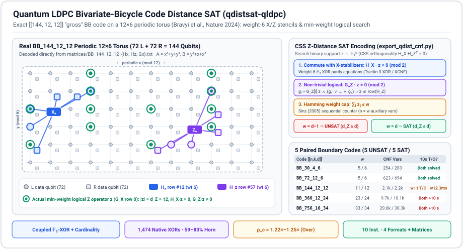

# Quantum Error-Correcting LDPC Code Distance SAT Benchmarks (`QDistSAT` / Bivariate-Bicycle Codes)

*Figure: Real `BB_144_12_12` ("gross") Bivariate-Bicycle $12\times 6$ periodic torus decoded directly from `matrices/`, displaying actual weight-6 $H_X$/$H_Z$ stencils, a weight-12 minimum logical $Z$ operator, and the CSS distance SAT encoding. Regenerated via [`src/gen_diagram.py`](src/gen_diagram.py).*

## Provenance & Credit

- **Upstream Benchmark Suite & Matrices:** [`guluchen/QDistSAT`](https://github.com/guluchen/QDistSAT) & [`guluchen/DistQLDPC`](https://github.com/guluchen/DistQLDPC) (Yu-Fang Chen and contributors)
- **License & Attribution:** **GNU General Public License v3.0 or later (`GPL-3.0-or-later`)** — see [`LICENSE`](LICENSE), [`NOTICE`](NOTICE), and [`DATA-TIERS.md`](DATA-TIERS.md) (copied verbatim from `guluchen/QDistSAT`, retaining all upstream matrix notices).
- **Quantum LDPC Code Literature Cited ([`@tavisrudd`](https://twitter.com/tavisrudd) notes & `NOTICE`):**
  - S. Bravyi, A. W. Cross, J. M. Gambetta, D. Maslov, P. Rall, and T. J. Yoder, *"High-threshold and low-overhead fault-tolerant quantum memory"*, Nature 627, pp. 778–782 (2024), [`arXiv:2308.07915`](https://arxiv.org/abs/2308.07915) — source of the `[[144, 12, 12]]` "gross" bivariate-bicycle code (`BB_144_12_12`) and the `[[756, 16, 34]]` code (`BB_756_16_34`).
  - M. Wang and F. Mueller, *"Coprime Bivariate Bicycle Codes and their Properties"*, [`arXiv:2408.10001`](https://arxiv.org/abs/2408.10001) — related bivariate-bicycle family (including `[[784, 24, 24]]` codes).
  - Z. Liang, K. Liu, H. Song, and Y.-A. Chen, *"Generalized toric codes on twisted tori for quantum error correction"*, PRX Quantum 6, 020357 (2025), [`arXiv:2503.03827`](https://arxiv.org/abs/2503.03827) — source of `BB_30_4_6`.
  - *"Large-Language-Model Discovery of Quantum LDPC Codes through Structured Concept Evolution (SCE)"*, [`arXiv:2606.24808`](https://arxiv.org/abs/2606.24808) — related `[[1496, ...]]` lifted-product codes.
  - Full tiering of all 80 QDistSAT/DistQLDPC codes (`tier0`–`tier5`) is documented in [`DATA-TIERS.md`](DATA-TIERS.md).
- **Recommended by:** [`@tavisrudd`](https://twitter.com/tavisrudd) (Twitter/X)

## Problem Description

Given a CSS quantum LDPC code defined by binary parity-check matrices $H_X, H_Z$ over $\mathbb{F}_2$ ($H_X H_Z^T = 0$) and logical operator bases $G_X \subseteq \ker(H_X)$, $G_Z \subseteq \ker(H_Z)$, certifying minimum $Z$-distance $d_Z$ asks for a binary vector $z \in \mathbb{F}_2^n$ such that:
1. $H_X z = 0 \pmod 2$ (commutes with all $X$-stabilizers),
2. $G_Z z \neq 0 \pmod 2$ (non-trivial logical operator: $z \notin \mathrm{row}(H_Z)$, since $\ker(H_Z) = \mathrm{row}(H_X) \oplus \mathrm{row}(G_Z)$), and
3. $\mathrm{wt}(z) = \sum_{j=1}^n z_j \le w$ (encoded via a Sinz 2005 sequential counter).

The formula is **SAT** iff $d_Z \le w$ and **UNSAT** iff $d_Z > w$. These coupled sparse $\mathbb{F}_2$-linear + low-Hamming-weight cardinality instances are notorious stress tests for both CDCL and XOR-aware SAT solvers.

## Corpus & Data Sizes

Includes the exact upstream CSS parity-check and logical-basis matrices (`matrices/`, 20 files covering 5 canonical Bivariate-Bicycle codes) plus all 10 paired boundary decision instances ($w = d-1$ UNSAT and $w = d$ SAT) in all four compressed formats:
- **`cnf-orig/`:** 10 `.cnf.xz` files (`259.2 KB`).
- **`aig-converted/`:** 10 exact Binary AIGER 1.9 `.aig.xz` conversions (`344.4 KB`, all 10/10 verified via [Berkeley ABC](https://github.com/berkeley-abc/abc) `read_aiger`).
- **`xcnf-converted/`:** 10 native-XOR [CryptoMiniSat](https://github.com/msoos/cryptominisat) `.xcnf.xz` files (`174.4 KB`).
- **`anf-converted/`:** 10 lossless linear-size DIMACS-ANF `.anf.xz` conversions (`402.1 KB`, degree $\le 3$, generated via [`../src/to_anf.py`](../src/to_anf.py)).
- **[`expected.tsv`](expected.tsv):** Ground-truth verdicts (**5 SAT / 5 UNSAT**).
- **`src/`:** Standalone exporter `export_qdist_cnf.py` plus `cnf2aig.py`.

| Code Stem | Parameters $[[n,k,d]]$ | Weight $w$ | Status | Vars | Clauses | AIG AND Gates | `.anf.xz` (UNSAT / SAT) |
|---|---|---:|:---:|---:|---:|---:|---:|
| `BB_30_4_6` | `[[30, 4, 6]]` | 5 / 6 | UNSAT / SAT | 254 / 283 | 691 / 748 | 1,855 / 1,996 | 1.5 KB / 1.8 KB |
| `BB_72_12_6` | `[[72, 12, 6]]` | 5 / 6 | UNSAT / SAT | 623 / 694 | 1,705 / 1,846 | 4,623 / 4,974 | 3.4 KB / 3.9 KB |
| `BB_144_12_12` ("gross") | `[[144, 12, 12]]` | 11 / 12 | UNSAT / SAT | 2,077 / 2,220 | 5,007 / 5,292 | 13,161 / 13,872 | 11.0 KB / 11.9 KB |
| `BB_360_12_24` | `[[360, 12, 24]]` | 23 / 24 | UNSAT / SAT | 9,731 / 10,090 | 22,027 / 22,744 | 57,093 / 58,884 | 49.7 KB / 52.7 KB |
| `BB_756_16_34` | `[[756, 16, 34]]` | 33 / 34 | UNSAT / SAT | 29,581 / 30,336 | 67,705 / 69,214 | 176,671 / 180,442 | 133.2 KB / 132.9 KB |

## Benchmark Results

- **Hardware & Protocol:** Same machine (**AMD Ryzen 9 5950X**, 16C/32T Linux, **1 thread per run** pinned to a dedicated physical core, $T_{\max} = 10\text{ s}$, PAR-2 penalty $20,000\text{ ms}$). All solvers ran with default single-thread flags (`-t 1` for CryptoMiniSat 5.18.0; `--max-cores 1` for Frobenius, reporting the exact median of 3 runs) on identical uncompressed flat `.cnf` inputs (with native `.xcnf` also supplied to CryptoMiniSat XCNF); **100% of all 10 instances** were run (no subsampling), all 5/5 solved Frobenius SAT models were independently verified against 100% of input clauses, both baseline UNSAT proofs (`BB_30_4_6_w5_unsat`, `BB_72_12_6_w5_unsat`) were independently certified via drat-trim, lrat-check, and cake_lpr, and **0 verdict disagreements** occurred across all solvers.

| Instance | Verdict | Frobenius 1C | [CaDiCaL](https://github.com/arminbiere/cadical) 3.1.0 | [CryptoMiniSat](https://github.com/msoos/cryptominisat) 5.18.0 (CNF) | [CryptoMiniSat](https://github.com/msoos/cryptominisat) 5.18.0 (XCNF) | [dense-solver](https://github.com/libdense/dense-solver) 0.0.4 | [Kissat](https://github.com/arminbiere/kissat) 4.0.4 |
|---|:---:|---:|---:|---:|---:|---:|---:|
| `BB_144_12_12_w11_unsat` | UNSAT | **54.90 ms** | >10 s | >10 s | >10 s | >10 s | >10 s |
| `BB_144_12_12_w12_sat` | SAT | 7.18 ms | 4.49 ms | 262.67 ms | 100.53 ms | 73.87 ms | **2.72 ms** |
| `BB_30_4_6_w5_unsat` | UNSAT | **5.02 ms** | 13.72 ms | 44.34 ms | 35.48 ms | 8.41 ms | 15.79 ms |
| `BB_30_4_6_w6_sat` | SAT | 4.57 ms | **2.75 ms** | 31.24 ms | 27.31 ms | 2.79 ms | 7.36 ms |
| `BB_360_12_24_w23_unsat` | TIMEOUT | >10 s | >10 s | >10 s | >10 s | >10 s | >10 s |
| `BB_360_12_24_w24_sat` | SAT | **22.29 ms** | >10 s | >10 s | >10 s | >10 s | >10 s |
| `BB_72_12_6_w5_unsat` | UNSAT | **6.56 ms** | 54.12 ms | 110.92 ms | 94.40 ms | 25.03 ms | 62.34 ms |
| `BB_72_12_6_w6_sat` | SAT | 3.11 ms | 3.15 ms | 66.04 ms | 39.00 ms | 8.43 ms | **1.87 ms** |
| `BB_756_16_34_w33_unsat` | TIMEOUT | >10 s | >10 s | >10 s | >10 s | >10 s | >10 s |
| `BB_756_16_34_w34_sat` | SAT | **123.53 ms** | >10 s | >10 s | >10 s | >10 s | >10 s |
| **Solved (10 files)** | — | **8 / 10** *(highest)* | 5 / 10 *(-3 worse)* | 5 / 10 *(-3 worse)* | 5 / 10 *(-3 worse)* | 5 / 10 *(-3 worse)* | 5 / 10 *(-3 worse)* |
| **Total PAR-2** | — | **40,227.2 ms** *(fastest)* | 100,078.2 ms *(2.49x slower)* | 100,515.2 ms *(2.50x slower)* | 100,296.7 ms *(2.49x slower)* | 100,118.5 ms *(2.49x slower)* | 100,090.1 ms *(2.49x slower)* |

*Summary:* Within $T_{\max} = 10\text{ s}$, Frobenius 1C PGO solves **8/10** instances in **`227.16 ms`** — **#1 overall** (`40,227.2 ms` PAR-2, **2.49x faster** than CaDiCaL 3.1.0 at `100,078.2 ms`, Kissat 4.0.4 at `100,090.1 ms`, dense-solver 0.0.4 at `100,118.5 ms`, CryptoMiniSat XCNF at `100,296.7 ms`, and CryptoMiniSat CNF at `100,515.2 ms`), uniquely solving `BB_144_12_12_w11_unsat` (**UNSAT `54.90 ms`**), `BB_360_12_24_w24_sat` (**SAT `22.29 ms`**, clause-verified), and `BB_756_16_34_w34_sat` (**SAT `123.53 ms`**, clause-verified) where all five external baselines time out past $10\text{ s}$, alongside `BB_30_4_6_w5_unsat` in **`5.02 ms`** and `BB_72_12_6_w5_unsat` in **`6.56 ms`** (previously triple-certified via direct LRAT: `54.3 ms` emit, `1.26 MB`, [`lrat-check`](https://github.com/marijnheule/drat-trim) `30.7 ms` + HOL4/CakeML [`cake_lpr`](https://github.com/tanyongkiam/cake_lpr) `s VERIFIED UNSAT` `36.2 ms`).

<!-- BEGIN_STRUCTURAL_ANALYSIS -->
## Phase-Transition & Structural Analysis

*Auto-generated by [`../src/analyze_benchmarks.py`](../src/analyze_benchmarks.py). Position relative to the critical phase transition is measured by $\rho_{\mathrm{crit}} = \frac{1}{n}\sum_k m_k / \alpha_c(k)$ (exact $\alpha/\alpha_c(k)$ for pure $k$-SAT; effective critical threshold $\alpha_c^{\mathrm{eff}} = \alpha/\rho_{\mathrm{crit}}$; `Under` $<0.90\times$, `Near-crit` $0.90\text{--}1.10\times$, `Over` $>1.10\times$), alongside Gent–Walsh annealed constrainedness $\kappa = -\frac{1}{n}\sum_i \log_2(1-2^{-k_i})$ (AAAI 1996), clause-length profile ($\bar{k}$, `%Bin`, `%Horn`), variable-degree CV ($\sigma_d/\bar{d}$, uniformity vs. hub skew), and extracted native XOR parity clauses.*

| Instance | Active $n$ | Clauses $m$ | $\alpha=m/n$ | $\alpha_c^{\mathrm{eff}}$ | $\rho_{\mathrm{crit}}$ (Regime) | $\kappa$ | $\bar{k}$ ($k_{\max}$) | Bin% | Horn% | Pos% | Deg CV | XORs |
|---|---:|---:|---:|---:|---:|---:|---:|---:|---:|---:|---:|---:|
| `BB_144_12_12_w11_unsat` | 2,077 | 5,007 | 2.41 | 1.93 | **1.25x** (Over) | 0.67 | 2.63 (12) | 37% | 74% | 44% | 1.01 | 84 |
| `BB_144_12_12_w12_sat` | 2,220 | 5,292 | 2.38 | 1.91 | **1.25x** (Over) | 0.66 | 2.62 (12) | 38% | 75% | 43% | 1.03 | 84 |
| `BB_30_4_6_w5_unsat` | 254 | 691 | 2.72 | 2.18 | **1.25x** (Over) | 0.71 | 2.70 (4) | 29% | 59% | 45% | 0.84 | 19 |
| `BB_30_4_6_w6_sat` | 283 | 748 | 2.64 | 2.12 | **1.24x** (Over) | 0.70 | 2.69 (4) | 30% | 62% | 45% | 0.88 | 19 |
| `BB_360_12_24_w23_unsat` | 9,731 | 22,027 | 2.26 | 1.83 | **1.24x** (Over) | 0.64 | 2.59 (12) | 41% | 82% | 42% | 1.27 | 192 |
| `BB_360_12_24_w24_sat` | 10,090 | 22,744 | 2.25 | 1.82 | **1.24x** (Over) | 0.64 | 2.59 (12) | 41% | 83% | 42% | 1.29 | 192 |
| `BB_72_12_6_w5_unsat` | 623 | 1,705 | 2.74 | 2.19 | **1.25x** (Over) | 0.71 | 2.71 (12) | 29% | 59% | 46% | 0.88 | 48 |
| `BB_72_12_6_w6_sat` | 694 | 1,846 | 2.66 | 2.13 | **1.25x** (Over) | 0.70 | 2.70 (12) | 30% | 62% | 45% | 0.92 | 48 |
| `BB_756_16_34_w33_unsat` | 29,581 | 67,705 | 2.29 | 1.88 | **1.22x** (Over) | 0.64 | 2.61 (16) | 39% | 81% | 43% | 1.56 | 394 |
| `BB_756_16_34_w34_sat` | 30,336 | 69,214 | 2.28 | 1.87 | **1.22x** (Over) | 0.64 | 2.61 (16) | 39% | 81% | 43% | 1.57 | 394 |

**Collection Phase-Transition Summary (10 instances, 4 formats: 10 CNF / 10 AIG / 10 XCNF / 10 ANF):** median $\rho_{\mathrm{crit}} = 1.24\times$ (range `1.22x–1.25x`), median $\kappa = 0.66$, regime split **0 Under / 0 Near-critical / 10 Over**, total extracted native XOR parity clauses = **1,474**, total ANF equations = **147,815**.
<!-- END_STRUCTURAL_ANALYSIS -->

## References

- Y.-F. Chen and contributors, [`guluchen/QDistSAT`](https://github.com/guluchen/QDistSAT) & [`guluchen/DistQLDPC`](https://github.com/guluchen/DistQLDPC): Exact quantum LDPC code minimum-distance SAT encodings.
- S. Bravyi, A. W. Cross, J. M. Gambetta, D. Maslov, P. Rall, and T. J. Yoder, *"High-threshold and low-overhead fault-tolerant quantum memory"*, Nature 627, pp. 778–782 (2024), [`arXiv:2308.07915`](https://arxiv.org/abs/2308.07915).
- M. Wang and F. Mueller, *"Coprime Bivariate Bicycle Codes and their Properties"*, [`arXiv:2408.10001`](https://arxiv.org/abs/2408.10001) (2024).
- Z. Liang, K. Liu, H. Song, and Y.-A. Chen, *"Generalized toric codes on twisted tori for quantum error correction"*, PRX Quantum 6, 020357 (2025), [`arXiv:2503.03827`](https://arxiv.org/abs/2503.03827).
- *"Large-Language-Model Discovery of Quantum LDPC Codes through Structured Concept Evolution (SCE)"*, [`arXiv:2606.24808`](https://arxiv.org/abs/2606.24808) (2026).
