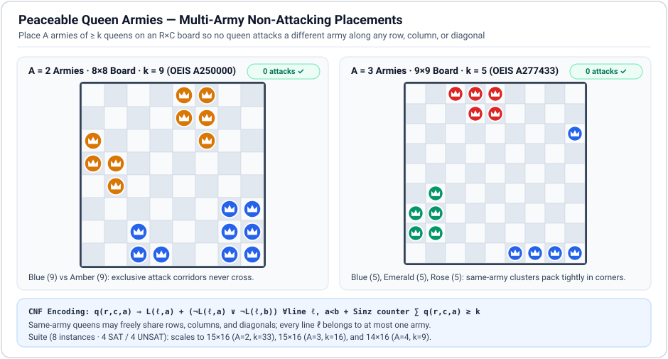

# Peaceable Queen Armies (`queen-armies`)

*Figure: Verified OEIS-optimal peaceable queen-army placements for $A=2$ ($8\times 8, k=9$, A250000) and $A=3$ ($9\times 9, k=5$, A277433) showing non-crossing opposing-army attack lines and the Sinz cardinality CNF encoding. Regenerated via [`src/gen_diagram.py`](src/gen_diagram.py).*

## Provenance & Credit

- **Author:** Luke Hutchison ([`lukehutch`](https://github.com/lukehutch))
- **License:** MIT License ([`../LICENSE`](../LICENSE))

## Problem Description

The **Peaceable Queen Armies** problem asks whether $A \ge 2$ opposing armies of at least $k$ chess queens each can be placed simultaneously on an $R \times C$ chessboard so that **no queen attacks any queen of a different army** along a row, column, or diagonal (queens belonging to the *same* army are allowed to attack one another).

- **Origin:** **Original** parameterized CNF generator (MIT [`../LICENSE`](../LICENSE)), directly inspired by **Christopher Wolfram's** [*Chess Queen Armies With SAT Solvers*](https://christopherwolfram.com/projects/queen-armies/) (September 2022) and the Rosetta Code [*Peaceful Chess Queen Armies*](https://rosettacode.org/wiki/Peaceful_chess_queen_armies) challenge.
- **OEIS Sequences (square $n \times n$ maximal equal-army sizes $a_A(n)$):**
  - $A = 2$ armies ([OEIS A250000](https://oeis.org/A250000)): $0, 0, 1, 2, 4, 5, 7, 9, 12, 14, 17, 21, 24, 28, 32, \dots$ for $n = 1\text{--}15$.
  - $A = 3$ armies ([OEIS A277433](https://oeis.org/A277433)): $0, 0, 0, 1, 1, 2, 3, 4, 5, 7, 8, 10, 11, 14, 15, 17, \dots$ for $n = 1\text{--}16$.
  - $A = 4$ armies ([OEIS A277434](https://oeis.org/A277434)): $0, 0, 0, 0, 1, 1, 2, 3, 4, 5, 6, 7, 8, \dots$ for $n = 1\text{--}13$.

### Encoding

Each instance is encoded in standard flat DIMACS CNF:
1. **Queen placement variables:** $q_{r,c,a}$ ($0 \le r < R$, $0 \le c < C$, $0 \le a < A$), true iff a queen of army $a$ stands on square $(r, c)$.
2. **Line-occupancy non-attacking constraints:** For every line $\ell$ (each row, column, main diagonal, and anti-diagonal of length $\ge 2$):
   - For $A = 2$: a single polarity variable $L_\ell$ with clauses $(\neg q_{r,c,0} \lor L_\ell)$ and $(\neg q_{r,c,1} \lor \neg L_\ell)$, ensuring no line contains both armies (and simultaneously enforcing per-square mutual exclusion).
   - For $A \ge 3$: per-army occupancy variables $L_{\ell, a}$ with clauses $(\neg q_{r,c,a} \lor L_{\ell,a})$ and pairwise mutual exclusion $(\neg L_{\ell,a} \lor \neg L_{\ell,b})$ for all $a < b$.
3. **Army-size cardinality constraints:** $\sum_{r,c} q_{r,c,a} \ge k$ for each army $a \in \{0, \dots, A-1\}$, encoded via **Sinz (2005)** monotone sequential counters.

### Calibration & Selection

Instances were swept across board dimensions $R \times C$ and army counts $A \in \{2, 3, 4\}$ with Frobenius 1C up to a **15 s** timeout. For smaller boards (e.g., $7 \times 7$ to $13 \times 13$ SAT or $7 \times 7$ UNSAT), solving completes in `< 2 s`; past the 15 s frontier (e.g., $A=2$ UNSAT at $8 \times 8, k=10$ or $A=3$ SAT at $17 \times 17, k=19$), solvers time out. The final **8-instance suite (4 SAT / 4 UNSAT)** selects instances positioned cleanly in the **~5–15 second** difficulty band without timing out across repeated runs.

## Corpus & Data Sizes

### Directory Layout & Regeneration

- `cnf-orig/` — Original native **DIMACS CNF** encodings (8 `.cnf.xz` files, `139.8 KB`, 4 SAT / 4 UNSAT).
- `aig-converted/` — Exact logically equivalent **Binary AIGER 1.9 `.aig.xz`** conversions (`197.8 KB`, 8/8 verified with [Berkeley ABC](https://github.com/berkeley-abc/abc)).
- `xcnf-converted/` — Exact **[CryptoMiniSat](https://github.com/msoos/cryptominisat) `.xcnf.xz`** conversions (`142.4 KB`).
- `anf-converted/` — Lossless linear-size **DIMACS-ANF `.anf.xz`** conversions (`456.7 KB`, degree $\le 3$, generated via [`../src/to_anf.py`](../src/to_anf.py)).
- **[`expected.tsv`](expected.tsv)** — Ground-truth verdict manifest for all 8 instances (**4 SAT / 4 UNSAT**).
- `src/gen_queen_armies.py` — Standalone zero-dependency Python 3 generator and witness verifier (`python3 src/gen_queen_armies.py --generate-suite .`), plus `cnf2aig.py` and `cnf2xcnf.py`.

### Problem Parameters & Data Sizes

| Instance | Armies $A$ | Board $R \times C$ | Army Size $k$ | Status | CNF Vars | CNF Clauses | `.cnf.xz` | `.aig.xz` | `.anf.xz` |
|---|---:|:---:|---:|:---:|---:|---:|---:|---:|---:|
| `queen_armies_a3_13x16_k14_sat` | 3 | $13 \times 16$ | 14 | SAT | 9,330 | 19,032 | 25.4 KB | 35.6 KB | 85.1 KB |
| `queen_armies_a4_14x16_k9_sat` | 4 | $14 \times 16$ | 9 | SAT | 9,152 | 19,020 | 26.1 KB | 37.0 KB | 82.7 KB |
| `queen_armies_a2_15x16_k33_sat` | 2 | $15 \times 16$ | 33 | SAT | 15,351 | 31,002 | 36.7 KB | 49.6 KB | 131.0 KB |
| `queen_armies_a3_15x16_k16_sat` | 3 | $15 \times 16$ | 16 | SAT | 12,141 | 24,732 | 32.1 KB | 43.9 KB | 107.3 KB |
| `queen_armies_a3_7x8_k5_unsat` | 3 | $7 \times 8$ | 5 | UNSAT | 1,095 | 2,232 | 4.1 KB | 6.7 KB | 9.8 KB |
| `queen_armies_a3_6x10_k5_unsat` | 3 | $6 \times 10$ | 5 | UNSAT | 1,176 | 2,397 | 4.4 KB | 7.2 KB | 10.9 KB |
| `queen_armies_a3_6x11_k6_unsat` | 3 | $6 \times 11$ | 6 | UNSAT | 1,476 | 3,006 | 5.5 KB | 8.4 KB | 13.9 KB |
| `queen_armies_a2_7x10_k12_unsat` | 2 | $7 \times 10$ | 12 | UNSAT | 1,733 | 3,510 | 5.5 KB | 9.5 KB | 16.1 KB |

## Benchmark Results

- **Timeout:** $T_{\max} = 15\;\text{s}$ per instance (PAR-2 penalty $30{,}000\;\text{ms}$).
- **Same machine?** **Yes** — all five solvers were run on the exact same **AMD Ryzen 9 5950X** Linux workstation (1 core per run, default single-thread flags with `-t 1` for CryptoMiniSat 5.18.0 and `--max-cores 1` for Frobenius; Frobenius 1C reports the exact median of 3 runs; 0 verdict disagreements; all 4/4 SAT placements independently verified for non-attacking armies of size $\ge k$).

| Instance | Status | Frobenius 1C | [CaDiCaL](https://github.com/arminbiere/cadical) 3.1.0 | [CryptoMiniSat](https://github.com/msoos/cryptominisat) 5.18.0 | [dense-solver](https://github.com/libdense/dense-solver) 0.0.4 | [Kissat](https://github.com/arminbiere/kissat) 4.0.4 |
|---|:---:|---:|---:|---:|---:|---:|
| `queen_armies_a3_13x16_k14_sat` | SAT | **24.2 ms** | >15 s (T/O) | >15 s (T/O) | >15 s (T/O) | >15 s (T/O) |
| `queen_armies_a4_14x16_k9_sat` | SAT | **24.2 ms** | >15 s (T/O) | >15 s (T/O) | >15 s (T/O) | >15 s (T/O) |
| `queen_armies_a2_15x16_k33_sat` | SAT | **13.1 ms** | 4,106.2 ms | 1,830.4 ms | >15 s (T/O) | 5,757.6 ms |
| `queen_armies_a3_15x16_k16_sat` | SAT | **26.7 ms** | >15 s (T/O) | >15 s (T/O) | >15 s (T/O) | >15 s (T/O) |
| `queen_armies_a3_7x8_k5_unsat` | UNSAT | **908.9 ms** | >15 s (T/O) | >15 s (T/O) | 13,448.9 ms | 11,902.2 ms |
| `queen_armies_a3_6x10_k5_unsat` | UNSAT | **1,297.3 ms** | >15 s (T/O) | >15 s (T/O) | 11,398.4 ms | 13,366.5 ms |
| `queen_armies_a3_6x11_k6_unsat` | UNSAT | **1,388.3 ms** | >15 s (T/O) | >15 s (T/O) | >15 s (T/O) | >15 s (T/O) |
| `queen_armies_a2_7x10_k12_unsat` | UNSAT | **2,740.1 ms** | >15 s (T/O) | >15 s (T/O) | >15 s (T/O) | 9,577.9 ms |
| **TOTAL (8 instances, PAR-2)** | **4 / 4** | **8/8 — 6,422.7 ms** *(fastest)* | 1/8 — 214,106.2 ms *(33.34x slower)* | 1/8 — 211,830.4 ms *(32.98x slower)* | 2/8 — 204,847.3 ms *(31.89x slower)* | 4/8 — 160,604.2 ms *(25.01x slower)* |

<!-- BEGIN_STRUCTURAL_ANALYSIS -->
## Phase-Transition & Structural Analysis

*Auto-generated by [`../src/analyze_benchmarks.py`](../src/analyze_benchmarks.py). Position relative to the critical phase transition is measured by $\rho_{\mathrm{crit}} = \frac{1}{n}\sum_k m_k / \alpha_c(k)$ (exact $\alpha/\alpha_c(k)$ for pure $k$-SAT; effective critical threshold $\alpha_c^{\mathrm{eff}} = \alpha/\rho_{\mathrm{crit}}$; `Under` $<0.90\times$, `Near-crit` $0.90\text{--}1.10\times$, `Over` $>1.10\times$), alongside Gent–Walsh annealed constrainedness $\kappa = -\frac{1}{n}\sum_i \log_2(1-2^{-k_i})$ (AAAI 1996), clause-length profile ($\bar{k}$, `%Bin`, `%Horn`), variable-degree CV ($\sigma_d/\bar{d}$, uniformity vs. hub skew), and extracted native XOR parity clauses.*

| Instance | Active $n$ | Clauses $m$ | $\alpha=m/n$ | $\alpha_c^{\mathrm{eff}}$ | $\rho_{\mathrm{crit}}$ (Regime) | $\kappa$ | $\bar{k}$ ($k_{\max}$) | Bin% | Horn% | Pos% | Deg CV | XORs |
|---|---:|---:|---:|---:|---:|---:|---:|---:|---:|---:|---:|---:|
| `queen_armies_a2_15x16_k33_sat` | 15,351 | 31,002 | 2.02 | 1.57 | **1.29x** (Over) | 0.63 | 2.47 (3) | 53% | 53% | 58% | 1.14 | 0 |
| `queen_armies_a2_7x10_k12_unsat` | 1,733 | 3,510 | 2.03 | 1.50 | **1.35x** (Over) | 0.65 | 2.43 (3) | 57% | 57% | 56% | 0.70 | 0 |
| `queen_armies_a3_13x16_k14_sat` | 9,330 | 19,032 | 2.04 | 1.51 | **1.35x** (Over) | 0.65 | 2.44 (3) | 56% | 56% | 59% | 0.75 | 0 |
| `queen_armies_a3_15x16_k16_sat` | 12,141 | 24,732 | 2.04 | 1.52 | **1.34x** (Over) | 0.64 | 2.45 (3) | 55% | 55% | 59% | 0.80 | 0 |
| `queen_armies_a3_6x10_k5_unsat` | 1,176 | 2,397 | 2.04 | 1.38 | **1.48x** (Over) | 0.69 | 2.36 (3) | 64% | 64% | 55% | 0.48 | 0 |
| `queen_armies_a3_6x11_k6_unsat` | 1,476 | 3,006 | 2.04 | 1.40 | **1.45x** (Over) | 0.68 | 2.37 (3) | 62% | 63% | 56% | 0.51 | 0 |
| `queen_armies_a3_7x8_k5_unsat` | 1,095 | 2,232 | 2.04 | 1.37 | **1.48x** (Over) | 0.69 | 2.35 (3) | 64% | 64% | 55% | 0.47 | 0 |
| `queen_armies_a4_14x16_k9_sat` | 9,152 | 19,020 | 2.08 | 1.46 | **1.42x** (Over) | 0.67 | 2.41 (3) | 59% | 59% | 57% | 0.66 | 0 |

**Collection Phase-Transition Summary (8 instances, 4 formats: 8 CNF / 8 AIG / 8 XCNF / 8 ANF):** median $\rho_{\mathrm{crit}} = 1.39\times$ (range `1.29x–1.48x`), median $\kappa = 0.66$, regime split **0 Under / 0 Near-critical / 8 Over**, total extracted native XOR parity clauses = **0**, total ANF equations = **104,931**.
<!-- END_STRUCTURAL_ANALYSIS -->

## References

- C. Wolfram, [*Chess Queen Armies With SAT Solvers*](https://christopherwolfram.com/projects/queen-armies/), September 2022.
- Rosetta Code, [*Peaceful Chess Queen Armies*](https://rosettacode.org/wiki/Peaceful_chess_queen_armies).
- OEIS Foundation Inc., [*A250000*](https://oeis.org/A250000), [*A277433*](https://oeis.org/A277433), and [*A277434*](https://oeis.org/A277434): Maximal peaceable armies of 2, 3, and 4 queens on an $n \times n$ board.
- S. Ainley, *Mathematical Puzzles*, G. Bell & Sons, 1977.
- R. A. Bosch, *Peaceably Coexisting Armies of Queens*, Optima 62:6–9, 1999.
- B. M. Smith, K. E. Petrie, and I. P. Gent, *Models and Symmetry Breaking for "Peaceably Coexisting Armies of Queens"*, CPAIOR 2004, LNCS 3011, pp. 271–286.
- C. Sinz, *Towards an Optimal CNF Encoding of Boolean Cardinality Constraints*, CP 2005, LNCS 3709, pp. 827–831.
